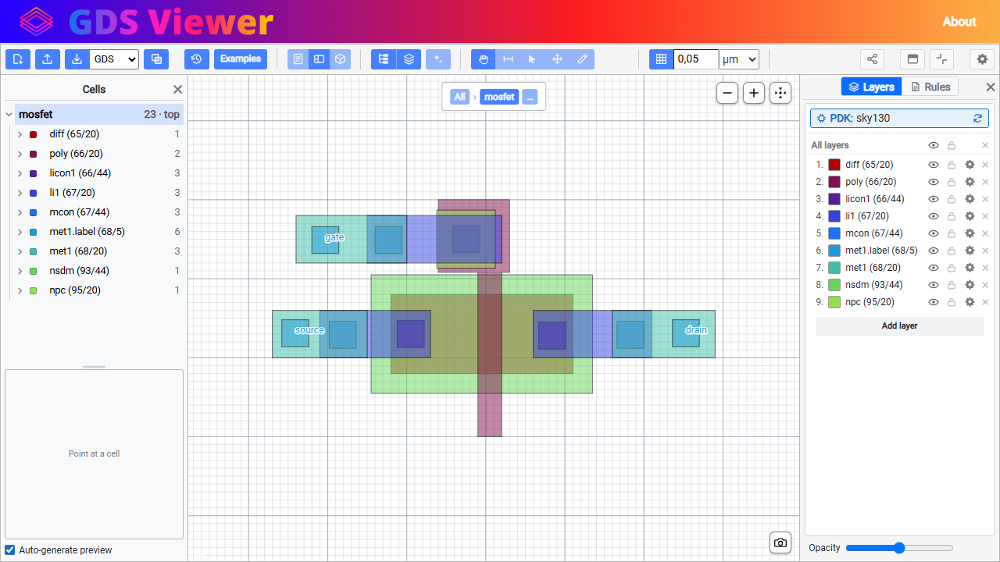
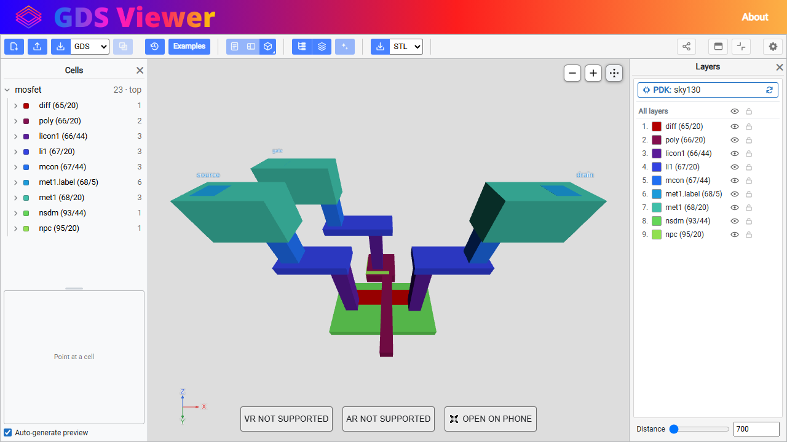
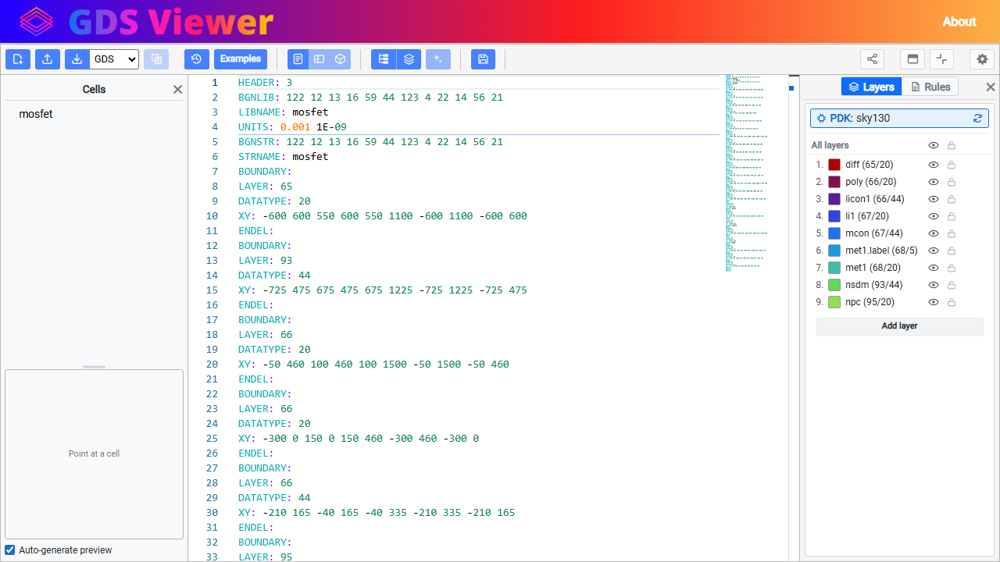
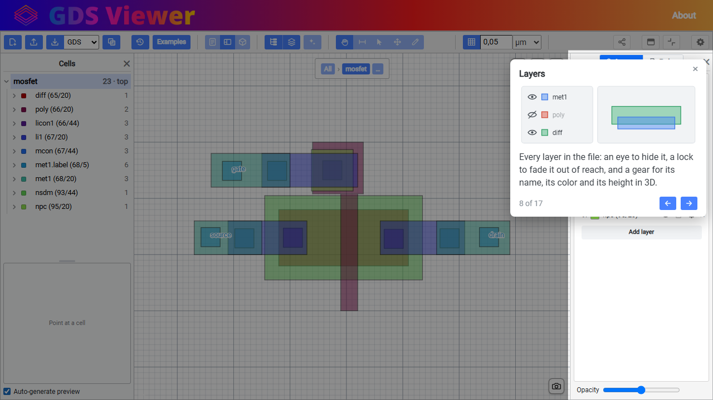
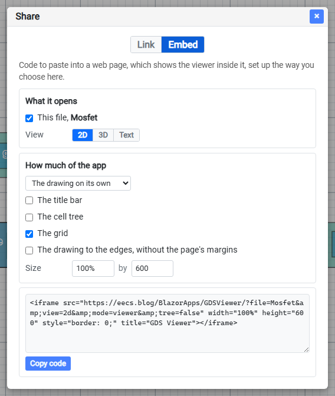
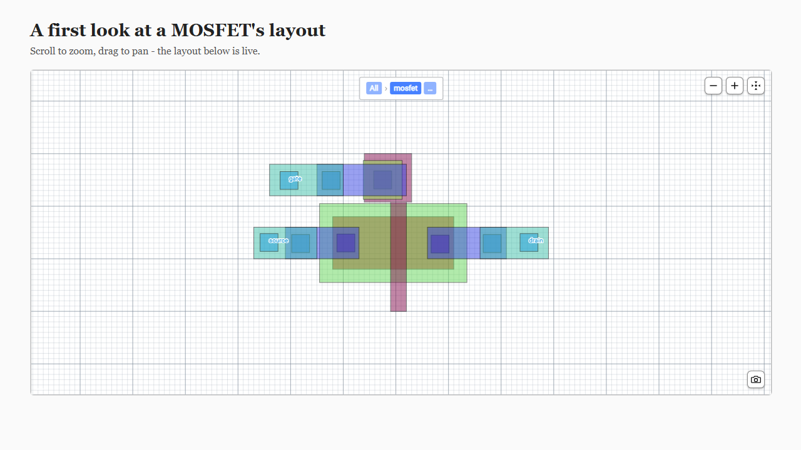

# GDS Viewer

### A free online GDSII viewer — open an IC layout file and inspect it in 2D, in 3D, or as raw records, entirely in your browser.

   [](https://www.nuget.org/packages/GdsII) [](https://www.nuget.org/packages/GdsII.Cli)


## About


I got the idea to make an online GDSII viewer some time ago when I took a course to learn how to make an ASIC. When you create your chip design it will get output in the GDS format, which can be viewed and modified by the appropriate software. Most of it is not free and open source, except Magic and KLayout. Also, none of the software I found works in the browser, unlike my app, which is a PWA (progressive web app). This makes it cross-platform and much more accessible, as you don't have to install any software — simply visit a web page and that's it. Additionally, I added a 3D viewer, the ability to see your chip in AR/VR, and you can download the 3D model for whatever use (3D printing, maybe?).

At the time of writing, it has been more than 3 years since I started this. This viewer was meant to be embedded into another project that I later decided wasn't worth pursuing further, so this project subsequently lost some of its originally intended purpose. Combine that with my lack of time and working on other stuff, and I only occasionally worked on this, then did other things and forgot about it, came back to it, then left it again … But it's done at last.

I updated the UI and added more features, and the functionality is now also available as a [CLI tool](docs/CLI.md) and a [NuGet package](docs/NUGET.md) if you want to use some of it in your own projects.

📝 Blog post about the project: <https://eecs.blog/online-gds-file-viewer/>

> **Use it at your own discretion.** This still isn't a proper tool for making ICs, or at least I wouldn't recommend you use it for anything too serious or expensive. It is more useful for visualizing GDS files on websites, blogs and Obsidian notes, or embedded into other software that just needs a viewer to show its output.
> There is no guarantee that what it shows is correct — it may have bugs, and it may read or draw a file differently to the tool that wrote it. Double-check anything that
> matters against other software. See [Current limitations](#current-limitations).


## Try it out


🔗 Open the viewer: <https://eecs.blog/BlazorApps/GDSViewer/>


## Features

**Three views over the same file.** The 2D editor, the layout extruded into 3D, and the raw records — the
first and the last of them editable, and every one built from the same parse.

The 2D editor: the layout as SVG, layers named from a layermap, the file's cells down the left and its layers
down the right.



The 3D view: every layer extruded to its thickness and stacked at the height the layermap gives it — the
contacts reaching the films they join, because that is where the process puts them. The Distance slider
opens a gap on top of that when you want to see between layers that in reality touch.



The text editor: the raw record stream in Monaco, editable and saveable back into the file.



**See [FEATURES-DEMO.md](docs/FEATURES-DEMO.md) for the rest of them, in pictures** — selecting and editing,
drawing and the structures made from numbers, the grid, measuring, tracing a net, fill patterns, the cell tree, the
layer settings, the PDK manager and the AI assistant.


### Feature List

- ⚙️ A **Blazor WebAssembly** single-page app. The GDSII parser is C# compiled to WebAssembly, so it runs
  in the browser tab — **your file is never uploaded anywhere**. The exceptions are yours to make: the
  optional AI assistant sends what you ask it, and what it reads from the layout to answer, to the AI
  provider you gave it a key for; and the **MCP server** in AI settings lets Claude, through `gds mcp` on your own computer,
  read and change the open layout, which Claude's provider then sees as part of your conversation. Both are
  off until you start them.
- 📲 An **installable PWA** with no CDN dependencies: Monaco and three.js are vendored into the app, so it
  keeps working offline once installed.
- ✏️ A **viewer that can also edit**. Reading, inspecting, downloading and exporting all work, and an edit
  made in the text view can be saved back into the file — within the limits in
  [Current limitations](#current-limitations).
- ✨ **AI assistant** — describe a change in words, *"draw a 2 µm met1 strap from #3 to #7"*, and an assistant makes
  it with the editor's own tools: every change is one step on Undo. It is told which cell you have open, what
  you have selected and what is on screen, and it can look at a picture of the cell. It looks around freely
  and asks before each change — or asks about everything, or nothing, as you choose. A question can carry
  **files** — a pasted screenshot, a design rule manual, a deck, a netlist — picked with the paperclip, pasted or
  dropped on the conversation, or taken with the **camera** or as a **screenshot** — and a files panel says which of
  them go again with every question. A **microphone** puts speech into the box, by the browser's own recognition or
  written out by your AI provider for better accuracy with a layout's words. Each answer
  shows **what it cost**, the window what the next request will, from the provider's published rates or your own.
  Tools can be **switched off** for a conversation, a long one **compacted** into a briefing that is sent in its
  place. **Every chat is kept**, listed down the window's left like the Claude app's, to open again and carry on,
  save as text or delete. It can **put a PDK in use** - its layers laid on, named and colored, on a new layout, or the
  ones a layout drawn in it lacks - before it draws on them by name, put down any of the **Generator's structures**
  whole from its numbers, read the app's own **sky130 examples** to see how a real cell is drawn, and write a PDK's **rules and layers** for you, from **Write with AI** in the PDK manager, each
  change shown as a diff on its card. One button picks the model, its effort and, on an Opus that has it,
  **fast mode**; a **slash** in the box lists the window's commands; a long run **pauses** after the rounds set under
  AI settings, thirty to begin with, and asks whether to go on; and an empty chat offers a few questions to start
  from.
  **Bring your own key**: Anthropic, OpenAI, Google's Gemini or any OpenAI-compatible server, added under
  **Settings → AI settings** and kept in your browser - or, with GDS Viewer built into another app, the models and
  chats of the account signed in there, through one service (as a Treeality plugin, planned). Opened by the spark
  in the toolbar, in every view. The same tools work outside
  the browser too: [`gds mcp`](docs/CLI.md#gds-mcp) lets Claude Desktop or Claude Code open, edit, check and
  save the layouts in a folder — or, through **MCP server** in Settings, AI settings, work on the layout open in the
  app while you watch, by a code the app shows you.
- 🗂️ Open your own `.gds` file — through the dialog or by **dragging it onto the view** — or pick from
  **1,242 examples**: the SkyWater [sky130](https://skywater-pdk.readthedocs.io/en/main/), GlobalFoundries
  [GF180MCU](https://gf180mcu-pdk.readthedocs.io/) and IHP [SG13G2](https://github.com/IHP-GmbH/IHP-Open-PDK)
  standard-cell libraries, a hand-made MOSFET, ten complete sky130 designs, and eleven GF180 and eleven IHP ones
  downloaded from their own repositories when you open one. The picker filters as you type and previews each one
  as you point at it - drawn while the page goes on answering, so even a whole chip never stops it, and the big
  ones are kept for your next visit. Open a sky130, a GF180 or an IHP cell and links to the PDK's documentation
  appear at the foot of the Examples picker.
- 🔬 **Real chips to open** — ten sky130 designs, each credited in the app with links back to where it came
  from: an Intel 4004 rebuilt in Verilog, a VGA clock, the Zero to ASIC RGB mixer, a 12-bit SAR ADC, a 555
  timer, an op-amp, an RC oscillator, SkyWater's GPIO pad, and Uri Shaked's skull-shaped transistors, twice.
  Most come from [Tiny Tapeout](https://tinytapeout.com/) shuttles; see
  [Bundled designs](#bundled-designs) for each one's source. **And eleven GF180 ones** - a Z80, Texas Instruments'
  SN76489 sound chip, a 4-bit CPU, a VGA clock and the wafer.space screensaver, Simon Says, an eFPGA tile, a bandgap
  and a PLL, and GlobalFoundries' GPIO pad and SRAM - listed and credited the same way and **not shipped**: each row
  says how big it is, and opening one downloads it from GitHub at the commit its credit names. **And eleven IHP ones**
  the same way - TinyQV, a RISC-V microcontroller, an ALU of two 74181s, a rotating-tile FPGA and Nyan Cat on VGA,
  an LDO, a bandgap, a fractional-N PLL, a DC-to-130 GHz amplifier and a 60 GHz power amplifier's core, and IHP's
  own devices and an SRAM.
- 📐 **OASIS too, both ways** — `.oas` files open the same way, and a dropdown beside the download button
  chooses which format comes back out, starting on whichever the file arrived as - GDSII or OASIS; a DXF or an
  SVG starts on GDSII. So opening a `.gds` and
  saving it as `.oas` is a conversion, and so is the reverse. The format going in is decided by what the
  file starts with rather than by its extension, so a renamed file still opens. Cells stay cells: the
  hierarchy is kept rather than flattened.
- 📄 **DXF in** — a `.dxf` drawing opens as a layout, in either the text or the binary flavor. Closed runs
  become boundaries and open ones paths; circles, arcs, ellipses and splines are flattened until the error
  is under a database unit; hatches become the area they fill, with their islands cut out; blocks become
  cells and inserts placements, mirroring and base points included. A layer named after a number *is* that
  number — `68/20`, `L68D20` — since that is how a drawing meant for a mask shop carries one, and the names
  come across either way. The drawing's own `$INSUNITS` sets the scale.
- 📐 **DXF out, too** — the same dropdown writes one. A release 12 drawing, which every reader still
  opens: cells stay blocks and placements stay inserts rather than being flattened, arrays become one
  repeated insert, and the layer numbers go into the layer names — `L68D20` — since that is the only
  place a DXF has to put them. So a layout can go back to whoever sent you the drawing.
- 🎨 **SVG in** — a drawing from Inkscape or Illustrator opens as a layout. Filled shapes become the area they
  fill, by their own fill rule, so a ring drawn as one path is a ring; stroked ones become the area the pen
  covers, width, joins and ends included. Curves and arcs are flattened to within a nanometer, the document's
  own millimeters or inches set the scale, and each Inkscape layer - or each color, outside one - becomes a
  layer, named after it and drawn in its color. A layer named `68/20` *is* 68/20, the way a DXF's is.
- 🖼️ **SVG out** — the same dropdown also saves the layout as a picture: the whole of it, framed to fit,
  from any of the three views, with the layers you have hidden left out.
- 🖼️ **PNG too, and masks** — the dropdown's **PNG** saves that picture as pixels, and the camera in the corner
  of the 2D view opens a menu of two: **PNG picture**, exactly what is on screen, and **SVG drawing**, every
  shape framed on it. **Masks** writes a black and white PNG of every layer that is
  showing, one bit a pixel at the pixel size you choose, all the same size and lined up, in one zip - for a
  laser writer or a maskless aligner that takes pictures rather than polygons.
- 🌙 **Dark mode** — under the gear at the far end of the toolbar. The page, the panels, the menus and
  the drawing's ground all go dark; the layers keep their colors. Light by default, and remembered on this
  computer.
- 📈 **Debug info** — the gear's other switch puts the frame rate in the corner of the 2D or 3D drawing:
  frames a second, a graph of the last ten seconds, and the longest frame, so a freeze shows up as well as a
  slow drag. In 3D it adds the scene's own count - the frames three.js drew, its draw calls and triangles - so a
  browser holding the page back reads differently from a scene that cannot keep up. Off by default, and
  remembered on this computer.
- 🟦 **2D view** — the layout as an SVG, one path a layer with a subpath per element, drag to pan, scroll or
  pinch to zoom, adjustable opacity to see through stacked layers. A real chip - the RGB mixer's 222,000
  shapes - pans and zooms at the display's own frame rate however far in, and takes an edit in about half a
  second. The camera in its corner saves a **PNG picture** of what is on screen, at twice its size, or an **SVG
  drawing** of every shape, framed on what is on screen. While a file opens or a view is built, a note over the
  drawing says what is loading. On a phone the drawing takes the whole width and the sidebars sit under it.
- 🎯 **Center the view**, in 2D or in 3D, from the button in the top-right of the canvas, with **+** and **−**
  beside it to zoom without a wheel — Center for when you have panned or orbited the layout off the edge of the
  window. Both views frame the layout when it opens, so this is for
  getting back rather than for arriving. And **where you are looking can go in the link**: frame
  something and press **Share**, and the link it makes, like the 3D view's QR code, opens on that transistor
  rather than on the whole cell. The address bar follows neither the framing nor the file, only which view is
  open. Reload, or open the app without a link, and your last framing comes back with the rest of your session.
- 🖱️ **Tools** — **Pan**, an open hand over the drawing that closes while it drags, **Measure** for a
  distance in units and microns, **Select** to click a shape and read what it is, **Move** to drag one whole,
  and — inside a cell — **Draw**. What is dragged follows the pointer rather than jumping when you let go.
- ✂️ **Edit in place** — click a shape and the panel says its layer, corner count and area, where it sits and
  how big it is, in microns you can retype to move or resize it exactly. Copy, cut, delete, turn, mirror,
  grow or shrink by a number, or group a selection into a new cell. Band-select several and they can be
  combined with booleans, lined up, spaced out or repeated into an array.
- ⭕ **Round or cut corners** — **Round** turns every corner of what is chosen into an arc of the radius you
  type, and **Cut** takes it off straight: a fillet and a chamfer, for a channel that must not trap bubbles or a
  waveguide that must not turn sharply. A radius bigger than a shape can take becomes the biggest that fits,
  and an inside corner is filled rather than cut.
- ✏️ **Draw new shapes** — rectangles, polygons, ellipses, paths at a real width, and labels typed where they
  land. A layout format has no curves, so an ellipse is a many-sided polygon and the side count is yours to
  set — it says what it costs, too. The same menu places **cells**: choose one and it follows the pointer
  until you click to put it down, as many times as you click, and Esc puts it back.
- 🔤 **Text and logos as shapes** — the Draw menu's **Text** writes words onto the layer being drawn on as real
  geometry, not a label: a part number or a name in a five-by-seven pixel font, every stroke one square wide
  so a design rule can check it — click where it goes and type it, or paste words onto the drawing. **Image**
  does the same for a picture — a logo for a corner of the die — chosen, dropped onto the drawing or pasted, its
  shape told from its background by the picture's own border. Either lands with a frame round it: drag its
  corner to size it and its middle to move it, and press **R** to turn it a quarter (Shift+R the other way), use
  the arrows over it, or right-click it to turn or mirror it. Double-click writing in its frame, or choose **Edit
  text** from that menu, to change its words. They read the right way round here; this app draws
  Y downward, so in the file and on the chip they are mirrored, and **Mirror down** puts them upright there.
- 🎯 **Structures made from numbers** — the Draw menu's **Generator** makes the shapes a layout needs besides its
  transistors, 38 kinds: a **die frame**, an **alignment cross** and its **window**, a **vernier scale**, **lines
  and spaces**, a **Greek cross** and a **comb and serpentine** for testing a process; a **spiral inductor** with
  its **underpass** and **vias**, a **loop inductor**, an **interdigitated capacitor**, a **meander resistor**, a
  **guard ring** and a **patterned ground shield** for analog; a **coplanar waveguide** and **CPW resonator**,
  **branch-line** and **rat-race** couplers, a **Marchand balun**, **coupled-line** and **stepped-impedance**
  filters, a **radial stub** and a **split-ring resonator** for RF; **patch**, **dipole**, **bowtie** and
  **spiral** antennas; a **clock H-tree** and **power rails**; a **pad ring**, its **openings** and **dummy
  fill**; and a **ring resonator**, a **grating**, a **serpentine channel** and a **chamber** for photonics and
  microfluidics. Its numbers are typed into a **drawing of the kind**, each box beside the part it sets and its
  dimension lit as you point at it; press **Place**, click where it goes. The layers of one structure share their
  numbers, and an inductor says its inductance as you type.
- 📄 **Start from nothing** — **New** in the toolbar makes an empty layout: one cell, no layers, nothing drawn.
  Every other way in needs a file, so beginning one of your own used to mean opening somebody else's and
  deleting it. It names nothing by itself, but its empty layer list offers **Set PDK**, which opens the PDK
  manager: use a PDK there and its layers come in - for sky130, its 21 drawing layers with their 16 pins and labels,
  named, colored and stacked, ready to draw on and check without a layermap of your own. A layer added to it is named by the PDK too.
- 🧱 **Add and remove layers** — **Add layer**, at the foot of the layer list, puts a layer/datatype in it that
  nothing is drawn on yet: how an empty layout gets somewhere to draw, and how you reach a pair a file does
  not already use. An **×** on any row takes that layer out, asking first and saying how many shapes go with
  it. Removal takes them everywhere in the file and undoes as one step, with the layer's name and height
  intact. (The format records a layer only through the shapes on it, so an empty one is gone when the file is
  written — draw on it or name it and it stays.)
- 👁️ **An eye and a lock on every layer** — two different questions, so two controls. The eye is whether the
  layer is drawn: off, and its shapes leave the 2D view, the 3D stack and the reach of the pointer together.
  The lock leaves them drawn but faded and out of reach — not clickable, not caught in a band, not draggable.
  Lock everything but the layer you are on and it is isolated, while what you are lining it up against is
  still visible; hiding those would take away the thing you were aligning to. A header over the list does a
  whole column at once — draw or hide every layer, lock or unlock every layer — and its **×** removes every
  layer, asking first and undoing in one step. Locks are kept with the rest of the session.
- 🩺 **Add and remove rules** — **Add rule**, at the foot of the rules list, takes one line of the deck's own
  grammar, checked by the same parser that reads a deck file, with its complaint shown where you typed. An
  **×** on any row takes that rule out, asking first. A **gear** on the row opens the rule as the deck holds
  it, editable and checked the same way. Both edit the PDK in use's rules, so its **Export**, in the PDK manager,
  hands you what the panel is showing. An **eye** on each rule switches it off without taking it out of the deck — it is left out of the
  check until switched back on — and a header switches or removes every rule at once.
- 🙈 **Waive a fault you have looked at** — clicking a broken rule steps through its faults one at a time, and
  **Waive** marks the one in front of you as accepted: still drawn, in gray, but left out of the count, kept
  with the file while the fault stays exactly where it is, and left alone by the AI assistant. **Report** downloads the
  run as KLayout's `.lyrdb`, the waived faults tagged the way KLayout tags them.
- 🔎 **KLayout's DRC results over your layout** — the `.lyrdb` report KLayout's own DRC writes comes in through
  **Open** or a drop on the drawing, and what it found is drawn over the layout in
  blue, a category to a row. Clicking a row steps through its markers one at a time, an eye takes a category
  off the drawing, and waived items are drawn in gray. A fault KLayout found inside a cell lands where it found
  it, through that cell's placement. The other way round, `gds drc -o faults.lyrdb` writes this app's own
  results for KLayout's marker browser.
- 📐 **A grid to see and to snap to**, in nanometers, microns, millimeters or raw database units. It starts at
  the file's own grid rather than a round number, so the first thing you draw lands where the rest of the
  file already is. Drawing can also snap to a neighboring corner or edge. With a rule deck loaded, snapping also
  puts the corners the app works out - ellipses, rounded corners, lettering, generated structures, booleans and
  grows - on the deck's grid, and draws a path that slants or ends round as its outline there.
- ↩️ **Undo that survives a refresh** — close the tab mid-edit, come back, and the edit is still there to
  take back.
- 🗂️ **Several files open in tabs** — every file you open gets a tab of its own, and nothing is closed by
  opening another: switch back and it is as you left it, edits, undo, layers and view included. The tabs come
  back after a reload too, and a double-click on a tab's name renames its file.
- ⌨️ **A command palette** — `Ctrl+K` (`⌘K`) from anywhere lists what you can do from where you are; type a
  few letters and press Enter. Every command is a button you could have pressed, and it shows the key that
  button already has.
- 🧭 **A guided tour** — the app asks as it opens whether you want one (tick **Don't show this again** and it
  stops asking), and Settings → **Take the tour**, or "tour" in the command palette, starts it any time. It walks
  through the app one part at a time: each shows through a shade over the rest, with a card saying what it is for,
  and five of the cards carry a small picture - the three views side by side, a rectangle drawn by a drag, a
  layer's eye hiding it, a sentence to the assistant turning into a square, and two files' differences. It shows
  only the parts the view you are in has.

  

- 🎮 **A chip game** — Settings → **Play game** drops a little car onto the top layer of the 3D view: drive
  along the wires, jump from layer to layer, or press P for a plane or a jet to fly over them, with a gun and
  missiles. Its panel sets the neon haze - how far it reaches, and whether it thins with height - and the
  music, and remembers them for the next game.
- 🌳 **The cell tree** — every cell, where each one is placed, and what each placement draws, down to the
  individual shapes, beside the 2D view and the 3D one. Press a placement to go to it - selected in 2D, the camera
  on it in 3D. A cell placed by two parents appears under both. Right-click a row in 2D to rename, copy or delete
  it.
- 📥 **Put one file inside another** — open a second layout while one is on screen and it asks whether to add
  it to the open library or open it on its own. Added, its cells arrive whole and its top cell follows the
  pointer until you click to place it. Clashing cell names are renamed, references and all, and a file that
  measures in different units is scaled to match. The example the app opens for itself is never asked about -
  the first file you open just opens.
- 🔎 **Trace a net** — choose a shape on a conductor and everything electrically joined to it lights up,
  through vias and across layers, with any label sitting on it reported. Needs a layermap's `role` column,
  since nothing in the file says which numbers are metal.
- 🔀 **Compare two files** — **Compare**, beside Download in the toolbar, lays another file over the open one,
  layer by layer, and marks every place one of them draws and the other does not: an XOR, the way a foundry
  checks a resubmitted file changed only what it meant to. What is drawn is compared, not what is written, so a
  cell renamed or a shape cut in two is no difference. Arrows step from one difference to the next, and the panel
  stays up while you look; the other file can be GDS, OASIS, DXF or SVG.
- 🏷️ **Pin labels** — `TEXT` elements drawn in their layer's color in **both** the 2D and 3D views, so
  `A`, `Y`, `VPWR` and friends are readable on the layout, justified about their anchor the way the file
  asks. In 3D they turn to face you as you orbit.
- 🪆 **Hierarchy resolved** — `SREF` and `AREF` instances are placed with their reflection, magnification
  and rotation, at every level of nesting.
- 🔌 **Wires drawn at their real width** — a `PATH`'s centerline is expanded into the shape it occupies,
  with mitered corners and all four end-cap styles.
- 🧊 **3D view** — layers extruded and stacked in space, orbit and drag, scene backgrounds, and a cinematic
  camera orbit. It opens looking down at 45° with the whole layout in frame, a chip as much as a cell. With a
  layermap carrying heights it opens on the **process stack itself** — a contact sitting between the two films
  it joins, because the table says where it is — and the **Distance** slider opens a gap on top of that when
  you want to see between layers that in reality touch. The box beside the slider sets how far it reaches, for
  a big design with many layers.
  A lettered **X/Y/Z indicator** in the bottom-left corner turns with the camera, and it is lettered in the
  layout's axes rather than the scene's: Z is the process stack, the way the layermap means it.
  Its **settings** open from the 3D button of the view switch, pointed at or pressed while the view is on: how
  far it draws, fading the far side out, the backdrop, Admire, and whether the layers show their **textures**: a
  grid on the tops, shaded walls, polished metal, and a picture of your own on any layer, chosen in that layer's
  settings.
- 🥽 **WebXR** — enter the layout in VR or AR from a supported headset or phone. The chip is scaled from
  its own nanometer units down to something you can stand next to, and AR keeps the camera feed visible
  behind it.
- 📤 **Export the 3D model** as STL, OBJ or GLTF — **Z-up and wound outward**, which is what every CAD and
  EDA tool that opens one expects, rather than the Y-up the browser scene is drawn in. Checked against the
  same cells extruded by KLayout: same footprint, same stack height, same levels to the nanometer.
- 📝 **Text view** — the raw record stream, one record per line, in Monaco with a GDSII grammar: keywords,
  colons and numeric values colored, and typing offers every record type with its data type as
  documentation. **Save** reads the buffer back into the file, all or nothing: a line it cannot parse is
  reported with its line number and the loaded file is left exactly as it was. A save that works rebuilds
  the layer list and redraws, so an edit that adds or removes a layer shows up straight away.
- 🎚️ **Per-layer visibility** — toggle any layer on or off. A layer is a **layer/datatype pair**, the way
  every tool treats it, so `65/20` and `65/16` are separate rows with their own colors rather than one
  "layer 65" hiding drawn geometry and pins together.
- 🏷️ **Name your layers** — a row's gear and type, or import a CSV of `layer,datatype,name` into a PDK, in the
  PDK manager, with further columns for a color, a height and a thickness, what the layer is for, how it is
  hatched and the picture it is drawn with in 3D — or a KLayout `.lyp`, for its names and colors, read as KLayout
  reads it. Any PDK's layermap converts to the CSV — sky130's 432-row table took a single substitution — and
  `?layermap=` loads either straight off a URL. A PDK's **Export** hands its layers back in that format, and a
  whole PDK goes out as a zip with its pictures.
  The numbers stay on the label — `diff.drawing (65/20)` — because the name is your mapping and the numbers
  are what the file says. A name you give goes into the PDK in use, so it persists across visits and reaches
  every file drawn in it, since a layer number means the same thing throughout a technology.
- 🧰 **PDKs, and a manager for them** — a PDK is a process's layers and its rules. **sky130, GF180MCU and IHP SG13G2
  are built in.** sky130's is a forty-six-row layermap and the sky130 rule deck, both beside the examples, with sky130's
  **process stack** read from the PDK's own cross-section script, so the 3D view draws the real thing: met1 at 1370
  nm, met5 at 5365, each via bridging the metals it joins, and the wells below the surface. **gf180mcu** is
  GlobalFoundries' 180 nm PDK as its five-metal gf180mcuD stack: 104 layers named from the foundry's design manual, a
  56-rule starter deck, and its stack read off the PDK's own cross-section - Metal1 at 910 nm, the 1.19 µm top metal at
  5810. **ihp-sg13g2** is IHP's 130 nm SiGe BiCMOS PDK: 195 layers named from its layout rules' layer table, a 68-rule
  starter deck, and its seven-metal stack from the process specification - Metal1 at 640 nm, the 3 µm TopMetal2 at
  10830. **The PDK manager** - the **PDK:** row at
  the top of the layer panel, which names the one in use, or **Settings → PDK manager** - keeps PDKs of your own too:
  made empty or copied, **brought in whole from a zip** of a layermap, a rule deck, their textures and a README (or
  dropped on its list) and written out the same way; their layers a table, each styled through the layer panel's own
  settings, and their rules a table with **a form to make one by choosing** - or either as text, in a code editor
  that colors it as it is read - and puts one in use. A PDK picked shows its **README**: each built-in's says
  what the process is and draws its metal stack. **The PDK in use names and checks every file drawn in it**: every
  example, a file of your own, a new layout - and **an example drawn in another built-in puts that one in use**, so
  a GF180 cell or design picked while sky130 is in use comes in named and checked as GF180. A file of your own is
  named by the PDK in use alone, and one it does not fit keeps its numbers, since one PDK's labels over another's
  layout would be worse than nothing. What you
  change in the layer and rule panels goes into the PDK in use, a layer or a rule at a time, and **Reset** brings a
  built-in back as it ships; a whole layermap
  or deck comes in and goes out in the PDK manager. A layer no mapping covers — a
  marker, an area id, a cell outline — is left out of the 3D view rather than hung at a depth nobody measured; it
  keeps its row and its 2D drawing, and a height in its settings brings it back. The space you see left between
  metals is the dielectric, which no layer draws: a via crosses it where a via exists, and nothing does where one
  does not.
- 🩺 **Fill patterns** — dots, squares, a grid, dashes, diagonals either way or crosshatch drawn over a layer's
  color, with a color and a screen size of their own. Color runs out before layers do.
- 🎨 **Color them yourself** — the swatch on a row shows its color, and the gear at the end of the row opens
  the layer's settings, a picker among them, with the colors you have used recently offered again so a scheme is
  quick to apply. **Reset to palette** there puts any layer back on the palette it started on.
- 🔤 **Labels on or off** — hide the `TEXT` elements without hiding the geometry they name, which usually
  sits on the same layer.
- 💾 **Picks up where you left off** — close the tab, come back, and the file is still open with your edit
  in it, your layers still hidden and named, and the view and sliders as you left them. Kept in your
  browser's own storage (IndexedDB), never uploaded. An edited or uploaded file is stored whole, because it
  exists nowhere else; an untouched bundled example is stored by name, since it is already on the server. A
  link still wins: opening `?file=…` gives you that file, not your last one — and from then on it is your
  session like any other, so a reload keeps what you have done to it.
- 🕘 **History** — beside Examples: every file you open from this computer or start with **New**, and any file
  you change, so one you uploaded an hour ago is a click away rather than gone. An example goes in once you
  change it; one you only looked at is a click away in Examples already.
- 🔗 **Linkable** — `?file=sky130_fd_sc_hd__nand2_1&view=3d` opens that cell in that view, so any of the
  examples, in all three PDKs, can be sent to someone, and **Share** writes the link for whatever is open. The file leaves
  the address bar once it is open, so a reload brings back your session rather than a fresh copy.
- 📤 **Share a link, or an embed** — **Share**, at the far end of the toolbar, writes the link for you: which
  file and view, whether to keep where you are looking, and how much of the app comes along — the whole
  editor, no editing, or viewer only. Its **Embed** tab gives the `<iframe>` code instead, with the panels,
  the grid, the 3D backdrop and the size as switches rather than parameters to look up. Copy it and send it.
  A file from your own computer cannot be linked to, since it never leaves your browser, and the popup says so.
- 📱 **QR code** of the page, from the 3D view, to jump from desktop to a phone or headset — carrying the
  file, the view and where the camera is, so you land on what you were looking at.


## Embedding


Drop the viewer into your own page in an `<iframe>` and set its whole opening state from the address. Nothing
needs building, configuring or hosting — every setting is a query parameter.

**The quickest way to one is Share**, at the far end of the app's toolbar, which writes the code for you:

1. Open the file and the view you want to show.
2. Press **Share** and choose **Embed**.
3. Set the switches: which view, how much of the app comes along, the title bar, the cell tree, the grid, the
   size. The code under them changes as you go.
4. Press **Copy code**, and paste it into your page.



And that code, pasted into a page, is the viewer in it - live, so a reader can zoom and pan:



A file from your own computer cannot be embedded, since it never leaves your browser; the popup says so. The rest
of this section is what the code means, for writing or changing it by hand.


### Copy and paste this

```html
<iframe
    src="https://eecs.blog/BlazorApps/GDSViewer/?file=Mosfet&view=2d&mode=viewer&full=true&banner=false&tree=false"
    width="100%"
    height="600"
    style="border: 1px solid #ddd; border-radius: 6px;"
    title="GDS layout viewer"
    loading="lazy"
    allow="xr-spatial-tracking">
</iframe>
```

That gives you a layout in the 2D view with the toolbar and sidebars left out — the picture and nothing else.
Drop `mode=viewer` for the whole app, or use `mode=noedit` for one that can be looked at but not changed.

`allow="xr-spatial-tracking"` is only needed if you want the VR and AR buttons to work from inside the frame;
everything else works without it.


### Every parameter

| Parameter | Values | Sets |
| --- | --- | --- |
| `file` | an example's name, e.g. `Mosfet` | Which layout opens |
| `view` | `2d`, `3d`, `text` | Which view it opens in |
| `mode` | `edit` (default), `noedit`, `viewer` | How much of the app is offered |
| `full` | `true`/`1`/`yes`/`on`, or the negatives | Whether the view takes the page's margins |
| `banner` | as above | Whether the GDS Viewer header is drawn |
| `tree` | as above | Whether the cell tree is docked beside the 2D or 3D view — open unless told otherwise, in viewer mode too |
| `layers` | as above | Whether the layer list is down the side. There is none in viewer mode |
| `grid` | as above | Whether the grid is on |
| `snap` | as above | Whether drawing snaps to it |
| `pitch` | a number | How far apart the grid lines are |
| `unit` | `nm`, `um`, `mm` | What that number is in |
| `tool` | `pan`, `select`, `move`, `draw`, `measure` | Which tool starts chosen |
| `background` | `none`, `background1.jpg` … `background4.jpg` | The 3D view's backdrop |
| `example` | `Name\|URL`, repeatable | A file of your own, in the picker |
| `layermap` | a URL | A layermap over the open file: names, colors, roles, patterns |
| `box` | `x,y,width,height` | Where the 2D view looks — pan and zoom, as an SVG viewBox |
| `camera` | `x,y,z,x,y,z` | Where the 3D camera stands, and the point it orbits |

Anything you do not name is left to whatever the visitor had last time, so you pin what you care about and the
rest stays theirs. `file` is the one exception: it is treated as authoritative and opens directly without
consulting the session, which is what a shared link should do.

A misspelled `tool` costs that one setting and leaves the rest working, and so does a `box` or `camera` that
is not the right count of numbers. A misspelled `unit` costs the `pitch` with it, since the number cannot be
read without knowing what it is in.

**You do not have to work `box` and `camera` out.** Frame the layout the way you want it and press
**Share**: the link it makes carries where you are looking, and so does the 3D view's QR code. The address
bar does not follow the framing, only which view is open. Opened in a tab of its own, a link's `file`, `box`
and `camera` are read as the page opens and then taken back out of the address, so a reload brings back what
the visitor has done since rather than the link again. **Inside your `<iframe>` nothing is taken out**: the
address is yours, so the frame comes back on your file and your framing when your page is reloaded. The
**center** button in the canvas's top-right puts the layout back in the middle of it, and in the 2D view a
link made after that carries no `box`, since the middle is the framing a fresh visitor gets anyway.


### The three modes

`mode` is the coarse control, and the one worth choosing deliberately:

| Mode | What it gives you |
| --- | --- |
| `edit` | The whole app. The default. |
| `noedit` | The whole app with everything that could change the file disabled — upload, history, draw and move. Pan, select and measure stay, because reading the layout is the point. |
| `viewer` | The canvas alone. The toolbar and layer sidebar are left **out of the markup** rather than hidden, so nothing invisible can be tabbed into. |

A `mode` this build does not recognize gives you the whole app, which is the safe direction to be wrong in: a
misspelled `noedit` that fell back to `viewer` would take the toolbar away with nothing on screen to say why.


### Your own files in the picker

```
?example=My%20cell|https://example.com/cells/my-cell.gds&example=Another|https://example.com/other.oas
```

One `example=` per file rather than one holding a list, because the value is a URL and a URL is full of the
characters a list would have to be split on. The split is on the **first** bar, so a bar inside the address
itself survives.

They appear at the top of the Examples picker under a "From this page" heading, above the files the app ships
with, and your name beats a bundled one. Only absolute `http`/`https` addresses are accepted; anything else is
refused quietly, one entry at a time.

**CORS is your job.** A file on another host has to be served with a header allowing this app's origin, or the
browser refuses the read. The app says so in the failure rather than reporting a bare network error, because a
page that has just embedded the viewer has no other way to find out.


### Naming the layers

```
?file=Mosfet&layermap=https://example.com/pdk/sky130.csv
```

**The one setting here that is not a preference.** Everything else in the table is "what should this start
as", and the visitor can change any of it. This is the difference between a feature working and not: what a
layer is *called* and what it is *for* are the two things a layout file does not carry, so a page showing one
layout has no way to say "and these numbers are metal" — and without that, Trace net is a button that grays
out with no way for the visitor to fix it.

The file is a CSV, the same one the app's Import button takes and the same one the
[`gds` command](docs/CLI.md#layermaps) reads:

```
layer,datatype,name,color,height,thickness,role,fill,patterncolor,patternsize,texture,texturesize
65,20,diff,#e69ac5,0,120,conductor
66,20,poly,#d80000,180,180,conductor
66,44,licon1,,300,180,via
```

A URL rather than the mapping itself, because a real one is hundreds of rows and a query string is not where a
PDK table goes. Same absolute `http`/`https` rule as `example=`, and the same code decides both.

The last two columns give a layer a picture to be drawn with in 3D, by its name beside the CSV - so the pictures
are fetched from beside the URL, or the URL is a zip of the CSV and its pictures, the one Export writes.

It stays quiet when it works — a modal over every visitor's first sight of the layout would answer nobody's
question — and puts a dismissable line above the view when the fetch fails or the mapping matches none of the
file's layers, because the layers stay as bare numbers and nothing else explains why.

It names the page's files — the one the address opens, and any example opened from there — and never becomes
the visitor's own: a file they upload gets none of it, and after they leave, only the file it named keeps it.

The bundled sky130 mapping is served from the app's own origin, so it works without a second host — given as a
whole address, since a relative one is refused:

```
?file=Mosfet&view=2d&layermap=https://eecs.blog/BlazorApps/GDSViewer/resources/GDS%20Files/sky130-roles.csv
```


### A few worth trying

```html
<!-- A 3D wafer, no chrome, in the White Room backdrop -->
<iframe src="https://eecs.blog/BlazorApps/GDSViewer/?file=Mosfet&view=3d&mode=viewer&background=background2.jpg"
        width="100%" height="500"></iframe>

<!-- Look but do not touch, with a grid in microns -->
<iframe src="https://eecs.blog/BlazorApps/GDSViewer/?file=Mosfet&mode=noedit&grid=true&pitch=0.5&unit=um"
        width="100%" height="600"></iframe>

<!-- Your own file, named from your own PDK table -->
<iframe src="https://eecs.blog/BlazorApps/GDSViewer/?mode=viewer&tree=false&example=Ring%20oscillator|https://example.com/ring.gds&layermap=https://example.com/pdk.csv"
        width="100%" height="600"></iframe>

<!-- Opening on one transistor rather than the whole cell -->
<iframe src="https://eecs.blog/BlazorApps/GDSViewer/?file=Mosfet&mode=viewer&box=-300,-200,1400,1400"
        width="100%" height="500"></iframe>
```

How this is implemented, and how the precedence is tested, is in
[DOCUMENTATION.md](docs/DOCUMENTATION.md#embedding-the-viewer).


## The command line and the packages


Everything the viewer does to a file, it can do from a terminal too — read it, check it, name its layers,
draw it, extrude it, run booleans over it and convert it between GDSII, OASIS and DXF.

**The library builds layouts as well as reading them.** Rectangles, circles, ellipses, regular polygons and
rings; Bézier curves; and routes laid a segment at a time with radiused bends and a width that can taper
along them — every one handing back corners rather than elements, so a shape can be measured or combined
before it goes on a layer. Each edit is undoable, so the same calls drive a generator or an editor.

```bash
dotnet tool install -g GdsII.Cli
gds info cell.gds
```

**And an AI model can drive it.** `gds mcp` serves the tools the AI assistant edits with to any client of the
[Model Context Protocol](https://modelcontextprotocol.io/) — `claude mcp add gds -- gds mcp`, and Claude
Code can open, draw on, check and save the layouts in the folder it is working in, with no browser in the
way. It reads and writes in that folder and nowhere else, and writes nothing until the model saves. Or it
works on the layout open in the app, as you watch: **Settings → AI settings → MCP server** there shows a code, and told it,
Claude edits what is on your screen, each change a step you can undo.

| | |
|---|---|
| **[The `gds` command line](docs/CLI.md)** | Every command and option, layermaps, and what the app can do that it cannot |
| **[The NuGet packages](docs/NUGET.md)** | Using the format library from your own code, and how a release is cut |

The format library is its own project with **no dependencies** and nothing in it that touches a browser —
the web app is one consumer of it, and the command line is another.


## Documentation


| | |
|---|---|
| **[FEATURES-DEMO.md](docs/FEATURES-DEMO.md)** | Every feature, in pictures |
| **[DOCUMENTATION.md](docs/DOCUMENTATION.md)** | How to build, run and test it, and a walkthrough of every subsystem |
| **[ARCHITECTURE.md](docs/ARCHITECTURE.md)** | The map: which components and classes exist, and which one uses which |
| **[CLI.md](docs/CLI.md)** | The `gds` command line |
| **[DRC.md](docs/DRC.md)** | Design rule checking: the deck format, the checks, and what they were measured against |
| **[WRITING-A-DECK.md](wwwroot/resources/WRITING-A-DECK.md)** | How to write a rule deck for your own PDK — a grammar you can hand to an AI |
| **[NUGET.md](docs/NUGET.md)** | Using the format library from your own code |


## Current limitations


The caveat in the About popup is accurate — this is a work in progress. The most important gaps:

- **A saved edit is checked as far as one element, not beyond.** A line that cannot be read, a record
  missing or out of order, a coordinate list that is the wrong shape for its element — too few points, or a
  boundary that does not close — and an element carrying the same property attribute twice are all refused,
  naming the record and its line number. The whole save is refused rather than half applied, so a mistake
  costs you the save and not the file. What is *not* checked is anything spanning more than one element: a
  reference to a cell the file does not contain is reported rather than refused, and no rule compares one
  element against another. Check anything that matters in another viewer.
- **Share sends a link, never the file.** There was a button offering the file itself to the Web Share API,
  and it is gone: every desktop browser refuses to share a *file* even where it will share a link, so on most
  machines it did nothing but explain that it could not. **Share** links to a bundled example,
  so a file you uploaded — or your edits to an example, which a link opens as it ships — has to be downloaded
  and sent from there.
- The 3D view's labels are camera-facing billboards, not extruded letters, so they do not appear in an
  exported STL, OBJ or GLTF — those contain the layout geometry only.
- **Converting between formats flattens a few things one can say and the other cannot.** Reading OASIS, a
  repeated element becomes one element per copy, and a circle or a named trapezoid becomes an ordinary
  polygon; writing it, a `NODE` has nowhere to go and is reported, a round path end becomes a square one,
  and a label loses its justification. What is drawn is the same; how it was written down is not. Size is
  no longer part of this entry: the OASIS written is packed — modal state, repetitions, manhattan point
  lists, compressed cell bodies — and comes out a little under KLayout's own output on the 897 bundled sky130
  cell files.
- **VR and AR are shipped as-is, and will not be tested on real hardware.** The code handles the scaling,
  passthrough and depth range a session needs, but none of it has been run in a headset and none of it is
  going to be — so treat those two buttons as unproven rather than broken. AR also drops the layout wherever
  the headset started rather than on a surface it detects. Nothing else in the app goes through either path.
- Opening a single cell from a standard-cell library can leave gaps where the cells it places would be,
  because such a file names the other cells it uses without containing them; a line above the view says how
  many are not drawn, naming the first three. That is how the files are built, not a parsing failure.
- **The AI assistant is only as careful as the model behind it.** It works through the editor's own tools, so
  a shape it draws is a real shape and every change is a step you can undo — but a model can misread a
  request, and a change it was allowed to make without asking is made. Its pictures and words go to the
  provider you chose, under that provider's terms.


A fuller list, including the internal ones, is in
[DOCUMENTATION.md](docs/DOCUMENTATION.md#known-gaps).


## Third-party code


Vendored under `wwwroot/lib/`, with exact versions and file lists in
[`wwwroot/lib/README.md`](wwwroot/lib/README.md):

- [Monaco Editor](https://github.com/microsoft/monaco-editor) 0.41.0 — MIT
- [three.js](https://github.com/mrdoob/three.js) 0.152.0 — MIT

Vendored as C# source under `GdsII/Clipper2/`, for the format library's polygon arithmetic, with its file list in
[`GdsII/Clipper2/README.md`](GdsII/Clipper2/README.md):

- [Clipper2](https://github.com/AngusJohnson/Clipper2) 2.0.1 — Boost Software License 1.0

Also used: [Bootstrap](https://getbootstrap.com/) and
[Open Iconic](https://github.com/iconic/open-iconic) (in `wwwroot/css/`), and
[Net.Codecrete.QrCodeGenerator](https://github.com/manuelbl/QrCodeGenerator) via NuGet.

The bundled standard cells are from the
[SkyWater sky130 PDK](https://github.com/google/skywater-pdk) and GlobalFoundries'
[GF180MCU PDK](https://github.com/google/gf180mcu-pdk), the `gf180mcu_fd_sc_mcu7t5v0` library, and IHP's
[SG13G2 PDK](https://github.com/IHP-GmbH/IHP-Open-PDK), the `sg13g2_stdcell` library, all licensed Apache-2.0. See [THIRD-PARTY-NOTICES](docs/THIRD-PARTY-NOTICES.md#sample-data).

### Bundled designs

Ten complete sky130 designs ship as examples, under **Sky130 Designs** in the picker. Each is its author's
work under the Apache License 2.0, unchanged from the file linked here — whose text ships beside them as
[`LICENSE-Apache-2.0.txt`](wwwroot/resources/GDS%20Files/LICENSE-Apache-2.0.txt) — and the app shows the
same credit, with these links, when one is open.

| Design | By | Project | GDS taken from |
|---|---|---|---|
| MCS-4 4004 CPU | Munetomo Maruyama | [ttsky25a_MCS4_CPU](https://github.com/munetomo-maruyama/ttsky25a_MCS4_CPU) | [Tiny Tapeout SKY25a](https://github.com/TinyTapeout/tinytapeout-sky-25a/blob/85e372cfc19e94d7b572a6feae9174bc21070982/projects/tt_um_mcs4_cpu/tt_um_mcs4_cpu.gds) |
| VGA clock | Matt Venn | [tt08-vga-clock](https://github.com/mattvenn/tt08-vga-clock) | [Tiny Tapeout 08](https://github.com/TinyTapeout/tinytapeout-08/blob/b4342ed12fe5759cf989cc621f22d3e4d539341d/projects/tt_um_vga_clock/tt_um_vga_clock.gds) |
| RGB mixer | Matt Venn | [caravel_rgb_mixer](https://github.com/mattvenn/caravel_rgb_mixer) | [caravel_rgb_mixer](https://github.com/mattvenn/caravel_rgb_mixer/blob/c0ba2c47d83113218372ddb692c9a458586e2544/gds/rgb_mixer.gds) |
| 12-bit SAR ADC | Ricardo Nunes | [tt07-12bit_SAR_ADC](https://github.com/rnunes2311/tt07-12bit_SAR_ADC) | [Tiny Tapeout 07](https://github.com/TinyTapeout/tinytapeout-07/blob/239db054bafb02b90bfd25d141c6b22b3c54d7f1/projects/tt_um_rnunes2311_12bit_sar_adc/tt_um_rnunes2311_12bit_sar_adc.gds) |
| 555 timer | Vincent Fusco | [tt06_555](https://github.com/vincentfusco/tt06_555) | [Tiny Tapeout 06](https://github.com/TinyTapeout/tinytapeout-06/blob/4f8caad5f922725e81f85e38e301f856363efbde/projects/tt_um_vaf_555_timer/tt_um_vaf_555_timer.gds) |
| Op-amp | Efabless | [sky130_ef_ip__opamp](https://github.com/fossi-foundation/sky130_ef_ip__opamp) | [sky130_ef_ip__opamp](https://github.com/fossi-foundation/sky130_ef_ip__opamp/blob/f0eb5cd47112d90fd6d7792ba68e763beacac8e7/gds/sky130_ef_ip__opamp.gds) |
| 500 kHz RC oscillator | Tim Edwards, Efabless | [sky130_ef_ip__rc_osc_500k](https://github.com/RTimothyEdwards/sky130_ef_ip__rc_osc_500k) | [sky130_ef_ip__rc_osc_500k](https://github.com/RTimothyEdwards/sky130_ef_ip__rc_osc_500k/blob/343f4481b2199efe4ddba48428c89fcf1029ae9a/gds/sky130_ef_ip__rc_osc_500k.gds) |
| GPIO pad | SkyWater Technology | [sky130_fd_io](https://github.com/fossi-foundation/skywater-pdk-libs-sky130_fd_io) | [sky130_fd_io](https://github.com/fossi-foundation/skywater-pdk-libs-sky130_fd_io/blob/3ea30515f909f1c2f7e6ee887e83bd7fb4a78b90/cells/top_gpiov2/sky130_fd_io__top_gpiov2.gds) |
| SkullFET | Uri Shaked | [tt05-skullfet](https://github.com/urish/tt05-skullfet) | [Tiny Tapeout 05](https://github.com/TinyTapeout/tinytapeout-05/blob/774826437e2dd0f939a2b20154ab0b62e262020b/projects/tt_um_urish_skullfet/tt_um_urish_skullfet.gds) |
| Oscillating Bones | Uri Shaked | [tt08-oscillating-bones](https://github.com/urish/tt08-oscillating-bones) | [Tiny Tapeout 09](https://github.com/TinyTapeout/tinytapeout-09/blob/c9701782ae3a61874681404a88c7ec2c23476991/projects/tt_um_oscillating_bones/tt_um_oscillating_bones.gds) |

Most are from [Tiny Tapeout](https://tinytapeout.com/), which publishes every project's layout in its
shuttle repositories; the op-amp and the oscillator are Efabless's analog IP, now kept by the
[FOSSi Foundation](https://fossi-foundation.org/) and Tim Edwards; the GPIO pad is from SkyWater's own I/O
library.

### GF180 designs

Eleven designs made in GF180 are listed under **GF180 Designs** and credited the same way - and none ships with
the app. Opening one downloads it from GitHub, the raw file at the commit linked here, so a row says how big it is
and pointing at one waits for a press before drawing its preview. All are Apache-2.0.

| Design | By | Project | Size |
|---|---|---|---|
| eFPGA logic tile | Leo Moser | [gf180mcu-fabulous-fpga](https://github.com/mole99/gf180mcu-fabulous-fpga) | 4.4 MB |
| Bandgap and current source | Akira Tsuchiya | [ISHI-KAI on wafer.space Run 1](https://github.com/ishi-kai/ISHI-KAI_Multiple_Projects_WaferSapce-GF180-1) | 2.2 MB |
| Analog PLL | Akira Tsuchiya | [ISHI-KAI on wafer.space Run 1](https://github.com/ishi-kai/ISHI-KAI_Multiple_Projects_WaferSapce-GF180-1) | 2.7 MB |
| GPIO pad | GlobalFoundries | [gf180mcu_fd_io](https://github.com/fossi-foundation/globalfoundries-pdk-libs-gf180mcu_fd_io) | 2.2 MB |
| 64×8 SRAM | GlobalFoundries | [gf180mcu_fd_ip_sram](https://github.com/fossi-foundation/globalfoundries-pdk-ip-gf180mcu_fd_ip_sram) | 2.2 MB |
| SN76489 sound generator | Renaldas Zioma | [tt05-psg-sn76489](https://github.com/rejunity/tt05-psg-sn76489) | 158 KB |
| Z80 | Renaldas Zioma | [z80-open-silicon](https://github.com/rejunity/z80-open-silicon) | 427 KB |
| Super-Simple SPI CPU | James Ashie Kotey | [SPI-CPU-Final](https://github.com/Sheffield-Chip-Design-Team/SPI-CPU-Final) | 93 KB |
| Simon Says | Uri Shaked | [tt-simon-game](https://github.com/urish/tt-simon-game) | 131 KB |
| VGA clock | Matt Venn | [GF180-VGA-clock-waferspace](https://github.com/mattvenn/GF180-VGA-clock-waferspace) | 97 KB |
| wafer.space VGA screensaver | Uri Shaked | [tt-waferspace-vga-screensaver](https://github.com/TinyTapeout/tt-waferspace-vga-screensaver) | 227 KB |

The six Tiny Tapeout ones are from [Tiny Tapeout GF 0.2](https://tinytapeout.com/chips/ttgf0p2/), made on
[wafer.space](https://wafer.space/)'s first GF180 run. Each one's file, at the commit it is downloaded from, is in
[`gf180-designs.json`](wwwroot/resources/GDS%20Files/gf180-designs.json).

### IHP designs

Eleven designs made in IHP SG13G2 are listed under **IHP Designs** the same way, downloaded from GitHub when opened
and shipped not at all. All are Apache-2.0.

| Design | By | Project | Size |
|---|---|---|---|
| SG13G2 primitive devices | IHP | [sg13g2_pr](https://github.com/IHP-GmbH/IHP-Open-PDK/tree/5e6d592e4002946a4616f798c357f0f3c06cf3b6/ihp-sg13g2/libs.ref/sg13g2_pr) | 1.2 MB |
| 256×8 SRAM | IHP | [sg13g2_sram](https://github.com/IHP-GmbH/IHP-Open-PDK/tree/5e6d592e4002946a4616f798c357f0f3c06cf3b6/ihp-sg13g2/libs.ref/sg13g2_sram) | 419 KB |
| TinyQV RISC-V SoC | Michael Bell | [ttihp-tinyQV](https://github.com/MichaelBell/ttihp-tinyQV) | 8.5 MB |
| 8-bit ALU from two 74181s | Caio Alonso da Costa | [tt_ihp0p2_ALU_74181](https://github.com/calonso88/tt_ihp0p2_ALU_74181) | 2.2 MB |
| ROTFPGA v2a | htfab | [ttihp0p2-rotfpga](https://github.com/htfab/ttihp0p2-rotfpga) | 3.9 MB |
| VGA Nyan Cat | Andy Sloane | [ttihp-nyan](https://github.com/a1k0n/ttihp-nyan) | 3.5 MB |
| LDO regulator | Daniel Arevalos, IHP | [IHP open tapeout, May 2024](https://github.com/IHP-GmbH/TO_May2024/tree/a6b6e9e8afa2d7e333ee43ca79d4db81d3ac69dc/AnalogLDO_exampleDesign) | 1.9 MB |
| Bandgap reference | Phillip Ferreira Baade-Pedersen | [IHP open tapeout, April 2025](https://github.com/IHP-GmbH/TO_Apr2025/tree/63e203a0eccfb6028a1a0a8364553e4e979b55b3/bandgap_ref_cmos) | 4.5 MB |
| 30 MHz fractional-N PLL | Avishka Herath, Kithmin Randula | [IHP open tapeout, July 2025](https://github.com/IHP-GmbH/TO_July2025/tree/b71d2682daecf6e06c23972a4dca91696153e7f0/30_MHz_Fractional_N_PLL) | 3.8 MB |
| DC to 130 GHz transimpedance amplifier | Muhammad Ikram | [IHP open tapeout, April 2025](https://github.com/IHP-GmbH/TO_Apr2025/tree/63e203a0eccfb6028a1a0a8364553e4e979b55b3/DC_to_130_GHz_TIA) | 4.2 MB |
| 60 GHz power amplifier core | Phillip Ferreira Baade-Pedersen, Giovanni Di Pietrantonio | [IHP open tapeout, July 2025](https://github.com/IHP-GmbH/TO_July2025/tree/b71d2682daecf6e06c23972a4dca91696153e7f0/60_GHZ_MPA) | 250 KB |

The four Tiny Tapeout ones are from [Tiny Tapeout IHP 0.2](https://github.com/TinyTapeout/tinytapeout-ihp-0p2), and
the analog and millimeter-wave ones from IHP's own open tapeouts, collected in
[IHP-Open-DesignLib](https://github.com/IHP-GmbH/IHP-Open-DesignLib). Each one's file, at the commit it is downloaded
from, is in [`ihp-designs.json`](wwwroot/resources/GDS%20Files/ihp-designs.json).


## License


Released into the public domain under [The Unlicense](UNLICENSE) — do whatever you want with it,
commercial or not, no attribution required.

That covers this repository's own code. The vendored libraries under `wwwroot/lib/` and `GdsII/Clipper2/`,
the bundled sky130 cells and the bundled designs keep their own licenses; see [Third-party code](#third-party-code),
[Bundled designs](#bundled-designs) and [THIRD-PARTY-NOTICES.md](docs/THIRD-PARTY-NOTICES.md).

Provided as-is, without warranty. It is a development-stage tool — do not trust its output for
anything that matters without checking it against another viewer.
