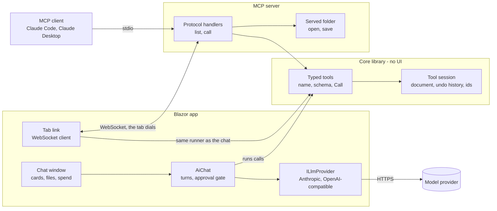

# Adding an AI assistant and an MCP server to a Blazor app

A guide for putting a model to work inside a Blazor application: a chat window that reads and changes the
document the person has open, with every change shown and undoable, and an MCP server that lets Claude Code or
Claude Desktop do the same from outside the browser. It is written to be copied into another project and
followed there, by a developer or by a Claude Code session that has never seen the code it comes from.

Two working implementations stand behind every recommendation here, and both are named so their code can be read
when a section is not enough:

- **GDSViewer** (this repository) - a Blazor WebAssembly PWA with no server. Its **AI assistant** window calls
  Anthropic, OpenAI, Google's Gemini or a server of the person's own straight from the browser, with the person's
  own key, and changes the open layout through typed tools. Its **`gds mcp`** command serves the same tools to MCP
  clients over standard input and output, and a **tab link** lets those clients work on the layout open in a
  browser tab. Reference files: `Ai/`, `Components/AskAi.razor`, `Components/AiSettings.razor` with
  `Components/AiModels.razor` in it, `wwwroot/js/speech.js` and `camera.js`, `GdsII/Agent/`, `GdsII.Cli/Mcp/`, and the
  "Tools for an AI assistant", "AI assistant" and "The MCP server" sections of `docs/DOCUMENTATION.md`.
- **ConfigurationRuleEditor** (a separate, hosted Blazor WebAssembly app) - its assistant runs on the **server**
  with the company's keys and streams to the browser; the model's changes arrive as **proposals that are never
  executed**, reviewed as diffs and published by a person. It also serves a read-only **MCP endpoint over HTTP**.
  Reference files: `ASSISTANT.md` (the long-form design), `Server/Services/Implementations/AssistantService.cs`,
  `ChatClientFactory.cs`, `AttachmentReader.cs`, `Client/Shared/Assistant/`, `Server/Mcp/`.

Each layer below can be built and tested on its own, in order. Code skeletons follow this repository's style
rules (US English, no ternaries outside Razor markup, block-bodied methods, an `if` body on its own line, no
space after `//`), so they can be pasted into a project that keeps the same rules.

## Contents

- [Decide first](#decide-first)
- [Layer 1: typed tools in the core library](#layer-1-typed-tools-in-the-core-library)
- [Layer 2: the providers](#layer-2-the-providers)
- [Layer 3: the conversation](#layer-3-the-conversation)
- [Layer 4: the window](#layer-4-the-window)
- [Files with a question](#files-with-a-question)
- [The files panel](#the-files-panel)
- [Speech, the camera and screenshots](#speech-the-camera-and-screenshots)
- [What it costs](#what-it-costs)
- [The tool picker](#the-tool-picker)
- [Compacting a conversation](#compacting-a-conversation)
- [Saving the conversation](#saving-the-conversation)
- [Keeping chats](#keeping-chats)
- [Slash commands](#slash-commands)
- [Bringing your own AI service](#bringing-your-own-ai-service)
- [Layer 5: the MCP server](#layer-5-the-mcp-server)
- [Layer 6: linking the person's tab](#layer-6-linking-the-persons-tab)
- [Testing](#testing)
- [Pitfalls](#pitfalls)
- [Checklist](#checklist)

---

## Decide first

Three decisions shape everything after them. Make them before writing code, because each one changes what the
later layers are.

### Does the model act, or propose?

**Act, when the app already has an undo history over a document in memory.** GDSViewer's tools change the open
layout directly, and every change is one step on the same history the person undoes with - so a change is safe to
make because it is one press of Undo away. An approval gate decides which calls wait for a person first.

**Propose, when a change goes to storage that other people read.** ConfigurationRuleEditor declares two tools,
`propose_edit` and `propose_constraint`, that are **never executed**: the call *is* the proposal. The browser
renders each one as a side-by-side diff, the person accepts or drops each change, and what is accepted goes
through the same publish path a hand edit does. Nothing the model says reaches storage without a person having
looked at the diff. Structured output comes free: the tool's schema is the shape of the proposal, and the
provider enforces it.

A project can have both: read tools that run, and change tools that propose.

### Where is the model called from?

| | Browser-direct (GDSViewer) | Server-proxied (ConfigurationRuleEditor) |
|---|---|---|
| Whose key | The person's own, typed into the app's settings | The company's, in server configuration |
| Where the key lives | Browser storage, sent only to its provider | `appsettings.Local.json` or environment variables; never served |
| CORS | Each provider must allow a page to call it - Anthropic does, behind a header | None: the server calls the provider |
| Who pays, who controls cost | Each person, on their own account | The company; the server can cap models, efforts and tiers |
| Offline / PWA | Works with no server at all | Needs the server |
| Conversation state | In the page | The endpoint can be stateless: the page sends the whole conversation each time |
| Streaming | Optional (see below) | Server-sent events, one JSON event per delta |

**Pick browser-direct for a static or offline app whose users bring their own key**, and server-proxied for an
internal tool where the company pays and nobody should hold a key. **Blazor Server and the interactive-server
render mode** already run the C# on the server: call the provider from there with keys from configuration, and
none of the browser-only concerns below (CORS, the direct-access header, keys in storage) apply.

In Blazor WebAssembly a response is read whole unless the request is marked with
`request.SetBrowserResponseStreamingEnabled(true)`. GDSViewer does not stream - a tool loop's rounds are short -
and ConfigurationRuleEditor streams from its server, where a long answer is worth seeing as it is written.

### Which MCP server?

**A command-line server over standard input and output, beside the files**, when the documents are files on the
person's machine: GDSViewer's `gds mcp`, started by Claude Code or Claude Desktop, working in one folder.
**An HTTP endpoint on the app's server**, when the documents live in the app's storage: ConfigurationRuleEditor's
`/mcp`, behind a shared key. And, for the first kind, **a link from the person's open tab**, when they want to
watch the model work on the document on their screen.



---

## Layer 1: typed tools in the core library

**Typed tools rather than the document's own text.** A model asked to write a file format by hand gets a count,
a type or a closing element wrong somewhere in a hundred lines, and produces a file nothing opens - or worse, one
that opens. A model calling `draw_rectangle` with a layer name and two corners has nothing to get wrong that
cannot be checked before anything is written, and what it is told when it does is what it needs to try again.
Each tool is a few lines over an edit the library already has, so what the model makes is the same data as what
the mouse makes.

**In the core library, with no UI dependency.** The chat window, the MCP server and the tests are three hosts of
one set of tools. GDSViewer keeps them in `GdsII/Agent/` (`AgentTools`, `AgentSession`, `AgentTool`,
`AgentParameter`, `AgentResult`); the library knows nothing of Blazor, providers or MCP.

A host does three things:

```csharp
var session = new AgentSession(document, history);        //the app's own history, so Undo takes it back

foreach (var tool in AgentTools.All)                       //name, description, InputSchema()
    offer(tool);                                           //in the provider's own format

var result = AgentTools.Call(session, name, argumentsJson);

//result.Text goes back to the model; IsError says it was refused, and Changed that the view needs drawing.
```

The rules that made GDSViewer's tools work across providers and models:

- **The schema is written from the parameter list**, so the schema and the reading of a call cannot disagree.
  Each parameter is a name, a value kind (number, text, flag, point, box, ids...), a description, whether it is
  required, and its choices.
- **Only the keywords every provider reads**: `type`, `description`, `properties`, `required`, `items`, `enum`,
  `minItems`, `maxItems`. Google's function calling takes a subset of OpenAPI and refuses `additionalProperties`,
  `oneOf` and `default` outright - a schema using them works with one model and is an error with another. A test
  walks every schema for anything else.
- **A map whose names are not fixed goes as text.** Google refuses an `object` with no `properties` too, and that is
  what a set of named numbers is when the names depend on another argument - a structure's numbers, by its kind.
  GDSViewer's `place_structure` takes them as `"radius=700, ring=11"` and reads a JSON object in the same place, since
  a model may send one anyway (`AgentArguments.Pairs`); a unit written after a number is taken as said, and a name the
  kind does not have is refused with the ones it does.
- **Strict about names, forgiving about spelling.** An argument the tool does not take is refused with the ones it
  does (`diameter` for `radius` would otherwise draw a default-sized circle with nobody knowing why), but a number
  sent as `"1.5"`, an id as `"#12"`, a point as `{"x": 1, "y": 2}`, or the whole argument object as a JSON string
  are all read as what was meant.
- **Objects are named by id, never by position.** Two objects on top of each other are exactly what a model asking
  for "the one at (1, 1)" would edit wrong. GDSViewer hands out `#12`-style numbers tied to the object, not to its
  index, so a number survives other objects coming and going and an undo puts the very object back.
- **Every call is one undo step, all of it or none.** Parts are applied one at a time, a part that fails takes back
  the ones before it, and only then is the whole recorded - named `AI draw rectangle` and so on, so the undo button
  says whose it was. **A refusal changes nothing**, and every test of one checks the document and the history's
  length.
- **A refusal says what to do about it**: the corner where a polygon crosses itself, the run too short for the
  bend asked for, the names that do exist and the near misses.
- **Units and names the person uses.** Sizes in the units on screen, rounded once onto the document's grid; layers
  (or whatever the app's categories are) by name, with numbers as the deliberate way onto one that does not exist
  yet, so a typo does not quietly start one.
- **`undo_last_change` only while nothing has happened since**: the history is shared with the person, and an
  undo after their edit would take back theirs.
- **Checks after a change report only what the change broke.** With a rule deck loaded, GDSViewer checks the
  neighborhood before and after and reports the difference; a model shown every old fault near a new rectangle
  sets about fixing those.
- **A conventions paragraph for the system prompt lives with the tools** (`AgentTools.Conventions`: units, the
  cell being worked in, ids, undo), so every host says the same thing. **Sentences that are the host's** - how to
  load rules, where settings are - are set by the host on the session (`HowToLoadRules`), never written into the
  library.

**Tools only the app can have are the app's**, in the same runner as the library's: offered, gated by the rung,
switched off in the tool picker and refused in words the same way. GDSViewer's are `look` (a picture needs the
browser), `read_rules` and `add_rules` (`Ai/RuleTools.cs`) and `read_layers` and `set_layers` (`LayerTools`) on the
PDK the person aims them at, `use_pdk` (`PdkTools`) over the person's saved PDKs, and `list_examples` and
`read_example` (`ExampleTools`) over the files the app ships - the ones that write marked as changes, as the
library's are. Each is offered only where the host has given it something to work on (`LayoutToolRunner.ToolsFor`),
rather than everywhere to answer that there is nothing.

**Hand the model what the app already makes from a few numbers.** GDSViewer's Draw menu has a Generator - 38
structures, from a die frame and alignment marks to spiral inductors, couplers and antennas, each made from a handful
of named numbers - and until 2026-11-01 an assistant asked for an inductor or a coupler drew it shape by shape. Now
`list_structures` names the kinds and, for one, what each number means, its unit and its default, and
`place_structure` puts one down whole from the same numbers the panel takes (`Marks.Named` and `MarkMaker.Make`): on a layer, its middle at
a point, turned or mirrored, one undo step, on the deck's grid, and the answer names the kinds made from the same
numbers to put at the same point on their own layers - a spiral's underpass and vias. The system prompt names what it
covers and says to use it rather than drawing one by hand, so a request for an inductor finds it. **A generator, a
wizard or a template the app already has is a tool waiting to be declared**, and what the model makes with it is
exactly what the person would.

---

## Layer 2: the providers

One interface, one implementation per family of API. GDSViewer's (`Ai/LlmProvider.cs`) is a port of
GraphDBViewer's, which is why the names match across those projects:

```csharp
public interface ILlmProvider
{
    ///<summary>A plain answer to a conversation, with no tools.</summary>
    Task<LlmResult> CompleteAsync(string systemPrompt, IReadOnlyList<LlmMessage> conversation, CancellationToken ct);

    ///<summary>The conversation with the runner's tools offered, each call run, until the model answers in words or maxRounds runs out - the person's setting, where the chat passes one.</summary>
    Task<LlmResult> CompleteWithToolsAsync(string systemPrompt, IReadOnlyList<LlmMessage> conversation, ILlmToolRunner tools, CancellationToken ct, int maxRounds = LlmProviderFactory.DefaultToolRounds);

    ///<summary>The model it asks for, as it is sent - what its spend is kept under.</summary>
    string Model { get; }

    ///<summary>Everything this provider has been billed for, added as each response arrives - see What it costs.</summary>
    LlmUsage Spent { get; }

    ///<summary>What its tokens cost, or null when no rate is known for the model.</summary>
    LlmPrice? Price { get; }
}

public interface ILlmToolRunner
{
    IReadOnlyList<LlmTool> Tools { get; }

    ///<summary>Runs one call and says what came of it. Never throws for anything the model did.</summary>
    Task<LlmToolOutput> RunToolAsync(string name, string argumentsJson, CancellationToken ct);
}
```

`LlmToolOutput` is richer than a string: the text the model reads, `IsError` for a refusal, and an optional PNG.
A model told that a call failed tries something else rather than building on it, and a picture of the document is
something it should see rather than read about.

**Request bodies are built as `JsonObject`**, never serialized from anonymous objects. A trimmed,
ahead-of-time-compiled WebAssembly build does not promise that reflection over a type nobody names survives. The
same reason puts every type the app stores as JSON (saved models, dev secrets) in a source-generated
`JsonSerializerContext`, with `JsonPropertyName` pinning each name.

### Anthropic

`POST https://api.anthropic.com/v1/messages` with `x-api-key`, `anthropic-version: 2023-06-01` and, from a
browser, **`anthropic-dangerous-direct-browser-access: true`** - without it the browser's preflight is refused.
`max_tokens` is required: GDSViewer sends the person's, or 8192 - a ceiling, not an allowance, and a long call
(a polygon of a hundred corners) spends it too.

A call is a `tool_use` block; its answer goes back as a `tool_result` under the call's id, with a picture inside
it beside the words and `is_error` on a refusal. The model's reply goes back into the next request **as it came**,
`tool_use` blocks and all. A `stop_reason` of `max_tokens` with a call in the reply means the call has half its
arguments: do not run it, say so. A `stop_reason` of `refusal` is a refusal, not an empty answer.

```csharp
        public async Task<LlmResult> CompleteWithToolsAsync(string systemPrompt, IReadOnlyList<LlmMessage> conversation, ILlmToolRunner tools, CancellationToken ct, int maxRounds = LlmProviderFactory.DefaultToolRounds)
        {
            if (refusal() is string why)
                return LlmResult.Failure(why);

            var toolsArray = BuildToolsArray(tools.Tools);
            var messages = ToWireMessages(conversation);
            var progress = new ToolProgress();

            for (int round = 0; round < maxRounds; round++)
            {
                string body = BuildRequestBody(model, maxTokens, systemPrompt, messages, toolsArray, true, effort, fast);
                var (json, problem) = await LlmProviderFactory.SendAsync(http, request(body), Label, ct);

                if (problem is not null || json is null)
                    return LlmResult.Failure(problem ?? "Anthropic sent nothing back.");

                JsonDocument document;

                try
                {
                    document = JsonDocument.Parse(json);
                }
                catch (JsonException)
                {
                    return LlmResult.Failure("Anthropic answered with something that is not JSON.");
                }

                using (document)
                {
                    var root = document.RootElement;

                    //Before anything can end the run: a round is billed whatever comes of it.
                    Spent.Add(LlmUsage.FromAnthropic(root));

                    if (LlmProviderFactory.ErrorIn(json) is string said)
                        return LlmResult.Failure(said);

                    if (stopReason(root) == "refusal")
                        return LlmResult.Failure("The model declined to answer.");

                    if (!root.TryGetProperty("content", out var content))
                        return LlmResult.Failure("Anthropic answered in a shape this app does not know.");

                    var calls = ParseToolUses(content);

                    if (calls.Count == 0)
                        return answered(TextOf(content), stopReason(root));

                    //A call cut off at the cap has half its arguments, and running it would be running a guess.
                    if (stopReason(root) == "max_tokens")
                        return LlmResult.Failure($"The model ran into its limit of {maxTokens} tokens partway through a call. Raise Max tokens for this model under Settings, AI settings.");

                    //Its reply goes back as it came, tool_use blocks and all, followed by an answer to each call.
                    messages.Add(new JsonObject
                    {
                        ["role"] = "assistant",
                        ["content"] = JsonNode.Parse(content.GetRawText())
                    });

                    var results = new JsonArray();
                    var ran = new List<(LlmToolCall, LlmToolOutput)>();

                    foreach (var call in calls)
                    {
                        var output = await tools.RunToolAsync(call.Name, call.ArgumentsJson, ct);

                        results.Add(ToolResult(call.Id, output));
                        ran.Add((call, output));
                    }

                    messages.Add(new JsonObject
                    {
                        ["role"] = "user",
                        ["content"] = results
                    });

                    if (progress.IsStuckAfter(ran))
                        return LlmResult.Failure(LlmProviderFactory.RoundsStuck);
                }
            }

            return LlmResult.Paused(LlmProviderFactory.RoundsPaused(maxRounds));
        }
```

**Two limits, and only one of them is an error.** A count of rounds cannot tell a model at work from a stuck one:
GDSViewer's first cap was ten rounds and a red "kept calling tools without answering", and it fired on a cell
drawn, labeled, looked at and checked - ten rounds of calls that all worked. So since 2026-11-01:

- **Stuck is an error.** `ToolProgress` counts a round as getting somewhere when one of its calls worked and was not
  a repeat (the same call answered the same, picture included). Three rounds in a row that got nowhere - every call
  refused, or one already made - stop the run as failed.
- **Long is a pause.** The cap on rounds is there for spend: every round sends the whole conversation again. It is
  the person's to set under AI settings, thirty to begin with, and passed to the loop as `maxRounds`. Reaching it ends
  the run with `LlmResult.Paused`, which asks whether to go on for another as many, with **Continue** on it; Continue
  sends a message of its own, and the calls before the pause go with it, said in words, as any run's do.

ConfigurationRuleEditor allows six lookup rounds and tells the sixth that it is the sixth, since a turn that
quietly stops mid-search reads exactly like an answer.

**An effort, and fast mode, only where the model takes them** (GDSViewer since 2026-11-01). The effort goes in
`output_config` (`{ "effort": "high" }`), from the levels the model's version takes: low, medium and high from Opus 4.5,
max from Opus and Sonnet 4.6, xhigh with Opus 4.7 and every Claude since. Sonnet 4.5 and Haiku 4.5 refuse it, so they
are offered none. Fast mode is the same model writing up to two and a half times as fast at twice the price, on Opus
4.8 and Opus 5 on: `"speed": "fast"` in the body and the `fast-mode-2026-02-01` beta in `anthropic-beta`, with the
window's prices doubled while it is on. Decide both from the version number (`LlmConnection.EffortLevels`,
`SupportsFast`), choose them per request and never save them, and drop a level or fast mode chosen for one model when
the next does not take it - in the provider as well as the menu (`AnthropicProvider.ResolveEffort`), so a stale choice
is never what a request is refused over.

### The OpenAI-compatible family

One adapter serves OpenAI (`https://api.openai.com/v1`), Google's Gemini through **its OpenAI-compatible endpoint
`https://generativelanguage.googleapis.com/v1beta/openai`** (a Google AI Studio key works as it is), and any server
of the person's own (Ollama, LM Studio, vLLM). It posts to `{base}/chat/completions` with the key as a bearer token.

- **A server of one's own has no default address.** A blank base URL sent to OpenAI would put the key meant for
  somebody's own server, and their question, in front of a company they did not choose.
- **The assistant's message goes back with its `tool_calls` copied whole.** Gemini 3 puts a signature of its
  thinking in each call (`extra_content`) and refuses the next request without it. Echo only the role, the
  content and the calls, though: OpenAI's reply carries fields its requests do not take.
- **A picture goes in a user turn.** Chat completions take an image only from the user, so a tool that took one
  answers in words in its `tool` turn, and the picture follows in a user turn naming the call.
- **A refusal is said in words** (`Refused: ...`), there being no flag for it in a `tool` turn.
- **`reasoning_effort` only where it is understood** - OpenAI's reasoning models and Gemini 2.5 and up. A chat model
  refuses the whole request over it. Decide from the model's version number, not a list of names, so a family
  released later lands in its family; and label the default with what the provider documents the model doing
  then (GDSViewer: *Default (high)*), since "default" alone tells nobody how hard it will think.

### Sending, and saying what went wrong

```csharp
        internal static async Task<(string? Body, string? Problem)> SendAsync(HttpClient http, HttpRequestMessage request, string label, CancellationToken ct)
        {
            using var sending = request;
            using var clock = CancellationTokenSource.CreateLinkedTokenSource(ct);

            clock.CancelAfter(RequestTimeout);

            HttpResponseMessage response;

            try
            {
                response = await http.SendAsync(request, clock.Token);
            }
            catch (OperationCanceledException) when (!ct.IsCancellationRequested)
            {
                return (null, $"{label} did not answer within {(int)RequestTimeout.TotalSeconds} s.");
            }
            catch (HttpRequestException failed)
            {
                string address = request.RequestUri?.GetLeftPart(UriPartial.Authority) ?? "the server";

                return (null, $"Could not reach {address}: {failed.Message}. If the address is right, the server may not allow requests from a web page (CORS), or may not be running.");
            }

            using (response)
            {
                string body;

                try
                {
                    body = await response.Content.ReadAsStringAsync(clock.Token);
                }
                catch (OperationCanceledException) when (!ct.IsCancellationRequested)
                {
                    return (null, $"{label} did not finish answering within {(int)RequestTimeout.TotalSeconds} s.");
                }

                if (response.IsSuccessStatusCode)
                    return (body, null);

                string status = $"{(int)response.StatusCode} {response.ReasonPhrase}".Trim();

                if (ErrorIn(body) is string said)
                    return (null, $"{label} answered {status}: {said}");

                if (response.StatusCode == HttpStatusCode.Unauthorized || response.StatusCode == HttpStatusCode.Forbidden)
                    return (null, $"{label} answered {status}. The key may be wrong, or not allowed to use this model.");

                return (null, $"{label} answered {status}.");
            }
        }
```

- **No timeout on the HttpClient** (`Timeout = Timeout.InfiniteTimeSpan`): its 100-second default cuts long
  answers off with the provider still working. Each request carries its own clock instead - five minutes in
  GDSViewer - which says which request it was when it fires.
- **A person's Stop and a timeout are the same exception**; the `when (!ct.IsCancellationRequested)` filter tells
  them apart. Without it a timeout is reported as "you stopped it", the one message guaranteed to stop anybody
  investigating.
- **Read the status, not only the body.** A provider says why in its body (`error.message`; Google sometimes wraps
  the object in an array), but a gateway in between answers with HTML, and "could not parse the response" names
  the wrong problem.
- **"Failed to fetch" means CORS or nothing listening**, which is the likeliest failure for a server of one's
  own: name the address and say what to check.
- **Drop empty turns** before sending: a stopped or failed answer leaves one, and providers refuse empty content.

### Behind a server: Microsoft.Extensions.AI

ConfigurationRuleEditor reaches all four providers through `IChatClient` (Anthropic's SDK, and the OpenAI SDK for
OpenAI, Gemini's compatible endpoint and local servers). Its lessons, from `ASSISTANT.md` "Provider tuning":

- **Coalesce a round with `ToChatResponse()`, never rebuild it by hand.** A hand-built replay dropped Anthropic's
  thinking blocks and their signatures, and Anthropic rejects a conversation whose thinking does not verify.
- **A refusal arrives as `ChatFinishReason.ContentFilter`**, whose string is `"content_filter"`, never `"refusal"`.
- **Efforts and service tiers are whitelists**: a known word is translated into the provider's typed option, and
  anything else falls back to the default rather than being forwarded.
- **A provider with no credential is never offered**, so the picker cannot show one that would fail.
- **The endpoint is stateless and streams server-sent events** - `thinking`, `text`, `lookup`, `proposal`,
  `edit`, `usage`, `done`, `error` - and a failure after the headers went out travels as an `error` event, since it
  can no longer be a status code. Statelessness is what makes a hundred parallel conversations cheap: they are a
  hundred calls to the one endpoint, each one canceled on its own.

---

## Layer 3: the conversation

**A plain class, out of the component** - GDSViewer's `Ai/AiChat.cs`. A whole conversation (approvals, declines,
a stop in the middle of a card) can then be driven by a test with a stand-in provider and a real document, and
no browser. ConfigurationRuleEditor goes further for the same reason Blazor forces: **a component's state is
thrown away the moment it stops being rendered**, so its hundred conversations live in `ChatContext` objects hung
off the map's nodes, and the panel takes one as a parameter.

**Turns of eight kinds** (`ChatTurn.User`, `Assistant`, `Tool`, `Error`, `Paused`, `Note`, `Summary`, `Reopened`): the
person's words, the model's answer, a card for each tool call, an error, a run paused at the cap on rounds, a note
from the app ("another file is open now") that marks where the conversation the model is sent starts again, the
briefing a compaction leaves in the conversation's place, and the line a kept chat starts with when it is opened again.

**What was run is replayed in words.** Neither provider family can carry a tool exchange from one request to the
next without rebuilding its wire format from a copy that has lost half of it, so the next request says plainly
"(What you did while answering that: you called draw_rectangle {...}, and it answered: Drew ...)", each
argument and answer cut at a few hundred characters.

**A ladder of how far the model may go**, not a set of switches - each rung includes the one below it:

| Rung | Reads | Changes |
|---|---|---|
| Ask before every step | wait for a person | wait for a person |
| Ask before changes | run | wait for a person |
| Change without asking | run | run, each still one undo step, each still shown as a card |

- **Every tool is offered on every rung.** Withholding the changing tools made the model answer that it could not
  make changes; the rung decides only what runs unattended.
- **Start on the middle rung and remember none of them between visits**, so a reload never finds the top one on.
- **Read the rung at every call, not once per answer** - a switch to Change without asking in the middle of an
  answer must let the waiting card go at once, and a switch to a stricter rung stops the calls after it.
- **The gate is also what switches the changing tools on.** A runner reached without the gate neither offers nor
  runs one, so a caller that knows nothing about changes cannot hand the model one by accident.

```csharp
        public async Task<ChatOutcome> SendAsync(string text, ILlmProvider provider, string systemPrompt, ILlmToolRunner? tools)
        {
            if (Generating || string.IsNullOrWhiteSpace(text))
                return ChatOutcome.NotSent;

            var question = new ChatTurn { Kind = ChatTurn.User, Text = text.Trim() };

            question.Attachments.AddRange(pending);
            pending.Clear();
            turns.Add(question);

            var conversation = BuildConversation();
            int asOf = generation;
            bool changedAnything = false;
            var before = provider.Spent.Copy();
            var outcome = ChatOutcome.Stopped;
            ChatTurn? ending = null;

            var source = new CancellationTokenSource();
            var token = source.Token;

            Generating = true;
            GaveFilesBack = false;
            cancel = source;

            await changed();

            try
            {
                LlmResult result;

                if (tools is null)
                {
                    result = await provider.CompleteAsync(systemPrompt, conversation, token);
                }
                else
                {
                    async Task done(ToolRunRequest request, LlmToolOutput? output)
                    {
                        if (output is not null && request.Changes && !output.IsError)
                            changedAnything = true;

                        await completedAsync(output);
                    }

                    //The rung as it is when each call is made, not as it was when this began - see Mode.
                    var approving = new ApprovingToolRunner(tools, approveAsync, done, () => Mode);

                    result = await provider.CompleteWithToolsAsync(systemPrompt, conversation, approving, token, MaxToolRounds);
                }

                if (asOf != generation)
                    return ChatOutcome.Stopped;

                if (result.IsError)
                {
                    ending = new ChatTurn { Kind = ChatTurn.Error, Text = result.Error + changesStay(changedAnything) };
                    outcome = ChatOutcome.Failed;
                }
                else if (result.IsPaused)
                {
                    ending = new ChatTurn { Kind = ChatTurn.Paused, Text = result.Text };
                    outcome = ChatOutcome.Paused;
                }
                else
                {
                    ending = new ChatTurn { Kind = ChatTurn.Assistant, Text = result.Text };
                    outcome = ChatOutcome.Answered;
                }

                turns.Add(ending);
            }
            catch (OperationCanceledException)
            {
                outcome = ChatOutcome.Stopped;

                if (asOf == generation)
                {
                    ending = new ChatTurn { Kind = ChatTurn.Error, Text = "Stopped." + changesStay(changedAnything) };
                    turns.Add(ending);
                }
            }
            catch (Exception failed)
            {
                outcome = ChatOutcome.Failed;

                if (asOf == generation)
                {
                    ending = new ChatTurn { Kind = ChatTurn.Error, Text = failed.Message };
                    turns.Add(ending);
                }
            }
            finally
            {
                record(provider, before, ending);

                if (asOf == generation)
                {
                    Generating = false;
                    pendingTool = null;

                    if (outcome == ChatOutcome.Failed)
                        giveFilesBack(question);
                }

                if (ReferenceEquals(cancel, source))
                    cancel = null;

                source.Dispose();

                await changed();
            }

            return outcome;
        }
```

The card a call waits on:

```csharp
        private async Task<bool> approveAsync(ToolRunRequest request, CancellationToken ct)
        {
            var turn = new ChatTurn
            {
                Kind = ChatTurn.Tool,
                ToolName = request.ToolName,
                ArgumentsJson = request.ArgumentsJson,
                Changes = request.Changes
            };

            if (request.AutoApproved)
            {
                turn.Auto = true;
                turn.Decision = true;

                turns.Add(turn);
                pendingTool = turn;

                await changed();

                return true;
            }

            //Continuations run on their own, so a button's handler that answers the card does not go on to run the
            //rest of the provider's loop inside its own render.
            var gate = new TaskCompletionSource<bool>(TaskCreationOptions.RunContinuationsAsynchronously);

            turn.Gate = gate;

            turns.Add(turn);
            pendingTool = turn;

            await changed();

            //A stop while a card is unanswered has to let it go, or the loop waits for a button nobody can press. A
            //stop is not a yes, so it answers the way declining does.
            using var registration = ct.Register(() => gate.TrySetResult(false));

            bool approved = await gate.Task;

            turn.Decision = approved;

            await changed();

            return approved;
        }
```

And the rung's setter, which is what puts a new rung in force mid-answer:

```csharp
public ToolApprovalMode Mode
{
    get
    {
        return mode;
    }
    set
    {
        mode = value;

        if (pendingTool is not ChatTurn waiting || waiting.Decision is not null || waiting.Gate is null)
            return;

        if (ApprovingToolRunner.NeedsApproval(value, waiting.Changes))
            return;

        //Marked only when this is what let it go, rather than a button pressed a moment before.
        if (waiting.Gate.TrySetResult(true))
            waiting.Auto = true;
    }
}
```

- **Clear stops the run first and counts conversations** (`generation`): a run left going would write its answer,
  or its "Stopped.", into the conversation that replaced it.
- **Another document opened starts the model afresh** (`StartAfresh`): what came before stays on screen, but none
  of it is sent - it was about a document that is not open, in ids that meant its objects.
- **The system prompt is built at every Send**, from facts the page gathers: the document, its units, its
  categories (a bounded number, and how many more a tool lists), what is selected (as ids), what is on screen,
  the conventions paragraph, and the rung in force - a model told every call is vetted writes differently from one
  told nothing is watched. Say whatever about the view is surprising: GDSViewer's 2D view draws y downward, so
  "the top of the screen" is the smallest y.
- **A picture tool** (GDSViewer's `look`, `Ai/LayoutPicture.cs`) draws what the person sees with the view's own
  renderer, about 1024 pixels on the longer side, hidden categories left out, and **says in words what the pixels
  mean**: the area in document units, units per pixel, which way y runs, which color is which category. The card
  shows the person the picture the model was sent.

**A one-shot writer is a lighter pattern** for a form rather than a document - one plain request with no tools
(`CompleteAsync`), whose system prompt is the format guide the app already hands people, and whose answer is shown,
checked against the format and placed by kind before anything changes. GDSViewer's PDK manager had one for its rules
until 2026-10-31, when the user asked for the assistant itself instead: two tools beside the layout's, one to read the
deck and its grammar and one to add lines, refused whole with every problem when the format will not take them (see
`RuleTools`). What that buys is the conversation - a rule manual attached, a question asked before anything is
written, a refusal mended - at the price of the tools and their cards. Its layers went the same way on 2026-11-01
(`LayerTools`). **Write with AI** in the manager now aims those tools at that PDK, opens the assistant and offers words
to send in the box, as its example does, unless something is being written there already - so the app has one window
that talks to a model rather than two.

---

## Layer 4: the window

**A floating window, hidden rather than unmounted** (GDSViewer's `Components/FloatingWindow.razor` and
`wwwroot/js/floatingWindow.js`): the conversation outlives closing it and switching view because the component is
never torn down. It is dragged by its header and sized from a grip of its own, does not dim the page, and opens
**in the middle, under the toolbar, every time** - so the button that opened it and Undo are never under it.
Remember a size only once somebody has set one with the grip; a remembered position ends up off-screen on the
next, smaller browser window.

**The composer:**

- **The box and its controls are one frame** (GDSViewer 2026-10-31, as the Claude app has it): the words on top, and
  along its foot a slim row of borderless controls - the paperclip, the camera, a screenshot and the approval rung at
  the start; the tool picker, the model with its effort, the (i) with what the next question costs, Send and the
  microphone at the end. A press in the frame's spare room puts the caret in the box. A slash at the start of the box
  lists the window's commands - see [Slash commands](#slash-commands) and
  [Speech, the camera and screenshots](#speech-the-camera-and-screenshots).
- Enter sends and Shift+Enter breaks the line. **Refuse the newline in JavaScript** on keydown: a Blazor handler's
  `preventDefault` is fixed when the element renders, not decided per key.
- The box grows with what is typed, up to about 200 pixels.
- **Send and Stop are one button**, in the same place. **A double-click on Send must not stop what it sent**: the
  first click sends and the button becomes Stop under the pointer, so while an answer is coming a click the
  browser counts as the second of a pair (`MouseEventArgs.Detail >= 2`) is let go.
- **The box can start with an example to send**, selected whenever it gets the keyboard while it is still those
  words, so Enter sends it and the first key replaces it. Let go of the mouseup of the click that focused it, or
  that click puts the caret down over the selection.
- Before sending, **save anything typed elsewhere** that the tools would read (GDSViewer's text view), or the
  model's change is drawn over the typing.

**Cards** show the call as the model wrote it, its arguments on a line, *auto* when the rung ran it, Approve and
Decline while it waits, and what the model was told once it ran - the answer, the picture, and for a change
**what it did to the document**, as a read-only Monaco diff of the text form (inline rather than side by side,
which a card is too narrow for; only the changed lines and a few either side). **Walk a copy of the turns when
making the diffs**: the first loads Monaco, which takes seconds, and the run goes on adding cards meanwhile -
walking the live list across that await threw "Collection was modified" and took the page down.

**A change the model makes is followed by what follows a change made by hand**: the view's own after-edit (the
new objects picked out), the session saved, the checks run, every other view told. GDSViewer's 3D view kept
drawing the old scene until it was told explicitly, because it knew the document by object identity and a change
hands back the same object.

**Keys and models** live under the app's settings (GDSViewer's *AI settings*, `Components/AiSettings.razor`, with the
models' list and form in `AiModels.razor`), any number of saved models, picked in the chat. Kept in browser storage
only - never in a session or a history entry, which travel with a document - and the settings say plainly where. A
key saved for an `https` address **leaves the form when the address is changed to `http`** and comes back if it is
changed back before another is typed (`Ai/SavedSecretRule.cs`), so a saved key is never sent in the clear without
being typed again. The same window holds the rest of what is the person's to set: the cap on rounds and how the
microphone writes speech out.

**The model and its effort are one button** in the box's row (GDSViewer 2026-11-01, as the Claude app has them; two
lists side by side before): the model's name with its effort beside it in gray, and a bolt while fast mode is on. It
opens a menu of the saved models with their providers, then **Effort** with its level - pressed, the levels take the
menu's place, with a way back - fast mode's switch where the model has one, and **Manage models**, into the settings.
A model or a level chosen closes it and the switch leaves it up; Escape steps back out of the levels before it closes
the menu. The effort is chosen per request and never saved, and **its default says what it is** - *Default (high)*,
not *default* (see [the OpenAI-compatible family](#the-openai-compatible-family)).

**While developing, models can come from a file** (`Ai/DevSecrets.cs`): a Development build asks for
`wwwroot/dev-secrets.json` as the page starts and adds the models in it, without replacing ones already saved under
the same name. It is a real key under the site's root, so: `.gitignore` leaves it out, the project file marks it
`<Content Update="wwwroot\dev-secrets.json" CopyToPublishDirectory="Never" />`, only a Development build asks for
it, the file carries a marker property (`"devSecrets": true`) because a server without it answers with the app's
own page, which is a success too, and **a browser a test is driving is left alone** (`navigator.webdriver`), so a
spec never spends a real key it found. Commit a `dev-secrets.example.json` template beside it.

---

## Files with a question

A question can carry files: a screenshot pasted into the box, a datasheet PDF, a CSV of settings. GDSViewer's
design is `Ai/AiAttachment.cs`; ConfigurationRuleEditor's is `Shared/Models/Assistant/AssistantAttachment.cs`
with `Server/Services/Implementations/AttachmentReader.cs`.

**Kinds, and how a file is told apart:**

| Kind | Taken as | Checked by |
|---|---|---|
| Image | `.png` `.jpg` `.jpeg` `.gif` `.webp`, or an `image/*` type of those four | Its type read off its first bytes |
| PDF | `.pdf` | `%PDF-` within the first kilobyte |
| Text | `.txt` `.csv` `.tsv` `.json` `.xml` `.md` `.log` `.yaml` `.yml` `.ini` `.htm` `.html`, the app's own text formats, and anything the browser calls `text/*` | No NUL byte in the first 8 KB, unless a UTF-16 byte order mark says otherwise |

- **The name decides before the browser's type.** A browser calls a CSV something different on every system and
  has no type at all for most domain formats; the type is used only when the name says nothing.
- **An image's type is read from its bytes**, never from its name: Anthropic refuses a JPEG sent as a PNG. A file
  that is not what its name says - a PDF called `.png`, a binary file called `.txt` - is turned away with that
  sentence.
- **Text is UTF-8 unless a byte order mark says otherwise, and Latin-1 when it is not UTF-8**: files from older
  tools are often in a Windows code page, Latin-1 reads every byte as some character, and the numbers that make up
  most such files come through whole.
- **A spreadsheet or a Word document goes as its text**: one row a line, its number first and its cells between
  tabs, so an answer can say "row 214"; a document's paragraphs and tables. ConfigurationRuleEditor reads them on its
  server with NPOI. **A browser needs no library for it**: an `.xlsx` or a `.docx` is a zip of XML parts, and .NET's
  `ZipArchive` and `XmlReader` run in WebAssembly as they are - GDSViewer's `OfficeText` reads the shared strings,
  the cell styles' number formats (for dates and percentages) and each sheet's rows, streaming, and a document's
  paragraphs, tables, headers and footers, with nothing added to the build. Read the file when it is attached, so a
  broken one is turned away there; stop reading a workbook at the text limit; and cap what any one part may unpack
  to, since a zip can lie about its sizes. The binary `.xls` and `.doc` from before 2007 are another format; ask for
  an `.xlsx` or a `.docx` instead.

**Limits, and why each one:**

| Limit | Value | Why |
|---|---|---|
| Files a question | 10 | |
| One image | 5 MB | Anthropic's ceiling for one image |
| Any other file | 10 MB | |
| A conversation's files together | 12 MB | Every question sends them all again, as base64, a third bigger: 16 MB, under Anthropic's 32 MB request and OpenAI's 50 MB of files a request. Set when Google took 20 MB inline; its own API takes 100 MB since January 2026 (50 MB for a PDF), but its OpenAI-compatible endpoint documents no limit of its own (all read 2026-10-29), so try one there before raising it. ConfigurationRuleEditor allows 15 MB against its server's 28.6 MB request limit |
| Text one file puts in the prompt | 200,000 characters | About 57,000 tokens, paid again with every later question. Past it the text is cut, and says where and how much was left out |

The checks are one static method that returns the reason or null, shared by the page and anything else that
builds a request, so a file is turned away before it is sent rather than after.

```csharp
public static string? ImageType(byte[] data)
{
    if (opens(data, 0, new byte[] { 0x89, 0x50, 0x4E, 0x47, 0x0D, 0x0A, 0x1A, 0x0A }))
        return "image/png";

    if (opens(data, 0, new byte[] { 0xFF, 0xD8, 0xFF }))
        return "image/jpeg";

    if (opens(data, 0, "GIF87a"u8) || opens(data, 0, "GIF89a"u8))
        return "image/gif";

    if (opens(data, 0, "RIFF"u8) && opens(data, 8, "WEBP"u8))
        return "image/webp";

    return null;
}

private static bool opens(byte[] data, int offset, ReadOnlySpan<byte> signature)
{
    return data.Length >= offset + signature.Length && data.AsSpan(offset, signature.Length).SequenceEqual(signature);
}
```

**Which kinds each provider is sent:**

| Provider | Image | PDF | Text |
|---|---|---|---|
| Anthropic | yes | yes | yes |
| OpenAI | yes | yes | yes |
| Gemini, through the OpenAI-compatible endpoint | yes | no - Google's compatibility page documents images and audio, not files | yes |
| A server of one's own | yes, as GDSViewer's `look` already sends pictures there | no | yes |

ConfigurationRuleEditor holds images back from local servers, on the reasoning that most local models read text
only; either choice is defensible - pick one and say it in the settings.

**A file a model cannot be sent is named, never dropped.** Left out without a word, it reads to the model as a
file the person never sent. And while a file waiting in the box is one the picked model cannot take, **Send waits
and the window says which file and why**.

**Files go ahead of the question.** An image or a PDF follows a line naming it, so a question about one of several
can be matched to the right one; text goes inside tags, so the model can tell where the file stops and the
question starts:

```
Attached file: wafer.png            <- text block
<the image>                         <- image block
<attachment name="layers.csv">      <- text block
...the file's text...
</attachment>
[sketch.png was attached here, and has been left out since.]
What is wrong with the layer table?
```

Ahead of the question rather than after it, because a question's own text can change when it moves back into the
history and its files do not - so everything up to its last file is byte for byte what was sent before, which is
what a prompt cache reads back (see [What it costs](#what-it-costs)).

**The wire shapes:**

```json
{ "type": "image", "source": { "type": "base64", "media_type": "image/png", "data": "<base64>" } }
{ "type": "document", "source": { "type": "base64", "media_type": "application/pdf", "data": "<base64>" } }
```

are Anthropic's, inside the user message's `content` array. Chat completions take:

```json
{ "type": "image_url", "image_url": { "url": "data:image/png;base64,<base64>" } }
{ "type": "file", "file": { "filename": "datasheet.pdf", "file_data": "data:application/pdf;base64,<base64>" } }
```

A message with no files keeps its plain string `content`, so nothing about a conversation without files changes.

The `file` part is OpenAI's documented shape for chat completions (checked 2026-10-29), which takes PDFs and nothing
else that way. Its reference marks `filename` optional and says only that `file_data` is base64, but requests with
bare base64, or the name spelled `file_name`, are reported failing - send the data URL and the name, as above.
**Google's compatible endpoint documents `image_url` and audio parts and no PDF**, so a PDF is not sent there; its own
API reads PDFs, through its own request format.

**A failed question gives its files back.** A file the provider refused - a PDF over its page limit, an encrypted
one - would be refused again with every later question, since each one sends the conversation's files whole. So a
question that fails takes its files off itself and puts them back in the box, **and its words with them if the
box is empty**, where the bad file can be taken off before asking again. A stop is not a failure and keeps them.

### Getting files in: the paperclip, a paste, a drop

**One way in**: a hidden Blazor `InputFile` behind a paperclip. A paste and a drop hand their files to that same
input, as if they had been picked there, so the component handles one event.

```razor
                <InputFile id="aiAttachInput" style="display: none;" multiple accept="@AiAttachment.Accept" OnChange="filesChosen" disabled="@ReadOnly" />
                <label id="aiAttach" for="aiAttachInput" class="aiBarButton aiAttach @(ReadOnly ? "aiAttachOff" : "")" role="button"
                       aria-label="Attach files" title="@attachTitle()" @onclick:stopPropagation="true">
                    <svg viewBox="0 0 16 16" aria-hidden="true">
                        <path fill="currentColor" d="M4.5 3a2.5 2.5 0 0 1 5 0v9a1.5 1.5 0 0 1-3 0V5a.5.5 0 0 1 1 0v7a.5.5 0 0 0 1 0V3a1.5 1.5 0 1 0-3 0v9a2.5 2.5 0 0 0 5 0V5a.5.5 0 0 1 1 0v7a3.5 3.5 0 1 1-7 0z" />
                    </svg>
                </label>

@code {
    private async Task filesChosen(InputFileChangeEventArgs e)
    {
        var problems = new List<string>();

        //GetMultipleFiles throws past its maximum, so take every file and let the count refuse the extras.
        foreach (var chosen in e.GetMultipleFiles(e.FileCount))
        {
            //From the name, the type and the size alone, before a byte is read: OpenReadStream throws past its own
            //maximum, which would be a failure rather than a reason.
            if (AiAttachment.Refusal(chosen.Name, chosen.ContentType, chosen.Size) is string refused)
            {
                problems.Add(refused);

                continue;
            }

            byte[] data;

            try
            {
                await using var stream = chosen.OpenReadStream(AiAttachment.MostBytes(AiAttachment.KindOf(chosen.Name, chosen.ContentType)));
                using var memory = new MemoryStream();

                await stream.CopyToAsync(memory);
                data = memory.ToArray();
            }
            catch (Exception failed)
            {
                problems.Add($"{chosen.Name} could not be read: {failed.Message}");

                continue;
            }

            //The bytes' own checks, and the question's and the conversation's budgets.
            if (chat.Attach(new AiAttachment(chosen.Name, chosen.ContentType, data)) is string problem)
                problems.Add(problem);
        }

        attachProblem = string.Join(" ", problems);
    }
}
```

**A paste** of a screenshot arrives called `image.png` every time, so it is renamed for when it was pasted. **A
paste that also has text on the clipboard pastes the text**: cells copied out of Excel come with a picture of
themselves. GDSViewer's is `floatingWindow.attachFiles(box, 'aiAttachInput')`, called once the box is on the page;
the app's own paste handler for the drawing already lets a paste into a text box alone.

```js
        attachFiles: function (box, inputId) {
            if (!box || box.gdsFilesAttached)
                return;

            box.gdsFilesAttached = true;

            box.addEventListener('paste', function (e) {
                const data = e.clipboardData;

                if (!data || !data.files || data.files.length === 0)
                    return;

                if (data.getData('text/plain'))
                    return;

                const input = document.getElementById(inputId);

                //Not before Blazor's own listener is on, or the change would carry nothing - see the same flag in fileDrop.js.
                if (!input || input.disabled || input._blazorInputFileNextFileId === undefined)
                    return;

                const stamp = new Date().toTimeString().slice(0, 8).replace(/:/g, '');
                const transfer = new DataTransfer();

                Array.from(data.files).forEach(function (file, index) {
                    let named = file;

                    if (/^image\.\w+$/.test(file.name)) {
                        let suffix = '';

                        if (index > 0)
                            suffix = '-' + (index + 1);

                        named = new File([file], 'pasted-' + stamp + suffix + '.' + file.name.split('.').pop(), { type: file.type });
                    }

                    transfer.items.add(named);
                });

                e.preventDefault();

                input.files = transfer.files;
                input.dispatchEvent(new Event('change', { bubbles: true }));
            });
        },
```

`_blazorInputFileNextFileId` is how GDSViewer tells that Blazor's listener is on - an internal detail of
`InputFile`, so re-check it on a framework upgrade. A change dispatched before the listener attaches carries no
files, and the handler takes the same silent return a canceled dialog takes.

**A drop anywhere on the conversation** - the transcript as well as the box - goes the same way. GDSViewer's
`wwwroot/js/fileDrop.js` listens on the document and routes a drop on any element marked
`data-drop-into="<input id>"` to that input; mark the transcript and the box. **A drop anywhere else on the page is
swallowed**, not left to the browser: its default is to navigate to the file, which closes the app on top of
unsaved work because somebody missed by a centimeter.

```js
document.addEventListener('drop', function (event) {
    if (!carriesFiles(event))
        return;

    //Before anything else, so a miss lands on nothing rather than on the browser's own file viewer.
    event.preventDefault();

    const zone = event.target.closest('[data-drop-into]');

    if (zone == null)
        return;

    const input = document.getElementById(zone.dataset.dropInto);

    if (input == null || input._blazorInputFileNextFileId === undefined)
        return;

    input.files = event.dataTransfer.files;
    input.dispatchEvent(new Event('change', { bubbles: true }));
});
```

`dragover` has to call `preventDefault` too (everywhere, for the same reason), and it is the event to light the
zone from: it fires continuously and says where the pointer is, where `dragleave` fires on every child boundary
crossed.

The files waiting show as **chips above the box**, each with its size and a cross; once asked, they show on the
question.

---

## The files panel

A conversation's files get a panel of their own beside the transcript, opened from **a toggle in the window's
header showing a count** (ConfigurationRuleEditor's draws a window with a ruled column down its right side).

- **In this conversation** - every file a question was sent with, ticked or not, its size beside it and, on hover,
  the question it went with. **An unticked file is excluded**: it stays on screen (its chip dimmed and struck
  through) so it can be put back, but its bytes are not sent, a one-line note stands where it was, and it stops
  counting against the conversation's budget - which makes unticking the answer to "this conversation can take no
  more files". Ticking one back in is held to the budget.
- **With the next question** - the files waiting in the box, the same as its chips, with the same cross.
- Under the lists, **what the ticked files add to every question, in tokens** - a file is a file whether it is
  ticked or not; the choice is only whether it goes.

Open or shut is the person's choice and holds across conversations. In a window too narrow for both, the panel
lies over the transcript's side rather than squeezing it (a container query on the row they share).

**Excluding or including an old file changes the replayed prefix**, so the next question misses the prompt cache
once. That is the trade, and the cheaper side of it.

ConfigurationRuleEditor's panel also lists the other products' files the answers read through its catalog tools,
folding those that only turned up among a search's matches under a count. A project whose tools read beyond the
open document should do the same: it is the only way to see what an answer rests on.

---

## Speech, the camera and screenshots

Three buttons in the box's row put the person's voice, a webcam's picture or a screen into the next question
(GDSViewer, 2026-10-31). Each one ends in something the window already has - words in the box, or a file on the
paperclip's input - so nothing after them is new.

**The microphone, two ways**, chosen in the settings (`Ai/SpeechPreference.cs`, kept in the browser):

- **The browser's own recognition**, to begin with (the Web Speech API, `wwwroot/js/speech.js`): free and live, a
  guess first and replaced as the words settle, written after whatever is in the box. Only Chrome and Edge have it, and
  both **send the audio to Google's or Microsoft's servers** - say so where it is chosen. It is general-purpose, so a
  domain's words come back as they sound: "metal one", "Polly". In a browser without it the microphone is dimmed and
  says why.
- **The AI provider** (`Ai/SpeechTranscriber.cs`): record until the microphone is pressed again, two minutes at most,
  and send the recording to be written out - to OpenAI's `/v1/audio/transcriptions` as a form with
  `gpt-4o-transcribe`, or to Gemini's own `generateContent` with the audio inline, since its OpenAI-compatible endpoint
  has no transcription. **Tell it the words the conversation is full of** - the app's terms, its units, the open
  document's category names - as OpenAI's `prompt` and in Gemini's instruction: that is most of what it does better
  than the browser. Anthropic's API takes no audio, so with a Claude model picked the recording goes to the first saved
  OpenAI or Gemini model, and the window says so when there is none. The provider bills it and the window's spend does
  not count it: say that too.
- **Send WAV, not what the browser recorded.** `MediaRecorder` writes the browser's choice - WebM in Chrome and Edge -
  which is not a format Gemini lists, so GDSViewer decodes the recording (`decodeAudioData`) and writes it again as mono
  16 kHz 16-bit WAV in the page (`wwwroot/js/speechWav.js`, with Node units), which both providers take.
- **A level meter while it listens** - sixteen thin bars in the box's corner, from an `AnalyserNode` - so a muted or
  wrong microphone shows at once rather than after a silence. The script sets the bars' heights itself every 70 ms,
  with no render per tick. The browser's recognizer hands the page no sound, so in that mode the meter opens the
  microphone a second time for itself and lets it go when the listening ends.
- **Pointed at, the microphone says what a press does and what the other way is better at**, and where to switch. Red
  while it listens or records, breathing while the provider writes it out, and what went wrong said under the box.

**The camera** (`wwwroot/js/camera.js`): `getUserMedia` live in a card over the box; the shutter draws the frame on
screen into a canvas and attaches it as a JPEG named for when it was taken (`camera-<date>-<time>.jpg`), and the cross
puts the card away. **Putting it away stops every track**, or the camera's light stays on. With no camera, the card
says why where the shutter would be.

**A screenshot**: `getDisplayMedia`, the browser's own picker of a screen, a window or a tab; one frame as a PNG, and
the sharing ended as soon as the frame is taken. **A picker closed without a choice attaches nothing and says
nothing** - it is somebody changing their mind, not a failure.

**Both go in through the paperclip's input**, as a paste does (a `DataTransfer` set on the input and a `change`
dispatched - see [Getting files in](#getting-files-in-the-paperclip-a-paste-a-drop)), so every check a chosen file
meets they meet, a picture for a model that cannot see one included.

---

## What it costs

People stop using an assistant whose bill is a surprise. Show what each answer cost, what the conversation has
cost, and what the next question will cost before it is sent.

### Usage, read from every response

GDSViewer's design is `Ai/LlmUsage.cs`: input (cached and cache-written parts included), output (reasoning
included), and how many requests reported.

| Provider | Input | Cached | Cache written | Output | Reasoning |
|---|---|---|---|---|---|
| Anthropic | `input_tokens` + both cache counts | `cache_read_input_tokens` | `cache_creation_input_tokens` | `output_tokens` | not separate |
| OpenAI chat completions | `prompt_tokens` | `prompt_tokens_details.cached_tokens` | none | `completion_tokens` | `completion_tokens_details.reasoning_tokens` |
| Gemini, OpenAI-compatible | `prompt_tokens` | `prompt_tokens_details.cached_tokens` (seen, not documented) | none | `completion_tokens`, plus any `total_tokens` beyond prompt and completion | the same excess - or `reasoning_tokens` if it ever appears, the larger, never the sum |

**Anthropic's `input_tokens` is only what came after the last cache mark**: the parts read from and written to
the cache are counted apart, and must be added back for the total. **Google's compatible endpoint can leave the
thinking out of `completion_tokens` and in `total_tokens`**; count the difference as thinking, billed as output -
Google's pricing pages bill output "including thinking tokens". That is observed, not documented: the compatible
endpoint's page defines no usage fields at all (read 2026-10-29), and people using it report prompt, completion and a
total that holds the thinking. It does report what its implicit cache read back, in `prompt_tokens_details.cached_tokens`
as OpenAI does: GDSViewer's live run of 2026-10-30 saw 3,813 of 17,875 input tokens come from it.

```csharp
        public static LlmUsage? FromAnthropic(JsonElement root)
        {
            if (root.ValueKind != JsonValueKind.Object || !root.TryGetProperty("usage", out var usage) || usage.ValueKind != JsonValueKind.Object)
                return null;

            long fresh = count(usage, "input_tokens");
            long read = count(usage, "cache_read_input_tokens");
            long written = count(usage, "cache_creation_input_tokens");

            return new LlmUsage
            {
                InputTokens = fresh + read + written,
                CachedInputTokens = read,
                CacheWriteTokens = written,
                OutputTokens = count(usage, "output_tokens"),
                Requests = 1
            };
        }
```

It answers null when the response carries no `usage` object, and `Spent.Add` adds nothing for that round.

**Summed over the rounds**, because a turn that called tools is several billed requests. **Kept by the provider as
each response arrives**, not returned with the result: a run stopped after three rounds was billed for three, and
a result that never comes would lose them. The chat takes the difference before and after a run, puts it on the
turn that ended it ("Stopped." included), and adds it to the total **per model**, since the picker can change
between questions and each model bills at its own rate.

### Rates

GDSViewer's design is `Ai/AiPricing.cs`: US dollars per million tokens for input, cached input, cache writes and
output; a built-in table **dated, with the page each rate was read from, and with changes the provider has already
announced entered with the date they take effect**; and rates a person enters per saved model in the AI settings,
which win. Rates as published on 2026-10-29, for example:

| Model | Input | Cached | Cache write | Output | Note |
|---|---|---|---|---|---|
| `claude-opus-5-5` | 4.00 | 0.20 | 5.00 | 20.00 | |
| `claude-sonnet-5-5` | 2.00 | 0.10 | 2.50 | 10.00 | |
| `claude-haiku-5-5` | 0.10 | 0.01 | 0.125 | 0.50 | prompts over 100,000 tokens cost five times as much |
| `gpt-5.6-terra` | 2.00 | 0.20 | - | 12.00 | |
| `gpt-5.6-sol` | 4.00 | 0.40 | - | 20.00 | promotional, at least through 2026-11-21 |
| `gemini-3.8-flash` | 0.75 | 0.075 | - | 3.75 | 1.50 / 0.15 / 7.50 from 2027-01-01 |

Sources: Anthropic's `platform.claude.com/docs/en/about-claude/pricing`, OpenAI's
`developers.openai.com/api/docs/pricing`, Google's `ai.google.dev/gemini-api/docs/pricing`. Link the window to
the provider's page, so a figure can be checked rather than taken on trust.

- **A model with no rate shows tokens and no cost.** A guessed price read as fact is worse than an empty space.
- **A missing cached or cache-write rate is charged as input**; Anthropic's five-minute cache writes are 1.25
  times input, and the others bill no writes.
- **Match a model id exactly, or with a date suffix** (`claude-sonnet-5-5-20261001`), never by prefix alone:
  `gpt-5` must not pick up `gpt-5-mini`'s rates.

In GDSViewer the rates are an `LlmPrice` (`Ai/AiPricing.cs`), resolved once per provider from the saved model -
`AiPricing.For(connection, today)`, null where neither the model nor the table has an input and an output rate - and
the provider carries it as `ILlmProvider.Price`, so a run is priced at the rates of the model that ran it:

```csharp
public decimal Cost(LlmUsage usage)
{
    //Cached and written tokens are parts of the input count, not additions to it.
    long fresh = Math.Max(0, usage.InputTokens - usage.CachedInputTokens - usage.CacheWriteTokens);

    decimal dollars = fresh * Input + usage.CachedInputTokens * Cached + usage.CacheWriteTokens * CacheWrite + usage.OutputTokens * Output;

    return dollars / 1_000_000m;
}
```

### The estimate before Send

What the next request will carry, from characters, before anything is sent: the system prompt, the tools'
definitions, the conversation as it will be replayed, the ticked files and the files waiting.

| Assumption | Value | Why |
|---|---|---|
| Characters a token | 3.5 for prose; ConfigurationRuleEditor uses 3.2 for its JSON | Deliberately not flattering: the number's job is to be trusted |
| An image | 1,600 tokens | About what Anthropic charges for a picture at the size it reads them |
| A PDF page | 2,000 tokens | Text and a picture of each page |
| An answer | 800 output tokens (ConfigurationRuleEditor) | Thinking is billed as output, so a high effort quotes low |

Say it as what it is: *about 12,000 tokens a request, about $0.05 on this model; each tool round sends it again*.
A tool loop's round count is not knowable in advance; the first request's price and the warning are honest.

### Prompt caching

**Anthropic caches only what it is told to**, and a request reads back what an earlier one cached up to one of its
own marks. The order it caches in is the tools, then the system prompt, then the messages. Two marks, in every round
of a tool loop:

- **On the last stable block before the conversation.** That is the system prompt where it is the same for every
  question - ConfigurationRuleEditor marks it, and so covers the tools ahead of it. GDSViewer's system prompt is
  written again for every question, with the selection and the view in it, so it marks **the last tool** instead:
  the tools are the same in every request of every conversation, and most of what one sends.
- **On the last block of the conversation**, so the next round of the loop - which re-sends everything the round
  before it sent, with one more call and its answer - reads it back at a tenth or a twentieth of the input rate.

**On the copy each request is built from**, never on the list the loop keeps adding to: marks left behind would
pile up round after round, past Anthropic's limit of four. **Only in the tool loop**: a request answered in one round
pays the write premium, a quarter over the input rate, for an entry nothing reads - a plain completion (GDSViewer's
rule writer, one request) is not marked.

```csharp
        public static string BuildRequestBody(
            string model,
            int maxTokens,
            string system,
            JsonArray messages,
            JsonArray? tools,
            bool cache = false,
            string effort = "",
            bool fast = false)
        {
            var body = new JsonObject
            {
                ["model"] = model,
                ["max_tokens"] = maxTokens,
                ["system"] = system,
                ["messages"] = messages.DeepClone()
            };

            if (tools is not null && tools.Count > 0)
                body["tools"] = tools.DeepClone();

            if (effort.Length > 0)
                body["output_config"] = new JsonObject { ["effort"] = effort };

            if (fast)
                body["speed"] = "fast";

            if (cache)
                MarkForCache(body);

            return body.ToJsonString();
        }

        public static void MarkForCache(JsonObject body)
        {
            if (body["tools"] is JsonArray tools && tools.Count > 0 && tools[tools.Count - 1] is JsonObject lastTool)
                lastTool["cache_control"] = ephemeral();

            if (body["messages"] is not JsonArray messages || messages.Count == 0 || messages[messages.Count - 1] is not JsonObject last)
                return;

            if (last["content"] is JsonValue words)
            {
                last["content"] = new JsonArray
                {
                    new JsonObject
                    {
                        ["type"] = "text",
                        ["text"] = words.GetValue<string>()
                    }
                };
            }

            if (last["content"] is JsonArray blocks && blocks.Count > 0 && blocks[blocks.Count - 1] is JsonObject block)
                block["cache_control"] = ephemeral();
        }

        private static JsonObject ephemeral()
        {
            return new JsonObject { ["type"] = "ephemeral" };
        }
```

The tool loop calls it with `cache: true`; the plain completion leaves it off. A test worth having counts the marks in
every request of a three-round run: two each, never more.

A mark on a prompt shorter than the model's minimum cacheable length is ignored rather than refused. Whether
caching works shows in the cached figure: from the second round of a tool loop, it should not be zero.
**OpenAI and Gemini cache a repeated opening by themselves**; nothing needs marking there. OpenAI reports what it
read back in `cached_tokens`, and Google's compatible endpoint does the same, though its page does not say so.

ConfigurationRuleEditor adds a **priced pre-flight sheet** before anything that sends many requests at once - worth
copying where one press fans out. What it and GDSViewer both do when a conversation grows is under
[Compacting a conversation](#compacting-a-conversation).

---

## The tool picker

A card that switches tools off for a conversation - ConfigurationRuleEditor's context picker, which also chooses
how much of the open file goes with each question; GDSViewer's tools fetch what they need, so its card is the tools
alone, and Compact (`#aiToolPicker` in `Components/AskAi.razor`).

- **A switch with a count of what is off**, in the box's row, and the card hanging over the conversation's
  top right. Group the tools by what they do - reading and changing - with *all* and *none* per group. Close it on a
  press anywhere else (the app's own outside-press helper, which leaves the opener alone) and on Escape: focus the card
  as it opens, or Escape lands on the switch.
- **Switched off means not offered, refused, and said.** Leave the tool out of the request's tool list; refuse a call to
  it anyway, in words (the model can see the tool in what the conversation says it did); and name the switched-off
  tools in the system prompt, with where to switch them back on. Withholding tools without a word is what made
  GraphDBViewer's model answer that it could not make changes and stop. With **every changing tool off**, say the
  conversation only reads, in place of the approval rung's "never say you cannot make changes".
- **Keep the choice through Clear and another document opened** - somebody who switched a tool off wants it off in the
  next conversation too - but not through a reload, where it would be a setting nobody remembers making.
- **Weigh the estimate with the tools on offer**, since the tools are a large, fixed part of every request.

```csharp
//The runner: a set the window owns, read at every call.
public IReadOnlySet<string> Off { get; init; } = new HashSet<string>();

public async Task<LlmToolOutput> RunToolAsync(string name, string argumentsJson, CancellationToken ct)
{
    if (Off.Contains(name))
        return refused($"{name} is switched off in this conversation: the person turned it off in the window's tool picker. Say what you would have used it for, and that it can be switched back on there.");

    //...the call as before.
}
```

## Compacting a conversation

A conversation only grows: every question sends all of it again, its files included. **Compact** replaces it with a
briefing the model carries on from. Both implementations do it in the app rather than with Anthropic's server-side
compaction, which is one provider's and returns a block that must be replayed verbatim - which a conversation
replayed in words, or rebuilt per turn, cannot do.

- **One request, no tools**, under instructions of its own: carry the exact identifiers the domain turns on - shape
  numbers and microns in GDSViewer, property keys and JSONPaths in ConfigurationRuleEditor, never paraphrased - what was
  changed, declined and refused, and what is open; facts from attached files rather than the files; length in proportion
  to what happened. The message is a transcript of the conversation since it last started afresh, **each call with what
  came of it** - a briefing that lost a decline walks the next answer into asking again - with the files still ticked.
- **Which model**: ConfigurationRuleEditor moves a pick of a provider's top model down to its middle one, since a
  briefing needs care with names rather than the top model's reasoning, and reads the whole history at the rate of
  whatever runs it. GDSViewer runs it on the model picked, at its lowest effort: a model there is one somebody saved
  with their own key and address, and another one is not theirs to be sent to.
- **The briefing takes the conversation's place**, sent as the person's message with a line saying what it is ("Summary
  of the earlier conversation, compacted to save tokens:"), and the sent conversation starts there. **What it stands in
  for is kept, not sent**: on screen behind a *show what came before*, dimmed - hidden with a class rather than taken
  out of the page, if its cards hold anything expensive to draw again - and in the export.
- **The files stay, unticked**: another of each file the folded part carried goes on the briefing, the bytes shared, and
  the files panel lists them apart, where ticking one sends it again. Sending them all with every question after it
  would go on paying for exactly what compacting stops paying for.
- **On any failure the conversation is as it was**, with a line saying so - and what the request was billed for is
  counted either way.
- **Suggest it, priced**, once it is worth it: a few questions since it began or was last compacted (three in both
  apps) and a history past a threshold (20,000 tokens) - the conversation and its files, not the system prompt or the
  tools, which compacting does not touch. Price both sides: what the history costs every question now, and the
  compaction once - the history read once and about 2,000 tokens of briefing written. *Not now* holds until the next
  compaction or a new conversation.

```csharp
public async Task<ChatOutcome> CompactAsync(ILlmProvider provider)
{
    if (WhyNotCompact() is not null)
        return ChatOutcome.NotSent;

    var files = SentFiles().Where(sent => !sent.File.Excluded).Select(sent => sent.File).ToList();
    var request = new List<LlmMessage> { LlmMessage.FromUser(compactionAsk(), files) };
    var before = provider.Spent.Copy();
    ChatTurn? ending = null;

    //Generating, Compacting and the cancellation as in SendAsync; then:
    var result = await provider.CompleteAsync(CompactSystem, request, source.Token);

    if (result.IsError || string.IsNullOrWhiteSpace(result.Text))
    {
        ending = new ChatTurn { Kind = ChatTurn.Error, Text = $"The conversation could not be compacted, and is as it was. {result.Error}" };
    }
    else
    {
        ending = new ChatTurn { Kind = ChatTurn.Summary, Text = result.Text.Trim() };

        foreach (var (_, file) in SentFiles())
            ending.Attachments.Add(file.Unticked());
    }

    turns.Add(ending);
    record(provider, before, ending);

    //...
}

///<summary>Where the conversation the model is sent starts: after the last note, or at the last briefing.</summary>
private int afresh()
{
    int from = 0;

    for (int i = 0; i < turns.Count; i++)
    {
        if (turns[i].Kind == ChatTurn.Note)
            from = i + 1;
        else if (turns[i].Kind == ChatTurn.Summary)
            from = i;
    }

    return from;
}
```

Test it against the stand-in provider: the request's instructions, its one message and no tools; the briefing in the
conversation's place and the next request carrying it alone; a failed and a stopped compaction leaving the conversation
as it was; a second compaction reading the first's briefing; when it is suggested; and its price.

## Saving the conversation

An **export** - a download icon on the chat's row in the chats panel (beside the files panel's switch until there was a
panel) - writes the conversation as plain text to read back or paste in another day: every turn, the part a compaction
folded away included and each briefing headed as one, the questions with their files **named and sized but not
included**, each call with what it answered in full, and what each answer was billed. Not while an answer is coming. A
string the conversation class builds (`AiChat.Transcript`) is a unit test; the download is one call to the app's
existing helper, and an end-to-end spec reads the file back.

## Keeping chats

GDSViewer keeps every chat (2026-10-31) and lists them down the window's left, as the Claude app does: **New chat** at
the top, then a row per chat, the one changed last first, each opened by a press and carried on, and saved as text or
deleted from its own row. What it takes:

- **A shape of its own to keep** (`SavedChat`, `SavedTurn`, `SavedFile`), not the window's turns written out: a turn
  holds things that mean something only while the page is up - the gate a waiting card is let go by - and the names
  written are pinned, so a chat kept by an earlier version still reads. A card kept while it waited comes back answered
  no, as a stop leaves one. The questions' files are kept **with their bytes**, so they go with the next question as
  they did; that is why GDSViewer keeps chats in IndexedDB rather than localStorage's few megabytes.
- **A list apart from the chats** (`ChatStore`): the panel reads it whenever it is shown, and reading every chat whole
  to name it would read every picture in every one. Write the chat before the list that names it, and drop a row whose
  chat is gone when it is opened.
- **Keep from the first question on, after every answer and every compaction.** A chat with nothing asked in it is not
  kept. Count the chats put on screen, so an answer that lands as another chat is opened is not kept under the new
  one's id.
- **Opened again, say so - and send it whole.** A line from the app marks where it was opened (`ChatTurn.Reopened`),
  with the file open now when it is not the one the chat was about. Unlike the note another file opened leaves, it is
  not where the conversation sent starts: carrying a chat on is the point. Send the line with a warning that **any ids
  the tools gave out were another session's** - GDSViewer's shape numbers - and number afresh for each chat put on
  screen. Put it once however often the chat is opened.
- **Clear becomes New chat**, which asks nothing, since nothing is thrown away. Delete is per row, and asks **in the
  row** - a dialog is one more thing an embedded or automated browser may answer for you. What the window holds rather
  than a chat - the files waiting in the box, the tools switched off, what has been spent - stays through all of it.
- **Nothing is switched while an answer is coming**: it belongs to the chat on screen. Disable the rows and New chat,
  and say why in their tooltips; Stop is one press away.

Test the kept shape round-tripping whole, the list's order and its tolerance of text that will not read, and a chat put
back - one line, sent whole with the warning - as units; the panel, a reload, the row's export and delete, and the wait
while an answer comes in a browser.

## Slash commands

**A slash at the start of the box lists what the window can do** (GDSViewer 2026-10-31, as Claude has them), in a card
over the conversation's foot, narrowed as the name is typed. The arrows move through it, Enter or a press runs the one
marked, Tab writes its name out so words can follow it, and Escape puts it away until the words change.

| Kind | GDSViewer's | What it does |
|---|---|---|
| The window's own actions | `/new`, `/compact`, `/export`, `/tools`, `/camera`, `/screenshot`, `/settings` | What its button does, from the keyboard |
| A question | `/describe`, `/check` | Sends a question written for the app at once, with any words after the name added: `/check met1 only` |
| A question started | `/rules` | Puts the start of a question in the box to finish - only where there is a PDK to write into |

- **A command that cannot run now stays listed, dimmed, saying why** - nothing to compact in a new chat, an answer
  still coming - so the list is the same every time, and the reason is where the command is.
- **Build the list in one method, from the state the buttons are disabled by** (`slashCommands()` in
  `Components/AskAi.razor`: each command a name, what it does, and why it cannot run now or null), so a command and
  its button cannot disagree.
- **Nothing reaches the model by its slash.** A name that is no command is sent as it was written. Written out in
  full, a command runs on Enter or Send without the list, and the box's placeholder says a slash is there to type.
- **The menu's keys are refused in JavaScript**, for the reason Enter's newline is: a Blazor handler's
  `preventDefault` is fixed when it renders. The box carries `data-slash-menu="open"` while the list is up, and the
  composer's keydown handler then refuses the arrows, Tab and Escape, so they move through the list rather than the
  caret and the focus.

## Bringing your own AI service

**Put everything the assistant stands on behind one interface**, so an app the editor is built into can supply it for
its own signed-in account. GDSViewer's is [`IAiService`](../Ai/IAiService.cs) (2026-10-31):

```csharp
public interface IAiService
{
    string KeptWhere { get; }                       // "in this browser", "with your account"
    bool ModelsEditable { get; }                    // false: the host's models, picked and not edited here

    Task<Dictionary<string, LlmConnection>> LoadModelsAsync();
    Task SaveModelsAsync(Dictionary<string, LlmConnection> models);
    event Func<Task>? ModelsChanged;

    ILlmProvider CreateProvider(LlmConnection connection);  // straight from the page, or through the host's server

    //The microphone's recording, as WAV, written out by a provider that takes audio - with the words to expect.
    Task<(string? Text, string? Problem)> TranscribeAsync(LlmConnection connection, byte[] wav, string vocabulary, CancellationToken ct);

    Task<List<ChatSummary>> ListChatsAsync();
    Task<SavedChat?> LoadChatAsync(string id);
    Task SaveChatAsync(SavedChat chat);
    Task DeleteChatAsync(string id);
    event Func<Task>? ChatsChanged;
}
```

The windows - the chat, the settings, anything else that calls a model - ask the container for it and never for a
store or a provider directly. The app's own registration, in Program.cs, builds the model store and the chat store
over `AppStorage` (`devSecrets` is the Development build's file, null in any other build):

```csharp
builder.Services.AddScoped<GDSViewer.Ai.IAiService>(sp =>
{
    var storage = sp.GetRequiredService<GDSViewer.Models.AppStorage>();
    var models = new GDSViewer.Ai.LlmConnectionStore(storage) { DevSecretsPath = devSecrets };

    return new GDSViewer.Ai.BrowserAiService(models, new GDSViewer.Ai.ChatStore(storage));
});
```

**Built into another app, the editor registers another in its place - the host does not.** Check how the host loads
what is built into it before assuming it will swap a service: Treeality, which GDSViewer is meant to go into, runs a
plugin's own module (`IPluginModule.ConfigureServices`) where the standalone app's Program.cs would have run, and
replaces nothing of a plugin's, since it does not know a plugin's types. So the plugin's module registers an
`IAiService` written over what the host offers - Treeality's per-account model store and storage - and both it and
Program.cs should call one shared registration method, so the rest of the editor's services are not set up twice.
GDSViewer's findings and its two ways in are in [TREEALITY-PLUGIN.md](TREEALITY-PLUGIN.md). What another service can
change:

- **The models**: its own list for the account, perhaps with no key in them. `ModelsEditable` false hides Add,
  Delete and the form in the settings window, which then lists what the host gives and says whose they are.
- **The provider**: `CreateProvider` is handed a copy of the model with the request's effort on it, and returns
  anything that implements `ILlmProvider` - one that posts to the host's own endpoint, which holds the key and
  forwards to the provider, is how a key stays out of the page. ConfigurationRuleEditor's server-proxied assistant is
  that shape.
- **The speech**: `TranscribeAsync` is handed the recording and the words to expect, so a host can write it out
  through its own endpoint with its own key, or answer why it cannot - the window says the answer under the box.
- **The chats**: kept with the account - `SavedChat` is plain JSON with pinned names, so a host can store it as a
  document - and `ChatsChanged` raised when they change, so the panel reads the list again.

**Raise the change events** after a save, from every place that saves: the settings window and the chat window are
both made with the page and only hidden, and a list that is not told goes stale in the window that did not do the
saving. A Development build's seeding of the models from a developer's file belongs to the browser's own
service alone - a host's account has the models it gives.

---

## Layer 5: the MCP server

### A command-line server over standard input and output

GDSViewer's `gds mcp` (`GdsII.Cli/Mcp/`, `GdsII.Cli/Commands/Cli.Mcp.cs`) uses the official C# SDK's **Core
package**, `ModelContextProtocol.Core` - a server on standard input and output needs no host and no dependency
injection, and Core brings two small Microsoft packages where the main package brings a host. It uses **the
low-level handlers** rather than the SDK's attributed methods: those build a tool out of a C# method, and these
tools already exist, with schemas written from the same description their arguments are read against.

```csharp
public static McpServerOptions Options(ToolSession session)
{
    var tools = new List<Tool>();

    foreach (var tool in session.Tools)
    {
        tools.Add(new Tool
        {
            Name = tool.Name,
            Description = tool.Description,
            InputSchema = tool.InputSchema,
            Annotations = new ToolAnnotations { ReadOnlyHint = tool.ReadsOnly, DestructiveHint = tool.Destroys, OpenWorldHint = false }
        });
    }

    return new McpServerOptions
    {
        ServerInfo = new Implementation { Name = "myapp", Version = "1.0.0" },
        ServerInstructions = session.Instructions,
        Capabilities = new ServerCapabilities { Tools = new ToolsCapability() },
        Handlers = new McpServerHandlers
        {
            ListToolsHandler = (request, cancel) => ValueTask.FromResult(new ListToolsResult { Tools = tools }),
            CallToolHandler = async (request, cancel) => await callAsync(session, request.Params, cancel)
        }
    };
}

public static async Task RunAsync(ToolSession session)
{
    await using var server = McpServer.Create(new StdioServerTransport("myapp"), Options(session));

    await server.RunAsync(CancellationToken.None);
}
```

- **The same tools, word for word.** The in-app chat's tools are called through the same `Call`, so their
  descriptions, schemas and answers cannot drift between the two hosts. The handshake's instructions are the same
  conventions paragraph, with the folder and the file rules in front of it.
- **A failure is an answer, not a protocol error**: the call's result says what went wrong with `IsError` set, so
  the model reads it and tries another way instead of the client reporting a broken server.
- **Annotations say what a client should ask about.** Reads are read-only; only the tools that can lose something
  (a file written over, changes never saved) are destructive. An edit in memory, undoable, is not.
- **Standard output is the protocol's.** Nothing writes to it but the SDK; what a person running the server by
  hand needs goes to standard error, which clients keep as its log. One stray `Console.WriteLine` breaks the
  client.
- **File tools the in-app chat never needed**: list, open, new, save, and loading whatever settings the documents
  are checked against.

**The folder is the sandbox, and every path the model names is a request.** What it names can come from anywhere
- a label in a document, a line it was asked to follow. GDSViewer's `ServedFolder.Resolve` takes a path relative to
the folder, or absolute and inside it, and refuses `..` out of it, an absolute path elsewhere, another drive or
server, a Windows device name (`CON`, `NUL` - reading `CON` waits on the console forever) and a stream inside a
file (`chip.gds:x.gds`). **A link is followed only as far as the folder**: each existing step is asked whether it
is a link and where it ends. Only links - OneDrive marks every file it syncs as a reparse point, and a check on that
would refuse most of a Documents folder. The listing goes through no link, nor into `.git`, `bin`, `obj` or
`node_modules`.

**Nothing reaches the disk until save**, which writes only the app's own formats, chosen by the extension - so
whatever path the model is handed, it cannot write a script or replace a document. Save will not write over
another file without `replace`; open and new will not drop unsaved changes without `discard_changes`, since the
model is the only one who could save them and nobody is watching a screen. A save is written beside the file and
moved over it, so one that fails halfway leaves the file as it was.

Clients start it themselves. For Claude Code, `claude mcp add myapp -- <command> <args>`; for Claude Desktop, an
entry under `mcpServers` in its configuration file with the command and its arguments.

### An HTTP endpoint on the app's server

ConfigurationRuleEditor mounts the SDK's ASP.NET Core package at `/mcp`, stateless, with attributed tool classes
over the same stores its controllers use:

```csharp
builder.Services.AddMcpServer()
    .WithHttpTransport(options => options.Stateless = true)
    .WithTools<ConfigurationTools>();

app.MapConfigurationMcp(builder.Configuration.ResolveMcpKey());
```

- **Its own credential**, since an MCP client cannot run an interactive sign-in: an `X-MCP-Key` header compared
  with the configured key in constant time (`CryptographicOperations.FixedTimeEquals`). A wrong key is a bare
  401; **no key configured at all is a 503**, so a server that was never set up is neither left open nor falls
  through to the app's own pages.
- **Read-only on purpose.** Its write tools follow a **plan-and-confirm** pattern - each `plan_*` tool changes
  nothing and returns numbered steps, warnings and a plan id; `confirm_plan` is the only thing that acts; plans are
  single-use, expire after ten minutes, and refuse to run if the state they described has changed (a lock taken by
  somebody else). The steps shown and the action run are one object, so what runs is what was read. They are
  written, tested, and **not registered**, because the person who should approve a change to shared storage is a
  person reading the diff, not another agent. Register them only if that judgment changes.

---

## Layer 6: linking the person's tab

**The model on the document the person is looking at.** A command-line server works on files, which is right for
a model working alone. When the person has the document open in the app and wants to watch it change, a link joins
the two: they open the MCP server card in the app's AI settings and press Start, which shows a code; they tell Claude "link to my
tab, code 4821 7356"; a `link_tab` tool takes it, and from then on the document tools work on that tab's document
- each change drawn as it lands, and one step of the tab's own undo. GDSViewer's halves are `Ai/LiveLink.cs` (the
tab), `GdsII.Cli/Mcp/TabLink.cs` and `McpSession.Link.cs` (the server), `Components/LiveLinkCard.razor` and
`LiveLinkChip.razor`.

**The tab dials, because a page cannot listen.** The server listens on `127.0.0.1` - a fixed port unless an option
says otherwise - from the moment its client starts it. Start opens a WebSocket to it and says hello with the code,
trying again every second, then less often up to every eight, until something answers. **While the tab waits, the
browser logs each refused connection to its console** - a page cannot quiet it; say so in the docs. Do not open the
port exclusively: on Windows that refuses it while a previous server's connections sit in TIME_WAIT for minutes.

The messages are JSON text, one call at a time:

```
tab:    {"type": "hello", "code": "48217356", "file": "chip.gds"}
server: {"type": "linked", "client": "Claude Code"}
server: {"type": "call", "id": 1, "name": "draw_rectangle", "arguments": {...}}
tab:    {"type": "answer", "id": 1, "text": "Drew #12 ...", "isError": false, "png": null}
```

**The code is the lock.** Anything on the machine can open a socket to the port - a web page from any site can -
and say hello with a code. What it cannot do is show the person the code their own tab shows. Eight random digits
from `RandomNumberGenerator`, compared in constant time; a wrong code while a tab waits is refused at once, since
the likeliest mistake is a digit read wrong; two tabs offering one code link neither. Bound to loopback, so nothing
off the machine reaches it. **The tab acts on nothing before the server says it is linked.**

```csharp
//The tab's side: dial, and say hello with the code it shows.
var socket = new ClientWebSocket();

await socket.ConnectAsync(new Uri($"ws://127.0.0.1:{port}/"), cancel);

var hello = new JsonObject { ["type"] = "hello", ["code"] = code, ["file"] = fileName };

await socket.SendAsync(Encoding.UTF8.GetBytes(hello.ToJsonString()), WebSocketMessageType.Text, true, cancel);
```

```csharp
//The server's side, once the request's Sec-WebSocket-Key has been read: the RFC 6455 answer, then the framework's socket.
string accept = Convert.ToBase64String(SHA1.HashData(Encoding.ASCII.GetBytes(key + "258EAFA5-E914-47DA-95CA-C5AB0DC85B11")));
byte[] answer = Encoding.ASCII.GetBytes($"HTTP/1.1 101 Switching Protocols\r\nUpgrade: websocket\r\nConnection: Upgrade\r\nSec-WebSocket-Accept: {accept}\r\n\r\n");

await stream.WriteAsync(answer, cancel);

var tab = WebSocket.CreateFromStream(stream, new WebSocketCreationOptions { IsServer = true, KeepAliveInterval = TimeSpan.FromSeconds(20) });
```

**The handshake is written by hand** in GDSViewer: one header in and one out, and past it
`WebSocket.CreateFromStream` is the framework's own. ASP.NET's host would be a web server in a console tool for one
socket, and `HttpListener` on Windows needs a URL reservation for anybody who is not an administrator. Read the
request a byte at a time up to its blank line, refuse anything that is not an upgrade, and give a socket a few
seconds to say hello before closing it.

- **Calls on the tab are answered by the same runner as the in-app chat**, so the tools and their answers are the
  same; a picture tool is answered with the tab's own picture.
- **File tools wait while linked** (listing apart): the tab's document is the person's, to open and save in the app.
- **No second approval gate in the tab.** The client the model runs in asks the person before each call; a gate in
  the tab would be two questions about one thing.
- **Ids belong to one document and one link.** A new Start, or another document opened under the tab, starts them
  again, and the next answer says so.
- **An ending is said, never assumed.** Stop, a reload or the page closing ends the link, and the model's next call
  is refused with why rather than run on the folder's file, which is not the one it was thinking of. A link that
  ended stays ended: the code is spent, and a tab that went back to waiting by itself would be offering itself to
  whatever said hello next.
- **A chip in the corner says "Linked to Claude"** for as long as that is true: a document that can be changed from
  outside says so wherever the person is looking.

---

## Testing

**A stand-in provider, not a mock.** GDSViewer's `tests/GDSViewer.Tests/AiStandIn.cs` is an `HttpMessageHandler`
that answers each request from a script **in each provider's own wire format** and keeps what it was sent - so the
code under test is the code that talks to the real thing, request bodies included:

```csharp
internal sealed class AiStandIn : HttpMessageHandler
{
    private readonly Func<int, JsonObject, HttpResponseMessage> reply;

    public AiStandIn(Func<int, JsonObject, HttpResponseMessage> reply)
    {
        this.reply = reply;
    }

    ///<summary>Replies with these, one per request, repeating the last when they run out.</summary>
    public AiStandIn(params string[] replies) : this((index, _) => Json(replies[Math.Min(index, replies.Length - 1)]))
    {
    }

    public sealed record Sent(string Uri, Dictionary<string, string> Headers, JsonObject Body);

    public List<Sent> Requests { get; } = new List<Sent>();

    public HttpClient Client()
    {
        return new HttpClient(this) { Timeout = Timeout.InfiniteTimeSpan };
    }

    protected override async Task<HttpResponseMessage> SendAsync(HttpRequestMessage request, CancellationToken cancellationToken)
    {
        cancellationToken.ThrowIfCancellationRequested();

        string text = "";

        if (request.Content is not null)
            text = await request.Content.ReadAsStringAsync(cancellationToken);

        var headers = new Dictionary<string, string>(StringComparer.OrdinalIgnoreCase);

        foreach (var header in request.Headers)
            headers[header.Key] = string.Join(",", header.Value);

        var body = (JsonObject)JsonNode.Parse(text)!;

        Requests.Add(new Sent(request.RequestUri!.ToString(), headers, body));

        return reply(Requests.Count - 1, body);
    }

    //...and the replies, written in each provider's own shape: AnthropicText, AnthropicCall, OpenAiText, OpenAiCall, and
    //WithAnthropicUsage and WithOpenAiUsage to say what one cost.
}
```

What it makes testable without a browser, a key or a network:

- **Providers**: what each sends and reads back, the headers, the failures (status with and without a readable
  body, HTML from a gateway, a timeout against a person's Stop), files in both families' shapes, cache marks (two,
  however many rounds), usage summed over rounds.
- **Whole conversations** with a real document under them: a change made and answered, refused, declined, stopped
  with a card waiting, capped at the round limit, a rung switched mid-answer each way, files sent and sent again, an
  excluded file's note, a failed question giving its files back, a stopped run's spend counted.
- **Tools**: every tool called the way a model calls it, JSON in and text out, checking **what is left in the
  document, not what the answer claims**; every schema walked for keywords some provider refuses.

**End-to-end, with the providers intercepted and everything else refused** (GDSViewer's `tests/e2e/ask-ai.spec.js`).
Register a route that aborts every request off the machine first, then the fake providers after it, so a spec that
goes wrong fails loudly and locally instead of spending a real key; answer the CORS preflight the way a real
provider does:

```js
async function blockTheOutside(page) {
    await page.route(url => (url.protocol === 'http:' || url.protocol === 'https:') && url.hostname !== 'localhost', route => route.abort('blockedbyclient'));
}

async function fakeProvider(page, pattern, replies, status = 200) {
    const sent = [];

    await page.route(pattern, async route => {
        const request = route.request();

        if (request.method() === 'OPTIONS') {
            await route.fulfill({ status: 204, headers: CORS });

            return;
        }

        sent.push({ url: request.url(), headers: request.headers(), body: request.postDataJSON() });

        const reply = replies[Math.min(sent.length - 1, replies.length - 1)];

        await route.fulfill({
            status,
            headers: { ...CORS, 'Content-Type': 'application/json' },
            body: JSON.stringify(reply)
        });
    });

    return sent;
}
```

Save models before the page loads with `page.addInitScript` writing where the settings keep them, and drive the
window: the settings, Approve and Decline, Undo taking a change back, a diff on its card, the picture tool drawn by
the browser and sent, files attached by the paperclip, a paste and a drop, the files panel's ticks reaching the
next request, the cost line, the slash list and its keys.

**Devices without devices.** A spec that records needs Chromium's fake microphone - a tone, its permission granted
without asking - so it lives in a file of its own whose browser is launched with `--use-fake-ui-for-media-stream` and
`--use-fake-device-for-media-stream` (GDSViewer's `ask-ai-devices.spec.js`); the same flags give the camera a test
pattern to take. A screen to share is a canvas's `captureStream()` put in place of `getDisplayMedia` by an init
script, throwing `NotAllowedError` when the spec wants the picker closed without a choice. The browser's recognizer is
a class put in place of `SpeechRecognition` the same way; the WAV writer is a Node unit; and what goes to each
transcription endpoint, with its words, is a C# unit against the stand-in (`AiSpeechTests`).

**Live tests, behind a switch.** A suite that bills an API on every run is one people stop running. GDSViewer's
`ask-ai-live.spec.js` runs only with `GDS_LIVE_AI=1`: the key comes from a git-ignored `.env` at the root (with a
committed `.env.example`), is read in Node and put where the settings keep it before the page loads, is never
printed, and **traces and retries are off for that file**, because a trace records request headers.

**The MCP server**: each test in a folder of its own, with a document beside it outside the folder that nothing may
touch; paths out of the folder by every route (a junction on Windows, a symbolic link elsewhere); what open, new
and save leave on disk; a save that fails. Two tests go through the protocol in process over a pair of pipes with
the SDK's own client, and **one starts the server as a process and reads every line of its standard output as a
protocol message** - the one fault nothing in process can see. **The tab link**: both real ends in one process on
ports found free; and an end-to-end spec against a real server process.

**Break each guard on purpose and watch its test go red** - the gate, `is_error`, the echoed calls, the round cap,
the folder's edge, the code comparison. A test can be green for a reason unrelated to its name. Do it in a scratch
copy of the app, never the tree a running dev server serves from.

---

## Pitfalls

Collected from both projects; each one cost somebody an afternoon.

**Providers**

- Anthropic from a browser without `anthropic-dangerous-direct-browser-access: true`: the preflight is refused.
- A blank base URL defaulting to OpenAI for a custom server: the person's key and question go to the wrong company.
- Gemini 3 tool calls rebuilt instead of echoed: the next request is refused for a missing thought signature.
- A picture in an OpenAI-compatible `tool` turn: refused; it goes in a user turn after it.
- `reasoning_effort` sent to a chat model: the whole request is refused.
- HttpClient's 100-second default timeout: long answers cut off mid-thought.
- Cancel and timeout both `OperationCanceledException`: a timeout reported as "you stopped it".
- A body that is not JSON from a gateway: "could not parse" names the wrong problem; read the status.
- A call cut off at `max_tokens`: running it runs a guess.
- Empty turns left by a stop or failure: providers refuse empty content.
- Anthropic's thinking blocks replayed by hand through Microsoft.Extensions.AI: signatures lost, conversation
  rejected; use `ToChatResponse()`.
- A model that cannot call functions puts its proposal in a fenced JSON block; ConfigurationRuleEditor recovers
  only blocks that are unmistakably a proposal, prefixes their ids `fenced-`, and never replays them as calls the
  model did not make - a fabricated call corrupts the history for every provider that validates it.
- Anonymous objects serialized by reflection in a trimmed WebAssembly build: build `JsonObject`s instead.
- An `object` parameter with no `properties`, for names that vary: Google refuses it. Take the map as `name=value`
  text.
- An effort or fast mode sent to a Claude model that does not take it: refused. Decide by version, and drop the choice
  when the model changes.

**The conversation and the window**

- Withholding the changing tools on the safe rungs: the model says it cannot change anything and stops.
- The rung read once per answer: a switch mid-answer is ignored until the answer ends.
- Stop with a card waiting: the loop waits forever unless Stop answers the card no.
- Clear during a run: the old run writes its ending into the new conversation.
- Walking the live list of turns across an await: "Collection was modified", and the page goes down.
- Conversation state in a component that stops rendering: Blazor throws it away.
- A remembered window position: off-screen on the next, smaller browser window.
- A double-click on Send: the second click stops what the first sent.
- Enter's newline prevented in a Blazor handler: fixed at render, not per key.
- A model handed both the whole document and a way to search it: it searches anyway, and each round pays for the
  whole conversation again (ConfigurationRuleEditor offers its lookup tools only above a size).
- A proposal plus a search in one round, followed by another round: one proposal becomes two. A proposal ends the
  turn.
- A cap on rounds reported as an error: it fires on long runs that are working. Stuck is the error; long is a pause.
- A slash command's keys left to Blazor: the arrows move the caret and Tab the focus. Refuse them in JavaScript while
  the list is up.
- A slash name that is no command swallowed: send it as written.

**Speech and the camera**

- The browser's speech recognition taken for local: Chrome and Edge send the audio to Google's and Microsoft's
  servers. Say so where it is chosen.
- A browser's recording sent as it came: WebM is not a format Gemini lists. Write WAV in the page.
- Gemini's OpenAI-compatible endpoint asked to transcribe, or Anthropic sent audio at all: neither takes it.
- A level meter waiting on the browser's recognizer for sound: it hands the page none. Open the microphone again for
  the meter.
- A camera or a shared screen left running after the frame: stop every track, or the light stays on.
- A screen picker closed without a choice reported as a failure: it is somebody changing their mind.

**Files and cost**

- A JPEG named `.png` sent as PNG: Anthropic refuses it. Sniff the bytes.
- Every pasted screenshot named `image.png`, and Excel pastes a picture beside its cells.
- An `InputFile` change dispatched before Blazor's listener is on: no files, no error, nothing.
- A drop that misses the zone: the browser navigates to the file and the app closes.
- A refused file left on its question: refused again with every later question. Give it back.
- Files re-sent with every question: limit the conversation, not just the file, and let people untick.
- Anthropic's `input_tokens` taken as the total: cache reads and writes are missing from the bill.
- Cache marks left on the stored conversation: more than four after a few rounds, and the request is refused.
- A guessed price shown as fact: worse than showing none.
- Prefix-matching model ids for rates: a cheap model priced as an expensive one, or the other way round.
- A cheaper tier priced at the standard rate (ConfigurationRuleEditor's flex): an upper bound, not the bill - say so.

**Keys and secrets**

- A key typed for `https` sent to an `http` address after the address was edited: hold it back until typed again.
- A development key under `wwwroot`: git-ignore it, mark it `CopyToPublishDirectory="Never"`, ask for it only in
  Development, and check a published folder and the service worker's asset list for it.
- A test browser finding a real saved key: leave the models to the test when `navigator.webdriver` is set.

**MCP and the link**

- Anything but the protocol on standard output: the client sees a broken server.
- A path from the model taken at face value: `..`, devices, streams and links all leave the folder.
- A reparse-point check instead of a link check: OneDrive's synced files all refused.
- `HttpListener` on Windows: needs an administrator's URL reservation.
- An exclusive port: refused for minutes after a restart, while old connections sit in TIME_WAIT.
- A link that ended silently: the model's next call lands on a different document than it thinks.
- A protocol error for a tool's failure: the client reports a broken server instead of the model trying again.

---

## Checklist

In order, with rough sizes (S a day or less, M a few days, L a week or more). Each step ends with its tests green.

1. **Decide** act or propose, browser-direct or server-proxied, which MCP server. Write the decisions down where
   the next developer will read them. (S)
2. **Tools in the core library**: parameters, schemas from them, `Call` with all-or-nothing undo steps, ids,
   refusals, the conventions paragraph, the app's own generators as tools; a test that calls every tool as a model
   would and walks every schema. (L)
3. **Providers**: the interface, Anthropic, the OpenAI-compatible adapter, `SendAsync` with its sentences; the
   stand-in handler and provider tests. (M)
4. **The conversation**: `AiChat`, the approving runner, the ladder, cards, Stop, Clear, the replay, the system
   prompt from the page's facts; conversation tests. (M)
5. **The window and the settings**: the floating window, the composer, cards and diffs, the after-edit path, saved
   models in browser storage, the https rule, dev secrets kept out of git and out of publish; the model and its
   effort as one button. (M)
6. **End-to-end specs** with the providers intercepted and the outside refused; a live spec behind a switch. (M)
7. **Files**: the attachment model and its checks, the parts for each provider, the paperclip, paste and drop, the
   chips, giving files back; the files panel. (M)
8. **Speech, the camera and screenshots**: the browser's recognizer and a provider's transcription with the words to
   expect, WAV written in the page, the level meter; the camera and a screenshot through the paperclip's input; specs
   with fake devices. (M)
9. **Cost**: usage from every response, kept by the provider; rates with dates and sources, per-model overrides;
   the line under each answer, the total, the estimate; Anthropic's cache marks. (S to M)
10. **The tool picker, compacting, the export and slash commands**: tools switched off, refused and named in the
    prompt; the briefing in the conversation's place, its files kept unticked, the priced suggestion; the conversation
    as text; the slash list built from the window's own state. (M)
11. **Chats and the service**: the kept shape and the list, the panel with New chat, opening one again with its line
    and warning, export and delete per row; the models, the provider, the speech and the chats behind one interface a
    host can register. (M)
12. **The MCP server**: the low-level handlers over standard input and output with the same tools, the served
    folder and its refusals, save semantics, annotations; in-process and real-process tests. Or the HTTP endpoint
    with its key, read-only. (M)
13. **The tab link**: the listener and handshake, the code, the tab's client with retries, calls answered by the
    chat's runner, the endings, the window and the chip; both-ends tests and a real-process spec. (L)
14. **Documentation and guards**: a developer reference like GDSViewer's DOCUMENTATION.md sections or
    ConfigurationRuleEditor's ASSISTANT.md, and each guard broken once on purpose. (S)
