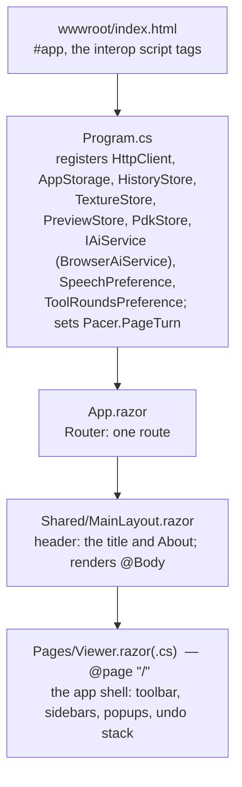
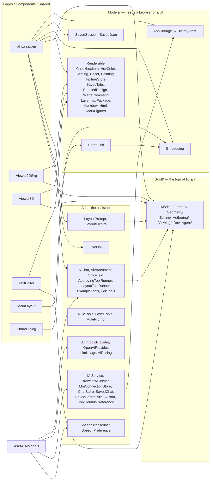
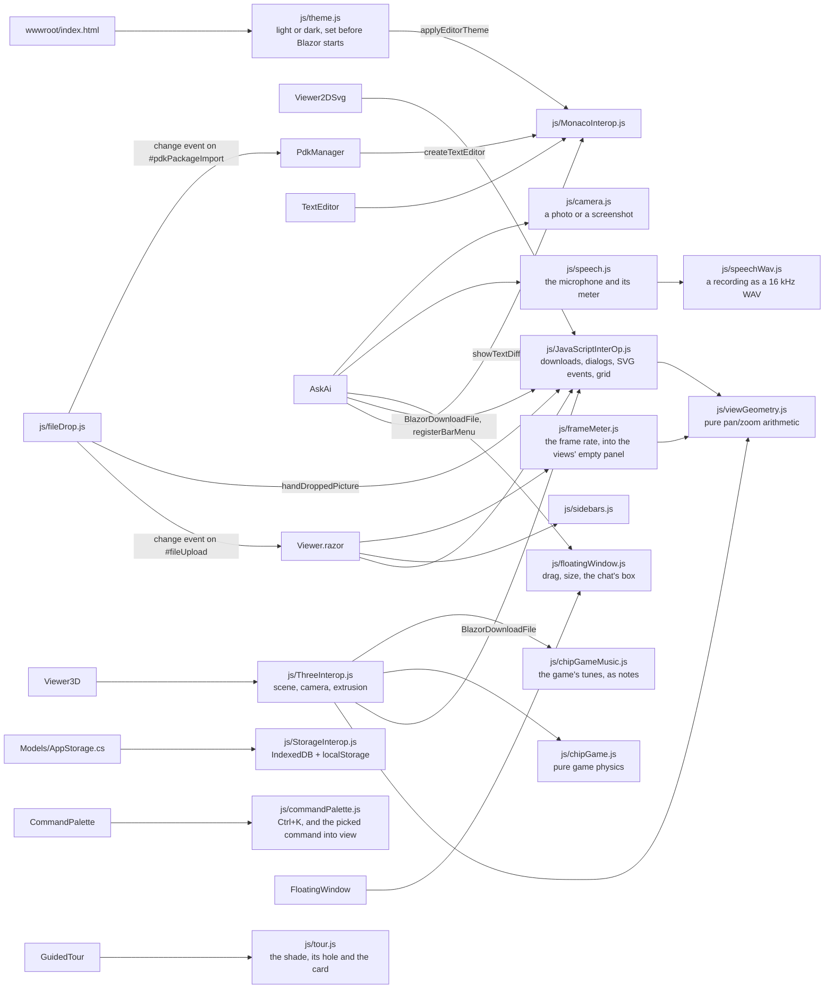

# Architecture — the map

Where every Razor component and C# class sits, and which one uses which. This is the map, not the
walkthrough: each subsystem's *why* lives in [DOCUMENTATION.md](DOCUMENTATION.md), and this file exists so
that finding a class does not require reading it. Every edge below is in the code; none of it is intent.

## From address bar to viewer

One route. The layout renders `@Body`, the router puts the one page in it, and everything else is a
component the page composes.

`Pages/` holds the one file with an `@page` directive and nothing else. Everything under `Components/` is
composed, never routed.

The two AI windows are the shell's too, mounted with the page and only hidden, so a conversation outlives
switching view: **the AI assistant** and **AI settings**, both inside a `FloatingWindow`. The first opens from the spark in
the shell's bar, after the Cells and Layers switches, in all three views.

## The component tree

The shell renders exactly **one** view at a time, chosen by `ViewType` from `?view=` in the address. All
three implement `IRenderable`, which is what the shell knows about every view: `Render(gds,
showLayers, prepared)`, a toolbar, and `WriteSettings` and `ApplySettings` for its own controls in a session. What
only some views have, the shell reaches by a cast rather than through it: the 2D view's opacity, and the 3D
view's spacing, settings menu, game and being told of an edit made in place, among others. The QR popup
belongs to the 3D view, not to the shell, and opens from **Open on phone** over the scene, beside VR and AR. The
Share popup is the shell's, and so is its button, at the far end of the bar with the settings gear: only the
shell knows what file and framing a link would carry.

```mermaid
flowchart TD
    Viewer["Pages/Viewer.razor — the shell"]
    Viewer -->|"?view=2d"| V2D["Components/Viewer2DSvg.razor(.cs)<br>SVG editor: select, draw, move, measure"]
    Viewer -->|"?view=3d"| V3D["Components/Viewer3D.razor(.cs)<br>three.js extrusion of the stack"]
    Viewer -->|"?view=text"| TE["Components/TextEditor.razor(.cs)<br>Monaco over the record dump"]
    V3D --> QR["Components/QR.razor<br>QR popup of a link to what is open"]
    V3D --> Tree3D["Components/CellTree3D.razor<br>the cells beside the scene, read rather than worked on"]
    Viewer --> Share["Components/ShareDialog.razor<br>the Share popup: a link, or the iframe round one"]
    Viewer --> Ask["Components/AskAi.razor<br>the assistant's conversation"]
    Viewer --> AiSet["Components/AiSettings.razor<br>the saved AI models"]
    AiSet --> Link["Components/LiveLinkCard.razor<br>Claude through gds mcp, by a code"]
    Viewer --> Chip["Components/LiveLinkChip.razor<br>the link, while its window is put away"]
    Viewer --> Note["Components/LoadingNote.razor<br>what is loading, and Cancel"]
    Viewer --> Palette["Components/CommandPalette.razor<br>Ctrl+K: the page's own commands, by name"]
    Viewer --> Tour["Components/GuidedTour.razor<br>the tour, a card a part"]
    Viewer --> Pdk["Components/PdkManager.razor<br>the PDKs: their layers and rules, and which is in use"]
    V2D --> Kept["Components/KeptUntilChanged.razor<br>a costly part, drawn again only when it changes"]
    TE --> Kept
    Tree3D --> Kept
    AiSet --> Models["Components/AiModels.razor<br>the models' list and form"]
    Ask --> Float["Components/FloatingWindow.razor<br>a window: dragged, sized, opened in the middle,<br>a size set with its grip remembered"]
    AiSet --> Float
    Pdk --> Float

    V2D -.->|"OnFileChanged, OnSettingsChanged,<br>OnToolChanged, OnLayerRenamed,<br>OnNoticeDismissed, OnCellTreeClosed,<br>OnDrawn, OnAutoPreviewChanged"| Viewer
    Ask -.->|"OnLayoutChanged, OnOpenSettings"| Viewer
    V3D -.->|"OnSettingsChanged, OnToolChanged, OnDrawn,<br>OnCellTreeClosed, OnAutoPreviewChanged"| Viewer
    TE -.->|"OnFileChanged, OnCellListClosed,<br>OnAutoPreviewChanged"| Viewer
```

Data flows down as parameters — the open `GDS`, the flattened layout, the layer checkboxes, the edit
history — and changes flow back up as the dashed callbacks. `onFileEdited` in the shell is the one funnel
every change goes through, whichever view raised it; that is what keeps the sidebar, the session and the
other views agreeing about what the file now contains.

## What each piece uses

Four layers, used strictly downward: components use `Ai/` and `Models/`, `Ai/` uses `Models/` for its
storage, all three use `GdsII/`, and `GdsII/` uses nothing of any of them — it has no browser, no UI, and is what
the NuGet package ships. `Ai/` is the assistant: the providers, the saved models and the conversation, ported
from GraphDBViewer, over the library's `AgentTools`.

Who uses what, at the class level — the heavy consumers first:

| File | From `Models/` | From `GdsII/` |
|---|---|---|
| [`Pages/Viewer.razor`](../Pages/Viewer.razor) + `.razor.cs` | `AppStorage`, `HistoryStore`/`HistoryEntry`, `SavedSession`/`SavedJson`, `Embedding`, `HsvColor`, `CheckboxItem`, `IRenderable`, `Pacer`, `TextureStore`, `SavedTabs`, `BundledDesign`, `PaletteCommand`, `LayermapPackage`, `PdkList`/`Pdk`/`PdkStore`, `PreviewStore`, `PreviewPictures`, `AutoPreviewSwitch` | `GDS`, `GdsFlattener`, `LayoutEdit`/`EditHistory`, `Hierarchy`, `Importing`, `Drc`/`DrcDeck`/`DrcReport` and their `DrcRule`/`DrcViolation`, `Compare`, `LayerNames` and `Layer`/`LayerKey`/`LayerFill`, `SvgWriter`, `Preview`, `MaskBitmaps`, `Picking`, `Measure`, `Grid`, `Shapes`, `Bounds`, `LayoutFile` and the OASIS and DXF readers and writers, `SvgReader`, `AgentSession`/`AgentResult` |
| [`Components/Viewer2DSvg.razor`](../Components/Viewer2DSvg.razor) + `.razor.cs` | `Settling`, `SavedSession`, `CheckboxItem`, `IRenderable`, `Pacer`, `CellTreeText`, `PreviewPictures`, `AutoPreviewSwitch`, `MarkFigures` | `GDS`, `GdsFlattener` (and its `Index`), `SvgWriter`, `Picking`, `LayoutEdit`/`EditHistory` (`AddElement` and `CompoundEdit` among its edits), `Flattening`, `DrcDeck`, `Hierarchy`, `CellContext`, `Booleans`, `Corners`, `Marks`, `Nets`, `Measure`, `Grid`, `Shapes`, `PixelFont`, `Raster`, `Aligning`, `Turning`, `Preview`, `Scaling`, `Bounds`, `Transform`, `Paths`, `Element`, `ElementSource`, `LayerKey` |
| [`Components/Viewer3D.razor`](../Components/Viewer3D.razor) + `.razor.cs` | `Settling`, `SavedSession`, `CheckboxItem`, `IRenderable`, `Pacer` | `GDS`, `GdsFlattener`, `Booleans` and its `Outline`, `Layer`, `Element` |
| [`Components/CellTree3D.razor`](../Components/CellTree3D.razor) | `CellTreeText`, `PreviewPictures`, `AutoPreviewSwitch` | `Hierarchy`, for its rows and where a press on one puts the camera, `GdsFlattener` for the picture of the cell pointed at, and `SvgWriter` for a layer's swatch |
| [`Components/TextEditor.razor`](../Components/TextEditor.razor) + `.razor.cs` | `SavedSession`, `CheckboxItem`, `IRenderable`, `PreviewPictures`, `AutoPreviewSwitch` | `Hierarchy`, for the rows of its cell list and each cell's placements, and `GdsFlattener` for the picture of the cell pointed at, drawn through `PreviewPictures` — the text itself it makes with `AsText()` and reads back with `Deserialize` on a save, then tells the shell through `OnFileChanged` |
| [`Components/QR.razor`](../Components/QR.razor) | — | — (renders SVG from `Net.Codecrete.QrCodeGenerator`) |
| [`Components/ShareDialog.razor`](../Components/ShareDialog.razor) | `ShareLink`/`ShareOptions` (which use `Embedding`'s framing readers), `AppMode` | — (the 3D backdrops come from `Viewer3D.Backdrops`) |
| [`Shared/MainLayout.razor`](../Shared/MainLayout.razor) | `Embedding` | — |
| [`Components/AskAi.razor`](../Components/AskAi.razor) | — (from `Ai/`: `IAiService` for its providers and its chats, `AiChat`, `SavedChat`/`ChatSummary`, `AiAttachment`, `LayoutToolRunner` with `RuleTools` and `LayerTools` given a `RuleBook` by the shell, `ExampleTools` the bundled examples and `PdkTools` a `PdkShelf` of the PDKs, `LayoutPrompt`, `LlmUsage`, `AiPricing`/`AiEstimate`, `SpeechTranscriber` for the microphone, `ToolRoundsPreference`) | `AgentSession`, `AgentResult`, `EditHistory`, `DrcDeck` |
| [`Components/AiModels.razor`](../Components/AiModels.razor), [`AiSettings.razor`](../Components/AiSettings.razor) | — (from `Ai/`: `IAiService` for the models, `LlmConnection`, `SavedSecretRule`, `OpenAiProvider`, `AnthropicProvider`, `AiPricing` for the rates a blank box stands for) | — |
| [`Components/LiveLinkCard.razor`](../Components/LiveLinkCard.razor), [`LiveLinkChip.razor`](../Components/LiveLinkChip.razor) | — (from `Ai/`: `LiveLink`) | — (the calls are answered by the shell, through `LayoutToolRunner`) |
| [`Components/PdkManager.razor`](../Components/PdkManager.razor) | `PdkList`/`Pdk` (the shell keeps the list, lays the PDK in use over the open file, and opens its layer settings on a row), `PdkPackage`/`LayermapPackage`, `TextureStore`, `PdkReadme` and `MarkdownHtml` for its README; and Write with AI, which the shell answers by opening the AI assistant on that PDK (`OnWriteRules`; see `Ai/RuleTools`) | `LayerNames`, `DrcDeck`/`DrcRule`/`DrcCheck`, `Drc`, `LayerKey`, `SvgWriter` (its rules as text in `js/MonacoInterop.js`'s `createTextEditor`) |
| [`Components/FloatingWindow.razor`](../Components/FloatingWindow.razor) | — | — (`js/floatingWindow.js` does the dragging) |
| [`Components/LoadingNote.razor`](../Components/LoadingNote.razor) | — (the shell says what is loading, and does the cancel) | — |
| [`Ai/`](../Ai) | `AppStorage`; its own `AiJson` for what it keeps as JSON | `AgentTools`, `AgentSession`, `AgentParameter`, `Hierarchy`, `GdsFlattener`, `SvgWriter`, `Preview`, `LayerNames`, `DrcDeck`, `LayerKey` |

The asymmetry is the design: the shell owns everything that belongs to the *file* (the undo stack, the
session, the history, DRC, import and export), the 2D view owns everything that belongs to *editing*
(which is why its GdsII list is the longest), the 3D and text views mostly draw, and `MainLayout` knows
whether an embedding address asked it to hide the header. The settings and Share are the shell's now, at the
far end of its bar: the settings because the bar is where every control is, Share because only the shell
knows what file and framing a link would carry.

## The JavaScript seam

Each view has its own interop file, one per library, and they call each other in one place: `ThreeInterop.js`
saves the 3D model through `BlazorDownloadFile` in `JavaScriptInterOp.js`. `MonacoInterop.js` serves more than
the text view: the AI assistant shows what a change did to the file's text with its `showTextDiff`, and the PDK manager
writes a deck's text in its `createTextEditor`. Plain scripts sit
beside them: `viewGeometry.js` is pure arithmetic shared by the 2D and 3D interop (and required as-is
by the Node unit tests), `chipGame.js` is the physics of the 3D view's game and pure for the same reason,
`chipGameMusic.js` is the game's music written as notes, which `ThreeInterop.js` plays in Web Audio,
`fileDrop.js` turns a file dropped on the drawing into the same `#fileUpload` change event the file dialog
produces — a picture over the 2D drawing goes to the Image row's own input instead, through `handDroppedPicture`
in `JavaScriptInterOp.js`, and a PDK dropped on the PDK manager's list to the manager's own — and swallows a
drop anywhere else, and `theme.js` sets light or dark from the page's head, before
Blazor has started, so a dark visitor never sees the app open white — and tells the text editor when it
changes, through the `applyEditorTheme` that `MonacoInterop.js` leaves on the window. `frameMeter.js`
counts the frames the page shows, for the frame rate the settings can put in the corner of either drawing,
and writes it straight into the panel each view leaves empty for it. `floatingWindow.js` moves and sizes every
floating window — the AI assistant, AI settings (the MCP server's card among them) and the PDK manager — opening each in the middle, and
grows the chat's text box; the picture the assistant's `look` sends is drawn by
`layoutPictureBase64` in `JavaScriptInterOp.js`, beside the PNG download it shares a rasterizer with.
`commandPalette.js` listens for Ctrl+K on the window and scrolls the picked command into view, and `tour.js`
keeps the tour's shade, with its hole, and its card over the part a step is about. The assistant's microphone is
`speech.js` - the browser's own recognition, or a recording that `speechWav.js`, pure and unit-tested under Node, writes
as a 16 kHz WAV for the provider to transcribe - and `camera.js` takes the photo or the screenshot a question carries,
handing it to the paperclip's own input so it meets every check a chosen file does.

The odd one out is `Models/Counters.cs`: nothing in the app references it. It is `[JSInvokable]` and
exists to be called *from* JavaScript — `DotNet.invokeMethod('GDSViewer', 'FlattenCount')` — so an
end-to-end test can ask how many times the library was flattened, which no amount of looking at the screen
can reveal.

## Where the depth is

| For | Read |
|---|---|
| The shell, the toolbar protocol and `IRenderable` | [DOCUMENTATION.md — The page shell](DOCUMENTATION.md#the-page-shell-and-the-toolbar-protocol) |
| Each view in detail | [The 2D SVG view](DOCUMENTATION.md#the-2d-svg-view), [The 3D view](DOCUMENTATION.md#the-3d-view), [The text editor view](DOCUMENTATION.md#the-text-editor-view) |
| The library the views draw from | [DOCUMENTATION.md — The GDSII parser](DOCUMENTATION.md#the-gdsii-parser) onward, and the folder-by-folder tree in [Where everything is](DOCUMENTATION.md#where-everything-is) |
| Sessions, history and the undo stack's two lives | [Keeping a session](DOCUMENTATION.md#keeping-a-session) |
| What runs where at test time | [Testing](DOCUMENTATION.md#testing) |
