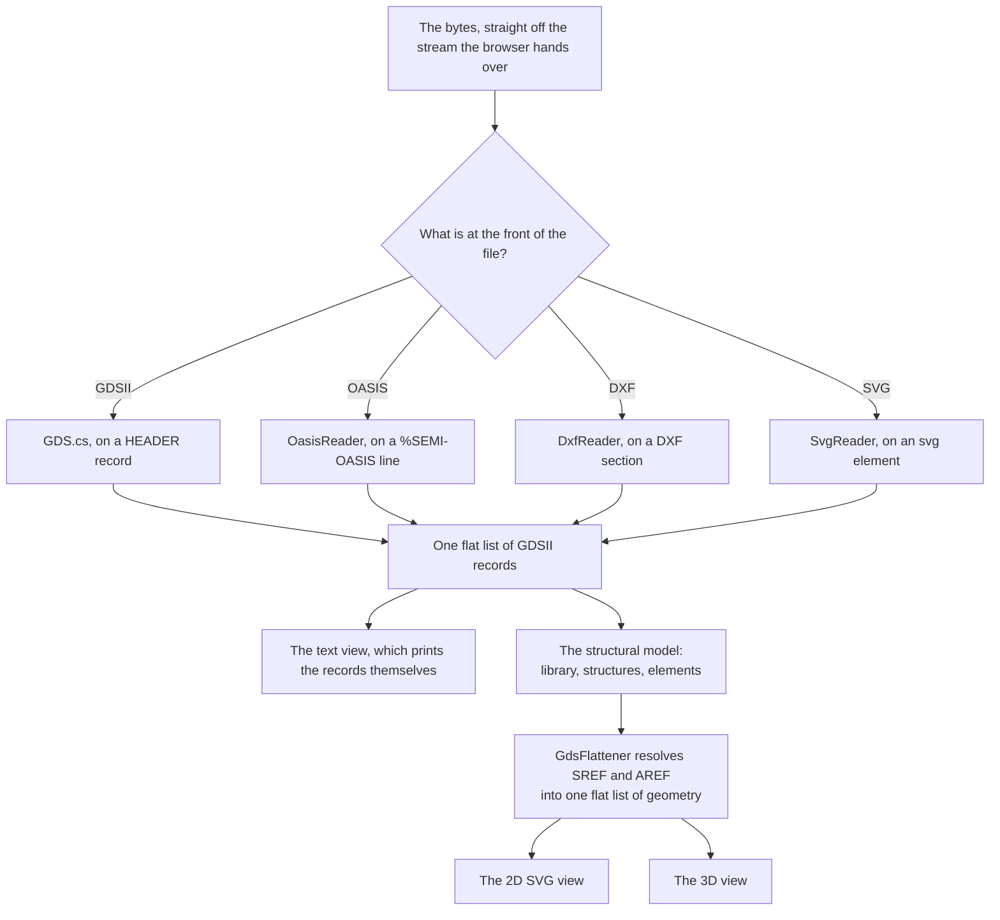
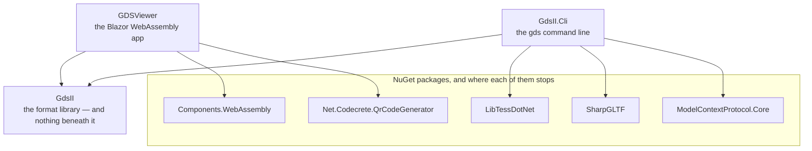
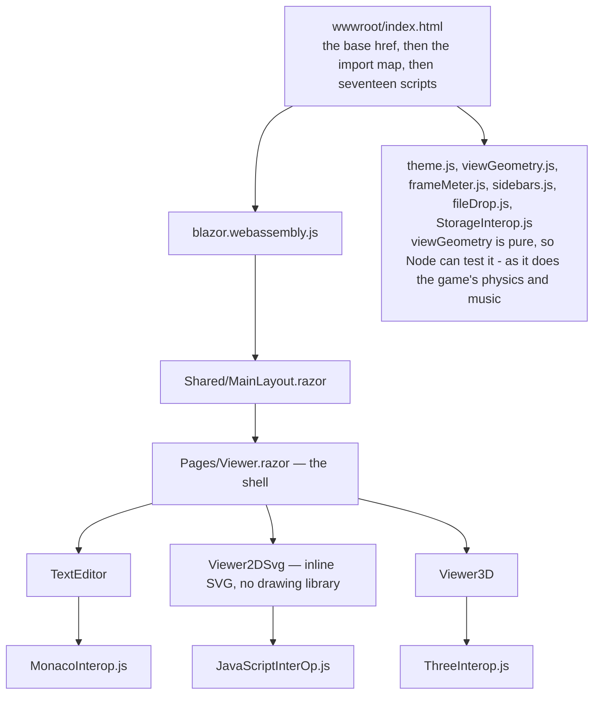
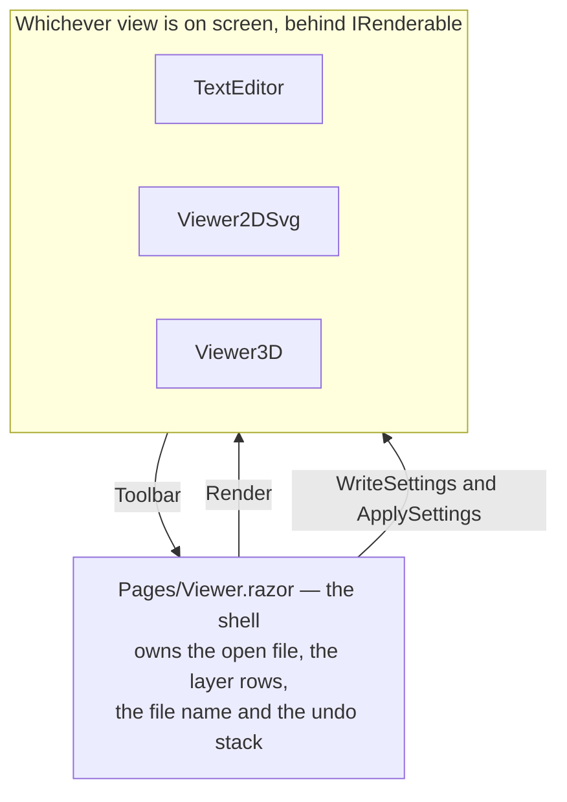
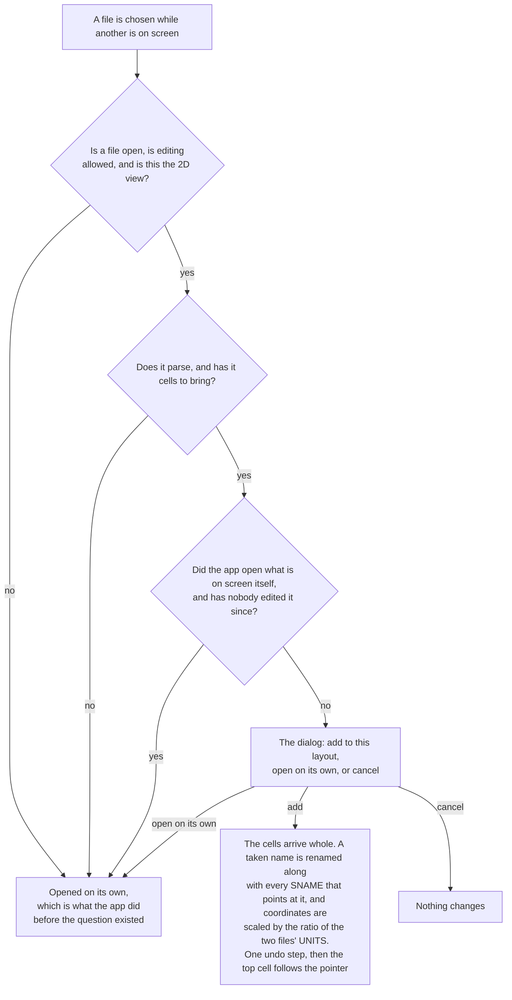
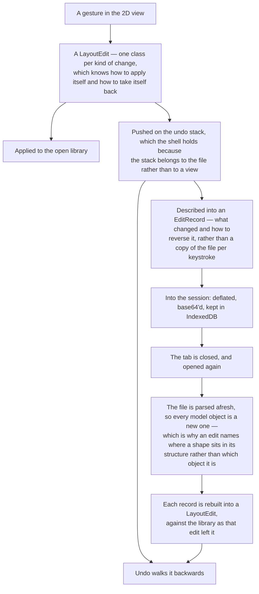
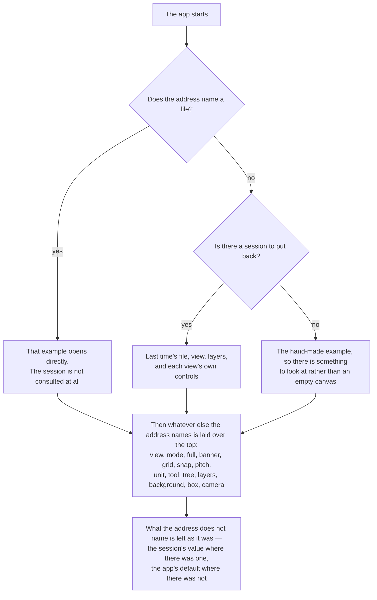

# GDS Viewer — Developer Documentation

This document describes how the app is put together, subsystem by subsystem. For the user-facing
overview see [README.md](../README.md); for code style see [CLAUDE.md](../CLAUDE.md).

## Contents

- [Overview](#overview)
- [Runtime & bootstrap](#runtime--bootstrap)
- [The GDSII parser](#the-gdsii-parser)
- [Reading OASIS](#reading-oasis)
- [Writing OASIS](#writing-oasis)
- [Boolean operations](#boolean-operations)
- [The structural model](#the-structural-model)
- [Making a layout](#making-a-layout)
- [Tools for an AI assistant](#tools-for-an-ai-assistant)
- [AI assistant](#ai-assistant)
- [The MCP server](#the-mcp-server)
- [PDKs](#pdks)
- [Layers, colors and stacking](#layers-colors-and-stacking)
- [Resolving the hierarchy](#resolving-the-hierarchy)
- [The page shell and the toolbar protocol](#the-page-shell-and-the-toolbar-protocol)
- [The 2D SVG view](#the-2d-svg-view)
- [The 3D view](#the-3d-view)
- [The text editor view](#the-text-editor-view)
- [Vendored JavaScript](#vendored-javascript)
- [Keeping a session](#keeping-a-session)
- [The history list](#the-history-list)
- [PWA and hosting](#pwa-and-hosting)
- [Embedding the viewer](#embedding-the-viewer)
- [Testing](#testing)
- [Build & run](#build--run)
- [Known gaps](#known-gaps)

## Overview

GDS Viewer is a **Blazor WebAssembly** single-page app (`net10.0`) that reads
[GDSII](https://en.wikipedia.org/wiki/GDSII) integrated-circuit layout files entirely in the browser.
Nothing is uploaded: the file is read straight off the stream the browser hands over, parsed by C# running
in WASM, and handed to one of three views through JS interop. The exceptions are the person's to make, and
off until they give a key: [the AI assistant](#ai-assistant) sends what they ask and what it reads from the layout to the AI
provider of that key, and the PDK manager's [Write with AI](#the-pdk-manager) opens it to write the rules they describe,
with the PDK's deck and layers beside them.
[OASIS](#reading-oasis), the format meant to replace GDSII, is read and [written](#writing-oasis) too —
converted into the same model on the way in, which is why everything downstream needs to know about only
one format, and back out of it on the way to a download.

[DXF](#reading-dxf) and [SVG](#reading-svg) arrive the same way, so the whole read path is four front ends and one
of everything after them — and the place they meet is the record list rather than the views:



The extension is not consulted anywhere on that path — see
[Reading OASIS](#reading-oasis) for why a file is asked what it is rather than told.

**The format itself is a separate project.** [`GdsII/`](../GdsII) holds everything about GDSII — reading a
file into an object model, writing one back, validating it, the text dump in both directions, resolving
the hierarchy into flat geometry, rendering that to SVG, and converting to and from OASIS. The app
references it and is one consumer of it. The line is drawn at the browser: nothing in the library touches a
renderer, a UI framework or JS interop, which is what leaves it usable from a command-line tool or anything
else.

What stayed behind in [`Models/`](../Models) is what cannot cross that line — anything that is about *this app*
rather than about the format, or that reaches the browser:

| | |
|---|---|
| [`AppStorage`](../Models/AppStorage.cs) | IndexedDB and localStorage, through interop |
| [`SavedSession`](../Models/SavedSession.cs), [`SavedJson`](../Models/SavedJson.cs) | app state — a view, an opacity, a background — rather than a layout |
| [`HistoryEntry`](../Models/HistoryEntry.cs), [`HistoryStore`](../Models/HistoryStore.cs) | [the list of files opened](#the-history-list), which is a fact about the visitor |
| [`Embedding`](../Models/Embedding.cs) | [what the address is allowed to say](#embedding-the-viewer) |
| [`OtherModels`](../Models/OtherModels.cs) | `IRenderable`, `CheckboxItem`, the toolbar model |
| [`HsvColor`](../Models/HsvColor.cs) | the color picker's own arithmetic |
| [`Settling`](../Models/Settling.cs) | coalescing a drag across a slider |
| [`Painting`](../Models/Painting.cs) | waiting for the screen to show a message before work that holds the page |
| [`TextureStore`](../Models/TextureStore.cs), [`LayermapPackage`](../Models/LayermapPackage.cs) | [a layer's own picture](#a-layers-own-picture), kept in this browser by name and zipped with the layermap that names it |
| [`PreviewPictures`](../Models/PreviewPictures.cs), [`PreviewStore`](../Models/PreviewStore.cs) | [the pictures beside the lists](#the-pictures-beside-the-lists): when one is drawn, given up and kept |
| [`Pdk`](../Models/Pdk.cs), [`PdkStore`](../Models/PdkStore.cs) | [the PDKs](#pdks) kept, and which one is in use |

`SvgWriter` did cross, and its signature changed to take a set of `LayerKey` rather than the shell's row
model: a library about GDSII should not have a type called `CheckboxItem` in its public surface. The
conversion now lives on `CheckboxItem` itself, on the app side.

All four projects target **net10.0**. The library and the CLI started on net8.0, to reach further as a
dependency — worth something while 8 was the current LTS, but it goes out of support in November 2026, and
in the meantime the floor was costing a .NET 8 install on every machine that opens the solution. Visual
Studio is what said so: it warns that a project targets a framework with no installed runtime, where the
command line stays quiet because the SDK pulls the reference pack from NuGet and compiles happily against
it. If someone does need to consume this from net8.0, the answer is to multi-target rather than to drop the
floor back and carry the same problem again.

A second consumer already exists: [`GdsII.Cli/`](../GdsII.Cli) is a console tool over the same library — its own
guide is [docs/CLI.md](CLI.md), and [docs/NUGET.md](NUGET.md) covers consuming the library from code.
Writing it found a hole in the surface immediately - there was no way to make a `GDS` from text alone.
`Deserialize(string)` replaces the contents of a library that is already open, which is what the editor's
save needs, but there was no route in from nothing. `GDS.FromText` is that route, and it exists because
something outside the app asked for it.

The CLI is also where the two package references live. `gds model` extrudes a layout into a solid, which
the app gets from three.js and a console tool cannot - so
[LibTessDotNet](https://github.com/speps/LibTessDotNet) triangulates the caps and
[SharpGLTF](https://github.com/vpenades/SharpGLTF) writes the glTF. **Both are referenced by `GdsII.Cli`
alone**: the library stays dependency-free, which is the property that makes it worth depending on, and
the no-package-manager rule is about [what the app ships](#vendored-javascript) rather than about every
project in the solution. STL and OBJ are written by hand in
[`ModelWriters.cs`](../GdsII.Cli/Modeling/ModelWriters.cs) - both are a triangle list with a header, and a
dependency for that would be more to keep current than to write. A third reference came with `gds mcp`: the
official MCP SDK's Core package, which talks the Model Context Protocol - see [The MCP server](#the-mcp-server).

Which leaves the solution one library with nothing under it, and two consumers that each pay for their own
surroundings:



The empty space under `GdsII` is the point of the drawing: anything added there is paid for by everything
that depends on it, forever.

Inside the app, the seventeen scripts under `wwwroot/js` are shared out one to a view, with six that belong to
nobody in particular - and eight that belong to one thing each: the command palette, the tour, the floating windows
(the AI assistant, AI settings and the PDK manager), the AI assistant's microphone (`speech.js`, with `speechWav.js`
for the recording it sends a provider) and its camera (`camera.js`), and the 3D view's game, its physics and its music:



**Every one of those seventeen is asked for by name, and the name is checked.** A script tag whose spelling differs
from the file only by case works on Windows and macOS and 404s on any host worth deploying to, which is a
defect that cannot be seen on the machine it is written on —
[`ShippedAssetTests`](../tests/GDSViewer.Tests/ShippedAssetTests.cs) reads `index.html` and holds every
local `src` and `href` to the directory listing rather than to `File.Exists`, since `File.Exists` is
precisely the check that cannot tell the difference. It also asserts the other direction: a file under
`wwwroot/js` that nothing loads is either dead or a script tag somebody forgot.

Design points:

- **Two-stage parse.** `byte[]` becomes a flat `List<Record>` first, then a second pass walks that list
  into a nested model (library, structures, elements). Both stay available: the text view prints the
  flat records, the renderers walk the tree.
- **The views are interchangeable.** Each implements `IRenderable.Render(GDS?, List<CheckboxItem>?, FlattenedLayout?)` and
  is swapped by a `switch` in the shell. The shell owns the file, the layer list, and the toolbar.
- **The build is warning-free**, which makes a new warning worth reading. See
  [Nullability](#nullability) for the convention that keeps it that way.
- **No bundler.** Monaco and three.js are vendored under `wwwroot/lib/`; `dotnet build` is the whole
  build. See [Vendored JavaScript](#vendored-javascript).

Dependencies: **Microsoft.AspNetCore.Components.WebAssembly** and
**Net.Codecrete.QrCodeGenerator** (the QR popup), with the **DevServer** package beside them for `dotnet run`
alone. No other NuGet packages.

### Where everything is

```
GDSViewer/
  Program.cs                    # Blazor WASM host builder
  App.razor                     # Router: one route, "/" (the view goes in ?view=)
  Shared/MainLayout.razor       # Header with About, hosts the viewer
  Pages/
    Viewer.razor(.cs)           # The app shell and the ViewType enum
  Components/
    Viewer2DSvg.razor(.cs)      # 2D SVG view
    Viewer3D.razor(.cs)         # 3D three.js view
    CellTree3D.razor            # The 3D view's cell tree, beside the scene
    TextEditor.razor(.cs)       # Monaco record view
    QR.razor                    # QR code popup, opened by OPEN ON PHONE over the 3D scene
    ShareDialog.razor           # The Share popup: a link, or the iframe that embeds one
    AskAi.razor                 # The AI assistant window: the conversation, its cards and its controls
    AiModels.razor, AiSettings.razor  # The saved AI models: the picker, the form, and their window
    LiveLinkCard.razor, LiveLinkChip.razor    # AI settings, MCP server: the tab linked to gds mcp, and the chip while it is put away
    FloatingWindow.razor        # A window rather than a popup: dragged, sized, remembered
    CommandPalette.razor        # Ctrl+K: the page's own commands, found by name
    GuidedTour.razor            # The tour, a card a part, started from Settings and never sprung
    PdkManager.razor            # The PDK manager: the PDKs, their layers and rules as tables, a rule form, a PDK as a zip
    LoadingNote.razor           # What is loading, and Cancel
    KeptUntilChanged.razor      # A costly part of a view, drawn again only when what it shows changes
  Ai/                           # The assistant, ported from GraphDBViewer - see the AI assistant
    AnthropicProvider.cs, OpenAiProvider.cs  # The two families of API, called from the browser
    LlmProvider.cs, LlmMessage.cs, LlmTool.cs  # What they share: results, turns, tools, sending
    IAiService.cs, BrowserAiService.cs  # The seam: models, providers and chats - the browser's own, or a host app's
    LlmConnection.cs, LlmConnectionStore.cs, SavedSecretRule.cs  # Saved models and their keys
    SavedChat.cs, ChatStore.cs  # A chat as it is kept, and the chats kept in this browser
    AiChat.cs                   # The conversation: turns, cards, Stop, the files waiting, what was spent
    AiAttachment.cs             # A file sent with a question: its kind, its limits, what a request carries of it
    OfficeText.cs               # An Excel workbook or a Word document read out as words, in the page
    LlmUsage.cs, AiPricing.cs   # What an answer was billed for, the rates, and the next request's estimate
    ApprovingToolRunner.cs      # How far the model may go before a person is asked
    LayoutToolRunner.cs         # The layout's tools as a model is given them, and look
    LayoutPrompt.cs, LayoutPicture.cs  # What the model is told, and what it is shown
    RuleTools.cs, RulePrompt.cs # read_rules and add_rules, a PDK's deck written in the AI assistant, and the grammar they give
    LayerTools.cs               # read_layers and set_layers, a PDK's layermap written there the same way
    ExampleTools.cs             # list_examples and read_example, the app's own sky130 examples read beside the layout
    PdkTools.cs                 # use_pdk: a PDK put in use from the AI assistant, and the layers of it a layout lacks laid on
    ToolRoundsPreference.cs     # How many rounds of tool calls a message takes before the run pauses to ask
    SpeechPreference.cs, SpeechTranscriber.cs  # The microphone's words: the way chosen under AI settings, and the browser's own recognition or a recording the provider writes out
    TextChange.cs               # What one change did to the file's text, as the diff its card shows
    LiveLink.cs                 # The tab's end of its link to gds mcp
    DevSecrets.cs               # The models a Development build adds from wwwroot/dev-secrets.json
    AiJson.cs                   # The saved models and dev-secrets.json as JSON, generated at compile time
  GdsII/                        # The format library. No browser, no UI - see below
    README.md                   # The package's readme, the one nuget.org shows
    Pauses.cs                   # How a long walk offers to stop, every so many steps
    Model/                      # What a layout *is*
      GDS.cs                    # Records, payload decoding, structural model, validation
      RecordData.cs             # The payload types, one per GDSII data type
      BitFields.cs              # STRANS, PRESENTATION and ELFLAGS unpacked
      Element.cs                # Layer/datatype keys, layers, palette, stacking offsets
      LayerNames.cs, .LayerProperties.cs, .Editing.cs  # A layermap: names, colors, the stack, roles and patterns; KLayout's .lyp read as one; edited a row at a time and written back, for a PDK
      Paths.cs                  # What a path is written with: centerline, width, end style
      LayoutWriter.cs           # Flat geometry back into a library
    Formats/                    # Everything that reads or writes a file
      OasisReader.cs, OasisWriter.cs   # OASIS in and out
      LayoutFile.cs             # Which of the four a file is, told off its front, and reading it as that
      ConcatenatedStream.cs     # A file's front put back in front of the rest, for a stream that only goes forward
      DxfReader.cs, DxfWriter.cs, DxfBinary.cs, DxfCurves.cs  # DXF in and out
      SvgWriter.cs              # A flattened layout as SVG markup, and every icon
      PngWriter.cs              # The same picture as a PNG, for the thumbnails beside the lists
      SvgReader.cs              # A drawing from Inkscape or Illustrator, read as a layout
      MaskBitmaps.cs            # One bitmap a layer for a mask writer: rasterized, PNG, zipped
      PngFile.cs                # The signature, chunks and CRC both PNG writers frame their pixels with
      TextFormat.cs             # Parses the text dump back into records (the save path)
    Geometry/                   # Arithmetic over shapes
      GdsFlattener.cs           # Resolves SREF/AREF into flat geometry
      Booleans.cs               # AND/OR/XOR/NOT and offsetting, over vendored Clipper2
      PathOutline.cs            # A PATH's centerline expanded to the shape it occupies
      Transform.cs              # Placement composition
      Scaling.cs, Bounds.cs     # Units and extents
      Fracture.cs               # Cutting a shape too large for one record into several
      Corners.cs                # Cutting a shape's corners off, or rounding them
    Editing/                    # Changing what is already there
      LayoutEdit.cs, EditRecord.cs # Every edit, and an edit written down so it survives a reload
      Hierarchy.cs              # The cell tree, and what places what
      Flattening.cs             # A placement taken apart into the cell that holds it
      CellContext.cs            # Which cell is being edited, through which placement
      Importing.cs              # One library's cells brought into another
      Aligning.cs, Turning.cs   # Lining up; rotating and mirroring geometry
    Authoring/                  # Making geometry from nothing
      Shapes.cs                 # Rectangles, circles, ellipses, rings, regular polygons
      PathBuilder.cs, Bezier.cs # Routes that bend by a radius, and curves
      Synthetic.cs              # The benchmark's generator
      PixelFont.cs, Raster.cs   # Writing in a 5x7 font, and lit squares merged into outlines
      Marks.cs                  # Die frames, alignment and test structures, inductors, couplers, antennas, pads
    Viewing/                    # What a viewer needs and a writer does not
      Picking.cs                # Which shape a click landed on
      LayoutIndex.cs            # Where every element is, so a question about one place reads only that
      Nets.cs, Measure.cs       # Tracing a net; area and extent
      Grid.cs                   # The grid and snapping
      Preview.cs                # The thumbnails beside the lists: their frame, and their pictures
      Comparison.cs             # Two layouts laid over each other: where they differ
    Agent/                      # Tools for an AI assistant: AgentTools, AgentSession, the schemas
    Drc/                        # Design rule checking - see DRC.md
      Drc.cs, DrcChecks.cs      # The engine, and each rule's measurement
      DrcDeck.cs, DrcLayers.cs  # The deck as written down, and what it names
      DrcEdges.cs               # Edge extraction
      DrcReport.cs, .Reading.cs # KLayout's report database, written and read back
    Clipper2/                   # Vendored, byte-identical to upstream. Never edited
  GdsII.Cli/                    # The gds command-line tool, over that library
    README.md                   # The tool's readme, the one nuget.org shows
    Commands/
      Cli.cs                    # Argument parsing, and info, dump, build, validate, layers, svg, model
      Cli.Structure.cs          # cells, nets and measure
      Cli.Convert.cs            # convert - format conversion, any direction
      Cli.Geometry.cs           # boolean and size
      Cli.Drc.cs                # drc - running a deck from the command line
      Cli.Bench.cs              # generate and bench - a layout to order, and timing the stages over one
      Cli.Mcp.cs                # mcp - reading its command line, then serving
      LayerFilter.cs            # --layers and --hide
    Mcp/                        # gds mcp - see The MCP server
      McpSession.cs             # The folder, the open layout, and the 41 tools over them
      McpSession.Link.cs        # The tools that link a tab, and calls sent on to a linked tab
      TabLink.cs                # What a GDS Viewer tab links to, by its code
      ServedFolder.cs           # Every path checked, and the listing
      McpServing.cs             # The session on the protocol
    Modeling/
      LayoutMesh.cs, ModelWriters.cs   # Extrusion, and STL/OBJ/GLTF
    licenses/                   # The MCP SDK's license file, which the tool's package carries
    Program.cs                  # Main, and nothing else
  Models/                       # App-only: the parts that need a browser or a UI
    AppStorage.cs               # IndexedDB and localStorage, over JS interop
    SavedSession.cs, SavedJson.cs    # What is put back when you return
    HistoryStore.cs, HistoryEntry.cs # The list of files opened
    Embedding.cs                # What the address is allowed to say
    ShareLink.cs                # The Share popup's choices, as an address and an iframe
    HsvColor.cs                 # The color picker's arithmetic
    Settling.cs                 # Coalescing a drag across a slider
    Painting.cs                 # Waiting for a paint before work that holds the page
    OtherModels.cs              # IRenderable, CheckboxItem, ToolBarItem
    CellTreeText.cs             # What a row of the 2D and 3D cell trees says
    Counters.cs                 # What the app has done, for e2e tests to ask from outside
    TextureStore.cs             # The 3D view's layer pictures, kept by name
    LayermapPackage.cs          # A layermap and its pictures, as one zip
    SavedTabs.cs                # The files open in tabs, and how each was left
    BundledDesign.cs            # One of the bundled designs, and whose it is
    Pacer.cs                    # One load's pace, and its way out: what a long walk waits on, and what Cancel sets
    PreviewPictures.cs          # A list's thumbnails: drawn at a pace, given up when the pointer moves on, kept
    PreviewStore.cs             # The big designs' thumbnails, kept between visits
    AutoPreviewSwitch.cs        # Auto-generate preview: one switch under the four previews, and what it says
    Pdk.cs, PdkStore.cs         # The PDKs - sky130 built in, any of your own - and which one is in use
    PdkPackage.cs               # A whole PDK - layermap, rule deck, pictures and README - as one zip
    MarkdownHtml.cs             # A PDK's README as a page, escaped before any tag is made
    MarkFigures.cs              # The Generator's kinds drawn, each number's box beside the part it sets
    PaletteCommand.cs           # One thing the command palette can do
  wwwroot/
    index.html                  # Host page: base href, import map, interop scripts
    js/                         # ThreeInterop, MonacoInterop, JavaScriptInterOp,
                                #   StorageInterop, sidebars, fileDrop, viewGeometry, theme,
                                #   frameMeter, floatingWindow, commandPalette, tour,
                                #   chipGame, chipGameMusic, speech, speechWav, camera
    lib/                        # Vendored Monaco + three.js (see lib/README.md)
    css/, resources/            # Styles, icons, backgrounds, sample GDS files
                                #   resources/GDS Files/examples.json, gf180-examples.json and
                                #   ihp-examples.json are generated by the build
  tests/                        # Every test layer and the tooling that runs them
    GDSViewer.Tests/            # xUnit tests (net10.0), with fixtures/ beside them
    jstests/                    # Browser-JS unit tests (node --test, no packages)
    e2e/                        # Playwright end-to-end specs
    screenshots/                # Takes the screenshots the docs are built from,
                                #   under playwright.screenshots.config.js
    playwright.config.js        # Starts the app itself and runs e2e/ against it
    package.json                # Test tooling only - never part of the app build
  docs/                         # Everything written down, except the readme
    DOCUMENTATION.md            # This file
    ARCHITECTURE.md             # The map: which component and class is used where
    FEATURES-DEMO.md            # Every feature, in pictures
    CLI.md, NUGET.md            # The command-line tool, and the package
    DRC.md                      # Design rule checking: the engine and what it cannot do
    ADDING-AN-AI-ASSISTANT.md   # How the AI assistant was built, layer by layer, to build another
    TREEALITY-PLUGIN.md         # GDS Viewer as a Treeality plugin: what was found, and the two ways in
    (the two authoring guides live in wwwroot/resources, so the app can hand them out)
    THIRD-PARTY-NOTICES.md      # Everyone else's terms, carried along
    images/                     # The screenshots the two above are built from
  CLAUDE.md                     # Code style guidelines
  README.md
```

### The files worth knowing first

| File | Responsibility |
|---|---|
| `GdsII/Model/GDS.cs` | The whole GDSII implementation: record framing, the structural model and validation; the payloads decode in `RecordData.cs` (REAL8 among them). |
| `GdsII/Model/Element.cs` | Layer discovery, the stacking offsets, the 255-color palette, and the flattened render primitives. |
| `Pages/Viewer.razor` | The app shell: file loading, view switching, layer sidebar, toolbar host. |
| `GdsII/Formats/SvgWriter.cs` | Builds the 2D view's SVG markup: layer visibility, label justification, opacity. |
| `GdsII/Formats/TextFormat.cs` | Reads the text dump back into records — the text view's save path. |
| `GdsII/Editing/LayoutEdit.cs` | Every edit as one class each, undoable, and writable to a session. |
| `GdsII/Viewing/Picking.cs` | Which shape a click landed on, now that the picture is one path per layer. |
| `Components/Viewer2DSvg.razor` | The 2D editor: hosts that markup, and every gesture over it — select, band, move, draw, turn, align, array, combine, measure, and the cell context. |
| `Components/Viewer3D.razor` | Flattens geometry for three.js; the view settings hung from the shell's cube (Admire, the background), the model download in the toolbar, and OPEN ON PHONE's QR code over the scene. |
| `Components/TextEditor.razor` | Hosts Monaco over `GDS.AsText()`. |
| `wwwroot/js/ThreeInterop.js` | The three.js scene: extruded meshes, controls, WebXR, exporters. |
| `wwwroot/js/MonacoInterop.js` | Lazily loads Monaco and registers the custom `GDS` language. |
| `wwwroot/js/JavaScriptInterOp.js` | SVG pan/zoom, SVG download, the generic blob download, and the waits on the page (`afterPaint`, `pageTurn`). |

## Runtime & bootstrap

- **[`wwwroot/index.html`](../wwwroot/index.html)** is the host page. An inline script sets
  `<base href>` before anything else: `/` on localhost, otherwise `window.location.pathname`, so the
  app works when served from a GitHub-Pages-style subpath. The **import map must stay after that
  script** — its relative URLs resolve against the document base URL as it is parsed.
- The three interop scripts load last, after the shared ones: `JavaScriptInterOp.js` and `MonacoInterop.js` as
  classic scripts, `ThreeInterop.js` as `type="module"` (it uses `import`).
- **[`Program.cs`](../Program.cs)** is short: it registers the `App` root component, `HeadOutlet`, a scoped
  `HttpClient` pointed at the base address (used to fetch the bundled sample files), five scoped stores over
  the browser's storage - `AppStorage`, `HistoryStore`, `TextureStore`, `PreviewStore` and `PdkStore` - and the
  `IAiService`, this app's own `BrowserAiService` over the same storage, told where a Development build's
  `dev-secrets.json` is (an app GDS Viewer is built into registers its own there - see
  [Whose AI it is](#whose-ai-it-is)), and two AI settings kept as services over the same storage,
  `SpeechPreference` and `ToolRoundsPreference`, so the settings window and the chat hear each other's change -
  and hands `Pacer.PageTurn` the posted message a picture's pace lets the page in with.
- **[`App.razor`](../App.razor)** hosts a `Router`, which resolves `Pages/Viewer.razor` at `@page "/"`.
- **[`Shared/MainLayout.razor`](../Shared/MainLayout.razor)** draws the header (logo, About link) and the
  About popup, and renders `@Body`. It used to name `<GDSViewer.Pages.Viewer>` directly, which is what left the
  router matching nothing and `<NotFound>` unreachable. **About opens from Settings as well**, last in the menu -
  `ShowAbout`, through the cascade the page already has for the banner's button - and the popup is written outside
  the header for it, since the header is left out of an embed that asked for none, in viewer-only mode and once its
  button has put it away, which is when Settings is the only way to About.

### The URL

One route, and **the view lives in the query string** — `?view=2d`, `?view=3d`, `?view=text` — not as a
path segment. That is forced by the bootstrap above rather than chosen for taste: `index.html` sets
`<base href>` from `window.location.pathname`, so any path below the app root would *become* the base and
break every relative asset URL and the import map with it. A query string leaves the path alone. It also
avoids needing the host to rewrite unknown paths onto `index.html`, which GitHub Pages does not do, so a
shared link keeps working wherever the app is served from.

`[SupplyParameterFromQuery]` feeds the slug in, `OnParametersSet` applies it, and switching views calls
`NavigateTo(..., replace: true)` — replace, because switching views is not something the back button
should have to walk back through. The slugs are spelled out in `slugOf`/`viewOf` rather than taken from
the enum names, which would put `View2DSvg` in a link meant to be read and would tie a bookmarked URL to
an identifier that is free to be renamed. An unrecognized slug falls back to the 2D view.

An address with no `?view=` is left alone rather than rewritten to `?view=2d`: a bare link already lands
where a bare link should. The view buttons take their pressed state from the field rather than from a
hardcoded default, so arriving on a link shows the view that is actually on screen.

**`?file=` names a bundled example** — the file name without its `.gds`, so
`?file=sky130_fd_sc_hd__nand2_1&view=3d` opens that cell in the 3D view. The full name rather than a short
one because `nand2_1` exists in the hd, hs and hvl libraries; a name that does not match reports itself
and shows the shape of a real one, since these names are long and a pasted link is usually wrong by a
character or two. `Mosfet.gds` is checked separately from the manifest, which excludes it because the
picker lists it above the sky130 cells.

**It is a way in, not a record of what is open.** Once its file is open it leaves the address
(`takeOutOfAddress`), and nothing writes it back — not the picker, not the history list, not the app's own
first open. Left there, a reload was the link followed again: the file opened fresh, the session was never
asked, and a layer hidden since, a color or an edit was gone. A reload goes to the session now, which by then
holds that file as it was left. A link to the file is what **Share** makes, from what is open
(`linkableFile`), and the 3D view's QR code writes the file into the address it encodes. A name that does
not open stays in the address, so it can be corrected where it was typed, and goes once something else is
open. An **uploaded** file cannot be named in a link at all — it exists only in the tab it was dropped into —
so Share says so rather than naming a bundled example that is not what is on screen.

**Inside an iframe the address is left alone**, because it is the embedding page's. The browser can bring a
frame back at the address it has now rather than at the one the page wrote — going Back to the page does, and
some browsers do it on a reload — and every viewer on a page shares one session, so a frame that had lost its
`file=` would come back as whichever file was saved last: two embeds of two files, both showing one of them.
`isInIframe` in `JavaScriptInterOp.js` is asked once, on the first render.

`?file=` is acted on from `OnAfterRenderAsync` rather than `OnParametersSet`, because it needs the example
manifest and it reports a bad name through a JS alert. That timing is load-bearing: `OnInitializedAsync`
yields on the manifest fetch, so **Blazor renders once before the list exists** and the first
`OnAfterRenderAsync` runs with it still empty. The slug is therefore not consumed until
`exampleListFetched` is set — without that, a linked example was reported as not existing, which is
exactly what happened on the first run.

The payoff is the QR code, which exists to get you from a desktop onto a phone or a headset: it encodes
`NavigationManager.Uri` rather than `BaseUri`, so scanning it from the 3D view of a cell opens that cell's
3D view. The file, `view=3d` and the camera are written into it as it is made, because the address follows
neither the file nor the camera — see [The parameters](#the-parameters). The file is the one Share would name,
handed to the view as `LinkFile`, so an upload is taken out of the code rather than named wrongly.

## The GDSII parser

[`GdsII/Model/GDS.cs`](../GdsII/Model/GDS.cs) is the whole format implementation. `new GDS(byte[])` runs
`Deserialize`, which calls `parseRecords` then `constructGDS`, then builds `AdditionalInformation`.

Of the other implementations worth comparing this against, `python-gdsii` is the closest structural
analogue, and `gdspy`'s `gdsiiformat.py` is the reference for the eight-byte real described below.

### Record framing

A GDSII record is a 4-byte header followed by its payload:

| Bytes | Meaning |
|---|---|
| 0-1 | total record length, **big-endian**, header included |
| 2 | record type |
| 3 | data type |
| 4+ | payload (`length - 4` bytes) |

The length is read **unsigned**. It is only two bytes, and reading it signed would make any record past
32767 bytes come out negative; nothing in the format caps record size there.

Every length in the file is checked before it is trusted, because the cursor is driven by numbers the
file itself supplies. `parseRecords` rejects a stream with too few bytes left for a header, a length
below the four-byte header (zero being the dangerous one — the cursor would never advance and the loop
would spin forever), and a record claiming more bytes than remain. `constructGDS` then rejects an empty
record list and a stream that does not begin with `HEADER`, and converts the `ArgumentOutOfRangeException`
that the forward-only model walk raises when it runs off the end into a readable "ends before its
structure is closed". All of these are `InvalidDataException`, which `Viewer.selectFile` catches and
reports in an alert, leaving whatever was already loaded on screen.

### Reading off a stream

There are three readers. `Deserialize(byte[])` is for bytes already in hand, read in one go — a file chosen to
compare against, or one the import offer reads whole before asking whether to place it. `GDS.FromStream` and
`GDS.FromStreamAsync` read a record at a time off a stream, which is what the file a user opens off their machine
and what the CLI reads off disk both are. And `GDS.FromBytesAsync` reads bytes in hand with pauses in the walk, so
the page can paint while a big file comes in — a session's base64 payload and a fetched example both come in that
way; see [Giving a load up](#giving-a-load-up).

The difference is what is alive at once. The array reader wants the whole file in memory before it starts,
so the bytes and the records they become are both held; in the browser it was three copies, since an
uploaded file arrives as a stream that had to be drained into a `MemoryStream` and then `ToArray`'d before
a single record existed. The stream reader keeps the records and nothing else.

Both exist in sync and async form because the browser leaves no choice: a Blazor WASM file stream refuses
a synchronous read outright, and a CLI has no reason to be asynchronous. What they agree on —
`checkRecordLength` — is written once, so their messages cannot drift. What they cannot agree on is the
one check that needs the whole file: an array reader knows a record declares more bytes than remain before
it reads them, and a stream only finds out by running out, so it says *"the stream ends inside it"* rather
than quoting a count it never had.

**A stream is read in a loop, never in a single `Read`.** A `Read` is allowed to return fewer bytes than
asked for and routinely does — a network stream hands over what has arrived, the browser's file stream
hands over a chunk. Read once and every record after the first short read is framed from the wrong offset,
which surfaces as a corrupt file rather than as a bug in the reader. A test stream that never returns more
than one, two, three or seven bytes at a time pins it; against a `MemoryStream`, which always answers in
full, the bug is invisible.

Anything that is not already a `MemoryStream` gets a `BufferedStream` in front of it. This reads a
four-byte header and then a payload of a hundred or so, which against a raw file handle is two round trips
per record and tens of thousands of them for one layout.

**The upload limit was the browser's default, and nobody had chosen it.** `IBrowserFile.OpenReadStream`
refuses anything over 512 KB unless told otherwise, and the GDS upload was not telling it — so a real
layout of a megabyte was refused, with a message about a limit nobody had picked. Every bundled example was
under 60 KB then, which is why neither the 897-file corpus nor the e2e suite ever met it. The ceiling is a
gigabyte now, and it is not meant to be the thing that stops you: what runs out first is the browser's
memory, which no number here can move.

`parseRecords` reads bytes 2-3 as a single big-endian `short`, which is why `RecordType` packs both
bytes into one enum value — `LAYER = 0x0D02` is type `0x0D` with data type `0x02` (INT2), and
`XY = 0x1003` is type `0x10` with INT4.

Because the low byte *is* the data type, `setData` derives it rather than restating it:

```csharp
declaredDataType = (RecordDataType)((short)Type & 0xFF);
```

It then names only the one pair of records that needs more than a straight conversion — `BGNLIB` and `BGNSTR`,
whose twelve INT2 values are two timestamps and expose a `DateTime` pair; `UNITS` and `XY` are ordinary arrays
of their data type, two reals and a run of INT4. This replaced a 270-line switch that hand-assigned a data type per record type, and which had
drifted from the enum for **ten** of them: `WIDTH`, `PLEX` and `RESERVED` were read as INT2 where the
type word says INT4, `ATTRTABLE` and `SRFNAME` as INT2 where it says ASCII, `STRCLASS` as INT2 where it
says BITARRAY, and `BGNEXTN`, `ENDEXTN`, `LIBDIRSIZE` and `LIBSECUR` had no case at all, so their
payloads were dropped. A test walks every value of the enum and asserts the decoded type matches the
declared one, so the class of bug cannot come back.

### Payload decoding

A payload is a [`RecordData`](../GdsII/Model/RecordData.cs) — an abstract base with one sealed subclass per
GDSII data type:

| Class | Holds | For |
|---|---|---|
| *(null)* | — | a record with no payload |
| `BitArrayData` | `byte[]` | `STRANS`, `PRESENTATION`, `ELFLAGS` |
| `Int2Data` | `short[]` | `LAYER`, `DATATYPE`, `COLROW`, timestamps |
| `Int4Data` | `int[]` | `XY` coordinate runs, `WIDTH`, `PLEX` |
| `Real8Data` | `double[]` | `UNITS`, `MAG`, `ANGLE` |
| `AsciiData` | `string` | `LIBNAME`, `STRNAME`, `SNAME`, `STRING` |
| `RawData` | `byte[]` + the declared type | anything else — see below |

Each class owns its **decoding, its encoding and its text formatting**. Those three used to live in
three separate switches — one picking a decoder, one picking an encoder, one picking a format — none of
which knew about the others. That is the same shape that let `setData` drift from the format for ten
record types, so here a new data type cannot be added without implementing all three.

Arrays are the single shape: `Int2Data` holds `short[]` even when the payload is one value, and `Value`
returns the first. That removes a scalar-versus-array split the encoder previously had to handle twice.
The text view still prints a lone value bare and a run space-separated, which is a deliberate two-line
choice inside `AppendText` rather than a consequence of two different runtime types.

`Record.DataType` is **derived** from the payload rather than stored beside it, so the two cannot
disagree; a private `declaredDataType` covers the one case the payload cannot answer, a record that
names a type and then carries nothing. `BGNLIB` and `BGNSTR` additionally expose their twelve INT2
values through `Timestamps`, a typed `(DateTime Modified, DateTime Accessed)?`.

**`Timestamps` is an interpretation, not the data.** The raw INT2 values in `Data` are the truth — the
record writes back out as it came in and the text dump reports exactly what the file said — while
`Timestamps` applies two readings on top:

**Impossible stamps become null rather than an exception.** Files carry a year of 0, a month of 13, the
30th of February, and `new DateTime(...)` throws `ArgumentOutOfRangeException` on all of them. That used
to escape the parse and take the whole file with it, so a perfectly readable layout would refuse to open
over a field nothing here draws from. Null is returned for the pair as a whole, since half a pair is not
useful. The cases are caught from the constructor rather than checked in advance, because checking would
mean a second implementation of which days each month has, leap years included — a rule `DateTime` owns.

**A year below 1000 is read as an offset from 1900, and one below 50 from 2000**, in `toFullYear`. Writers disagree about this field
and the sample files contain both conventions: the 896 sky130 cells write the full year (`2019`, 3584
times across the corpus), while `Mosfet.gds` writes `122` and `123` — the C `tm_year` convention, for 2022
and 2023. Read literally, that dates a 2022 file to the year 122.

It is a heuristic and worth knowing as one: nothing in the record distinguishes "2022, written the old
way" from "the year 122". It is applied because every file that actually uses small years means the
former, and a viewer reporting 122 AD is wrong in a way nobody wants. Two details of the cut:

- **1000, not 100** — `122` has to be caught, and no convention produces a year between 200 and 999.
- **50 is the other cut**, KLayout's: a two-digit year under it is the 2000s, so a file stamped `24` is from 2024
  rather than 1924 — see [Reading its source](#reading-its-source-not-just-its-output), where it came from.
- **Negative is left alone** — corruption under either reading, and shifting it would turn nonsense into a
  plausible 19th-century date instead of leaving it visibly unreadable.

The tests pin both edges of each cut (`49` and `50`, `999` and `1000`) and assert both conventions against
real files, so a future reader can see exactly which values the guess changes.

### Bit fields

`STRANS`, `PRESENTATION` and `ELFLAGS` are two-byte flag words, so they decode to `BitArrayData` like
any other bit array. [`GdsII/Model/BitFields.cs`](../GdsII/Model/BitFields.cs) reads meaning out of them —
`Strans`, `TextPresentation` and `ElementFlags`, each with a `From(RecordData?)` that falls back to the
format's default when the record is absent or malformed.

Interpretation lives beside the payload rather than in it, on purpose: `convertData` picks a payload
class from the type word's low byte alone, and giving these three their own `RecordData` subclasses
would mean branching on the *record* type there too — reintroducing exactly the coupling that let
`setData` drift for ten record types.

The one thing worth stating loudly: **GDSII numbers the bits of these fields from the left**, so bit 0
is the most significant. Reflection is `0x8000`, not `0x0001`. The one-bit flags of `STRANS` and `ELFLAGS`
are written as the bit number from the format's own tables, with `BitField.IsSet` doing the translation,
because writing them as hex by hand is where this normally goes wrong. `PRESENTATION`'s two-bit fields are
shifts from the low end instead — bits 14–15 a shift of 0, 12–13 of 2 and 10–11 of 4 — with the format's
bit numbers beside them in a comment.

| Field | Contents |
|---|---|
| `STRANS` | bit 0 reflect about X (before rotation), bit 13 absolute magnification, bit 14 absolute angle |
| `PRESENTATION` | bits 10–11 font (0–3), 12–13 vertical justification, 14–15 horizontal — **no size**, that comes from the `MAG` in the text's own `STRANS` |
| `ELFLAGS` | bit 15 template data, bit 14 external data |

Only `0`, `1` and `2` are defined for the justification pairs, so a `3` falls back to the default rather
than becoming a nameless enum value.

`RawData` is what makes the set total. A data-type code comes out of the type word and can be anything
at all: `REAL4`, which no record type actually declares; a `NODATA` record that carries a payload
anyway; or a code out of a malformed type word. Keeping those bytes verbatim means such a record still
writes back out unchanged instead of quietly shrinking the file.

This replaced `dynamic`, which read more nicely at the call sites but bound every access through the C#
runtime binder and pulled `Microsoft.CSharp` and `System.Linq.Expressions` into the WASM payload — two
assemblies and 0.68 MB of a published build, for a handful of conversions on the hot parse path.

### REAL8

GDSII does not use IEEE 754. `Real8Data` decodes the format's own 8-byte real:

- bit 7 of byte 0 is the **sign**
- bits 6-0 of byte 0 are the **exponent, excess-64**
- bytes 1-7 are a 56-bit **mantissa**, read as a fraction in `[1/16, 1)`

giving `value = fraction * 16^(exponent - 64)`, negated if the sign bit is set. A zero mantissa
short-circuits to `0` whatever the exponent. The canonical encoding of `1.0` is therefore
`41 10 00 00 00 00 00 00` — exponent 65, mantissa `2^52`.

The divisor for the fraction is `2^56`, which is what the format means by a fraction and what KLayout uses
in both directions. It was `2^56 - 1` until the two were compared — see [Writing](#writing) for what that
cost, which was nothing measurable, and why it changed anyway.

### Writing

`Record.Serialize()` is the inverse of the read path: it emits the big-endian length, the packed type
word, then the payload encoded from `Data` according to `DataType`. The length is **derived from the
payload** rather than remembered from the file, so editing a value to a different size cannot leave a
stale length behind.

`GDS.Serialize()` **measures before it writes.** Every payload reports an `EncodedLength` it knows from
what it holds, so the whole library is sized up front and filled in one pass. Growing a stream instead
meant three passes over a file that can be very large: each record allocating its own array to be copied
in, the stream reallocating as it doubled, and one more full copy to get the array back out.

That makes `EncodedLength` and `Encode()` a pair that has to agree exactly — too small a buffer throws,
too large leaves trailing zeros on the end of a file — so
[`SerializeTests.cs`](../tests/GDSViewer.Tests/SerializeTests.cs) pins them per payload type. The trap is
adding a payload type and implementing only one of the two.

`Real8Data` divides the mantissa by `2^56`, which is what the format means by reading it as a fraction and
what KLayout does in both directions. It used `2^56 - 1` until the two were compared; nothing observable
changed, since over two million random mantissas the two divisors decode to the same double every time,
the gap being `1.4e-17` relative where a double's precision is `2.2e-16`.

The round trip does not depend on that choice, which is what the old comment here got wrong: encoding
inverts decoding whatever the two divide by, as long as they agree. What it does depend on is the mantissa
carrying no more than a double can hold. That is not a given — a 56-bit mantissa does not fit in 53 bits,
and 69% of *arbitrary* 56-bit values do not survive the trip — but it is true of every mantissa a real
writer produces, because that writer held the value in a double too. Measured over 200,000 values across
the exponent range a layout uses, `double → bytes → double` and `bytes → double → bytes` are both exact.

String payloads are null-padded to an even length, since every GDSII record length must be even, and every
trailing null comes off again on the way back in — not one, since a writer that sizes its names up front pads
with more, and a cell named `AB` with two came back as a name no `SREF` to `AB` could match (fixed 2026-11-03).
The bytes are Latin-1 both ways, so a byte over 127 in a label — `µm` is `B5 6D` — is one character and goes out
as it came in, where ASCII decoding made it a question mark and wrote that back: the one record a
byte-for-byte round trip changed.

`REAL4` is **kept as raw bytes**, not decoded and not refused. The format lists it as unused and no record
type declares it, so there is no value to read out of one — but a record carrying it would still be lost if
the payload were dropped, and a file is not something to shrink on the way out. `RawData` holds the bytes
for it, for a `NODATA` record that carries a payload anyway, and for a data-type code from a malformed type
word; all three round-trip in [`SerializeTests.cs`](../tests/GDSViewer.Tests/SerializeTests.cs).

Fidelity is pinned by a round-trip test over the whole bundled corpus — all 1,220 files, the cells and the
designs, parse, serialize, and come back **byte for byte identical**. That includes the REAL8 records.

### Interoperability

Until this was checked, "correct" only ever meant "self-consistent": `Serialize()` round-tripped all 897
bundled files byte for byte, but nothing except this parser had ever read a file it wrote. **Checked
against KLayout 0.30.9, both directions, and both open questions came back clean.**

Ours, read by KLayout — a library our writer assembled from scratch, with no input bytes to copy:

```
begin_lib 0.001
begin_cell {TESTCELL}
box 42 0 {0 0} {1000 500}
end_cell
```

- **The REAL8 divisor question is settled.** KLayout reports the database unit as exactly `0.001` at 17
  significant digits — not `0.0009999999999999998` — so the `2^56 - 1` encoding is read identically by a
  reader that does not share the assumption.
- **The padding question is settled, both ways.** KLayout read our unpadded file without complaint, and
  the files *it* writes are 268 and 1514 bytes — neither a multiple of 2048, and both ending in a bare
  `ENDLIB`. It neither expects padding nor emits any, so this parser refusing trailing bytes is not a
  problem in practice. An older tool that pads would still trip it.
- **An edited file survives the trip.** A sample edited through the text view and written out opens in
  KLayout with layer `65/20` become `200/20`, the other eight layers, 18 shapes, 3 texts and the same
  bounding box.

KLayout's, read by us — the direction that can be automated, and is, in
[`InteropTests.cs`](../tests/GDSViewer.Tests/InteropTests.cs) against two files kept in
[`tests/GDSViewer.Tests/fixtures/`](../tests/GDSViewer.Tests/fixtures):

- Both parse with **no unknown record types** and **round-trip byte for byte through `Serialize()`**, which
  says the two implementations agree about record framing, payload encoding and padding at once.
- Geometry this writer would never produce is read correctly: a three-point triangle, beside a rectangle
  KLayout wrote as an ordinary five-point `BOUNDARY`, not a `BOX`: neither file holds one, and the test's own
  summary says so now.
- KLayout's own `UNITS` read back to `0.001` and `1e-9`.

And a **DXF** it wrote, in [`DxfRealFileTests.cs`](../tests/GDSViewer.Tests/DxfRealFileTests.cs) —
`Mosfet.gds` saved out as
`klayout-written.dxf`, so the DXF reader has a file from an exporter rather than one hand-written to
exercise a branch, and the original beside it to compare against. Every shape lands on the same
coordinates, every label keeps its text and position, and the layer numbers come back through the names
KLayout puts them in. Regenerated with:

```python
layout = pya.Layout()
layout.read("wwwroot/resources/GDS Files/Sky130 GDS/Mosfet.gds")

options = pya.SaveLayoutOptions()
options.format = "DXF"

layout.write("tests/GDSViewer.Tests/fixtures/klayout-written.dxf", options)
```

Two things it settled that a hand-written fixture could not have raised: KLayout names its DXF layers
`L65D20`, which is a GDSII pair spelled out and the only place a DXF has to carry one — and it winds its
rings the opposite way to the GDSII it read them from, which is the same polygon and is why the comparison
normalizes rather than matching point sequences as written.

The **writer** goes the other way through the same tool, in `Klayout_reads_a_dxf_this_wrote`. That test is
the only one of the writer that is not circular: everything in
[`DxfWriterTests.cs`](../tests/GDSViewer.Tests/DxfWriterTests.cs) goes out through this project's writer
and back through this project's reader, which says the two halves agree with each other and nothing about
whether either is right — a wrong idea shared between them round-trips perfectly. KLayout has never seen
the code, reads the drawing, and comes back with as many shapes, all 23 of Mosfet's, and — in
`Klayout_reads_back_the_layer_numbers_from_the_names` — the same layer pairs, the numbers taken out of the
`L65D20` names. Their coordinates are not compared.

That file is also what the **binary** DXF reader is checked against, in
[`DxfBinaryTests.cs`](../tests/GDSViewer.Tests/DxfBinaryTests.cs). Nothing on hand writes binary DXF, so
the test converts the text one and reads it both ways: the two produce a byte-identical library, over
every group code a real exporter emits and in the order it emits them. That covers breadth and nothing
else — a code both paths had in the wrong range would be encoded wrongly and read back wrongly and would
still match — so the type of each range is pinned separately by hand-built bytes in the same file.

The reciprocal half — what KLayout makes of our output — began as a check done by hand, with `strmcmp`,
`strm2txt` and a Ruby script reporting `dbu`, cells, layers, shape counts and bounding box at full
precision. **It is a test now**, traited `Needs=KLayout` the same way the OASIS tests are, so it re-runs
wherever KLayout is installed:

- A library built here from nothing — cells, an `AREF` placing one of them, boundaries across four layers —
  is written, read by KLayout, written back out, and compared flattened against our own reading.
- And a **converted** file, where a DXF supplies no layer numbers, no units and no cell structure, so the
  entire record list is this project's invention.

Built rather than borrowed on purpose. The corpus comes back byte for byte, so handing one of those to
KLayout would only ask whether KLayout reads a file that KLayout-compatible tools already wrote; the bytes
worth asking about are the ones this project *chose*.

It is a comparison between two readings of the same file rather than against an expected answer, so it is
worth being clear about what that does and does not catch. It catches a file KLayout will not read at all,
and anything the two read *differently* — a transform applied the other way, an array off by a pitch, a path
outlined to a different shape. It does not catch a value both read identically: a wrong `UNITS` leaves it
green, because the comparison is in database units and both sides scale alike. Shifting one written
coordinate fails both tests, which is the check that the check works.

**KLayout is the reference, and deliberately the only one.** gdstk, gdspy and python-gdsii would each be
another data point, but a second reference is a second thing to keep agreeing with, and where two of them
differed this project would have to pick anyway. One mature implementation, checked in both directions and
read at the source, is the standard being held to. What that leaves genuinely unknown is narrower than it
sounds: not "is this correct" but "does anything else read the format differently", and the answer only
matters if a real file turns up that this refuses and something else opens.

#### Reading its source, not just its output

Running KLayout says whether two implementations agree on the files at hand. Reading it says *why*, and
answers the questions a corpus cannot reach — the ones about records no bundled file contains. Its GDSII
support is four files under `src/plugins/streamers/gds2/db_plugin`. Four things came out of it.

**`AREF` placement is right, and was unverified.** `read_ref` takes the three `XY` points as an origin plus
the far end of each run and divides each vector by its count from `COLROW`, so the stored vector is the
whole span and not one step. `GdsFlattener.appendArray` does the same. No bundled file had an `AREF` then, so
until this the rule came from the format's prose alone; the designs bundled since carry five.

**The bit-field masks are right.** `STRANS` reflection is `0x8000` and the absolute-magnification and
absolute-angle flags are `0x0004` and `0x0002`; `PRESENTATION` carries horizontal justification in the low
two bits and vertical in the next two. All four match [`BitFields.cs`](../GdsII/Model/BitFields.cs), which
is worth having pinned because the format numbers bits **from the left** and that is exactly the sort of
thing that is wrong for years without anyone noticing.

**The year field had a third convention.** `get_time` reads a year under 50 as a two-digit 2000s year and
only then falls back to years-since-1900. This code had only the second rule, so a file stamped `24` came
out as 1924. Fixed, and the cut is now KLayout's rather than a guess of ours — see the year heuristic in
[`GDS.cs`](../GdsII/Model/GDS.cs).

**The REAL8 divisor is `2^56`.** Both directions of KLayout agree on it, so the deviation this had is gone;
see [Writing](#writing).

What it also showed is how much more forgiving a mature reader is, which is its own entry under
[Known gaps](#known-gaps).

## Reading OASIS

[`GdsII/Formats/OasisReader.cs`](../GdsII/Formats/OasisReader.cs) reads OASIS (SEMI P39), the format that
was meant to replace GDSII. [`GdsII/Formats/OasisWriter.cs`](../GdsII/Formats/OasisWriter.cs) writes it;
that half is [below](#writing-oasis).

**An OASIS file becomes a GDSII library rather than a model of its own.** Everything downstream — the
structural model, the flattener, both views, the layer sidebar, the text editor, the exporters — speaks
GDSII records, and a parallel model would mean a second copy of all of it. So the reader emits the record
list a `.gds` would have produced and hands it to `GDS.FromRecords`, which runs the same structural pass a
parsed file gets. Which means the conversion comes free in both directions: an OASIS file downloads as
valid GDSII the moment the format picker beside that button is switched to GDS, and the name follows the
bytes rather than the file they came from, because handing back a `.oas` holding GDSII would be a file
every tool refuses on sight.

**Which format a file is comes off the file, not its name.** The two are told apart at the front —
`%SEMI-OASIS\r\n` against a GDSII `HEADER` — and an extension is a guess about something the file has
already answered. A `.oas` mailed as `.gds` opens either way. In the browser and the CLI that means reading
the first 256 bytes — the magic is thirteen, but telling a DXF apart needs to see past a comment line — and
putting them back in front of the stream, since neither a browser file stream nor standard input can be
rewound.

### What the format does differently

Three things make an OASIS reader a different shape from a GDSII one, and all three are places to be wrong
quietly rather than loudly:

- **Numbers are variable-length.** Seven bits a byte, the top bit saying more follows. Signed quantities
  carry the sign in the *low* bits of the first byte, and deltas carry a direction there instead — one bit
  for a sign, two for a compass direction, three to include the diagonals, four for the general case. All
  of it goes through one `ReadPacked(skipBits)`, because they are the same encoding with a different number
  of bits held back.
- **Almost every field is optional.** A record's first byte says which of its fields are present; the rest
  are whatever the last record set. That is where the compactness comes from and where a reader fails
  silently: miss one and every element after it lands on the wrong layer, at the wrong place, or both. Every
  modal variable is reset at a `CELL` record and at a name record (10.1): the positions and the addressing
  mode to where they started, the rest to undefined. A file whose cell leans on the cell before is read as its
  writer meant - this project's own writer did that until 2026-11-03 - and said in
  `OasisReader.Read(bytes, out problems)`, which `gds validate` prints as `warn` lines.
- **A CBLOCK is a deflated run of ordinary records.** The cursor moves into the inflated bytes and comes
  back out where the compressed ones ended, so nothing above that level knows the difference. Raw deflate,
  no zlib header, which is what `DeflateStream` reads natively — no dependency needed.

### What conversion costs

A few OASIS ideas have no GDSII spelling and are expanded on the way through. **A repetition becomes one
element per position** — GDSII's `AREF` covers only a rectangular grid of *references*, where OASIS repeats
any element in eleven different patterns. **A CTRAPEZOID or a CIRCLE becomes an ordinary boundary**, a
circle at 64 segments. That is lossless for what is drawn and lossy for how it was written down, which is
the right trade for a viewer and the same one every GDSII exporter makes. Expansion is capped, because a
fill pattern repeated a few million times is one record that would become a few million elements.

Two smaller ones. **A label's anchor is written down**, because OASIS hangs a label from its bottom-left
corner and GDSII from its top-left — a converter that says nothing moves every label up by its own height.
And **the timestamps are invented and fixed**, at 1970, because OASIS records none and converting the same
file twice should produce the same bytes twice.

## Writing OASIS

[`GdsII/Formats/OasisWriter.cs`](../GdsII/Formats/OasisWriter.cs) is the other direction. Reachable four
ways: `gds convert cell.gds -o cell.oas`, `gds mcp`'s `save_file` to a `.oas` name, the format picker beside
the app's download button, and `OasisWriter.Write` in the library.

**The hierarchy is kept.** A cell goes over as a cell and a placement as a placement, so a library of two
hundred standard cells placed a thousand times stays two hundred cells and a thousand placements rather
than becoming a million polygons. That is the whole reason to write the format, and it is why the writer
walks the structural model rather than the flattener's output the way
[`LayoutWriter`](../GdsII/Model/LayoutWriter.cs) does for `boolean` and `size`.

OASIS gets its size from three things: modal variables, where a record omits a field that has not changed
since the last one; repetitions, where one record stands for a grid of copies; and compression. Before any
of them it is already smaller than the GDSII it came from, because a variable-length integer beats a fixed
four, a coordinate is a delta rather than an absolute, and a rectangle — which is most of a layout — is a
position and two lengths rather than five points.

### Modal state, and what compression left of it

**A record leaves out the layer, datatype and sizes the one before it already set.** 87% of consecutive
elements in the bundled corpus share the previous element's layer and 90% its datatype, so most records
carry neither.

**Measured, it is worth 22.7% — and 1.5%.** Both are true and the difference is the whole point. Written
without compression the corpus goes 2,444,116 bytes to 1,889,143, which is what the technique is worth on
its own. With the cell bodies compressed it goes 1,392,811 to 1,371,339, because a run of records that all
repeat the same layer byte is exactly what DEFLATE was already removing. The techniques overlap almost
entirely, and the one that came first took nearly all of it.

That is worth knowing before reaching for the next one. Anything that saves bytes by *not repeating
something* is being paid for twice, and the second payment is small.

**Every cell starts from nothing, on both sides.** The specification (10.1) has a reader forget every modal
variable but the six positions at each `CELL` record, and `OasisReader.resetModalState` does; the writer's
`resetModalState` forgets the same at each cell, so the first record of a cell says everything. Until
2026-11-03 neither reset more than the positions, on a reading of the specification that was wrong: the files
parsed everywhere while being wrong, KLayout read every second cell with *Modal variable accessed before being
defined*, and 1,220 round trips between a reader and a writer sharing the mistake saw nothing. Compressing the
bodies changes nothing here: the state belongs to the reader, not to the buffer it is reading from.

**Labels have their own pair.** `textlayer` and `texttype` are separate modal variables from `layer` and
`datatype`. A writer sharing one pair between them goes wrong only when a label's numbers match the shape
before it — then it omits them and the reader fills them from its own text pair, which is whatever the last
label said. `Layers_carry_across_a_cell_boundary_the_way_the_reader_expects` is built around exactly that
order, because a label on some third layer proves nothing.

**Placements came later.** `placement-cell` is modal too, and the name is left out when it repeats — but that
was added with a test of its own rather than against the corpus, whose cells have seven placements in one file
and no arrays at all; see [Placements](#placements). Untested modal state is the kind this writer's own history warns
about.

The path extension scheme also stays on every path. It is one byte, the two extensions behind it are a pair
of signed numbers with their own modal state, and paths whose ends differ are common enough that leaving it
out would trade a byte for a class of bug.

### Measuring the size

Two of these, because a size claim that nothing repeats is a size claim that stops being true quietly.

**`gds convert` says what it wrote**, in bytes and as a percentage of what it read, for all three formats.
That makes the command the measuring stick for anything done to a writer: convert the same file with two
builds and the difference is on screen, where before it needed converting twice and running `ls`.

**`gds bench` times the OASIS write and prints its size**, beside parse, flatten, svg and merge. Compaction
costs time as well as saving bytes, and the same write runs in a browser tab when somebody presses
download, so the two numbers belong next to each other rather than one of them being the story. On a
generated 20,000-shape layout: 65 ms, and 810 bytes against 1,280,106 of GDSII — the generator lays a uniform grid, and repetition detection swallows a grid whole, so the number says more about the input than the writer. 49,772 before repetitions were detected, which is the honest comparison for a layout with no pattern in it.

**And the corpus total is pinned by a test.** `The_corpus_is_no_larger_than_it_was_measured_at` writes the
897 files in the cells' folder and holds the sum under a ceiling, because nothing else in the suite can see
size at all: the round trips ask whether the shapes come back, and they come back whether the file is packed
or not. It is a ceiling rather than an equality so that getting smaller is never a failure, with a couple of
per cent of room for a .NET version whose DEFLATE differs. The designs bundled since are left out of the sum,
since they would move it without the writer having changed.

### Manhattan point lists

**A step that is purely horizontal or purely vertical is written as its length alone.** The general point
list carries a g-delta per step — a direction and a distance together — where kinds 0 and 1 alternate the
axis and write only the number. Kind 0 starts horizontal, kind 1 vertical.

**A closed outline leaves its last corner out entirely.** The reader walks the steps and then adds one more
point along whichever axis has not just been used, so a ring of N corners writes N−2 numbers where the
general kind writes N−1 g-deltas.

**Measured, 1,285,977 bytes to 1,191,819 — 7.3%**, and 1,682,755 to 1,421,780 written plain. Like
repetitions and unlike modal state, most of it survives compression, and for the same reason: it does not
remove a repeated byte, it removes a piece of information. There is no axis in the file at all for DEFLATE
to notice was predictable.

**Strict alternation, or it falls back to the general kind.** Two steps along the same axis in a row — a
collinear pair, which is a corner that is not a corner — cannot be written this way, because the reader
takes each step's axis from the alternation rather than from the file. Nor can a step of zero length, which
is a repeated point. A closed ring is checked all the way round including the edge the reader invents, and
an odd number of corners is refused outright since it cannot alternate and close.

**None of that is reachable from the bundled corpus**, where every boundary is manhattan and none has a
collinear pair, so both fallbacks are covered by fixtures written for them:
`An_outline_with_a_collinear_pair_falls_back_and_still_round_trips` and `A_diagonal_outline_still_round_trips`.
The first of those needed six corners rather than five — at five it fell back on the parity check and never
reached the alternation it was written to test.

**And the corner count is asserted in order**, by `A_manhattan_polygon_keeps_its_corners_in_order`, because
`GdsTestData.Geometry` compares corners as a sorted de-duplicated set and cannot see this class of mistake
at all. One step *too few* corrupts the shape and five tests catch it, KLayout among them. One step too
many turns out not to corrupt anything: the corner the reader invents lands exactly on the first one, so
the file is correct and one number longer. That is a size fault rather than a correctness one, and it is
what the corpus ceiling is for.

### Repeated rectangles

**A row of the same rectangle is written once, with a count and a pitch behind it.** Rectangles only —
they are 86% of the boundaries in the bundled corpus and all of what a via array or a fill pattern is made
of, and a polygon run would need whole point lists compared rather than four numbers. Runs of three or
more, along one axis, at a constant pitch; two would spend a repetition record to save one rectangle.

**Measured, 1,371,339 bytes to 1,285,977 — 6.2%.** Written without compression it is 1,889,143 to
1,682,755, so unlike modal state this one keeps most of its value through DEFLATE: it removes whole
records rather than repeated bytes, and compressing five records is still five records where a repetition
is one. That is the difference between the two techniques and it is why this one was worth its risk and
modal reuse was marginal.

**This is the only thing the writer does that reorders the file.** A run is written where the first of its
members sat and the rest are skipped, so a shape can move earlier within its cell. Nothing in OASIS makes
the order of geometry within a cell mean anything — it is a set — but a diff between two conversions is no
longer a diff of the layout.

**Along x first, then along y among what is left.** A grid of vias satisfies both, and taking the rows
leaves each column with one member, which is not a run. The other order collapses the same grid the other
way for the same saving.

**The anchor is the lowest coordinate, not the first element.** A repetition lays its copies out from the
record it hangs off, stepping one way, so the record has to be the member the run starts from. The position
it is *written at* is the lowest element index — a different rectangle whenever the file does not store its
shapes in coordinate order, which sky130 does not. Anchoring on the wrong one lays the whole run out from
the wrong end, and the corpus said so exactly: the same number of shapes, in the wrong places.

### Placements

**A placement leaves out the cell it names when the last one named the same**, and a row of the same cell
at a constant pitch collapses into one record with a repetition, exactly as a row of rectangles does.

**Neither could be measured on the bundled corpus when this was written.** All 897 cell files have one cell;
seven placements exist in one of them and there are no arrays at all. So the size numbers everywhere else in
this section have nothing to say here, and both features are held by fixtures written for them. The designs
bundled since do place cells — 13,434 times, with five arrays — so the corpus round trip now goes through
both, though the size numbers here are still the cells'. On
a 20×20 grid of placements written out one at a time, collapsing takes 1,426 bytes to 413.

**The modal name is one variable for both placement records and both ways of naming a cell** — see
readPlacement, where whichever of the name and the reference number is given clears the other. This writer
only ever writes names, so a transformed placement can follow a plain one that already said which cell, and
does.

**A placement's repetition bit is 0x08 where a shape's is 0x04.** The two records do not share an info
byte. Reading one layout for the other gives a file that parses into nonsense rather than one that fails,
which is the kind of mistake that is cheap to make here and expensive to find.

**Only the right-angle, unit-magnification form is collapsed.** A transformed placement carries a real
magnification and a real angle, and whether two of those are "the same" is a floating-point question this
has no reason to ask: layouts that place a cell along a row place it the same way up.

**An `AREF` is still the better form, and the gap is now one dimension.** It arrives as a repetition
covering a grid both ways, where run-finding takes the rows and leaves twenty of them: 335 bytes against
413 for the same four hundred copies. That comparison used to be 335 against 1,435, and the change is the
longhand being collapsed rather than the array being worse.

**A test of its own, because nothing else can fail on it.** Writing the name every time is *correct*, only
longer, so every round trip passes and KLayout is content — and the corpus, where a size regression would
otherwise surface, has almost no placements. `A_placement_leaves_out_the_cell_the_last_one_named` places
one cell twice against placing two cells with names of equal length, so the only thing that can differ is
whether the second record carries a name.

### Compressed cell bodies

**Each cell's records go into the file as a `CBLOCK`** — record 34, DEFLATE, the uncompressed and
compressed counts, then the deflated bytes. Measured over the 897 bundled cell files: **2,444,116 bytes to
1,392,811, 43% off**. On a 200,000-shape layout it is 2,778,822 to 484,276 — against 12,800,106 of GDSII,
which is 26× smaller.

**It is the one compaction technique that changes no record**, which is why it came first. Every byte
inside a block is a byte this writer already produced and 1,220 files already round-trip through KLayout, so
a bug here cannot make a wrong shape — only a block that will not inflate, and that fails at the first
record read rather than quietly. That is the opposite of the modal-state bargain above, and it is what
makes this worth taking on its own.

**`CELL` stays outside the block.** A reader has to know which cell it is in before the geometry arrives —
this one resets its per-cell modal state when that record is read — so the name has to be readable without
inflating anything.

**Whole records only, and never nested.** The reader steps out of a block the moment its inflated bytes run
out and carries on from the outer buffer, so a record straddling the end would be read half from one and
half from the other: quietly wrong rather than refused. A body is built from complete records, so it cannot
arise. Nesting cannot either — `Cursor` holds a single outer buffer, and one block per cell has nothing
inside it that compresses anything.

**Only when it pays.** DEFLATE on a few dozen bytes is usually longer than what it compresses, and the
header costs four or five more. A library holding one rectangle comes to 308 bytes stored plainly and 314
as a block, so the plain body goes in whenever the packed one is not smaller. Most of this repository's own
examples are standard cells, which is exactly the size where that matters.

**`Optimal` rather than `SmallestSize`**, which is not what the names suggest. On the 200,000-shape layout
SmallestSize is neither smaller nor faster — 484,276 bytes in 284/334/283 ms against Optimal's 482,662 in
187/233/184 — and `Fastest` is worse on both counts again, since what it saves in searching it spends
writing the extra bytes out. SmallestSize does win on the corpus of small cells, by a little over one per
cent, and that is not worth a third again as long on every file written.

One thing this changed elsewhere: an `AREF` written as a repetition used to be a *tenth* of the same
placements written longhand, and is now a quarter. Four hundred identical placements are exactly what
DEFLATE is best at, so compressing the longhand closes most of the gap. The repetition is still the better
form — it is what a reader expands rather than four hundred records it walks — but the tenth was a number
about uncompressed files.

**An array is only a repetition when the steps come out whole.** GDSII stores where an array *ends* and
divides; OASIS stores the step, and a step is a whole number of database units. Three copies across four
hundred units is a step of 133⅓, which no repetition holds — so those are written out a placement at a
time, each rounded to its own nearest unit. Rounding the step instead would not merely move a copy but move
each one further than the last.

**What has no OASIS spelling.** A GDSII `NODE` marks an electrical connection rather than an area, and
there is nothing to write it as; those are counted and reported — by `gds convert`, by `gds mcp`'s
`save_file`, and by a line in the page under the app's toolbar — rather than dropped in silence. A `TEXT` loses its `PRESENTATION`, since an
OASIS text is an anchor and a string with no justification of its own. A round-ended `PATH` becomes a
half-width extended one, the closest of the three ends the format offers: the same reach, square corners
instead of a semicircle.

### What the corpus does not cover

Worth writing down, because it was a surprise. Of the 897 bundled cell files, exactly **one** has a
placement in it, **none** has an array, a box or a node, and **none** has more than a single cell. Run against
those alone a writer could get every placement record wrong and pass 897 times. So the hierarchy, the
arrays, the four right angles, the mirror, the magnification and the four kinds of path end are exercised
by a library built in [`OasisWriterTests.cs`](../tests/GDSViewer.Tests/OasisWriterTests.cs) that has one
of each — and KLayout reads that file, which is the only check that is not this project agreeing with
itself.

**The bundled designs closed most of that gap.** Between them the ten hold 951 cells, place them 13,434 times
with rotations, mirrors and magnifications, carry five arrays and 10,506 properties — and every corpus round
trip, KLayout's included, goes through all of it. A box, a node and the explicit and round path ends are
still in no bundled file, so the library above stays.

Writing the explicit-extension path also surfaced a **pre-existing bug in the reader**: it emitted `WIDTH`
*after* `BGNEXTN`/`ENDEXTN`, which is out of the order GDSII fixes and this project's own parser enforces.
Nothing had reached it, because KLayout writes flush or half-width path ends and never the explicit pair —
so that branch was only ever taken by a file written here, and until there was a writer there were none.

## Boolean operations

[`GdsII/Geometry/Booleans.cs`](../GdsII/Geometry/Booleans.cs) does the four set operations on layout
geometry — AND, OR, NOT, XOR — and grows or shrinks a shape. Between them they are what a PDK is written
in: a transistor gate is not a drawn layer but `poly AND diff`, and a design rule is a size followed by a
boolean, so *"closer than 200 nm"* is answered by growing one shape by 200 and asking whether it now
touches the other.

**The arithmetic is [Clipper2](../GdsII/Clipper2/README.md)'s**, vendored as source. Robust polygon clipping
is not something to write — coincident edges, self-intersections and rounding all have to be right at
once — and everyone who needs it uses the same library. What is here is the translation. **Nothing is
scaled**: layout is on an integer grid and Clipper works in 64-bit integers, so a database unit goes in
and comes back unchanged — with one exception, a grow followed by another (`Grow(shapes, by, thenBy)`, which
the rule checks use), which keeps a hundredth of a unit between the two offsets and rounds once at the end.

**Every input is wound the same way first.** GDSII says nothing about which direction a boundary runs and
real files carry both, and the non-zero fill rule counts windings — so two overlapping shapes drawn in
opposite directions cancel and leave a hole where there is solid metal. This only bites when both are in
the *same* set, which merging a layer is; Clipper sorts out a subject against a clip by itself, which is
why the first test of this passed with the normalization removed and had to be rewritten to use `Merge`.

### Holes, and why GDSII cannot have one

A boundary is a filled outline and nothing else. There is no hole record, and a hole written as a second
boundary on the same layer is drawn as solid — so a shape with a hole has to reach in and come back out
along the same line. That is a **keyhole**, and it is what every tool emits and expects.

Each hole is bridged by casting a ray to the right from its rightmost corner and cutting in at the first
edge the ray meets. The holes are taken rightmost-first and each is spliced into the ring the last one left
behind, so a ray that would have crossed another hole meets the boundary of the hole already folded in.
The landing point is rounded to the grid like everything else, which moves the boundary by under a
nanometer at one point and keeps the ring simple, because the point is still inserted between the two
corners it lies between.

The two things worth asserting about a keyhole are that the area afterwards is the outer less the holes —
the channel encloses nothing — and that reading the result back finds the same shape again. Both are
tested; removing the keyholing reddens four.

A shape sitting inside a hole is an outline again, not part of the ring around it, and comes back as its
own shape. An island in a lake.

### Merging a layer before extruding it

The 3D view runs `Booleans.MergeByLayer` over the flattened layout and extrudes the result, because **two
slabs at the same height fight over which is in front**. A layer's shapes are allowed to overlap — 171 of
the 897 bundled cells have a layer that does — and extruded separately their top faces land on exactly the
same plane, which is the one thing a depth buffer cannot decide. The result flickers between them as the
camera moves. Merged, there is one face.

**Held rather than recomputed.** It depends only on the file, and the spacing slider changes no geometry: each
step of a drag moves the meshes already built (`restackLayers`), and the whole scene is redrawn once the drag
settles — running a clipping pass for that redraw would be the most expensive thing in the app happening for no
reason.

**A layer is merged a connected group at a time.** Clipper sweeps a line up the shapes it is given and keeps
every edge that line crosses in a list, which it walks once for each shape it adds — so unioning a whole layer
costs as much more as there is layout side by side across it. Two shapes whose boxes neither overlap nor touch
cannot change each other's union, so `apart` in [`Booleans`](../GdsII/Geometry/Booleans.cs) finds the groups
that do, through a grid of buckets and a union-find, and each is unioned on its own. A shape in a ring's hole
that touches none of the ring's bars is a group of its own, and comes out as the island it is.

**And a group one of its own rectangles covers is not swept at all.** Every shape is inside its own box, so a
rectangle that is the whole group's box has the group inside it, and that rectangle is the union. A contact,
a via or a strip of metal that touches nothing else on its layer is a group of one, and where two cells meet
the same contact comes twice, once from each, on top of itself: every contact on the RGB mixer's mcon and licon
is one of these, 99,231 of them. It is written out exactly as Clipper writes a lone rectangle — from its top
right corner, counter-clockwise — which a test holds against Clipper itself.

**The same ground as merging each layer whole, outline for outline and hole for hole**, held on every bundled
cell by a test, and checked on every bundled design and on generated layouts too. What can differ is which
corners partway along a straight side come out, since that depends on what else is in Clipper's sweep. It
takes the RGB mixer's layers from 1.2 s to 0.46 s on desktop .NET, and from 2.1 s to 0.8 in the browser — see
[Labels in one draw, and the merge in groups](#labels-in-one-draw-and-the-merge-in-groups). A layer whose shapes
all touch is the worst case, one group as big as the layer: a generated one of 100,000 pays 8–17% for finding
that out, over three runs, and gets nothing back.

**The holes go over as holes, not as keyholes.** The triangulator takes them as such — `ShapeUtils.triangulateShape`,
with each hole a ring of its own. The keyhole a
GDSII file has to use is a channel whose two edges lie on top of each other, which is the case an
ear-clipper handles worst — and merging the bundled cells produced 55 of them, so this is not
hypothetical. It is also why merging could have made things *worse*: a ring drawn as four rectangles
renders correctly today as four slabs, and folding it into a keyholed ring would have put a degenerate
polygon through the triangulator to fix an artifact that file never had.

That the hole is really cut was measured rather than assumed. Ignoring the hole list and re-rendering
`sky130_fd_sc_hd__and3_1` moves the total top-face area from 38,231,650 to 38,646,600 square database
units; the difference is the hole.

**The model exporter does the same, and it matters more there.** A mesh with two faces in the same place
is not a solid — it is non-manifold, which is what a slicer refuses and a mesh checker reports as a defect,
and the volume is wrong on top of it because the overlap is counted twice. On screen the same geometry is
only a flicker. `LayoutMesh` walls every ring including a hole's, and hands the hole to LibTessDotNet as a
contour of its own, for the same reason the triangulator gets a hole as a ring of its own.

**One consequence worth knowing:** the 3D view does not draw a slab per GDSII boundary. `Mosfet.gds` has
two shapes on 66/20 that meet along an edge, so twenty boundaries become nineteen slabs covering the same
ground — which is why the e2e suite holds `MOSFET_OUTLINES` apart from `MOSFET_POLYGONS` rather than
deriving one from the other. The two views deliberately draw the same layout differently. Nor is a slab a
mesh any more: each layer's slabs are one mesh, so the same file is nine — see
[One mesh per layer](#one-mesh-per-layer).

### Reaching them

[`LayoutWriter`](../GdsII/Model/LayoutWriter.cs) is the other half and was missing: flattening a hierarchy was
one-way, so anything computed from flat geometry had nowhere to go. It writes a flattened layout back as a
one-structure library, keeping the source's header and units — the units are *copied* rather than
recomputed, because a GDSII real is lossy and rebuilding one from a value read out of another moves it in
the last bit.

`gds boolean` and `gds size` are the command-line surface. Both write a flat file, because a boolean
between two layers means nothing until the references that place them are resolved, and putting the
hierarchy back would mean deciding which cell a derived shape belongs to — a question the operation does
not answer. The result is added to the rest of the layout unless `--only`, since a derived layer is nearly
always looked at against what it came from and this app opens one file at a time.

## The structural model

`constructGDS` walks the flat record list once, with a shared `ref int i` cursor threaded through every
model constructor. Each model consumes its own records and leaves the cursor on the next one, so the
whole tree is built in a single forward pass with no backtracking.

### Reading the record list

Because that pass is positional, every read goes through one of three private helpers on `GDS` rather
than indexing directly. This is what makes the grammar enforced rather than merely assumed:

| Helper | Reads |
|---|---|
| `take(ref i, records, expected)` | a required record, which has to be of the type named |
| `next(i, records, type)` | whether the cursor is on a record of this type, for the optional ones |
| `takeXy(ref i, records, element)` | an `XY`, joined with any `XY` records straight after it, then held to an even number of coordinates and to the element's least pairs and closure (below) |

The models used to index straight into the list — `LAYER = records[i]; i++` — which assumed the record
was a `LAYER` without ever asking. A file missing one therefore slid every later record into the wrong
field, and the cursor kept sliding until the parse ran off the end of the library and reported *"the
stream ends before its structure is closed"*: true of where it stopped, and no use at all for finding
the record at fault. Reordering was not detected at all.

Now a mismatch names both sides and where it is — *"Record 8 is DATATYPE where LAYER was expected: the
records are either missing one or out of order"*. **The record number is the line number in the text
view**, which is what makes it actionable for someone who has just edited it.

`takeXy` is there because an `XY` is a list of coordinate pairs, so an odd count leaves one unpaired. That
is a valid INT4 payload, so nothing about the *bytes* rejects it; read past, it leaves a point short of
what any outline needs and the element silently stops being drawn.

It also checks the *shape* the element's geometry has to have, which `geometryOf` states in one place:

| Element | Least pairs | Must close |
|---|---|---|
| `BOUNDARY` | 4 | yes — closed where it is read if it does not |
| `BOX` | 5 | yes |
| `AREF` | 3 | no |
| `PATH` | 2 | no |
| `NODE`, `TEXT`, `SREF` | 1 | no |

**Minimums and closure only — no upper bounds.** The format's tables cap a boundary at 200 pairs, but
that limit belongs to an era this app does not live in: modern writers go well past it, the bundled cells
already reach 193, and refusing a file for being detailed would be a worse failure than the one being
prevented.

The rules were checked against the corpus before being written down, which is what says they are not
over-strict: of **112,546 boundaries not one is unclosed** and the smallest holds 5 pairs, paths run 2 to 4
pairs, and `SREF` and `TEXT` carry exactly 1. `BOX`, `NODE` and `AREF` appear in no bundled file, so those
three rest on the format's word alone — which is why they get the loosest reading that still means
anything. That was the cells; the bundled designs have since brought five `AREF`s, which the rule reads.

**Properties are checked the same way.** An attribute number identifies a property *within its element*, so
an element carrying the same one twice is two values for one name with nothing to say which is meant, and
that is refused. The pair itself is already covered — `PropertyModel` takes a `PROPVALUE` straight after
its `PROPATTR`, so an attribute with no value fails where it is read. The rule is per element on purpose:
repeating a number across elements is how properties are normally used at all, attribute 2 meaning "net
name" on every one of them. The format's other rule about properties is an upper bound — 128 bytes per
element, 512 for `SREF`, `AREF`, `NODE` and `BOX` — and upper bounds are not enforced here, for the same
reason the 200-pair cap is not.

No bundled cell carries a property at all, so when this was written the rule could not be checked against
the corpus; it is written the loosest way that still means something. The bundled designs carry 10,506
properties between them now, and every one of them reads under it. KLayout is looser still — it inserts
each value into a set keyed by attribute, so a duplicate silently overwrites and the first value is lost
without a warning.

Enforcing this is a real trade, and the direction is the opposite of the one taken for
[timestamps](#the-gdsii-parser): a file with an unclosed boundary was refused where before it drew,
slightly wrong. That is deliberate. A timestamp is metadata nothing draws from, so refusing a file over
one would be absurd; geometry that cannot close is geometry the renderers cannot draw correctly, and
saying so beats drawing something subtly wrong. If a real file is ever rejected by one of these, the fix
is to relax that specific rule — not to stop checking.

**And one was.** Efabless's SPM example, the OpenLane demo design, carries an early copy of
`sky130_ef_sc_hd__decap_12` with one li1 boundary that runs round from (0, -85) and stops at (0, 0), on its
own edge, without coming back. One boundary in 63,069, and the whole file was refused. So an unclosed
boundary is now **closed where it is read** — its first point repeated, in the record list itself, the way a
split XY is joined — which means it draws as the polygon it plainly is and saves as a boundary the format
allows. Everything else here still holds: a boundary is still refused below four points, and a `BOX` that
does not close is refused as before. See [Known gaps](#known-gaps).

Asserting what the code already assumed cannot reject a file that previously parsed correctly — it can
only turn a silent misparse into a named error. All 1,220 bundled files still parse and round-trip byte for
byte, which is the evidence for that.

The nesting mirrors the format's grammar:

- **`StreamFormatModel`** — `HEADER`, `BGNLIB`, `LIBNAME`, then the optional `REFLIBS`, `FONTS`,
  `ATTRTABLE`, `GENERATIONS` and `FORMAT` block, then `UNITS`, then structures until `ENDLIB`.
- **`FormatTypeModel`** — `FORMAT` plus an optional `MASK` to `ENDMASKS` run.
- **`StructureModel`** — `BGNSTR`, `STRNAME`, optional `STRCLASS`, then elements while
  `ElementModel.IsElementRecord(...)` holds, then `ENDSTR`.
- **`ElementModel`** — dispatches on the element start record to one of the seven element models,
  then collects any `PROPATTR`/`PROPVALUE` pairs into `Properties`, then `ENDEL`.

The element models all derive from `ElementType` (which carries `ELFLAGS`, `PLEX` and a virtual `XY`):

| Model | Start record | Notable extras |
|---|---|---|
| `BoundaryModel` | `BOUNDARY` | `LAYER`, `DATATYPE` |
| `PathModel` | `PATH` | `LAYER`, `DATATYPE`, optional `PATHTYPE` / `WIDTH` |
| `SrefModel` | `SREF` | `SNAME`, optional `StransModel` |
| `ArefModel` | `AREF` | `SNAME`, optional `StransModel`, `COLROW` |
| `TextModel` | `TEXT` | `LAYER` plus a `TextBodyModel` |
| `NodeModel` | `NODE` | `LAYER`, `NODETYPE` |
| `BoxModel` | `BOX` | `LAYER`, `BOXTYPE` |

`TextModel` overrides `XY` to read and write through to `TextBody.XY`, because for `TEXT` the
coordinates live inside the text body rather than beside the layer.

**A derived model must not redeclare `ELFLAGS` or `PLEX`.** Six of the seven did, which hid the base
properties: since a constructor assigns whichever declaration is nearest in scope, the record landed on
the derived property and `ElementType.ELFLAGS` stayed null on every element ever parsed. Everything that
holds an element polymorphically — `ElementModel.Element` is typed `ElementType`, and so is what the
flattener and the views see — therefore read nothing, which is why `ElementFlags` had no working call site
when it was written. The corpus contains no `ELFLAGS` record at all, so nothing failed and no test
noticed; it was wrong by construction rather than by observation. `ArefModel` was the one that had it
right. The guard is
[`Every_element_type_carries_its_elflags_and_plex_on_the_base_class`](../tests/GDSViewer.Tests/StructureModelTests.cs),
which reads through an `ElementType` reference — the older test read through the derived cast and passed
either way.

### KLayout's context cell

**A structure named `$$$CONTEXT_INFO$$$` at the head of a library is not a cell of the layout**, and since
2026-11-03 it is read the way KLayout reads it: held aside as `StreamFormatModel.Context` rather than put among
`Structures`. KLayout writes it first in a GDSII file whenever a cell was made from a PCell or a library, to say
what each was made from — an `SREF` of that cell at the origin, with the library, the PCell and its parameters as
properties on it, and, when the layout has a note of its own to keep, a `BOUNDARY` of five points all at the origin
on 0/0 to carry it. Reading the file back, KLayout makes no cell of it: `read_context_info_cell` in its
`dbGDS2ReaderBase.cc` takes the strings and moves on.

**Read as a cell, it was a second top.** Nothing places it, so the flattener drew it, and with it everything it
names a second time at the origin. IHP's 60 GHz amplifier core, whose context names its via stack and its
transistor, came out as 5,564 shapes where KLayout reads 3,957 — 40 contacts for 20 — reaching to (20000, 17185)
where the layout stops at (6975, -21465). With two tops it opened outside every cell rather than in its own, a rule
check over the whole file counted the copy with the rest — at twice IHP's limits, 40 `Cnt.a` pairs where KLayout
finds 20 — and an import placed the incoming library's first top, which was the context: a via stack and a
transistor at one point, and none of the layout. A context carrying the boundary put a layer 0/0 in the list, with
that boundary on it as a shape of no area.

Held aside, it is in no walk of the cells — the flattener's tops, the cell lists, the layer table, a rule check, an
import, the OASIS and DXF writers — without any of them having to know it is there. The amplifier reads as KLayout
reads it, layer for layer and its extent to the database unit, and a rule check over the whole file is KLayout's
27,835 pairs at twice the limits, pair for pair.

**Kept, not dropped.** Its records are still the file's, so a GDSII save writes it back first, byte for byte, and
KLayout reading the saved file still knows which cell came from which PCell. Renaming a cell renames it in the
context too: left on the old name, KLayout would read the renamed cell back as plain shapes. OASIS and DXF leave it
out, since neither has a place for it — KLayout keeps the same thing in OASIS as properties of its own, which the
writer here does not write — and written as a cell it would be a second top to whoever read the result; the cells it
names go as the plain cells they are. `gds info` and `gds cells` say on a line of their own that the file holds one,
since a reader that makes a cell of it lists one more, and `gds validate` and a conversion to GDSII name it beside
the structures they count.

**Only at the head of the library**, because that is the only place KLayout's reader looks for it: a structure by
that name anywhere else is a cell to KLayout, drawn like any other, and so it is here.
[`KLayoutContextTests`](../tests/GDSViewer.Tests/KLayoutContextTests.cs) holds both to KLayout, on libraries built
by hand and on one KLayout wrote itself with a circle from its Basic library in it.

### Nullability

**The build is warning-free, so a new warning is a real signal rather than noise to scroll past.** Keeping
it that way needs one decision per member, and there are only three answers:

| Situation | Declare it | Why |
|---|---|---|
| The format allows the record to be absent | `Record?` | The null is the point — it *means* "the file omitted this" |
| The format requires it and a parsing constructor always assigns it | `Record` | Callers should not test for a state that cannot occur |
| Built by object initializer rather than a constructor | `required` | Same guarantee, enforced at the call site instead |

`= null!` is the fourth answer and the last resort: it belongs only where a value is genuinely always
assigned but through a path the compiler cannot follow. There are seven in the code written here (the
vendored Clipper2 has a few of its own) — `GDS.StreamFormat` and `GDS.AdditionalInformation`, which
`Deserialize` assigns on every constructor path; `ElementType.XY`, which cannot be assigned in the base class
because `TextModel` overrides it to read through to its text body; `ElementModel.Element` and
`ElementType.Opening`, set as the record list is read into the model; and `ENDLIB` and `ENDSTR` in the
head-only constructors the paced reader fills, which set them once it gets there. All but `Element` and
`Opening` carry a comment saying so.

This is why a blanket sweep would have been the wrong way to reach zero: most of these warnings were
optional records, where `Record?` adds real information that `= null!` would have thrown away. A
sizable minority were not nullability problems at all — thirteen never-assigned properties on `GDS`, and
the by-hand constructors of `StreamFormatModel`, `StructureModel`, `BoundaryModel` and `ElementModel`,
none of which anything called. Those constructors were the *reason* `ENDSTR` and `ENDEL` looked
unassigned, so deleting the dead code was the honest fix and annotating it would have cemented a lie.

`IRenderable.Render` takes `GDS?` and `List<CheckboxItem>?` for the same reason: the shell calls it
before a file is open, and a view re-rendering itself for its own reasons — a slider moving — passes null
to mean "use what you already have".

### `IHasLayer`

`BoundaryModel`, `PathModel`, `TextModel`, `NodeModel` and `BoxModel` implement `GDS.IHasLayer`;
`SrefModel` and `ArefModel` deliberately do not, because a reference has no layer of its own. Both
renderers and layer discovery filter on that interface, so it is load-bearing: an element type that
forgot to implement it would silently vanish from every view.

## Making a layout

Every way into this app used to need a file. The picker, the examples, a link, a drop — all of them start
from something that already exists, so beginning a layout of your own meant opening somebody else's and
deleting it. Three things were missing, and they are missing together: somewhere to put shapes, a layer to
put them on, and a rule to check them against.

### An empty library

`GDS.NewLibrary(name, topCell, metersPerDatabaseUnit, stamp)` builds one: `HEADER`, `BGNLIB`, `LIBNAME`,
`UNITS`, one empty cell, `ENDLIB`. It goes out through `FromRecords`, so it is structurally checked on the
way and arrives with a `StreamFormat` and an `AdditionalInformation` like any library that was read.

**One number decides the unit, not two.** `UNITS` says the size of a database unit twice — once in user
units, once in meters — and a skeleton typed by hand can say a nanometer in one field and something else in
the other, which nothing complains about and which makes the file measure differently depending on which
half a reader believes. Here the meters are the parameter and the user units are derived from them on the
convention that a user unit is a micron, so the two cannot disagree. The default is a nanometer, which is
what nearly every real file uses and what makes a process table in nanometers read as it stands.

The **New** button in the toolbar is this: one cell called `TOP`, no layers, nothing drawn, named
`Untitled.gds`. It stops taking what is open for a bundled example (`forgetExample`), because it no longer
is one — so Share and the QR code stop naming it. **It has no layers to name, but it counts as drawn in the PDK
in use** (`LayerNames.Fits`), so a layer added with Add layer comes in named by that PDK, the way a sky130
upload's layers are.

### A layer nothing is drawn on

The layer list is built from what the layout draws, so a new layout has no rows at all and an existing one
offers only the numbers it happens to carry. The draw tool draws onto a row of that list — so without a way
to add one, an empty layout was somewhere you could not put anything, and drawing on a pair a file does not
already use was impossible.

`AdditionalGDSInformation.AddLayer` is the one place that decides what a layer arriving late looks like: it
gets the plain gray `NewLayerColor` rather than a share of the gradient, since the gradient is divided by
how many layers there were. **`GDS.AddLayer` is what every way in reaches** - the sidebar's Add layer, a shape drawn
onto an unused pair (`LayoutEdit.Register`), the AI assistant and the MCP link - and on a file drawn in the PDK in use it lays
the PDK's row for that pair over the new layer (`GDS.RowsForNewLayers`, which the page hands every file as it goes
in), so 66/20 added to a sky130 layout comes in as poly, with poly's height and role, whoever added it. Until the
2026-10-21 audit only Add layer did that, and a layer the AI assistant started came in as a bare number - no name, no height
for the 3D view, no role for Trace net - until the PDK was next laid over the file. Adding a pair that is already
listed returns false rather than overwriting the row, which would silently throw away the name, color and height it
was carrying.

**Past 255 layers the palette goes round again.** The colors are a 255-step gradient divided by the number of
layer/datatype pairs, a step of 255 over the count; from 256 pairs up that step was 0 and every layer came out the
gradient's first red. A full PDK's purposes pass 256 easily - KLayout's sky130 `.lyp` lists 413 - so more pairs than
colors walk the gradient a color at a time now and start again, every color used and no two neighbors alike.

**The control sits at the foot of the list rather than over it.** What acts on the mapping as a whole is the
PDK manager's - the row of Import, Export and Clear that was over the list went there on 2026-10-19; this puts
one row in a list, so it belongs at the end of that list where the row will appear.

**An empty layer is not something GDSII can record, and the tooltip says so.** The format stores elements,
and a layer is only the number written on one — so a layer added and left empty is gone when the file is
written and read back. Draw on it and it is in the file like any other; name it and it survives too, since
a name is carried in the layermap a session stores. **That last part was not true until 2026-10-18**: a restore
named only the layers the file's records brought back, so a named empty layer was gone at the first reload or
tab switch. `applyRestoredLayers` puts the session's named layers back first now (`LayerNames.Pairs`), together
with `AddLayers`, so the palette is divided over them as it was when they were added; a color chosen comes back
from its row.

### Starting from the PDK's layers

**A new layout's list offers the PDK's layers** (for sky130 since 2026-10-18, asked for the day before; for any PDK
with the [PDK manager](#pdks)). With no rows the list says *No layers yet* and offers **Set PDK**
above Add layer - a small gray pill since 2026-10-31, where a blue *Start with sky130's layers* offered only the PDK in
use. It opens the PDK manager to pick with: every PDK shown offers its **use** pill, the one in use too, and using one
puts it in use, closes the manager and brings its layers in. Closed without using one, nothing changes. While the
list is empty the manager opens the same way however it is reached - the PDK row over the list, the settings menu or
the palette - and the row says *PDK: not set* rather than the name of the PDK in use - since 2026-11-01, when the
row named sky130 and opened the manager on *in use* with nothing offered. For the
built-in that is 37 layers: the 21 its rule deck defines
(`DrcDeck.Parse(...).Layers`) - nwell, diff and tap, the implants and npc, poly, licon1, li1 and mcon, and the metal and
via stack up to met5 - and the 16 pins and labels its layermap names on them, met1.pin and met1.label and the rest,
which is where a layout's ports and net names go (asked for 2026-10-18). Named, stacked and given their roles by the
layermap, so the deck checks them, the 3D view stacks them as sky130 does and Trace net knows the conductors.
gf180mcu starts with 28, its labels on datatype 10, and ihp-sg13g2 with 48 - its net names are text on datatype 25,
`Metal1.text`, which `Pdk.StartingLayers` counts beside pins and labels.

**Not the markers and implants nobody starts a layout on** - text, capm and pad, pwell and dnwell, hvi, and the hvntm,
rpm and urpm implants - which are named all the same once a file drawing on them is opened. The threshold implants hvtp
and lvtn are among the 37, since the deck defines them. Which layers is the PDK's to say: `Pdk.StartingLayers`,
and the manager's Start column for one of your own.

**Each in a color of its own.** `AdditionalGDSInformation.AddLayers` divides the palette again over the whole table,
keeping any color chosen by hand - thirty-seven rows of the gray a layer added on its own comes in would be a list
nobody could tell apart. **The colors are the palette's**, and a reload divides it the same way: `applyRestoredLayers`
puts the layers with nothing drawn on them back together, with `AddLayers`, rather than one gray at a time. They were
marked as chosen until the PDK manager, which kept them through a reload and carried them to every file as choices
nobody made; see the carry-over in [PDKs](#pdks).

**Offered, never laid on.** New still names nothing by itself, so this is a press. **Example → Load** in the Layers
panel did the same on a file with nothing drawn, and a layermap imported into one said *this file has no layers yet for
them to name*, until both went to the PDK manager with the panel's row of controls (2026-10-19): a layermap goes into a
PDK now, and a layer added later is named by it. Pinned in [`authoring.spec.js`](../tests/e2e/authoring.spec.js): the
offer and its 37 rows in 37 colors, the rows and colors through a reload, and a layer added named by the PDK;
`AddLayers`, `Pairs` and the starting layers in `NewLibraryTests`, `LayerNamesTests` and `PdkTests`.

### Taking a layer out, and putting it back

The **×** at the end of a row takes every shape on that layer, in every cell — a layer belongs to the library
rather than to the cell you happen to be inside, so removing it from one cell would leave it in the list, in
the file, and drawn the moment you stepped into another. The question says how many shapes go with it.

**It asks even for an empty layer.** It did not while it lived behind a gear and two clicks, on the reading
that an empty row is nothing to lose; on a × beside the checkbox it is a mis-click away from the thing next
to it, and a row with a name, a color and a height on it is not nothing even when no shape carries it.

The shapes go through the edit history as one step. **The row itself does not, and that is the part worth
recording.** Putting an element back registers its layer — see `LayoutEdit.Put` — so an undo restores the row
on its own, but with the gray a new layer gets and no name, no height and no role, because none of that is in
the file. Undoing a removal on a mapped file therefore lost the mapping for that one layer, silently, which is
the kind of thing nobody notices until the 3D view is wrong. So the removed `Layer` object is held and its
settings put back into the bare row that returns — `restoreRemovedLayers`, run after every edit rather than
hooked onto the undo, because the shell does not own the undo and asking "is a row I am holding back, and
bare?" needs no agreement with the view that does. Into the row rather than over it (`Layer.TakeSettingsFrom`,
2026-11-03): the 2D view flattens before the shell runs this, and every element it drew holds the bare row's
instance, so a replacement in the table left the shapes drawn in that row's gray under a swatch showing the
color put back. Every row taken out with shapes on it is held, not only the last: the list
header's × takes them all at once, and two taken out one after the other are the same case a press apart.

### The list as a whole

A header sits over the layer list — **All layers**, then an eye, a padlock and a ×, each over the column of
them below. It is on the rows' own grid (one CSS rule for both), so the switches stand over the columns they
act on, and it stays at the top while a long list scrolls under it.

**Each switch goes back to normal first.** With any layer hidden the eye draws them all, and only with every
layer drawn does it hide them all; the padlock unlocks every layer while any is locked, and locks them all
while none is. That makes the two moves people make a press each — put everything away and open the one
wanted, or undo a scatter of rows switched one at a time — and the glyph is the state the column is in, as
on a row, so it says which way the next press goes. `aria-pressed` reads `mixed` for a column of both.

**The × removes every layer and every shape on them**, as one step of the edit history, after asking with the
counts — "Delete all 23 shape(s) and remove all 9 layer(s)?" on the bundled Mosfet. What is left is the
cells and their placements, which carry no layer. One undo puts the drawing back, and every row comes back
saying what it said.

The header's controls have classes of their own (`listHeaderEye`, `listHeaderLock`, `listHeaderRemove`)
rather than the rows': the specs count `.layerEyeButton` and `.layerRemove`, and a header answering to them
would be one more eye than there are layers.

**Locks are kept in the session**, as `LockedLayers` beside `HiddenLayers` — the on set, since a layer opens
unlocked. The padlock's handler always said it saved and there was nowhere for a lock to go, so a reload
handed every layer back unlocked; with a header that locks the whole list in one press that stopped being a
small loss.

### A rule, typed in the deck's own grammar

**One box holding a line, rather than a form of dropdowns.** A rule is a check, some layers, a number and a
description, and it can also carry `except`, a window and a step — so a form covering the grammar would be
most of a form builder, and one that did not would be a panel that quietly cannot express half the decks
people write. The grammar is documented, the guide is a press away in the PDK manager's help on rules
(`#downloadDeckGuide`), and the parser already says exactly what is wrong with a line.

**Read back as a whole deck rather than appended to the parsed one.** The text *is* the deck — it is what
gets exported, saved and read again — so a rule existing only in the parsed list would vanish the next time
anything re-read the text, and a rule naming a layer the deck derives would be accepted here and rejected
there. Adding a line parses the whole proposed deck and keeps it only if the parser reports nothing; the
complaint shown is the parser's own words, because a second wording invented here would be a second thing to
keep in step and the wrong one would be the one somebody is reading.

Removing works the same way and goes **by line, not by id**: `DrcRule.Line` records which line of the deck a
rule was read from. Matching by id would nearly work and fail on a deck carrying the same id twice — which is
exactly the deck somebody is in the panel to fix.

The × sits inside the row, and the row is a link to the first violation under it, so the click is stopped
from reaching it: without that, taking a rule out would be the same press as going to look at a fault it is
about to stop reporting. It asks first, for the same reason removing a layer does — a rule removed by
accident is a check that silently stops being made.

### Shapes, curves and routes

[`Shapes`](../GdsII/Authoring/Shapes.cs), [`BezierBuilder`](../GdsII/Authoring/Bezier.cs) and
[`PathBuilder`](../GdsII/Authoring/PathBuilder.cs) build geometry for code that is *writing* a layout.
They live in the library rather than in the app, and the app's own drawing tools do not use them — those
were there first and go through the edit classes directly. They are reached instead by the layout tools the AI assistant
and `gds mcp` share ([`GdsII/Agent`](../GdsII/Agent)), whose rectangles, circles, rings and paths are drawn
through them, and by the Generator's marks ([`Marks`](../GdsII/Authoring/Marks.cs)), built from `Shapes.Between`.
What these add is a way to say what a shape *is* rather than where its corners are.

**A layout format has no curves**, so the side count is a decision somebody has to make and these take it as
an argument. Everything hands back corners rather than elements: the corners are what varies, and putting one
on a layer is `AddElement` whichever shape it was.

A circle's corners sit **on** it, so the polygon is inscribed — to within a database unit, since a corner at
45° on a radius of 500 is at 353.553 and the nearest whole coordinate is 0.63 further out. Rounding inward
would buy the stronger claim by shrinking every shape systematically, for a sub-nanometer artifact nothing
measures.

A `PathBuilder` carries a **heading**: `Straight` goes the way the last segment pointed and `BendDeg` turns
from there, which is the whole difference between a route and a list of points. `Build` cuts a long one into
pieces that overlap by a point, because a cut that does not overlap is a dotted line — on a wire, an open
circuit that reads as a rendering artifact.

#### One outliner, generalized rather than duplicated

A width that changes along a route needed offsetting that a single half-width cannot express, and the obvious
move — a second offsetter beside `PathOutline` — is the one to avoid: two of them would agree on the straight
cases everybody looks at and drift apart on the sharp corners nobody does.

So `PathOutline.Build` takes **a width per point**, and the constant case goes through it with one number
repeated. The generalization is small: where the width changes along a segment, that segment's offset edge is
no longer parallel to it — it runs from the start point offset by the start's half-width to the end point
offset by the end's — and a corner of the outline is where two such edges meet as lines. With equal widths
the edges are parallel to their segments again and the arithmetic is what it always was, which is what
`A_width_that_never_changes_outlines_the_way_a_constant_width_does` pins.

The widths are dropped in lockstep with the points that rounding collapses. A fine bend can land two steps on
the same database unit and the repeat has to go — a zero-length segment has no direction — but dropping the
point while keeping its width puts every later width on the wrong point, which draws the taper over the wrong
part of the route and looks deliberate.

**A tapering wire is not a GDSII path.** The format's `WIDTH` is one number for the whole element, so a wire
that narrows has to be written as a boundary. That is what `BuildPolygon()` produces.

## Tools for an AI assistant

The first step of the AI assistant: **typed tools a model calls to edit a layout**,
in [`GdsII/Agent`](../GdsII/Agent). The window that offers them in the app is [the AI assistant](#ai-assistant), below, and
[`gds mcp`](#the-mcp-server) offers them to Claude Desktop and Claude Code after it - both hosts of this rather
than new tools.

**Typed tools rather than GDSII text.** A model asked to write records gets a datatype, a byte count or a
closing corner wrong somewhere in a hundred lines, and the file it produces is one nothing opens - or worse,
one that opens. A model calling `draw_rectangle` with a layer name and two corners has nothing to get wrong
that cannot be checked before anything is written, and what it is told when it does is what it needs to try
again. Every tool is a few lines over an edit the library already has - `AddElement`, `MoveElement`,
`Booleans.CombineAll`, `Hierarchy.AsArray`, `Corners.Round`, `Flattening.Edits` - so a shape the model draws
is the same records as one drawn with the mouse.

### What a host does

Three things, whether it is a chat panel, an MCP server or a test:

```csharp
var session = new AgentSession(gds, history);        //the app's own history, so Undo takes it back

foreach (var tool in AgentTools.All)                 //name, description, InputSchema()
    ...                                              //in the provider's own format

var result = AgentTools.Call(session, name, argumentsJson);

//result.Text goes back to the model; IsError says it was refused, and Changed that the view needs drawing.
```

`AgentTools.Conventions` is the paragraph for the system prompt: microns, the cell being worked in, shape
numbers, undo. `session.Deck` takes the loaded rule deck - with `session.RulesOff` and `session.Waived`, the
rules the host's panel has switched off and the faults it has waived, which every check here leaves out and
`check_rules` says it left out - `session.Cell` the cell being edited,
`session.HowToLoadRules` the sentence `check_rules` ends on when there is no deck - the app's PDK manager, or
`gds mcp`'s `load_rules` - and `session.IdOf(element)` numbers the selection so the prompt can say "the
selection is #3 and #7".

| Reading | Drawing | Editing |
|---|---|---|
| `list_layers`, `list_cells`, `open_cell`, `find_shapes`, `measure`, `check_rules`, `list_structures` | `draw_rectangle`, `draw_polygon`, `draw_circle`, `draw_ring`, `draw_path`, `draw_text`, `add_label`, `place_structure` | `move`, `copy`, `array`, `turn`, `align`, `delete`, `change_layer`, `boolean`, `grow`, `corners`, `make_cell`, `place_cell`, `flatten`, `rename_cell`, `delete_cell`, `undo_last_change` |

**`draw_text` writes upright in the file**, reading left to right the way KLayout and the die show it, and it
turns the way `place_cell` does (2026-10-29): `turn` takes 90, 180 or 270 degrees counterclockwise and `mirror`
flips it top to bottom first - GDSII's order, so `mirror` with a half turn is mirror writing. The writing turns in
its own box, whose bottom left corner stays at `at`, and the answer says how it lies. The app's Text tool does the
same four turns and mirror from the keyboard, but starts from writing that reads right in its own view, which is
mirror writing in the file - see [Writing and pictures, as shapes](#writing-and-pictures-as-shapes).

**What the Draw menu's Generator makes is two tools** (2026-11-01, asked for), in
[`AgentTools.Structures.cs`](../GdsII/Agent/AgentTools.Structures.cs): an assistant asked for an inductor or a coupler
drew it shape by shape, where the app makes one whole from a few numbers. `list_structures` names the 38 kinds by
key, and with a kind says what each of its numbers means, its unit and what it is when not given. `place_structure`
puts one down whole - the structure [`Marks`](../GdsII/Authoring/Marks.cs) makes from the same numbers, on one layer,
the middle of its box at `at`, turned and mirrored the way `draw_text` is - as one step named for it, *AI place
rat-race coupler*, its worked-out corners on the deck's grid as the panel's are. A structure on more than one layer is
its kinds put down at one point, and the answer names the rest of its family, along with what its numbers come to
where the kind says - an inductance, a resistor's squares. **The numbers are text**, `"radius=700, ring=11"`, with a
JSON object read the same way: the names are each kind's own, and an object with no properties is a schema Google's
function calling refuses outright. A name the kind does not have is refused with the ones it has, an underscore is
taken for a space - `wide_run` - and a unit after a number is taken as said.

### Microns, names and numbers

**Sizes go in as microns and come out on the file's grid**, rounded once - a nanometer grid takes three
places and no more, and a size under one database unit is refused with what the unit is, rather than drawn as
nothing. **Layers go by name** from the layermap, by numbers (`68/20`, or `68` when the file has one datatype
on it), or as `met1 (68/20)`, which is how every answer writes one. A name the file does not know is refused
with the names it does and the near misses; numbers are the deliberate way onto a layer the file has nothing
on yet, so a typo does not quietly start one.

**Shapes are named by number**, `#12`, handed out by `find_shapes` and by every tool that draws. The number
is tied to the element object, not to where it sits in its cell, so it survives other shapes coming and
going - and an undo puts the very element back (`DeleteElement` keeps it), so it survives that too. A shape
rebuilt rather than changed - a turned placement, a path whose corners became a polygon, the result of a
boolean - is a new element with a new number, and the answer says which became which. Coordinates were never
an option: two shapes on top of each other are exactly what a model asking "the one at (1, 1)" would edit
wrong.

**One cell per call.** An edit happens in one cell's coordinates, and a move of a micron means something else
in a cell placed turned, so shapes from two cells in one call are refused - it is nearly always a model that
has lost track of where it is. New shapes go into `session.Cell`, settled to the library's only top cell at
the first call when nothing has said. Settled *first*, because `make_cell` makes a second top and a drawing
tool would otherwise have to ask which.

### One step, all of it or none

Every editing call is **one step on the history**, however many shapes it adds or replaces: a word of
`draw_text` is one press of Undo. The parts are applied one at a time and a part that fails takes back the
ones before it, and only then is the whole recorded - `EditHistory.Record`, beside `Do`, which cannot do this
because it hears of a failure with half the change made and none of it on the stack. The steps are named
`AI draw rectangle`, `AI union` and so on, so the undo button says whose they were.

**A refusal changes nothing**, and every test of one checks the file byte for byte and the history's length.
What the model hears is what it can act on: the corner where a polygon crosses itself, the run too short for
the bend asked for, the numbers of the cells that exist. A crossing is checked before the area, because a bow
tie's two halves wind opposite ways and its area adds up to nothing too - and "crosses itself" is the answer
that says what to fix.

`undo_last_change` takes back the assistant's own last change, **and only while nothing has happened since**:
the history is shared with the person, and an undo after their edit would take back theirs.

### Cells

`make_cell` and `place_cell` build hierarchy; `flatten`, `rename_cell` and `delete_cell` take it apart, each
the edit the app's own button makes. **`flatten` is the app's Flatten**, through the same `Flattening.Edits`
(see [Editing the hierarchy](#editing-the-hierarchy)): a placement inside comes out turned with the one
flattened, a path magnified with it, an array as every place it has - and a cell that goes with its last
placement is named in the answer, since a cell disappearing is not something to find out later.
**`delete_cell` is refused while anything places the cell**, naming where, as the app's Delete is: taking it
out would leave every placement naming a cell that is not there.

**The cell being worked in follows a rename.** The session holds the cell itself and reads its name back, so
renaming it - with `rename_cell`, by hand in the app, or by undoing either - leaves it the cell being worked
in rather than a name nothing has.

### Rules around a change

With a deck on the session, a change is followed by a check of the rules **around it**: the cell is flattened,
everything within twice the deck's longest distance of what changed is checked, and only what the change
*broke* is reported - the same check is taken before and after, and violations that were already there are
left out, since a model shown every old fault near a new rectangle sets about fixing those. "It cleared 2 that
were there before" is said too. Density and antenna rules are left to `check_rules`: one is about a whole
layout and the other a whole net, and a window cut out of either would report things untrue of it.

The cost is two flattens of the cell per change, which is nothing for a cell and noticeable for a chip;
`CheckAfterEdits` turns it off.

### Routes with bends

`draw_path` with `bend_radius` keeps **the corners where they were asked for**: the straight runs aim at them
and each arc is the one that leaves one run and joins the next, the way a rounded corner on a drawing is. A
corner turning by θ takes `r·tan(θ/2)` off the run on each side, and a run too short to give that is refused
with both numbers rather than drawn as a wire that loops back. The result is one `PATH` through the arc's
points, so its width stays a width - unless the deck sets a grid, when it is drawn as its outline (see below); a
bend tighter than half the width is refused, since its inside would fold over itself.

### The manufacturing grid

A deck's `offgrid` rule says which grid every corner has to sit on - five nanometers on sky130 - and a corner a
tool **works out** lands wherever the arithmetic puts it: a circle's corners, a bend's, the strokes of lettering a
seventh of its height. Rounded to the database unit, nearly all of them fall between grid points. Driving
`gds mcp` against `sky130A.drc` found it: "MCP" written a micron tall on Mosfet broke `grid.1` 99 times, and a
circle, a ring, a bent path and a rectangle's four rounded corners broke it 60, 121, 17 and 28 times.

So with a deck loaded, those corners go on its grid. `DrcDeck.GridFor(layer)` says which: every `offgrid` rule
that looks at the layer at once - their least common multiple - with `*` meaning the layers the deck declares,
exactly as the check reads it. With no deck, or on a layer no grid rule looks at, nothing moves.

- **Lettering**: the stroke is rounded to whole grid steps and the start onto the grid, so 1 µm capitals on
  sky130 are 1.015 µm with 145 nm strokes. The answer says the stroke and the start it used, since the model
  asked for neither; lettering finer than half a step a stroke is refused with the smallest there can be.
- **Circles, rings, and rounded or cut corners**: each corner to the nearest grid point, repeats dropped. A
  ring's keyhole - where the hole is joined to the outside - is worked out too, so it goes on the grid after the
  hole is cut as well as before.
- **Paths**: the check reads a path's outline, offset half the width either side of every corner, so where a
  path bends, runs on a slant or ends round, its outline is off the grid whatever its centerline is on. Such a
  path is drawn as its outline - a polygon on the grid, to within half a step of where the path would have
  been - and the answer says why. A path square to the axes stays a path.
- **Booleans and grows**: a boolean puts a corner wherever two edges cross, and a grow moves every edge there is,
  so every corner of what they make is worked out - a circle cut by a rectangle put two off the grid, a circle
  grown by 0.1 µm fifty-two. `Grid.SnapAll` puts each outline on the grid; a piece narrower than a step all along
  is a line there, and is left out and counted in the answer, and a boolean that leaves nothing wider than a step
  is refused as one that leaves nothing is. A piece the grid would **fold** - a corner within a step of an edge it
  is not on, at a sharp point or a narrow neck, moved across it - refuses the whole call and says where, since
  the answer less that piece is a different answer and the model chose no number that would mend it.

**The corners the model gives go where it gives them.** A rectangle's corners, a polygon's, a path's points are
its own numbers, and a corner moved without asking is one it would go looking for where it put it - the check
after the change says when they are off, and `Conventions` tells it so. The start of lettering is the one
exception, since moving it is the only way its strokes can land on the grid.

Every one of those drawings comes back clean on Mosfet now, `grid.1` and the rest. The rest took a fix in the
checker: the width and spacing checks shrank and grew back in two roundings, which rounded curves on the grid
into slivers - see [the round trip](DRC.md#what-a-design-rule-check-is) in DRC.md.

**The app's own tools do the same while snapping is on.** Snapping is what puts a placed corner on a grid, so it
is the switch for the worked-out ones too: with a deck loaded and snapping on, the 2D view puts on the deck's grid
an ellipse's corners, Round's and Cut's, the squares of Draw > Text and Image, and a mark's curves (`deckGrid` in
[`Viewer2DSvg.razor`](../Components/Viewer2DSvg.razor)). A bundled example arrives with the sky130 deck and
snapping starts on, so that is how the examples draw. Writing's squares come out in whole steps of the deck's grid
(`squareNear`), and something the grid would fold or flatten is refused rather than drawn: an ellipse too small
for it on the red line over the drawing, a shape Round or Cut would spoil left as it was and named there, a mark
in its own panel. An ellipse's preview is the curve as worked out, a fraction of a step from where its corners
land. Corners somebody places - a rectangle's, a polygon's, a path's points - stay where the pointer put them,
which the view's own pitch already sees to.

**A path the grid cannot hold is drawn as its outline**, as the assistant's is: one that slants or ends round
becomes a polygon on the grid, one step named Draw path, and the red line says so and that snapping off draws a
path. One that comes back over itself stays a path, and the line says why its outline is off the grid; one only
a step or so wide, whose outline the grid flattens, is refused there. A path square to the axes stays a path -
off the grid only by a width or a point it was given, which the check says.

**Grow and the four set operations go on it too**, and so does every union the Merge switch makes - a shape
drawn onto others, or dragged onto them (`ontoDeckGrid`). A piece narrower than a step is left out and the red
line says how many; one the grid would fold is the same refusal it is for the assistant, said on that line,
with snapping off as the way to make it on the database unit. For an explicit Union or Grow that is a refusal:
nothing changes. For a join, which the switch makes rather than the person, the shape is drawn or moved
unjoined instead, and the line says so.

The rounding and the fold are the library's - `Grid.Snap`, `Grid.SnapAll` and `Grid.Crossing` - and the
assistant's tools call the same ones, so the app and the model put a worked-out corner in the same place. So is
which paths become their outline, `Grid.PathOutlineOff`, which both path tools ask.
**`SnapAll` looks for a fold only along the edges a moved corner ends**: the rest are where a set operation left
them, and that never crosses itself - so a union of five thousand corners with two where edges crossed is two
edges to look along, not twelve million pairs. A corner another one lands on counts as moved, since the edge it
then starts is new; a test holds an outline where that edge, between two corners that never moved, is the fold.

The booleans and grows have 17 C# tests - `GridTests` for `SnapAll` itself, `AgentToolTests` for the two tools -
and 4 in [`deck-grid.spec.js`](../tests/e2e/deck-grid.spec.js) for Union, Grow, a joined drawing and a joined
move, each against the same gesture with snapping off. The fold examples were found by search; Clipper takes a
spike a few units long off an outline before the grid ever sees it, so the one the tool test folds is a narrow
neck instead. Eighteen guards broken on purpose - the flags a landed-on corner and a closing corner carry, the
fold, a flat ring, the moved flag, closing again, the two tools' snapping, the refusals and what the answers
say, and the four places the app snaps - each turned its own test red.

The app's path tool has 6 C# tests in `GridTests` for `PathOutlineOff` - the assistant's `draw_path` tests in
`AgentToolTests` go through it too - and 4 in `deck-grid.spec.js`: a slanted path drawn as its outline while
snapping and as a path without it, a square path kept and the same run with round ends drawn as its outline, one
too narrow refused, and one that comes back over itself kept. Of seventeen guards broken on purpose - which parts
count as worked out and how they are listed, no width, an outline on the grid anyway, the corners a bent path
came from, and the seven places the app decides or says - sixteen turned their own test red. The seventeenth is
a shortcut: with no grid every corner is on it, so skipping the outline answers what building it would.

### The schemas

Each tool's schema is written from its parameter list, so the schema and the reading of a call cannot
disagree. **Only the keywords every provider reads** - type, description, properties, required, items, enum,
minItems, maxItems: Google's function calling takes a subset of OpenAPI and refuses `additionalProperties`,
`oneOf` and `default` outright, so a schema using them works with one model and is an error with another. A
test walks every schema for anything else.

Arguments are **strict about names and forgiving about spelling**. A name the tool does not take is refused
with the ones it does - `diameter` for `radius` would otherwise draw a circle of the default size with nobody
knowing why - but a number sent as `"1.5"`, a shape as `"#12"`, a point as `{"x": 1, "y": 2}` or the whole
argument object as a JSON string are all what was meant.

[`AgentToolTests`](../tests/GDSViewer.Tests/AgentToolTests.cs) calls every tool the way a model does, JSON in
and text out, and checks what is left in the file rather than what the answer claims.

## AI assistant

The second step: those tools in a chat window, where somebody describes a change and watches it made. A
**port of GraphDBViewer's Ask AI** - its providers, its saved models, its approval ladder and its window - over
this app's tools, in [`Ai/`](../Ai), with the window in [`Components/AskAi.razor`](../Components/AskAi.razor),
the models in [`AiModels.razor`](../Components/AiModels.razor) and
[`AiSettings.razor`](../Components/AiSettings.razor), and the window itself in
[`FloatingWindow.razor`](../Components/FloatingWindow.razor) and
[`floatingWindow.js`](../wwwroot/js/floatingWindow.js).

### Where it comes from

**GraphDBViewer has the same window over a graph database**, written in Treeality's `GraphDBViewer.Core` and
copied from there: Anthropic called straight from the browser, one OpenAI-compatible adapter for OpenAI,
Gemini and a server of one's own, a ladder of how much runs without asking, and a cap on rounds. The class
names are kept - `ILlmProvider`, `AnthropicProvider`, `OpenAiProvider`, `LlmConnection`, `ApprovingToolRunner`
- so the two read as one design. **LabEquipmentController's AI is a different thing**: a script writer and a
datasheet reader, each one request from its server that returns a schema's worth of JSON, with no tools and no
loop. Its ideas came across into GraphDBViewer - several saved models, an effort setting, Clear, windows
rather than modals - and so are here too. **Neither of the other two has an MCP server**; this one's is
[`gds mcp`](#the-mcp-server), the third step.

What is different here, and why:

| | GraphDBViewer | Here |
|---|---|---|
| Tools | two, a read query and a write query | the layout's 31 and `look` |
| A tool's answer | a string | words, a picture, and whether it was refused - `is_error`, which GraphDBViewer never set |
| A change | cannot be undone | one step on the history the person undoes with |
| Where the window starts | Ask: every call waits | Reads run, changes wait: a read only looks at the open file, and every change is still a card |
| Rounds | 6 | 30, set under AI settings: list the layers, find the shapes, draw, check is four before anything has gone wrong |
| Request bodies | serialized from anonymous objects | built as `JsonObject`: this app is trimmed and compiled ahead of time, and reflection over a type nobody names is not promised to survive that |
| A failed request | the body parsed, whatever the status | the status read too: a gateway's HTML page was "could not parse model response" |
| The conversation | inside the component | in [`AiChat`](../Ai/AiChat.cs), where a test can drive all of it |

### The providers

**Anthropic** is called at `https://api.anthropic.com/v1/messages` with the key, `anthropic-version` and
**`anthropic-dangerous-direct-browser-access: true`**, which is what Anthropic asks of a page calling it
directly: without it the browser's preflight is refused. The model is the person's, or `claude-opus-5-5` when
the field is left blank; `max_tokens` is theirs or 8192, a ceiling rather than an allocation. A call is a
`tool_use` block, and its answer goes back as a `tool_result` under the call's id - a picture inside it, beside
the words, and `is_error` on a refusal.

**The OpenAI-compatible adapter** posts to `{base URL}/chat/completions` with the key as a bearer token. A
blank base URL is OpenAI's, or for Gemini **Google's OpenAI-compatible endpoint,
`https://generativelanguage.googleapis.com/v1beta/openai`**, which takes a Google AI Studio key as it is - so
Gemini needs no provider of its own. A server of one's own has no default at all: GraphDBViewer sent a blank one
to OpenAI until 2026-10-03, with the key meant for somebody's own server. Two things this family needs that
Anthropic's does not:

- **A call goes back as it came.** Gemini 3 puts a signature of its thinking in each call (`extra_content`) and
  refuses the next request without it, so the assistant's message is echoed with its `tool_calls` copied whole -
  but only its role, content and calls, since OpenAI's reply carries fields its requests do not take.
- **A picture goes in a user turn.** Chat completions take an image only from the user, so a tool that took one
  answers in words in its tool turn, and the picture follows in a user turn naming the call.

`reasoning_effort` is sent only when the person chose one, and only offered where it is understood - OpenAI's
reasoning models and Gemini 2.5 and up - because a chat model refuses the whole request over it.

**Claude takes an effort too, and Opus a fast mode** (since 2026-11-01; Claude was offered no effort before, written
when its only control was a budget of thinking tokens). The effort goes in `output_config`, from the levels the model's
version takes - low, medium and high from Opus 4.5, max with Opus and Sonnet 4.6, xhigh (*Extra high*) with Opus 4.7
and every Claude since - and Sonnet 4.5 and Haiku 4.5 are offered none, since they refuse it
(`LlmConnection.EffortLevels`). **Fast mode** is the same model writing up to two and a half times as fast at twice the
price, on Opus 4.8 and Opus 5 on and nowhere else (`SupportsFast`): `speed: "fast"` in the body and the
`fast-mode-2026-02-01` beta in the header, and the chat's prices doubled while it is on. Both are chosen per request
and never saved, and neither is sent to a model that does not take it - a level chosen for one model is dropped on a
change to another that lacks it, and the provider drops it again (`AnthropicProvider.ResolveEffort`).

**When it goes wrong, the answer says what to do about it.** A refusal is the status and the provider's own
words, *Anthropic answered 401 Unauthorized: invalid x-api-key*; a failure with nothing readable is its status.
A request that never arrived - in a browser that is "Failed to fetch", whether the server is down or does not
allow requests from a page - names the address and says to check CORS. The HttpClient has no timeout of its own:
LabEquipmentController found its 100-second default cutting answers off with the provider still working, so
each request carries a five-minute clock instead, and Stop cancels it.

### Keys

Added under **Settings → AI settings**, any number of them, and picked from in the chat. **Kept in this browser
alone**, by [`LlmConnectionStore`](../Ai/LlmConnectionStore.cs) under `gdsviewer.llmConnections` through the
app's storage - never in a session or a history row, which travel with a file. The app's storage deflates a long
value, which is compression and not secrecy, so the settings window says plainly where keys are kept. The key
field is a password field and is sent to no one but its provider.

**What the models are for is behind an (i)** at the end of the picker's row (`#aiModelsInfo`, since 2026-11-01, asked
for): pointed at, or reached with Tab, its words show in a card under it, and there is nothing to press. It was a
paragraph over the picker, then an (i) that a press opened; it is 22 pixels across now, larger than the row's other
icons, as asked. Read out by a screen reader all along, through `aria-describedby`.

### Whose AI it is

**Everything the AI stands on is behind one seam** (2026-10-31, asked for, for the day GDS Viewer is built into
another app): [`IAiService`](../Ai/IAiService.cs) - the models and whether they can be edited here, the provider that
talks to one, and the chats kept, listed, opened and deleted. The chat window, the settings window and the PDK manager
ask for it, never for a store or a provider directly. This app registers
[`BrowserAiService`](../Ai/BrowserAiService.cs) in [`Program.cs`](../Program.cs): the models above with the person's own
keys, the [chats](#chats) in this browser, and each provider called straight from the page.

**Built into another app, another one is registered in its place**, for the account signed in there: its models and
connections, perhaps with no key in the page at all and every request sent through its own server by the providers it
makes, and the chats kept with the account. `ModelsEditable` false gives the settings window the picker alone, with a
line saying whose models they are; `KeptWhere` is what the chats panel and that line say about where things are kept.
**It is GDS Viewer that registers it there, not the host**: Treeality, the app it is meant to go into as a plugin, runs
a plugin's own module and replaces none of a plugin's services, and has no AI service of its own to hand one - so the
plugin's module registers an `IAiService` written over Treeality's model store and the account's storage, and
`Program.cs` does not run at all. What was found in Treeality's code, and the two ways in, are in
[TREEALITY-PLUGIN.md](TREEALITY-PLUGIN.md); the general shape is in
[ADDING-AN-AI-ASSISTANT.md](ADDING-AN-AI-ASSISTANT.md#bringing-your-own-ai-service).

[`SavedSecretRule`](../Ai/SavedSecretRule.cs) is GraphDBViewer's rule of 2026-10-03: a key saved for an https
address leaves the form when the address is changed to http, and comes back if it is changed back before another
is typed - so a saved key is never sent in plain text without somebody typing it again. The effort is chosen per
message and never saved.

**While developing, the models can come from a file instead of being typed in** - the way Treeality's GraphDBViewer
does it. A Development build (`dotnet run`, which is what the dev server and Playwright both start) asks for
`wwwroot/dev-secrets.json` as the page starts, and adds the models in it under Settings
([`DevSecrets`](../Ai/DevSecrets.cs), [`LlmConnectionStore.SeedAsync`](../Ai/LlmConnectionStore.cs)). It adds and
does not own: a model already saved under the same name is left as it is, so one changed in Settings is not put back
at the next load, and one with no key is left out. Copy [`dev-secrets.example.json`](../dev-secrets.example.json),
the committed template, to `wwwroot/dev-secrets.json` and fill in a key. Since 2026-10-31 the template carries an
Anthropic model beside Gemini - Claude Sonnet 5.5 - and this machine's copy whichever Claude models were added to it,
asked for so they need not be typed in either.

- **It is a real key under wwwroot, which is the site**, because wwwroot is all the dev server serves. Three things
  keep it there: `.gitignore` leaves it out of the repository, `GDSViewer.csproj` marks it `CopyToPublishDirectory="Never"`
  so no publish carries it - [`DevSecretsTests`](../tests/GDSViewer.Tests/DevSecretsTests.cs) holds both lines in
  place - and only a Development build asks for it at all. A Release publish of 2026-10-13 was checked: no
  `dev-secrets.json` in the folder and none in the service worker's list of assets.
- **The file says it is the file**, `"devSecrets": true`: a server without one can answer with the app's own page,
  which is a success too. It is asked for past every cache and given three seconds.
- **Not in a browser a test is driving.** Playwright runs the same Development build; its specs set up the models
  they want, and one that found a real key under Settings would spend it. A browser driven through WebDriver says
  so in `navigator.webdriver`, and the app leaves its models to the test - see `seedDevModels` in
  [`Viewer.razor`](../Pages/Viewer.razor). `ask-ai.spec.js` answers the request with a file of its own in a browser
  made to look undriven, and checks both halves.

### The conversation

[`AiChat`](../Ai/AiChat.cs) holds the turns and runs one message at a time: the person's words, a card for each
call, and the answer, a refusal or *Stopped.* A card waits on a `TaskCompletionSource` that its buttons answer,
so waiting on a person is the provider's own `await` taking longer, and **Stop answers a waiting card no**,
which is what lets the loop end.

**The app's examples are the model's to read** (2026-11-01, asked for). Two reading tools in
[`ExampleTools.cs`](../Ai/ExampleTools.cs), offered whenever the page has its example list: `list_examples` names the
files the Examples popup lists - the transistor, the bundled designs with who made them, and the nine hundred sky130
cells - narrowed by a filter, and `read_example` fetches one from the app's own folder, names its layers with the
layermap that ships, and reads it **on a session of its own** with `list_cells`, `list_layers` and `find_shapes`, so
nothing done there reaches the person's file. The last three read are kept, since a design is large. The prompt says
they are there, and asks the model to read how sky130 draws a cell, device or structure before drawing one like it.
They have a group of their own in the tool picker.

**A PDK is put in use from the conversation** (2026-11-01, asked for). Told to use sky130 on a new layout - one with
no layers yet, which the layer panel offers Set PDK for - the assistant had nothing that did what that button does. It
was told only that a layer comes into being when something is drawn on it, so it drew a MOSFET on 66/20 and 95/20 from
memory, each layer coming in alone and in the gray a layer added on its own gets, while the PDK row went from *not set*
to sky130's name without sky130's layers under it. `use_pdk`, in [`PdkTools.cs`](../Ai/PdkTools.cs), puts one of the
person's PDKs in use and, on a layout that waits for one, lays its layers on - `usePdkForAssistant` in `Viewer.razor`,
which is the PDK manager's use pill and Set PDK's `startWithPdkLayers` - and answers with the layers that came in, by
the names the list shows, to draw on by name. A change, so it waits on the rungs that ask before changes; not a step on
Undo, any more than Set PDK is. The prompt names the PDKs and the one in use, and on a layout that waits says to call it
before drawing when a PDK is named, and to ask which when a device or a cell is asked for without one. The rules it
brings check the rest of that answer's changes, since the session's deck is set again after it. Its group in the tool
picker is *The PDK in use*.

**And the ones a layout drawn in it lacks** (asked for the same day). A layout whose first layers came in one at a
time, on numbers drawn before any PDK was set, gets the rest of the PDK's laid on round them: `startWithPdkLayers` was
already written for that, since `AddLayers` takes only the pairs not there, divides the palette again over the whole
list - so the gray a layer added on its own arrives in becomes a color - and keeps a color somebody chose. A layout
that has every one is left as it is. **Not over a file from another process**: the PDK's layers go only onto a layout
that waits for them or is drawn in the PDK (`fileFitsPdk`), since its names over another process's layers would read as
right when they are wrong; there the answer says the PDK is in use and its layers were not laid on.

**A model that is stuck is stopped; one that is busy is paused** (2026-11-01). Three
rounds of calls in a row that got nowhere - each refused, or a repeat answered the same - end the turn as an error,
saying that what it changed on the way stays, each change a step to undo. A run that reaches the rounds set under
**Settings, AI settings, Tool rounds before asking** - thirty to begin with, kept in the browser by
[`ToolRoundsPreference`](../Ai/ToolRoundsPreference.cs) - with every round getting somewhere is paused instead, and
asks whether to go on for another as many, with **Continue** on it: the limit is there for spend, and a long run that
was working has done nothing wrong. See `ToolProgress` and `LlmProviderFactory.DefaultToolRounds` in
[`LlmProvider.cs`](../Ai/LlmProvider.cs).

**What was run is replayed in words.** Neither provider can carry a tool exchange from one request to the next
without rebuilding its format from a copy, so the next message is sent "(What you did while answering that: you
called draw_rectangle {…}, and it answered: Drew …)" - cut short where an argument is a polygon's worth of
corners. **Another file opened** puts a note in the transcript and starts the conversation sent over from there,
since shape numbers meant shapes of the old file. **New chat** puts an empty one on screen - Clear until 2026-10-31,
when chats began to be kept, so nothing is thrown away and nothing is asked first - and a run stopped by it does not
write its ending into the empty window, which GraphDBViewer's did.

### Chats

**Every chat is kept, and listed down the window's left** (2026-10-31, asked for, like the Claude app's sidebar): **New
chat** at the top (`#aiChatsNew`), then the chat on screen before it is kept - *New chat*, *Not kept yet* (`#aiChatNow`) -
and a row for each chat kept, the one changed last first - its first question as the title, over the file it was about
and when.

**The panels are open to begin with, sized from their dividers and collapsed by arrows at the window's sides** (asked
for the same day, in place of a switch for each in the title bar and New chat beside them): between each open panel
and the conversation is a strip that shows a line under the pointer and sizes the panel when dragged, kept on this
computer under `gdsviewer.aiPanel.chats` and `.files` (`attachSplits` in `floatingWindow.js`, as custom properties on
the row, which outlives the panels Blazor takes away and puts back). **The AI assistant's sides are as wide as the room under its
box**, and in the middle of each is the panel's arrow (`#aiChatsToggle` on the left, `#aiFilesToggle` on the right),
which collapses it and, pointing the other way, opens it again - **in the same place either way**: it sat on the
divider first, and went where the panel's edge went. A collapsed panel leaves no strip, so the conversation keeps its
edge in line with the box, and the files' arrow carries how many files the conversation holds while its panel is
collapsed. The conversation takes what the panels leave, so the window opens at 960 pixels rather than 720; too narrow for
all three, each panel lies over the conversation from its edge with its divider beside it. A chat is kept from its first question on, under an id of its own, and again after every
answer and every compaction ([`SavedChat`](../Ai/SavedChat.cs)); one with nothing asked in it is not kept. Where is the
[`IAiService`](#whose-ai-it-is)'s: this app's keeps them in this browser, in IndexedDB through the app's storage, so a
chat with pictures and files in it fits ([`ChatStore`](../Ai/ChatStore.cs) - a list under `gdsviewer.aiChats` and each
chat under its own key, so naming them reads no pictures).

**A row pressed opens its chat to carry on.** Its turns come back whole - the cards with their pictures and diffs, the
questions with their files, ticked or not, so they go with the next question as they did - and a line saying it was
opened again, and with which layout when it is not the one it was about (`ChatTurn.Reopened`). Unlike the note another
file leaves, that line is not where the conversation sent starts: the model is sent all of it, the line too, with the
warning that the shape numbers above were another session's and are to be found again (`AiChat.ReopenedWarning`). The
shapes are numbered afresh for each chat put on screen, as for a new file. **Not while an answer is coming**, which
belongs to the chat on screen: the rows and New chat wait for it, or for Stop.

**Each row saves its chat as text and deletes it**, from two icons at its end under the pointer and on the chat on
screen - where Export and Clear in the title bar went. The bin asks in the row itself, *Delete this chat?* with Delete
and Keep, rather than in a dialog; the chat on screen deleted gives way to a new one, and what the assistant changed
stays either way. The files waiting in the box, the tools switched off and what has been spent are the window's rather
than a chat's, and stay through all of it.

### How far it may go

A ladder, as GraphDBViewer's is: **Ask before every step**, **Ask before changes** - where reads run on
their own - and **Change without asking**. Every tool is offered on every rung - withholding the changing ones made the model answer
that it could not make changes - and the rung decides only what runs unattended. The window starts on the middle
one and remembers none of them between visits, so a reload never finds the top one already on.

**A rung chosen in the middle of an answer is in force at once** (since 2026-10-21, asked for): the gate asks
`AiChat.Mode` at every call rather than taking it once as the answer starts, and a card already waiting that the new
rung would not have stopped for is let go - approved, and marked *auto*. A switch to Change without asking used to go
on putting up cards until the answer was finished. A rung that asks more leaves a waiting card waiting and stops only
the calls after it. The model's instructions still name the rung it started on, which is harmless: what runs is the
gate's to decide. `AiChatTests` holds each direction.

[`ApprovingToolRunner`](../Ai/ApprovingToolRunner.cs) is the gate, and it is also what turns the changing tools
on: [`LayoutToolRunner`](../Ai/LayoutToolRunner.cs) neither offers nor runs one until something sets
`AllowEdits`, so a runner used without the gate cannot be talked into a change.

### What the model is told

[`LayoutPrompt`](../Ai/LayoutPrompt.cs) builds the system prompt at each Send, from
[`LayoutFacts`](../Ai/LayoutPrompt.cs) the page gathers: the file, its units, its top cells, its layers (forty,
and how many more `list_layers` has), the layers locked, **the cell open in the 2D view - which becomes the cell
the tools work in**, the selection as shape numbers, and the area on screen in that cell's coordinates. Then
`AgentTools.Conventions`, word for word, the rung in force - a model told every call is vetted writes
differently from one told nothing is watched - and one line this app needs and GraphDBViewer did not: **the
2D view draws y downward**, so what the person calls the top of the screen is the smallest y. Where the page offers
them, the PDK's rule and layer tools, the examples and `use_pdk` each get a line saying when to reach for them - since
2026-11-01 the person's PDKs and the one in use too, and on a new layout that no PDK has laid its layers on, to call
`use_pdk` before drawing (see [the conversation](#the-conversation)).

### look

[`LayoutPicture`](../Ai/LayoutPicture.cs) draws the cell being worked in with the 2D view's own `SvgWriter`, so
the model sees the colors, fills and labels the person does: framed on the area asked for, or on everything with
a margin; 1024 pixels on the longer side, which is about what a model reads a picture at; an area slimmer than a
twelfth widened about its middle; labels where they would be legible; and the layers the person has hidden left
out. **The words matter as much as the pixels**: the area in microns, the size and microns a pixel, which way y
runs, and which color is which layer - the key that turns what is seen into numbers a tool can be called with.
The browser draws it (`layoutPictureBase64`, over the same `pictureAsPng` as the PNG download), and the card
shows the person the picture the model was sent.

### In the page

**The spark in the bar** opens it, after the Cells and Layers switches and in the same place in all three views:
the window is the page's rather than a view's. A switch like the two beside it, lit while its window is up, and
pressed again it puts the window away. Until 2026-10-16 it was on the 2D drawing beside the camera, because the
bar was full - from 1280 up it held one row with about twenty pixels to spare. The frame grew by the button
instead: `max(80%, 1256px)` from 1280 up, where it was 1216, since the widest 2D bar needs 1248 with it (see
`#mainAppContainer` in `Viewer.razor.css`) - 1276 for the day the PDK manager's chip was at the end of the bar, and
1256 again since; see [Settings, and dark mode](#settings-and-dark-mode). It is off on a read-only page and absent from one that is the drawing
alone. The two windows are mounted with the page and hidden rather than removed, so a conversation outlives
closing it and switching view. They open in the middle of the browser window, below the toolbar - so Undo is never
under the window that made something to undo - and sit under the app's popups, and over the views' own controls: the 3D view's
headset row, Admire and the game's panel were stacked at 9997 to 9999, over the window at 980, and Open On Phone
took the press meant for Send. They are at 23 to 25 now, in the same order - see `.xrButtons` in
`Viewer3D.razor.css` - and Admire's button has since gone into the 3D view's settings.

**The box and everything about the next question are one rounded frame** (2026-10-31, asked for, as the Claude app
has it): the words on top, and along the frame's foot a slim row of borderless controls - the paperclip and the rung at
the start, the model with its effort, the (i) and Send at the end (`.aiBox` in `app.css`). Its corners, Send's and the
conversation's are the window's own 6 pixels, so the four match. The pickers are words with an
arrow until pointed at, and a press in the frame's spare room puts the caret in the box. It was a box with the paperclip
beside it and a row of bordered fields under it. **960 pixels wide to begin with** - 720 until the chats and files panels opened beside the conversation, the
least that kept that row one line with the longest model name the picker shows before cutting one off. It was 560, which put half of it on a second line, and 680
until the effort's first row said what default is (below), 44 pixels wider. Clear, which was the row's last and then
the title bar's red bin, became [New chat](#chats).

**Send and Stop are one button** (since 2026-10-18, asked that day): Stop while an answer is coming, Send the rest of
the time, in the same place - Stop used to be a second button that appeared beside a grayed Send. An arrow on a
rounded square since 2026-10-31, and a square while it stops, named *Send* or *Stop* for a screen reader. One element in both states, so a
Send pressed with the pointer keeps its focus as it turns. **A double-click on Send does not stop
what it sent**: the first click sends and the button turns into Stop under the pointer, so `sendOrStop` lets go of a
press the browser counts as the second of a pair while an answer is coming. And the box grows with what is typed in
it, up to 200 pixels, which it already did - `attachComposer` in `floatingWindow.js`.

**An empty conversation offers examples** (since 2026-11-01, asked that day): *Create a simple MOSFET using the sky130
PDK*, *Draw a 2 µm met1 square at the origin* and *What is on poly in this cell?*, as pills under its opening words.
A press puts one in the box with the keyboard there, to send or change first; nothing is sent until Send. The box
itself starts empty, its placeholder saying what to do - from 2026-10-21 it started with the met1 square in it to send
as it was, which the examples took the place of.
The PDK manager's **Write with AI** offers the box words of its own about the PDK it was pressed on - see
[The PDK manager](#the-pdk-manager).

**A change shows what it did to the file's text** (since 2026-10-21, asked that day), whichever view it was asked for
from: under the card, a Monaco diff of the record dump the text view shows, the lines taken away over the lines put in -
inline rather than side by side, which a card is too narrow for - numbered as the text view numbers them, and
read-only. [`LayoutToolRunner`](../Ai/LayoutToolRunner.cs) writes the file's text before a change and after it when the
window asks (`DiffsText`), and [`TextChange`](../Ai/TextChange.cs) keeps only the lines that changed, found from both
ends, with three either side; past 100,000 records (`MostRecordsWhole`) - a chip, whose text is tens of megabytes,
twice a change - it is the cell being worked in alone, its BGNSTR to its ENDSTR (`GDS.AsText(first, count)`). The
editor is made once the card is on the page (`showTextDiff` in `MonacoInterop.js`, which loads Monaco the first time,
in any view), as tall as the lines it shows up to fourteen, and let go with its card when another chat takes the window. **The cards are walked
as a copy** (`showDiffs`): the run goes on adding them while Monaco loads, and walking the conversation itself across
that wait threw the moment the next card came in - a change approved and the next asked for, which took the page down
with an unhandled error until 2026-10-21. Monaco 0.41's diff
editor folds no unchanged lines - only its experimental second version does - which is the other reason the lines
are cut down before they get there. The model is never sent any of it.

**The model and its effort are one button** (2026-11-01, asked for, as the Claude app has them; a list of models and a
list of efforts side by side before): the model's name with its effort beside it in gray, and a bolt while fast mode is
on (`#aiModelMenuToggle`). It opens a menu over the conversation's bottom right, where the tool picker opens
(`#aiModelMenu`): the saved models with a check on the one picked and their provider beside each, a line, **Effort**
with its level and an arrow - pressed, the levels take the menu's place, with a way back - and, on an Opus that has it,
**Fast mode** with a switch. A model or a level chosen closes it, the switch leaves it up; Escape steps back out of the
levels and then closes it, and a press anywhere else does too. Under a last line, **Manage models**
(`#aiModelMenuManage`, since 2026-11-01, asked for) opens AI settings, where the models are added, changed and taken
out; the menu's rows were drawn closer together the same day.

**The effort's default says what it is**: *Default (high)* for a Gemini 3 model and most Claudes, *(medium)* for
OpenAI's o-series and GPT-5 and for Opus 5.5 and Haiku 5.5, *(none)* for GPT-5.1 and after and for Gemini 2.5
Flash-Lite, *(as needed)* for the rest of Gemini 2.5 - and beside the model's name, that default until a level is
chosen. It said only *default*, which told
nobody how hard the model would think. Default still sends no level; the parenthesis is what the provider documents a
model doing then, by family and read from the version number like whether the list is offered at all -
`LlmConnection.DefaultEffort`, held to each family in `AiProviderTests`. Nothing in an answer says what level it was
given, so a family that changes its default is noticed only by reading the change.

**Every window opens in the middle**, each time it appears (since 2026-10-21, asked for) - the chat, the AI settings
and the MCP server's (a card in AI settings since 2026-11-03) across the browser window and down the room under the toolbar (`FloatingWindow.Below`), so the
spark that closes the chat is never under it; the PDK manager in the middle of the whole window, as it already was.
The first three opened at the browser window's right edge under the bar and then where they were left, which with
the page off full screen was to one side of the app and past its edge. Where a window was is no longer kept; **its
size is, once somebody has set one with the grip** (`sized` in `floatingWindow.js`): the size a window merely had
was saved too, and held every browser that had opened the chat at 560 after the default changed. The grip is a
diagonal arrow both ways, 18 pixels in a 22-pixel square (since 2026-10-31, asked for; a one-way arrow of 15 before).
The title bar is slimmer the same day, its cross a size down from a popup's (`.aiWindowHead`, whose cross is the popups' `.closeButton`).

**Ctrl+C copies words selected in the conversation.** The keys were the 2D view's whatever was selected, so they
copied the chosen shape and left the clipboard alone. They are the browser's while words are selected anywhere on
the page (`wordsSelected` in `JavaScriptInterOp.js`), and a press on the drawing lets go of the words, so after one
the keys are the drawing's again.

**A change the model makes is followed by what follows a change made by hand**: the 2D view's own after-edit,
with the shapes it made picked out (`Viewer2DSvg.AfterOutsideEdit`), or the shell's `onFileEdited` from the
other views - so the layer list, the session, the rule check and the history all hear of it the same way. **The
3D view is told as well** (`Viewer3D.FileEditedInPlace`): it builds a file's scene once and knows the file by the
object, which a change hands back unaltered, so until 2026-10-16 it went on drawing the file as it was - after the
assistant's change and the MCP server's alike. It builds the scene again now, and leaves the camera where it was.

**In the text view, what has been typed is saved before anything is sent** (`TextEditor.SaveIfTyped`): the
assistant reads the file, which typing has not reached until it is saved, and its change would be drawn over the
typing. Text that cannot be read sends nothing - the strip under the editor says which line, the chat says why,
and the words stay in the box to send again.

### Files with a question

**A question can carry files** (since 2026-10-29, asked for - ported from ConfigurationRuleEditor's assistant, which
has the same three ways in): a screenshot pasted into the box, files picked with the paperclip at the start of the box,
or files let go anywhere over the conversation. They show as chips over the box, each with its cross, and over the
question once it has gone. **One way in**: the paste (`attachFiles` in `floatingWindow.js`) and the drop
(`data-drop-into` on the conversation and on the box - see `fileDrop.js`) hand their files to the paperclip's own input,
`#aiAttachInput`, as if they had been picked there, so one handler reads them (`filesChosen` in `AskAi.razor`). A file
held over the conversation lights it with *Drop to attach to your question*, and a layout let go there is turned away
with a pointer to Open rather than opened over the one on screen. A screenshot arrives called `image.png`, every time,
so it is named for when it was pasted; a paste with text on the clipboard as well - cells copied out of a spreadsheet
come with a picture of themselves - pastes the text.

| Kind | Taken as | Reaches the model as |
|---|---|---|
| Picture | `.png` `.jpg` `.jpeg` `.gif` `.webp`, or an image type with no name | The picture, its type read off its first bytes: Anthropic refuses a JPEG sent as a PNG |
| PDF | `.pdf` | The document - to Anthropic and OpenAI models only, below |
| Excel workbook | `.xlsx` `.xlsm` | Its words, read in the page: every sheet, a row to a line - the row's number first, so an answer can say "row 214", and its cells between tabs - with a date as a date, a percentage as one, and a formula as what Excel last worked it out to |
| Word document | `.docx` | Its words, read in the page: its paragraphs a line each, its tables a row to a line, and its page header and footer |
| Text | decks, layermaps, KLayout's `.lyp`, netlists, HDL, LEF and DEF, scripts, CSV, JSON, Markdown, and whatever the browser calls `text/*` | Its words between `<attachment name="…">` tags: UTF-8 unless a byte order mark says otherwise, and Latin-1 when it is not |

[`AiAttachment`](../Ai/AiAttachment.cs) decides the kind - the name before the browser's type, which has no word for a
deck - and turns a file away with a reason: a layout (*Open it with Open*), an Excel or Word file from before 2007 or a
PowerPoint deck (*save it as an .xlsx, a .docx or a PDF*), a workbook or document locked with a password, anything else
unreadable, an empty file, one too big, and one that is not what its name says - a PDF called `.png`, a binary file
called `.txt`, a document called `.xlsx`. One far too big is turned away on its size, before a byte of it is read.

**A workbook and a document are read in the page** (asked for 2026-10-30), by [`OfficeText`](../Ai/OfficeText.cs).
ConfigurationRuleEditor reads them on its server with NPOI; this app has none, but an `.xlsx` or a `.docx` is a zip of
XML parts, and .NET's `ZipArchive` and `XmlReader` run in the browser as they are - so nothing was added to the build,
and the words that come out are the ones that app sends. They are read once, when the file is attached, so one that
cannot be read is turned away there with what went wrong rather than failing the question. What is read, and what not:

- **A value as it means, not as Excel dresses it.** A date reads `2023-11-01` and a time `18:00`, from the cell's
  number format, Excel's built-in ones included; a percentage reads `12.5%`; every other number reads as the number,
  to the fifteen digits Excel keeps, without the decimals, separators or currency its format would show. A formula
  reads as the result the file keeps beside it, or as `=SUM(B2:B4)` when it keeps none, as a workbook a script wrote
  often does not. A hidden sheet is read and said to be hidden; a chart on a sheet of its own is said to be one.
- **A workbook stops being read at 200,000 characters**, which is all of one file a question sends, and says so where
  it stops - a sheet of a million rows costs no more to attach than that.
- **A document as it reads now**: words deleted with changes tracked are left out and words inserted are in, a field
  reads as what Word last showed, and a text box's words follow the paragraph it is anchored to, once, though Word
  writes it two ways. **Not read**: the numbers Word puts in front of a list item or a heading by itself, which are
  drawn rather than written, footnotes, comments, and pictures - attach a picture or a PDF for those.
- **No part is unpacked past 100 MB** (`OfficeText.MostPartBytes`): a zip says how big its parts are and can lie, and
  a few megabytes can unpack to gigabytes in a page that has to go on running.

Checked against real files on 2026-10-30: eight workbooks Excel wrote, of up to 5.6 MB, came out cell for cell as
openpyxl reads them, in 1 to 71 ms each on desktop .NET.

| Limit | Value | Why |
|---|---|---|
| A question | 10 files | |
| A picture | 5 MB | Anthropic's ceiling for one |
| Any other file | 10 MB | |
| A conversation | 12 MB | Every question sends them all again, as base64 - a third bigger - straight to the provider. Google's own API has taken 100 MB in one request since January 2026, but its OpenAI-compatible endpoint, which this app uses, documents no limit of its own (read 2026-10-29) |
| A text file's words | 200,000 characters | About 57,000 tokens, sent again with every question; past it the model is told where the file was cut |

**Files go ahead of the question, each named** (`AiAttachment.Parts`): a picture or a PDF just after a line naming it,
a text file inside tags carrying its name, so "the second screenshot" or "line 40 of the deck" can be matched to the
right one - and everything up to the last file is what was sent the time before, byte for byte, which is what a
provider's cache holds on to. Anthropic is sent image and document blocks; chat completions a picture as an `image_url`
data URL, and OpenAI a PDF as a `file` part with its bytes in `file_data`.

**Which provider is sent what** (`AiAttachment.SentTo`): pictures and words go to every model - `look`'s pictures already
went to a server of one's own - and a PDF to Anthropic and OpenAI, which say they read one. Google's OpenAI-compatible
endpoint, which is how this app reaches Gemini, documents pictures and audio and says nothing of a PDF, and a server of
one's own may be anything, so neither is sent one: while a PDF waits in the box with such a model picked, its chip is
red, Send waits, and a line over the box says which file and what to do. A file a model is not sent, or one unticked in
the files panel, still goes as a line saying it was there - left out without a word, it would read as a question about
a file nobody sent.

**A failed question gives its files back** (`AiChat.GaveFilesBack`). A file the provider refused - a PDF past its page
limit, a picture it cannot read - would be refused again with every later question, since each sends the conversation
whole. So a question that fails takes its files off itself and puts them back in the box, ahead of any attached since,
and its words with them when the box is empty, where the bad one can be taken off before asking again. A stop is no
sign that a file was refused, and leaves them where they were.

### Slash commands

**A slash at the start of the box lists what the window can do** (2026-10-31, asked for, as Claude has them) - in a
card over the conversation's foot (`#aiSlashMenu`), narrowed as the name is typed. The arrows move through it, Enter or
a press runs the one marked, Tab writes its name out to add words after it, and Escape puts it away until the words
change. A command that cannot run now stays listed, dimmed, saying why - nothing to compact in a new chat, an answer
still coming.

| Command | What it does |
|---|---|
| `/new` | A new chat, as the sidebar's New chat |
| `/compact` | Compact, as in the tool picker |
| `/export` | Saves the chat on screen as text, as its row's Export - kept or not yet |
| `/tools` | Opens the tool picker |
| `/camera`, `/screenshot` | The camera's card, or a screenshot, as their buttons |
| `/settings` | Opens AI settings |
| `/describe` | Asks what is in the open cell and how it is laid out |
| `/check` | Asks for a check against the design rules and what each fault means, changing nothing |
| `/rules` | Starts a question that writes rules into the PDK's deck, left in the box to finish - only where there is a PDK |

**A question command sends its question at once**, with any words written after its name added on - `/check met1
only`. Written out in full, any command runs on Enter or Send without the list. Nothing reaches the model by its slash:
a name that is no command is sent as it was written. The box's placeholder says a slash is there to type.

### Speech, the camera and screenshots

**A microphone in the box's row puts speech into the box** (2026-10-31, asked for), two ways, chosen under *Settings →
AI settings → Speech to text* ([`SpeechPreference`](../Ai/SpeechPreference.cs), kept in this browser):

- **Browser**, to begin with: the browser's own recognition (the Web Speech API, [`speech.js`](../wwwroot/js/speech.js))
  writes the words into the box as they are said - a guess first, replaced as they settle - after whatever is there.
  Free and live, but only in Chrome and Edge, which send the audio to Google's and
  Microsoft's servers to be recognized; general-purpose, so a layout's words come back as they sound - "metal one",
  "Polly". In a browser without it the microphone is dimmed and says so.
- **AI provider**: the microphone records until pressed again (two minutes at most), and the recording - made mono,
  16 kHz, 16-bit WAV in the page ([`speechWav.js`](../wwwroot/js/speechWav.js), a format both take where the WebM a
  browser records is not one Gemini lists) - goes to the provider to be written out
  ([`SpeechTranscriber`](../Ai/SpeechTranscriber.cs), through `IAiService.TranscribeAsync` so a host can supply its own):
  OpenAI's `gpt-4o-transcribe`, or Gemini's own `generateContent` with the audio inline (its OpenAI-compatible endpoint
  has none). **Told the words a layout conversation is full of** - the editor's terms, units and the open file's layer
  names, as OpenAI's prompt and in Gemini's instruction - which is most of what it is better at. In any browser with a
  microphone; slower, since nothing comes back until the recording is sent, and billed by the provider, which is not
  added to what the window says was spent. Anthropic's API takes no audio, so with a Claude model picked it goes to the
  first saved OpenAI or Gemini model, and says so when there is none.

**Pointed at, the microphone says what a press does and what the other way is better at** - the browser's offering the
provider for accuracy with layer names and numbers, and where to switch (asked for). Red while it listens or records,
breathing while the provider writes it out; what went wrong is said under the box.

**While it listens, a level meter in the box shows what it hears** (asked for the same day, as the Claude app has one):
sixteen thin bars in the box's top right corner, newest on the right, rising and falling with the sound (`#aiMicLevel`),
so a muted or wrong microphone shows at once rather than after a silence. In the box rather than beside Send, where it
was first, so nothing in the row of controls moves as it comes and goes; the words keep clear of it while it is up. speech.js sets the bars' heights itself every 70 ms from an
`AnalyserNode`, with no render per tick. The browser's recognizer hands the page no sound, so in that mode the meter
opens the microphone a second time for itself and lets it go when the listening ends; a recording's own stream is
measured as it is.

**A camera beside it takes a picture from a webcam** ([`camera.js`](../wwwroot/js/camera.js)): the camera live in a card
over the box, and the round shutter under it (`#aiCameraCapture`) attaches the frame on screen as a JPEG named for when
it was taken, `camera-<date>-<time>.jpg`; the cross in the card's corner (`#aiCameraClose`) puts it away. Pictures rather
than words since 2026-10-31, asked for. With no camera, the card says why in the shutter's place.
**And a screenshot**: the browser's own picker of a screen, a window or a tab, one frame of it as a PNG,
`screenshot-<date>-<time>.png`, the sharing ended as soon as the frame is taken; closing the picker attaches nothing and
says nothing. Both go in through the paperclip's own input, as a paste does, so every check a chosen file meets they
meet - a picture to a model that cannot see one included.

### The files panel

**A panel to the right of the conversation** (2026-10-29) - ConfigurationRuleEditor's files panel - open to begin with
since 2026-10-31, collapsed by its arrow in the window's right margin (`#aiFilesToggle`), which then carries how many files the
conversation holds; until then a switch in the title bar opened it - see [Chats](#chats) for the dividers. **In this conversation** lists every file sent since the conversation last started afresh, ticked or not,
with its size and, pointed at, the question it went with; **With the next question** the ones in the box, with their
crosses; and under both, what the ticked ones and the waiting ones add to every question, in tokens and at the picked
model's rates.

**Unticked, a file stays on screen and stops being sent** (`AiAttachment.Excluded`): its chip on the question is struck
through, the model is told in a line that it was there, and it stops counting against the conversation's 12 MB - which
makes unticking the way out of a conversation that can take no more, and of one whose old screenshot is paid for again
with every question. Ticking it back is held to the same budget, and a tick the budget refuses goes back off rather than
staying on over a file that is not sent. Another file opened starts the list afresh, as it does the conversation. In a
window too narrow for both, the panel lies over the conversation's right side instead (a container query on the row
they share). After a compaction, **From before the summary** lists the files it kept, unticked - see
[Compacting a conversation](#compacting-a-conversation).

### What it costs

**Each answer says what it was billed for**, under it: the requests the run took, the tokens read - with how many came
from the provider's cache - the tokens written, and the cost at the model's rates. **The rest is on a line at the
window's very foot, on to begin with**, the grip beside it and no gap under it, and **the (i) in the box's row takes it
off and puts it back**; while it is off, the (i) shows the same in a card when it is pointed at (2026-10-31, asked for:
a card that opened on a press the day before, and a line under the row with the grip's room under it until then). Both say
**Spent**: everything since the page opened, by model in its tooltip; a new chat does not take it back, since what was
spent was spent. Above it, and in the (i)'s name for a screen reader, **what the next request will be, before it is
sent**: the instructions, the editor's
tools, the conversation with its ticked files, and the box with its own - at about 3.5 characters a token, 3 for the
tools' JSON, a picture at 1,600 and a PDF's page at 2,000 ([`AiEstimate`](../Ai/AiPricing.cs)). It is an estimate and
says *about*; every round of tool calls sends it again, which the tooltip says. A *rates* link goes to where the picked
model's provider publishes its rates.

**What a provider reports** ([`LlmUsage`](../Ai/LlmUsage.cs)) is read off each answer as it arrives and added to the
provider's `Spent`, so a run stopped or failed partway is still counted - each request was billed as it was answered.
Three of the five figures are parts rather than additions: cached and written tokens are parts of the input, thinking
of the output. Anthropic's `input_tokens` leaves its cache out, so what was read is the three together; chat
completions give `prompt_tokens` with `cached_tokens` in its details and `reasoning_tokens` in the completion's.
Gemini, through Google's compatible endpoint, can count its thinking only in `total_tokens`, so what that holds beyond
the other two is taken for thinking, which Google bills as output - and a `reasoning_tokens` said beside that surplus is
taken for the same thinking said twice, the larger counting. That is how the endpoint answers as people using it report
it; Google's page for it says nothing of the fields. It does report what its implicit cache read back, in
`cached_tokens` like OpenAI - 3,813 of 17,875 in the live run of 2026-10-30. A server that reports nothing shows
nothing, rather than a zero.

**The rates** ([`AiPricing`](../Ai/AiPricing.cs)) are a saved model's own, set under Settings, AI settings - in, cached
and out, in US dollars a million tokens, kept with the model - and otherwise the published table, read from Anthropic's,
OpenAI's and Google's pricing pages on 2026-10-29, with the rises Google announced from the days they start: Gemini 4
Argon's on 2026-12-01, the 3.6 and 3.8 Flash models' on 2027-01-01. The boxes in the form show the published rates,
grayed, where there are some. An id matches as the provider spells it, ignoring case and Google's `models/`, or with
the date at its end taken off - a snapshot priced apart has a row of its own - and never by a prefix: `gpt-5` is not
`gpt-5-mini`, and costs five times as much. Cached and written tokens are taken out of the input and priced at their
own rates; Anthropic charges a write at a quarter over the input rate, and nobody else charges one. **A model with no
rate shows no cost**, its tokens still shown: a guessed price read as fact is worse than an empty space, the rule
ConfigurationRuleEditor keeps. The table's rates are the standard, short-prompt ones - Claude Haiku 5.5's to 100,000
tokens, OpenAI's to 272,000, the Pro Geminis' to 200,000 - so a prompt past those is priced low here.

**Anthropic caches only what it is told to** (`AnthropicProvider.MarkForCache`). In a run of tool calls each request
marks the last tool and the last block of the conversation - a string made a block to carry it - on the copy the
request is built from, so marks never pile up past Anthropic's four. The next round, which sends all of this again with
one more call and its answer, reads it back at a tenth of the input rate, or a twentieth on Opus and Sonnet; the tools,
the same in every request, are read back across questions too. The system prompt has no mark of its own: it is written
again for every question, with the selection and the view in it. A request answered in one round would only pay the
write premium, so a plain completion - the PDK manager's rule writer - is not marked. OpenAI and Google cache a
repeated opening by themselves.

**Measured** only against scripted answers: the figures the specs check are the published rates applied to usage a
stand-in reports. No real provider was asked - the live suite spends money, and was not run for this.

**Saving a model's rates** brought out a lost press in the form: the note under the rates says what is known of the
model typed, and written when the Model box was left, it appeared under a press on Save - moving Save from under the
pointer between the press and the release, so the press did nothing. The box is read as it is typed now.

### The tool picker

**Three sliders in the box's row**, before the model, open a card over the conversation's bottom right, just above
them (`#aiToolPicker`, 2026-10-29) - ConfigurationRuleEditor's context picker. They were the title bar's until
2026-10-31, asked for, which leaves the bar the title and the cross. It lists every tool the model may use, in groups,
*Reading the layout* - `look` among them - *Changing it*, and *The PDK's design rules* while there is a PDK to write
them into, each with *all* and *none*; the switch counts what
is off. A press anywhere else puts it away, through the toolbar menus' own `registerBarMenu`, and so does Escape, the
card taking the keyboard as it opens.

**A tool switched off is not offered** (`LayoutToolRunner.Off`): it is left out of the tools each request carries, a
call to it anyway - the model can see it in what the conversation says it did - is refused in words, and the
instructions name it (`LayoutPrompt.Build`), so a request that needs it is answered with which tool and where to switch
it back on. That last part is GraphDBViewer's finding turned round: a model whose changing tools were taken away without
a word answered that it could not make changes and stopped. With **every changing tool off**, the instructions say the
conversation only reads, in place of the rung's "never answer that you cannot make changes". The estimate behind the (i)
weighs only the tools on offer.

**Kept through a new chat, another chat opened and another file opened** (`AiChat.ToolsOff`), as ConfigurationRuleEditor keeps its picker's
choices - somebody who switched a tool off wants it off in the next conversation too - and not through a reload, the way
the approval rung is not. Under the tools, the card's *This conversation* holds **Compact**, with what it would cost.

### Compacting a conversation

A conversation only grows: every question sends all of it again, files included. **Compact** - in the tool picker, or
on the suggestion over the box - asks the model for a briefing that can stand in for it (`AiChat.CompactAsync`,
ConfigurationRuleEditor's compaction): one request with no tools, under instructions of its own
(`AiChat.CompactSystem`) asking for the file, cells, layers, shape numbers and microns exactly as they were - the shape
numbers stay good, since the tools' session is the same - what was changed, declined and refused, and what is still
open. It carries a transcript of the conversation since it last started afresh, each call with what came of it, and the
files still ticked. It runs on the model picked, at its lowest effort where it takes one; ConfigurationRuleEditor moves a
pick of a provider's top model down to its middle one, but a model here is one somebody saved with its own key and
address, and the one picked is the one asked.

**The briefing takes the conversation's place** (`ChatTurn.Summary`): it goes as the person's message, introduced as a
summary, and the conversation the model is sent starts there, as it does after a note. What it stands in for stays in
the window, folded away behind *Show what came before* on the briefing's card and dimmed when shown - hidden by a class
rather than left out, so a card's diff is not drawn again each time. **Its files stay, unticked**: another of each file
the folded part carried goes on the briefing - the bytes shared - and the files panel lists them under *From before the
summary*, where ticking one sends it again; sending them all with every question would go on paying for what compacting
stops paying for. **On any failure - an error, a refusal, Stop - the conversation is as it was**, with a line saying so,
and what the request was billed for is counted either way, under the briefing or the line.

**Suggested, priced, once it is worth it** (`AiChat.WorthCompacting`): three questions since the conversation began, was
compacted or started afresh, and 20,000 tokens of history every question sends again - the conversation and its ticked
files, not the instructions or the tools, which a compaction does not touch; measured on the whole request, a short
conversation about a big file tripped it where compacting saves nothing. The line over the box says what the history
costs every question now and what compacting costs once - the history read once and a briefing of about 2,000 tokens
written (`AiChat.CompactCost`) - with *Not now*, which holds until the next compaction or a new conversation. Anthropic's
own server-side compaction was not used for the reason ConfigurationRuleEditor gives: it is one provider's, and its block
has to be sent back verbatim, which a conversation replayed in words cannot do.

### Saving the conversation

**A download arrow on each chat's row in the [chats panel](#chats)** (`.aiChatExport`) saves that chat as text,
`ai-assistant-<file>-<date>-<time>.txt` - ConfigurationRuleEditor's Export, to read back or paste in another day
(`AiChat.Transcript`). It was beside the files panel's switch in the title bar until 2026-10-31, for the chat on screen
alone; a chat not on screen is read from where it is kept, and named for the file it was about. Every turn is in it, the part a compaction folded away included and each briefing headed as one:
the questions with their files named and sized - not included, since they are still on the machine they came from -
each call with what it answered in full, the answers, the lines from the app, and what each answer was billed. Not
while an answer is coming.

### Tests

- [`AiProviderTests`](../tests/GDSViewer.Tests/AiProviderTests.cs) - what each provider sends and reads back,
  the headers, the failures, and the connection's rules - Claude's effort levels by version and fast mode's models
  among them, and an effort and fast mode sent only when chosen and taken.
- [`AiChatTests`](../tests/GDSViewer.Tests/AiChatTests.cs) - whole conversations against **a stand-in provider**
  ([`AiStandIn`](../tests/GDSViewer.Tests/AiStandIn.cs), an HttpMessageHandler answering in each provider's own
  format) with a real layout under them: a change made and answered, refused, declined, stopped, capped, and
  pictures reaching both providers.
- [`AiLayoutTests`](../tests/GDSViewer.Tests/AiLayoutTests.cs) - the prompt, the picture, the saved models and
  the key rule.
- [`AiTextChangeTests`](../tests/GDSViewer.Tests/AiTextChangeTests.cs) - the lines a change's diff is cut down to,
  and the runner giving a change one only when asked, of the cell alone past the most written whole.
- [`AiAttachmentTests`](../tests/GDSViewer.Tests/AiAttachmentTests.cs) - which files are taken and why one is turned
  away, a layout, an Office file from before 2007, a locked one and a workbook that is not one or cannot be read
  included; a picture's type read off its bytes; text in UTF-8, UTF-16 and a code page; a text file between tags and
  cut where it runs long; a PDF's pages counted; each file named ahead of the question, and a file not sent - to Gemini,
  or unticked - said in a line; which provider is sent a PDF; what the estimate weighs each at.
- [`OfficeTextTests`](../tests/GDSViewer.Tests/OfficeTextTests.cs) - workbooks and documents built as the zips of XML
  Excel and Word write: rows and cells with and without their positions, shared, rich and inline strings, dates, times,
  durations and percentages by Excel's formats and a file's own, 1904 dates, a formula with no result, a hidden sheet, a
  chart sheet, Excel's Strict namespaces, a sheet read only as far as is sent, a part that unpacks too far; a document's
  runs, tabs and breaks, tracked changes, a field, a content control, a text box written two ways, a table, and its
  header and footer said once.
- [`AiPricingTests`](../tests/GDSViewer.Tests/AiPricingTests.cs) - a model priced by its id however it is spelled, a
  dated snapshot as its model or by a row of its own, never by a prefix; an announced change from its day; the write
  premium Anthropic's alone; a model's own rates winning and kept with it, and no cost with no rate; cached and written
  tokens at their own rates; fast mode's doubled, and only on a model that has it; what each provider reports, Gemini's
  unsaid thinking included and counted once when it is said twice.
- `AiProviderTests` and `AiChatTests` hold the rest of it on the wire: a question's files as Anthropic's blocks and as
  chat completions' parts, a PDF to Gemini said and not sent, two cache marks in every round of a run and none on a
  plain completion, each round's cost added up; files going with their question and again with the next, unticked,
  given back by a failed question and kept by a stopped one whose spend is still counted, spend by model outliving
  Clear, and the budgets of a question and of a conversation. And compacting - the request it makes, the briefing in the
  conversation's place with its files unticked, a failed and a stopped one leaving it as it was, a second one reading the
  first's briefing, when it is suggested and what it costs - a tool switched off, not offered and refused, kept through
  a new chat, and named in the instructions, and the transcript a conversation is saved as.
- [`AiSavedChatTests`](../tests/GDSViewer.Tests/AiSavedChatTests.cs) - a chat kept and read back whole, its cards'
  diffs and pictures, its questions' files ticked or not and its answers' bills; a card kept while it waited coming
  back answered no; the title; the list in its order, and kept text that will not read being no chats; and a kept
  chat put back with one line saying so however often, sent whole with the warning about shape numbers, or with no
  line when it is only saved as text.
- [`ask-ai.spec.js`](../tests/e2e/ask-ai.spec.js) - the same in a real browser, **with the providers' APIs
  intercepted** and every other address off the machine refused: the window, the settings, Approve and Decline,
  Undo taking a change back, a change's diff on its card, the box's words sent by Enter, the model, its effort and fast
  mode picked from one button's menu and sent, `look`'s picture drawn by the browser and sent, and Gemini through
  Google's endpoint. Eight more for files and cost: files ahead of the question
  and again with the next until unticked in the files panel, a screenshot pasted and named, a file dropped on the
  conversation and a layout dropped there turned away, a PDF waiting for a model that reads one, an Excel workbook and a
  Word document unpacked in the page and sent as their words and an old `.xls` turned away, a failed question's
  files and words given back, an answer's cost under it with the spend and the estimate in the (i)'s card while it is
  pointed at and on the line under the box a press keeps, and a model's own rates set under Settings. Three for the
  tool picker and compacting: a tool switched off not offered and named to the model, the picker put away by a press
  elsewhere and by Escape; Compact's price, or why it cannot be pressed; and a long conversation offered compacting,
  compacted, its earlier part folded and shown, its picture kept unticked and the briefing sent in its place. Three for
  the chats: one kept from its first question, listed above a newer one, opened again and carried on with the model
  sent all of it and the warning, and still listed after a reload; one saved as text from its row with what each answer
  cost and deleted from it after asking there; and none opened nor started while an answer is coming. Two for the
  slash commands: the list narrowed as a name is typed, moved through by the arrows and put away by Escape, with a
  command that cannot run dimmed; and `/check` sent with the words after it, `/tools` and `/new` run from the list, and
  `/compact` in a new chat saying why not.
- [`ask-ai-live.spec.js`](../tests/e2e/ask-ai-live.spec.js) - **against a real model, only with
  `GDS_LIVE_AI=1`**: a suite that bills an API on every run is one people stop running. The key comes from `.env`
  at the root (git-ignored, out of every publish, with `.env.example` as the committed template), read in Node
  and put where Settings keeps it before the page loads; it is never printed, and traces and retries are off for
  that file because a trace records request headers. It asks for a rectangle and a picture; `GDS_AI_MODEL` names
  the model, or the newest stable Flash Google lists for the key is used. Run on 2026-10-10, both pass against
  `gemini-3.8-flash`: the rectangle is drawn, and the model names the labels it read off the picture. A third
  (2026-10-30) attaches a deck with widths no model could guess, reads the answer and its cost line, compacts, and
  asks again from the briefing alone; all three passed that day, four requests of the third billed $0.012. Two
  more the same day take what had only met a scripted provider to a real model: a change on the rung the window
  opens on waits for Approve and then shows its diff of the file's text, and the PDK manager's Write with AI turns
  "met2 at least 0.437 µm wide" into `rule m2.house width met2 437`, which Add puts into the deck. Both passed on
  their first run.

Breaking each of the fourteen guards in `Ai/` on purpose - the middle rung's wait, the gate, `is_error`, the
echoed calls, a server of one's own getting no address, Clear, the note, the effort not being saved, the
status, hidden layers, the browser header, the held-back key, a decline, the round cap - turned a test red every
time.

## The MCP server

The third step: the same tools outside the browser. `gds mcp` - in the command line, in
[`GdsII.Cli/Mcp`](../GdsII.Cli/Mcp) and [`Cli.Mcp.cs`](../GdsII.Cli/Commands/Cli.Mcp.cs) - serves them to Claude
Desktop, Claude Code or any other client of the [Model Context Protocol](https://modelcontextprotocol.io/), which
starts it and talks to it over standard input and output. [CLI.md](CLI.md#gds-mcp) says how to set a client up;
this is how it is built.

**The official C# SDK, its Core package** - `ModelContextProtocol.Core` 2.2.0. The protocol is JSON-RPC with a
handshake, capabilities, cancellation and a version that moves, and the SDK keeps up with all of that. Core
rather than the main package, because a server on standard input and output needs no host and no dependency
injection, and Core brings two small Microsoft packages where the main one brings a host. **The low-level
handlers** rather than the SDK's attributed methods: those build a tool out of a C# method, and these tools
already exist, with schemas written from the same description their arguments are read against.

### The pieces

| | |
|---|---|
| [`McpSession`](../GdsII.Cli/Mcp/McpSession.cs) | The folder, the layout open from it, the deck and the layermap, and the 41 tools over them. Free of the SDK, so a test calls it as calls and answers |
| [`ServedFolder`](../GdsII.Cli/Mcp/ServedFolder.cs) | The check every path goes through, and the listing |
| [`McpServing`](../GdsII.Cli/Mcp/McpServing.cs) | The session on the protocol: the tool list with its annotations, and each call answered as text, and as a picture when a linked tab drew one |
| [`TabLink`](../GdsII.Cli/Mcp/TabLink.cs) and [`McpSession.Link.cs`](../GdsII.Cli/Mcp/McpSession.Link.cs) | A linked GDS Viewer tab, which the model works on instead of the folder's file - see [below](#linking-a-tab-ai-settings-mcp-server) |

**The thirty-one are called exactly as the AI assistant calls them**, through `AgentTools.Call`, so their descriptions,
schemas and answers are word for word the same. Six more are for files, which the AI assistant never needed because the
viewer has a file open and a person to save it: `list_files`, `open_file`, `new_file`, `save_file`,
`load_layermap` and `load_rules`. Their schemas are written from `AgentParameter`, with the library's keywords
and no others, and their arguments are read by the library's rules: strict about names, forgiving about `"true"`
and `"0.5"`. What the client is told at the handshake is `AgentTools.Conventions`, with the folder and the file
rules in front of it. Reading tools are marked read-only; only the three that can lose something - a file
written over, changes never saved - are marked destructive, since an edit is in memory and undoable.

**The library had one sentence that was the app's**: `check_rules` with no deck said to load one "in the app's
rules panel". It is the host's to say now - `AgentSession.HowToLoadRules` - so the app says its own, and `gds mcp`
says `load_rules`. The app's sends the model to the PDK manager since the rules panel's Import went there
(2026-10-19): the rules come from the PDK in use.

`look`, the AI assistant's picture of the cell, is drawn by a browser, so it is answered only through a linked tab; on the
folder's files the model works from what the tools answer, as the AI assistant's mostly does too. The four tools of a linked tab
- `link_tab`, `unlink_tab`, `look` and `describe_tab` - are below; `--link-port 0` leaves all four out.

### The folder

**Every path the model names is a request.** What it names can come from anywhere - a label in a layout, a line
in a document it was asked to follow - so `ServedFolder.Resolve` takes it relative to the folder, or absolute
and inside it, and refuses `..` out of it, an absolute path elsewhere, another drive or server, and on Windows a
device (`CON`, `NUL` - reading `CON` waits on the console for good) and a stream inside a file
(`chip.gds:x.gds`). **A link is followed only as far as the folder**: each step of the path that exists is asked
whether it is a link and where it ends, and one that ends outside is refused. Only links are looked into -
OneDrive marks every file it syncs as a reparse point, and a check on that would refuse most of a Windows
Documents folder. The listing goes through no link at all, nor into folders whose names start with a dot, `bin`,
`obj` or `node_modules`.

### Saving

**Nothing reaches the disk until `save_file`**, which writes only GDSII, OASIS or DXF, chosen by the name's
extension (`.gds`, `.gds2` or `.gdsii`; `.oas` or `.oasis`; `.dxf`) - so whatever path the model is handed, it
cannot write a script or replace a document. It will not write over a
file other than the open layout's own without `replace`, and `open_file` and `new_file` will not drop changes
nobody saved without `discard_changes`: the model is the only one who could save them, and nobody is watching a
screen. A save is written beside the file and moved over it, so one that fails halfway leaves the file as it
was. An undo counts as a change, since the history cannot tell going back to where the file was from going
somewhere new.

**Standard output is the protocol's.** Nothing writes to it but the SDK; what a person running `gds mcp` by
hand needs to know goes to standard error, which clients keep as the server's log.

### Linking a tab: AI settings, MCP server

**The model on the layout the person is looking at.** `gds mcp` works on files in a folder, which is the right
shape for a model working alone; when the person has the layout open in GDS Viewer and wants to watch it change,
a link joins the two. Settings, AI settings, Start under **MCP server** shows a code; the person tells Claude "link to my GDS
Viewer tab, code 4821 7356"; `link_tab` takes it, and from then on the layout tools work on that tab's file - each
change drawn as it lands, and one step of the tab's own undo.

**Called MCP server in the app, where it was Live link until 2026-10-13.** Live link was a name made up for it while
it was planned, and it said nothing to anybody who had not read the plan; MCP server is what somebody who has met MCP
looks for. Strictly the server is `gds mcp`, and the card is how the tab gets to it. The code keeps the old name -
`LiveLink`, `TabLink`, the ids - since nothing a person reads is spelled with it.

**The tab dials, because a page cannot listen.** `gds mcp` listens on 127.0.0.1 - port 43707, unless `--link-port`
says otherwise - from the moment its client starts it. The tab's Start opens a WebSocket to it and says hello with
the code ([`LiveLink`](../Ai/LiveLink.cs)), trying again every second, then less often, until something answers.
One `gds mcp` per Claude window and one port, so the first one up has it; the rest say so on standard error and
try again when `link_tab` is called. **While the tab waits, the browser writes each try that finds nothing
listening into its console as an error** - its own report of a refused connection, which a page cannot quiet -
and they stop once `gds mcp` answers. The port is not opened exclusively: on Windows that refuses it while the
connections of a server before it are still in TIME_WAIT, which is minutes, and Claude restarting `gds mcp` would
find it taken by nothing.

**The code is the lock.** Anything on this computer can open a socket to the port - a web page from any site can -
and say hello with a code. What it cannot do is show the person the code their own tab shows, and calls go only to
the tab whose code the model was given: eight random digits, compared in constant time. A wrong code while a tab
waits is refused at once, since the likeliest mistake is a digit read wrong; two tabs offering one code link
neither. Bound to loopback, so nothing off the computer reaches it. The tab acts on nothing it is sent before the
server says it is linked.

**The server's WebSocket is written by hand** - [`TabLink`](../GdsII.Cli/Mcp/TabLink.cs). The opening handshake is
one header in and one out, and past it `WebSocket.CreateFromStream` is the framework's own; ASP.NET's host would be
a web server in a console tool for one socket, and `HttpListener` on Windows needs a URL reservation for anybody
who is not an administrator. In the tab it is .NET's `ClientWebSocket`, which Blazor runs on the browser's own.
The messages are JSON: a hello and `waiting` back, `linked`, then one `call` at a time and its `answer`.

**What goes to the tab, and what waits.** While linked, the library's thirty-one go to the tab, and are answered
there by the AI assistant's own runner (`answerLinkCall` in [`Viewer.razor`](../Pages/Viewer.razor)) - the same tools, the
same answers. `look` is the tab's picture, sent on as an image the model is shown; `describe_tab` says what the
person has open, selected and on screen, the way the AI assistant's prompt says it. The file tools wait, `list_files` apart:
the tab's file is the person's, to open, save and load rules for in the app, and a `save_file` would write the
folder's layout rather than the one on their screen. **Nothing in the tab asks before a change**: the client Claude
runs in asks the person before each call, which is the gate, and a second one in the tab would be two questions
about one thing.

**Shape numbers belong to one file and one link.** A new Start, or another file under the tab - one opened, or
another of the app's tabs chosen - starts them again, and the next answer says so. The cell the person opens
becomes the one the tools work in, from when they open it; until they open another, the model's own `open_cell`
stands.

**An ending is said, never assumed.** The tab's Stop, a reload or the page closing ends the link, and the model's
next call is refused with why rather than drawn into the folder's file, which is not the one it was thinking of.
The call after that is the folder's again. `unlink_tab` ends it from the model's side, and the tab shows "Claude
ended the link". A link that ended stays ended: the code is spent, and a tab that went back to waiting by itself
would be offering itself to whatever said hello next. A tab let go for being one too many - eight may wait at
once - ends the same way rather than dialing again, which made it one too many once more and the next-oldest
the one let go, round and round (2026-11-03). While a tab waits, a line under the status says when nothing on
the port has said it is `gds mcp` within fifteen seconds of the hello - an older `gds mcp`, which says nothing
until it links, or something else on the port, which never will - and the wait goes on (`LiveLink.Notice`).

**On the page** ([`LiveLinkCard`](../Components/LiveLinkCard.razor)), the first card of AI settings shows the code on a
row with Copy - which takes the whole request, "Link to my GDS Viewer tab, code ...", to paste into the chat - and
Stop, then who it is linked to - the client as it introduced itself to `gds mcp` - and each call with what the tab
answered. With AI settings put away, a chip ([`LiveLinkChip`](../Components/LiveLinkChip.razor)) says "Linked to
Claude" for as long as that is so - a tab that can be changed from outside says so wherever the person is looking -
and opens them again scrolled to the card, as the command palette's MCP server does. It sits in the drawing's bottom
left, just above where the pointer is; until 2026-11-03 it was in the window's corner, over the side panel, which is
where the text view, with no drawing, still has it. Not offered on a read-only page.

**A card rather than a window of its own, since 2026-11-03** (asked for). It had a line of the settings menu and a
window to itself; it is one more way of letting an AI at the layout, so it went where the models and their settings
are, and the menu lost a line. The same day it moved above the models, was made compact - one row a state, the state
a dot and a line under it - and Start, Stop and Copy were given icons. AI settings became two cards with it: this
one, and Models - named with the assistant's spark - holding Speech to text (a microphone) and Tool rounds (two
arrows, one each way) under the note on keys, where each had been a card of its own.

### Tests

[`McpTests`](../tests/GDSViewer.Tests/McpTests.cs), each in a folder of its own with a layout beside it, outside
it, that nothing may touch: the tools and their annotations; paths out of the folder by every route, a link
included - a junction on Windows, a symbolic link elsewhere; what open, new and save leave on disk, in all three
formats; a save that fails; the layermap and the deck carried from file to file; the listing; and the command
line. Two go through the protocol in process, over a pair of pipes with the SDK's own client, and **one starts
`gds mcp` as a process** and reads every line of its standard output as a protocol message - the one fault
nothing in process can see.

Breaking each of seventeen guards on purpose - the folder's edge, a link's end, devices, streams, the
listing's skipped folders and links, writing over another file, the formats, the leftover beside a failed
save, unsaved changes, a new file over an old one, the layermap on every open, unknown arguments, nothing
open, the read-only hint, a line of prose on standard output, and the host's own sentence - turned the test
written for it red every time.

[`LiveLinkTests`](../tests/GDSViewer.Tests/LiveLinkTests.cs) puts **both real ends in one process** - the server's
`TabLink` and the app's own `LiveLink`, .NET's WebSocket where the browser's would be - each on a port found free:
linking by the code, calls and their answers, a picture back whole, a wrong code refused at once, a tab arriving
while `link_tab` waits, Stop, `unlink_tab`, a tab going mid-call, a second tab taking the link over, a request that
is no WebSocket, a hello with no code, a port another server has, and `gds mcp`'s tools over the link: the file
tools waiting, the next call after the tab goes refused rather than run on the folder, `look` with no tab, and
`--link-port`. One more in `McpTests` takes `look` through the protocol to an image block.
[`live-link.spec.js`](../tests/e2e/live-link.spec.js) is the page's half against a real `gds mcp` process, each
worker on a port of its own: a change landing on screen as a step of the tab's undo, the picture and the
description, Stop, `unlink_tab`, a wrong code, another file opened under the link, and the chip. It runs the
`gds.dll` the C# build leaves in `GdsII.Cli/bin/Debug`, so it comes after `dotnet build` or `dotnet test`, and
skips, saying why, when there is none.

Breaking each of eighteen guards of the link on purpose - the code compared, a wrong one refused at once, two
tabs with one code, a hello's code, why a link ended and saying it once, a call waiting on a tab that went, a tab
another replaced, `unlink_tab` telling the tab, the file tools waiting, the call after the tab went, the layout
tools going to the tab, `look` with no tab, the tab answering before it is linked, an ended link staying ended,
the note when the file changes, the chip, and a change being drawn - turned the test written for it red every
time.

## PDKs

**A PDK is what the app keeps per process: a name, its layers and its rules** (since 2026-10-18, asked for that day).
The layers are a layermap - the CSV `LayerNames` reads, which names, colors, stacks and gives roles to the layers a
file draws on - and the rules are a deck in the format `DrcDeck` reads. [`Models/Pdk.cs`](../Models/Pdk.cs) holds one,
and `PdkList` holds them all and which one is in use, kept under `gdsviewer.pdks` by `PdkStore` for every file and
every visit.

**sky130, gf180mcu and ihp-sg13g2 are built in** - the other two since 2026-11-02, asked for - each from the files
beside the examples: sky130's `sky130-roles.csv` and `sky130A.drc`, GlobalFoundries' `gf180mcu-roles.csv` and
`gf180mcuD.drc`, IHP's `ihp-sg13g2-roles.csv` and `sg13g2.drc`, and a README each. Each is edited like any other: its
`Layers` and `Rules` are null until something is changed, and null means the shipped file's text, so a newer build's
built-in reaches a browser that never touched it. **Reset** puts one back. None is deleted or renamed; **Duplicate**
makes one that can be. `Pdk.BuiltIns` lists them with their three files each. A list kept before one shipped gets it in
its place when it is read - gf180mcu under sky130, ihp-sg13g2 under gf180mcu - and a PDK somebody had brought in under
that name is kept, renamed the way a new one would be - gf180mcu 2. sky130 is the one a fresh browser has in use, and
the one a list falls back on (`PdkList.Default`).

**gf180mcu is the gf180mcuD stack**: five metals, the fifth the 11K Å top metal drawn on `Metal5` (81/0), with the MiM
capacitor between Metal4 and Metal5 - the variant open_pdks has had every open shuttle use since the first. Its layermap's
104 rows are the design manual's drawn-layer table, the pairs and the names as the manual writes them - `COMP`, `Poly2`,
`Metal1` - with its purposes written the app's way, `Metal1_Label` as `Metal1.label`, and four pairs from the PDK's Magic
tech file that the manual does not list. **All but `PR_bndry`**, the place-and-route boundary every GF180 cell draws on
0/0: layer 0 is where tool after tool puts whatever has no layer of its own, a DXF drawing's first among them, and named
here it made a two-layer DXF drawing GF180's, its own layer names giving way to `PR_bndry` (`dxf.spec`). Its heights are read off the PDK's cross-section of exactly that stack: Metal1
at 910 nm, every metal 550 thick but the top one, and Metal5 at 5810, 1193 thick. Its deck checks 56 rules from the
manual's tables at their 3.3 V values, and lists the ones it leaves out and why - CO.3 and CO.4 among them, which failed
three of GlobalFoundries' own cells at inside corners their deck passes. `Gf180LayermapTests` holds the layermap to the
vendored table, `DrcDeckTests` the deck to the layermap, and `DrcRunTests` the deck to the 229 bundled GF180 cells, which
it finds nothing in.

**ihp-sg13g2 is IHP's SG13G2**, the 130 nm SiGe BiCMOS process: five thin metals and two thick ones, `TopMetal1` 2 µm
and `TopMetal2` 3 µm, with the MIM capacitor between Metal5 and TopMetal1. Its layermap's 195 rows are the SG13G2 layout
rules' layer table - chapter 2, read out of the PDF into `OtherResources/IHP/sg13g2-layer-table.csv` and checked row for
row against `sg13g2.lyp`, the layer properties the PDK ships for KLayout - but **not the whole of it**, which is IHP's
for every process it runs, graphene and waveguides and sensors among them: the rows of the 50 layers SG13G2's rules
govern, the marker layers rules 3.1 names, and those IHP's own libraries draw, and **none** of the layers rules 3.2
forbids, BiWind, BasPoly, EmPoly and NoDRC among them. Five more come from `sg13g2.lyp`, drawn by IHP's libraries or by
a design the picker lists: three boundaries, GatPoly's, and `Metal1.label`. A drawing purpose is the bare name and any
other follows a dot - `Metal1.pin`, `Metal1.text`, which is where IHP writes a net's name. Its heights are the process
specification's (2.16): a 400 nm trench, gate poly 160 thick, Metal1 at 640, the metals 490 thick over 540, TopMetal1 at
6030 and TopMetal2 at 10830, and the PDK's own 2.5D script builds the same metals 400 higher, from the trench's bottom.
`MIM` and `Vmim`, the via IHP draws on the plate in place of TopVia1, take no role, for the false short IHP named Vmim
to prevent. Its deck checks 68 rules, each at the value in IHP's own rule tables, `main_rules.md` and `extra_rules.md`,
vendored beside. **Two choices in it came from running it over IHP's 84 cells**: Cnt.c and Cnt.d left, for the
inside-corner reason CO.3 and CO.4 left gf180mcu's; and the widths and spaces of the layers SG13G2 draws at 45 degrees
measure as distance, `euclidean` as IHP's own rules do, since as squares a diagonal reads 1.41 times nearer than it
is - sg13g2_tielo's poly, and a whole Tiny Tapeout tile of these cells, reported faults that are not there. See
[DRC.md](DRC.md). `IhpLayermapTests`, `DrcDeckTests` and `DrcRunTests` hold each, and the deck finds nothing in any of
the 84.

### The one in use

**The PDK in use names and checks every file drawn in it.** On every file opened, its layermap is laid over the file's
layers and its deck becomes the rules - and on every file restored or switched to that it was laid over when the file
was put away (`SavedSession.PdkLaidOver`), as the PDK is by then. That is in place of the bundled sky130 mapping and
deck, which were laid over the bundled examples alone, and of the names that carried from file to file, which were one
PDK nobody could see, name or keep two of: a set of names taken off whatever file was open last.

**Drawn in it means most of the file's layers are the PDK's own** - `LayerNames.Fits`: at least half its pairs are rows
of the layermap, and a file with no layers fits any. The bundled names stopped at the examples because a file off
somebody's machine could be any technology, and sky130 labels on another process's layout read as right when they are
wrong. That reason holds, and the test is what keeps it: a sky130 upload is named and checked now, and a file from
another process keeps its numbers and is not checked against sky130's rules - a deck the PDK put on the last file comes
off it. Every bundled design fits sky130 (`PdkTests` holds each to it), and gf180mcu's COMP and Metal1 do not.

**An example drawn in another built-in puts that one in use** (2026-11-02, with gf180mcu built in beside sky130). A
GF180 cell picked while sky130 was in use came in as bare numbers, though the PDK that names it was a press away in the
manager. So a row of the picker - a shipped cell, or a design listed there - drawn in the built-in that is not in use
puts that one in use first, and is named and checked by it; the chip over the layer list says which
(`builtInForExample`).

**Only an example, whose PDK is known rather than guessed.** It was every file at first, each judged by
`LayerNames.Fits` against every PDK kept, and the spec suite answered within the hour: a DXF drawing's two layers,
numbered from 0, fitted gf180mcu by its 0/0 and came in named as GF180. A file off somebody's machine is named by the PDK
in use alone, as it always was, so a GF180 layout of one's own keeps its numbers under sky130 until gf180mcu is put in
use. **And only between the built-ins**: a PDK somebody made and put in use is one they chose, and an example opened
under it stays under it - the one that names nothing included, which `slider-carry.spec` opens a sky130 cell under on
purpose. Only on a file opened fresh, too: a PDK put in use by hand while a file is open stays in use whether the file
fits it or not, a session comes back under the PDK it was saved under, and a file a page brought into the picker, or one
opened where an address names a layermap, is the page's to name.

**A layout started from the PDK's layers is put under it by hand**, whatever its layers: `pdkTaken`, kept in its
session as `PdkTaken`, so a reload keeps it there. **Example → Load** in either panel did the same, and **Clear**
declined the PDK's layers or rules for one file, until the panels' rows of controls went to the PDK manager
(2026-10-19): which PDK names and checks a file is the PDK manager's to say, and a session's old flags for a Clear -
`ln`, and `NoBundledDeck` - are read without. A deck loaded by hand - the strict demonstration, or one imported before
then - stays for the files after it, as it always has, and says so in a line where the rules panel's row was, with
**Back to sky130's** to put the PDK's rules back (`backToPdkRules`); only a deck the PDK put on comes off by itself.

**A PDK button runs the width of the layer panel's list, at its top** (`#sidebarPdkManager`, asked for 2026-10-19 - over the
names first, then in their row, then at the left end of it, and since 2026-11-01 over a line and *All layers* or the rules, the names getting icons in the room it left): the bar's chip and *PDK:* with the name of the PDK in use, in place of each panel's
row of **Import**, **Export**, **Clear**, **Example** and the PDK's name - so the panel is the list, and the PDK manager
is where layermaps and decks come in, go out and are changed. The info icon that was beside the names went in there
with them: **a help square at the end of the PDK manager's squares** (`#pdkHelp` - an (i) over the list at first) puts what
a PDK, its layers and its rules are - three sections, the same whatever is picked (2026-11-01) - and the guides to writing a layermap and a deck, in the place of the picked list, the deck that fails on purpose with them - which loads
over the open file and puts the manager away (`OnDemoDeck`). It says when pointed at which PDK is in use and whether it names
the file on screen (`pdkLinkTitle`). With no deck, the rules panel says why - the file is not drawn in the PDK in use,
or the PDK has no rules - and points at the link (`noRulesSaid`).

### The panels edit the PDK in use

**A layer renamed, recolored, restacked or given a role, a fill or a picture in the layer panel goes into the PDK in
use**, so every file drawn in it has it: `rememberLayer` makes that pair's row say what the layer now says
(`LayerNames.SetRow`, through the writer a session's names go through). **A rule added, changed or taken away** in the
rules panel becomes the PDK's rules (`rememberRules`). A layermap or a deck imported is the PDK manager's since the
panels' Import went there: a layermap laid over the PDK column by column (`MergeFrom`), so a map of names alone keeps
the PDK's heights, and a deck in place of its rules.

**Only on a file the PDK is laid over.** There the layer carries the PDK's row as well as the edit; anywhere else the
edit is the file's own, kept in its session - written into the PDK, a layer renamed on a file from another process
would replace that pair's row with one that knows nothing of the PDK's heights. **A layer added** with Add layer on a
file drawn in the PDK comes in named by it - 66/20 is poly in sky130 - which is how it comes back after a reload too.

### The PDK manager

**Settings → PDK manager**, the palette's *PDK manager*, or the PDK button in front of the layer panel's names. A chip at
the end of the bar, beside Share, opened it as well from 2026-10-18 until the next day, when it went. A window like the AI ones ([`Components/PdkManager.razor`](../Components/PdkManager.razor)),
but opened in the middle of the page and larger - up to 1160 by 840 - every time it opens, since it is the thing being
worked in while it is up (asked for 2026-10-18; `Below=""` on its `FloatingWindow`, so it centers on the whole browser
window rather than under the toolbar, and a size set with its grip is still kept). It
began beside the layout like the AI windows, at 820 by 620. The PDKs down the left as a tree - the one shown open, its
**Layers** and **Rules** under it, which is how the list on the right is chosen (asked for 2026-10-19, in place of tabs
over the table with an Import and an Export each) - and under the tree five squares acting on what is picked in it:
**New**, a plus, empty; **Duplicate**, the copy mark; **Import** and **Export** - of a whole PDK as one zip, below, or of
the picked list as its layermap or its deck; and the red bin, **Delete**, asked first under the squares - a PDK, or the
picked list emptied - which the built-in picked has **Reset** in place of, an arrow turning back, live once its layers or
rules have changed; and set apart at the end, **?**, the help on what is picked, in its place: what a PDK is and what its
zip holds, or what layers or design rules are and the guide to writing their file. The right side is the picked list and
nothing over it (2026-10-19 - a row of the name, *Use this PDK*, *In use* and *Reset* was there, and a line naming the
list) - or, **with the PDK itself picked, its README** (asked for 2026-11-01; its layers' table stood there before, the
list last picked): Markdown drawn as a page by [`Models/MarkdownHtml.cs`](../Models/MarkdownHtml.cs) - which escapes
every character before it makes a tag and links only to http, https and mailto, since a README comes in somebody's zip
- an HTML one in a frame sandboxed to run nothing, a PDF in the browser's own viewer, and text as it is, over its
file's name with **Replace** (two arrows turning) and **Remove** - under the README since 2026-11-01, asked for, so its
top lines up with the tree's. A PDK with none says so, and what one would hold, with **Add a README**. **A Markdown
README shows pictures** (2026-11-01, asked for), but only the ones it carries: `PdkReadme.Pictures`, by the path it
names each by beside it or below its folder (`IsPicturePath` - never an address, a root or a `..`), brought in its zip
from where it names them, chosen with it in Replace, and written back out beside it on Export; a picture it does not
carry is its alternative text, so a README cannot reach off the page for one. The page made is kept until the README
changes (`readmeAsHtml`), since the pictures are in it.
sky130's is [`sky130-README.md`](../wwwroot/resources/GDS%20Files/sky130-README.md), written from SkyWater's and
Google's documents: the process, its stack, its drawing layers, a few of its rules, its libraries and tools, where chips
are made in it now, and links, with three of the PDK's own drawings beside it in `sky130-images/` - the metal stack and
an NMOS and the MiM capacitors in cross-section, fetched with it and carried as a zip's would be - and a README put on
sky130 in its place is taken out again by Reset. gf180mcu's is
[`gf180mcu-README.md`](../wwwroot/resources/GDS%20Files/gf180mcu-README.md), written the same way from the GF180MCU
documents, with the PDK's own cross-section of the gf180mcuD stack beside it in `gf180mcu-images/`. ihp-sg13g2's is
[`ihp-sg13g2-README.md`](../wwwroot/resources/GDS%20Files/ihp-sg13g2-README.md), from IHP's documents, with the stack
drawn to scale from the process specification's table in `ihp-sg13g2-images/`. The window opens on
the PDK in use, so on its README. **A PDK is renamed in the
tree**, by a double-click on its name - Enter or leaving the box keeps what is typed, Esc does not, and the built-in
keeps its name - and one made with New or Duplicate opens its box at once; the PDK in use wears an *in use* pill, and
the one shown, when it is not in use, a dashed **use** pill that puts it in use.

- **Layers** is a table of the layermap's rows: whether a new layout **starts** with the layer, its **style** - a swatch
  of its color and pattern, or *auto* for the palette's - and its pair, name, role, height and thickness. **A swatch
  opens the layer panel's own settings popup on the row** (asked for 2026-10-18 - it was a bare color picker): its name,
  height, thickness, role, pattern, texture for 3D and color, every switch the gear on a layer row offers but the
  labels, which a layermap has no column for, and *in sky130* beside the title. The popup works on a layer standing in
  for the row (`openPdkLayerSettings` and `pdkRowLayer` in `Viewer.razor`): the row laid on it with
  `LayerNames.ApplyTo`, every switch changing it as it changes a file's layer, and `SetRow` writing it back - only what
  was chosen, so a palette color or an automatic height never lands in the row. Each change is the PDK edited, so the
  PDK in use is laid over the open file again and the drawing shows it; the row is read again whenever the PDK changes,
  so an edit made in the table meanwhile is not written back over. **A layer is added from the table's last row** -
  **Add new layer**, a gray row with a plus as the rules' is, until it is pressed (`#pdkLayerAdd`, 2026-11-01, asked
  for), then its pair under the pairs, its name under the names, and *Add layer* or Enter, open for the next until its
  X - held to the bottom of the list as the heads are held to its top, so it is in reach however far the list is
  scrolled (asked for 2026-10-19; it was a row under the table), and the row added is scrolled to; Import with the list
  picked lays a layermap or a KLayout `.lyp` over the PDK and says beside it how many layers it read and the first line
  it could not use (`layersSaid` - the layer panel's Import said it in a dialog, until it came here), and **Export**
  writes its layers out. **The layers have the rules' bar** (2026-11-01, asked for): **Text** shows the layermap's own
  CSV in a code editor of its own, whose **Apply** makes it the PDK's layermap and says how many layers it read and the
  first line it could not use, given the layermap again whenever it changes underneath it; and **Write with AI**
  (`#pdkLayersAi`, blue as the rules' is since the same day) opens the AI assistant on the PDK as the rules' does, offered
  words about layers. Its two tools ([`Ai/LayerTools.cs`](../Ai/LayerTools.cs), on the same `ruleBook`) are
  `read_layers` - the layermap as written and the layermap-writing guide's prompt part, its format - and `set_layers`,
  rows laid over the layermap as Import lays a file (a column left empty keeps what was there) and pairs to take out,
  refused whole with every problem when a row does not read or a pair is not the PDK's, and a change whose card shows
  the layermap's diff.
- **Rules** is a table of the deck's rules - id, check, layers, limit and description, switched on and off here as in
  the rules panel for the PDK in use - with **a form to make or change one by choosing rather than by writing its line**
  (asked for 2026-10-18): the check, the layer or two it takes, the limit in the check's own unit, the description, a
  layer it is exempt inside, a density's window and step, and how a width or a one-layer spacing is measured. The form
  shows the line it writes; **Save** puts it where the rule was and **Add** under the last rule (`DrcDeck.WriteRule`,
  `WithLine` and `WithRuleAdded`), since the deck is its text and a rule made here is a line in it like any other. The
  layers offered are the deck's own, then the PDK's layers it does not name yet - which saving declares with a `layer`
  line (`WithLayerDeclared`), so a PDK of one's own gets rules without a layer line typed. A line is judged on its own
  under the deck's layers before it goes in, as the rules panel's box judges one, and refused rather than half-applied;
  the × asks twice. The form opens from **Add new rule**, a gray row with a plus at the foot of the table, held to the
  bottom of the list as it scrolls like the layers' New layer row, and stands under the last rule, where the rule lands
  (`#pdkRuleAdd`, at the foot since 2026-11-01 and at the top the day before, both asked for; an Add rule button in the
  bar over the table before that).
  **Text** shows the deck's own text instead, in the code editor - a second Monaco instance,
  `createTextEditor` in `MonacoInterop.js`, apart from the text view's single editor and with a small highlighter for the
  deck's grammar - for its comments, its derived layers and anything the form does not offer, and **Apply** makes that
  the PDK's rules, saying how many it read and listing what it could not use. Import and Export, with the list picked, the deck.
  The highlighter colors a `#` comment only on a line of its own, which is how the deck is read; a `#` after a rule is
  marked invalid, since Apply would refuse that line - it was colored as a comment until the 2026-10-21 audit.

  **Write with AI** (`#pdkRulesAi`) **opens the AI assistant on the PDK it was pressed on** (since 2026-10-31, asked for; a box
  of its own here from 2026-10-19, one plain request with no tools): the box is offered words to send about that PDK,
  unless something is being written there, and the assistant gets two tools beside the layout's
  ([`Ai/RuleTools.cs`](../Ai/RuleTools.cs), given by the page's `ruleBook`). `read_rules` answers with the PDK's deck as
  it stands, its layers by name, pair and role, and the deck's grammar - the deck-writing guide's own prompt, the part
  between its two ✂️ marks (`RulePrompt.Grammar`), so the grammar a model is given is the one the guide hands out.
  `add_rules` takes deck lines - the code fences a model puts round them dropped (`RulePrompt.LinesIn`), an array of
  lines taken too - and judges them the way the form's line is: under the deck's declarations and none of its rules
  (`RuleTools.Weigh`), with an id the deck already uses called a problem. **Anything wrong and nothing goes in**: the
  model is told every problem, to mend them. Otherwise each line goes where its kind goes (`DrcDeck.WithLinesAdded`) - a
  layer under the layers, a derive under the derives, a rule under the last rule - and the PDK is kept and laid over the
  open file as any change here is. It is a change, so its card waits for Approve on the rungs that ask before changes,
  and shows the deck's diff; it is taken back here, not with Undo. The system prompt names the PDK and says rules go
  there. So a rule manual can be attached, a rule asked about first, and the conversation carried on - which a box with
  one request could not. The PDK is the one pressed on while it is there, and the one in use otherwise (`rulesPdk`).

**The rules panel's own box stays a line of the grammar**, for the reason given at `addRule`: a form covering every
qualifier is most of a form builder. The PDK manager's form covers the qualifiers the deck has - an exemption, a
window and a step, a metric - and leaves derived layers and comments to the text; asked for by name, it is the
graphical way in, and the line it shows is the grammar it writes.

**A whole PDK comes in and goes out as one zip** ([`Models/PdkPackage.cs`](../Models/PdkPackage.cs), asked for
2026-10-18). Export writes a folder named for the PDK holding `<name> layers.csv`, `<name> rules.drc`, the pictures
its texture column names and its README; Import - or the zip **dropped on the list** - adds it under its own name, free
of the names taken, and says how many layers and rules it brought. **The README is the file named README** - Markdown
ahead of HTML, a PDF and text - or else the nearest the top of the other documents in it (`PdkReadme`, since
2026-11-01); a `README.txt` is never taken for the layermap a `.txt` can be. What to put in one is in
`WRITING-A-LAYERMAP.md`'s *Putting a whole PDK together*, which the help hands out. A zip made by hand is read by what its files are: the CSV nearest
the top is the layermap, or a KLayout `.lyp` where there is none; the `.drc` nearest the top is the deck, or a `.txt`
that reads as one; and the files in the layermap's folder are its pictures, kept in this browser like any texture. What
a Mac leaves in a zip is left out, and so is the byte-order mark a spreadsheet puts in front of a CSV. The same files
chosen or dropped together, unzipped, are read the same way. A drop on the list goes the drawing's own way in -
[`fileDrop.js`](../wwwroot/js/fileDrop.js) hands a drop on anything marked `data-drop-into` to that input.

**Which layers a layout starts with is the PDK's to say.** A built-in starts with the layers its rules check and the
pins and labels its layermap names on them - sky130 with 37, gf180mcu with 28, ihp-sg13g2 with 48 - see [Starting from the PDK's layers](#starting-from-the-pdks-layers) - and
any other PDK with every layer it has, until its Start column says otherwise (`Pdk.Start`).

**What came before is carried in, once.** A browser that never kept a PDK list carries the names that used to carry from
file to file (`SavedSession.CarriedLayerNames`) into sky130, the one built-in there was, laid over its shipped layermap: their names, heights
and roles, and not their colors. A layout started from sky130's layers before 2026-10-18 marked all 21 colors as chosen,
to keep them through a reload, and carried in as choices they would have pinned every sky130 file's palette to that
one layout's. Sessions no longer write `CarriedLayerNames`.

Pinned in [`pdk-manager.spec.js`](../tests/e2e/pdk-manager.spec.js) - the window on sky130 with its 46 layers and 30
rules; the PDK button in front of the layer panel's names opening it from either list, with no row of controls and no
info icon left; its layers and rules picked in the tree, written out and the rules emptied from the squares and put
back by Reset; the information over the list, on a PDK, on layers and on rules, in the place of the list; sky130's
README shown with the PDK picked and the lists only with a list picked, a README added to a PDK of one's own with its
markup shown as words, exported in its zip, an HTML one sandboxed, and taken out; a rename in the table reaching the file, kept through a reload and put back by Reset; a rename in the layer panel
reaching the PDK and the next file, the PDK's height and role kept; the rules edited as text and applied becoming the
rules panel's; a PDK of one's own made, put in use, naming nothing on Mosfet, and deleted, sky130 naming it again; the
PDK button opening the window in the middle with no chip left in the bar, and Reset in the bin's place on the
built-in; a row styled through the layer panel's settings, its pattern reaching the file and its height the table;
a rule added with the form, changed to an enclosure that asks for its
second layer, and taken out with two presses; gf180mcu built in beside sky130, with its README and cross-section, its 104
layers and 56 rules, Reset in the bin's place and its name its own; a GF180 file uploaded under sky130 keeping its
numbers until gf180mcu is put in use; a GF180 cell from the picker putting gf180mcu in use, named, checked and clean, and
a sky130 cell after it putting sky130 back; a GF180 example opened under a PDK of one's own staying under that one;
ihp-sg13g2 built in after it, with its README and stack, its 195 layers and 68 rules, and an IHP cell from the picker
putting it in use, named, checked and clean; a rule on a new PDK's layer declaring that layer in the deck; a PDK
exported, imported, dropped on the list and deleted; and a sky130 upload named and checked where one from another
process keeps its numbers - and in `PdkTests`: a layermap written out and read back, a row set from a layer, a merge
keeping what the other leaves out, the fit, the starting layers, and the list kept; in `PdkPackageTests`: the zip both
ways, a zip made by hand, the `.lyp` and `.txt` cases, a Mac's leftovers, the byte-order mark, files chosen together,
and file names; and in `DrcDeckTests`: every kind of rule written back as the line it was read from, a quote in a
description, a line replaced or taken out, a rule added under the last, and a layer declared.

## Layers, colors and stacking

[`GdsII/Model/Element.cs`](../GdsII/Model/Element.cs) holds the presentation-side model.

### A layer is a pair

**`LayerKey` is the layer number *and* its data type**, because that is what identifies a layer in GDSII.
Every element pairs its `LAYER` with a second number saying what the shape is for — drawn geometry, a pin,
a label — and `65/20` being `diff.drawing` where `65/16` is `diff.pin` is the whole reason tools key on
both. This kept only the number, having parsed the other and thrown it away: across the bundled corpus that
collapsed **46 distinct pairs into 21 entries**, so one checkbox hid drawn geometry together with the pins
annotating it, and the two were forced to share a color.

The awkward part is not the dictionary but that the format spells the second number differently per
element — `DATATYPE` on a `BOUNDARY` and a `PATH`, `TEXTTYPE` on a `TEXT` (and in its text body rather than
on the element), `BOXTYPE` on a `BOX`, `NODETYPE` on a `NODE`. `IHasLayer.DataTypeRecord` is what hides
that: each model points it at whichever record it already holds, so nothing downstream has to know which of
the seven elements it has. A model wired to the wrong record shows up as its elements landing on
`LayerKey.UnknownDataType` instead, which is negative and so cannot collide with a real data type.

`LayerKey` is comparable as well as equatable. A record struct gives value equality but **not** ordering,
so `OrderBy` on the key compiles and then throws at runtime — worth knowing, because that is how it first
went wrong here.

`GetLayers` collects the distinct pairs into `Dictionary<LayerKey, Layer>`, then makes two passes over them
sorted by number and then data type. **Both walk the pairs:**

- **Stacking offset — per pair.** Every row of the list is its own step up the even stack. It was one step
  per layer *number*, on the grounds that `65/20` and `65/16` are geometry and a pin on one diffusion layer,
  not two depths in the wafer; but a contact is a `/44` purpose of the layer *below* it, so licon1 sat at
  poly's height and mcon at li1's. The cost is the old reasoning's: a pin or a label purpose floats a step above
  what it annotates, and a layermap with real heights is the answer to wanting the physical stack - see
  [Every layer its own step](#every-layer-its-own-step-and-what-that-costs). The 3D view's "Distance"
  slider calls the same `SetStackingOffsets`; it used to walk the layers itself, one step per entry, which
  is exactly where the two definitions could drift apart.
- **Color — per *pair*.** This is the half where telling geometry from a pin is the point, and it is what
  every layer-properties file does: KLayout's sky130 `.lyp` colors all 413 entries separately. The palette
  is a fixed gradient (`layerColors`, from a nine-stop multi-hue ramp) walked with a step of
  `paletteLength / layerCount`, so however many layers a file has they spread across the whole ramp. The
  lowest-numbered layer always gets `#b30000`.

`Element` is the flattened render primitive: a `Layer` plus a `List<Element.Point>`. Both renderers
build these from `XY.Data` rather than drawing from the record tree directly.

### Naming layers

**A GDSII file does not say what its layers mean.** It carries numbers; that `65/20` is diffusion is PDK
data, recorded nowhere in the format. So this does what every other tool does and takes the mapping from
outside the file — KLayout from a `.lyp` or a reader layer map, Magic from its techfile, Cadence from a
layermap — rather than compiling one PDK's table in. See [Known gaps](#known-gaps) for why bundling
sky130's would be the wrong trade.

[`GdsII/Model/LayerNames.cs`](../GdsII/Model/LayerNames.cs) reads `layer,datatype,name` per line, with
optional further fields for a color, then the layer's **height** and **thickness**, then what it is
**for**, then its
**fill pattern**, then two more saying how that pattern is drawn — the color of its marks and how many
screen pixels one repeat covers — and last the 3D view's texture: a picture's file name and the size of one
repeat. That is a Cadence-style layermap with
commas, chosen because a PDK's own table converts to it mechanically — sky130's 432-row `layers.py` took
one substitution — while staying short enough to type by hand. Blank lines, `#` comments, any line ending,
whitespace around fields and a spreadsheet's header row are all handled; the header is *recognized* rather
than required, by its first two fields being words rather than numbers, so a layer honestly called `name`
still reads. Every column past the third is optional, so a three-column mapping written for an older build
still reads.

**A field in double quotes may hold a comma**, the way a spreadsheet writes one, and that is how a name with a
comma in it is written: `65,20,"poly, gate"`, a quote inside doubled. Only a field that starts with a quote is
read that way, and only a field with a comma or a quote in it is written that way, so every file without one
reads and writes as it always did. It used to go out as it was, and the comma split the row: a name typed as
`poly, gate` came back from the session as `poly`, with ` gate` for its color and the stack and the role one
column along, so the layer stopped carrying a net - and a name can hold anything, typed or off a DXF or an SVG.
See `splitFields` and `csvField`.

**And the same file reaches the command line**, which for a long time it did not. `LayerNames` has been public
since it was written and any consumer of the library could load one, but `gds` had no way to hand one over — so
`gds svg` drew a palette the tool had invented and `gds model` stacked the layers evenly whatever the wafer
actually looks like, which made the tool a worse citizen of its own library than the app was. `--layermap`
closes that: names reach `gds layers`, names and colors and fills reach `gds svg`, and the height and thickness
columns reach `gds model`, where a layer the mapping placed rests at its own height and `--spacing` opens the same
extra gap on top of wherever every layer rests. `gds layers --write-layermap` is the export side. See
[docs/CLI.md](CLI.md#layermaps).

One ordering detail carries the whole feature: the mapping is applied *before* `SetStackingOffsets`, because a
row's stack columns set `CustomHeight` and the spacing walk reads that back as where the layer rests. The other way
round, the even spacing would overwrite the wafer.

**A name is one of the things a row can set, not the price of entry.** It used to be required, which meant
an export with heights in it could not be read back: `Export` writes a row per layer and leaves
the name blank for the ones that have none, so every height it carried was thrown away at the door. A row
with no name still applies its color and its stack; a row that sets *nothing* is still reported, because
that is what a file with its columns shifted looks like.

#### A KLayout .lyp

**A `.lyp` is read too, for the two things it carries**: each layer's name, and the color KLayout fills it with.
It has no heights and no roles, and its stipples are KLayout's own bitmaps, so a `.lyp` names and colors a
layout and the CSV columns do the rest - imported and exported again, it is the CSV to start those from.
`LayerNames.Parse` tells the two apart by the first character, which no CSV row can make `<`, so every way in
takes one: the app's Import, `layermap=`, `--layermap` and `gds mcp`'s `load_layermap`. That tool had said it
took a `.lyp` since it was written, with only the CSV reader behind it, so a `.lyp` handed to a model was read
as rows and matched nothing - see
[`LayerNames.LayerProperties.cs`](../GdsII/Model/LayerNames.LayerProperties.cs).

**Read the way KLayout reads it**, which was asked of KLayout itself rather than worked out from the format:

- **An entry is a node naming one layer and data type on the first layout.** `68/20`, `68/20@1`, `met1 68/20`
  and `68` - data type 0 - are all one; a wildcard, a layer with any data type, a layer known only by name and
  a source on a second layout (`@2`) are not, and are passed over without a word, since every `.lyp` with a
  group has some. A member does not take its group's layout.
- **A group's color is its members'.** The outermost node on the way down that gives a fill color is the color,
  whatever a member says and wherever in the file the group gives it, and the brightness on the way adds up.
- **Brightness is KLayout's to the last bit**: each channel moves a share of the way to white, or to black below
  zero, the share halving every 128 and worked in whole 256ths. Found by having KLayout fill 933 colors and
  brightnesses and fitting the rule to every one.
- **The first tab** of a file with several, and the last of a pair given twice, as in a CSV.
- **A name ending in its own pair loses it** - sky130's are `met1drawing_m 68/20` - since every label here shows
  the pair already; a line break becomes a space, and a comma stays, quoted in the row the name is stored in.

**Its own small reader rather than System.Xml**, like the report reader's, since this library is compiled into
the app. `LayerNamesTests` reads sky130's own two `.lyp` files - 413 layers, and the cross-section one with
its brightened layers - beside KLayout, and three hundred random colors and brightnesses, and they agree on
every name and every color.

### The process stack

The 3D view spaces layers evenly until it is told otherwise, which says only what order they are in. A real
process gives each layer a **height** — where it starts up the stack — and a **thickness**. Those are
`Layer.Offset` and `Layer.Depth`, in database units, which for a file whose `UNITS` make a database unit a
nanometer (every bundled example does) means a process table can be typed in as it stands. It is the same
thing [GDS3D](https://github.com/trilomix/GDS3D) asks for in its process definition file.

They arrive two ways: typed into a layer's settings popup, or in the fifth and sixth columns of a layermap.
Both set `Layer.CustomHeight`, with `StackIsCustom` beside it telling the session writer to keep the columns, and
the height does more work than it looks like — **the whole stack is recomputed every time the 3D view's spacing
slider moves**, so without it a height typed in would last exactly until the next nudge of that slider. What
`CustomHeight` keeps is the *resting* height: a placed layer
rests where it was told and every layer, placed or not, spreads from where it rests. Skipping the placed ones
was tried and is what made the slider a lie on any file with a stack in it — the layers that had heights
stayed put while the rest spread past them, so dragging pulled a layout apart around a clump that never
budged.

**And the spread counts up the stack, not down the layer numbers.** The multiplier used to be the layer's
place in the ordered list, which is layer number then datatype. That is the same sequence as the resting
stack only while the heights are synthetic; a real process table parts the two immediately. sky130 puts its
implants at `93/44`, `94/20` and `95/20` — the highest numbers in the file and the lowest things on the
wafer — so multiplying those by 22, 23 and 24 sent them climbing past met3 as the slider was dragged, and
pulling the stack open scrambled the order it exists to make legible. The rank is taken over levels read
from the bottom up instead.

A level is **shared only where every layer on it was told to be there.** A pin and a label carry their
metal's height and have to travel with it, or the first step of the slider would lift a pin off the wire it
names. A height that merely *lands* on one the automatic stack computed is a coincidence between two
unrelated layers, and separating those is exactly what somebody drags the slider to see — so a computed
height always takes a rank of its own.

#### A layer the file says nothing about is left out of the 3D view, not given a place in it

A mapping covers the layers a technology defines. A layout carries whatever else it likes — markers, area
ids, a pin or label purpose nobody wrote a row for — so **a file with a process table in it still has
layers with no height.** There is no height that is right for one of those. It is not on the wafer at all,
so every number the app could invent puts a slab somewhere it does not belong, and the only question left
is which lie is least visible.

So the 3D view leaves it out. Its shapes and its labels are skipped; **its row stays in the layer sidebar
and its 2D drawing is untouched**, and giving it a height in the layer settings brings it back — because
then somebody has chosen one. This applies **only where the file carries a process table at all**: without
one every layer is in this case, the even stack is the only statement about order there is, and drawing all
of it is what the view is for. `AdditionalGDSInformation.HasProcessStack` is the whole of that condition.

**This replaced a rule that parked such layers above the top of everything measured, and the replacement is
the point.** Parking was visible, and badly. On `sky130_fd_sc_hd__nand2_1` eight of the twenty-two layers
had no row, and four of those — `nwell.pin`, `pwell.pin`, `areaid.standardc` and the cell outline at
`236/0` — are drawn to the full cell. Parked, they became a ladder of cell-sized plates hanging over the
layout with sky above and below each one, which reads as a broken render rather than as a layer nobody
measured. Before parking they were spaced by `50 × index`, which put them *inside* the wafer — `78/44` at
700 and `122/16` at 1000, straddling li1. Both are the same mistake in opposite directions: a layer with no
height being given one anyway.

**Five of those eight were not markers at all**, which is the other half of the fix. `nwell.label`,
`nwell.pin`, `pwell.label`, `pwell.pin` and `hvtp` are ordinary sky130 layers that the bundled map had
simply never had rows for — the map covered the metals' pin and label purposes and not the wells', and
pwell's two are not even both on layer 64 (the label is `64/59`, the pin is `122/16`). They now take the
height of what they annotate, and `hvtp` takes the source/drain implant depth the cross-section script
gives, so only the three real markers are left out. A map that covers its file completely is worth more
now than it was: a missing row is a shape that stops being drawn in 3D, not a shape that lands somewhere
harmless.

**Applying a mapping has to be followed by a restack**, which is a separate ordering this rests on.
`ApplyTo` writes heights onto layers; only `SetStackingOffsets` reads them back as a stack, and
`GetLayers` runs it *before* a mapping is ever applied. So every place a mapping lands — the PDK in use laid
over a file as it opens or as the PDK changes (`carryLayerNamesOver`, through `reapplyPdk` for the second), a
session restore, and a layermap an address names or the PDK's a new layout starts from (`applyLayerMapText`) —
restacks afterwards at the spacing in force. Without that the mapped layers keep the even heights from the earlier pass and the process stack
never appears at all.

**Height and thickness travel together or not at all.** A height with no thickness is a plane rather than a
slab, and guessing the missing half would put a layer somewhere nobody asked for — so the row keeps its name
and its color and the stack column alone is reported. A thickness of zero is refused for a related reason:
it draws nothing, which reads as the layer having gone missing rather than as a number being wrong.

#### A stack written out is the one that was asked for, not where the slider had pushed it

**This is the bug that made a layout come apart, and it compounded.** A layer is drawn at its height plus
the spread its rank earns from the spacing slider — `Layer.Offset` — and the height it was asked for is kept
separately in `Layer.CustomHeight` precisely so the two never mix. `LayerNames.appendRow` wrote `Offset`.

So a map exported, or a session saved, while the slider was off its minimum recorded the spread as though it
were a measured height. Reopening applied it as one, the slider spread it again, the next save recorded
*that*, and every open pushed the stack further apart. On `Mosfet.gds` the bundled sky130 heights had walked
from `-120..1370` to `-16..2180`: diff sitting above where it belonged, met1 eight hundred nanometers too
high, and the metals adrift from the contacts that are supposed to reach them. It reads as a viewer that
cannot draw a transistor rather than as a number being recorded twice.

It reached the picture two ways at once. The export is one, and the session's shorter row — written by the
same method, for the layers a mapping placed — is the other, which is what carried the drift from one file
open to the next.

`Layer.Resting` is the height without the spread in it: equal to `CustomHeight` where there is one, and to
the layer's place in the order where there is not, so it is the right answer for both kinds of row a layermap
can hold. `SetStackingOffsets` writes it beside `Offset`, being the only thing that knows the difference, and
the row builder writes `CustomHeight ?? Resting` — `CustomHeight` first because `ApplyTo` sets a height
without recomputing the stack, so `Resting` only catches up when the next restack runs.

The property worth pinning is not "what was on screen" but **the same stack, reproduced**: load an export
back, stack at the spacing it was taken at, and you get the picture it was taken from — at every spacing,
where the old behavior only held at the slider's own minimum. `LayerStackTests` asserts that directly, and
asserts it survives five round trips, because a round trip that moves a layer moves it again on the next one:
the failure was never one wrong number, it was a stack that never settled.

**An existing session keeps its drift.** The numbers are stored, not computed, and the names a session
carries win over the bundled mapping for the layers they cover — so a file that had already walked comes back
walked. **Reset** on sky130, in the PDK manager, puts the shipped stack back - **Clear** then **Example** on the
layer sidebar did, until both went there (2026-10-19); it is a one-time thing.

#### Every layer its own step, and what that costs

The automatic spacing is **one step per layer/datatype pair** — every row of the layer list separates from the
one below it by the same amount, which is the whole of what the spacing slider promises.

**It was one step per layer *number*, and the reversal is worth recording.** The reasoning for sharing was
physical: 65/20 and 65/16 are drawn geometry and a pin on the one diffusion layer, not two depths in the
wafer, so they sat at the same height. That is right about a pin and wrong about the case that matters, and
the sky130 mapping is what made it visible — a contact is a `/44` purpose of the layer *below* it, so licon1
sat at poly's height and mcon at li1's, and a via drawn inside the metal it is supposed to climb out of is not
a physical reading of anything. Half the rows of a sky130 cell did not move apart when the slider was pulled,
which is a complaint about the picture rather than about the model.

**The cost is the old reasoning's, and it is real**: a pin or a label purpose floats a step above the
geometry it annotates, and the stack is as tall as the file has purposes — 46 planes rather than 21 across the
bundled corpus. This is what a file with no process table gets, and pulling it open is what the slider is for.

**The bundled examples no longer get it**, because the shipped layermap now carries sky130's own stack. The
numbers are read out of the PDK's KLayout cross-section script — `sky130/klayout/sky130.xs` in the vendored
`skywater130-main.zip` — which builds the wafer as a sequence of deposits and etches: bpsg 0.94 puts li1 at
940, ild2 0.43 puts met1 at 1370, and so on to met5 at 5365. Each via runs from the top of the metal below it
to the bottom of the metal above, and those thicknesses fall out as exactly the extra term in the
corresponding ild — 270, 420, 390, 505 — which is the arithmetic checking itself. Wells and implants sit at
negative heights, because that is where they are.

Two rows are a judgment rather than a measurement, and are marked as such in the file: a pin or a label
takes the height of the layer it annotates, and `npc` is given poly's, since the cross-section models it as a
mask rather than a film of its own. `83/44` is left with no height at all — it is where a name goes when it
belongs to the drawing rather than to any layer, and there is nowhere on a wafer to put it.

**The two writers fill different numbers of columns, and the difference matters.** `LayerNames.Export` is
the file the user is handed and fills all six for every layer, including the heights nobody set — it wrote
only the placed ones at first, which made the export useless for the thing it is for: the header said
`height,thickness` and not one row had them, so building a stack meant knowing to type two columns that
were not there. `LayerNames.Named`, which is what a session keeps, writes the stack only for a placed
layer, because recording the automatic heights there would pin every layer of the *next* file opened to
where this one's happened to sit, with nothing to say it was a guess.

The cost of a full export is real and worth naming: reading one back marks every layer as placed, so each rests
where the export found it rather than in the even stack - the 3D view's spacing slider still spreads them from
there. Reset stack in a layer's settings puts one back.

#### Three ways the session writer wrote down more than anybody chose

All three were live, and the first had a symptom that read as a bug somewhere else entirely.

**The columns are positional, so a role dragged the stack along behind it.** A role is column seven; it
cannot be written without columns five and six in front of it, and those two were being *filled in* from
wherever the even spacing had put the layer. Read back, a height in that column means the layer was placed by
hand — so a session stored while the shipped sky130 mapping was loaded came back with most of a file's layers
pinned, and the 3D view's spacing slider then moved nothing at all. It looked like the slider being broken,
and it is a second, independent cause of the same complaint that
[per-pair stacking](#every-layer-its-own-step-and-what-that-costs) was the first cause of.

The fix is that written is not the same as filled in: the two columns go out **empty** when nothing was
chosen, which `readStack` already treats as "this row does not place the layer", and the columns after them
still land where they belong. What made it survive is worth recording — `A_layer_on_the_even_spacing_writes_no_stack`
asserts exactly this rule and passed throughout, because it names a layer and stops, and a name alone never
reaches the branch that writes those columns.

**And a layer with nothing but a pattern was skipped entirely.** `Named` decided which layers were worth a
row by asking for a name or a role, which was the whole answer while those were the only two columns. A color
by hand, a stack, a fill and the two pattern columns each arrived afterwards without coming back to it — so a
hatch chosen on a layer nobody had named was stored nowhere and gone on the next refresh, and the row builder
was already willing to write it, which is what made the setting look like it had worked. That test is now
`Layer.WasSaid`, whose nine clauses are the nine things `ApplyTo` can put back: anything restorable has to be
something the writer will write down.

**And the color was the same mistake, one column to the left.** Column four was filled in from whatever the
palette gave the layer, so read back it marked the layer as recolored by hand — exactly what
`Layer.ColorIsCustom` exists to deny. Nothing is lost by leaving it out: the palette is a gradient divided by
the layer count, so the same file reopened arrives at the same shades. What it *did* do is carry one file's
palette onto a **different** file's matching pairs, because a mapping is kept per technology and the next file
need not have the same layer count.

This one was recorded as a known gap first rather than fixed, on the grounds that two tests asserted the old
behavior deliberately and nobody had seen the wrong. That was the wrong call and it is fixed: the tests were
pinning a mistake, and the fix is the same empty column the other two use. `A_palette_color_does_not_follow_a_mapping_onto_another_file`
is the case in as many words — and its first version was wrong, because *every* palette starts at the same
place, so 65/20 as the first layer of one file and the first of another is the same color whatever the count.
The assertion that the two files disagree is what caught that, rather than a green test over a case that was
not the case.

The sidebar's two controls for this were **Import** and **Export** - Names and Template before that, both
words having stopped being true - until they went to the PDK manager with the rest of their row (2026-10-19).
A layermap comes in and goes out with a PDK now: the PDK manager's **Import** and **Export** with a PDK's
**Layers** picked in its tree, or a whole PDK as a zip - see [PDKs](#pdks).

**Reading is not all-or-nothing**, unlike [saving an edited file](#saving-an-edit). That refuses everything
because a half-applied edit would corrupt a layout; this only labels what is already drawn, so a file with
one bad row is still worth its good rows. Bad rows are reported by line number and stop being listed after
five, since a file with the wrong delimiter fails identically on every line.

The message when a mapping applies to nothing says so specifically. Rows matching nothing is *normal* — a
mapping covers a whole PDK where a file uses a handful of layers — but **zero** matching means the wrong
technology or the columns the wrong way round, and left unexplained that reads as the feature being broken.

A name is typed in the box at the top of a layer's settings, behind the gear on its row in the sidebar, which
is where it is useful: you look at the shape to work out what it is. Enter keeps it, Escape puts back what it
was, and a blank box or the pair typed back leaves it unnamed. On a file the PDK in use is laid over, it goes
into that PDK's layermap (`rememberLayer`) **as the same CSV the loader reads**, so there is one format rather
than a second private one, and it names the pair in every file drawn in that PDK — the useful behavior, since
the numbers mean the same thing across a PDK, so naming them while looking at one cell names them for every
other file in it. On any other file the name is the file's own, kept in its session. The PDKs are kept through
`AppStorage` under `gdsviewer.pdks`, best effort like everything kept there, because storage can throw outright
in a private window and losing a rename to that would be worse than losing the persistence.

Whatever the source, the label keeps the numbers visible — `diff.drawing (65/20)` — the way KLayout's own
layer panel shows both. A name is somebody's mapping where the numbers are what the file says, so dropping
them would hide a disagreement between the two.

### Labels, and colors by hand

**Labels have their own switch**, separate from the layers they sit on. Worth having because a `TEXT`
element usually shares a layer with the shapes it names, so hiding that pair to be rid of the writing takes
the geometry with it — and on a dense cell the labels are what turn the view into a wall of text.

**It is one switch per layer**, in that layer's settings, not one for the file. Which labels are worth
reading depends on the layer: the pin names on one metal layer can be the reason the view is open while
every other layer's are noise, and a single switch could only ever be all of them or none. `SvgWriter.Build`
therefore takes a *set* of labeled pairs alongside the visible ones, built by `CheckboxItem.LabeledLayers`
the same way `VisibleLayers` is. The two are intersected, so a layer that is switched off cannot leave its
labels floating over the geometry that is left.

That also removed an oddity from `IRenderable.Render`. Labels used to ride along as a third `bool`
argument, because a `[Parameter]` is only pushed to a child when the parent re-renders and the shell calls
`Render` directly — so the view drew with the previous value and caught up a render later, where
`showLayers` gets away with it by being a list the shell mutates in place. Labels are in that list now, so
the exception is gone.

**Each row carries a swatch of its layer's color and a gear.** The swatch only reports; the gear opens the
layer's settings, which hold the labels switch and the color picker. The swatch used to be the button, which
left a narrow row with two things to press and no way to tell which did what — and the one that looked most
like a control was the readout.

The picker is not a bare `<input type="color">`: it also carries a **History** row of the colors used
recently, because a layout gets colored to a scheme and picking the same green out of a gradient four times
is nobody's idea of a good time. The list is capped — past a handful it stops being something you can choose
from at a glance, which is the only thing it is for.

It is a popup, like About and the QR code, rather than something that grows out of the sidebar. Inline it
pushed the layer list around as it opened and closed, and it had only the sidebar's width to lay a row of
history swatches out in.

**With it open, a press on any row shows that row's settings instead.** It went on showing the layer it was
opened for, so moving on to the next one meant closing it and finding that row's gear. It changes in place
and stays where it is rather than jumping level with the new row — a panel that moves on every press has to
be found again after each one — and the gear of the layer it is showing stays lit, which says which row it
belongs to now that it is no longer simply the one it was opened from. With the Draw tool out the same press
still picks the layer to draw on as well: both are questions about the row pressed. `showSettingsFor` is the
one place a layer is put into the popup, for the gear and the row alike.

**The list itself is a grid.** It was bootstrap rows of `fit-content` columns, which left it ragged: every
cell sized itself to its own contents, so the index, the swatch, the label and the checkbox each landed
somewhere different on every line. Fixed tracks line all four up and the grid is centered in the sidebar as
a block — the alignment is in `.layerRow` rather than in per-element styles, so a row cannot drift again.

Only colors that were *chosen* are stored, which is what `Layer.ColorIsCustom` marks. The palette is
derived from how many layers a file has, so storing one of its colors would be storing something already
known — and would then fight the palette if the file changed and the layer count with it. "Reset to
palette" reassigns the whole gradient and puts the other custom colors back over it, rather than
recomputing one entry, so the spacing stays right.

### Fill patterns, because color runs out before layers do

A palette is the hue wheel divided by however many layers a file has, and past about a dozen the steps are
smaller than the difference an overlapping stack of half-transparent shapes makes to any of them: 66/20
and 67/20 are two greens and nothing on screen says which is which.
[`LayerFill`](../GdsII/Model/Element.cs) is a second axis — the same green, dotted or hatched rather than
solid — which survives a low opacity and a screenshot somebody prints in gray. Seven patterns and solid,
which is what KLayout's stipples and Cadence's fill styles are for.

**The color goes *into* the pattern rather than under it.** The obvious build is a solid fill with a
pattern painted over the top, and it needs two paths per layer — where the picture is one path per layer
precisely because twenty thousand nodes is what pan could not afford. A tile that already holds a washed
ground and the motif keeps the node count exactly where it was.

**A tile is a fraction of the layout, and then a fixed size on screen.** A database unit is not a length —
the bundled Mosfet is a couple of thousand units across and a die is tens of millions — so
`SvgWriter.TileFor` sizes the tile at a thirty-second of the layout's own extent, which is the right answer
for a picture with no viewer: a downloaded SVG, or one `gds svg` wrote. In the 2D view there *is* a viewer,
and `scalePatterns` in the interop sets each pattern's `patternTransform` from the current viewBox so a
repeat stays nine pixels however far you zoom. Left in layout units it would be a wall of solid tone at the
fit and four enormous stripes across a single via. It is called where the viewBox changes *size* — a zoom,
a fit, a resize — and guards on the ratio so a pan costs one float compare.

The first attempt put a hundred repeats across the layout, and the seven patterns rendered as the same
faint tone at any size a picture is actually looked at. That is the kind of thing only a picture shows: all
seven were drawn side by side, and the fix was a number.

**One thing this exposed was already broken.** A `<style>` inside an inline SVG is hoisted into the
document by the HTML parser, and an id resolves document-wide — so two pictures of one file wrote the same
`path.l65_20` rules and the later won for both. Measured: opening the cell tree and pointing at a row took
the *whole layout* from the slider's 0.5 to the thumbnail's 0.85, and moving the pointer away put it back.
Patterns would have handed it the thumbnail's tile as well, which is a different pitch because a cell is
smaller than the file it is in. `Build` now takes a picture token — empty for the main view, so its markup
is unchanged — that scopes both the rules and the pattern ids; `Preview.Of` passes the name of whatever it
is a picture of. The thumbnails beside the lists have been PNGs since 2026-10-17, which have no rules or ids
to hoist (see [The pictures beside the lists](#the-pictures-beside-the-lists)); the token still keeps any
picture written as markup to itself.

The swatch beside each layer shows the pattern too, or the list stops describing the drawing. Both it and
the eight choices in the popup are drawn by `SvgWriter.SwatchFor`, which is the same code that fills the
layer — a hand-drawn icon is a picture of what somebody believed the fill does, and the two drift the first
time either is touched.

Stored in the session as `65/20=Dots`, and carried by the layermap CSV as an eighth column. No
"is custom" flag, unlike the color and the stack: there is no automatic pattern to record a deviation from,
so a layer named at all is a layer that was told.

**The marks can be a second color, and the repeat a chosen size.** Two greens told apart by a hatch is the
whole idea, and it still leaves the hatch itself invisible on a dark layer — so `Layer.PatternColor` paints
the motif while the ground stays the layer's own, and the settings popup aims its one picker at whichever
of the two with a Background/Pattern switch. **Null rather than a copy of the color**, which is what makes
"follows the layer" a state: a layer given the color's own value would look identical today and stop
following the moment it was recolored. `Layer.PatternPixels` is the other half — the size in *screen*
pixels, which is the end of the arithmetic a person actually judges, since the tile is written in layout
units and `scalePatterns` rescales it. It travels on the `<pattern>` tag as `data-pixels` rather than in a
table beside it, because the thing that reads it is already walking those nodes; absent means the usual
nine, so a picture where nobody changed anything carries no such attribute at all. Both extend the same
session entry — `65/20=Dots:#00ff00:18`, with an empty middle where only the size was set — and both are
columns nine and ten of a layermap.

The columns are positional, so a gap is a shift: anything written means everything in front of it is
written too, even where that is an explicit `none` the reader treats as an absence. `appendRow` works that
cascade out once rather than repeating it as a longer condition on each column, which is how the fill
column came to carry the role's condition inside its own.

## Resolving the hierarchy

A GDSII library is a tree, not a drawing. A structure places other structures with `SREF` (one instance)
and `AREF` (a grid of them), each carrying an optional transform, so the same cell can appear many times
in different places and orientations.
[`GdsII/Geometry/GdsFlattener.cs`](../GdsII/Geometry/GdsFlattener.cs) turns that tree into a flat
`List<Element>` whose coordinates are all in top-level space, and both renderers consume it. Doing it once
here rather than in each view means the 2D and 3D pictures agree and neither has to know how a transform
composes.

`GdsFlattener.Flatten(gds)` returns a [`FlattenedLayout`](../GdsII/Geometry/GdsFlattener.cs) — the elements, the
structure names that could not be resolved, and whether nesting hit its depth limit.

**Top-level structures.** Only structures nothing else references are walked. Without that a
referenced cell would be drawn twice: once where it is placed, and again at the origin in its own
right. If every structure is referenced — a circular library — everything is treated as top level so
that something is still drawn. KLayout's `$$$CONTEXT_INFO$$$` is not among the structures to begin with, so it is
never one, and what it names is not placed by it — see [KLayout's context cell](#klayouts-context-cell).

**Transforms.** [`GdsII/Geometry/Transform.cs`](../GdsII/Geometry/Transform.cs) is a 2×3 affine matrix. GDSII specifies a
placement as *reflect about the X axis, then magnify, then rotate counterclockwise, then translate*;
`Transform.ForPlacement` bakes that order in once. Nesting is then matrix composition, which is what
makes a parent's rotation correctly turn a child's offset — keeping reflection, magnification and angle
as separate fields would mean re-deriving their interaction at every level.

The placement's flags come from [`Strans.From`](../GdsII/Model/BitFields.cs); `MAG` and `ANGLE` default to
1 and 0 when absent. A magnification or angle marked **absolute** is measured against the world rather
than the containing structure, so `placementOf` divides the parent's own scale or rotation out before
composing — the composition then puts the intended value back. `Transform.Scale` and
`Transform.AngleInDegrees` read those off the matrix, which works because a GDSII placement is always a
similarity: uniform scale, rotation, optional reflection.

**Arrays.** An `AREF`'s `XY` holds three points: the origin, the far end of the column run, and the far
end of the row run. One step is that span divided by the corresponding `COLROW` count, and an instance
is placed at every lattice position.

**Paths.** A `PATH` is a centerline plus a `WIDTH`, not a shape — drawing its `XY` list as a polygon
encloses no area, which is why wires used to show as hairlines.
[`GdsII/Geometry/PathOutline.cs`](../GdsII/Geometry/PathOutline.cs) offsets the centerline by half the
width to either side and joins the two sides into one closed polygon.

One polygon rather than a rectangle per segment, deliberately: the 2D view fills at partial opacity, so
overlapping quads at every corner would show through each other as darker patches. Interior corners are
**mitered** — the two offset edges extended until they meet — with a limit of four half-widths past
which the corner is beveled instead, because a nearly-reversing path would otherwise grow an
arbitrarily long spike. Collinear points contribute no corner and drop out.

`PATHTYPE` selects the ends: 0 flush with the endpoint, 1 a semicircular cap, 2 extended by half the
width, 4 extended by `BGNEXTN` and `ENDEXTN` (which `PathModel` now reads). Every path in the sample
files is type 0, so 4 is covered by unit tests only, and 1 and 2 by unit tests and two end-to-end specs:
`path.spec.js` extends a drawn path's ends and measures how far it then reaches, and `deck-grid.spec.js`
draws a run with round ends, which on the deck's grid comes out as its outline.

Outlining happens in the path's own coordinates, *before* the placement transform is applied — that is
what lets a magnified reference scale the wire's width along with its length.

**Text.** A `TEXT` element becomes an `Element` with `Text` set and a single anchor point rather than an
outline. The 2D view draws it as an SVG `<text>`; the 3D view has no geometry to extrude for it, and hangs
it at its layer's height instead, where that layer's labels are switched on (`drawLabels` in `ThreeInterop.js`).

**Loops.** A structure may appear many times in one layout but not inside itself. The flattener tracks
what it is currently expanding and refuses to re-enter it, and stops at 64 levels regardless, setting
`DepthLimitReached` either way.

## The page shell and the toolbar protocol

[`Pages/Viewer.razor`](../Pages/Viewer.razor) owns the session: the loaded `GDS`, the current
`ViewType`, the per-layer `CheckboxItem` list, and the file name. It renders the top toolbar (upload,
download, example picker), the view selector, the active view, and the layer sidebar.

**Every toolbar control carries a `title` saying what it does**, not what it is called — "Slowly orbit the camera
around the layout" on the 3D settings' switch rather than "Admire". Half the toolbar is unlabeled icons and the
rest is one or two words, so without it a control's name is all there is to go on. The two the three.js
`VRButton` and `ARButton` build get theirs assigned after creation, since their own label says only
"VR NOT SUPPORTED" without saying what would support it.

A few specs find a control by its title, so changing one of those strings breaks them — deliberately.
There is no separate list of what the controls are for that could drift from the controls themselves.

Views are swapped by a `switch` over `ViewType` and captured into an `IRenderable? viewer` field via
`@ref`. `RenderGDS()` then calls `viewer.Render(gds, checkboxItems, preparedLayout)` whenever the file or the
layer selection changes.

**The sidebar is built from `AdditionalInformation.Layers`, not by walking the structures again.** It
used to be a second copy of the discovery in `Element.cs` — same walk, same filters — inside a `catch`
that discarded whatever it went wrong on. Two independent answers to one question is the hazard, because
the two are used against each other: `Layers` is where a rendered element takes its color and stacking
offset from, while `checkboxItems` is what it is filtered against. Any disagreement shows up as geometry
drawn in a color whose layer has no checkbox, or silently not drawn at all. Ordering by layer number came
with it; the walk produced whatever order the elements happened to appear in.

**The toolbar is declared by the view, not pushed into the shell.** `IRenderable` has a
`RenderFragment Toolbar` alongside `Render`, each view returns its own controls from it, and the shell
draws them with a single `@viewer?.Toolbar`. No view holds a reference back to the shell.

Every arrow between the two goes through that interface, and only one of them points back up — `Render`
whenever the file or the layer selection changes, `WriteSettings` and `ApplySettings` around a saved
session, and `Toolbar` on the way back, which the shell draws without knowing what is in it:



That leaves one piece of Blazor timing to handle: `@ref` is not assigned until a render has completed,
so the pass that switches views draws no toolbar. `OnAfterRenderAsync` compares the view instance it last
drew a toolbar for against the current one and calls `StateHasChanged` when they differ. Comparing
instances rather than setting a flag means it settles by itself — the extra pass sees them equal and
stops.

What a view needs from the shell beyond that, it takes as a parameter of its own rather than the whole parent:
the 3D view's `FileName`, for naming its exported model, was the first, and the 2D view takes the most — the
deck, the markers, the history and the rest of what editing needs.

`IRenderable` lives in [`Models/OtherModels.cs`](../Models/OtherModels.cs) alongside `CheckboxItem` and
`ToolBarItem`. Each view declares the interface in a tiny `.razor.cs` partial (for example
[`Components/Viewer3D.razor.cs`](../Components/Viewer3D.razor.cs)) and implements its four members in the
`.razor` file.

The example picker's entries come from a manifest rather than the markup — see
[Build & run](#build--run).

### Where a control lives, and giving the view the window

Two of the shell's controls are placed rather than merely present, and both were moved after being looked
at rather than reasoned about.

**Opacity is under the layer list, and so is layer distance.** Both were overlays laid across the view —
each a control sitting on top of the very thing it changes, so reading its effect meant looking past it,
and in the 3D view it also sat on a surface where every drag belongs to the orbit controls. They are the
same control answering the same question one way each: how to see past the layer on top. 2D fades it, 3D
pulls the stack apart. So whichever view is open, that control is the row under the layer list.

It is *outside* `.layerList` rather than in it: that list takes whatever height the sidebar has left and
scrolls, so a control inside it would scroll away with the rows on a file with enough layers, which is
exactly the file you would want it on. Each view still owns its own value and the shell reaches it through
a cast, for the same reason it reaches the draw layer that way — neither question is one every view can
answer. `.layerOpacity` and `.layerSpacing` are two names on one rule, since only one of them is ever on
screen.

**The distance has a reach of its own.** A box after the slider sets how far it goes: 700 to begin with, which
is the end it always had, and anything from 100 to 100,000. 700 pulls a standard cell well apart and leaves a
chip a couple of hundred microns across, with thirty layers in it, a sliver against its own width. Bound
`@onchange` rather than `@oninput`, since typing 5000 passes through 5, 50 and 500. Lowering the reach under the
distance brings the distance down with it, stack and all, so the thumb never says less than the scene shows;
raising it moves nothing. It is saved with the distance - `sr` in a session, and 700 for a session from before
the box, which has no key for it - and a session whose distance is past its reach opens with the reach raised
to the distance rather than the stack lowered. Each layer is lifted by the distance times its place up the
stack in 32-bit integers, so 100,000 a step leaves a file needing over twenty thousand places in its stack to
run out. The row may run the sidebar's width for the box, where the opacity row keeps to 200 pixels: at 200
the slider was left seventy.

**Full screen is the page's own margins, not the browser's.** The full-screen button, at the end of the toolbar
before only the settings gear, takes `.content`'s four rems top and bottom and Bootstrap's `px-4` at the sides away; on a 720-pixel window
that is 128 pixels of height and 48 of width back, and the view goes from 805×447 to 831×575. Which rule to
override was measured rather than guessed: every one of the nine ancestors between the window and the view
is at zero padding and zero margin except that one.

Not the browser's own fullscreen, which hides the tab strip and the address bar — that is the browser's
business, it needs a user gesture it is entitled to refuse, and the padding is what is actually in the way.
The top bar stays either way, since it is the thing being kept: the point is more room for the editor, not
fewer controls over it.

**On from the start, since 2026-11-03** (asked for): the app opens full screen, with the title bar showing, and the
button puts the margins back. Which of the two somebody chose is kept in the session as before, under a new key -
`full` where it was `fs` - because every session from before held `fs` false for anybody who had simply never pressed
the button, and that is not a choice worth keeping over the new default. An embed's `full=` still decides for itself.

The page marks itself with a class and `body:has(.viewerPageFull) .content` looks *upwards*, because the
padding belongs to a layout component the page is rendered inside and Blazor cannot reach up to it. A class
on the body would mean interop for what is a piece of styling. On a browser without `:has()` the button
does nothing visible, which is the right way for this to fail — it is a preference about room, not a
feature anything depends on.

**Taking the padding away is not enough on its own, and taking too much away is worse.** Two things were
still holding the sides once it was gone, and neither of them was padding:

- `#mainAppContainer` is capped at `max-width: 80%`. At 1905 wide that held the whole app to 1543, with 181
  pixels of bare page either side — in full screen and out of it. It goes to 100% here. Out of full screen it
  is never less than 1256 pixels from a 1280 window up, so the toolbar keeps to one line — see
  [Settings, and dark mode](#settings-and-dark-mode).
- Bootstrap lays a `.row` out on **negative margins** and relies on an ancestor's padding to absorb them.
  With the article's padding gone, the outermost row ran from −12 to window+12 and the page grew a
  *horizontal* scrollbar. That bar then costs fifteen pixels of height, so the page that fitted exactly was
  fifteen too tall and grew a vertical one as well, and the opacity slider at the foot of the sidebar went
  under it. Reported as vertical overflow, which it was — as a consequence. `.page` is `height: 100dvh` and
  cannot be pushed taller; the only way the app loses its bottom edge is a scrollbar taking it.

Only `.viewerPageRow` gets its margins zeroed, because only its parent is the article. Zeroing
`#mainAppContainer`'s padding as well was tried and put the *toolbar* twelve pixels past the window instead
— every row below the top one still has that padding to work against, and `#viewContainer`'s negative
gutter is what carries the view out to the edge. Measured after: 0 overflow both ways, view at x=1, sidebar
flush right, on a 22-layer cell at 1280×600 and at 1024×450.

Both overrides go through `body:has(…)` rather than `.viewerPageFull` alone, for specificity rather than
reach. The 80% is a *scoped* style, so Blazor writes it as `#mainAppContainer[b-qutmcw59j5]` — one id and
one attribute, which ties `.viewerPageFull #mainAppContainer` exactly, and `GDSViewer.styles.css` is linked
after `app.css` so the tie goes to the 80%. The leading element breaks it, and keeps the whole full-screen
story in one block instead of scattering a rule into the component's own sheet to win on source order.

**On a phone the sidebars go under the view, and the page scrolls.** Below 768 pixels there is no row to
share. The layer sidebar is 16em and the cell tree 15rem, neither shrinks, and on a phone that is fatal rather
than cramped: measured at 375×812, the two wanted 496 pixels of a 345-pixel row, the view pane was left 89, the
cell tree took all of it, and the SVG came out **0 pixels wide**. Nothing was drawn at all. At 768 the drawing
had 188 pixels, about a quarter of its row. Loading at phone size and resizing down to it gave the same numbers
to the pixel, so it was never the resize handling — there was simply no arrangement for a narrow screen.

So under 768 the drawing takes a line of its own and each sidebar takes one under it: the canvas, the cell
tree, then the layer sidebar, every one the width of the screen. That means letting the page off the window.
Everything from `.page` down is a chain that fits the app to exactly `100dvh` with `min-height: 0` at every
link, which is what stops a desktop ever scrolling and exactly what would clip anything put under the view;
`.page` gives up its height there, and every box becomes as tall as what is in it. The page's margins go with
it — the same three things full screen takes. On a phone they had been 128 pixels of height, 30 of width, and
a row hanging four pixels past both edges that let the whole page be dragged sideways.

Each view gets a height of its own, since none of them can take what the window has left any more: `70svh`,
not `dvh`. The address bar comes and goes as a page scrolls, and a view sized in `dvh` would be resized and
redrawn every time it did; `svh` is the window with the bar showing, which does not move. Seventy rather than
all of it, so the top of whatever is underneath shows below the drawing — a sign there is more, and somewhere
for a thumb to scroll the page, since a finger on the drawing moves the drawing. The cell tree is capped at
`50svh` and loses its preview picture, which follows a pointer no finger is ever over; the layer sidebar is
capped at `60svh`, so a hundred layers scroll inside the list rather than making the page a hundred rows
long. The tree's rows hand a scroll on to the page at their end, where a desktop keeps it. A layer row's
eye, padlock and gear go from 18 pixels to 32: they sat six apart, so a thumb meaning to hide a layer was
about as likely to lock it. And the toolbar's first group gets back the 10-pixel gutter it gives up so a
one-line bar is inset by the bar's own padding alone — a phone's bar is never one line, every later row
starts with a group that kept its gutter, and the first row sat ten pixels left of all the rows under it.

Measured after, at 375×812: the SVG 373×568, no sideways overflow, the toolbar at x=0 straight under the
banner, the tree and then the sidebar below the drawing, and the 3D canvas and the text editor both 374×568.
At 768×1024 and 1024×768 every rectangle is identical to before. The rules are three blocks in `app.css`, each
after the rules it overrides — two after full screen, one for the margins and one for the page and the
sidebar, and one after the sidebar grabbers for the cell tree — with `#app` in front of the scoped ones, for
the same tie `body:has()` breaks above. Pinned by [`phone-layout.spec.js`](../tests/e2e/phone-layout.spec.js),
including both sides of the edge at 767 and 768.

**A phone on its side loses the margins and keeps the row.** It is wider than 768 — 844×390 for the commonest
— so the phone layout never applied, and it kept the laptop's frame: 128 of its 390 pixels went on padding,
the bar wrapped to two rows in what was left, the drawing measured 256×135, and the row's gutter hung four
pixels past the 8-pixel padding the 900 rule leaves, so the page dragged sideways. The margin rules now
answer `(max-width: 767.98px), (max-height: 500px)`, and the stacking stays under 768 alone: on its side a
phone has the width for the sidebars and is short of nothing but height, so they stay beside the drawing
and the page stays the height of the window. Measured after, at 844×390: no padding, no sideways overflow,
the bar flush under the banner and edge to edge, and the drawing 347×263 with the cell tree and the layer
sidebar either side of it. The line is drawn by the height, not by being a phone — the tallest phone on its
side is 440 before its browser's bars, the shortest tablet 600 — so a desktop window dragged under 500 tall
gets the room too, which it needs for the same reason. 1024×500 gives the drawing 527×405 against 303×246
at 1024×501; 1280×720 and 375×812 measure exactly as before. Pinned at 844×390 and either side of the edge,
500 and 501; on the old rules the first three fail, the drawing at 134 tall.

**Center is on the drawing, not in the bar.** One button, two answers: the 2D view fits the drawing into its
`viewBox`, and the 3D view works out how far back a camera has to stand to see the whole stack. That is the
same shape as opacity and layer spacing — one question each view answers its own way.

Unlike those two it is *not* under the layer list, and unlike full screen it is not in the toolbar. It
belongs to what is on screen rather than to the page around it, which is the reading that already puts
Download Image on the canvas rather than beside the format picker; full screen and the banner switch stayed
in the bar because those two really are about the page. It shares `.viewAction` with Download Image and
takes the top-right corner, which is the one nothing else uses — the selection panel is top left, and Download
Image is bottom right.

It sits in `.viewPane`, the box both views are rendered into, rather than inside either of them: it is one
button and one handler answering a question both views have, and a shared control cannot be laid out against
a box that only exists in one of them. That is also what makes it survive a view switch without being
written twice, and it is why `.viewPane` is positioned.

**And + and − beside it**, for zooming without a wheel or a trackpad: out, then in, then Center, left to
right. A press is four of the wheel's notches, about 1.6 times - one notch, an eighth, is too little to see from
a press - and in 2D it zooms about the middle of the view rather than under a pointer, since a button has none
over the drawing; in 3D the camera moves along its line to the orbit's target by the same factor, within the
distances the controls allow, and not while Admire is moving it. `zoomedAboutMiddle` and `zoomedDistance` in
[`viewGeometry.js`](../wwwroot/js/viewGeometry.js) are the arithmetic, where Node tests it. The 2D press goes the
wheel's way - the picture moved now, the viewBox set once the presses stop - so a run of them is one rebuild.

**A cast rather than an interface member.** It is reached by testing `viewer is Viewer2DSvg` / `is Viewer3D`,
the way the draw layer is, rather than by putting `CenterView` on `IRenderable`. The text editor implements
that interface too and has no framing at all, so the only implementation it could carry is one that does
nothing — and the button is left out of the markup there for the same reason. A method that means nothing on
a third of the things holding it is worse than a test for the two it does mean something on.

The icon is four triangles closing on a point. It was a crosshair first, which reads as *aiming* at
something rather than gathering it back — and while the button was still in the bar, its ticks at sixteen
pixels were thin enough to be taken for the full-screen corners two buttons along.

The two views differ in what centering leaves for a link. The 2D fit is where a file opens, so centering
returns to a state a fresh visitor already gets, and a link made afterwards carries no `box=`. The 3D view
opens on its fit too — the same call as the button, from above at 45° — but that call reports where the camera
came to rest like any other move, so a 3D link carries `camera=` from the moment a file is drawn.

### Settings, and dark mode

A gear at the very end of the view's bar, after Share, the title bar's switch and full screen, opens a drop-down: opened
by a press and by pointing at it, put away by a press anywhere else (`registerBarMenu`, the same as the
grid's switches) or by the pointer leaving it. It holds two switches, both Bootstrap's own and both off by
default: **Dark mode**, and **Debug info**, which puts the frame rate in the corner of the drawing — see
[The frame rate on screen](#the-frame-rate-on-screen). Under them are AI settings (the MCP server is a card in it, left
out on a read-only page), PDK manager, Take the tour, Play game and Game controls with a file open, and About.

**In the bar, at the same end as Share, which needed room made for it.** The bar is pinned to one line at 1280
pixels (`app-launch.spec.js`, "the toolbar fits on one line") and had about 20 pixels to spare there against
a button's 37, so the two of them wrapped it onto a second row on a common laptop screen; and the fences
between its groups could not give the room back, being already only six pixels over an ordinary gutter. The
title bar has the width, and both spent a while up there - but it is the one thing on the page that can be
put away, by its own switch or an embed's `banner=false`, and it took them with it.

**So the room came from the page.** The bar is the editor's width, and the editor was held to 80% of the
window, which at 1280 is 1005 pixels. From 1280 up it is now 1256 or 80%, whichever is wider
(`#mainAppContainer` in `Viewer.razor.css`), which is the bar at its widest plus a margin; above about 1570
the 80% is the wider and nothing changed. Measuring for it turned up a wrap that was already there: an edit
brings the undo pair into the bar, and with it the bar was two rows at 1280 before anything moved. The spec
measured with a tool in hand and nothing edited, so it never saw it. It makes an edit now, which puts the
merge switch, the undo pair and all four buttons at the end in the row at once.

**Share first and the gear last, with the window's pair between them.** The end of the bar is spaced as three
things rather than four: Share and the gear each stand twenty pixels off the title bar's switch and full screen,
as far as the bar's own groups stand apart and over three times the six between those two, so the two about the
app read apart from the two about the window. Twenty where the line has the room, that is: at its widest on a
window up to about 1500 wide the bar has eleven pixels to spare, so the end's column grows into whatever its line
has left and the two spaces in it grow with it, from twelve up to twenty. The line is broken with them at twelve,
so the room they take never costs the bar a second row. They take a quarter each of what is left until they get
there, and the other half stays ahead of Share, which is what keeps the end of the bar apart from the group
before it (`.toolbarEnd`, `.toolbarEndSpace` and `.toolbarWindowPair` in `app.css`).

**The PDK manager had a chip at that end for a day** (2026-10-18), in a pair with Share. Its 37 pixels put the
widest bar at 1282, past any window of 1280, so the two spaces were let close to the pair's own gap, the frame was
held at 1276 from 1280 up, and the page's sides gave up the room. **It went again on 2026-10-19** - the PDK button over
the layer panel and Settings → PDK manager are the ways in - and all three went back as they were: the spaces stop
at twelve, the frame is held at 1256, and `.content` keeps Bootstrap's `px-4`.

**The theme is decided before the app exists.** [`js/theme.js`](../wwwroot/js/theme.js) is a classic script
in the head, read before the stylesheets and run at once: it sets `data-theme="dark"` on the root if dark was
chosen, so a dark visitor never sees the page open white and flick over while Blazor starts. The choice lives
in its own `localStorage` key, `gdsviewer.theme`, rather than in the session — the session is written
compressed and only Blazor reads it, and this has to be read by a few lines of script before Blazor is up. It
is a preference about the app rather than about a file, too, so it has no place in a history entry. The
switch reads the page on the first render rather than keeping its own copy, and `setTheme` sets the
attribute, stores the choice and tells the text editor, which draws in a canvas of its own: it has a dark
twin of its token theme, `defaultGDSDark`, and `applyEditorTheme` switches an editor already open.

**The dark look is a block at the end of `app.css`, keyed on the attribute.** Light is the absence of the
attribute, so every rule written before there was a dark mode goes on meaning what it did. The light colors
could not be inverted value for value — the same `#fff` is a panel in one rule and the writing on a blue
button in another — so the block goes part by part against a handful of colors defined once at its top: the
page, the surfaces on it, a field, the lines between them and three weights of writing. `color-scheme: dark`
does the native controls — scrollbars, spinners, a select's list, any text box with no colors of its own —
and Bootstrap's `--bs-body-bg` and `--bs-body-color` do the page. Three things needed more than a color: the
view pane sets its white inline, so the drawing's ground takes `!important`; a label carries a white halo
inline, which on a dark ground is a white outline round every word, so the halo becomes the ground; and the
gears' holes are drawn white in their markup, so they take the list's color. Found by sweeping the page for
anything still painted light with the menus and popups open, not by reading the stylesheet.

**What is left alone.** The blue buttons and the colored notices read the same on either ground. The layers
keep their colors: they are the drawing, and a dark mode that changed them would be a different picture of
the layout rather than the same one in the dark. The 3D view has a choice of backdrop of its own, and the QR
code draws its own white square, so a phone can still read it.

### The frame rate on screen

**Debug info** puts a small dark panel in the top left corner of the drawing, in the 2D view and the 3D view
alike: frames a second, a graph of the last ten seconds, and the longest frame in the last second. It is for
finding out whether a view keeps up rather than guessing from the feel of it.

**Counted off `requestAnimationFrame`**, which the browser calls once for every frame it shows — so it is the
rate of the page rather than of one view's own loop. A 2D drag whose frames take a tenth of a second to raster
reads 10, a 3D scene too heavy to keep up reads whatever it manages, and a still view reads the display's own
rate, which is the honest answer to whether it is keeping up. Sampled every 250 ms; the arithmetic is
`frameRate`, `meterScale` and `meterPoints` in [`viewGeometry.js`](../wwwroot/js/viewGeometry.js), where Node
tests it.

**The longest frame is there for the freeze an average hides.** A page stuck on one long task shows no frame at
all, so the wait is measured up to the moment of the sample as well as between frames: a rebuild that holds the
page for a second reads as a one-second frame while it is still going on, not as nothing wrong. It is what makes
the rebuild after a pan visible at all — on the dev server, a drag across the RGB mixer shows the graph fall to
nothing for a second and more after the pointer is let go.

**Written straight into its panel, not through Blazor.** Each view renders an empty `#frameMeter` while the
switch is on, and [`frameMeter.js`](../wwwroot/js/frameMeter.js) fills it four times a second. A readout that
went through C# would add work to what it measures, on exactly the interactions it is there to measure — the
same reason the pointer readout is written in place. Nothing runs while the switch is off: no loop and no
timer.

**A compositing layer of its own** (`will-change` on `.frameMeter`). It changes four times a second over the
drawing, and painted into the drawing's layer every change would raster the drawing again where the two
overlap, which on a real chip is the very cost it is there to show. It takes no pointer events, and the
selection panel, which wants the same corner and is the one with buttons in it, steps down below it.

**And in 3D, the scene's own count.** three.js keeps no frame rate: its renderer counts frames, draw calls and
triangles - `renderer.info` - and a rate is something measured over time, which is all three's own Stats panel
does too. So the 3D view counts its scene's renders in `animate`, rather than reading the renderer's frame count,
which goes up twice a frame because the corner indicator is a second render; `threeFrameStats` hands them over,
and the panel adds **Scene drawn**, the scene's frames over the same second as the page's, with the **Draw
calls** and **Triangles** of the last frame. If the two rates agree while the scene moves, it drew every frame
the browser showed, and a low number is the browser. Standing still it reads nothing: the scene is drawn only
when something changes - see [The 3D view](#the-3d-view). That is what a report of 3D "always at 32" turned out
to be: the same screen read 32 in 2D standing still, where a headless browser on the same GPU read 60 in both
views - a browser held to about 30. It was a virtual machine reached over Remote Desktop, which holds a session
to 30 frames a second unless the host's `DWMFRAMEINTERVAL` setting says otherwise; Chrome's Energy Saver does the
same.

The choice is remembered in its own `localStorage` key, `gdsviewer.debug`, for the reason the theme is: it is a
choice about the app on this computer, not about a file. Pinned by five specs in
[`settings.spec.js`](../tests/e2e/settings.spec.js), each of which fails when what it names is broken.

### Saying what is loading

Opening a file and switching to a view are seconds of work on a big design: reading the file, flattening it and
drawing it is C# on the page's only thread, and nothing on the page says the app is working rather than stuck. So a
note in the middle of the view says what is loading - *Loading rgb_mixer.gds…*, *Loading the 3D view…* - from the
moment the work starts until the view's first picture of it is on the page, with a Cancel on it: see
[Giving a load up](#giving-a-load-up). On the RGB mixer on the dev server it went up 1.3 seconds into the page, as
the fetch began, and stayed through eighteen seconds of reading and drawing.

**Put up before the work, and seen before it.** What C# renders reaches the screen only when the thread next lets
go, so a note rendered and followed straight away by the work would first be seen once the work was done.
[`Painting.AfterPaintAsync`](../Models/Painting.cs) waits between the two, on `afterPaint` in the interop: a frame,
and a timer after it, which is the first moment the frame is known to have been drawn. A page given no frames -
a tab in the background, a hidden pane - would wait for good, so a timer of 100 ms on its own is the floor.

**Turned by the compositor.** The spinner and the note's fade are a transform and an opacity on layers of their
own, which the compositor runs while the page itself is stuck, so the spinner turns through the freeze it is
there to explain. The note fades in after 150 ms, so a small file is drawn before it is ever seen.

**Taken down by the view.** Each view raises `OnDrawn` once a file's first picture is in: the 2D view at the end
of the render that put it on the page - after a large layout has been framed and drawn, not at the empty picture
it shows first - and the 3D view once a draw has reached a viewer it registered, which the shell's own draw on
the way into the view does not. That is asked of the draw itself: `drawInterOp` answers with the number of the
viewer it built into, or 0 for none. The view used to go by its own number, which is taken at the top of its
first render, before the viewer exists - and the shell's draw, running interleaved with that render, could land
on nothing and still find it set. The note came down a draw early, which nobody could see; Play game started
from another view found no scene to drive on, which is how it came out. Every route that gives up on a file takes the note down itself, and the text view
never puts one up, since it draws no picture to report. The note takes no pointer events, so one that outstayed
its work could never come between the pointer and the drawing. One wait it does not cover: a session that comes
back zoomed in draws the fit first and then the box it was left on, and on a large layout the second of those
lands after the note has gone. Pinned by [`loading.spec.js`](../tests/e2e/loading.spec.js).

**What the wait shook loose.** A frame's wait before reading, and the shell's render when the note comes down,
moved the timing of start-up enough for three specs to find what had been a narrow gap:

- **A file dropped on the app's own example got the import question.** That example is the one a drop may
  replace after a plain question, and the flag that says so was set once the app's open had finished - after
  its drawing, its save and the address. A drop in that gap found a file "somebody chose". It is set as the
  file goes in now (`openParsedFile`'s `itself`), and a superseded example fetch writes no name over the file
  that superseded it, where it used to label a dropped layout "Mosfet". The default also stands aside for a
  file on its way in (`fileArriving`). `file-drop.spec.js` went from 6 failures in 8 under load to 8 passes.
- **An embed's setting lost to the session it was meant to beat.** The shell's after-render puts a restored
  session's settings on the view and then the address's over them, across awaits; a second render in between ran
  the address's first, and the session's landed on top. The address's now wait for the restore to land.
- **Two framing specs read the address too soon.** The file leaves the address once its open has saved, a moment
  after it is drawn, and they now wait for that rather than reading straight after the drawing.

### Giving a load up

**Cancel, on the note.** A load can be given up while it runs, and the page goes back the way it was before it
began. The button sits beside the note's status rather than inside it, so what a screen reader announces is what is
loading and not the button's name with it. What *back* takes depends on how far the load got, which the note carries
as `data-stage`:

- **Reading.** Fetched, parsed, flattened and indexed: nothing on screen has changed yet but the page's name, since
  every way in renames the page first so that a save during the read records the right one - and a tab switch's
  tabs, which say the tab pressed is on screen from the press. Those go back and the file that was open never left
  (`readingGivenUp`, through `putBackAhead`).
- **Drawing.** The file is in and only its picture is still to come. The tab it was given closes and the file that
  was on screen comes back onto its own, through `applySavedState` - the road a tab switch takes. A file that gave
  its place up rather than keeping a tab comes back in that place, a tab switch goes back to the tab it came from,
  and a switch of view goes back to the view it left. Each way in sets this as it puts its file on screen
  (`undoLoad`). The way back is a load of its own, with the note but without a Cancel: it is what Cancel asked for.
- **Overtaken.** Choosing something else while a load runs - another example, a tab, a view - gives that load up
  too, since the page answers through it and the list can be opened at all. The load overtaken stops at its next
  pause, and the page is the newer load's. What it changed ahead of a file that never went in goes back at once,
  though, as the newer one begins (`beginLoad`). Left for its walk to put back at that pause, it is what the newer
  one would note as the page to come back to: canceling a file chosen over another still being read would come back
  to the first one's name over the file that was open, and an open chosen over a tab switch would put that file away
  into the tab the switch was headed for, which holds something else. **And each step of a load is handed the load
  it belongs to** - `applySavedState`, `fetchExample`, `selectFile`, `openParsedFile` - rather than looking up the
  load in hand as it begins, which after a wait can be the newer one: New pressed as an example's bytes arrived had
  the rest of the example's read go on as New's load, and put the example in over the empty layout.

**The note is a component of its own** ([`LoadingNote`](../Components/LoadingNote.razor)), drawn again on its own
as a load's file goes in. Nothing renders the page between that and the view's first picture, and the 3D view's
merge is seconds of a real chip, which the note spent saying the file was still being read. Rendering the page there
is not the fix: what follows a render of the page - a restored session's settings, a link's - would run into the
middle of the load, ahead of the draw it is meant to land after.

**Why a load could not be stopped, and what changed.** All of a load is C# on the page's only thread, and the RGB
mixer's was one unbroken thirteen seconds on the dev server - parse 0.5, flatten 3.4, index 3.4, the 2D picture 4.8,
and in 3D the merge 14 and the scene 2.6 of JavaScript. A press during it is heard only once it is over. So each of
those walks has an async twin in the library that awaits a pause between runs of its steps -
`GDS.FromBytesAsync`, `GdsFlattener.FlattenAsync`, `FlattenedLayout.IndexAsync`, `SvgWriter.BuildAsync`,
`Booleans.MergeByLayerAsync` - and the app's [`Pacer`](../Models/Pacer.cs) decides when a pause is worth taking:
once a walk has run 80 ms without letting go it awaits a timer, which goes through the browser's event loop, where
a press is heard and a frame drawn. Canceled, the next pause throws, which unwinds the walk to the route that began
the load. The scene's JavaScript is paced the same way (`drawPacedInterOp`, a layer's extrusion as a generator). A
view asks the shell for the load in hand as a file arrives in it (`Loading`) rather than being handed it as a
value, which is only as new as the shell's last render: New pressed during a big load puts its file in before the
shell renders again, and the view would have drawn it at the pace of the load New had just canceled. The
flatten and the index run before the file goes in, so most of a load is the cheap stage to give up. Measured on the
dev server with the GPU on: the RGB mixer in 2D went from one block of thirteen seconds to a load whose longest is
0.7, in 13.7 seconds against 13.2.

**Each twin runs the plain walk's own steps.** A walk is a method over a range of its steps, which the synchronous
entry point runs once for everything and the twin a run at a time - so the two cannot answer differently, and the
loops stay plain ones. The first version made each walk one async method that the synchronous callers ran with no
pause, and in the browser's interpreter that made every walk a third slower, the synchronous callers' as much as
the paced ones': an async method keeps its loop's locals on the heap. The flattener, which recurses, keeps its
plain walk and has a twin that steps from one placement to the next, drawing any placement that draws little
(`drawnBy`) by the plain walk in one go. `PacingTests` holds every twin to its walk on real files.

**Paced, the page answers during a load - which found four things that had only ever run with it frozen:**

- **The Examples list's preview.** Pointing at a row starts a 160 ms wait before the row is drawn into the preview,
  and pressing the row is how one is chosen - so the wait was still running at the press, and ran out under the
  load to draw the whole file a second time for a list nobody could see: sixteen seconds of the RGB mixer, holding
  the page against the Cancel. Closing the lists cancels it now, and since previews are drawn at a pace of their own
  it gives up one being drawn as well - see [The pictures beside the lists](#the-pictures-beside-the-lists).
- **The 3D view's two draws on the way in** - the shell's, and the view's own as it mounts - both waited on the one
  merge and then both drew: five seconds of building the same scene twice. The second leaves the drawing to the
  first now, which by then has a viewer to draw into.
- **A large file opened from a link came up blank in 2D.** A link that sets anything at all - `tree=false` is
  enough - hands the view the state on screen once the file is in, and that state names the cell the view is in:
  the top cell, which entered again is a new context. The first picture, still being written for the old one, was
  thrown away when it was done, and the redraw the new one asked for had been put off until then and went with it.
  The picture is kept now when the two draw alike - the same cell, through the same placement - and anything else
  asked for meanwhile is drawn after it. `pan-zoom.spec.js` and `nets.spec.js` caught it, both opening the RC
  oscillator from a link.
- **A tab's view said the load was drawn before its file was read.** A tab or a history row puts the page in the
  view it was left in ahead of its file, and the view that mounts for it draws the file still on screen and says
  so, which took the note down and ended the load there. The rest of it then ran as a load of its own, and a Cancel
  of that one had forgotten the tab it was meant to go back to. Only a load whose file is in is ended by a view's
  picture now (`viewDrawn`), and a view stops merging or writing out a file at its next pause once a newer one has
  replaced it, where it used to finish the old one for nothing.

**What a pause cannot split.** One group in the 3D merge is one Clipper call, and a supply net that runs across the
chip is one group: the RGB mixer has two of three and four seconds on the dev server, through which a press waits.
Building the model out of a file's records passes a cursor down by reference and cannot stop part of the way
either, though on the RGB mixer it is a fraction of a second. Pinned by
[`cancel-load.spec.js`](../tests/e2e/cancel-load.spec.js): each stage, a switch of view, a tab, a file chosen over a
load, New pressed over one, a cancel of a file chosen over another, and the next file after a cancel.

### The pictures beside the lists

Five lists draw the row under the pointer into a frame beside them: the Examples and History popups, and the cell
lists of the 2D, text and 3D views. **Until 2026-10-17 pointing at one of the big designs froze the whole page.** The
picture was one piece of C# on the page's only thread - read the file, flatten it, write it as SVG - and then six to
eight million characters of markup for the browser to parse, lay out and paint. A picture already drawn and kept
still froze it for the markup alone. A chip's top cell in a cell list did the same, since that cell is the chip.

So a picture is now drawn the way a load is, as a PNG, and kept - [`PreviewPictures`](../Models/PreviewPictures.cs)
holds one list's pictures and the one being drawn:

- **At a pace.** The file is read by `GDS.FromBytesAsync`, flattened by `GdsFlattener.FlattenAsync` - the whole
  library for a file, or one cell by name for a cell list, an overload added for this - and drawn by
  `Preview.PictureAsync`, each awaiting a [`Pacer`](../Models/Pacer.cs) that lets the page in every 5 ms rather than
  a load's 80, with a message rather than a timer: nobody is waiting on a picture the way they wait on a load, and the
  list under the pointer has to go on answering as though nothing were being drawn. It was 30 ms until the garbage
  collector, below, showed why that was too long.
- **Given up** at the next pause when the pointer settles on another row (a new picture begins and stops the one
  before), leaves the list, or the popup closes - which is also what keeps a row pressed while its picture was still
  coming from drawing it on under the load the press began. The fetch is given up with it: on the site a design is
  megabytes to download for a row the pointer has already left. An edit in a cell list throws its pictures away and
  gives the one being drawn up before its walk reads any of the changed file, so a picture is never of half of each.
- **A PNG, not markup** - see [`PngWriter`](../GdsII/Formats/PngWriter.cs), which draws the picture `SvgWriter`
  writes: each layer's fill, or its pattern over the washed ground, with the black outline over it, at the opacity,
  over the layers before it in the order the SVG writes them, shapes on one layer not doubling up. It works out
  coverage rather than sampling pixel middles, since a chip at thumbnail size is mostly shapes smaller than a pixel,
  which sampled would mostly vanish: an edge adds its signed area to the cells it crosses and a sum along each row
  gives every pixel its share (font-rs's accumulation rasterizer). Drawn at the frame's own size in device pixels
  (`picturePixels` in the interop), so it is as sharp as the markup was; the 2D tree's at the size of the bigger
  picture its lens opens, which is the same picture. The PNG framing is shared with the mask export, in
  [`PngFile`](../GdsII/Formats/PngFile.cs). Not for a small layout since 2026-10-21, which is its SVG again - below.
- **Kept**: the last forty in each list, as before, now as the picture's data address an `img` shows. The Examples list
  also keeps the costly ones between visits, in [`PreviewStore`](../Models/PreviewStore.cs): a layout of more than
  5,000 elements (every bundled design, no cell) under a key of the file's name, its length and a sample of its
  bytes, and the version of the drawing, so a changed file or a change to how pictures are drawn is a key nothing
  asks for again. Twenty-four at most, the oldest going first, written as they are rather than deflated - a PNG is
  compressed already. PNGs only: markup is no cost to draw again.

**A small layout is markup again, since 2026-10-21** (asked that day: "the MOSFET is very simple"). A PNG costs every
pixel of the frame for every layer drawn in it, however little is there, where markup costs what the layout holds - and
on the dev server, where C# runs unoptimized, the pixels were all of the time: Mosfet, a 1.5 KB file, showed 0.8 s after
the pointer in a 590 by 341 frame and 2.35 s at twice the screen density, against 0.27 s at either as markup (the 160 ms
pause included each time). So a layout of no more than 20,000 elements and corners counted together
(`PreviewPictures.MostAsMarkup`) is drawn as its SVG: `Preview.PictureDocument`, the thumbnail's markup in the
thumbnail's frame, saying it is the size the PNG would have been (`PngWriter.SizeFor`), so either kind lands the same
in a frame and is as sharp. The same `img` shows it, from a data address - a document of its own, whose styles and
patterns stay in it rather than reaching the drawing behind. A few hundred kilobytes of markup at most, which the
browser draws at once; the freezes the PNG is for were six to eight million characters.

While a picture is drawn, the one before it stays, faded, under a note saying what is coming, **both after 150 ms**:
most pictures take a few milliseconds, and a fade and a note flashed for each would make sweeping down a list of
cells flicker. **The note turns the loading note's spinner** beside its words (since 2026-10-18, asked that day), a
size down for its smaller type; the compositor runs it, so it goes on turning while a slice of the drawing holds the
page - see `.viewLoadingSpinner`.

Measured on 2026-10-17 on a local Release build in headless Chromium with the GPU, a 1400 by 900 window, pointing at
each design from a page with a small cell open (`perf/hoverpreview.js` in the scratchpad):

| Pointed at | Page frozen, before | Longest stall, after | Picture shown, before | After | A second visit |
|---|---|---|---|---|---|
| sky130_fd_io__top_gpiov2 | 782 ms | 105 ms | 1,518 ms | 1,041 ms | 509 ms |
| tt_um_rnunes2311_12bit_sar_adc | 850 ms | none | 1,514 ms | 624 ms | |
| tt_um_mcs4_cpu | 543 ms | 57 ms | 1,116 ms | 749 ms | 340 ms |
| tt_um_vga_clock | 450 ms | none | 1,045 ms | 623 ms | |
| rgb_mixer | 496 ms | 64 ms | 839 ms | 632 ms | 290 ms |
| tt_um_urish_skullfet | 162 ms | none | 452 ms | 368 ms | |

The times include the 160 ms a hover waits, and "none" is no frame longer than 50 ms. A picture drawn already used
to freeze the page for another 130 to 270 ms on the big designs, for its markup; it shows now with no stall at all.
The pictures are 13 KB for a cell to 330 KB for the busiest design, against 6 to 8 million characters of markup.

**The two pauses that were left are paced too, since 2026-10-18** (asked that day). Timed in a scratch copy of the app
with a Stopwatch around each step:

- **gpiov2's 105 ms was the model and its layer table**, built out of the records in two walks with no pause in
  them - 55 and 23 ms, back to back. Both stop between runs of elements now, a run being so many elements however they
  fall into structures: `GDS.FromBytesAsync` reads the library with `StreamFormatModel.ReadAsync`, whose heads and
  ends are read by the constructors' own code and whose elements by the constructor's loop
  (`StructureModel.ReadElements`), and `AdditionalGDSInformation.OfAsync` takes the layers the same way. The MCS-4's
  74 ms went to 55 with it, and gpiov2's seemed to go altogether - a lucky run, as the garbage collector, below, showed.
- **A History row's file was read in one piece**: its three megabytes as stored crossed from the browser to C# in
  47 ms, were decoded in 49 and turned back from base64 in 17, nothing answering meanwhile - 116 ms on first pointing
  at gpiov2's row, before the two walks above added their own. It is handed over in parts and decoded at a pace,
  for opening a row as well as pointing at it - as text at first, and as bytes since later the same day (see
  [Two stores, one interface](#two-stores-one-interface)): read as text, gpiov2's eight megabytes were about a hundred
  megabytes of garbage on the way - each part copied three times crossing into C#, the inflated text eleven million
  characters and then copied again behind its name - and a probe saw the heap go from 5 to 82 MB over the read, through
  four collections. As bytes it is the parts, the compressed file and the file's own bytes twice over.

**And the garbage collector, since the same day.** What was still left was one stall of 50 to 70 ms in most first
looks at a big design, a History row's and an Examples one's alike - not the History row's alone, which is what a run
or two had suggested. A light probe (every run between two pauses over 20 ms, with a count of major collections) put
it in a run that otherwise takes well under a millisecond: the runtime's garbage collector, which collects the whole
heap in one piece whenever it has grown enough, and which building an eight megabyte design's model sets off at least
once - on gpiov2 36 to 44 ms, most of it marking a model of well over a million objects, at no moment the app
chooses. Landing late in a 30 ms slice, it ran on in the same task. So a picture's pace is 5 ms now, which keeps a
slice and a collection under 50 ms between them, and it lets the page in with a message the page posts to itself
(`Pacer.PageTurn`, `pageTurn` in JavaScriptInterOp.js) rather than a timer, whose four milliseconds a turn made the
picture about a sixth slower at ten milliseconds a slice. On a local Release build, first looks at gpiov2's History row
and at gpiov2 and the MCS-4 in Examples:

| A picture's pace | History: stalls over 50 ms | Examples: stalls, gpiov2 / MCS-4 |
|---|---|---|
| 30 ms, timer, the file read as text | 5 runs in 6, 50-66 ms | 2 in 3 / 2 in 3, 52-59 ms |
| 30 ms, timer, the file read as bytes | 4 in 6, 50-72 ms | 3 in 3 / 3 in 3, 54-67 ms |
| 10 ms, timer | none in 24 | none in 3 / none in 3 |
| **5 ms, message** | 2 in 12, 54-57 ms | none in 4 / 1 in 4, 53 ms |

Light probe builds of the last two, run in turns, had no stall in ten runs each, with collections of 36 to 41 ms and
37 to 44. Run in turns against the build from before both changes, eight times on the History row and three on each
design, the last had one stall of 50 ms against four of 50 to 64, and none in Examples against three; the pictures
came as soon as they did, 805 against 815 ms after the pointer on the History row, 1,130 against 1,097 on gpiov2 and
771 against 779 on the MCS-4. The collection alone is the floor: in a busier stretch it ran to 50 and 57 ms, which no
slice keeps under 50. The way under that is fewer live objects - a lighter model for a picture than the one an open
file needs - which is not done.

[`PngWriterTests`](../tests/GDSViewer.Tests/PngWriterTests.cs) pin the pixels against what the SVG draws, and
[`PacingTests`](../tests/GDSViewer.Tests/PacingTests.cs) hold the paced picture, the paced cell flatten and the paced
model and layer table to the plain ones, count the pauses the model and its layer table make, and see a pace let the
page in with the turn it is handed; [`StorageTests`](../tests/GDSViewer.Tests/StorageTests.cs) hold a file read at a
pace to the file read whole, against a stand-in for the browser's half - across the end of a run, of a part and of
base64, under no name and under one with characters of two and three bytes - and see a big one come over in parts and
a run at a time.

## The 2D SVG view

Pure Blazor with no drawing library, split in two:
[`GdsII/Formats/SvgWriter.cs`](../GdsII/Formats/SvgWriter.cs) builds the markup, and
[`Components/Viewer2DSvg.razor`](../Components/Viewer2DSvg.razor) is the glue around it — parameters, the
cached layout, `StateHasChanged`, the pan/zoom and download interop, and the toolbar.

**The split is deliberate, and it is about testing.** All of this view's actual rules — which layers are
drawn, how a label is justified and encoded, how a number is written — are plain string building over a
flattened layout, needing no browser, renderer or DOM. Inside the `.razor` file the only way to check any
of it was to load the app and look, which is how three culture bugs in it survived a suite of 340 tests.
Outside, [`SvgWriterTests.cs`](../tests/GDSViewer.Tests/SvgWriterTests.cs) exercises it directly.

`CheckboxItem.VisibleLayers` turns the `CheckboxItem` list into a set of layer keys once per redraw,
which the 3D view uses too so that "visible" means one thing in both. It replaced a scan of that list per
element: the bundled cells are far too small to notice, but this view rebuilds its entire markup on every
tick of the opacity slider, and it takes whatever file the user opens rather than only those.

`SvgWriter.Build` skips elements on deselected layers, then writes one `<path>` per layer holding every shape on
it, colored by a class per layer and filled at the current opacity — see
[One path per layer](#one-path-per-layer-and-the-end-of-a-node-per-shape). A `TEXT` element becomes a `<text>` instead,
in its layer's color with a white halo (`paint-order: stroke`) so it stays readable over whatever sits
beneath. A label's string is HTML-encoded — it is the only value out of the file that reaches the markup
as text, so it is the only place a stray angle bracket could close an element early.

`FormatOpacity` and `TryParseOpacity` live there too, as a pair: the slider is rendered with the first and
its input read back with the second, and if they ever disagreed about the decimal separator the slider
would move once and then stick.

A label is justified about its anchor from its `PRESENTATION` record, mapped onto SVG's `text-anchor` and
`dominant-baseline`. The vertical mapping is **inverted on purpose**: this view puts GDSII's upward Y
straight onto SVG's downward Y, so text the format says hangs below its anchor has to sit above it on
screen to land in the same place relative to the geometry it labels.

A label's own `STRANS` — reflection, rotation and magnification — is deliberately **not** applied. The
sample files carry magnifications of 0.1 to 0.3, reflections on 146 labels and quarter-turn angles: those
are instructions for a mask writer, and honoring them would render pin names a few units tall, mirrored,
or sideways. A viewer's labels exist to be read, so only the positioning is taken. The values are
unpacked and available if that trade is ever worth reversing. The result is injected as a `MarkupString` inside a
fixed `viewBox="-2000 -1000 4000 4000"` `<svg id="gdsSVG">`.

`Render` flattens only when a new file arrives, not on every opacity or layer change — it is called for both,
and resolving the hierarchy depends only on the file. An edit flattens again on its own way, in `afterEdit`,
and usually only the part it touched (`GdsFlattener.Reflatten`).

Note the view maps GDSII's upward Y directly onto SVG's downward Y, so a layout is drawn vertically
mirrored relative to how a layout tool shows it. That is long-standing and applies to labels and
geometry alike.

Pan and zoom are handled in [`wwwroot/js/JavaScriptInterOp.js`](../wwwroot/js/JavaScriptInterOp.js),
which `registerSVGEvents` wires up on first render: a pointer drag moves the view, a wheel handler on
`#svgWrapper` zooms it about the pointer, and on a touch screen one finger drags and two pinch.

**While a gesture is under way it moves the picture already drawn, and the `viewBox` follows when it stops.**
Each move works out the `viewBox` it is heading for, as it always did, and shows it as a CSS transform on the
SVG instead of setting it (`showViewBox`); 140 ms after the gesture stops, the `viewBox` is put on, the
transform taken off and C# told what is on screen, all in one task (`commitViewBox`, then `reportViewBox`). A
new `viewBox` is a new picture for the browser to raster, so setting it per move cost a raster per frame —
which on a real chip was most of the cost of moving at all; see
[Moving the picture instead of drawing it](#moving-the-picture-instead-of-drawing-it). Anything that maps the
pointer to the layout is untouched by this, since `getScreenCTM()` includes the element's transform; a spec that
reads the `viewBox` attribute after a gesture waits for `viewSettled` in the helpers first.

**A drag moves the layout by exactly the pixels dragged.** How many layout units a screen pixel is gets read
off the SVG's own `getScreenCTM()` at the press, and the whole drag is worked out from that. It used to be a
`ratio` — the `viewBox` width over the SVG's width, refreshed by a `ResizeObserver` — scaled by the zoom a
second time on top. That was right only if the ratio had last been measured at the starting zoom, on a square
view whose width was the tight side: zoom in and then open a sidebar, turn a phone round, or simply have a view
wider than it is tall, and every drag afterwards carried the layout faster or slower than the pointer. The
matrix is what the drawing is drawn through, so there is nothing left to drift. The observer is still there,
for the grid and the ruler, which are drawn across whatever is on screen.

**Two fingers zoom about the point between them, and drag while they do.** The layout point under the fingers'
middle when they land stays under their middle for the whole gesture: spreading them is the wheel's anchored
zoom with a scale that varies smoothly, and moving them together carries that point along. It is worked out
against where the fingers started rather than move by move, so nothing accumulates, and it stops at the wheel's
`MINIMUM_SIZE` floor rather than refusing, since a pinch is one continuous gesture. Lift one finger and the
other carries on dragging from where the view now is, not from where it first landed. The arithmetic is
`pinchedViewBox` in [`viewGeometry.js`](../wwwroot/js/viewGeometry.js), unit-tested under Node against an
independent model of how a browser fits a `viewBox` rather than against its own formula. Fingers are followed
only in pan mode — with a tool in hand a touch belongs to the tool — and none of this is needed in 3D, where
OrbitControls already orbits with one finger and pinches with two.

**`touch-action: none` on `#gdsSVG` is what lets any of it arrive.** Without it the browser owned a drag on a
touch screen: a few pixels in, it decided the gesture was a scroll, canceled the pointer, and moved the page —
on a phone, where the page scrolls down to its sidebars, the page slid away under a drawing that did not move.
It is on the SVG alone, so a tap on a button over the drawing is still a tap and a thumb on the toolbar still
scrolls. Pinned through the browser's real touch input rather than dispatched events, which never meet that
decision at all — see [`touch-navigation.spec.js`](../tests/e2e/touch-navigation.spec.js).

**It has to be safe to run more than once**, because leaving the 2D view and returning is a first render
again. The listeners on the SVG go away with the element Blazor replaced, but an observer does not — so the
`ResizeObserver` that watches the SVG's size is disconnected and made again on each visit rather than
accumulating a copy per visit, each doing the same work forever. The SVG is also found by id: the QR code and any inline icon are `svg`
elements too, and `querySelector('svg')` handed the pan and zoom to whichever came first in the document.

**The `viewBox` lives at module scope, and a file that has just been opened is framed once** — `refit`, in the
2D view, which runs `fitView` after the render that put the new shapes in the page. It used to survive a load
untouched, so that stepping through a library of standard cells at the same coordinates kept one framing; a
file at unrelated coordinates opened off-screen until it was panned back, which is what the fit is for — see
[The 3D camera frames the layout](#the-3d-camera-frames-the-layout-rather-than-pointing-where-it-used-to-be)
for the 3D side of the same change.

The same file holds `downloadSvg` (wraps the markup C# built for the download in an `svg` element with the view's
`viewBox`, as a data URL), `BlazorDownloadFile` (the generic
blob download used by the GDS and 3D-model exports), and small DOM style helpers.

### What the Draw tool makes

**A new shape goes in a cell, so the tool refuses outside one — out loud.** It was left out of the bar
entirely at first, which is a worse puzzle than a tool that does nothing: five icons became four, the row
changed width, and the one that went was the one somebody was looking for. It was disabled next, with the
reason in its tooltip. Better, but a tooltip is read by somebody who already suspects there is something to
read, and pressing a disabled button produces nothing at all — the same silence the missing button had, and
exactly how it was reported: *"the draw tool just doesn't put down anything."* It is live now, and the press
is what answers, in the place the drawing hints are said and naming the way out rather than only the rule.

**The lines over the view are orange unless something failed.** Every one of them — the drawing hints, what a
download had to leave out or rename, what a rule check found — shares one pill (`.drawHint`), and it was a
pink close enough to red that an instruction for drawing a polygon read as something having gone wrong. They
are the marker orange now, the one a rule check that found faults has always used, and red is kept for the
line that says why the pencil would not do what was asked, or did it differently — this refusal, where the press
did nothing, the Draw menu's picture that could not be read, a path drawn as its outline on the deck's grid, a
piece the grid left out — and for a download that was refused outright (`.drawHintError`, the app's own
`#b30000`). A clean rule check stays green, being the one piece of good news.

The `D` shortcut answers identically, through the same method — it never went near the button, so a disabled
one could not have stopped it either. It needs its own `StateHasChanged`: `OnShortcut` is called from JS, and
a `[JSInvokable]` does not re-render the way an `@onclick` does, so without it the button spoke and the key
stayed quiet. Still disabled where editing itself is off, which is a fact about the whole app rather than
about this file's cells — there is no way out of it to describe. Mostly this is now a state you have to ask
for: a file [opens in its own top cell](#the-list-of-cells).

Five things, and only the first two are what most people picture. A rectangle and an ellipse are dragged
out; a polygon is clicked corner by corner; a [path](#drawing-a-path) is clicked turn by turn; a label is
clicked into place and typed where it lands. All five end up as one `AddElement` on the undo stack, which is
one class rather than five because what an element *is* differs only in the records that go in — everything
after that is the same work, and the two halves silently disagreeing about any of it is the failure that class
exists to make impossible.

#### Which shape, under the pencil — and each shape's own settings on its row

The five were a column of five words in the toolbar, which was the widest thing the bar ever carried and was
there for as long as the tool was, whether or not anybody was about to change it. It belongs to the pencil
rather than beside it, so it hangs *from* the pencil: opened by choosing Draw and by pointing at it, closed by
choosing a shape, by moving off the tools column, or by a press anywhere else — and a press meant for the
canvas draws and closes it on the way past, which is what dismissing on a click ought to mean. Each line
carries a drawing of its shape in the same 16-unit box and 1.4 stroke as every icon in the bar, because the
shapes those five words name are the one thing about them that can be shown rather than said.

**And a shape's own properties hang off its row rather than sitting in the bar.** A path has a width and an
end style; an ellipse has a side count; the other three have nothing. Those controls used to appear in the
toolbar as the shape in hand changed, which put a question about paths on screen at all times and rearranged
the bar every time the answer to a different question changed. They are now a panel on the shape's own row,
held open by hovering it, with a chevron on exactly the rows that have one — Ellipse, Path and the Generator and
Cell rows below — a promise the others have not got. Text and Image had one until 2026-10-19, when what they make
came to be sized by a frame round it instead; see below.

Two things make the panel behave:

- **It is a *child* of the picker, not a sibling.** These close on mouse-out, and an absolutely positioned
  child is still a descendant, so moving the pointer into the panel never fires the leave. Same reason the
  two file lists are rendered inside the column their buttons are in.
- **`:hover` or `:focus-within`, with no state of its own.** A panel opened by a flag would need a state
  machine to decide when it closes, and the CSS already knows: a field being typed into keeps its own panel
  up even if the pointer wanders off it.

The specs went through the toolbar to reach these, so `openShapeSettings` and `setShapeSetting` in
[`tests/e2e/helpers.js`](../tests/e2e/helpers.js) are where the menu's manners now live — a test about
paths should not have to know them. `setShapeSetting` also *closes* the picker and waits for it to go,
because the tools column hangs over the top of the view: a spec that went straight from typing a width to
a drag would press while the menu was still on screen and the press would land on the menu. Moving the
pointer only starts the closing, which is a Blazor render away.

Two visibility specs had their premise retired rather than deleted — they asked whether the toolbar carried
these controls, and the honest question afterwards is which *row* carries them. Both now check it in both
directions, since a panel on every row would satisfy "Path has one" just as well.

**The last row places a cell.** Placing one is drawing with a bigger brush — it adds something to the cell
being edited, at a point the pointer chooses — so the menu holding the pencil's shapes offers the cells too,
on a row whose panel lists them by name: the ones `canPlace` allows, which leaves out the cell being edited
and anything that already holds it. Choosing one is exactly the tree's square, `carryCell`: the cell follows
the pointer, every click puts one down, and Esc puts it back with the pencil still in hand - as choosing any
shape or tool does, see [Carrying a cell to where it goes](#carrying-a-cell-to-where-it-goes). The row itself
chooses nothing, so a press on it only opens the list — which on a touch screen, with no hover, is how the
list is reached at all. The list is held against the tree's stamp and the cell being edited, since asking
`canPlace` of every cell walks the hierarchy once each and the menu renders again with the rest of the view.

That Esc was the bug it found. The key handler asked the drawing's own keys first, and `drawing.active` is
true the whole time the Draw tool is out rather than only mid-stroke — so with the pencil in hand Escape
cleared a drawing that was not there, and the carried cell stayed on the pointer with no way to put it back
but to place it. Carrying from the tree with Draw out had the same fault, unnoticed. The carry check is first
now, the order the pointer handling already kept.

#### Writing and pictures, as shapes

**Two more rows put down geometry rather than drawing it.** *Text* writes words, and *Image* turns a picture
— a logo, usually — into boundaries on the layer being drawn on. Neither is a label: a label is a string
pinned to a point, which a viewer draws and a mask does not, where these are the shapes a mask is made of.
That is how a part number or a name gets onto silicon, and how a rule checker gets to measure it.

**Squares, both of them.** The writing is [`PixelFont`](../GdsII/Authoring/PixelFont.cs), the classic five
by seven: every stroke one square wide and every edge on the squares' grid, which is what lettering on a chip
is — a curve on a mask grid is a staircase anyway, and a stroke of one fixed width is a width a design rule
can be checked against. Several lines go one under the other with two rows between (`PixelFont.Lines`). A
picture is read by the browser, since a canvas is the only thing in the app that can open a PNG, into rows of
lit and unlit squares (`litRows` in [`viewGeometry.js`](../wwwroot/js/viewGeometry.js)) — for the side of it that
is not the ground, which its border says (`drawnSide`): a light border makes the dark parts the shape, laid over
white so a transparent background is never part of it; a dark one the light parts, for a logo drawn the other
way round; and a border mostly see-through whatever is there at all, whatever its color. That was a box ticked
by hand, *Light parts are the shape*, until 2026-10-19. [`Raster.Polygons`](../GdsII/Authoring/Raster.cs) does
the rest for both.
Each run of lit squares along a row becomes a rectangle, and the rectangles go through `Booleans.Merge` into
the outlines they make together, holes keyholed the way a boundary needs them. A square of its own per pixel
would be thousands of boundaries where a letter wants three, and a checker would measure the seams.

**Sized by a frame rather than by numbers** (asked for 2026-10-19, in place of boxes for a capital's height, a
square's side, the squares across and which side is drawn). Writing or a picture is put down at once, one
`CompoundEdit` — *Place text* or *Place image* — at a size that suits the zoom it was asked for at: a capital a
fourteenth of what is on screen tall, a picture a third of its width. A frame goes round it
(`showPiece` in the interop): its corner sizes it along its own diagonal, its proportions kept, and its middle
moves it. Each drag puts it down again in place of itself — its step taken back and taken again, as a label just
placed is named — so one undo still takes all of it; choosing another layer with the pencil out puts it on that
one. Enter, Escape, a press anywhere else or any other step taken in the meantime (`pieceLive`) lets go of it,
after which it is shapes like any others; Delete or Backspace while its frame is up takes it back.

**Squares on the grids.** A first size is whole steps of the grid's pitch, so writing starts out lined up with
it; a size dragged goes by the deck's grid alone (`squareNear`), since a square of writing twenty-three of them
wide on a 50 nm pitch moved the corner 1,150 nm a step and a sensible drag came back where it was. A picture is
read at a square a pixel, up to 256 across, and a size too small for that at the finest step reads it again
fewer squares across — and more again as it grows. A centimeter along the longest side is the most taken, and a
size whose arithmetic would run past a 32-bit coordinate is refused out loud rather than wrapped round.

**Where it lands.** The Text row is placed the way a label is: a click puts down *Text* with a box under it for
the words — Enter keeps them, Shift+Enter starts another line, and Escape takes the writing back — and a
double-click on writing still framed, or **Edit text** at the top of its frame's menu (since 2026-11-01), opens the
box again, its words kept as the same step that put it down. The Image row's file dialog puts the picture in the
middle of the view; one **dropped on the drawing** - not an SVG, which opens as a drawing - lands where it was let go (fileDrop.js hands a picture to
the Image row's own input rather than Open's, see `handDroppedPicture`), and **Ctrl+V** writes the clipboard's
words where the pointer is, a line of writing for each of their lines, or puts its picture there
(`onEditorPaste`). Copied shapes still paste as shapes: copying puts *n shapes copied in GDS Viewer* on the
system clipboard, which a paste knows (`markShapesCopied`), since otherwise words copied anywhere earlier would
be written instead. Every corner goes into the cell being edited the way a drawn shape's does, so writing on a
cell that is turned comes out turned with it.

**Keys typed into the words' box are the box's.** Enter that kept the words closed the box before the drawing's
own key handler heard it, and with the keyboard back on the page that handler took it for the drawing's Enter
and let go of the writing; it asks where a key was typed now, not only what has the keyboard (`onEditorKey`).

**It reads the right way round here, and so is mirrored in the file** (asked for 2026-10-21).
[This view draws Y downward](#the-2d-svg-view) and the 3D view frames a layout the same way round, so nothing
drawn reads right both here and in KLayout or on the die. Until then writing was put down upright in the file and
read here as an upside-down mirror image of itself — *Text* began with an upturned T — and a picture came out upside
down; both were asked to read the way they were typed and drawn. That is mirror writing on silicon, which nothing
else in the app would show, so the line over the drawing says it and *Mirror down* puts it upright in the file.
`putPiece` hands `Raster.Polygons` what is seen mirrored down, so its first row lands at the least Y, the top of the
screen.

**Turned and mirrored where it lies** (asked for the same day, for writing and pictures alike). While the frame is
up, R turns it a quarter to the right and Shift+R to the left — with Ctrl too, which is what turns a cell or a
generated structure in hand — and Ctrl+M mirrors it top to bottom. Two arrows over the middle of the frame's top
edge turn it the same way, drawn as the toolbar's Turn left and Turn right (`pieceArrow`), and a right-click on the
frame opens a menu of its own — Turn left, Turn right, Mirror across, Mirror down, Delete — rather than choosing the
one square of it under the pointer (`pieceMenuLines`, `pieceAt`). Each puts it down again in place of itself, so one
undo still takes all of it. The bitmap is kept as read and turned as it is drawn (`Piece.Seen`, `Raster.Turned`,
`Raster.MirroredDown`), so words typed again, or a picture read again at another size, lie the way it was turned; a
quarter turn goes about its middle by whole squares, so squares on the grid stay on it and two turns come back to
the corner they left.

**Said when it cannot be done.** A file the browser cannot read as a picture, and a picture that is all ground
— nothing on it its border is not — answer in the refusal's red line over the view. A picture that breaks into
more than 2,000 separate shapes is read again seven tenths as many squares across until it does not, down to
eight, since there is no box to ask for fewer in any more. That ceiling was measured rather than guessed at: on
Mosfet in a development build, noise 128 squares across came out as 1,044 specks and took 1.6 seconds to put
down, and 256 across as 4,263 taking 11.7, which is a tab that reads as crashed. A logo is a few hundred, and so
is the longest line of writing taken. That line is first in the chain over the view. It sat below the drawing
hints, on the grounds that it could only be up when they were not, and a picture refused with the pencil in hand
made that untrue.

**The file input is outside the menu.** The menu exists only while it is open and closes as the pointer
leaves it, which the pointer does to answer the file dialog — so an input inside it would be gone by the time
there was a file to give it.

#### Marks made from numbers

**The structures a layout is made of besides its transistors**: a frame round the die, the crosses a mask is
aligned by, the structures a process is checked with, the passives of an analog or an RF circuit - inductors,
capacitors, resistors, couplers, filters, resonators, antennas - a clock tree, pads and fill, and the first shapes of
a photonic or a microfluidic chip. Each is a handful of exact numbers - a cross is an arm and a width, a vernier a
count and a pitch, a ring resonator a radius, a width and a gap - so they are made from the numbers rather than
drawn: right the first time, and made again at another size in a second.

Thirty-eight of them, in [`Marks`](../GdsII/Authoring/Marks.cs) - the first ten from 2026-10-21, and the analog,
RF, antenna, digital and chip ones, with the comb and serpentine, asked for 2026-11-01 ("RF antennas, resonators,
mixers, and stuff like that"):

| Group | Kind | Made from |
|---|---|---|
| Alignment | Die frame | width, height, line - four bars that meet at the corners, since a ring is a hole GDSII cannot hold |
| | Alignment cross | arm tip to tip, arm width |
| | Alignment window | the cross's arm and width, and a gap - four squares round where the cross lands, for the other layer |
| | Vernier scale | bars, width, length, pitch - the middle bar half as long again |
| Test structures | Lines and spaces | widest, narrowest, groups, length - five lines a group at equal line and space, each group a constant ratio narrower |
| | Greek cross | arm width, arm, pad - a cross with a pad on every arm, for a four-point sheet resistance |
| Photonics | Ring resonator | radius, waveguide width, gap, bus length - the ring keyholed by the booleans |
| | Grating | teeth, period, tooth, length |
| Microfluidics | Serpentine channel | width, run, runs, pitch - a path outlined and then rounded at every turn, since a square turn traps bubbles |
| | Chamber | chamber, channel width, channel length, port - one outline from port to port |
| Test structures | Comb and serpentine | fingers, width, spacing, length, bus - a wire winding between two combs a spacing from both, for shorts and opens |
| Analog | Spiral inductor | turns, width, spacing, inner, lead - a square spiral with both ends out on the left, and the landing its underpass comes up to; says its inductance by Mohan's formula |
| | Inductor underpass | the spiral's numbers - the bar under the turns from the inner end to the landing, on the metal below |
| | Inductor vias | the spiral's numbers, and a via and a gap - a block of vias at each end of the underpass |
| | Loop inductor | diameter, width, gap, lead - one octagonal turn, leads out of its bottom side; says its inductance as a round loop |
| | Interdigitated capacitor | fingers, length, width, gap, end, bus - two combs whose fingers alternate, the RF one and the finger (MOM) one |
| | Meander resistor | width, run, runs, spacing, head - a strip folded back and forth with a contact head at each end; says its squares |
| | Guard ring | width, height, ring - a ring round a space, the same on the tap, the local interconnect and the metal |
| | Guard ring contacts | the ring's numbers, and a contact and a pitch - contacts down the ring's middle, all the way round |
| | Patterned ground shield | size, bar, slot, edge - four quarters of strips square to an inductor's turns, that never close a loop |
| RF and microwave | Coplanar waveguide | length, signal, gap, ground - a line between two grounds on one layer |
| | CPW resonator | length, width, gap, run, pitch - a meandered quarter wave drawn as its gaps, round its open start; says where it resonates on silicon |
| | Branch-line coupler | quarter, through, branch, port, lead - a 90° hybrid, the square's hole keyholed |
| | Rat-race coupler | radius, ring, port, lead - a 180° hybrid, its ports a sixth of the ring apart |
| | Marchand balun | quarter, width, gap, split, lead - a half-wave line over two quarter-wave ones |
| | Coupled-line filter | resonators, quarter, width, gap, lead - half-wave lines in a staircase, each beside the next for a quarter |
| | Stepped-impedance filter | sections, wide, narrow, wide run, narrow run, port, lead - a low-pass of wide and narrow sections in turn |
| | Radial stub | radius, angle, width, lead - a fan on the end of a line, the line carried into it |
| | Split-ring resonator | radius, width, spacing, split - two rings cut on opposite sides |
| Antennas | Patch antenna | width, length, inset, notch, feed, lead - a patch fed up an inset notch |
| | Dipole antenna | length, width, gap, lead - two arms fed by a pair of lines |
| | Bowtie antenna | length, angle, gap, feed - two triangles point to point |
| | Spiral antenna | turns, width, spacing, inner - two Archimedean arms wound a spacing apart |
| Digital | Clock H-tree | levels, span, width - an H with a smaller H on each tip, merged into one net; says its leaves |
| | Power rails | rails, pitch, width, length - the rails rows of standard cells stand between |
| Chip | Pad ring | die, pad, pitch, inset - pads along every side, the corners clear; says how many |
| | Pad openings | the ring's numbers, and an enclosure - the passivation's windows over the pads |
| | Dummy fill | width, height, square, spacing - squares in a grid; says how much of the area they cover |

**The starting numbers are a stated design, to be tuned rather than taped out.** The RF and antenna ones are a 60 GHz
line on 10 µm of oxide (εr 3.9), whose 50 Ω microstrip is 21 µm wide and whose quarter wave is about 720 µm, by the
textbook's closed forms rather than a field solver; the CPW resonator is a superconducting one on silicon, a quarter
wave near 7.4 GHz; the analog ones use sky130's top metal and contacts where it has them, and the power rails are
sky130's high-density rows, 2.72 µm apart on 0.48 µm of met1.

**A mixer is a device, and what is here is what surrounds one.** A mixer's core - a Gilbert cell, a diode ring - is
transistors or diodes, many layers each under the process's own rules. The hybrids a balanced mixer splits and
combines in (the branch-line and the rat-race) and the balun a double-balanced one is fed by (the Marchand) are one
layer each, and are here.

**A structure on several layers is a mark a layer, from one set of numbers.** A spiral inductor's inner end comes out
under its turns on the metal below and up through vias at both ends, so the spiral, the underpass and the vias are
three kinds, one per layer - and one **family** ([`MarkMaker.Family`](../GdsII/Authoring/Marks.cs)): the panel keeps
one set of numbers for the family, so the turns typed for the spiral are the underpass's and the vias' turns too, and
the three cannot be drawn from two sets. The underpass and the vias are drawn round the spiral's middle rather than
their own (`MarkMaker.PlacedOn`), so all three put down at one point line up. The cross and its window, the guard ring
and its contacts, and the pad ring and its openings are families the same way.

**Some kinds say what their numbers come to**, under the kind's description in the panel, worked out as they are
typed without drawing anything (`MarkMaker.NoteFor`): a spiral's inductance by Mohan's modified Wheeler formula
(Mohan, Hershenson, Boyd and Lee, JSSC 1999), a loop's as a round loop of the same area, a meander resistor's
squares with each corner counted as 0.56 of one, a CPW resonator's quarter-wave frequency on silicon, an H-tree's
leaves, a pad ring's pads and a fill's density. An angle - a radial stub's, a bowtie's flare - is in degrees, and the
panel says so after its box.

**No more than 2,000 outlines a placement** (`Marks.MostOutlines`). Each is an element of its own, and a picture put
down as 4,263 of them took twelve seconds; a fill of a large area, or a fine one, is said with how many squares it
would be rather than left to stop the page. The H-tree is merged into one net, and stops at six levels.

**The catalog is the library's, and the panel is built from it.** Each mark declares its settings with what
each means and where it starts, so the Draw menu's **Generator** row is a kind picker and a box per setting,
generated rather than written per mark, and a mark added to the list arrives in the menu with its own
numbers. The row was **Mark** until 2026-10-21: four of the ten are marks, and what it does is make any of them from
a few numbers — what a layout editor calls a parametric cell, put down here as shapes. Only the words changed; the
library is still `Marks`, and the ids the specs reach the row by are as they were. `MarksTests` makes every mark from its starting settings - so the picker can never offer one that
will not draw - and measures each against what its numbers say: a frame's area is the die less its inside,
a window leaves the gap it was asked for round its cross.

**The numbers are typed into a drawing of the kind** (2026-11-01, asked for) - [`MarkFigures`](../Models/MarkFigures.cs).
Each kind has a drawing of its own - a rat-race's ring with its four ports, a spiral's two turns and its landing -
with every number marked on it the way an engineering drawing marks a dimension: a line with an arrow at each end,
carried out on extension lines where the part has no room; arrows pointing in at a gap too narrow for them; a
bracket over what a count counts; an arc for an angle; a dashed line down the middle for a length along a path. Each
number's box sits beside its dimension, the name over the box and the unit inside it, and pointing at the box or
typing in it lights that dimension orange. **A drawing, not the structure**: its proportions are chosen so every
number has something to point at - a ring resonator's gap is a fiftieth of its radius, and to scale it is not there -
so it says which part a number sets, and the structure in hand under the pointer is what the numbers come to. What
another kind of its family puts down is drawn faintly behind it - the cross a window is cut round, the spiral an
underpass runs under - and the inductor's vias, too small at the spiral's size, are drawn again large in a frame. A
kind added to the library without a drawing still gets its boxes, in two columns. `MarkFiguresTests` holds every
kind to a drawing of its own, with a box and a dimension for every number, every box on the drawing and clear of the
others; `marks.spec` measures the same in the browser, at the size its fonts make a box.

**Hung from the top of the menu, and rounded.** With the drawing the panel is the tallest thing the bar opens, and
from its own row, eighth of nine, it ran off the bottom of a short window - so it hangs from the menu's top, still
the row's child, so pointing at it holds the row open. Its fields and its Place button are rounded like every
popup's, in `.aiField`'s frame, and so are Ellipse's, Path's and Text's and the masks panel's, which are built of
the same rows.

**Choosing another kind keeps the menu open.** The kind's list is drawn by the browser over the page, so choosing
from it leaves the pointer wherever the choice was - over the drawing, as often as not - and the first move from
there left the tools column and shut the menu, panel and all. A box or a dropdown in the menu that has the keyboard
now holds it open (`typingIn`, asked by `leaveTools`), which also keeps a number half typed from going with its box;
a press anywhere else puts it away, as before.

**A mark the numbers cannot make is said, not drawn.** A frame whose line is as wide as half the die has no
die inside it, and a mask with that on it is found out when the wafer comes back. The maker refuses with
the reason, which the panel shows in red.

**Carried like a cell**, on the layer being drawn on, once **Place** under the numbers is pressed (*Pick up* until
2026-10-21, and set further off the note over it): it follows the pointer, goes down on every click as one press of
undo named for it - *Place die frame* - turns with Ctrl+R, and Esc puts it back. Centered on
the pointer, which is where every mark is drawn round. A number changed while one is in hand changes what is
in hand.

A structure that needs several layers - a cross and its window, a spiral inductor and its underpass and vias - is a
mark a layer from one set of numbers, each put down at the same point on its own layer: see families above.

**The AI assistant puts them down too**, whole and from the same numbers, with `place_structure` - see
[Tools for an AI assistant](#tools-for-an-ai-assistant).

#### Typing a label where the label is

The words used to be typed into a box in the toolbar and then clicked into place. That split one decision
across the screen: you typed up there, looked down here, and had to remember which half you had already
done. A click now puts a label down reading `label` and opens a box over it, so the name is typed where the
name is going. Double-clicking any label opens the same box on it — with any tool but the Label shape, where
a click means *place another one*.

**It says something before it is typed.** Placing an empty element and typing into nothing would mean
something invisible in every view for as long as the box is open, and — if the box were abandoned — one
findable only by reading the records.

**One press of undo, not two.** Placing and naming is two edits underneath and one gesture on the screen, so
committing the box on a label that was just placed takes the placement back and puts it down again saying
the right thing. Retyping a label that was already there is genuinely its own edit and is written as one
record, keeping the element's place in the file, its justification and its identity. Escape closes the box
either way, and on a label just placed it takes the placement with it — what was there before is nothing.

**Three things fought this, all of them about *when* rather than *what*:**

*The box opened and vanished a few milliseconds later, every time.* `@onblur` committed it, and a blur was
not a person deciding to stop — the picture is rebuilt on every edit, and a rebuild takes the box's element
with it. Dismissal is a `pointerdown` somewhere other than the box, which is the gesture that was actually
meant. A rebuild still moves the keyboard, so `keepFocusIn` puts it back without re-selecting, or the next
keystroke would land nowhere.

*The box never opened at all.* It was being opened from `OnAfterRenderAsync`, since the node it is positioned
against is only in the page after the render — but `StateHasChanged` from a continuation of a render callback
is not reliably flushed. The whole gesture now stays inside the event that placed the label, and `labelBox`
waits on the browser side for the node to be drawn. This one hid behind its own investigation: it worked
while a probe's `console.log` awaits were in the method and broke the moment they came out.

*A double-click on a label reported the `<svg>` as its target.* The first click chooses the label, choosing
rebuilds the picture, and the second click therefore lands on a different node than the first — and a
double-click whose two clicks have different targets is dispatched on their common ancestor. `elementsFromPoint`
asks what is under the pointer instead of trusting what the event named.

**A label is a `TEXT` element, and the parts that go wrong are all invisible in the view that made it.**
The second half of the layer pair is a `TEXTTYPE`, not a `DATATYPE` — the format spells that field
differently for every element, and a label carrying the wrong one is a label no reader pairs with its
layer. It is centered on the point that was clicked, which means writing a `PRESENTATION` rather than
leaving it out, because the format's own default for a missing one is left and top. And it carries no
`MAG`: this view draws every label at one readable size on purpose, so a size control here would be a
number that changed nothing on screen and something elsewhere.

**A GDSII string is one byte a character, and the encoder maps anything past 255 to a question mark without
saying so.** Latin-1 since 2026-11-03, so a micron sign has a byte; a Greek letter or an arrow has none and
becomes `?`, and nobody finds out until they open the file somewhere else. `AddElement.AsAscii` keeps what is
typed to ASCII instead, so what lands on screen is what went into the file - and reads the same in every tool,
which a byte over 127 does not promise.

*This argued the other way until the box moved onto the canvas.* Typing first was defended on the grounds
that an input over the geometry hides the thing it is being placed against, and that the common case — one
name onto a row of pins — is a click, a click, a click. The first is true and small: the box is one line of
text over a layout, and it goes as soon as Enter is pressed. The second was the better point and it is the
one that lost, because a name that is typed somewhere other than where it lands is a name nobody is looking
at while they place it.

### Which layer a shape goes on

**The sidebar's rows, and nothing else.** The layers are already listed down the side of the screen, so
going up to a dropdown in the toolbar to name the one you are looking at was a detour — the row is the
control now, and the mark on it is the readout. The toolbar's `On layer` picker is gone rather than left
beside it saying the same thing twice, which also means the mark is the only thing on screen that answers
"where will this land": exactly one row carries it, and `startDrawingShapes` puts it on the file's first
layer until something says otherwise. **Shapes chosen with the select tool say otherwise** (asked for
2026-10-19): when they are all on one layer, the pen opens on it - picking out a met1 shape and taking the pen
means met1 - and when they are on several it keeps the layer it had, since they name none of them.

**Only while drawing.** The row used to rename its layer when clicked as well, and a click cannot mean two
things, so renaming moved to the settings behind the gear. Outside the Draw tool a press on the row does
nothing in 2D, flashes the layer's slab in 3D, and in either moves an open settings popup to that row. The
eye, the padlock, the gear and the × stop the click going further: hiding a layer and taking it as the one to
draw on are opposite answers to give to one press.

**The shell asks the view, by a cast.** `drawingView` is the 2D view while its Draw tool is out
(`viewer is Viewer2DSvg svg && svg.DrawingShapes`), not a member on
[`IRenderable`](../Models/OtherModels.cs) — drawing is not something every view does, and a text editor and a
three-dimensional model would each have to answer for a question that cannot apply to them.

The mark is a tint and an inset bar rather than a border. `.layerRow` is a fixed grid, and a border on one
row moves every other row by its width, so the list would shuffle each time a different layer was picked.

### Which layers the chosen shapes are on

**The same mark, on every layer something chosen is on.** Picking a shape out says in the list which layer it
is on, and a band across several layers lights each of them. It is the draw mark's question asked of a shape
that is already there, so it looks the same; the row's tooltip says which of the two it is, and how many of the
chosen shapes that layer holds. The panel's `On layer` picker answers for one layer and only for what the cell
being edited holds. The sidebar marks every chosen shape, including those reached through a placed cell,
because the view outlines them all alike.

**Counted by the view, drawn by the shell.** `Viewer2DSvg.ChosenByLayer` counts the chosen shapes on each
layer, and the shell asks once per render rather than once per row, since a band across a large layout can
choose a hundred thousand shapes. A selection made in the view does not re-render the shell by itself, so
`choose` raises `OnToolChanged` when the counts change, and only then: most clicks land on another shape of a
layer already lit, or on bare canvas with nothing chosen. Comparing before and after is enough because every
other way the selection changes (a tool taken up, a cell entered or left, an edit, a redraw the shell asked
for) redraws the shell already. The shell's render draws the view as well, so the view skips its own.

**Cheap because the grid readout is held.** The grid's tooltip names the grid the file was drawn on, which
`Grid.Of` works out from every coordinate in the library, and the bar asked for it twice on every render. The
bar renders with the shell, so on the RGB mixer that was 124 ms of the 134 ms a shell render took in the dev
server. `fileGrid` now holds it until the file changes or the history takes a step, and a click there that
moves the mark costs about 20 ms instead of 140.

### Landing on what is already there

A switch in the toolbar, off by default, that makes a shape become one with whatever it lands on rather than
a second shape laid over it. It is how a wide thing gets built out of pieces, and how a square dropped into a
gap closes two runs into one shape instead of leaving three that touch.

**However the shape got there.** Drawing and dragging are two ways of putting a shape somewhere, and a switch
that meant only one of them would be a switch whose scope you had to remember. So it sits outside the Draw
group, offered by the three tools that can bring shapes together — Draw, Select and Move — and not by Pan or
Measure, which move the view rather than anything in it.

**Off by default, because the union cannot be taken apart again.** Undo takes it back, but nothing afterwards
can say where one piece ended and the next began — so a shape staying the shape it was is what somebody who
has not asked for anything else means. It is also why the switch matters more on a drag than on a draw: a
shape that was already its own thing, and had been for a while, is the one you would mind losing the edges of.

**One edit, not an add followed by a merge.** Drawing the shape and then unioning it would put the same
picture on screen and two entries on the undo stack, which means two presses to get back to a state that was
reached by drawing once. `drawOutline` issues a single `CompoundEdit` — the shapes it lands on come out, the
union goes in — through the same `replaceWith` the Union button uses. The history entry reads
`Draw joined 2 shapes` rather than `Draw`, so what one press will restore is visible before pressing it.

**A joined move is one edit too, and it is worked out before the move rather than after it.** The shapes have
to be where they are going before anything can say what they touch, and applying the move first would mean a
second edit behind it — two presses of undo for one drag. A moved outline is its corners plus the distance,
which is exact, so `joinMoved` answers the question without moving anything and hands back one `CompoundEdit`
reading `Move joined`. Shapes on a layer that land on nothing keep their plain `MoveElement`: identity and
place in the file are worth keeping when rewriting them buys nothing.

**The shape being moved must not find itself.** Its record still holds the coordinates it had before the
drag, so a nudge onto a neighbor leaves the old footprint sitting under the new one — and a shape that turns
up in its own search goes into the union twice and is deleted twice. `joinedTo` takes the moved set as an
exclusion for that reason. A long drag never notices, which is exactly why the spec that pins it is a short
one; without the guard it comes out at nine shapes where seven were expected.

**Only the shapes that enclose an area, and the switch disappears for the others.** A path is a centerline
and a width rather than a region, and a label is a string; merging either into a boundary would change what
it *is*, quietly, at the moment somebody was drawing something else. A label or path dragged on the same
layer as a boundary simply moves rather than being swept into the union — the shapes going in come back as
one outline, and a string is not part of an outline. Instances are out for the same reason —
an instance is another cell, not geometry to add to.

**It follows the chain rather than taking one pass.** Two shapes can already be touching without being one:
drawn before the switch was on, or brought together by a drag. A third drawn onto one of them has to make
all three one thing, so `joinedTo` walks outwards breadth-first — what the new shape reaches, and what
*those* reach — taking each shape out of the running as it is reached, so every shape is tested at most once
however long the run gets. A single pass leaves a pair where there should be one shape, and that is the case
the spec pins.

**Bounding boxes decide what touches what**, not the real outlines. `Bounds.Intersects` counts touching, so
two rectangles sharing an edge are in, and being generous costs nothing that shows: a shape pulled in that
turns out to meet nothing comes back out of the union unchanged, as its own outline. What it costs is that
such a shape is rewritten rather than left alone, which is a bigger undo step and not a different picture.

### Turning and mirroring

Four buttons on whatever is chosen, and **only quarters and only mirrors about the axes**. Every one of
those maps whole numbers onto whole numbers about a whole-numbered point, so a shape comes out of one
exactly on the grid it went in on; a turn of some other angle rounds every corner by a different amount and
leaves geometry no mask shop would take. The pivot is the middle of what will actually move, rounded to a
whole unit for the same reason — the shape lands at most half a unit from the exact middle, which on a chip
is half a nanometer.

**Each corner goes out into the layout, turns there, and comes back.** Turning a shape where it sits comes
out as a different quarter on screen for a cell placed sideways, and as the *opposite* direction for one
placed mirrored — so a button marked "turn right" would turn some cells left.
[`Turning`](../GdsII/Editing/Turning.cs) does the round trip through the placement, which is exact for a
cell placed square: every value in it is a whole number. Removing that conjugation fails ten tests, and
the ones that catch it hardest are the mirrored placements at no rotation at all, where turning in place
looks entirely plausible.

The library names the four by **what they do to the coordinates**, not by a direction, because
[the view draws Y downwards](#the-2d-svg-view) where the format counts it upwards — so the quarter turn the
arithmetic calls positive is the one that *looks* like a turn to the right. A name borrowed from either side
is wrong on the other. The button, its arrow, its wording and its operation sit together in the markup, button
after button, so the four can be read against each other.

**The undo stores both sets of coordinates**, not one set and a way to compute the other. A quarter turn is
exactly reversible about a whole-numbered point in a cell placed square, and only then; anywhere else,
turning back is a second rounding rather than the first one undone. Two copies cost more room and are exact
for any shape in any cell.

### Lining up and spacing out

Six buttons to bring a set of shapes onto one edge, offered once more than one *element* is chosen, and two to
even out the spacing between them, offered once three are, since two have no gap between them to divide — see
below for why an element is not the same as a shape.

[`Aligning`](../GdsII/Editing/Aligning.cs) is arithmetic over rectangles: boxes in, offsets out, nothing
in it that knows what a shape is or which cell it belongs to. Lining up goes against the whole set rather
than one chosen member of it, because "leftmost" is what somebody who selected a handful of shapes and
pressed
**Left** means, and naming a key object would need a way to say which.

**Spacing evens out the middles, not the gaps between the edges.** For shapes of one size the two are the
same answer, which covers most of what gets spaced out on a chip — a row of vias, a row of pins. Where they
differ, middles is the one that behaves: chip geometry overlaps by design, every contact sitting inside the
metal it connects, and boxes that overlap have no free space between them to divide. Spacing the edges then
works out a *negative* gap and marches the middle shapes outward past the two on the ends, which is a
button labeled "space out" flinging a stack of layers across the cell. That is not a hypothetical — the
first version did exactly that, and the e2e specs against a real cell are what found it.

Middles are handled **doubled** and halved once at the end, because a box of odd width has no whole-numbered
middle of its own. Rounding each middle first and subtracting them leaves two shapes meant to sit on one
line a unit apart for no reason anybody could point at.

**One box per element, not one per shape on screen.** A cell placed three times draws three of everything in
it, and all three answer to the same records — so asking "each shape" to line up would be asking three
copies of one element to sit in three different places. Each distinct element is measured once, from its own
coordinates put through the placement being looked through, and moves once. That also makes the answer the
same whichever instance the pointer happened to land on.

The result is a group of ordinary `MoveElement` edits in one `CompoundEdit`, so persistence, undo and the
byte-exact round trip all come for free. A shape already where it is being asked to go contributes no edit
at all, which is what makes pressing the button twice add nothing to the stack.

### Editing the hierarchy

Until now the editor could descend into cells and change what was in them, and could not make one, place
one, or take one apart. Three operations close that loop.

**New cell** (its undo step reads *Make cell*) takes the chosen shapes into a cell of their own and puts an
instance where they were. Their
coordinates are kept exactly as they are and the instance goes at the origin — re-basing the contents to the
corner of the selection would read better inside the new cell and would add a rounding to every coordinate
in it, twice over if it is ever ungrouped. Keeping them means the picture does not move by a unit.

**Place** puts an instance of any cell into the one being edited: the square beside a cell in the tree picks it
up, and so does the Draw menu's Cell row, and a click puts it down - see
[Carrying a cell to where it goes](#carrying-a-cell-to-where-it-goes). Neither is on the selection panel, because
placing needs a cell to be *inside* and not a shape to be chosen. A cell that already contains the current one is
not offered: placing it would make a hierarchy with no bottom,
which the format cannot refuse, every writer stores happily, and every reader abandons at a different depth.
`Hierarchy.Reaches` walks with a set of what it has seen, so a library that *already* holds a cycle — which
is a file this app can be handed — is answered rather than followed forever.

**Flatten** is the inverse: the instance goes, and a copy of what it placed is written into the placing cell
with the placement applied, where the instance was in the cell's order. Its records are taken from the
library rather than rebuilt from the parts a model exposes, so a path stays a path and a label a label.

**Applying the placement is more than moving coordinates.** It was only that at first, which is right for a
boundary and wrong for anything with a size or an orientation of its own: a placement inside a turned,
mirrored, magnified instance came out at the right point and facing the way it faced before, and a path inside
it came out at its old width. `Hierarchy.Through` puts an element's records through a transform properly — a
placement's or a label's reflection, angle and magnification composed with it, the way
`Hierarchy.Placement` reads a matrix back, and a path's width and extensions grown by its magnification. An
angle or magnification marked absolute is written with the value it was drawn with and the flag dropped, which
draws the same whenever the cell flattened into is the top.

**An array comes apart whole.** It is one placement, so flattening it writes every place — from whichever
place was clicked. The instance used to be found by its first point only, so from any other place the button
did nothing, and from the first it took the whole array out and put one place's shapes back.
`Hierarchy.PlacementAt` finds the array from any place by solving for the column and the row. Past
`Flattening.MostElements` — ten thousand elements, a hundred by a hundred of a one-shape cell — the button is
disabled and says how many it would write.

**A flattened cell goes with its last instance.** This app draws a cell nothing references as a top of its
own, so leaving the emptied cell behind put every shape on screen twice — once inline where it had just been
written, and once more as the orphan drawing itself. A cell something else still places stays.

All of it is the library's, in `Flattening.Edits`, so the button and the assistant's `flatten` tool take a
placement apart the same way. [`flatten-instance.spec.js`](../tests/e2e/flatten-instance.spec.js) flattens
the case that was wrong and an array from its second place, and compares the picture before and after;
`FlatteningTests` does the same against the flattener, record by record where the records are the point.

**Rename** changes the cell's `STRNAME` *and* every `SNAME` that names it, as one edit. A library refers to
a cell by writing its name into each reference, so changing the `STRNAME` alone leaves every instance
pointing at a cell that no longer exists — a file that still parses, still opens, and draws nothing where
they were. The context is rebuilt on the new name afterwards, because everything about where you are is held
by name: the breadcrumb, what counts as editable, which shapes are drawn faded. Left alone, the next redraw
would be looking for a cell that no longer answers to that.

**Delete** is refused while anything still places the cell, with the count on the button so the answer to
"why not" is there before it is pressed — deleting a referenced cell leaves the same dangling instances a
half-done rename would. Deleting the cell you are in leaves the context with it, since there is nowhere to
be any more.

**Arraying a placement writes one `AREF`** rather than a copy per place: a hundred by a hundred is a single
record instead of ten thousand elements. That became possible the moment cells could be made — an `AREF`
places a *cell*, and until then there was never one to point at. The array panel offers it whenever exactly
one shape is chosen and it was reached through a single instance the current cell holds; loose geometry still
copies, because there is nothing to reference. **Not on an array**: it has its grid already, and the format
has no array of arrays — offered anyway, the button wrote a second `COLROW` into the array, and reading it
back stopped the app. `Hierarchy.AsArray` refuses one as well.

Two things about the record are easy to get wrong. It is built from the placement's **own records**, so a
reflection, an angle or a magnification comes across untouched rather than being rebuilt from a transform.
And its `XY` is **three points, not a pitch**: where the first instance sits, where the columns would reach
one step past the last, and the same down the rows — a reader divides by the counts to get the step back.
Writing the pitch there gives a grid a tenth of the size it should be, and it draws, which is the worst way
to be wrong.

`AddStructure` and `RemoveStructure` are the first edits that act on the *library* rather than inside one of
its structures. Both build their records and parse them through the very constructor every structure in
every file goes through. Two things about them are easy to get wrong and were:

- **A restored `AddStructure` must find the cell by name.** An edit read back from a session was never the
  one that put the cell there — the file it is undone against was parsed afterwards, so its `BGNSTR` and its
  model are different objects. Reaching for the ones the instance holds worked for a cell made in this
  session and silently did nothing for one restored from a stored stack.
- **A removed cell goes back where it was.** Where it sits among the cells is derived from where its records
  go rather than carried as a second number, so the live and restored paths are the same code. A restored
  edit that guessed "on the end" put the first cell in the file back as the last: the same cells, different
  bytes.

### How big a layout can be, measured

Every performance claim about this app used to be about a file that did not exist. The 897 bundled cells are
all under 60 KB, the largest count any end-to-end test asserted was 74 shapes, and the wall is somewhere
around twenty thousand — so nothing had ever been measured where it mattered.

`Synthetic.Layout` makes a layout to order and `gds bench` times the stages over it; `tests/e2e/large-layout.spec.js`
does the other half, in a browser. Generated rather than committed, because a half-million-element file does
not belong in a repository and the interesting question is where the curve bends, which needs a family of
sizes rather than one specimen. Shapes overlap along a row on purpose: a layer whose shapes never touch is a
layer `MergeByLayer` finishes instantly, which would hide the one measured cliff from the benchmark built to
find it.

**The library, .NET 10 Release, x64 desktop:**

| Elements | parse | flatten | svg | merge | SVG characters | peak heap |
|---|---|---|---|---|---|---|
| 20,000 | 53 ms | 38 ms | 31 ms | 158 ms | 3.2 M | 78 MB |
| 50,000 | 123 ms | 81 ms | 82 ms | 514 ms | 8.0 M | 111 MB |
| 100,000 | 210 ms | 97 ms | 257 ms | 1,062 ms | 16.1 M | 286 MB |
| 576,000 | 2 ms | 500 ms | 551 ms | **5,238 ms** | **96.7 M** | 493 MB |

Measured again with the same `gds bench` on 2026-10-14, after the work below, three runs of each on a quiet machine:
20,000 — 46 to 50, 31 to 36, 11 to 12 and 149 to 178 ms, 0.72 M characters, 63 MB; 100,000 — 160 to 180, 136 to 144,
63 to 71 and 1,031 to 1,042 ms, 3.7 M, 311 MB; 576,000 — 2 to 3, 317 to 407, 161 to 164 and 978 to 1,012 ms, 22.5 M,
345 MB. The markup is a quarter of what it was and the array case's merge a fifth. The table's own commit, rebuilt
and run on this machine the same morning, gave 198, 184, 78 and 973 ms and 261 MB at 100,000 — so against the same
hardware the flatten and the markup are faster, the merge sits inside the spread between runs, and the heap is
fifty megabytes higher, which the bench does not break down; the flattened layout has gained its index since. The
heap column is the highest reading taken between the stages, which it has been since this round - before it was
the one reading at the end of the run, and on these shapes the two agree.

Everything is linear. Nothing is quadratic, so the fix is to do less work rather than to do it faster.

**A real deck, every net, and the 3D view, since 2026-11-03**, the three the audit that day found nothing measuring.
`gds bench <file> --deck <deck>` times the whole deck over the file the way `gds drc` runs it, and `--layermap <csv>`
gives the layers the roles a net is traced by and times tracing every net in the file - the most a click on a wire can
cost. The third is the large-layout spec's last test, from the press on the 3D button to the last layer's mesh in the
scene. First readings, Release library, the bundled 4004 CPU (182,560 shapes) against sky130A.drc and sky130-roles.csv:
the 30 rules in 13.7 s with 1,730 faults, and 3,885 nets in 1.6 s, the largest 28,477 shapes. And the 20,000-shape
layout opened in 3D in 3.1 s on the Debug dev server, for its 8 layer meshes. Recorded, not bounded, as the rest are.

**File size is the wrong metric.** That last row is a **64 KB** file: one `AREF` of a thousand-shape cell,
twenty-four by twenty-four. It parses in 2 ms and expands to 576,000 elements. A megabyte of flat geometry is
a much smaller problem than sixty kilobytes of arrays.

**The same 20,000 elements, in the browser:**

| | |
|---|---|
| Open, upload to drawn | **10.8 s** |
| Markup handed over | 3.3 M characters, **20,000 nodes** |
| Pan | **59 ms per pointer move** — about 17 fps |
| One shape dragged, drop to redrawn | **8.4 s** |

Measured again on 2026-10-14 on the same dev server, after the work below: an open of 10.3 s, 16.3 ms per
pointer move at 60 fps, and an edit 836 ms from drop to redrawn.

**These are dev-server numbers** — a Debug build, untrimmed and interpreted, which is what `npm run test:e2e`
runs against. They are the right numbers for comparing one change with the next, which is what the rest of
this section does. They are the wrong numbers for asking how the app performs: a published Release build
opens the same file about four times faster, and those figures are at the end.

**That is the finding that decides everything else.** Most of that 10.8 s is the browser: marshaling a
multi-megabyte string, parsing it, and laying out twenty thousand nodes. So the work below aims at *handing
the browser less* rather than at computing faster, and that is where nearly all of it came from.

**One inference from it was wrong**, and it is left here rather than quietly corrected, because the mistake
is an easy one to make twice. The library's share of an open was priced at 122 ms — the desktop rows above,
added together — and AOT was ruled out on that basis, as something that could only touch a fiftieth of the
time. But those are *desktop* milliseconds, and the C# doing the work in the browser is not desktop .NET: it
is WebAssembly, interpreted. Measured instead of inferred, the library's real share of a browser open is
around six hundred milliseconds, and AOT takes nearly half of an open away. **A number measured somewhere
else is not a measurement.**

Two consequences worth stating plainly. An edit takes **8.4 seconds** at twenty thousand elements, which is
well below anything anyone would call a large layout — the editor gives out long before the viewer does. And
96.7 M characters is about 193 MB as a .NET UTF-16 string, before the builder's own chunks, the `ToString`
copy and the marshaled JavaScript copy; on a 64-bit desktop that peaks the heap at 493 MB, and WebAssembly's
address space is 32-bit.

#### Two sliders that did it all again per step

Both sliders the app had then, Opacity and the 3D Layer Distance, were bound `@oninput`, and both handlers did work proportional to the whole file. So
dragging either was that work over again for every notch it passed through.

The 3D Layer Distance slider was the worse of the two, and its comment claimed the opposite. `Viewer3D.Render`
guarded its flatten and its `MergeByLayer` on `gds is not null` — but every caller passes the field it already
holds, so the condition was true every time and the note above it saying both were "done once per file" was
simply untrue. `flattenedFrom` and a `ReferenceEquals` guard fixed it, which is the same mistake and the same
fix the 2D view had already been through with its opacity slider. The layers are held by reference, which is
what lets the spacing change at all without re-merging: `SetStackingOffsets` writes new heights onto the very
`Layer` objects the merged outlines point at.

That guard alone was not enough, because what dominates a 3D redraw is not anything computed in C# — it is
handing three.js the whole scene again. So both sliders are now debounced through `Settling`: the last event
in a burst wins, after 120 ms of quiet.

**Debounced rather than switched to `@onchange`**, which would also have fixed it and would have cost the live
preview on every file small enough to afford one. A delay keeps the feedback immediate where the work is
cheap — each step lands before the next arrives — and coalesces it only where it is not.

Measured at twenty thousand elements, the same harness both ways:

| Drag | Before | After |
|---|---|---|
| Opacity, 10 steps | 49.0 s | **2.1 s** |
| 3D spacing, 12 steps | 42.8 s | **5.9 s** |

The risk of a cache is caching too much, and here that would look like a slider that still redraws while the
slabs stop moving — so `render-3d.spec.js` asserts the stack actually spreads, and fails if the heights stop
being applied.

#### Two more things done twice

**A thumbnail was drawn on every file open, and is only ever seen inside a popup.** `buildExamplePreview` ran
a flatten and a full-fidelity `SvgWriter.Build` over the whole layout to fill a two-hundred-pixel picture that
lives inside the Examples and History popups — about half the cost of opening a large file, paid every time,
for something most people never look at. It was deferred to `drawSelectedPreview`, which ran when a popup
opened. Still once per file rather than once per keystroke, which is why it had been hoisted out of the
popup's own render in the first place: the point was never to do it eagerly, only to stop doing it
repeatedly.

**And then it stopped being drawn at all.** That thumbnail existed to fill the *idle* state of the two popups
— what the frame showed while the pointer was on no row. Which meant a popup for choosing a file spent most
of its time showing a shrunk copy of the file you already had, over the drawing it was sitting on top of; it
reads as though a row is selected when none is. The idle state says `Point at a file` now, in the cell tree's
words for the same empty state, and the deferral, the cache and the second method went with the picture. See
`clearPreview` in [Viewer.razor](../Pages/Viewer.razor). Opening a popup costs nothing to draw now, which was
the expensive case the deferral existed for.

**An edit built the whole SVG twice.** `afterEdit` drew, then told the shell, which rebuilt the layer list and
called back into `Render`, which drew again — so the browser was handed two whole documents to parse per
edit. The shell's pass is the one worth keeping, because it comes *after* `getLayers`: an edit can put a shape
on a layer the file did not have, and the view's own copy of the layer list does not know about it yet, so
drawing first showed the file for an instant without the new shape on it. The view now draws only when
nothing is listening for `OnFileChanged`.

| At 20,000 elements | Before | After |
|---|---|---|
| Open, upload to drawn | 10.8 s | **7.5 s** |
| One shape dragged, drop to redrawn | 8.4 s | **5.4 s** |
| Pan | 59 ms | 57 ms |
| Markup handed over | 3.3 M chars, 20,000 nodes | unchanged |

Pan and the markup are unchanged on purpose — neither has anything to do with duplicated work. What is left
in that 7.5 s and 5.4 s is the browser being handed twenty thousand nodes.

**What was left undone, and why.** Hoisting the flatten cache to the shell would stop a 2D → 3D → 2D switch
re-flattening, and the plan called for it — but the measurements priced that at 38 ms at twenty thousand
elements and 500 ms at half a million, against an open that cost seconds. It was real and it was not where
the time was, so it waited behind the work that was.

**It has since been done, and this is what it looks like.** [`IRenderable.Render`](../Models/OtherModels.cs)
takes a third argument: a `FlattenedLayout` the caller has already worked out. `null` means "work it out
yourself", which is what a view passes when it re-renders for its own reasons — a slider moving — and what
the shell passes when it has nothing current to hand over.

The shell flattens once as a file opens, keeps the result beside the `GDS` it was made from, and hands it to
whichever view is mounted. `ReferenceEquals` is the test, not a flag: the cache is only good for the library
it was built from, and comparing the object itself cannot be fooled by a file that happens to look the same.
So a view switch now draws from what is already there instead of walking the hierarchy again, in both
directions — which is the 500 ms this paragraph used to be about, though it took counting to make the
return leg true as well.

**An edit drops it.** The library is changed in place, so the copy the shell holds is of the file as it was —
keeping it would draw the layout as it was before the edit. The next draw flattens once more, which is the
right answer and is why the edit timing in the table above did not move.

**And the flattening is where the shell's own reporting comes from**, which is the other reason it belongs
there rather than in a view. A reference loop, a cell the file places but does not contain, a layout too
large to draw all of — each of those is something somebody has to be told about whichever view they happen
to be looking at, and only the thing that resolved the hierarchy knows.

**It is pinned now, and pinning it found something.** A flatten that quietly came back would cost time and
change no picture, so every correctness test stays green through it and the timings `large-layout.spec.js`
prints are reported rather than bounded. [`GdsFlattener.Flattens`](../GdsII/Geometry/GdsFlattener.cs)
counts whole-library flattens wherever they are called from, `Counters.FlattenCount` hands the number to
JavaScript, and [`flatten-count.spec.js`](../tests/e2e/flatten-count.spec.js) asks for it either side of
an open, a view switch and an edit. Counted at the flattener rather than at the call sites, so a flatten
added somewhere new is counted without anybody remembering to.

An open cost one and an edit cost one, as intended. **A view switch cost nothing on the way out and one on
the way back**, which is not what this section claimed before anybody counted.

The reason was the view's own initialization rather than anything the shell does. A view is destroyed when
it is switched away from and built again on the way back, and a view built for the second time has flattened
nothing yet — so its guard, which asks whether the library it holds is the one it last flattened, is true.
Its `OnInitializedAsync` rendered, rendering with no prepared layout resolved the whole hierarchy, and the
shell's own call arrived afterwards carrying the layout it had kept all along, too late to save the work.

**Fixed by handing it over earlier.** `Render` takes a prepared layout and that is enough for every call the
shell makes — but a view builds itself before the shell can call anything. So the shell passes the same
layout as a *parameter* as well, which Blazor sets before it initializes a component, and the view renders
its first frame from what already exists. The two now come from one place, `preparedLayout`, because a
parameter and an argument that disagreed are what the defect was made of.

The spec asserted exactly one flatten on the way back until the day this was fixed, which is how the fix
announced itself: the test that pinned the cost failed, and changing its number was the deliberate act of
somebody who had removed it. It asserts zero now, and reverting the one-line change turns it red again.

**`preparedLayout` is null after an edit, and null means "work one out" — not "there is nothing here."** The
library is changed in place, so the copy the shell holds is of the file as it was, and `onFileEdited` drops
it; `RenderGDS` then hands the view a null and the view re-flattens for itself. That is correct for drawing
and it was quietly wrong for checking. `runDrc` read the same null as a reason to return, so **DRC Check did
nothing from the first edit onward** — no marks, no message, and the deck still listed above saying the
rules were loaded — and it took `check on every edit` down with it, since that runs through the same method. The
guard now flattens rather than returning, and keeps the result, which the next edit drops again. A silent
early return where the failure looks exactly like a legitimate empty case, which is the shape worth
recognizing: the two callers of a null had different questions and only one of them was being answered.

**Its tests were green throughout.** `an edit is rechecked when it is on` asserted the notice was still up
and the markers still there after an edit — both true of a run that did nothing at all, because both were
left over from turning the switch on. It reads the message away first now, so what comes back can only be
this edit's answer, and `the button still checks after an edit` presses the button on the far side of one.
Reverting the guard turns both red and leaves the rest of the file green.

**The counter counts previews too**, which is worth knowing before reading it. The Examples popup draws what
it is pointing at through the same whole-library flatten, so opening a file through the picker measures
three rather than one — all honest work, and only one of it the question this asks.
`Flatten(gds, structureName)` is a different overload and is not counted at all.

#### The markup was mostly the same words over again

Each shape carried its own `fill`, `opacity`, `stroke` and `stroke-width` - about a hundred bytes of
attributes per element, where the coordinates of a rectangle are forty. The color is per layer, so it is a
class per layer now; everything else is the same on every shape in the view, so it is a rule.

**Rules rather than a wrapping group**, which would have been fewer bytes still and a different picture:
opacity on a group composites the group as one, so overlapping shapes on a layer would stop double-darkening.
A rule matching each shape keeps the compositing exactly as it was. The `!important` declarations in
`app.css` - the faded context, the outlined instances, the selection - still win over these, the same way
they already won over the attributes they replace.

**And scoped by the generated class alone, with no ancestor.** Scoping to `#gdsSVG` is the obvious way to
write them and is wrong twice over: a downloaded image and anything `gds svg` writes has no element with
that id, so a standalone file came out with no color at all - every shape black-stroked and unfilled, while
the app looked perfectly fine. A bare `polygon{...}` would have been worse, because the drawing preview, the
rubber band and the snap mark are polygons JavaScript puts inside the same SVG, and a stylesheet rule beats
the attributes those set. A class no other element carries needs no scope at all.

| At 20,000 elements | Before | After |
|---|---|---|
| Open, upload to drawn | 7.5 s | **5.9 s** |
| One shape dragged, drop to redrawn | 5.4 s | **3.6 s** |
| Markup handed over | 3.3 M characters | **2.4 M** |
| Pan | 57 ms | 57 ms |
| Nodes | 20,000 | 20,001 |

**Pan did not move, and that is the finding.** Bytes and nodes are separate costs: opening and editing came
down with the bytes, and panning is unchanged because it is the browser re-rastering the same twenty thousand
nodes. Fewer bytes cannot help it. Fewer nodes is the only thing that will — which is what the section after
next does, and it turns out to take the bytes down again on the way.

The tests that read a color or an opacity now ask the browser what a shape *computes* to rather than reading
an attribute off it - which is the stronger question anyway, since it proves the rule reached the shape where
an attribute only proved it was written down.

#### One path per layer, and the end of a node per shape

Panning was the one number that never moved: 59 ms a frame before any of this work and 55 ms after all of
it. Everything else came down and it did not, because it is bound by nothing the rest of this touched -
a pan was then a `viewBox` attribute set in JavaScript, with no Blazor round trip, no rebuild and no C# at all.

**Measured properly before anything was built**, in the page rather than through Playwright's mouse API,
because `page.mouse.move` is a round trip per step and some fixed part of that 55 ms might have been the
harness. It was not: in-page the frame is **50.8 ms**, so the harness was about 6 ms of it and the number
stood. What the frame is made of settled the rest — `RasterTask` at **143 ms a frame** across the worker
threads, with neither `UpdateLayoutTree` nor `Layout` clearing a millisecond. Raster, and nothing else.

Then the fix was prototyped from JavaScript over the live DOM before a line of C# changed: walk the
polygons, build one `<path>` per layer, delete the originals, time it again. **16.8 ms**, which is the
display's own limit rather than the drawing's. That is a few dozen throwaway lines for a decisive number,
and it also caught the first mistake for free — the merged paths came out black, because the generated
rules are typed `polygon.l65_20` and a `<path>` matches none of them.

So the picture is one `<path>` per **(layer, editing state, open or closed)** now, with a subpath per shape:

```
<path class="l67_20" fill-rule="nonzero" data-elements="6 7 8" d="M-1050,700h700v…ZM300,700h…Z"/>
```

- **Subpaths, not a union.** `Booleans.MergeByLayer` would also give one shape per layer and would dissolve
  every internal outline with it. A subpath each keeps every shape's own stroke.
- `fill-rule` is `nonzero`; `evenodd` would turn an overlap between two of a layer's shapes into a hole.
- **A shape is its first corner and then steps** - `h` and `v` along a level or upright edge, `l` along a
  slanted one - and nothing stands between one shape and the next but its move. Until 2026-10-13 every corner
  was written out the way the `points` attribute had written it, at about twice the length; see [The cell
  tree, the margin and the markers](#the-cell-tree-the-margin-and-the-markers). Every corner is still there,
  a ring's closing one included, and `subpaths` in [`viewGeometry.js`](../wwwroot/js/viewGeometry.js) reads
  them back for the snapping index, the drag preview and the specs.
- `data-elements` keeps the provenance: the nth subpath is the nth number. Nothing reads the *numbers* - the
  hit test is C#'s now - but a downloaded image still says which element drew which outline, for about six
  bytes a shape. The attribute is load-bearing all the same: it is what tells a path the layout drew from
  one JavaScript put in, which is how the snapping index knows where to look.

**What it costs is that a layer composites once rather than per shape**, so two shapes on one layer that
overlap stop double-darkening. That was put to a screenshot rather than an argument: on the generated
fixture, whose neighbors overlap by design, the banding flattens and every outline still shows; on a real
cell the two pictures are indistinguishable, because shapes on a single layer are the same conductor and do
not overlap. It is also what KLayout does, and what this app's own 3D view has always done.

| At 20,000 elements, published build | Before | After |
|---|---|---|
| Pan, per pointer move | 55.0 ms | **16.6 ms** — 60 fps |
| One shape dragged, drop to redrawn | 754 ms | **318 ms** |
| Open, upload to drawn | 748 ms | **561 ms** |
| Markup handed over | 2.4 M characters | **1.3 M** |
| Nodes | 20,001 | **9** |

**Opening and editing were not what this was for**, and they moved the most in proportion. The prediction
was that bytes would barely drop, since the coordinates are the same either way - but the per-shape
boilerplate is about forty-five characters against roughly seven for a subpath and an index in a shared
list, and that is nearly half the document.

##### The three things that were nodes for a reason

Per-shape nodes were carrying three jobs, and each needed somewhere else to go.

**The hit test.** A pointer event named the node it landed on. [Picking.cs](../GdsII/Viewing/Picking.cs) answers it
from the layout instead - the cached `Element.Box` first, which rejects nearly everything for almost
nothing, then Clipper's `PointInPolygon` for the few that could be it. Asked **synchronously** through
`invokeMethod`, because the answer decides at pointer-down whether the drag that follows is a shape being
moved or a band being pulled; that works only because Blazor WebAssembly runs .NET on the page's thread,
which is worth knowing before anyone tries to host this server-side.

It is a better answer than the DOM's, too. While a cell is being edited its shapes win over anything drawn
over them, which is what clicking through a faded context means and which stacking order cannot express.
And it is directly testable, which the browser's answer never was.

**Which shape is chosen.** The highlight was a class on the shape's own node; a class on a merged path
would outline the whole layer. The few shapes that are chosen are drawn again over the top, in a group of
their own. Few is the point - a selection is one shape or a band's worth, never the layout - so a selection
stays instant, where rebuilding the markup to change what is chosen would cost the whole file per click.

**Where the corners are, for snapping.** That index was built by reading the `points` of every polygon, and
silently found nothing once there were none. It walks subpaths now, splitting on each move - reading a
path's coordinates as one run would invent an edge between the last corner of one shape and the first of
the next, and offer a snap along a line that is not drawn anywhere.

##### A label swallowing a click

The bug worth writing down, because it was invisible until the geometry stopped being nodes.

Labels are still their own `<text>` elements - a few thousand at worst against hundreds of thousands of
shapes, and a name is a box of text rather than an outline. So a click can turn up two answers: whatever
the browser found, and whatever the layout says. While both were nodes the browser settled it by stacking
order. With only labels left as nodes, a label won every time - and a name's box, at sixty layout units
with a twelve-pixel halo, is far larger than the anchor it hangs from, so it swallowed clicks meant for
shapes drawn over it.

`Picking.Preferred` settles it in one place, using the rule the DOM used to apply: whatever is drawn later
wins, and later in the layout is later in the drawing. The cell being edited still outranks both.

##### A hidden layer chosen by a click that was a band

Reported as "hide a layer, click where it is with the Select tool, and it appears": a selection on six
layers, five of them hidden, outlined in dashes over canvas with nothing drawn on it. The click itself was
never the fault. `Picking.At` has always been handed the set of layers that are drawn and not locked —
`CheckboxItem.EditableLayers` — but three other ways in were not:

- **The rubber band** asked only about locks, so it caught a hidden layer's shapes by their boxes. A press
  that moves a database unit before it lets go is a band, and the Mosfet view fits at about seven units to
  the pixel, so a hand that slips one pixel pulls one. Snapping usually lands both ends on the same crossing
  and hides it; with snapping off, or across a grid line, the click becomes a band.
- **Select All** asked the same lock-only question.
- **The label the browser hands over** was never asked anything. It is the nearest node carrying an
  element's index, and the dashed outline round a chosen shape carries one too, so a shape chosen on a
  layer since hidden was chosen again by pressing on its own outline. A locked layer's labels — drawn at
  full strength, since the fade is a rule on paths — went on answering clicks its shapes no longer took.

All three now ask `Picking.InReach` of the same set the click uses, and the band itself is
`Picking.Caught` in the library, where `PickingTests` can say what it takes. A selection carried across a
redraw lets go of whatever a hidden layer has put out of reach, as it already did for a lock, and a locked
label can no longer be retyped by double-clicking it. Pinned by `PickingTests` and by
[`layer-lock.spec.js`](../tests/e2e/layer-lock.spec.js), whose slipped press chose the hidden pairs before.

##### What culling turned out to be for, and the thing it was hiding

Culling and the sub-pixel level of detail were added when every element was a node and nodes were the wall.
With the picture at nine nodes whatever it holds, that reason is gone, so the question is whether they still
earn their place. Measured, on the published build at twenty thousand elements:

| | Shapes drawn | Nodes | Characters | Frame |
|---|---|---|---|---|
| At the fit | 20,000 | 9 | 1.3 M | 16.9 ms |
| Zoomed in | 16 | 5 | 2,731 | 16.7 ms |

**Culling no longer does anything for panning.** A frame costs the same with twenty thousand shapes on screen
as with sixteen, because both are already at the display's limit — raster stopped being the constraint at
this size when the nodes went. What it still does is cut the *bytes*, by a factor of five hundred here, and
bytes are what an edit pays: a rebuild while zoomed in marshals a couple of kilobytes instead of a megabyte.
So it has quietly changed jobs, from a raster saving to a rebuild saving, and it is worth keeping for the
second reason rather than the first.

What it was meant not to cost is a rebuild per pan. The view draws half a viewport past each edge, so an
ordinary drag stays inside what has already been drawn and needs nothing built. By 2026-10-09 that was not so:
the box arrived from `reportViewBox` with the margin already on and was compared with the last one, and any
pan at all moves a grown box out of the last on its leading edge, so every pan rebuilt. C# keeps the margin
now (`ViewMargin`) and asks whether what is *on screen* is inside what was drawn — see [The cell tree, the
margin and the markers](#the-cell-tree-the-margin-and-the-markers).

**And asking the question turned up a real bug.** `downloadSvg` cloned what was on screen, which is a fine
definition of the picture right up until the view stops drawing all of it. Zoomed into a twenty-thousand
element layout, a saved image held **sixteen shapes** and said nothing about the rest — the exact failure
this whole section is otherwise about avoiding, arrived through the fix for it. The markup is built again
for the download now, with no viewport and no smallest size, which is the whole layout. That also makes the
list of overlays it used to strip out unnecessary: the grid, the ruler, the handles, the band, the drawing
preview and the selection are things somebody is doing *to* the layout, and none of them are in what C#
builds. The selection highlight had just joined that list and was not in it, so it would have been saved
into the file.

**Where the button is says the same thing.** It sits in the bottom-right corner of the view rather than in
the bar above it, as a camera with the words in its tooltip. Everything in that bar changes what is on
screen; this takes what is there. Bottom right because it is the one corner nothing else uses — the
breadcrumb runs along the top and the pointer readout holds the other bottom one — and faint until the
pointer is over it, since a control at full strength sitting over the geometry is something to look past
every time the layout is read.

**The format picker beside the download button writes SVG as well**, and that one is the file rather than
the view: the whole layout framed to fit, by the same margin a thumbnail gets, from whichever of the three
views is open. [`Preview.Document`](../GdsII/Viewing/Preview.cs) builds it in the library — the markup
`SvgWriter` makes for the view, inside a document with the namespace a file needs and the frame `Preview.Of`
already worked out for thumbnails, now shared as `FrameOf`. The camera could not simply be reused: it frames
what is on screen by reading the view's own `viewBox`, and in the 3D and text views there is no view to read.
The rows' switches still hold — a hidden layer is out of the picture, labels only where they are on — at the
2D view's opacity when that is the view open and its starting 0.5 otherwise.

##### The test surface, which was the bulk of it

About 290 assertions read `#gdsSVG polygon` directly, and nothing addressable by a selector corresponds to
a shape any more. They go through helpers in [tests/e2e/helpers.js](../tests/e2e/helpers.js) that read
either form, and
**that migration was committed on its own, against markup that had not moved**, so the suite could say it
changed nothing. It found three bugs that way, which is the whole reason for the order.

One of those helpers then became a lesson in the same shape as the rest of this section. `shapeCount` handed
every shape back to be counted, and `openAndTime` polls it - so a twenty-thousand-element open measured
**3.2 seconds** against the 0.7 it actually took. The number was the instrument. It counts in the page now.

#### Saying when it is not the whole layout

The flattener has always worked out three things nobody was ever told. Only the CLI read them: the app
opened a file whose cells were missing, or one whose nesting was cut short because a cell contains itself,
and drew what it had without a word. In a tool for checking layouts, geometry quietly absent is the worst
thing that can happen — so all three are on screen now, in a banner that is not dismissable, because unlike
the download notice it is about what is on the screen right now rather than about something that finished.

The third is new. `MaximumDepth` caught a hierarchy that reaches itself; nothing caught **breadth**. One
`AREF` of a thousand-shape cell, a hundred by a hundred, is ten million elements out of a sixty-kilobyte
file, and nothing in the format limits the counts. Without a ceiling the tab does not fail, it dies.
`GdsFlattener.MostElements` is a budget on the count rather than a cap on an array, because a deep nest of
ordinary `SREF`s reaches the same place with no array anywhere in it.

**And the number is measured in a browser now**, which is the only place it means anything — see
[Where a layout actually stops](#where-a-layout-actually-stops).

**And it stops rather than throwing**, which is where it differs from `OasisReader.MaximumRepetition`. That
refuses a file over its limit, which is right for a *reader* — a half-read file is not a file. This is a
viewer, and a layout you can see most of, with the app saying so, is more use than one that will not open.
What must never happen is the quiet version.

#### Where a layout actually stops

The ceiling was two million elements, and that number was inferred rather than measured: half a million
elements is half a gigabyte of managed heap **on a desktop**, so two million looked like roughly the right
order for a browser. Every other number in this section was eventually found to be wrong for exactly that
reason, so this one got the same treatment — layouts of doubling size, opened in the published build.

Generated as arrays, which is the case a ceiling is for: **every one of these files is 64,198 bytes**, and
they hold between fifty thousand and three million two hundred thousand elements. File size is the wrong
metric, stated as plainly as it can be stated.

| Elements | Drawn in | Markup | WebAssembly memory |
|---|---|---|---|
| 200,000 | 1.3 s | 14.3 M characters | 239 MB |
| 400,000 | 2.4 s | 29.6 M | 495 MB |
| 800,000 | 4.8 s | 60.3 M | 919 MB |
| 1,600,000 | 9.4 s | 123.1 M | **1,732 MB** |
| 3,200,000 | **never finished**, at five minutes | | |

Nine nodes at every size, so the DOM stopped being the constraint when the picture became one path per
layer. What is left is dead linear, at about **1.1 KB an element** — and the build links with
`--max-memory=2147483648`, which makes two gigabytes a wall rather than a slowdown. Three million two
hundred thousand does not crash; it asks for three and a half gigabytes of a two gigabyte space and never
comes back, which is the worst of the available failures.

**So the old ceiling was past the real one.** 2 GB at 1.1 KB an element is about 1.9 million with nothing
left for the markup being built or the copy of it that crosses into JavaScript, and the guard was set at
two million — a file that size would have hung for minutes rather than stopping and saying so, which is the
precise failure the guard exists to prevent. It is **1,500,000** now: around 1.6 GB, inside the largest size
measured to work, with headroom for the rest.

Measured against the *published* build, because a Debug one is a different runtime, and read as WebAssembly
linear memory rather than as JS heap — the layout lives in the former and a JS-heap figure cannot see it.
`performance.measureUserAgentSpecificMemory` would have covered the whole tab and is the better instrument,
but Chrome refuses it here even with the page cross-origin isolated.

**Somewhere that is not a tab, a ceiling of its own** (2026-11-03). `GdsFlattener.Flatten(gds, mostElements)` takes
one for a single flatten, leaving the number every other flatten in the process uses as it was. The command line
flattens to five million, because its memory is a desktop's: there a flattened element is about 250 bytes of managed
heap and a rule check peaks near a kilobyte an element, IHP's 1024x16 SRAM macro — 2,639,671 elements, past the
app's ceiling — taking 2.5 GB to check whole. See
[How much of a layout a command draws](CLI.md#how-much-of-a-layout-a-command-draws). And a rule check over a layout
that stopped short says so rather than counting faults over part of it as though it were the whole: see
[Where the result is said](DRC.md#where-the-result-is-said).

**The AI tools take theirs from whoever runs them.** `AgentSession.MostElements` is how far the layout tools flatten
for a cell's extent, a rule check and the check after a change: the app's ceiling unless the host says otherwise,
since the app's assistant runs in the tab the ceiling was measured in, and the command line's under `gds mcp`, which
runs on the desktop beside every other command and takes `--most-elements` as they do. Where a flatten under the
tools stops all the same, what was worked out from it says so — `check_rules` under what it found, `open_cell` and a
placement beside the extent they give ("as far as its first 1,500,000 elements go, where flattening it stopped"),
and the check after a change beside its "nothing broken". A check over an area is a window cut out of the flatten,
and takes its sentence from the flatten rather than from itself, which put the stop at however many shapes the
window held (`Drc.NotCheckedOf`).

#### A published build, run for the first time

`npm run test:e2e` has always run against the dev server, so no **published** build had ever been exercised
by anything — and a Release publish trims. Serving the published output on the port the suite expects, which
[playwright.config.js](../tests/playwright.config.js) then reused rather than fought over, put every spec against the real
artifact instead. **All of them passed** — 459 specs at the time, and the suite has grown since. That is now the
check the next two sections both rest on.

The config no longer reuses a server it finds on the port: one built from other source once answered for code
that was no longer on disk, so a server left there now fails the run instead. Taking this check again is a
change to the config for that run — a `webServer` that serves the published output, or `reuseExistingServer`
set back to `true`.

It also turned up something the ordinary publish log does not say. Blazor sets
`SuppressTrimAnalysisWarnings` by default, so a clean publish proves nothing; asking for them
(`-p:SuppressTrimAnalysisWarnings=false -p:EnableAotAnalyzer=true`) produced **thirty**. Most are Blazor's
own — `Router` and `LayoutView` set their parameters by reflection, in generated code no project owns, which
is exactly why the SDK suppresses them. Fifteen were this app's, at four places:

| | |
|---|---|
| [SavedSession.cs](../Models/SavedSession.cs) | the session — the open file's bytes and its undo stack |
| [HistoryEntry.cs](../Models/HistoryEntry.cs) | the history index |
| [Viewer.razor](../Pages/Viewer.razor) | the manifest the example picker reads |

All three used `JsonSerializer` with no `JsonSerializerContext`, so the trimmer had to guess what to keep
(IL2026) and the AOT compiler had to assume code would be generated at run time (IL3050). Nothing was broken
— the shapes are plain enough that the trimmer kept everything, and Blazor's AOT falls back to an interpreter
rather than failing — but the failure it warns about is the worst kind. It appears only in a published build,
only for the property that got trimmed, and it looks like a session that quietly forgot something rather than
like an error. It would have arrived with whichever field someone added next.

[SavedJson.cs](../Models/SavedJson.cs) makes it structural: the generator walks the graph from its roots — those three, and the three added since: the open tabs, the bundled designs and the PDK list; the
assistant's four - the saved models, a developer's secrets, a saved chat and the list of chats - are done the same way in [AiJson.cs](../Ai/AiJson.cs),
kept apart so that `Models/` names nothing in `Ai/` — and writes the reader and writer out at compile time. All fifteen are gone; the fifteen that remain are
Blazor's, and are not ours to fix.

**What the tests assert is that the output did not change**, not that it round-trips. Sessions written by
every earlier version are already in people's browsers, and a round trip through the new serializer alone
would pass just as happily if both ends had moved together — so a fully populated session and a history index
are serialized both ways and compared byte for byte. Putting a naming policy on the context makes that fail,
which is the check that the check works.

#### AOT, turned on

`RunAOTCompilation` in [GDSViewer.csproj](../GDSViewer.csproj), measured both ways against a published build on
the same machine and the same fixture — twenty thousand elements, median of three, boot the median of five:

| | JIT | AOT |
|---|---|---|
| Open, upload to drawn | 1,366 ms | **748 ms** |
| One shape dragged, drop to redrawn | 751 ms | 754 ms |
| Pan, per pointer move | 56.8 ms | 55.0 ms |
| Boot to first shape drawn, on localhost | 827 ms | 848 ms |
| `_framework`, as served with brotli | 3.20 MB | **6.34 MB** |
| `_framework`, on disk | 17.7 MB | 41.7 MB |
| `dotnet publish` | 47 s | **190 s** |

Those are the figures as they stood when AOT was measured. The picture became one path per layer afterwards,
which took the same open to 561 ms, the edit to 318 ms and the pan to 16.6 ms — see
[One path per layer](#one-path-per-layer-and-the-end-of-a-node-per-shape). The comparison here is left as it
was measured, because what it is comparing is the two compilers and not the two pictures.

**An open is 45% faster; an edit and a pan are not faster at all.** That is the same split the whole section
has been about, arriving from the other side: opening runs C# — parse, flatten, build the markup — and AOT
compiles that C# instead of interpreting it. Editing and panning are the browser laying out and rastering
twenty thousand nodes, and no amount of faster C# touches them.

The costs are real and both are paid once. The payload roughly doubles, which is a first-visit download and
then a cache — the service worker takes the whole app for offline use, so it is doubled there too. And a
publish takes minutes rather than seconds. **`dotnet build` and `dotnet run` do not run the AOT step**, which
is the part that matters day to day: the edit-and-refresh loop is as quick as it was. The `wasm-tools` workload
is needed from the start, though - `RunAOTCompilation` makes it a requirement the moment the project is
evaluated, so without it `dotnet restore` fails with NETSDK1147 (see the comment in `GDSViewer.csproj`).

**Switching the property back needs a clean.** An incremental publish after flipping it reuses intermediates
built for the other mode and produces an app that dies on boot with a mono interpreter assertion rather than
a build error — `rm -rf obj/Release` first.

#### A real chip, edited

Everything above was measured on a generated layout: twenty thousand rectangles in rows, no labels, no
hierarchy. The first real chip anybody edited in this app was the RGB mixer, one of the
[bundled designs](#the-bundled-designs): 222,274 elements once flattened, 23,170 of them labels, a few
hundred cells placed thousands of times. On the dev server it was described, fairly, as almost frozen.

Measured with a script that opens it after the app has started, pans, zooms in three steps, clicks a shape,
drags it and undoes. The dev server columns are what `dotnet run` gives; the last is a published build, which
is what a visitor gets.

| RGB mixer | Dev server, before | Dev server, after | Published, after |
|---|---|---|---|
| Open, once the app is running | 50.9 s | 15.1 s | **0.97 s** |
| A frame of a pan, at the fit | 1,830 ms | 34 ms | **33 ms** |
| A frame of a pan, zoomed in | 125 ms | 17 ms | **18 ms** |
| A click, to the shape found | 494 ms | 14 ms | **2 ms** |
| A shape dragged, drop to undo showing | 15.5 s | 5.2 s | **0.48 s** |
| The flatten an edit pays | 6.0 s | 0.15 s | **21 ms** |

A frame is the browser's work and is the same on both builds; everything else is C#, which the dev server
interprets and a published build compiles, so it is ten to twenty times slower there. The open before was
timed from the page loading rather than from asking for the file, so it carries the few seconds the app takes
to start; nothing else in the table does. Before this a published build opened the design in 2.5 seconds - see
the table under the bundled designs.

##### Names nobody could read

**A frame of a pan took 1.8 seconds, and 1.6 of it was labels.** Hiding the shapes changed the frame by
nothing; hiding the 23,170 `<text>` nodes took it to 117 ms. A label is drawn sixty layout units tall - right
across a standard cell, where it is twenty pixels - and at the chip's fit that is a quarter of a pixel. Every
one of them was still a text node with a halo, laid out and rastered on every frame, and not one could be
read.

So a name is drawn only when it is at least five pixels tall: `SvgWriter.LabelsLegibleAt`, which is one answer
for every label since every label is the same size. The view asks it and, when the answer is no, hands over
no labeled layers at all - the same as every layer's labels being switched off. Only above `CullAbove`, like
everything else the view leaves out, so a standard cell keeps its labels at every zoom. The comment that said
a name "is the same size on screen at every zoom" was not true and has gone.

##### Outlines a fortieth of a pixel wide

**With the labels gone a frame was 117 ms, and 68 of it was outlines.** Every shape is stroked six layout
units wide so the picture says where one ends and the next begins - two pixels across a cell, a fortieth of
one across the chip, and stroking 63,000 subpaths is not free however thin they are. Measured as alternatives
in the page: no stroke, 49 ms; `fill-opacity` in place of `opacity`, no change; `crispEdges`, no change.

So `scaleOutlines` in the interop sets a class on the SVG once an outline would be under a quarter of a
pixel, and `#gdsSVG.hairlines` in `app.css` drops the stroke from the paths the library drew. A class rather
than a rebuild, so it follows the wheel as it turns. `SvgWriter.OutlineWidth` and the interop's
`OUTLINE_UNITS` are the same number on purpose.

##### Asking where, instead of walking everything

Which shapes are in the window, which one is under the pointer, which ones a band catches, how big the
largest is: each was a walk of every element. A click spent half a second on it on the dev server before
anything was chosen.

[`LayoutIndex`](../GdsII/Viewing/LayoutIndex.cs) files every element in a uniform grid over the layout's
extent, about two to a cell, kept by `FlattenedLayout.Index` and built the first time something asks.
**Every answer comes back in layout order**, because later in the layout is later in the drawing - it decides
which of two overlapping shapes a click takes - so `Picking.At`, `Picking.Caught` and `SvgWriter.Build` decide
between the same candidates in the same order they always did, from fewer of them.
[`LayoutIndexTests`](../tests/GDSViewer.Tests/LayoutIndexTests.cs) holds every answer to a walk, over random
layouts and random questions, with a shape over the whole layout and corners exactly on cell edges among them;
a window's picture is compared with a walk's, element for element.

A window over most of the layout would read most of the grid, so with a smallest size given the index walks
the shapes largest first instead and stops at the first group too small - at the chip's fit, a quarter of
them. Ordered by the power of two an area falls under rather than sorted: sorting a quarter of a million
areas was most of what an index cost to build on the dev server. The index also hands over the extent and
the layers in use, which the style block and the pattern tile used to walk every element for, on every
redraw.

##### The same picture, built three times over

**Opening the design built four pictures**: one of the whole layout, and then the same eleven-million
character picture of the fit three times over, six and a half seconds each on the dev server. Nothing was
wrong with any one caller - a render, a settle, the settings handed over after a reload, an embed's address -
and no one of them knew about the others.

So `redraw` writes down what a picture is built from - the layout and the cell being edited by reference,
which layers are drawn and labeled, the opacity, the window, the smallest size, and each drawn layer's color
and fill, which change in place on the layer - and an identical list is the picture already on screen.

##### Framed before it is drawn

The fit is measured off the drawing, so a file had to be drawn before it could be framed, and at that point
nothing knew where the view would be or how big a pixel was. The first picture of a large layout was all of
it - 21 million characters for the RGB mixer, eleven seconds on the dev server - replaced the moment the fit
landed by the 63,000 shapes big enough to see at it.

A layout above `CullAbove` is framed off its own extent now, which the index has: `fitView` hands the box to
`fitToBounds` in the interop, which frames it and hands back what the view report would say, and the first
picture is drawn for that frame. **It also fixed Center on a large layout**, which measured the drawing too -
and zoomed in, the drawing is only the window, so Center framed the part already on screen.

##### A walk of the library per cell

Setting a newly opened file up in the 2D view - its top cell, its grid - took 1.7 seconds on a published
build, before anything was drawn, and nearly all of it was `Hierarchy.Summarize`: it counted each cell's
placements by walking every element of every cell, once per cell, so a few hundred cells read the library a
few hundred times. One walk counts them all now, and the same setting up takes 0.3 seconds, most of it
building the index the first picture needs anyway.

##### An edit that moves a shape does not flatten the library

**Every edit flattened the whole library again**, which on a real chip is most of what an edit cost: six of
the fifteen seconds a drag took on the dev server, to move one rectangle. But moving a shape, dragging a
corner, turning it, putting it on another layer or retyping a label changes what that one element draws and
nothing else: the same elements in the same order, every one where it was in the file but these.

So an edit says which elements it changed in place - `LayoutEdit.Reshaped`, null for anything that adds or
takes away an element or touches a cell or a placement - and
[`GdsFlattener.Reflatten`](../GdsII/Geometry/GdsFlattener.cs) draws only those again, at every place their cell
is placed. Everything else is the very object it was, box and all. The edit history counts its steps
(`EditHistory.Version`) and names the last one (`LastStep`), and the view trusts that name only when exactly
one step has been taken since it last worked the layout out; otherwise, or whenever `Reflatten` is not sure, it
flattens as it always did. [`ReflattenTests`](../tests/GDSViewer.Tests/ReflattenTests.cs) makes each of those
edits to a real design, in a cell placed many times over, and holds the result to a flatten of the library
element by element.

**The index follows without being built again.** A new grid was a walk with arithmetic on every element, and
on the dev server it cost more than the flatten it followed. `LayoutIndex.After` keeps the grid and sets the
changed elements aside: every answer is the grid's, less what it holds for them, plus what they say now - and
once enough are set aside, a new grid is built. The layers in use and the extents are carried across too,
with counts per layer so a layer an edit empties drops out; an extent is left as large as it was when a shape
moves in from the edge, which only a walk could correct and nothing that reads one minds.

##### Nor draw the cell tree again

**A corner dropped on the RGB mixer froze the page for 408 - 495 ms** on a published build at the zoom it was
reported at, and 270 ms of that was the cell tree: every edit built its 1,246 rows again and Blazor drew all of
them, to say what they said before. A move, a corner, a turn or a label retyped keeps every shape on its layer,
and the tree shows cells, what each places, its layers and how many shapes are on each - none of which such an
edit changes. So an edit says whether it kept its shapes on their layers (`LayoutEdit.KeepsLayers`, false
unless it says otherwise), and the view keeps the rows when one did - unless an opened layer is showing a row
of a shape it changed, which says where that shape starts, or a placement's row is one it moved. A layer
changed builds them again, as does anything that adds or takes away.
[`HierarchyTests`](../tests/GDSViewer.Tests/HierarchyTests.cs) holds every such edit to leaving the whole tree
as it was, everything opened, and
[`cell-tree.spec.js`](../tests/e2e/cell-tree.spec.js) a moved shape's row to following it and a layer change
to reaching both layers' counts.

**The cell's placements are not counted again either.** The bar says how many times the cell being edited is
placed, and counting walks every element - 38 ms of each drop. A layout worked out from the one before it has
the same elements from the same placements, so the count is carried across.

What was left was nearly all the session save, which wrote the whole file after every edit: 100 - 140 ms of
it. An edit saves the steps since the file was last written instead - see [What is in a
session](#what-is-in-a-session) - which is 14 - 22 ms, most of it waiting on IndexedDB rather than holding the
page.

| RGB mixer, one corner dropped, tree showing | Before | Tree and count kept | And steps saved |
|---|---:|---:|---:|
| Twenty notches in | 425 - 585 ms | 152 - 182 ms | 0 - 51 ms |
| Thirty notches in | 408 - 495 ms | 97 - 137 ms | none |

How long the page froze after the drop - its long tasks, those over 50 ms - on a published build. With the
steps saved the whole drop is 41 - 57 ms of C# and no frame is longer than 33 ms. The first edit of an example
still writes the file whole - 214 ms here - since there is nothing beside the session yet to take steps on.

**The tree's pictures were kept for good.** Pointing at a row draws that cell, and the picture is kept so the
next look costs nothing - but nothing ever threw one away, so a shape deleted from a cell went on being drawn
in its picture until the page was reloaded, and a file opened afterwards showed the first file's picture for
any cell the two shared a name with. Every edit and every file now throws them away, and the one being looked
at is drawn again, after the same 160 ms pause a look waits so that a held arrow key draws it once.

##### Writing a coordinate once

On the dev server, writing corners out as text was most of a redraw - every coordinate a string made, copied
in and thrown away. Numbers go straight into the builder now (`appendWhole`), and a view keeps each shape's
subpath on the element (`Element.Drawn`) the first time it draws it, so the next pan, zoom or edit copies text
it already has. A changed shape is a new element, so nothing is ever stale. Only a view keeps it - a download
or `gds svg` writes each shape afresh - so the memory is paid for the shapes a view has shown, a few dozen
bytes each, and about half that since a shape is written as steps rather than corners.

##### Saving

Once an edit has made the session carry the file, every save serialized the whole file again - and a pan is
a save. And it compressed the session three times: for its own key, for the exit handler, for the history
row. It is compressed once now, and the file's bytes are kept until the next edit moves `fileVersion` on,
which `onFileEdited` does for every change for the same reason it sets `fileEdited`.

##### What is left

The dev server is still seconds per redraw on this design: it interprets every line of C#, and building eleven
million characters of markup is a lot of lines. A published build does the same in a few hundred
milliseconds. The session carried the file inside one blob, so a pan after an edit wrote it; it is kept
beside the session now and written when it changes — see [Moving the picture instead of drawing
it](#moving-the-picture-instead-of-drawing-it). And the 3D view still built a mesh per merged outline, which
was its own item on the list; it builds one per layer now — see [One mesh per layer](#one-mesh-per-layer).

#### Moving the picture instead of drawing it

Reported as "the movement of the canvas is still kind of slow", on the RGB mixer. Measured on a published build
in a browser with a GPU, at 1400 by 900, by dispatching the drag and the wheel in the page a frame at a time and
timing the frames between them - the same way the frame figures above were taken.

**The frame of a pan was a frame of raster, and it peaked a few notches in from the fit rather than at it.** At
the fit the smallest-worth-drawing rule leaves 63,664 shapes; eight notches in, a pixel is smaller and 170,612
are big enough to draw, half a viewport of margin included. A drag ran at 83 ms a frame at the fit and 100 to
167 at eight notches, and each notch of the wheel was one of those frames.

Taking things away in the page found nothing to take away: fills, the grid, labels and opacity changed a frame
by nothing, and drawing one layer alone brought it to the display's 16.7 ms. A trace said why. Of a 3.6 second
drag at eight notches, the GPU process spent 3.5 seconds in `RasterDecoderImpl::DoRasterCHROMIUM::Deserializing`
- reading the picture back in, tile by tile, every frame - while the page's own thread sat waiting for it.
Splitting each layer's path into a grid of smaller ones, so a tile would only have to read what is over it,
made frames slower rather than faster: 66 to 150 ms with four by four, 300 with thirty-two by thirty-two.

**So the picture is not drawn again while it moves.** A new `viewBox` is a new picture, and that was the raster;
a picture moved by a CSS transform is the compositor's work and costs a frame nothing whatever it holds. A drag,
the wheel and a pinch each work out the `viewBox` they are heading for exactly as before, and `showViewBox`
shows it as a transform - `viewBoxShift` in [`viewGeometry.js`](../wwwroot/js/viewGeometry.js), checked under
Node against an independent model of how a browser fits a `viewBox`. Once the gesture has stopped for 140 ms,
`commitViewBox` puts the `viewBox` on and takes the transform off, and `reportViewBox` tells C# what is on screen,
in one task: C# rebuilds and hands the markup over before control comes back, so a new `viewBox` and a picture
rebuilt for it are one raster rather than two. A gesture that starts while a settle is waiting holds it
(`holdSettling`), so it never lands in the middle of a drag.

Three things in [`app.css`](../wwwroot/css/app.css) make it work. The SVG is a layer of its own (`will-change`),
so it can move without being painted; it shows what it draws past its own edges (`overflow: visible`), which is
the half viewport of margin the view already builds its picture with, so a drag uncovers shapes rather than blank;
and `.viewCanvas` clips to the view - `overflow: clip` rather than `hidden`, which would make it a box that
scrolls, and a focus past one of its edges would scroll the whole drawing out from under the pointer. The grid
is drawn past the edges by the same margin, so what a drag uncovers has grid lines on it as well.

| RGB mixer, published build | Shapes drawn | A drag, before | A drag, now | The wheel, before | The wheel, now |
|---|---:|---:|---:|---:|---:|
| At the fit | 63,664 | 67 - 83 ms | **16.7 ms** | 83 - 100 ms | **16.7 ms** |
| Eight notches in | 170,612 | 100 ms | **16.7 ms** | 67 - 83 ms | **16.7 ms** |
| Sixteen notches in | 44,773 | 33 ms | **16.7 ms** | 33 ms | **16.7 ms** |
| Twenty-eight notches in | about 2,000 | 16.7 ms | 16.7 ms | 16.7 ms | 16.7 ms |

A picture moved and the same view drawn again were compared pixel by pixel, the drag held part way against the
same place once it had settled: no pixel differed by more than 40 of 255, and those that differed at all did so
by the sub-pixel shift a held drag sits at.

**Two things were found on the way.** A middle-button drag ended without telling C# where the view had gone - only
the left button's did - so on a large layout a middle drag past the margin left the picture drawn for wherever the
view had been. It reports like any other now, and [`pan-zoom.spec.js`](../tests/e2e/pan-zoom.spec.js) holds it to
that on the RC oscillator, the smallest bundled design the view culls. And every render of the view replaced the
grid and set every stipple's transform again, whether or not either had changed, which had the browser paint the
whole drawing under them - a raster of the chip for nothing, after every render. Both are left alone now when
they would come out the same.

**Pan shows an open hand** (asked for 2026-10-30): it is the tool in hand when no other is, and an arrow did not say
that a press takes hold of the view rather than of anything in it. A drag closes the hand, the middle button closes
it over any tool and gives that tool its own cursor back after, and putting any other tool away goes back to the hand
- all through `toolCursor` in the interop, which `pan-zoom.spec.js` checks tool by tool.

**And a second, smaller freeze a second after every gesture, once a file was edited or uploaded.** That is
when the view's resting place is saved into the session, and the session carried the file: each save
serialized and compressed all of it again. On a published build that was 56 to 58 ms after every pan of the
RGB mixer uploaded, 250 to 310 ms of an eight-megabyte upload, and on the dev server 1.3 seconds a pan for the
edited mixer. The bytes are kept beside the session now and written when the file changes - see
[What is in a session](#what-is-in-a-session) - and the same pans leave nothing over the browser's 50 ms line
for a long task on a published build, and cost 26 to 33 ms on the dev server.

**What is left is the moment a gesture stops.** The picture is rebuilt for the new view then, and on a big
picture that is one long frame: 0.1 to 0.17 seconds at the fit and 0.18 to 0.28 eight notches in, on a
published build, and nothing at all twenty-eight notches in. On the dev server the same rebuild is C# run by an
interpreter, and it is 1.7 to 2.2 seconds at the fit - the freeze that the Debug info switch's graph shows as a
drop to nothing after letting go. Those figures were taken with the cell tree shut, which hid the larger part
of what a gesture cost - see [The cell tree, the margin and the markers](#the-cell-tree-the-margin-and-the-markers).

The report came with one more observation, seen once on the dev server: after a visit to the 3D view, a plain
render of the 2D view of the RGB mixer took 1.07 seconds instead of 6 to 12 ms, and choosing a shape 2.3 seconds,
until a reload. Replayed on the code as it is now along the same route - a page restored into another design's 3D
view and left for Mosfet four seconds in, Mosfet edited, undone and band-selected, its 3D view, then the mixer in
2D by an in-app navigation, with animation frames and without - the same render takes 5 to 13 ms and choosing a
shape 18 to 21. Whatever it was went with something changed since.

What the replay did find is the 3D view going on after it was left. Its viewer was only taken down when the view
was next opened, so the 2D view ran with the 3D scene still being drawn every frame into a canvas no longer in the
page - 840 draws a second for the RGB mixer - with its WebGL context held, until the next visit or a reload. On
the GPU these figures were taken on it cost the 2D view nothing that shows: a drag held 16.7 ms a frame and the
rebuild after a gesture stayed within a frame or two of what it is without a visit. It is taken down when the view
is left now - see [The 3D view](#the-3d-view).

#### The cell tree, the margin and the markers

Reported 2026-10-09 with the Debug info panel open: the RGB mixer in 2D, zoomed in with three layers shown, at 3
frames a second with a 1,344 ms longest frame, and both views topping out at about 32. The 32 was the screen - a
virtual machine reached over Remote Desktop, see [The frame rate on screen](#the-frame-rate-on-screen). The
freezes were the app, and most of them were something every earlier measurement had left out: those were taken
with `tree=false` in the address, and a file opens with the cell tree showing.

Measured on a published build in a browser with a GPU, at 1400 by 900, with the tree showing. Each gesture is the
freeze when it stops and the one about a second later, when the session is saved:

| RGB mixer | Before | Now |
|---|---:|---:|
| A 300-pixel drag at the fit | 0.36 - 0.41 s, then 0.52 - 0.56 s | nothing |
| Four notches out | 0.28 - 0.60 s, then 0.50 - 0.53 s | nothing |
| Four notches in, at the fit | 0.44 s, then 0.54 s | 0.20 s |
| A 900-pixel drag eight notches in | 0.54 s, then 0.50 s | 0.32 s |
| Any gesture twenty-four notches in | 0.27 - 0.34 s, then 0.50 - 0.51 s | 0.03 s at most |

**The tree was drawn again on every render of the view.** The mixer's is 1,246 rows and 10,139 nodes, nine tenths
of the page, and a render built all of them: each cell row asked whether its cell could be placed, which walks
the hierarchy; each layer row looked its layer up five times in a list sorted afresh for each; and every row's
handlers were new ones. A quarter of a second a render, and a render comes with a selection, a tool, a pointer
over a row, a rebuild - and the session save after every gesture, which renders twice. The rows sit inside
[`KeptUntilChanged`](../Components/KeptUntilChanged.razor) now, which draws them again only when `treeLooks` says
something they show has changed: the rows themselves, the cell being edited, the row being renamed, and each
layer's name and look. The save after a gesture went from half a second to 5 - 11 ms.
[`cell-tree.spec.js`](../tests/e2e/cell-tree.spec.js) holds a layer's new pattern to reaching its rows, and the
open cell to being lit, which are the two things a stamp too small would leave stale.

**Every pan rebuilt the picture, margin or not** - see [What culling turned out to be
for](#what-culling-turned-out-to-be-for-and-the-thing-it-was-hiding). With the tree shut, 300-pixel drags at the
fit cost 60 - 110 ms each; inside the margin they cost nothing now, and the first drag after a file opens with
`tree=false` is the exception, because hiding the tree widens the view after it was framed. **A zoom out that
stays inside what was drawn keeps it too**: the picture then holds shapes that have shrunk under a pixel, which
is more than needs drawing rather than less, where drawing it again was up to 0.30 s. A zoom in draws again,
since a shape left out for being under a pixel may be over one now. Both pinned in
[`pan-zoom.spec.js`](../tests/e2e/pan-zoom.spec.js), each failing alone when its rule is taken out.

**The markers were part of the picture's markup**, so every change to them - a run, a category's eye, a step
through a report - handed the browser the whole drawing again. A category's eye on the mixer eight notches in
was a 116 - 179 ms freeze to move forty markers; it is under the browser's 50 ms line now.
[`klayout-report.spec.js`](../tests/e2e/klayout-report.spec.js) holds a node of the drawing to still being in the
page after the press.

**And the 3D scene was drawn every frame standing still** - see [The 3D view](#the-3d-view).

**What was left after that was the rebuild after a zoom in or a pan past the margin**: 0.02 s far in, to about
0.3 s at the heaviest view, eight notches in, where the picture was ten to thirteen million characters of markup.
So the markup got shorter. **Since 2026-10-13 a shape is its first corner and then steps** - `h400`, `v-300`,
one short number along a level or upright edge, `l` with two along a slanted one - where every corner used to be
written out whole, `L1234500,-678900`, and nothing but the move that starts a shape stands between it and the
last one:

| RGB mixer, tree showing, published build | Markup, M characters | Rebuild before | After |
|---|---:|---:|---:|
| Four notches in, at the fit | 6.36 → 3.27 | 153 - 195 ms | 128 - 153 ms |
| Four more, from eight notches in | 7.23 → 3.72 | 183 - 224 ms | 137 - 164 ms |
| A 300-pixel drag eight notches in | 10.57 → 5.50 | 280 - 360 ms | 242 - 247 ms |
| A 900-pixel drag eight notches in | 9.37 → 4.80 | 247 - 306 ms | 195 - 196 ms |

Four runs of the old build and two of the new, alternated on the same machine; the longest frame after the
heaviest settle went from 267 - 333 ms to 217. A profile of that settle shows where it went: the browser's part
halved with the text - parsing it 86 to 48 ms, decoding it out of WebAssembly memory 27 to 14.5 - and the C#
part hardly moved, 147 to 134 ms. **Building the string was never the half of it an earlier profile seemed to
say**, since a view keeps each shape's text on the element and only copies it (see [Writing a coordinate
once](#writing-a-coordinate-once)). What is left at the heaviest view is that C#, about half of a 0.2 s settle,
and a profile of the published build cannot say which of it is the walk through the window's 130,000 shapes and
which is Blazor's render: its WebAssembly functions have no names.

**Steps are a change to reading the picture as much as to writing it.** The corner-drag preview moved a path's
corners by their place in the text (`reshapeLifted` in the interop), and a step moved on its own would carry
every corner after it along; the snapping index and the specs read the text as absolute pairs too. All three go
through `subpaths` in [`viewGeometry.js`](../wwwroot/js/viewGeometry.js) now, which reads any straight path
data back into corners and is tested under Node, and the preview has the steps written out as corners
(`absolutePath`) before it moves one. The writer still writes every corner an element has - a ring's closing
repeat as the step back to its start, a corner given twice as `h0` - so the corners read back are the element's
own, one for one, which [`SvgWriterTests`](../tests/GDSViewer.Tests/SvgWriterTests.cs) holds over the 113,444
shapes of the 897 bundled cells with a reader of its own. The snapping index, which reads the whole picture the
first time it is asked after a redraw, is quicker for it: 119 to 83 ms at the fit, 256 to 193 ms eight notches in.

On the dev server, ten times the published cost, a drag inside the margin is 5 ms and its save 30 ms; a rebuild
was 0.85 - 1.5 s before the steps.

### Reading DXF

A mask is not always drawn in a layout tool. MEMS, photonics, packaging, test structures and anything with a
mechanical drawing behind it start life in a CAD package, and DXF is what comes out of one — so getting that
into a layout viewer normally means a round trip through something else.

Parsing DXF is unremarkable: it is pairs of lines, an integer group code and a value, and sections in order.
The thought goes into the mapping, between two formats that disagree about nearly everything.

**DXF is floating point and GDSII is integers.** Every coordinate is scaled and rounded exactly once, by the
drawing's own `$INSUNITS`. A drawing that says nothing is taken as **microns** — something has to be assumed,
because a number with no unit is not a length, and this is the assumption that makes a layout-sized drawing
come out layout-sized. It is stated rather than buried, because a file read at the wrong scale opens looking
perfectly fine and is a thousand times too big.

**DXF layers are names and GDSII layers are numbers.** A name that *is* a number — `68`, `68/20`, `L68D20` — is
taken as that layer, since a drawing meant for a mask shop names its layers after the numbers the shop uses. The
rest are numbered in the order the LAYER table declares them, then in the order entities first mention any the
table left out — so a file read twice gives
the same numbers, which a hash of the name would not and neither would a dictionary walked in whatever order
it happened to be in. The names are carried onto the layers, since a GDSII file has only numbers to remember
them by.

**DXF has curves and GDSII does not.** A circle becomes a polygon with as many sides as keep every chord within
one database unit of the curve — `CurveToleranceDatabaseUnits`, never fewer than eight nor more than 1,024 to a
full turn — and an arc gets the same angular step over its sweep rather than the same count, so a quarter turn
gets a quarter of the sides and a five-degree sliver a few. That replaced a flat sixty-four sides per circle, which
was wasteful on a small pad and coarse on a large one; `DxfCurves` is where all of it lives.

**A closed shape is a boundary and an open one is a path.** The only reading that keeps both: an open run has
no area, and calling it a polygon fills in a shape nobody drew. A `SOLID`'s four corners are numbered in a Z —
the third and fourth are the far edge backwards — so taking them as written draws a bowtie of half the area.

**A block is a cell and an insert is a placement**, so the hierarchy survives; flattening would be easier and
would turn a block used four hundred times into four hundred copies. A repeated insert becomes one `AREF`.
GDSII magnifies a placement by one number where DXF has two, so a non-uniform scale has no spelling — of
refusing it, flattening it, or taking the X one, taking one keeps the hierarchy and puts the shape somewhere
a reader can see is wrong.

Skipped, and worth saying rather than discovering: `DIMENSION`, `MTEXT`, `LEADER`, the 3D entities, and
everything else that is a drawing *about* a shape rather than a shape. `SPLINE`, `ELLIPSE` and `HATCH` were on
that list once, on the reading that they were drawing constructs too, which was wrong — a spline is a fillet, an
ellipse is a pad and a hatch is a filled region — and what was actually missing was a defensible answer to how
finely to flatten one, which the tolerance above is.

A DXF opens as GDSII, and **the download starts on GDSII**, since a drawing opened here is opened to become a
layout; DXF is in the picker for whoever asks for it (`DxfWriter`). That split the flag that used to mean
"arrived as OASIS" in two: whether the download may keep the name it came in as, and which format the picker
starts on. An OASIS keeps its format; a DXF or an SVG starts on GDSII.

**Two things a drawing exposed that were already wrong.** The 2D view's starting viewBox was a fixed window a
few thousand units across — fine for a standard cell, and a die or a package drawing opened somewhere off the
edge of it with no clue which way to pan. A file now frames itself once when it is opened, and never again,
because after that where you are looking is yours. And a zero-width path was handed through as its centerline
and then closed into a filled polygon: invisible on a straight line, and a solid segment where an arc should
be. `Element.IsOpen` says which it is, and an open run is stroked rather than filled. A GDSII file rarely
holds one of those; a DXF is full of them.

That flag has to be honored everywhere a set of points is treated as a ring, not just where they are drawn.
`Booleans.MergeByLayer` unions every element on a layer, and what extrudes one comes through it — the 3D view
and the CLI's mesh export — so an open run left in would have put a phantom slab in front of somebody. It is
filtered there beside the labels, for the same reason: neither encloses anything. `CoveredAreaOf` merges its one
layer through `MergeToRings` and `DrawnAreaOf` sums element by element, so each needed the same guard of its own,
or that phantom area would be in a number somebody quotes.

### Reading SVG

A logo, a microfluidic channel or a photonic device is as likely to have been drawn in Inkscape or Illustrator
as in a layout tool. [`SvgReader`](../GdsII/Formats/SvgReader.cs) reads the drawing itself, the same ways in as a
DXF - opened, or brought into the file already open as a cell - and `gds convert` takes one too. **A drop opens one
as a drawing wherever it lands**, the 2D drawing included: `isPictureFile` leaves `.svg` out, where until the
2026-10-21 audit a drop on the 2D drawing took an SVG for a picture and read it into squares, the way a PNG is.

**Paint is area.** A filled shape is what its fill covers, by the fill rule it names: a square inside a square
in one path is a frame under even-odd, and under nonzero only when the two run opposite ways - see
`Booleans.Fill`, which keeps the direction a ring was drawn in for exactly that reason. A stroked shape is what
the pen covers, its width through the transform, its joins and its ends included - `Booleans.Stroke`, over
Clipper's offsetter. A hole comes out keyholed, since GDSII has none.

**Layers come from the drawing's own organization.** Inside an Inkscape layer, the layer's name decides, and a
name that *is* a number - `68`, `68/20`, `L68D20` - is that layer, read by the same rule a DXF's is. Outside
one, each paint color is a layer of its own, named after the color and drawn in it. Everything else is
numbered from one in the order it was drawn, past every number a name took.

**Units are the drawing's.** A document `100mm` wide with a viewBox of a hundred is a hundred millimeters, and
one in pixels is measured at the CSS pixel, a ninety-sixth of an inch, which is what every SVG tool means by
one. A database unit is a nanometer.

**Y goes up**, as in every layout format, so the drawing is turned over once on the way in and comes out the
right way up in the file, in KLayout and on the mask. This app draws Y downwards, so it shows it mirrored - the
long-standing trade every shape here makes.

**Curves to within a nanometer**, the DXF reader's tolerance and for its reason: Béziers are halved until
their control points sit within it of the chord, and arcs are flattened as the arcs they are. **Not as cubics,
which is what most readers do**, and the first version of this one did: the cubic that best fits a quarter
circle sits up to 0.027% of the radius off it - 270 nanometers on a millimeter, which the test for a circle's
area caught - where every other curve was held to one.

**Its own small XML reader**, a few hundred lines, rather than the framework's: everything that ships here is
compiled into the app, and System.Xml is a megabyte of it for what a drawing needs - tags, attributes, five
entities, and a style sheet's simple selectors, which is all Illustrator's `.cls-1{fill:#e30613;}` is.

**What is skipped**: text, images, gradients' colors (a gradient fills like any paint, on a layer of its own),
clipping, masks, markers, filters and anything hidden. A drawing that relies on a clip path comes out
unclipped. `SvgReaderTests` draws each case small enough to work out by hand and holds it to the area, the box
and the layer it should come to.

**What is refused**, in a line rather than by the stack or the clock: nesting deeper than 128 - counting what a
`use` draws as inside it - and more than two million elements once every `use` is drawn out. A real drawing
meets neither. A file written to can: two thousand nested groups overflowed the stack, which nothing catches,
and a few lines of groups that each use the one before twice double at every line, to four billion inside the
thirty-two levels a `use` may nest. The same hostile files found a character reference to half a UTF-16 pair
escaping as an exception the shell does not catch, which took the page to its error screen; it is kept as
written now, like any reference the reader does not know.

### Pictures and masks

The format picker beside the save button writes two kinds of picture besides the SVG, and the 2D view's
camera offers two.

**PNG**, from the picker, is the SVG choice's picture as pixels: the same document - the whole layout framed
to fit, hidden layers out, labels where they are on - drawn by the browser 4,096 pixels on its longer
side. The browser draws it because the browser is what drew it on screen, so the two are one picture at two
kinds of resolution. The camera's **PNG picture** does the same for the view: exactly the area on screen, at
twice its size, on the ground it is drawn on, built again from the layout rather than copied off the page for
the reason the SVG is.

**One camera, and a menu.** The camera in the corner of the 2D view was two buttons - the camera for an SVG and
a picture beside it for a PNG - so which was which had to be learned from the tooltips. It opens a menu that
names both now, **PNG picture** and **SVG drawing**, upward from the corner and inside the view; a press
anywhere else puts it away, on the same list as the bar's menus (`registerBarMenu`). A choice puts the menu away
and waits for that to be drawn before it builds the picture, since building the whole layout holds the page.

**Masks** are a different thing entirely: one black and white PNG for every layer that is showing, for the
laser writer, maskless aligner or DMD system a lab actually has, which takes a picture at a stated pixel size
rather than a GDSII file. Choosing Masks and pressing save asks for the pixel and which way round - shapes
black on white, or white on black - and says what that comes to before anything is written.

- **One bit a pixel, and no blending.** A pixel is exposed when its middle is inside a shape, the rule every
  rasterizing writer uses; a gray edge has no meaning on a mask. Each shape is filled on its own by the
  even-odd rule and the results laid over each other, which is the union a layer is and handles a keyhole
  exactly, since its channel has no width for a middle to fall in.
- **Every layer on the same box**, the extent of everything showing, so the same pixel is the same place on
  every mask and one can be exposed over another.
- **In the library, not the canvas** - see [`MaskBitmaps`](../GdsII/Formats/MaskBitmaps.cs). A canvas draws
  anti-aliased and caps how big it may be; this is exact, testable, and as large as a gigabit a layer. Written
  as one-bit grayscale with the pixel size in the file's `pHYs` chunk, so a tool that reads it knows the scale
  unasked, and zipped with the files named by layer - `68_20_met1.png`.

`MaskBitmapsTests` counts pixels against areas and reads the PNG back by hand, its checksums by a second
implementation.

### Tracing a net

What is this piece of metal attached to. The question every layout tool answers, and the one this could not
until layers could say what they are for.

**The naive model is wrong, and wrong in a way that looks fine.** Highlight everything that touches, and
metal1 and metal2 — which cross each other all over a real chip without meeting — become one net, and almost
any layout reports as a single enormous one. So connectivity needs to know which layers are metal and which
are the contacts between them, and a GDSII file says neither. It is numbered shapes; nothing in it records
that 68/20 is metal. That is PDK data, exactly like a layer *name*, and it arrives the same way.

Hence **`LayerRole`**: `Conductor`, `Via`, or `None`. Three values, because three is what tracing a net needs
— a conductor carries a net along itself, a via joins the conductors either side of it, everything else takes
no part.
Anything finer is a design rule, and this app has no business pretending to know one. Roles are set in the
layer settings popup beside the height and thickness, and carried by a **seventh layermap column** — the one
column no PDK table already has, so it is the one somebody fills in by hand knowing which of their numbers
are metal.

The rule is then two lines: two shapes touching are one net if they share a **layer number**, or if either is
a via. The layer number rather than the whole pair, because a PDK spells one physical layer as several data
types — drawing, pin, label — and requiring the pair to match would break a net at every pin, which is
exactly where somebody clicks.

**Abutting counts as touching.** Two rectangles sharing an edge intersect in nothing at all as far as a
polygon clipper is concerned — the overlap has zero area — and yet they are plainly the same wire, and it is
the commonest way a router lays one down. So one shape is grown by a single database unit before the two are
compared. One unit, not a tuned tolerance: coordinates are whole numbers and a unit is a nanometer on most
files, so anything that close was meant to be touching.

It is a breadth-first walk out from the shape asked about, not an extraction of every net in the file — one
net is what somebody clicking a wire wants, and the whole file is the expensive thing this deliberately does
not do. Each shape reached asks the layout's index what lies under its box, grown by the unit; bounding boxes
reject most of that before any geometry is looked at; two rectangles meet exactly when their boxes do, since
the grow is mitered; and only what is left is grown and intersected.

**A via joins the conductor under it and the one over it, not everything it overlaps.** Seen from above, an
mcon between li1 and met1 also lies under whatever met2, met3 and met4 run over it, and joining all of those
shorted every route on a chip to every other. Where a layermap gives heights, `Nets.Stacked` joins a via only to
what its own height range touches: an mcon at 1,040 to 1,370 reaches li1, which ends at 1,040, and met1, which
starts at 1,370, and not met2 at 2,000. Where either layer has no height the stack says nothing, and the via
joins whatever it overlaps as before.

**And diffusion takes no part in the shipped map.** A transistor's diffusion is one rectangle with the gate
across it, so as a conductor it joined source to drain through the channel, and a trace walked through every
transistor to the supplies. Together the two made one net of nearly a whole chip: on the RGB mixer, twelve
shapes picked across the design each reached more than seventy thousand of its 222,274 elements, and a trace
froze the page walking them. Now its two supplies are two nets of 58,698 and 52,536 shapes sharing none, each
holding 33 of the 66 rails, and signals are the tens to hundreds of shapes they should be. A trace stops at the
contact down to a source or a drain; telling the two apart would take cutting the diffusion at each gate.

**A trace goes out a hundred shapes at a time.** The panel says how many it has reached, with **Next** and a
menu of how many more each step takes - 100, 500, 1,000, 5,000 or the rest. Breadth first, so a step adds the
next ring out from the shape it started at, which is where somebody following a wire is looking, and a step
that fills partway through what a via touches keeps the rest for the next. `Nets.Begin` is the walk that
stops; `Nets.Reaching` is the same walk taken to the end.

**The walk was also slow for a reason that had nothing to do with nets.** The index kept the elements that
cover more than sixteen of its cells in a list of their own, tested against every question on the grounds
that there would only be a handful - and with cells half a micron across, the RGB mixer had 28,132 of them.
A trace asks a question per shape, and the supply's 58,698 questions read that list every time: 26 seconds of
the 28 the trace took. Those elements go into a coarser grid now, sixteen times fewer cells at each level until
they fit, and the same trace takes 1.5 seconds natively; the same thirty nets on two designs came out identical
shape for shape before and after.

**The net comes back as a selection.** It is drawn by the highlight that already draws one, counted by the
heading that already counts one, and let go of by the same Escape — and it can be moved or measured like
anything else that was picked. A second kind of highlight would be a second thing to explain and a second
thing to clear.

With no roles set the button is **present and refused, with the reason in its title**. Hiding it would leave
somebody looking for a feature that is there; letting it run would answer "a net of one shape", which is a
different and wrong answer from "the question cannot be asked here".

**What a net is called is found, not read.** Nothing in a GDSII file names a net; the way a layout says which
piece of metal is `VPWR` is to put a `TEXT` element down on top of it. So `Nets.NamesOn` asks the separate
question afterwards — which labels land on the shapes the net turned out to be made of. Matched by layer
number for the same reason connectivity is, since a PDK writes the label on `68/16` and the metal on `68/20`,
and requiring the whole pair would find no names at all on the files this is for. On the edge counts: a pin
label is routinely placed on the boundary of the shape it names.

Two distinct names on one net are both shown. That is either two spellings of one thing or two nets that are
shorted, and hiding one of them would hide the second case entirely. The name belongs to the *net*, not to
the selection, so it appears only after a trace and goes the moment anything else is chosen — the same labels
over a rubber band would be whatever happened to be caught, which reads the same and claims much less.

**One condition, asked in one place.** A label sits on a conducting layer, so its role lets it through, and
it is a single point, which the walk will not follow — so the Trace net button was offered on one and did
nothing at all when pressed, which reads as a net of one shape. `Nets.TakesPart` is now what both the walk
and the button ask, and a label is refused with its own reason: it names a net rather than being part of one.

**What this is not** is an LVS extractor. It has no notion of a device, a terminal, a well or a resistance,
and it will happily call two things one net that a real extractor would separate on a rule it knows nothing
about. It answers one question, and that question is worth answering on its own. On the bundled Mosfet cell
with sky130's roles filled in, tracing the gate picks out six shapes across 66/20, 66/44, 67/20, 67/44 and
68/20 — poly, up through licon1 to li1, and through mcon to met1.

### Comparing two files

A button in the bar, beside Download, with a panel hanging off it. **Compare with** takes a second file - GDS,
OASIS, DXF or SVG - and lays it over the one open, layer by layer, and every place one of them draws and the
other does not is marked on the drawing: an XOR, the way a foundry checks that a resubmitted file changed only
what it was meant to.

**Beside the file buttons, not in the side panel.** It was the side panel's third list, after Layers and Rules,
but those two describe the file on screen where this brings a second one in - which is what Open and Download
are about. **And the panel stays up**, unlike the bar's other panels, which a press anywhere else puts away:
comparing is stepping through differences while looking at them on the drawing, so a press on the drawing has to
leave it where it is. The button or the panel's cross puts it away, and the marks stay until Clear. The 2D view
only, which is where the marks are drawn - grayed in the others, and the panel goes with the view. The bar was
at its full width before this, so the editor's floor from 1280 up went from 1180 to 1216 pixels, measured: the bar
in its widest state needed 1194 to stay on one line. The floor is 1256 since the AI assistant joined the bar, which then needs
1248 (`#mainAppContainer` in `Viewer.razor.css`).

**What is drawn, not what is written.** Two files can be the same layout and share no bytes - cells renamed,
shapes cut differently, placements flattened, one of them OASIS - and two can differ by one rectangle in a
million. So both are flattened, each layer is merged, and the area one covers that the other does not is the
difference, in both directions and kept apart: *only in this file* and *only in the other* are different
findings, marked in teal and violet. A layer only one of them has is all difference. See
[`Compare`](../GdsII/Viewing/Comparison.cs).

**In this file's units.** A file in ångströms compared with one in nanometers is scaled onto it first, so the
same layout in two units is the same.

**Ignore under** leaves out a difference thinner than it, by shrinking every region by half of it and growing
back - which removes a sliver and nothing else. For two files snapped to different grids, where every edge
moved a unit. Zero, to start with: a comparison that quietly drops a difference is the worst kind.

**Stepped through, like a rule check's faults.** The arrows go from one difference to the next - layer by
layer, down and across each - framing the view on each and drawing it heavier than the rest, and a row per
layer says how many each way and goes to its first. **A comparison is a claim about the file as it was**, so an
edit takes it off and says so; Compare runs it again against the same other file, which is kept until Clear.

`CompareTests` holds it to what is drawn: one rectangle against two halves of it is no difference, one moved
ten units is two strips of a thousand, a hole cut in one is a difference in the other.

### Retyping a label, typing a size, copying a cell

Three smaller things, each closing a case where the editor could make something and then not change it.

**Retyping a label is one record written, not an element rebuilt.** Every `TEXT` element carries a `STRING`,
so unlike a path's width there is nothing to add — the label keeps its place in the file, its anchor, its
justification and its identity, undo is exact for free, and the selection survives because nothing was
removed. `RetextElement` has the same shape as `RelayerElement` and for the same reason: what a label said is
not recoverable from the file once it has been changed, so it is taken the first time the edit runs and kept
for every undo after. That is also why the stored form carries both ends, in two string fields of its own —
`Before` and `After` are numbers, and ASCII stored as a run of integers is a thing a reader would have to be
told about.

**Typing a size scales, and scaling rounds.** This was left out deliberately when the position boxes went in,
and the reason was right: a move shifts every corner by the same whole number where a scale moves each by its
own fraction of a unit, so a shape scaled and scaled back is not the shape that started. What changed is that
being unable to make two shapes the same size on purpose is a worse problem than the rounding. So it is
offered with the cost stated on screen — `typing a size scales, and rounds` — rather than hidden or refused.

It anchors on the same corner the position boxes name, so growing a shape leaves the At number where it was;
two boxes that moved each other would be two boxes nobody could use together. One box is one axis, because a
width and a height are two numbers and making one drive the other is not a decision this can make for
somebody. It is not offered for a lone label: a label's box on screen is the words it draws while its
coordinates are the single point they hang from, so scaling one would move the anchor and change nothing
about the size the box was showing.

**Copying a cell takes its records**, so a path comes across as a path with its width and its ends, a label
with what it says, and a placement as a placement of the same cell — a copy rather than a tracing of the
outlines. Nothing places the copy, so this view draws it as a top of its own until an instance is put down,
which is the honest thing for an unreferenced cell to be. It shares the rename box, because both answer "call
it what?" and which button is pressed says which was meant; and it is wrapped in a `CompoundEdit` purely so
the undo button says *Copy cell* rather than `AddStructure`'s own *Make cell*, which is what grouping a
selection does.

### Drawing a path

Rectangles, polygons, ellipses and labels left out the element a real layout is mostly made of: every wire
between two things is a `PATH`, and the reader, the flattener and both writers handled one fully while the
editor could not make one.

**A path is a centerline and a width, not an outline.** That is the whole reason it is a separate tool rather
than a polygon with extra steps — one record changes the width of a route with two hundred corners in it, and
`PathOutline` turns it back into a polygon only at the point of drawing. So two clicked points is a
legitimate path where two corners would be a polygon with no area, which is the one place the two differ on
the way in from the browser.

**A ring closes on its first point and an open run ends on its last.** They cannot share the gesture:
clicking back onto the start of a wire means a wire that goes back where it came from, which is a route
somebody may well want. Enter and a double-click end either. The larger handle moves to whichever point ends
the shape, so the gesture is visible rather than remembered.

The preview is a `polyline` stroked at the path's **real width in layout units**, not a hairline — a preview
that ignored the width would be a preview of a different shape. A width of zero falls back to a hairline,
which is also how a reader draws one.

`Paths.Records` writes `PATH, LAYER, DATATYPE, PATHTYPE, WIDTH, XY, ENDEL` in that order. This app's own
parser is forgiving enough that a wrong order reads back perfectly and fails in somebody else's reader, so
the order is asserted directly rather than left to the round trip. Two points on top of each other are
dropped: a zero-length segment gives the outliner no direction to turn a corner by.

**With a rule deck loaded and snapping on, a path that slants or ends round is drawn as its outline**, a
polygon on the deck's grid, as the assistant's `draw_path` draws one — see
[The manufacturing grid](#the-manufacturing-grid). The check reads a path by its outline, and along a slanted
run or round an end that lands between grid points wherever the clicks did. It is still one step named Draw
path, and the line over the drawing says what it became and that snapping off draws a path. A path square to
the axes stays one.

**A handle goes on a coordinate the file holds, not on a corner it draws.** The two are the same list for a
boundary and are not for a path: a three-point wire draws six corners, so handles on those would be six
handles for three coordinates. `OnCornerDragged` moves the coordinate at that index, so the back half were
past the end and did nothing while the front half moved a point that was not under the hand. `handlesOn`
takes the element's own `XY` and puts it through the shape's placement — which is exactly what the flattener
did to arrive at the drawn points, so a boundary is unchanged and a cell placed turned still gets its handles
on the corners as they appear.

**And a handle is the reason there is a Move tool.** They have to be tested before the shape they belong
to — a click meant for one would otherwise re-select the shape under it and take the handles away from
under the pointer — so a chosen shape wears a ring of corners that all catch a drag. On a small shape there
is barely anywhere left to take hold of it, and aiming to move a shape while pulling a corner out of it
instead is a slip that looks like the tool working: the shape moved, near enough, and one corner did not.

Move is the same picking with none of them: same choosing, same rubber band, same panel, and nothing that
can intercept a drag. It is a tool rather than a modifier because a held key is not a mode you can see, and
which of the two is in hand decides what a drag will do — that belongs in the toolbar where it is showing.
`startSelecting` takes `withHandles` and the two buttons are the two answers.

##### The middle button pans, whatever tool is in hand

Panning is not really one of the tools. It is how you get to the part of the layout you want to use a tool
*on*, and going up to the toolbar to move the view and again to come back is an interruption in the middle
of the thing you were doing — which is why every layout editor gives it to the middle button.

`onPointerDown` answers it before it asks the tool, so it works during one rather than instead of one. The
release is answered first too, and that is the part worth stating: the tool never heard the press, so it
must not hear the release either, or Select would read half a gesture as a click on wherever the pan
finished.

**The browser has its own plans for that button.** A middle press starts scroll-anywhere in Chrome and
pastes the primary selection on Linux, and neither can be refused from `pointerdown` — the first is driven
by `mousedown`, the second by `auxclick`. Both are turned down where the listeners are hung up, or a middle
drag pans the layout with a drifting scroll cursor sitting over it.

##### The selection panel is a surface, not a window

It began as a readout — a few lines about what had been chosen — and was `pointer-events: none` so it could
never swallow a click meant for the layout behind it. Then it grew controls, and each one put pointer events
back on itself. The gaps between them did not: a press on the panel's own background went through to the
layout and chose whatever was underneath, so reaching for a button and missing it by two pixels silently
threw away the selection the panel was describing.

A panel with controls in it is a surface, and a surface stops what lands on it.

Taking its own clicks means taking its own drags, so it also had to stop selecting its own text — a band
pulled across the view smeared a highlight over whatever it was saying. `user-select: none` on the panel,
and no rule needed for the boxes: what is inside an input stays selectable whatever its parent says.

##### A drag that follows the pointer

The shape used to sit still until the button came up and then jump to wherever the pointer had got to,
because the drag was reported once, on release. That reads as the app having missed the gesture and guessed
at the end of it.

**Redrawing per frame was never the answer.** The picture is Blazor's markup, built in C#, and rebuilding it
costs about 300 ms at twenty thousand shapes — twenty frames' worth for one frame's work. So what moves is
not the picture: on the first real movement the chosen shapes are lifted out of their layer's path into a
group of their own, and that group gets a `transform`. One attribute a frame, no geometry rebuilt, and
nothing crossing into C# until the drop — which reports the same distance it always did, so it is still one
edit and one step on the undo stack.

**Lifted out rather than drawn over.** Leaving the originals where they are would drag a copy across a
stationary twin, which reads as two shapes rather than one being moved. The layer's path is rewritten once,
at the start of the drag, to drop the subpaths being carried — and each lifted shape is redrawn carrying the
same layer class, so it keeps the fill, the stroke and the opacity it had.

**A corner drag reshapes the preview instead of translating it**, because the two gestures do different
things to the shape and a preview that translated for both would be honest about one of them and lying about
the other. A click lifts nothing at all, so the common case costs nothing.

**Everything the eye is watching has to be lifted, not just the geometry.** Two things were left behind, and
both looked like the drag not working at all rather than like a preview being incomplete:

*The handles.* A corner drag moved the edge and left the dot being pulled sitting on the corner's old
position — and the dot is the thing somebody dragging a corner is looking at. A whole-shape drag left every
handle standing where the shape used to be. So the handles group now travels inside the lifted group for a
whole-shape drag, and `dragHandle` moves the ones being pulled for a corner drag.

*A label.* Geometry had to be cut out of a merged layer path because a shape is a subpath rather than a node;
a label never stopped being its own node, and so was simply never added to the group. It is borrowed into it
now and handed back on the drop — the real node, not a copy, which is why the drop has to hand it back
before removing the group rather than relying on the redraw the geometry relies on.

**The dot that would not move was two dots.** GDSII closes a boundary by repeating its opening corner at the
end, so a four-corner rectangle has five handles with two of them exactly on top of each other. A press takes
the one on top — `data-corner` **4**, not 0 — and moving only that left its twin behind on the corner you
thought you had hold of. `MoveVertex` had applied the both-copies rule to the file since it was written; the
preview had never applied it, which nobody noticed while the preview was not being watched. `cornersMovingWith`
now mirrors that rule, including the part `MoveVertex` documents about asking *before* the move: one of the
pair may already have been moved by an earlier frame, and asking then answers no.

The same gap was in the geometry, not only the handles — dragging corner zero opened the outline into a hook
for the length of the drag, which is exactly the shape the release was guaranteed not to make.

This is the merged picture paying for itself twice. With one node per shape there would have been no cheap
way to take a few shapes out of the drawing and move them on their own; with one path per layer it is a
string edit on a handful of nodes.

**Changing a path afterwards is a rebuild, not an edit.** A path with no `WIDTH` record is a hairline, and
giving it one means *adding* a record — which an element cannot be asked to do in place. `Paths.Rewritten`
copies the span, drops any `PATHTYPE`, `WIDTH`, `BGNEXTN` and `ENDEXTN`, and puts the new pair back straight
after the layer, keeping everything else in the order it was already in. The extensions go because they only
mean anything to a type-4 path, and type 4 is not among the ends offered — leaving them would leave two
numbers describing an end style the path no longer has.

**Two widths, meaning two different things.** The Draw menu's Path row holds the width of the *next* path to be
drawn (`#pathWidth`); the selection panel holds the width of the chosen one. One control for both would silently move whichever was not
being looked at. The panel's box appears for exactly one chosen path, because a width belongs to an element
rather than to a selection: a single number shown over two paths of different widths would read as a fact and
be a guess.

Both are in microns, like everything else typed into this view. A width is a real dimension of the thing
being made, and a database unit is a nanometer on most files.

### Editing a placement instead of what it places

Making and placing cells left an obvious hole: an instance could be put down and never moved again. What
closes it is not a new edit but a rule about **which element an action lands on**.

**While the cell above is being edited, a placement is what the pointer gets hold of.** Dragging a shape that
belongs to a placed cell moves the *instance*, because the shape itself lives in another cell and moving it
there would move it in every other instance too. Descend into that cell and the same drag on the same pixels
moves the shape and all three instances follow. Both are right and they are opposites, so the panel says
which is about to happen before a button is pressed — finding out by moving a cell placed four hundred times
is an expensive way to learn the rule. `chosenInstance()` allows several shapes as long as they came through
one placement, since a band dragged over a placed cell catches all of it.

**Deleting asks a looser question than turning does, and has to.** `chosenInstance()` gives up the moment
the selection reaches two placements, because turning or moving needs a single thing to act on — two
placements turned about their own middles are two different pictures and there is no one answer. Taking
records out has no such problem, so `chosenInstances()` collects every distinct placement the selection
reaches and Delete acts on all of them.

That was a hole rather than a design: a band across a layout of placed cells caught ninety shapes, none of
them the current cell's own, and the panel offered a copy button and nothing else. No Delete, and the
Delete key did nothing and said nothing, because both went through the single-instance question and got
null. Shapes still win when the selection holds any — a selection of shapes is a selection of shapes, and
the placements it happens to cross are context.

One thing about the result reads as a bug and is not. Delete three of a top cell's four drawn shapes and
two remain: the cell that was placed is drawn **on its own** afterwards, because nothing references it any
more and the flattener walks every structure nothing references. It arrives at depth 0 rather than through
a placement, which is what tells the two apart — see `The_cell_that_was_placed_is_drawn_on_its_own_afterwards`.

**A band lands in the cell it caught, the same way a click does.** Clicking a shape a top structure owns
outright descends into that structure at once (`descendsOnClick`), so a click was a way into a cell and a
band was not: dragging one over a second top-level cell left every shape in it chosen, none of them
editable from where you were, and a panel offering Copy and nothing else — no Delete, and no word about
why. `bandLandsIn` makes the band do the same, under three conditions that each rule out a case where it
would be wrong: nothing of the current cell's own is caught, everything caught is at depth 0, and it all
comes from one structure. A shape reached through a *placement* is deliberately excluded — a placement is a
thing in its own right, and taking hold of it is what lets it be moved, turned or deleted.

**Turning one is composition, not a rewritten angle.** The button says what it looks like on screen; what has
to be written is an angle in the holding cell's own frame, and those are the same number only when that cell
is drawn square. So the turn is made out in the layout with `Turning.About`, between the holding cell's
placement and its inverse, and the instance's own records go through it with `Hierarchy.Through`: its
transform composed with the turn and read back into the reflection, angle and magnification a placement is
written with, and its point moved.

**An array is one placement**, and a click on any of its places chooses all of it — the note under the chain
says so. Turning one puts all three of its points through the turn, so the grid turns whole. It used to be
rebuilt from the composed transform as a single instance, which kept one place of the array and lost the
rest, and dropped whatever else the placement carried.

That reading-back works because a reflection composed with any amount of rotation is still a reflection and
no rotation is ever one: `Transform.Mirrored` is the sign of the determinant, and `AngleInDegrees` gives the
same answer either way round. A right angle that has been through a cosine comes home as 89.99999999999999,
so `Hierarchy.Settled` puts it back on a whole degree — otherwise a placement's angle churns between two runs
that meant the same thing and no one can diff the file.

`Hierarchy.Turned` states the same composition as rules on the angle: a quarter is a quarter added, but a
mirror is not a reflection added to the reflection — mirroring across leaves `180 - angle` and flips it, and
mirroring down leaves `-angle` and flips it. Both routes are tested against each other, and both are checked
by putting a probe point through `Transform.ForPlacement` rather than by asserting the numbers, which would
only repeat the implementation back at itself. The case that decides the approach is an instance turned
inside a cell that is itself placed *mirrored*, where the case-by-case version goes the wrong way.

**The instance is rebuilt, not edited.** A plain placement carries no `STRANS` at all, so turning one has to
*add* records — which is a delete and an add rather than a change. Both go in one step, and the add goes back
at **the same index**: on the end, the cell would hold the same elements in a different order, the flattened
layout would come out in that order too, and the shape chosen afterwards would be a different one — so
turning an instance twice would turn two different things.

**A carried cell is turned and mirrored with the keys**, `Ctrl+R` and `Ctrl+M`, as it is carried — the picker
offered an orientation beside it once, and the keys replaced that; see
[Carrying a cell to where it goes](#carrying-a-cell-to-where-it-goes), which is where that now lives.

### Changing which layer a shape is on

A picker at the top of the selection panel, applying as it is chosen — a select is already two gestures, and
one that needs a button beside it is one that gets left showing a layer nothing is on. It shows the layer the
chosen shapes are on, and **says they are on more than one when they are**, rather than naming whichever
happened to be first: that would read as a fact and be a guess.

**The picker is the panel's title.** It used to sit near the bottom with a heading naming the layer at the
top, which is the same fact twice — and the copy you could act on was the one out of sight. The heading is
gone for a single shape; `3 shapes` stays for several, because a count is not the same fact as a layer.

**Built rather than a `select`, for the swatch.** An `option` holds text and nothing else — no markup, no
dependable background — so a colored square beside each layer is not something a native dropdown can be made
to do, and the square is the point: the sidebar identifies a layer by its color, so a picker that only named
them made the reader do the join. It is the sidebar's swatch and the example picker's popup, in the place the
layer is being changed.

The list is absolute over the panel rather than growing it — a list that pushed the panel open would move
every control under it as it opened — and it closes when the selection moves out from under it. It names the
layer of whatever was chosen when it opened, so left open over a new selection it is a list of somewhere
else, and the next row clicked would move shapes nobody was looking at.

*The spec for that closing passed for the wrong reason first.* It cleared the selection to check the list had
gone, which unmounts the whole picker and would pass whether anything closed the list or not — and did, with
the close mutated out at both call sites. Choosing a second shape leaves the picker on screen, which is the
only arrangement where the list shutting is observable.

**Two numbers written into records the element already has**, not a delete and a redraw. The shape keeps its
geometry, its properties, its place in the file and its identity; only what it is *for* changes. That also
makes undo exact for free, and the selection is kept, because nothing was added or removed.

The second half of the layer pair is spelled differently for every element — `DATATYPE` on a boundary and a
path, `TEXTTYPE` on a label, `BOXTYPE` on a box — so it goes through `DataTypeRecord`, the one property that
knows which of them the element in hand carries. Writing a `DATATYPE` onto a label would leave it on a pair
no reader matches: it would still have a layer, still draw, and be on the wrong one. Dropping that half
entirely fails five tests.

Reading and writing that pair used to be spelled out in three places; it is now `ElementRecords.LayerOf` and
`WriteLayer`, beside the registration that needs it.

### Combining, growing and shrinking

Union, Subtract, Intersect and Exclude over what is chosen, plus a distance to move every edge by. The
[arithmetic was already here](#boolean-operations) — Clipper2, vendored and tested, reachable from the CLI
since long before the editor could use it. What this added is the wiring and one decision.

**What an operation means for more than two shapes.** `Or` is the merge of them all. `Not` is the *first*
chosen with all the others taken out of it, because subtraction is the one operation with a side. `And` and
`Xor` fold through every shape in turn, which is the reading that is about all of them — the region three
shapes *all* cover is not the region the first shares with any of them, and those two answers part company
the moment the second and third overlap somewhere the first does not. `CombineAll` is where that is written
down, and the three-box fixture in the tests is built so the two readings disagree.

**In the cell's own coordinates.** Every other edit here goes out through the placement and back, because a
drag on screen means something different inside a cell that was placed turned. A set operation does not:
the union of two shapes, turned, is the turn of their union. So this one skips the round trip — which also
means it rounds nothing.

Growing is the exception that still needs the placement, for its *scale*: a cell placed at half size draws
its shapes at half size, so a tenth of a micron on screen is two tenths inside it.

Labels take no part — a label is an anchor and a string rather than an area. The result lands on the layer
of the first shape chosen, which is the same one subtraction takes as its side: one rule for "which of these
is the main one" rather than two.

An empty result is allowed through. Intersecting two shapes that never meet, or shrinking one past its own
narrowest part, genuinely produces nothing — and refusing would be refusing to answer the question that was
asked. Undo is one press either way.

With a rule deck loaded and snapping on, what they make goes on the deck's grid, since every corner of it is
worked out — see [The manufacturing grid](#the-manufacturing-grid).

### Cutting and rounding corners

**Round** turns every corner of what is chosen into an arc of the radius typed beside it; **Cut** takes each
off straight that far along both edges - a fillet and a chamfer. A sharp corner is often something a design
does not mean: light rounds it through a mask and an etch rounds it again, a channel with square corners traps
bubbles, and a waveguide that turns sharply leaks.

**Corner by corner, not by shrinking and growing back.** Opening a shape with Clipper's round joins would
round it in two calls, and would also take away every part narrower than the radius - a wire thinner than its
corners would vanish. [`Corners`](../GdsII/Geometry/Corners.cs) works on each corner where it stands, so a shape
keeps everything it had but its corners.

**Each corner takes at most half of each edge it sits on**, so two corners at the ends of a short edge meet in
its middle rather than crossing: a radius bigger than a shape can take becomes the biggest it can, and a wire
twenty wide rounded at fifty comes out as a stadium. An inside corner is rounded the same way, which fills it.
A quarter turn is drawn in a quarter of the ellipse's sides, so a corner and an ellipse drawn in one sitting
are equally round.

**A boundary keeps its identity.** Its corners are rewritten in place - the same element, its properties and
its place in the file - which is also the kind of edit the drawing follows without flattening the library;
see [A real chip, edited](#a-real-chip-edited). A path has no corners of its own: its outline is a centerline
and a width, so it becomes the boundary of that outline with its corners changed.

**Which is where a bug in Combine and Grow came to light.** Both read a shape's corners straight out of its
XY, which for a path is the centerline - so growing a wire with one bend grew the triangle its three points
make. `GdsFlattener.OutlineOf` is the area an element covers, worked out the way the picture works it out, and
all three use it now; a straight two-point path, which was left out of combining altogether, is in.

`CornersTests` holds the arithmetic: areas against the formula, every point of an arc on its circle, a radius
clamped to fit, an inside corner filled.

### Where the pointer is, and putting a shape somewhere exact

A readout in the corner of the view, in microns when the file says what a database unit is worth and in
database units when it does not - the same choice the ruler makes, because an invented scale is worse than
none. It says where the pointer *is*, not where a snap would take it: those differ, and only one is a fact.

**Its text is written straight into the element, not through the component.** This fires on every movement
of the pointer, and a call into C# per pixel of travel to set a string is a round trip per pixel - the one
place in this view where doing it the tidy way would be felt. Blazor does not own that element's contents,
so nothing fights over them.

The chosen shape's position is two boxes that can be typed into (`#atX`, `#atY`): typing a corner is a move,
and a move is exact. **Its size is two more** (`#sizeX`, `#sizeY`, left off for a label on its own), and typing
one is a scale, which rounds every corner of the shape by a different amount - the note under them says so,
*typing a size scales, and rounds*. It is still the only way to make two shapes the same size on purpose.
Typing a position reaches the same edit a drag does - the difference between where a shape is and where it is being asked to be is a distance, and
every distance in this view goes into the cell the same way.
### The list of cells

A library is a list of cells before it is a picture, and the only way into one used to be clicking a shape
and asking to edit the cell it is in. That cannot reach **a cell with nothing in it** - which is exactly the
cell somebody wants to open and draw the first shape into.

Each row says how much the cell holds and what places it, counted per *element* rather than per shape drawn:
a cell with one placement in it holds one thing, however much that placement puts on screen.

**Under the cell placing it, a cell opens to where it is placed there** (since 2026-10-17) - a row each, said as
the text view's list says it: where it is in that cell, then how it is turned, mirrored or arrayed. Each of those
opens to what it draws: the cell's layers, their shapes said where that placement draws them, and the cells it
places in turn. Before, a placed cell went straight to its layers, and nothing in the tree said where any instance
of it was. **A press on a placement takes hold of that instance** from the cell placing it, as a first click on it
in the drawing does, and puts the view on it; **a press on a shape under one chooses the shape drawn there**, not
whichever instance comes first (`Hierarchy.DrawnThrough`, by where each level puts the next, as `PlacementAt`
finds an instance). Only a cell at the top starts open. Everything under it starts shut, since a placed cell's rows
are as many as its placements - two hundred listed, `Hierarchy.MostPlacementsListed`, and the rest counted - so the
RGB mixer's tree is 69 rows until something is opened, where it was 1,246 with every placed cell showing its layers.

**The 3D view has the same tree beside the scene** (`CellTree3D`, since 2026-10-17; the Cells switch was grayed
out there). The same rows from the same `Hierarchy.Tree`, said in the same words (`CellTreeText`), with the same
picture of the cell pointed at. Nothing is edited in 3D, so a press on a placement or a shape **puts the camera on
it** - framed as Center frames the whole layout, on its box from the foot of the stack to the top - **and flashes a
frame round it** in the 2D view's selection color, three beats as a layer's pulse is (`frameCameraOnInterOp`);
a press on a cell or a layer opens or shuts it. Which drawn shapes a row stands for is `Hierarchy.DrawnFor`, which
the 2D tree's presses ask too. The scene and what is drawn over it are in a `.viewCanvas` of their own, as the 2D
drawing is, so the tree takes its width from the scene and the headset row and the game's panels stay on the
scene; three.js sizes the canvas to its box.

Opening one goes through a shape when there is one and directly when there is not. Through a shape gives the
whole chain it was reached by, so the breadcrumb reads the way it does after a click and going back up lands
where it should. `CellContext.Of` is the other way in: one level and no transform, which is what a cell
looked at directly is - and the only honest answer for a cell placed several times, since there is no single
place it sits and picking one would be inventing one.

**A file opens in its own top cell.** A top is a cell nothing places, so it is what the flattener draws on
its own account and what the picker previews - it is the thing the file is *about*, and opening in it is
where somebody already thinks they are. The view used to open outside every cell, which is a state with no
picture of its own: it looked identical, and the only thing it changed was that nothing could be added.
Draw sat disabled and its shortcut did nothing at all.

Only where there is exactly one. A library with several tops has no cell that "the top cell" names, and
choosing one of them would be answering a question nobody asked - so those open outside a cell as before,
and Draw says why when it is pressed. Applied as the file arrives and once per file, with a session that named a
cell restoring that one over it afterwards, so **All** — the whole layout — is somewhere you can stay rather than a
button that undoes itself on the next render.

### Auto-generate preview

**The picture under a cell list is as tall as it is dragged** (asked for 2026-10-19): an edge over the frame, in the
2D and 3D trees and the text view's list, drags it up and down - the rows above giving up the space or taking it back,
the panel one height throughout. It is the sidebars' own drag in [`sidebars.js`](../wwwroot/js/sidebars.js), told by
`data-sidebar-axis="y"` to go up and down, writing `--cell-preview` on the panel, which the frame's height reads
before its square; held between 60 pixels and the rows keeping 120, and forgotten with the panel, as a dragged width
is. Pinned in `cell-tree.spec.js`.

**The picture under the cell lists, and beside the History and Examples lists, can wait to be asked for.** Each draws
what is pointed at after a pause of 160 ms - a cell flattened from itself (`GdsFlattener.FlattenAsync(gds, name, pause)`)
for the 2D and 3D trees and the text view's list, a whole file fetched or read back and drawn for Examples and History.
For a chip, a top cell is the whole chip. Since 2026-10-17 that is drawn at a pace the page goes on answering through,
and given up when the pointer moves on - see [The pictures beside the lists](#the-pictures-beside-the-lists) - but it
is still a second or two of work for a picture nobody may have wanted. So with each of the five frames there is a box,
**Auto-generate preview**, ticked to begin with - under the frame in the three cell lists, and in the line under the
History and Examples popups: in History beside Clear History, under the picture (since 2026-10-21), and in Examples at
the end of the line, beside a design's credit or a sky130 cell's links (since 2026-10-17). It was under the frame in
both, a line of its own out of the picture's height, so the picture stopped short of the list beside it; it is as tall
as the list now. Unticked, a row pointed at is not drawn: the frame says
**Generate preview** with the name it would draw, and pressing it draws it. A picture already drawn is shown at once
either way, since that costs nothing; an edit throws the 2D tree's away, and the cell looked at waits for its press
again.

**One switch for all of them**, since 2026-10-16, which the shell keeps (`autoPreview`) and remembers in this browser
(`gdsviewer.autoPreview` in local storage): the reason to turn it off - a file or a computer where drawing on every
look is slow - is the same in each. Ticking it with a row waiting draws that row. In the History and Examples
popups the frame is beside the list rather than under it, so with the box unticked the file pointed at stays the
one waiting as the pointer leaves the list for the frame (`listLeft`); ticked, leaving the list empties the frame as
before. On a phone there is no frame, and the box goes with it. `cell-tree.spec.js`, `app-launch.spec.js` and
`history.spec.js` each untick the box and press Generate preview, and the first checks the switch is kept, and is
the text view's as well. `history.spec.js` also measures the history popup: the picture as tall
as the list, and the box level with Clear History and under the picture's left edge.

### Carrying a cell to where it goes

The row opens a cell; a square beside it picks the cell **up**, and it follows the pointer, a click putting a
copy down and leaving it in hand - a row of the same cell is a row of clicks - until Escape, or any other tool
or shape chosen, puts it back. Two controls rather than one, because the row already had a meaning and it is
the only one there is — clicking a name is how an empty cell is reached at all.

Placing was four controls on the context bar before this: a dropdown of names, an angle, a mirrored
checkbox and a button — to say a thing a picture under the pointer says by itself, and the instance landed
at the middle of the view rather than anywhere chosen. `Ctrl+R` turns what is in hand, `Ctrl+M` mirrors it,
`Escape` puts it back. Those keys are answered in the interop rather than through the shortcut handler, so
`Escape` cannot also clear the selection on the way past: putting down what you are carrying and throwing
away what was chosen are two things, and one press should not be both.

**Choosing a tool or a shape puts it back too** (since 2026-10-21, asked for). What is carried takes every press
before any tool does, so a Generator structure still in hand when Text was chosen stayed there, and the click meant
for writing put another structure down; Select left it the same way. Every tool, and every shape row of the Draw
menu, now lets go of what is in hand first (`emptyHand` in the 2D view); the Image, Generator and Cell rows only open
what they offer, and let go once a picture, a structure or a cell is actually taken up, as writing does when it is. A
cell or a structure is put back, writing or a picture whose frame is up is put down for good with its words kept,
and a polygon or a path half drawn is dropped. One thing in hand, the one asked for last. While one is
carried, its own row - Generator or Cell - is the one lit in the Draw menu, and putting it back gives the pointer the
tool's cursor again (`toolCursor` in the interop) rather than the arrow Esc used to leave with the pencil in hand.
`instance.spec.js`, `marks.spec.js` and `stamps.spec.js` each hold one way of it.

**The drawing is built once, in C#, and moved by the browser.** A cell is however many hundred shapes, and
rebuilding that markup through the component on every pointer move would be a round trip and a re-render
per pixel. What changes as the pointer moves is a `transform` on the group holding it — one attribute, the
same trick the drag already uses. A quarter turn is a `rotate()` in front of the translate rather than new
geometry, and the count goes to C# when the cell lands so the record says what the picture said.

**Held by the middle of its shapes, not by its origin.** A cell's origin is wherever the file says, and
grouping shapes into one keeps the coordinates they already had — so a cell made out of something drawn two
thousand units from the origin has an origin two thousand units from anything in it. Carried by that point
the cell hangs off the side of the screen while the cursor holds an empty patch of nothing. The picture is
held by the middle and the file is written from the origin, so `carriedOriginAt` applies the same transform
to (0, 0) rather than working the offset out a second way — the two disagreeing is how a cell comes to be
drawn in one place and written in another.

**Only offered where it could go.** The square is absent until a cell is being edited, because an `SREF`
lives inside a structure and there is nothing to place into before then; and it is absent on any cell that
already reaches the one being edited, which would be a hierarchy with no bottom that the format cannot
refuse and no reader can finish. Checked again on the way down, since the cell being edited can be left
while something is still in hand.

The whole flow was removed once, when the square was the only route into it and asking for the square to go
meant asking for the flow to go. It is back by request, on the tree rather than on the library popup that
has since been folded into it.

### Dropping a file on the view

**A drop is the Open dialog by another route, and is made to be exactly that.**
[`fileDrop.js`](../wwwroot/js/fileDrop.js) sets the dropped `FileList` on the same hidden `#fileUpload` the
toolbar's Open uses and dispatches that input's own `change` event. Blazor's `InputFile` listener picks it
up, `onFileInputChanged` runs, and everything below — the import offer, the tab the open file is given
(`makeRoomForFile`), the history entry, the parse errors, the alert about a second file — happens because it
already happened for uploads. Reading the bytes in JavaScript and handing them to C# through a `[JSInvokable]`
would have been a second copy of all of that, and a copy is a thing that drifts.

**Three drops do not open what they carry.** A KLayout report: `onFileInputChanged` takes a `.lyrdb` by its
name before anything else and lays it over the layout that is open — see
[Reading KLayout's reports](DRC.md#reading-klayouts-reports) — so none of the questions about replacing the
open file are asked of something that replaces nothing. A picture let go over the 2D drawing goes onto it as
shapes, on the layer being drawn on, through the Draw menu's own input for a picture (`handDroppedPicture`).
And a box marked `data-drop-into` — the PDK manager's list, and the AI assistant's chat row and prompt box — hands
what is dropped on it to an input of its own: a whole PDK for the one, an attachment for the other.

**The pane is the permission; the canvas is the target.** `#viewPane` in
[`Viewer.razor`](../Pages/Viewer.razor) is the one box all three views are mounted into, so it is where the
page says whether it opens files at all — `data-file-drop="on"`/`"off"` from `noEditing`, because a
read-only embed has turned Open off and a drop that opened a file there would be handing back the thing the
page says it does not do.

But the pane is not only the drawing, and **the two sidebars are not the same kind of thing**. The layer
sidebar on the right is a column *beside* `#viewPane`. The cell tree on the left is a column *inside* it —
see `.viewCanvas` in [`Viewer2DSvg.razor`](../Components/Viewer2DSvg.razor), which exists precisely because
"the wrapper stopped being the drawing" once a sidebar became a column within it. So a highlight on the pane
outlined the tree as well: a box mostly full of cell names, offering a drop over ground the drawing does not
own. `fileDrop.js` lights `.viewCanvas` where there is one and the pane otherwise — the 3D view has one too
since its cell tree came beside the scene (2026-10-17), and the text view has none, so for it the two are the
same rectangle.

That asymmetry is worth knowing beyond this feature: anything measured or drawn against "the view" has to
say which of the two boxes it means, and the popups below are the other place it bites.

**The overlay is a `::after` on the pane**, so the script adds a class and nothing else. A `<div>` appended
into a container Blazor renders is a node its diff never accounted for, and the drop highlight is not worth
that risk.

**Every file drop in the window is canceled, not only the ones taken.** The browser's default for a file
dropped on a page is to navigate to it, which here means the app closing over an unsaved layout because
somebody missed the view and hit the toolbar. Both `dragover` and `drop` are canceled document-wide, and off
the pane `dropEffect` is set to `none` so the cursor says so. A drag carrying anything other than files is
left completely alone — not canceled — so drags inside the page go on behaving as they did.

**What a spec can and cannot prove here.** A synthetic `DragEvent` has no default action, so a test that
drops a file on the toolbar and then asserts the address has not changed passes whether or not the app
prevented anything. That was the first version of [`file-drop.spec.js`](../tests/e2e/file-drop.spec.js), and
deleting both `preventDefault` calls left every one of its tests green — the guard against the app
navigating away was not tested at all. The tests read `defaultPrevented` inside the page instead, which is
the mechanism rather than a consequence of it, and three of them now fail on that mutation. The
`data-file-drop` gate was checked the same way: removing it fails the read-only test.

Worth generalizing from. A synthetic event is a good stand-in for one the automation cannot raise, but only
for what the *handler* does with it — never for what the browser would have done afterwards. An assertion
about the second kind will pass for free.

### The 3D camera frames the layout rather than pointing where it used to be

**The camera opened at a fixed distance down Z and stayed there**, which worked only for as long as the
geometry happened to sit in front of it. It stopped when the extrusion was corrected: slabs used to hang
*below* the plane they were drawn on and now stand on it, the placement the process describes, so the whole
stack rose by its own height and the fixed camera was left aimed at its underside. A mapped sky130 cell
opened with its metals off the top of the frame — measured, the stack projected to a normalized y of −0.20
to **2.90**, where anything past 1 is off screen.

Nothing caught it. Every 3D test asserted geometry — mesh counts, extruded footprints, label heights — and
none of them asserted that any of it was *visible*, which is a whole class of fault a scene graph check
cannot see. What caught it was a documentation screenshot coming out wrong.

The first draw of a file now calls the same fit the **Center the view** button uses, and only the first: a
layer toggle and a spacing step come back through the same path with the same file and must leave the camera
alone, or the view would snap back every time a row was switched off. A session's own camera still wins —
that fit is skipped outright when there is one waiting to be restored. `flattenedFrom` is what tells "a file
this view has not drawn yet" from "the same file again"; it already existed, for the merge cache.

**The test that pins it projects the stack's own corners through the camera the scene renders with** and
requires the normalized bounds to fall inside the cube, plus a floor on how much of the frame it fills so a
speck in the middle cannot pass. That holds wherever the geometry moves to next, where a camera position
tuned to today's stack would pass while meaning nothing. Verified by disabling the fit and watching it fail
with `the stack runs off the top: x -1.50..1.61, y -1.25..1.86`.

**Then every bundled design opened on nothing**, and that test went on passing. The planes were fixed at
`near = 1` and `far = 50000`, which suits a standard cell, and the fit stands a design further back than that —
the RGB mixer 167,613 units — so the whole of it was past the far plane. The test ran on Mosfet and checked
across and up, not depth. It checks depth now, and `designs.spec.js` runs the same check on a design.

**The planes are worked out for every frame** (`depthRange` in [`viewGeometry.js`](../wwwroot/js/viewGeometry.js),
unit-tested under Node), from where the camera is and the layout's box, which is measured whenever what is drawn
changes (`measureLayout`). Far is the furthest corner of the box. Near comes up to the nearest point of it, cut
by the cosine of the angle out to a corner of the frame, since a point that close but out in a corner is at less
depth than its distance. From outside the layout that leaves a ratio of about ten between the two, where the
fixed pair had fifty thousand; from inside it, the near plane comes down to a hundred-thousandth of the far.

**And it opens from above, at 45°.** It looked straight across the layout, which shows a cell's layers side by
side and a chip edge-on: with the far plane pushed back, the RGB mixer showed as a line across the window. One
angle for every file, cells included, from the side the layout's Y points to — so Y runs down the screen, the
way the 2D view draws it.

**Centered on the screen rather than aimed at the middle.** From an angle the near half of a layout is closer and
looks bigger: with this camera's 100° field of view, the near edge of a design comes out three to four times the
width of the far one. Aimed at its middle, a design sat in the lower two thirds of the window with its near edge
behind the buttons along the foot, and the top third was empty. `framedCamera` keeps the direction and solves for
the position: how far forward the camera can come with every point between the top and bottom edges of the
frame, and between its sides, is one pass over the points for each pair of edges, and the slide across and up
that leaves the points equally far out on either side is found by halving. A design now fills most of the width,
a quarter to a third more than it did. What an orbit turns around is the middle of the stretch of the view that passes
through the layout — the point of it in the middle of the picture — which is under a third of its depth in front
of a design's middle, and next to nothing off a cell's.

**Framed on the layers rather than on one box.** A box around the whole layout has corners where nothing is drawn,
and from above at an angle the near ones are the widest thing in the picture. Mosfet's widest parts, its source and
drain pads, are towards the back, so framed on its whole box it filled 57% of the width, with the empty near
corners at the edges of the frame. The fit takes the corners of each layer's box and of a box around each layer's
labels instead, which comes out as wide on screen as every vertex of Mosfet and of nand2_1, and Mosfet fills the
frame. The labels go a layer at a time because a design has tens of thousands: framing on each one's corners, a
hundred and fifty thousand points, took 450 ms under Node, where centering the RGB mixer now takes 11 to 15 in the
browser.

**And no closer than leaves the far side a quarter the scale of the near** (`PERSPECTIVE_LIMIT`). As tight as the
frame allows, a layout narrower than it is deep brings the camera right up to its near edge: nand2_1 came out
with its far side a ninth the scale of its near, the VPWR rail along the near edge filling the view, and a cell
one site wide would be at a twenty-third. In a window of ordinary shape the limit leaves Mosfet, at 3, and the
designs, at 3 to 4, much as they were; a wide window lets the camera closer, and there it holds a design back
to about half the width.

**Admire's orbit is sized to the layout too.** It ran 10,000 units out from whatever was open, which put the camera
inside every design, circling over a few of its cells. It is 5.3 times the radius of the sphere around the layout
now — which for Mosfet, the example the app opens with, is the same 10,000 — and it is centered and sized whenever
the layout is measured, rather than only when Admire is pressed.

The documentation screenshot no longer needs a tuned spread either —
`tests/screenshots/screenshots.spec.js` presses Center after opening the stack out, instead of the magic
60 that had already been 110 once.

### How tall a toolbar popup gets

**Examples and History are measured downward, not guessed.** They hang under their button at `top: 100%`,
so nothing in flow can size them — and `max-height` alone cannot make a box taller anyway, it can only stop
one. Two separate constants used to do the job: the popup took `100vh - 260px` and `.examplePicker` inside
it took `100vh - 450px`, each added up once on one window. They have to stay exactly 190 apart or the popup
scrolls inside its own cap, and being fixed they were wrong by the same number of pixels at every other
size — about forty short. On a 620-tall window the Examples list showed **six of its 897 rows with
eighty-three pixels going spare** underneath it.

`measurePopupRoom` in [`sidebars.js`](../wwwroot/js/sidebars.js) now takes both: `--popup-tall` from the
popup's own top down to the foot of the view — the downward twin of the `--popup-room` it already took
across — and `--picker-tall` from that, less the chrome it measures rather than a second constant. The
`640px` ceiling and `180px` floor stay, because those are judgments: a list of names that scrolls is no
more useful at 900 pixels than at 640. Measured at 1000×810, the list went from nine rows to fifteen.

**The chrome has to come off `scrollHeight`, not off a bounding rect.** The obvious reading — the popup's
rect less the picker's — is the popup's *capped* height whenever the cap is biting, while the picker in the
same pass is still whatever it was before. Shrinking a 1300px window to 470 left the picker at 640 against
a popup already clamped to 241, so the chrome came out at **minus 398** and the picker was handed the whole
640 back. `scrollHeight` is content, which no cap touches, so both terms move together and the picker's own
height cancels out of the subtraction. The transparent border the popup hangs from is added back as
`rect.height - clientHeight`, since those two are clamped alike and their difference is the border either
way.

### Opening a file into the one already open

**A file opened while another is on screen is a question rather than an answer.** Both readings are
ordinary — somebody has finished with this layout and is opening the next, or they want this file *inside*
the one they are looking at — and nothing about the upload says which. It used to replace what was open
without asking, which is right half the time and destroys the visitor's work the other half. So the upload
puts up `#importDialog` in [`Viewer.razor`](../Pages/Viewer.razor): add to this layout, open on its own, or
cancel.

**And where that offer does not apply, the file opens in a tab of its own** — see
[Files in tabs](#files-in-tabs). `mayOfferImport` stands down for a file with nothing to bring across, a
read-only page, a view that is not the 2D one, and the example the app opened for itself, where nothing on
screen is the visitor's yet. A plainer question used to stand here, asked on every way in whether or not
anything had been edited, because the point was knowing that the thing on screen was about to go. With tabs it
does not go, so there is nothing to ask; the offer's "open on its own" is a tab of its own too.

**As cells, because a GDSII file already is a library of cells.** The incoming cells are copied in whole,
keeping their own hierarchy, and the file's top cell is then carried on the pointer the way one picked out
of the tree is — so the import ends in the flow the section above describes. Nothing is flattened: place
the imported top twice and it costs one more placement, not a second copy of the geometry, which is the
whole reason the format has cells. The alternatives lose that. Flattening the shapes in would throw the
hierarchy away, and holding the file as a second open document would break the one-library assumption
everything downstream makes.

[`Importing`](../GdsII/Editing/Importing.cs) does the work, and it reconciles the two things that are
silent when they go wrong:

- **Names.** Two libraries invented their names independently, so both having a cell called `top` says
  nothing about the cells being related. Left alone, a placement inside the incoming hierarchy would
  resolve against the *host's* cell of that name and quietly draw the wrong geometry. So a taken name is
  renamed on the way in, and every `SNAME` in the incoming records is rewritten with it — the rename has to
  reach the references, or it breaks the hierarchy it was protecting. The dialog says what was renamed
  before it happens, rather than leaving it to be met later in the tree.
- **Units.** A coordinate means nothing without the file's `UNITS`: 1,000 database units is a micron in one
  file and a nanometer in another. Coordinates are scaled by the ratio of the two files'
  meters-per-database-unit, which is what KLayout does on the same operation. Only `XY` and `WIDTH` are
  touched — a `MAG` is a ratio, an angle is degrees, and a layer number is a number.

**The first upload of a visit is not a question.** The app opens a hand-made example when no link names a
file and there is no session to restore, because sitting on an empty canvas is a worse first sight than
something to look at — so there is *always* something open, and the question above would be asked every
single time, including the first. Asked then it is not a choice: what is on screen is a suggestion nobody
made and nobody has touched, so the answer is always "open on its own", and the dialog is a step rather
than a decision. `openedItself` marks that one file, and while it holds and `fileEdited` does not, an
upload simply replaces it.

**One edit and the question comes back**, which is the line the exception turns on. A layout somebody has
drawn into is theirs whatever it started as, and replacing that silently would throw the work away. So
would replacing a file they named in a link, chose from the picker, restored from their last session, or
uploaded — every one of those is deliberate and leaves `openedItself` false. `openParsedFile` sets it from
the route as each file goes in, rather than the route setting it back once its open has finished, so a file
dropped in that gap is not mistaken for the app's own. Two routes open a file as the app's own:
`restoreSessionOnce`, with nothing to restore and no link to follow, and `undoOpen`, when a canceled load has
nothing to go back to.

Both halves are pinned separately, because either could rot without the other noticing: dropping the guard
fails *is replaced by an upload without asking*, and dropping only the `fileEdited` half fails *is asked
about once something has been drawn into it*.

Three things are deliberately narrow. The question is **only asked in the 2D view**, since the other two
have no pointer to place anything with, and only when editing is allowed. The import is **one undo step**
for however many cells arrive — forty presses of undo to back out one import would be worse than not
offering it — and the placement is a second step, because it is a separate decision made later with the
pointer. And the address is **not** renamed after the imported file: what is on screen is still the
visitor's own layout, and a link naming the import would hand somebody else something else entirely.

Gathered up, that is three questions the app settles for itself before there is one worth putting to
anybody — and every way of failing them lands on the same ordinary open:



**A cell added by the shell has to tell the view.** An import changes the same `GDS` object the 2D view is
already holding, which no reference comparison can see — the cell tree is cached against a stamp for
exactly that reason, and every edit made *through* the view bumps it in `afterEdit`. `CarryImported`
invalidates it explicitly. Without that the cells are in the library, drawn, and placeable, but missing
from the tree that lists them — which is what the first run of the e2e spec caught.

### Files in tabs

**Several files open at once, a tab each, over the one view they take turns in.** Opening a file — Open, a
drop, the Examples list, a row of the history list, New — puts it in a tab of its own beside the one on
screen, and nothing is closed or asked about: closing is the tab's own ×, and a file somebody changed or
brought in stays in the history list when it is. The one file that gives way instead is the example the app
opened for itself, untouched, since a first file opened beside it would be a tab of something nobody asked
for. An example already open untouched in a tab is that tab rather than a second copy, and so is a history row
whose file has a tab. The strip is drawn only once there are two, so one file looks as it always did.

**The strip is the bar's band carried down** (since 2026-10-18, asked that day): the toolbar's gray, and the frame's
line down each side, so the frame runs unbroken from the bar to the view. It had neither, and it stood 12 pixels in
from both - a row with its side margins zeroed inside a column whose padding they are there to cancel - so a white
gap broke the frame at each end. See `.fileTabsRow`.

**A tab put away is a saved session**, the shape a reload and the history list already put a file back from:
`buildSession`, with the file itself inside, since nothing else holds a tab's bytes. Switching back is
`applySavedState`, the one road all three share — so the file comes back as it was left: its edits and its
undo, the layers named, hidden and locked, the view it was in, the faults waived. Only one library is live at
a time, which keeps the one-library assumption the import above leans on; what a tab costs is its session in
memory and a read when it comes back.

**Two faults it made plain.** A saved state that carries its file went in without the resets `openParsedFile`
makes, so a file opened from the history list kept the last file's DRC markers, report and comparison drawn
over it — and a tab switch is that every time; `leaveTheLastFile` is called on both roads now. And every way
in renames what is on screen before the new file is read, so a tab made as an open began would have filed the
old file under the new one's name if a second open started meanwhile: the file going into its tab is captured
as the open begins (`makeRoomForFile`) and filed as the new one lands (`fileWentIn`).

**Kept across a reload** under `gdsviewer.tabs` (`SavedTabs`): each tab's name and session, except the one on
screen, whose state is the session's own. Written when the tabs change rather than with every save. A link
that opens another file on arrival gets a tab after the ones that come back. An embedded viewer neither reads
nor writes them, since it shares the app's storage and opens one file.

**A double-click on a tab's name renames its file** (since 2026-10-31, asked that day): the name in a box where it
was, selected so what is typed replaces it, and the extension after the box rather than in it - what the file is does
not change with what it is called, and a name typed with its extension is the name without it. Enter or leaving the
box keeps it, Esc does not. The tab, a download and the file the shell says is open go by it from then on, and **the
history list's row moves with it**: written under the new name, then taken from the old, so a save cut short leaves
two rows rather than none. **A renamed file is the person's own**, so an example renamed carries its bytes from then
on, as an edited one does - put back by the example's name, it came back under that name. **A name that cannot be keeps
the box open, red, saying why** (`tabNameProblem`): none at all, a character no file name may hold (`\ / : * ? " < >
|`), another tab's name, or a history row's - saving under it would write over that row. Leaving the box on such a name
puts the old one back. A tab put away is double-clicked onto the screen by its first click, and its box opens once its
file is back (`renameWhenOn`). Only in the strip, so only once two files are open. See `startRenamingTab`.

### The grid a file was drawn on, and why it is not the pitch

**Nothing in a GDSII file records its grid.** The format stores a database unit and then whole numbers of
them; whatever manufacturing or routing grid the tool that made the file was snapping to is not written
down anywhere. It is recoverable, though — every coordinate divides by it, so the greatest common divisor
of the lot is at worst a multiple of it and in practice is it. [`Grid.Of`](../GdsII/Viewing/Grid.cs) is
that walk, and Mosfet comes back as **five database units**, which on its `UNITS` is five nanometers.

That number goes in the pitch box's readout, because it is worth knowing while laying out on a file: it is
the finest placement the file is built to, and nothing else on screen says it.

**And it is the pitch a file opens on — raised until it is worth drawing.** Using it directly was tried
first and taken back out: at the fit a five-unit pitch draws its fine lines under a pixel apart, dropped by
the level of detail, and its heavy ones seven — **178 lines across the view where a micron draws six**. That
is a wash rather than a grid, and it takes the tenth-line reading, the level-of-detail behavior and
corner-beats-grid precedence out of sight, which are three of the things the grid exists for.

So [`Grid.Opening`](../GdsII/Viewing/Grid.cs) keeps the file's own grid and multiplies it by ten until one
step is at least a five-hundredth of the layout's longer side. Mosfet is 2,800 units across and drawn on
five, so it opens on **fifty — 0.05 µm**, which puts about five heavy lines across the view. Two
properties survive that a round number never had:

- **The pitch is always a whole multiple of what the file was built on**, so nothing is ever placed off the
  grid the file already sits on. That is the whole reason for reading it.
- **It scales with the file.** The same five-unit grid on a ten-millimeter die opens on fifty microns rather
  than fifty nanometers. A fixed micron was right for a standard cell and wrong for everything else.

Ten rather than one-two-five, so the readout stays a round number in whatever unit is chosen: a grid of
25 nm reads as arbitrary where 50 does not.

**This is what made snapping worth having on by default.** At a fixed micron and the opening fit, one grid
step is about 145 screen pixels — so any gesture smaller than that put both ends on the same crossing and
the shape collapsed. It is 13 pixels on this file now. The arithmetic is unit-tested in
[`GridTests`](../tests/GDSViewer.Tests/GridTests.cs) rather than only exercised through the browser,
including the die case and a layout with no extent to go on.

**The pitch follows the file until somebody types one**, and then it is theirs and no file changes it back.
That fact is saved beside the number, under `gq` — the number alone cannot say whether it came from a person
or from the last file opened, and only one of those should survive opening the next.

**And a file drawn on an incompatible grid is pulled onto the current one.** Both ends of a drag are
snapped, so the distance between them is always a whole number of steps — which meant a shape that started
off the grid kept its offset for ever, however many times it was moved. Snapping was quietly preserving the
grid the file came on instead of applying the one in force, which is the opposite of what the switch is for.

So the *result* is snapped rather than the distance. The anchor is the left-bottom corner of what is chosen
for a whole shape, and the corner itself for a corner drag — the coordinate the panel prints as "At", so
what lands on the grid is a number you can read off the screen.

Only the axes that actually moved. Pulling both on at once means a press of Right that also slides the shape
down the screen — measured at 460 units on the bundled cell, which is not what that key means. A drag moves
both and so aligns both; a nudge aligns the way it was nudged, and the other axis comes on when it is moved
in turn.

In the layout's own coordinates, where the pitch is defined; the move is converted into the cell's
afterwards, so a placement that only shifts a cell comes out right and one that also scales it does not —
which is true of everything else here that reasons in layout units.

### Typing that pitch in something other than microns

The unit beside the pitch box is a dropdown — nanometers, microns, millimeters, or the file's own database
units. It is a **way of writing the pitch and not the pitch**: choosing one re-expresses the same distance,
so a grid at one micron reads 1000 the moment nanometers are picked and goes on being a grid at one micron.
Not one line moves.

`gridMicrons` stays the single canonical value and everything below the box goes on working in microns and
then in database units, so nothing under the toolbar knows a unit was ever chosen. A number typed in is
multiplied on the way in and divided on the way out, which is the whole of the mechanism — and is worth two
specs rather than one, because a conversion that ran the wrong way and a conversion that never reached the
grid look identical from either side alone: the first shows a plausible number over a grid at a thousand
times the pitch, and the second shows the right number over lines that did not move when they should have.

**Database units are in the list because the readout quotes them.** The section above recovers the grid the
file was drawn on and prints it — five, on Mosfet — and typing five where you can see that number is the
point of offering the unit at all. The readout flips round when they are chosen, since "1,000 database units
is 1,000 database units" tells nobody anything. A file whose `UNITS` say nothing usable has no conversion to
offer, so a database unit is taken as a micron there, which is the same fiction `gridUnits` already keeps.

The box's floor and its arrows' step follow the unit rather than staying at what suits one of them: a tenth
is a sensible nudge in microns and a hundred picometers in nanometers, and a database unit is a whole
number in the file.

The choice is saved beside the pitch, under `gu`, for the same reason the pitch is — somebody working in
nanometers is working in nanometers tomorrow too. Both, because either one alone comes back wrong: the pitch
without the unit reads 0.25 where 250 was typed, and the unit without the pitch reads 1000 where it should
read 250.

### Snapping to what is already drawn

A third switch beside the grid's two. Somebody holding the pointer over the corner of a shape means that
corner, and rounding to the nearest crossing afterwards would put a new shape a fraction off it with nothing
to say why.

**But whichever is nearer wins, rather than geometry always.** It used to take everything within ten pixels
whatever the grid said, so a crossing directly under the pointer lost to an edge nine pixels away - measured
on the bundled cell, that put a corner 225 to 400 units off a pitch of 1000, which reads as the grid being
broken rather than as the other switch working. Ten pixels is still the reach, so a shape in range usually
*is* the nearer of the two and still wins; what changed is that it no longer wins when it is not.

**And a grid a file is not drawn on will never line up with it.** Worth stating because it looks exactly
like a bug and is not: the bundled transistor's own coordinates are −600, 550, 1100, −725, 475, 1225, −50,
460, 1500 and so on, whose common divisor is 5 units — the file sits on a 5 nm grid. Switch on a 1 µm grid,
which is 1000 units, and none of its shapes touch a line. Nothing drawn afterwards with
snapping on is off by anything; the geometry that was already there was simply never on that pitch.

**A corner beats an edge, even a nearer one.** Every corner is also a point on two edges, so a search
comparing distances alone answers with the edge at every corner - by a fraction, and always. The rule lives
in [`viewGeometry`](../wwwroot/js/viewGeometry.js) with the rest of the pure arithmetic, so it is checked under
Node; the browser side supplies only the two things it knows, which are how far ten pixels is in layout
units and where the shapes are.

**The corners are indexed once per redraw, not read off the DOM per pointer move.** Asking the document for
the points of every polygon on every move is a string parse per shape per pixel of travel. A flat typed
array of four numbers per corner - where it is, and where the edge leaving it goes - is scanned in a
fraction of a millisecond. Blazor replaces the whole SVG rather than editing it, so the index is rebuilt
whenever the markup is: a stale one is not a wrong answer, it is an answer about shapes that are gone.

A ring is drawn wherever the pointer has been taken. Silent snapping is what makes snapping feel broken - a
corner lands somewhere it was not put, and there is nothing on screen to say why.

### Three things the browser does that an editor has to take back

Each of these looks like the app misbehaving and is the browser doing something perfectly reasonable with
what it thought it was looking at.

**It selects the layout.** The pin labels are `<text>`, so without being told otherwise a drag across them
highlights them like a paragraph. That is ugly on its own and worse while editing: a drag the browser reads
as a selection is a drag it may take over, and the pointer events that were moving a corner stop arriving.
The corner then lands wherever the sequence resumed — reported as it "jumping to the top left", which is
exactly what a lost middle of a gesture looks like. `#gdsSVG` sets `user-select: none`, and a spec drags
across the labels and asks the selection what it caught.

**It stops sending events to an element the pointer has left.** The view captures the pointer on the way
down and hands it back on the way up, so a gesture that wanders out of the view keeps its events and ends
where the button really came up. Leaving used to end the drag outright, which was the safety net for a
release that would otherwise never be heard; that net is still there for a browser that will not capture,
and skipped while the view is holding the pointer.

**Unproven, honestly.** Playwright's synthetic pointer produces boundary events a real one would not — the
event trace shows `gotpointercapture` arriving *after* the leaves it should have suppressed — so a test
cannot tell a captured drag from an uncaptured one here. The capture stays because it is the standard fix
and cannot hurt, but nothing in the suite demonstrates it, and a test that pretended to would be worse than
none.

**It has no opinion about Escape.** Abandoning a shape part way through used to reach only a half-clicked
outline, because Enter and Backspace mean something only to those and all three were gated together. A
rectangle being dragged out is just as much a thing in progress, and the way out of it was to finish it and
undo — two steps, with a shape in the file in between. `clearDrawing` forgets where the drag began and the
release checks for that, so letting go after an Escape adds nothing.

### The viewBox is not what is on screen

Worth its own heading, because three separate things were built on the assumption that it is.

The 2D view sets no `preserveAspectRatio`, so it takes the default of `xMidYMid meet`: a viewBox that is
not the element's shape is scaled to fit inside it and centered. The box here is square and the view is
wide, so the element shows a band of layout down each side that the box says nothing about. Asking the box
what is on screen answers about a smaller rectangle in the middle of the element.

| What asked | What it got wrong |
|---|---|
| The grid | Drawn over the box, so it stopped short of the window with bare ground either side |
| `unitsPerPixel` | Divided the box's *width* by the element's, where `meet` scales by the tighter axis — 2.8 units a pixel at the proportions the app opens at, against a true 4.08 |
| The box reported for culling | Narrower than the screen, and only covered by the half-viewport margin grown onto it |

The second is the one that hid. It is the number that sizes the snap radius, the vertex handles and both
level-of-detail thresholds, so ten pixels of snapping reach was about seven, and the grid's fine lines
disappeared at the wrong zoom. Nothing looked broken; everything was a little off.

All three read `getScreenCTM()` now. That matrix *is* the browser's answer to how the box was fitted, so
taking the visible area and the scale from it is one source rather than a second implementation of the same
rule — and the two would eventually disagree, which is exactly what happened here.

Checked at two window shapes, because a square one hides the whole thing: the bug only appears when the
element and the box disagree, which a test window that matches the box never does.

### Clicking a square to fill it

Dragging a rectangle out is how to draw one of any size and stays that way. But the commonest thing to want
on a grid is one square, and dragging across a single cell is a fiddly way to ask for it — a click asked for
nothing at all before, because below a unit of travel there is no rectangle and the gesture was dropped.

**From the unsnapped point.** A snapped one sits on a crossing shared by four squares and cannot say which
of them was meant; which side of each line the pointer fell on is what decides, and that is what flooring
the raw coordinate answers.

**Only while snapping to the grid.** That is the mode where a square is a thing the layout is being worked
to. With nothing snapping there is no cell to mean, and a click that dropped a pitch-sized shape somewhere
would be a surprise rather than a shortcut - so a click there is still what it always was, which is nothing.
### Repeating into an array

Columns, rows and a pitch, behind a disclosure on the selection panel — four number boxes on every
selection would make everybody pay for something most selections do not want. The pitch starts at the size
of what is chosen, so the copies abut the original rather than piling on it, and only on the first open so a
typed pitch is not overwritten by reopening. The count sits on the button, so nobody has to press it to find
out how much it was about to add.

**Copies, not an `AREF`.** GDSII has an array reference for exactly this and it would be a fraction of the
size — but an `AREF` places a *cell*, and a selection of shapes is not one. Making a cell out of a selection
is **New cell**, in the selection panel, and repeating a placement of it is what makes a real `AREF`; a repeated
selection of shapes stays elements, each copy a real one, which is why there is a ceiling on how many one press
may add.

**A copy is made from an element's records, not from the corners it draws.** `AddElement.CopyOf` walks the
span from the element's opening record to its `ENDEL`, rebuilds each one through its bytes, and offsets only
the `XY` — so a path copies as a path with its width and its ends, a label keeps what it says and how it is
justified, and anything carrying properties keeps them. Rebuilding from an outline would quietly turn every
one of those into a boundary: a file that draws almost the same and says something else entirely.

The records are rebuilt rather than shared, which matters more than it looks. Reusing the originals means
offsetting the copy's `XY` writes through to the element it came from — the copy appears, the original moves
with it, and the undo no longer returns the file. Three tests catch that.

Unlike a move or a turn, an array **does not keep the selection**: every copy is a new element, so the
numbering after the first one has shifted and the indexes no longer name what they named.

### The menu over the shapes, and where Paste lives

A right-click opens a menu built from the same conditions the panel's buttons are written under — every
line calls the method its button calls and appears when its button appears, so the two cannot drift, and
the words are the constants the undo step is named with, so a line says what it will be called afterwards.

**And the same pictures, drawn once.** `SvgWriter.IconFor` holds all twenty-five glyphs — the four booleans,
the six aligns, the two spaces, the four turns, the clipboard and cell actions, Rename and Trace net — because
every one of them is offered twice, as a square on the panel and as a line in the menu. Drawn separately in each, the glyph is the one
part of that pair free to drift into two pictures of one action. It lives beside `SwatchFor` in the library
for the same reason that does: it is string building over a fixed set of names, it needs no browser, and
there it can be tested. Four tests do: that each draws something, that no two draw the *same* thing, that every
rectangle in one fits its box, and that none carries a color of its own — a line is dark on white and white on blue when the pointer is over
it, and a fixed color would be right in one of those and invisible in the other.

On the panel, Combine, Line up and Space out became squares rather than words. The row above them — copy,
cut, delete, the four turns — was already eight squares, so the panel read as one language of pictures
followed by three rows of another. `Left`, `Center` and `Right` are also nearly the same *word* at a glance,
where the icons differ by which edge the rule is on.

The menu holds an empty column of the same width on the lines with no glyph, so the words still start at
one place. Trace net went without one at first — a mark nobody recognizes in the column that makes the
recognizable ones scannable is worse than a gap — and has one now, `ShapeIcon.TraceNet`, on the panel and the
menu line alike.

**Paste is the one line that is not about a selection.** It was a labeled button in the toolbar that
appeared the moment anything was copied, pushing the undo pair along with it — so copying a shape
rearranged the bar as a side effect. Copy and Cut were already on the panel and in the menu; Paste is there
now too, where the place it is about to put things is under the pointer, and on `Ctrl+V`.

That means the menu opens on empty canvas when the clipboard has something, which it did not before: with
nothing chosen and nothing to paste it stays shut, because a press that opens an empty panel over the
layout is worse than one that does nothing.

**A paste lands under the pointer, chosen, with Select in hand.** It used to go a tenth of its own width
down and to the right of where it was copied — far enough to be visibly a second shape and no further,
which on a layout at the fit can be a copy off screen. The pointer is where somebody about to paste is
already looking, so the middle of what was copied goes there; the old offset survives as the fallback for a
paste with no pointer to go to, which is `Ctrl+V` before the mouse has ever been over the view. The browser
will say where a pointer *event* happened and has no answer for "where is the cursor now", so the interop
records the last position over the SVG — the last one over the *view*, so the pointer traveling onto the
menu it just opened leaves it at the right-click point, which is where the Paste line means.

Landing them chosen needs more than `keepChosen`, which holds indexes and is written for the edits that
leave every element where it was. An add shifts everything after it, so `afterEdit` takes the library nodes
instead: `AddElement.Made` is the node each one produced, and `drawnFrom` finds them again in the layout
that has just been flattened afresh. By reference, not by coordinates — pasting on top of what was copied
makes two shapes with the same corners on the same layer, and there is nothing in the geometry to tell them
apart. One drawn shape per node, in the instance being looked through, because a cell placed three times
draws everything in it three times and a selection of three would claim three things to move.

### Renaming, copying and deleting from the row

The right button on a row of the cell tree or of the layer sidebar offers **rename, copy and delete** —
the same three words at all three levels, meaning something different at each. A cell is renamed in the
library and copied into a second cell; a layer is renamed in the table the whole app shares and its
*shapes* are copied or deleted; a shape is a shape, and only a label has words to rename.

It is the same menu the shapes raise, given a held list of lines instead of building one from the selection
on every render — the row is not on screen to be pressed again, and a menu that rebuilt itself would have
to answer what it should say after the line that deleted the row it is about. Everything else is shared:
the placement, which end is pinned, the backdrop that takes the next press, Escape.

**The sidebar's menu is drawn by the 2D view, not by the shell.** Two of its three lines are edits to the
layout, and everything that acts on shapes lives in that component — a second menu in the shell would be a
second set of the same answers to keep in step. The shell only says which layer was pressed and where; see
`Viewer2DSvg.OpenLayerMenu`, which is the one place that needs an explicit `StateHasChanged`, because a
component re-renders after its *own* handlers and this is called from the parent's. In the 3D and text
views there is no such component and no menu, which is right: neither of them can act on a shape.

A layer runs through the whole library, so "delete this layer" is scoped to the cell the row sits under —
the same cell the row is already showing a count for — and refused outside the cell being edited, with the
reason on the disabled line rather than the line going missing. Copy and delete go through the selection
rather than around it: they choose those shapes and then call what the panel calls, so there is one Copy
and one Delete rather than two of each to keep in step.

Renaming happens in the row itself, one text box serving all three levels, for the reason the layer
sidebar's own box is written under: a name is only worth choosing next to the thing it names. What differs
is where the typing goes, which is a delegate the row that opened the box supplied. A layer's name is not
part of the file — it is the app's own label for a pair of numbers, kept for the next file opened — so that
one goes back up to the shell as a `LayerRename` rather than onto the view's undo stack, and lands in the
same `applyLayerName` the sidebar uses.

### The keyboard

| | |
|---|---|
| `Ctrl+Z` / `Ctrl+Y`, `Ctrl+Shift+Z` | Undo, redo |
| `Ctrl+C`, `Ctrl+X`, `Ctrl+V` | Copy, cut, paste |
| `Ctrl+A` | Choose everything the cell holds |
| `Delete`, `Backspace` | Delete what is chosen, or take back writing or a picture whose frame is up; `Backspace` also takes back the last corner of a polygon or path being drawn |
| `Enter` | End the polygon or path being drawn, or put down writing or a picture whose frame is up |
| `Escape` | Put back a carried cell or Generator structure, else put down writing or a picture whose frame is up, else cancel what is being drawn, else let go of the selection |
| Arrows, `Shift`+arrows | Nudge by one grid pitch, or ten |
| `P` `M` `S` `V` `D` | Pan, Measure, Select, Move, Draw |
| `G` | Show or hide the grid |
| `Ctrl+R`, `Ctrl+M` | Turn or mirror a cell or Generator structure being carried |
| `R`, `Shift+R`, `Ctrl+M` | Turn writing or a picture whose frame is up right or left, or mirror it (`Ctrl+R` turns it too) |

Both redo pairs and both delete keys, because which one somebody reaches for is a habit rather than a rule.
Each key is also written into the tooltip of the button it stands for — a shortcut nobody is told about is
not a shortcut.

**One entry point, dispatching to the methods the buttons already call.** `OnShortcut` is a switch over
names; nothing here has its own version of undo or of delete. A second implementation is one more thing to
keep in step, and the one that gets forgotten is always the one nobody is looking at.

Two things guard it, and both are the reason this is not as simple as it looks.

**Nothing fires while something is being typed into.** There is a box for what a label says, one for the
grid pitch and four for an array — a `d` typed into any of them has to be a letter rather than the Draw
tool, and a `Backspace` has to delete a character rather than a shape. Checked against whatever holds focus
rather than against a list of ids, so a box added later is covered without anybody remembering to come back.

**Nothing fires once the view has gone.** The listener is on the `window`, because an SVG cannot take
focus — and the window outlives the view. Without a check that `#gdsSVG` is still in the page, `Ctrl+Z` in
the text editor would undo a shape instead of a line of typing.

A half-drawn polygon takes `Enter`, `Escape` and `Backspace` before the nudge and the shortcuts see them, since
all three mean something different mid-outline. That used to be a second `keydown` listener of its own; two
listeners racing for the same keys is a coin toss, so it is one handler (`onEditorKey`) that asks in order: what is
in hand first - a carried cell or Generator structure, then writing or a picture whose frame is up - and then the
drawing.

Nudging goes down the same path a drag does, so the distance is brought into the cell the same way and the
selection is kept — which is what lets a shape be walked into place one press at a time.

### The command palette

**`Ctrl+K`, or `⌘K`, from anywhere in the app**: a box near the top of the window, and under it what the app can
do from where it is — Open, New, Download, the views, zoom and center, the panels, the 2D view's tools, undo
and redo, the rules, the AI assistant, the theme, and a "Go to" for each other tab. A few letters narrow it, the arrows move
the pick, `Enter` runs it, and `Escape`, the key again or a press outside closes it. Each typed word has to begin
a word of a command's name, its group or the other words it answers to — "save" finds Download, "drc" the rule
check — so "go to" finds the tabs and not Draw, whose `polygon` and `Tools` hold the letters further in.

**Every command is something the app already does.** It is one of the page's own buttons pressed for you
(`commandPalette.press`), or the method one of them runs — so a command cannot come to do something its button
does not. The list is built from where the app is each time it opens (`paletteCommands` in
[`Viewer.razor`](../Pages/Viewer.razor)): the 2D view's tools only in that view, the view that is up not offered
again, nothing that edits on a page that may not. Where a command has a key of its own, the list shows it.

**The key is the page's, not the 2D view's**, so it opens the palette over the 3D and text views too; it is a
listener of its own in [`commandPalette.js`](../wwwroot/js/commandPalette.js) rather than a case of
`shortcutFor`, which belongs to the 2D view. And it stands aside in a box, as every shortcut does — the text
editor begins chords of its own on `Ctrl+K`, and has its own palette on `F1`. An embedded viewer has none.

### The guided tour

**Settings → Take the tour, or "tour" in the palette**: a card for each part of the app — the examples, opening
your own files, the history, the three views, the drawing and its tools, the layers, the PDK, the design rules, the cell tree, the
AI assistant, Compare, Download, Share and Settings — between a welcome and a last card that points at the palette. The
part a card is about shows through a hole in a shade over the rest of the page. The two arrow buttons or the arrow
keys move through it, and `Escape`, the cross or the check on the last card ends it. It never starts by itself: a card over the page on a first visit
would stand in the way of whatever somebody came to do, and of every test that starts as one.

**Asked as the page opens, since 2026-11-03** (asked for, after GraphDBViewer's in Treeality): a small card, "Want a
tour?", with a row of standard cells across its top. "Show me" starts the tour; "No thanks", Escape or a click beside
it puts it away. It is asked every time the app opens until it is answered with "Don't show this again" ticked, which
this browser keeps (`gdsviewer.noTourQuestion`). Not in the viewer or inside somebody else's page, where there is no
Settings to find the tour in afterwards, and not in a browser a test drives (`navigator.webdriver`), where it would
stand over every spec - the question's own tests set `gdsAskTourUnderTest` before the page loads.

**Sixteen cards since 2026-11-01** (asked for, with the docs brought up to date): the PDK row over the layer list,
Compare, Share and Settings joined the twelve, and three of the cards say what came since - New and a tab renamed by a
double-click under the files, the Generator's structures under the tools, and a question asked with a file, a photo, a
screenshot or a voice under the AI assistant. The rules' card no longer says where the PDK manager is; the PDK's own
card does.

**Seventeen since 2026-11-03**, with History after Your own files, the PDK's card naming all three built-in PDKs, and
Settings' naming the frame rate and the game. **Back and Next became arrows** the same day, and Done a check, each
keeping its word as its `aria-label` and title (asked for). **Five cards have a picture** (`TourPicture`), where
showing says it quicker than words and the part through the hole cannot: the three views side by side, a rectangle
drawn by a drag after D, a layer's eye hiding its shapes, a sentence to the assistant turning into a square on the
origin, and the places two files differ with the marker stepping between them. Drawn inline, so they follow the theme;
the moving ones loop, start again when their card comes up, and hold their last frame when the system asks for less
motion. The other cards have none on purpose - a picture of a button the shade already shows would only repeat it.

**Only the parts that are on the page.** Which ones are here is asked once, as the tour starts
(`tour.present`), so over the 3D view — no drawing, no 2D tools, no rules panel — it is fourteen cards and the count
says so, rather than going from 5 of 17 to 8. The AI assistant is one of the fourteen since it moved into the bar, and
Compare is one too: grayed there rather than taken away, as the bar does with what a view cannot do, so its card says
it is the 2D view's. A part that goes away during the tour, a window narrowed to a phone's, is passed over the same
way. The right arrow stops on the last card; ending the tour is Done's to say.

**The keys are the tour's while it is open.** The 2D view's shortcuts listen on the `window`, and the card is not
a box they would stand aside for — so without a hold on the keys, the arrow that moves to the next step also
nudged whatever shape was chosen behind the shade, and `Delete` deleted it. A capture-phase listener in
[`tour.js`](../wwwroot/js/tour.js) takes every key before the page hears it, passes `Escape` and the arrows to
[`GuidedTour.razor`](../Components/GuidedTour.razor), and keeps `Tab` going round the card's buttons. `Enter` and
`Space` still press those buttons: that is the browser's own doing, which stopping the event does not touch.

**The hole is a clip-path, not a shadow.** The usual spotlight is an element the size of the hole with a shadow
spread far enough to cover the window — a number picked for a window nobody has measured. Here the shade is the
window's own size and the hole is cut out of it, with the same ten corners every time, so a change of step
slides the one hole to the next. The card stays out of sight until it has been put beside its part, so it never
shows anywhere it was not put.

### An edit can keep what was chosen

A move, a corner drag and a turn change coordinates and nothing else, so the flattener produces the same
elements in the same order and the selection indexes still name the same shapes. Anything that adds or
removes one shifts what follows it, and holding an index across that would highlight a shape nobody chose.

Worth the distinction because two of these in a row is one gesture: a half turn is two presses of the same
button, and having to find the shape again in between is not that. It took two changes rather than one —
`afterEdit` keeps the indexes, and `Render` had to stop clearing them, because an edit tells the shell the
file changed and the shell renders every view. The first change alone looked right and was undone one call
later by the second path.

The highlight is put back from `OnAfterRenderAsync` rather than where the edit happened: it is a class on a
node, and those nodes do not exist until the render that follows the edit is actually in the page.

There used to be a share button beside the download one, handing the file to the Web Share API. It is
gone. `navigator.canShare({ files })` refuses a *file* on every desktop browser — link sharing is not the
same capability — so on the machines this is mostly opened on the button did nothing but explain that it
could not, and on a phone, where it did work, the browser already offers the same share sheet for a
downloaded file. Four of its five tests existed to cover a hand-off no test could reach without a phone.

## The 3D view

[`Components/Viewer3D.razor`](../Components/Viewer3D.razor) hands geometry to
[`wwwroot/js/ThreeInterop.js`](../wwwroot/js/ThreeInterop.js). `Render` flattens the file and merges each
layer once per file — see [Merging a layer before extruding it](#merging-a-layer-before-extruding-it) — and
calls `drawInterOp` - or `drawPacedInterOp`, for a file's first scene while its load is under way - with an
entry per layer and every corner of every outline in one block of bytes. The JS
side builds each layer into one mesh: `extrudeLayer` reads the outlines out of the block and extrudes them by
`depth` into one indexed geometry, under a `MeshPhongMaterial` in the layer's color - ready for its surface, which
Show textures and the chip game put on, see [The layers' surfaces](#the-layers-surfaces) - rotated flat by
`LAYOUT_ROTATION_X` and positioned at `y = offset + depth` — the comment at that line says why the depth is
added.

That rotation is `Math.PI / 2` — a right angle exactly, and it has to be one. It read `1.5` for a long
time, which is 4.06 degrees short, so every layout in this view leaned that far towards the camera and the
comment here recorded the lean as a property of the view rather than as the typo it was. It did not stay a
display quirk either: three's exporters write world transforms, so the lean went into every STL, OBJ and
GLTF the app produced, and a model tilted off level has no flat face anywhere in it. It is named rather
than repeated because labels have to be placed by the same amount.

### The layers' surfaces

**A layer was one flat color, and that is what made the game hard to read**: a top was a plane with nothing on it,
nothing went past a car driving over it, and a wall facing the light came out the same color as the top above it,
so where a shape ended was not on the screen. Since 2026-10-13 each layer's surface is worked out where it is drawn
- `surfaceOf` in `ThreeInterop.js` splices it into three's own Phong shader, so its lights, its fog, the pulse and the
headsets all work as they did.

**The surfaces are Show textures'** since 2026-10-14. The 3D view draws the flat colors it always did until **Show
textures**, in the settings under the view switch's cube, is ticked - see [The view's settings](#the-views-settings) -
and a game puts them on while it runs, whatever the menu says, and puts the menu's choice back when it stops. Each
layer's material carries both: `setSurface` switches the program it is drawn with between three's plain Phong and the
surfaced one, under two cache keys, so it goes back and forth without compiling either again, and puts the metal's
own-color highlights on and off with it. The surfaces are:

- **A grid on every top and underside**, in the layout's own units: a line every power of ten, the finest still nine
  pixels apart on screen, with the next finer fading in as the view comes closer - so there is always a grid, at any
  zoom, from a car's view down a wire to a whole die. Darkened a fifth where its lines are.
- **The walls darker than the tops**, darker still towards their feet, **with a bright lip along their top edge** - a
  pixel and a half - so the edge of every shape is a line.
- **The metal polished**: less of its own color, and a sky reflected in it - light overhead, a bright band at the
  horizon, dark below - tinted by its color and whiter at a glancing angle, brushed into streaks along x, with
  highlights in its own color. There is no room round the chip to reflect, and a metal that reflects nothing is a
  dark one.
- **A layer's own picture in place of its color**, where it names one - see [A layer's own picture](#a-layers-own-picture).

**Which layers are metal is what the layermap says they are** (`isMetal`): by name first - sky130's met1 to met5,
li1, mcon, licon1 and the vias, and the usual spellings elsewhere, metal1, M3, Via12, TopMetal, with a pin or label
purpose after a dot still the metal it marks - and then by role, a via being metal whatever it is called and a
conductor being metal unless it is poly, diffusion (active, a tap, nsd or psd) or a well. A file opened without a layermap has no metal: nothing in a
GDSII file says which of its numbers are. The layer's own color stays, so a row in the list and its slab still
match. The C# side hands each layer's name and role over with its color - see `packShapes`.

**What it costs**, measured as the same frame of the whole RGB mixer drawn sixty times over with the surfaces and
without, in headless Chromium: 1.93 ms against 1.77 on an RTX 2080 SUPER, at 958 by 575. In SwiftShader, which draws
in software, it is a third more - 8.4 ms against 6.3 for `Mosfet.gds`, and 2.8 s against 2.1 for the RGB mixer,
which is past drawing in software either way. Off, a layer is drawn by three's plain program, so the view outside the
game pays none of it. `render-3d.spec.js` checks the layers of `Mosfet.gds` are drawn plain and which of them are known
as metal; `view-settings.spec.js` checks Show textures puts the surfaces on, is kept, and that the shader compiles; and
`chip-game.spec.js` checks a game puts them on and stopping puts the view's choice back.

### The view's settings

**A menu under the cube of the view switch** - the 3D button, pointed at or pressed while that view is on - holds the
two settings the view and the chip game share:

- **Draw distance**, a share of the chip's width from a twentieth up to All, which is where it starts and draws
  everything. Short of All the far plane comes in to that share of the width past the nearest point of the layout,
  and the last two fifths of it fade into the color behind the scene, so a layer comes into view out of the haze
  rather than at a line - `drawReach` in `viewGeometry.js`. From the nearest point rather than from the camera, so
  backing away never leaves nothing drawn. With a picture behind the scene there is no one color to fade into, and
  the far side is cut instead.
- **Show textures**, off to begin with: the layers' surfaces and their own pictures - see
  [The layers' surfaces](#the-layers-surfaces) and [A layer's own picture](#a-layers-own-picture).

**Kept in this browser**, under `gdsviewer.view3d` in local storage the way the game's panel is kept under
`gdsviewer.game` - see `VIEW_OPTIONS` in `ThreeInterop.js` - and set from the 2D view too, where a picture given to a
layer turns Show textures on, so the layer shows it when the 3D view opens.

**A game has them its own way**: every game starts at All with the textures on, which is how it is played. Its panel's
Draw distance and Apply texture are these same two, so a change in either place shows in the other; and stopping puts
back what the view had, so a change made while the game ran is not kept - `setViewOption` saves only with no game
running, and `ChipGame.start` keeps what it found. The two controls in each place are set from the interop
(`showViewMenu`) rather than by the component, which would draw the whole shell again for every step of a slider's
drag. `view-settings.spec.js` covers the menu, and `chip-game.spec.js` the game's side.

**Admire and the backdrop are in the menu too**, since 2026-10-16, so the view's settings are all in one place.
**Admire** is a switch, and since 2026-10-17 the one place it is set - its button left the view's corner - and it
stops a game as the button did. **Background** is a row for each backdrop - a tick on the one up, its picture and its
name - under a rule; a choice leaves the menu open, with the next backdrop to try a press away. Neither is kept with
the two above: Admire is something being done rather than a setting, and the backdrop is the session's, as it was.

**Under the cube since 2026-10-17.** The menu had a button of its own in the 3D view's part of the bar, three sliders,
and the backdrop another beside it, a picture - two buttons that were the 3D view's alone, where the cube is the one
control in the bar that already means that view, and the backdrop is set only here now. The cube opens the menu the
way every menu in the bar opens, on a press or the pointer arriving, and only while the 3D view is on: from another
view its press is the way to 3D, as it was, and the next press opens the menu. A corner cut in under its picture says
so, and it is open or shut to a screen reader (`aria-expanded`). The menu is still the 3D view's -
`Viewer3D.SettingsMenu`, which the shell draws in a box around the cube (`.viewPickMenu`), asking for it with
`ShowViewSettings` and putting it away as the pointer leaves the two; a press anywhere else puts it away through
`registerBarMenu`, the cube being its opener (`Viewer3D.SettingsOpener`). The box makes the cube a first child while
the menu is open, so a rule of its own keeps it the switch's round end.

### A layer's own picture

**A layer can be drawn in 3D with a picture in place of its color** - a photograph of copper on met1, say. It is
chosen in the 2D view's layer settings popup, under **Texture for 3D view**: *Choose image…* takes a PNG, a JPEG, a
WebP, a GIF or a BMP - the kinds that can be drawn from the bytes alone, which is all the store keeps - and it then
sits in a thumbnail with its name, and *Remove* takes it off the layer again. The box under
it says how big one repeat of the picture is, in database units, and is a micron to begin with, in the file's own
units - `Layer.DefaultTextureMicrons`, put into units by `textureSizeOf` in `Viewer3D.razor`.

**The picture is kept in this browser by its file name, and the layer keeps only the name** - `Layer.Texture` and
`Layer.TextureSize`. The bytes go under `gdsviewer.texture.<name>` in the IndexedDB store the session uses, up to 16 MB
a picture - see [`Models/TextureStore.cs`](../Models/TextureStore.cs) - because a name is what a layermap can carry
and what two layers can share, and a session holding the bytes would write every picture again on every save. A layer
naming a picture this browser does not keep says so in the popup, and is drawn without one until it is chosen again.

**In 3D**, `sendTextures` hands the scene the pictures the layers about to be drawn name, before the draw and once each
for the life of the view, and `Viewer3D.setTexture` makes each a three texture - repeated, in sRGB, mipmapped and
filtered at an angle, so a picture a few pixels across on screen is its average rather than a shimmer - and puts it
on every slab that names it. A slab has no texture coordinates of its own, so the shader tiles the picture by where
it is on the layout: across x and y on the tops, and on a wall along whichever of the two the wall runs and up its
height, a repeat every texture size. The walls are still shaded and lipped over it, so an edge reads as it does
without one; the grid and the metal's reflections are left off, since the picture is the finish somebody chose. It is
drawn while the surfaces are - with Show textures, or in a game.

**A layermap carries it in its eleventh and twelfth columns**: `texture`, the picture's name, and `texturesize`, the
repeat in database units, each on its own like the pattern's two. **The name is of a file beside the CSV** - a file
name, or a path below the CSV's own folder. One that climbs out with `..`, starts at a root or a drive, holds a
backslash or names another place is reported rather than taken (`LayerNames.IsTextureName`): in a zip it would be a
file outside it, and on a page a fetch from wherever it pointed.

**The PDK manager's Export writes a PDK as one zip** - `<PDK>.zip`, holding `<PDK>/<PDK> layers.csv`,
`<PDK>/<PDK> rules.drc` and every picture the layermap names beside them, so unpacked it is a folder any tool reads
the CSV in - and with the PDK's Layers picked in its tree, the plain `<PDK> layers.csv`. The layer panel's Export
wrote a `<file> layers.zip` of the CSV and its pictures when a layer had one, until it went to the PDK manager
(2026-10-19); nothing writes that one now. **Import takes them back three ways**: the zip; the CSV chosen together with its pictures, which is that
folder imported without zipping it; or the CSV alone, where this browser keeps the pictures already. A zip's layermap
is the CSV nearest its top, and its other files are named from that CSV's folder, with either slash; one that unpacks
past 64 MB is refused before it is unpacked. See [`Models/PdkPackage.cs`](../Models/PdkPackage.cs) and
[`Models/LayermapPackage.cs`](../Models/LayermapPackage.cs). A picture the CSV names that came neither way and is not
kept here is named in the line the import leaves in the manager (`#pdkImportSays`), since its layer would otherwise be
drawn without one and nothing would say why.

**A layermap an address names** brings its pictures too - see
[The layermap in the address](#the-layermap-in-the-address).

The columns are covered by `LayerNamesTests`, the zip by `LayermapPackageTests` and `PdkPackageTests`, and the rest by
`layer-texture.spec.js`: the popup, the store, the slab in the scene and its repeat - a picture given to a PDK's row
reaching slabs already drawn - a PDK's zip carrying its picture out and back in, a PDK naming one it did not bring, a
CSV and its picture chosen together, and the address.

### One mesh per layer

**A layer is one mesh.** The view used to make a mesh, with a material of its own, for every merged outline
— 117,688 of them for the RGB mixer — and every mesh is a draw call on every frame. `extrudeLayer` builds a
layer's outlines into one indexed geometry instead, so a frame is a draw call per layer: 25 for the RGB
mixer.

It builds the slabs itself rather than through `ExtrudeGeometry`, which for every outline made a `Shape` with
a curve object per edge, grew plain arrays a corner at a time, generated texture coordinates nothing reads and
worked every normal out afterwards from the triangles. What decides the shape is kept exactly: the ring is
turned clockwise and each hole the other way, three's `ShapeUtils` triangulates the lids as it did, and the
walls are the same quads in the same order. A slab is the one it was, corner for corner. Each mesh records
how many outlines went into it and the vertex each one starts at, which is how the e2e suite still counts
nineteen outlines in `Mosfet.gds` and still holds every one of them to its 2D shape.

**The outlines cross the interop as bytes.** They went over as an object per outline holding a list of point
objects: 27.5 million characters of JSON for the RGB mixer, about two seconds to write and hand over and 1.2
more for the page to parse, before the first slab was built. `packShapes` in `Viewer3D.razor` writes the same
corners as 32-bit integers into one `byte[]` instead — about 6 MB, which arrives as a `Uint8Array` and is
read in place through an `Int32Array` — with a short entry per layer beside it saying where that layer's
outlines are.

**Labels share their pictures.** Each label drew its own canvas and uploaded its own texture, and a placed
design is the same few cells carrying the same pin names thousands of times over: the RGB mixer's 19,005
labels need 77 pictures. One picture per text and color, made the first time a redraw asks for it, took the
labels from 2.8 s to under a tenth of a second. They are packed onto shared sheets now, so that a layer's labels
can be one draw — see [Labels in one draw, and the merge in groups](#labels-in-one-draw-and-the-merge-in-groups).

Measured on a local Release build in headless Chromium. Opening is from asking for the design in 3D to the
scene built, labels included, which is CPU work; a frame is the median gap between animation frames once it
is built, with the browser on an RTX 2080 SUPER. 17 ms is the display's 60 Hz, so an "after" of 17 means
at least that fast.

| Design | Outlines | Meshes | Opening | A frame |
|---|---:|---:|---:|---:|
| Oscillating Bones | 1,689 | 1,689 → 24 | 0.70 → 0.50 s | 17 → 17 ms |
| RC oscillator | 8,717 | 8,717 → 24 | 0.93 → 0.51 s | 24 → 17 ms |
| 555 timer | 9,286 | 9,286 → 23 | 1.11 → 0.57 s | 17 → 17 ms |
| Op-amp | 13,503 | 13,503 → 19 | 1.20 → 0.59 s | 60 → 17 ms |
| SkullFET | 34,482 | 34,482 → 24 | 3.28 → 1.28 s | 27 → 17 ms |
| VGA clock | 85,674 | 85,674 → 23 | 9.04 → 2.94 s | 57 → 17 ms |
| SAR ADC | 95,513 | 95,513 → 33 | 8.30 → 3.69 s | 52 → 17 ms |
| 4004 CPU | 99,902 | 99,902 → 23 | 10.25 → 3.54 s | 70 → 17 ms |
| RGB mixer | 117,688 | 117,688 → 25 | 10.72 → 3.94 s | 70 → 17 ms |
| GPIO pad | 132,461 | 132,461 → 32 | 7.97 → 3.52 s | 148 → 17 ms |

**Those frames were at the view a design opened with then, where most of it was past the far plane** — see the
note under [The bundled designs](#the-bundled-designs). So they say what handing the scene to the GPU costs, which
is the part a draw call per outline made expensive, more than what filling the screen does. With the far
plane pushed out and the whole RGB mixer drawn, a frame went from 712 ms to 115: the meshes alone from 793
to 17, the labels alone from 161 to 54. The "before" side is a median of three frames, because the run of
forty did not finish.

**SwiftShader went the other way.** Headless Chromium without a GPU draws through SwiftShader, a renderer in
software, and there a frame of the RGB mixer went from 112 ms to 450 ms with the same triangles in fewer,
larger draws. That was not dug into: a browser with WebGL and no GPU is not where this view is used.

### Labels in one draw, and the merge in groups

**At the view a design opens with now, all of it is drawn**, from above — see [The 3D camera frames the
layout](#the-3d-camera-frames-the-layout-rather-than-pointing-where-it-used-to-be) — and three of the ten paid
for their labels there. As a sprite each, a draw call apiece on every frame, the VGA clock's 14,311 labels took
a frame to 33 ms, the 4004 CPU's 16,521 to 38 and the RGB mixer's 19,005 to 43, where the slabs of each alone
kept up with the display at 17. A layer's labels are one draw now — see [Labels](#labels) — and all ten open
at 17.

**And the merge was most of an opening.** `Booleans.MergeByLayer`, Clipper2 unioning each layer whole, took
2.08 s of the RGB mixer's: Clipper sweeps a line up the layer and walks every edge that line crosses once per
shape it adds, so its time grows with how much of the layout sits side by side as well as with how much there is.
It merges each connected group of shapes on its own now, and writes out a group one of its own rectangles covers
without sweeping it — see [Merging a layer before extruding it](#merging-a-layer-before-extruding-it).

Measured the way the table above was: a local Release build in headless Chromium, on the RTX 2080 SUPER. The
two merges are timed back to back in the same page once the scene is built, so neither pays for being first.
The one inside an opening does: about a fifth slower on the large designs, and two to four times slower on the
small ones, where the whole merge is tens of milliseconds. Opening is from asking for the design in 3D to the
scene built, with both changes in. The slabs are still the 19 to 33 meshes per design the table above arrived at.

| Design | Labels | Label draws | A frame | Merge | Opening |
|---|---:|---:|---:|---:|---:|
| RGB mixer | 19,005 | 19,005 → 7 | 43 → 17 ms | 2.08 → 0.84 s | 2.08 s |
| 4004 CPU | 16,521 | 16,521 → 5 | 38 → 17 ms | 1.73 → 0.84 s | 2.04 s |
| VGA clock | 14,311 | 14,311 → 5 | 33 → 17 ms | 1.50 → 0.71 s | 1.73 s |
| SAR ADC | 6,006 | 6,006 → 22 | 17 → 17 ms | 1.81 → 0.81 s | 2.01 s |
| SkullFET | 5,291 | 5,291 → 7 | 17 → 17 ms | 0.55 → 0.23 s | 0.77 s |
| GPIO pad | 1,891 | 1,891 → 18 | 17 → 17 ms | 1.60 → 0.58 s | 1.91 s |
| 555 timer | 496 | 496 → 5 | 17 → 17 ms | 0.11 → 0.03 s | 0.31 s |
| Oscillating Bones | 171 | 171 → 6 | 17 → 17 ms | 0.06 → 0.05 s | 0.33 s |
| RC oscillator | 16 | 16 → 2 | 17 → 17 ms | 0.10 → 0.03 s | 0.33 s |
| Op-amp | 14 | 14 → 2 | 17 → 17 ms | 0.13 → 0.05 s | 0.38 s |

**A label draw is a layer's labels on one sheet**, so the SAR ADC, whose 6,006 labels need 704 different
pictures, takes 22 where the RGB mixer's 77 pictures take 7. Building the RGB mixer's labels went from about
180 ms of an opening to 25.

**What is left of an opening** on the RGB mixer is the merge at about a second; extruding the slabs, about
0.3 s; the labels, about 0.2 s, most of it turning 19,005 of them into JSON and back; and fetching, reading and
flattening the file. The merge's largest single part is li1, where the rails join 14,608 of its 14,916 shapes
into one group: a group is still swept whole, and only a different sweep would change that.

### The corner axis indicator

Three lettered arms in the bottom-left of the canvas, turning with the camera so there is always something
saying which way round the layout is.

**It is lettered in the layout's axes, not in three's.** The scene is not in the layout's coordinate
system: every extrusion is built flat in the layout's own XY and then tipped by `LAYOUT_ROTATION_X`, which
lands the layout's Y along the scene's **+Z** and leaves the process stack — the layout's Z — running up
the scene's **+Y**. A `THREE.AxesHelper` would therefore letter the stack "Y", which is three's name for
that direction and not the one anybody reading a layout uses. So each arm is *placed* by the scene
direction and *lettered* by the layout axis that direction carries, and the colors follow the letter:
X red, Y green, Z blue. What the indicator reports is the same X, Y and Z the 2D view's ruler reads in.

**It is a second render into a corner of the same canvas**, from a scene and an orthographic camera of its
own — orthographic so an arm pointing at the camera is not foreshortened into a dot, and separate so the
indicator is never lit, fitted, exported or picked along with the layout. `buildForExport` walks the chip
group alone, so nothing here can reach a model file.

The little camera takes the main one's orientation exactly, by quaternion rather than by `lookAt`, so a
rolled camera rolls the indicator with it. Depth is cleared before it draws and color is not: the scene is
already on the canvas by then, and clearing color would punch a hole in it. The viewport is put back
afterwards, without which the *next* frame's whole scene is drawn into the corner square.

None of that is visible to a test that reads the scene graph, so
[`render-3d.spec.js`](../tests/e2e/render-3d.spec.js) watches `gl.viewport` instead — three assigns
`setViewport` onto each renderer as an own property rather than onto the prototype, so there is nothing to
patch without a handle on the instance, and the WebGL call underneath it is on a prototype and is what
actually moves the viewport.

An XR session renders one viewport per eye and owns `setViewport` while it does, so the indicator is
skipped there — a flat badge pinned to a corner of the canvas means nothing in a headset anyway.

### Every corner of an outline

**A slab is walled at every corner its outline has.** The outline used to be built as a three.js `Shape`
that called `moveTo` for *every* point and then `lineTo` the same point again, which produced a run of
zero-length segments and silently dropped the first point — the outline began at `points[1]`.

A closed ring survives that, because its repeated last point closes the same cycle, which is why the
bundled `Mosfet.gds` looked right and hid it. What breaks is an outline that is **not** explicitly closed,
which is what [`PathOutline`](../GdsII/Geometry/PathOutline.cs) returns: a four-corner rectangle lost a
corner and came out as a triangle. On `sky130_fd_sc_hd__a211oi_1` two of the seventy-four shapes were
wedges.

The 2D view was unaffected throughout — it walks the same points itself — so the two views disagreed while
only one of them was wrong. That is what the regression test uses: it compares the corner set of every
extruded outline against the corner set of the same shape in the SVG. Corners rather than bounding boxes,
because three corners of a rectangle have the same bounding box as four, and the first attempt at this test
passed happily with the bug reintroduced.

There is no `Shape` any more — `cornersOf` reads the corners straight out of the block the view hands over —
and the test splits each layer's mesh back into its outlines by the vertex each one starts at.

### Labels

`Render` splits the flattened elements in two: geometry goes over as before, and `TEXT` elements go
over as a separate `labels` array via `labelFor`, carrying the anchor, the layer's color, offset and
depth, and the justification **as a name** (`"Left"`, `"Middle"`) rather than an enum ordinal, so the
interop reads the same from both sides.

Each is a camera-facing quad scaled to `LabelHeight` **layout units**, matching the 2D view's font size so
both views agree on how big a pin name is, wearing a picture of its string drawn at `LABEL_PIXEL_HEIGHT` with
a white halo — the same trick the 2D view uses.

**A layer's labels are one draw.** Each label was a `THREE.Sprite`, and every sprite is a draw call of its own
on every frame, sorted back to front because it is transparent. `drawLabels` makes one mesh per layer instead:
a single quad drawn once per label — `InstancedBufferGeometry` — with each label's anchor, size, hang point and
picture coming in per instance, and the turn to face the camera that a sprite made for itself made for all of
them in `LABEL_VERTEX_SHADER`, with a sprite's own arithmetic. See [Labels in one draw, and the merge in
groups](#labels-in-one-draw-and-the-merge-in-groups) for what that saved.

**The pictures are packed onto sheets**, since a draw reads one texture. `packLabelSheets` draws one picture per
text and color — a placed design is the same few cells carrying the same pin names thousands of times over —
onto canvases `LABEL_SHEET_SIZE` wide, in rows, with `LABEL_SHEET_GAP` around each so a far-off label drawn
from a shrunken copy of the sheet does not pick up its neighbor's edge. A layer whose pictures land on two
sheets is two meshes, which only a design with hundreds of different pin names comes to.

**Depth is tested and not written**, the way the axis letters do it: a label is a picture on a transparent quad,
and writing depth would let whichever label was drawn first cut a hole the shape of its quad in any label behind
it. A sprite could write it, being drawn on its own after every label further away; a layer's labels are drawn
together. The layers' labels are still drawn back to front, a mesh each.

Billboards rather than extruded glyphs, deliberately:

- A label has to stay readable from any orbit angle. Text lying flat in the stack is edge-on from most
  of them, and text standing upright is backwards from half of them.
- It costs one quad per label instead of a mesh per glyph.
- **No font has to be vendored.** `TextGeometry` needs a typeface JSON, which would mean another
  offline PWA asset; here the browser rasterizes the text and three.js only ever sees a texture.

Justification is the point a label hangs from in its own 0..1 space with Y up — a sprite's `center`, and the
`hang` each label carries into the shader — so `PRESENTATION`'s naming translates with no arithmetic. Note this
makes the offset screen-relative rather than layout-relative, which is what a billboard wants.

A quad that turns to the camera has no rotation of its own, so `drawLabels` puts each anchor through the same
transform the extrusions carry by hand: the tip by `LAYOUT_ROTATION_X`, lifted by how much of the label hangs
below its anchor. The mesh is lifted to its layer's `offset + depth` and a clearance above it, which lands every
label just above the top face of the slab it names — and lets a restack move a layer's labels by moving one mesh.

`clearChipObjects` disposes the geometry, material and texture of everything it removes, once each since a
sheet's material is shared by every layer drawn off it. Anything that rebuilds the scene repeatedly would
otherwise pile up textures per rebuild — which the layer-spacing slider used to do on every input event, before
it stopped rebuilding at all.

### What the layer list does here

**A press on a row flashes that layer, and the list cannot be edited.** In 2D a row picks the layer to draw
on; there is no draw tool in 3D, so that press did nothing at all — while the question this view actually
raises had no answer anywhere. Nine slabs seen at an angle, several the same size, some behind others, and a
list of names beside them that says nothing about which is which. So the press lights the slabs it names:
three beats over 1.25 s, an emissive swell on the layer's own color rather than a replacement of it, keyed on
the same `stackAt` the spacing slider restacks by. It starts and ends at exactly nothing, so the layer is left
the color it was.

Adding and removing layers is gone from this view for the same reason the draw pick was meaningless in it.
Adding one is for putting a shape on it and removing one takes its shapes away, and neither is something the
3D view can show happening — a stack that quietly rebuilt under a press would be a surprise rather than an
edit. The list still says what is in the file and still turns slabs on and off, which is what it is for here.
`layersAreEditable` in [Viewer.razor](../Pages/Viewer.razor) is the one place that says so.

### Moving the stack without rebuilding it

**The spacing slider is a Y translation on geometry that is already built**, and treating it as one is what
makes it live.

It was settled instead — bound `@oninput`, but applying only once the drag stopped — because every step handed
three.js the whole scene again: measured at **7.6 seconds per step** on a twenty-thousand-element layout, so a
drag across the control was a minute and a half of frozen tab. Caching the merge behind it took a large part of
the per-step cost off and nowhere near all of it, because what was left was the marshal and the rebuild rather
than anything computed here. Debouncing was the right answer to that cost and the wrong answer to the
question.

So the work is split. Every step, `SetStackingOffsets` runs and `restackLayers` sends **one number per layer** —
tens of integers, no geometry — and `window.restackLayers` sets the height of each layer's slabs and labels
the scene already holds. The settled full redraw stays behind it, because the session still has to be written and a
layer switched on mid-drag still has to be built; what moved off the drag is the part that cost seconds.

Two details make it work on both kinds of object:

- **Shifted by the difference, not assigned.** A slab's Y is its layer's offset plus its thickness, and its
  labels' is that plus a clearance off the surface. So each object records the offset that went *into* it
  (`userData.stackOffset`) and the delta is the one thing that is right for both.
- **The order is taken before anything is described by it.** Each layer goes over carrying its index in the
  stacking order, and so does each label, so `takeStackingOrder` runs at the top of a draw and not only from the
  slider — built afterwards, every layer would have gone over as layer zero and a restack would have moved the
  whole scene to one height. The group restacked holds only the slabs and the label meshes, each recording its
  index (`userData.stackAt`), and anything without one is left alone; the scene has no grid, and the backdrop is
  `scene.background`, outside the group.

In a headset the scene is placed by its bounding box, which has just changed — so `restack` refits when
`renderer.xr.isPresenting`, or pulling the stack open walks the layout off into the room.

**The exporters do not carry labels.** A layer's labels are a mesh, but of quads that only face the camera
and only show anything through their shader, so `buildForExport` passes over any mesh carrying
`userData.labels` and an STL, OBJ or GLTF export contains exactly the layout geometry, as it did before labels
existed.

The `Viewer3D` JS class owns the renderer, scene, camera, an `OrbitControls`,
ambient plus directional light, and the animation loop.

**The loop draws only when something has changed.** It drew the scene on every frame the browser showed,
standing still included: on the RGB mixer, 2,463 WebGL draws a second and 5.6% of the page's thread to put the
same picture back, with most of each frame's GPU time behind it. A canvas keeps the last picture drawn into it,
so `animate` now runs every frame and draws only when `wantFrame` has been called since the last one: by the
controls' `change`, the camera entry points (a camera put back, Center, the zoom buttons), `draw`, `restack`, a
background and the moment its picture arrives, a resize - which clears the canvas - the end of a layer's flash, a
headset coming or going, and a WebGL context given back. Whatever moves by itself draws for as long as it moves:
Admire, a layer's flash, and a headset, which wants a frame of its own every time. Measured on the RGB mixer in a
published build: standing still, no draws at all and 1.5% of the thread; an orbit by the mouse, a frame for each
move. [`render-3d.spec.js`](../tests/e2e/render-3d.spec.js) holds it to both halves - quiet when still, and a
frame for each kind of change, since one that forgot to ask would leave the old picture up looking like a change
that did nothing.

**The viewer is taken down when its view is left.** `Viewer3D` is unmounted on every switch away, and its
`DisposeAsync` calls `unregisterThree` with the number it registered the viewer under. Without a teardown each
visit left behind an animation loop still rendering every frame to a canvas no longer in the document, a
`window` resize handler, and a live WebGL context — of which a browser allows only a handful before it starts
dropping the oldest, killing the view that is on screen. The first teardown was in `registerThree`, on the way
back in, which bounded that to one viewer but left it running: the 2D view went on with the last scene drawn
every frame behind it, 840 draws a second for the RGB mixer, until the 3D view was opened again or the page was
reloaded. `registerThree` still disposes whatever it finds, for a view that went without saying so.

**By number, because the order is not the view's to choose.** The view being left and the one replacing it can be
a render apart, and by the time the old one's teardown arrives the new one may have built a viewer of its own. A
request to take down "the viewer" could take down the one on screen, so `unregisterThree` only takes down the one
registered under the number it is given.

`dispose` stops the loop first so no frame is drawn against a half-released renderer, removes the listeners it
kept references to (`bind` returns a new function each call, so the originals have to be held to be removable),
releases the scene's objects, and gives up the context explicitly with `forceContextLoss` rather than waiting for
collection. Measured: six entries to the view leave one canvas, not six, and no `ResizeObserver` alive but the 3D
view's one on its container and the 2D view's from its last visit; and once the view is left its canvas is drawn
into no more and its context is lost - both in
[`render-3d.spec.js`](../tests/e2e/render-3d.spec.js).

Beyond drawing it provides:

- **Backgrounds** — `changeBackgroundInterOp` loads an equirectangular JPEG from
  `resources/Images/Background/` into a `WebGLCubeRenderTarget`.
- **Cinematic view** ("Admire") — `cinematicViewInterOp` toggles a camera orbit around the bounding
  box of the geometry, driven from the render loop, and sized to it: 5.3 times the radius of the sphere
  around the layout, which is the 10,000 units it always had for Mosfet.
- **The chip game** — `startGameInterOp` and `stopGameInterOp`, and `showGamePanelInterOp` for its panel; a car to
  drive over the layers, or a plane or a jet to fly over them. See [The chip game](#the-chip-game).
- **Export** — `download3DModelInterOp` runs the STL, OBJ or GLTF exporter over the scene and pushes
  the result through `BlazorDownloadFile`.
- **WebXR** — `VRButton` and `ARButton` are put into the `#xrButtons` row over the scene, ahead of the
  view's own OPEN ON PHONE (`addXrButton`), and the loop uses
  `renderer.setAnimationLoop` (required for XR) rather than `requestAnimationFrame`. Entering a headset
  needs more than that, though; see below.

### WebXR

Four things have to change on the way into a session, all handled from `sessionstart` / `sessionend`
listeners on `renderer.xr`.

**Scale.** WebXR measures the world in meters; GDS coordinates are database units, and `UNITS` says one
of those is a nanometer. A single sky130 cell measures roughly 3600 × 3200 units, so at 1:1 a headset
would place the viewer inside a layout **3.6 km wide** — inside one polygon, in practice. `fitForXr`
measures the geometry's bounding box, scales it so its largest dimension is about half a meter, centers
it (GDS coordinates start at a corner, not the middle) and puts it an arm's length ahead. `draw` re-runs
the fit while a session is live, because loading a file or moving the layer-spacing slider changes the
box. Leaving the session restores unit scale so the orbit controls find the layout where they expect it,
and centers the stack about its own middle again — the fit moves the whole group, and putting it back at zero
used to leave the stack half its height higher than the camera was framed on.

**Passthrough.** An AR session composites the rendered frame onto the camera feed, so anything opaque
behind the model hides the room. The renderer is created with `alpha: true` — without it the canvas has
no alpha channel to be transparent through — and on entering AR the clear alpha drops to zero and
`scene.background` is set aside. Both are restored on exit, so the desktop view keeps its gray backdrop
and any chosen background image.

**Depth range.** The desktop planes are worked out for every frame from where the camera is and the
layout's box — see [The 3D camera frames the layout](#the-3d-camera-frames-the-layout-rather-than-pointing-where-it-used-to-be).
At XR scale that would put them in the wrong units altogether, so the session uses a fixed `0.1` and `1000`
and the desktop fit stands aside while it runs.

**The camera.** `runCinematicView` returns early while presenting: the headset owns the camera pose, and
writing to it from the animation loop fights the device.

AR asks for **no `requiredFeatures`**. It previously required `hit-test`, which nothing here uses — and a
required feature the device cannot supply makes the browser refuse the session outright, so AR failed to
start on hardware that would otherwise have run it.

**None of the above has run in a headset, and none of it is going to.** Everything here was reasoned from
the format's units and the three.js AR examples and then verified as far as a machine with no XR device
allows. That is where it stops by decision, not by backlog — see [Known gaps](#known-gaps). Read this
section as the intent of the code rather than as observed behavior, and if someone does put it in a headset,
expect the scale factor and the AR placement to be where it is wrong first.

[`Components/QR.razor`](../Components/QR.razor) is a small popup component the 3D view's OPEN ON PHONE button,
in the headset row over the scene, uses to show a QR code of the current URL, with the 3D view and its camera written in, rendered as an SVG from
`Net.Codecrete.QrCodeGenerator` - one path, a run of dark modules a stretch of it, in a box a unit a module, so the
code fills its box and the popup's padding is the same on every side of it. Until 2026-10-21 the box was 300 units
and a module a whole number of them, so a code 53 modules across was 265 units wide and the popup had a white band
down its right and along its bottom. In the dark theme the code has a white margin of its own, since the popup's is
dark there and a phone needs light round the code to find it.

**Open On Phone is not offered on a phone.** The button hands *this page* to another device, so on the
phone it is a code pointing at the page you are already reading — the one device it can do nothing for, and
it is the widest of the three buttons on the narrowest screen they have to fit on. The rule is
`@media (hover: none) and (pointer: coarse)`, both halves rather than either: a touchscreen laptop has a
coarse pointer *and* a mouse, and should keep a button it can use. Enter VR and Enter AR stay, because a
phone genuinely can do AR.

A media query rather than a check in code — it is which controls to show at a size, and the alternative is
interop reporting the device back to Blazor to render one button differently. The three.js interop finds
this button by id to insert the other two before it, and `getElementById` does not care that it is not
displayed, so nothing there changes. The spec emulates touch rather than merely narrowing the window,
since a width alone cannot tell a phone from a touchscreen laptop and would pass either way.

**In a narrow view the row goes up the side instead of across the foot.** Centered along the bottom, the row runs over
the axis indicator in the bottom-left corner whenever the view is too narrow for it — and three.js decides the labels,
not this app. They are `ENTER VR` / `START AR` at 100 pixels, `VR NOT SUPPORTED` / `AR NOT SUPPORTED` at 150, and `WEBXR NOT AVAILABLE` or
`WEBXR NEEDS HTTPS` at 180: every iPhone, having no WebXR, and any phone on plain http. At 375 wide every one of them
puts the first button over the indicator, and the longest makes a row wider than the view. On a laptop at 1024×768 the
layer sidebar leaves the view 543 wide, and the three buttons a mouse gets would run 70 pixels over the indicator.
Until 2026-10-17 it was Admire's button in the other corner that the row ran into first; Admire is a switch in the
view's settings now — see [The view's settings](#the-views-settings).

What decides it is the **3D view's own width against the row's**, measured rather than written as a breakpoint. The
view's width rather than the window's, because the sidebar opening or closing changes the answer, which a media query
cannot see. And measured, because the row is as wide as its labels and those differ by browser: three `VR`/`AR NOT SUPPORTED`
buttons come to 482 pixels, and the widest row any browser builds is 542 — two `WEBXR NOT AVAILABLE` and Open On
Phone, in a desktop browser without WebXR. A container query at 800 was the first version, wide enough for the 542
row, and it stacked the 482 one at 1280×720, the size the specs run at, where the view is 747. So `fitXrButtons` in
`ThreeInterop.js` lays the row out and adds a `stacked` class when it would come within eight pixels of the
indicator's square, or hang off the right of the view. The square is drawn into the canvas rather than laid over it,
88 pixels and 12 in from the corner, so its edge is worked out from `AXES_VIEWPORT` and `AXES_MARGIN` rather than
measured. At 747 the 482 row clears it by 32 pixels and the 542 one by two and a half, so the first stays a row and
the second stacks. It runs again whenever the view resizes and whenever three.js relabels a button, which it does a
frame or two after building them. Stacked, each button keeps whatever width three.js gives it, they line up on the
right edge, and the buttons get an explicit `2.6rem` height, so a column of them is one height whatever three.js puts
in each.

### The chip game

**Play game**, near the foot of the Settings menu, above About, drops a little car onto the top layer of the 3D view and hands
the keyboard to it: W A S D or the arrows drive, Space jumps — and every press in the air is another jump from
wherever the car is, so pressing it over and over climbs as high as you like — Shift boosts, H is the horn, P goes
from the car to a plane, to a jet and back, V switches between the view from behind and the driver's seat, R goes
back to the start, and Esc stops it and puts the camera back where it was. While it runs the same entry reads **Stop
the game**, with **Game controls** under it. A panel in the view's top-left corner lists the keys and names the layer
the car is on, and steps down below the frame rate when Debug info is on, which wants the same corner. **Its × puts it
away** and Game controls brings it back; this browser keeps which, so a panel put away stays put away. The slab under the car is
outlined in white, so the wire being driven along is the one that stands out — an outline rather than a glow,
because a layer is one mesh, and lighting the slab would light every shape on its layer.

**A game is played against Neon**, since 2026-10-14: the backdrop goes up as it starts, the view's settings change it
while it runs, and stopping puts the view's own back - whatever the menu chose meanwhile, which was the game's - the
way it puts back the view's draw distance and textures. A session and a share link keep the view's own. See
`Viewer3D.putGameBackdropUp`; a picture asked for and then taken down before it had loaded no longer lands afterwards,
which a game started and stopped at once had it do.

**And in neon, with Neon glow ticked in the panel** - since 2026-11-01, asked for, and on to begin with. Every layer's
edges are lines of light in the layer's own color, round the top and the underside of each shape and up each corner,
the color made as vivid as gas in a tube makes it - a dull brown lights up orange, and a gray lights up white. Its faces
are darkened to about a third, and with Apply texture the grid on its tops is lit in the same color rather than shaded,
which makes every top a synthwave floor. The electrons, the rounds, the missiles' flares, the jet's flame, the car's
lamps and the outline under the car are lit three times as bright. A glow is drawn round everything brighter than white,
and a haze lies over the distance, thick by the square of how far off a thing is: half thick 150 car widths off, so
what is round the car is all but clear of it and the horizon is gone into it. **Thinner the higher the camera is over
the stack**, half thick no nearer than three times its height, so the chip is still there under a jet flown high.
**Both can be set in the panel** since 2026-11-03, for somebody who liked the thick haze a game starts in: **Haze
reach** takes the distance it is half thick at from an eighth of that to eight times it, twice as far a step, with
None at the far end; and **Haze thins with height** unticked keeps it as thick up high as it is down by the chip. Both
are kept with the game's options, and grayed out with Neon glow off, which has no haze. **The
backdrop is dimmed to under a third of itself**, so the lines are the brightest thing on screen: the Neon backdrop came
out a pale cyan as bright as anything lit. The haze fades into the backdrop's own color round its horizon, three tenths
of the way to violet - in violet alone the far side of the chip was a flat wall of it against a teal sky - and into a
violet the scene is drawn against when no picture is up, in place of the gray, which washed the lines out; short of
All, the draw distance's own haze fades into that violet too. Unticked, the game is played as it was; the view outside a
game never has it. See `ChipGame.showNeon`, `Viewer3D.setNeon` and `neonLayer` in `ThreeInterop.js`.

**The glow is the app's own**, three's bloom being an addon the app does not vendor: `NeonGlow`, a handful of passes
with three's own render targets and materials. The scene is drawn into a picture of its own rather than onto the canvas,
in half floats and four samples a pixel, so what is lit past white stays past it - the edges five times their color,
the grid one and a half. What is past white is taken out of that at half the view's size, with a soft knee either side
and about a twelfth of everything else as a haze of light over the rest; halved again five times, each a little blurred
on the way down, and added back up, blurred again as it goes, so the smallest reaches furthest round what lit it; and the
picture goes onto the canvas with a little over half of that over it, dithered by a step either way, since a glow is a
slow fall of color over the dark and in the canvas's 256 steps a slow fall is bands. Thirteen taps down and nine up, the
way a game's bloom has been made since Call of Duty: Advanced Warfare, which does not shimmer as a line a pixel wide
moves. **The edges are lines** (`edgesOf`) rather than the lip the surfaces draw along the top of a wall, since a wall
turned away from the camera is not drawn and its lip with it, which left the far side of every top without an edge. They
are children of their slab, so they go wherever it does, and the faces are put a hair further off than they are while
the lines are there, so a line along an edge is drawn over its face rather than in and out of it. **What it costs** is
nothing to speak of on a GPU: the op-amp parked in the car took 0.6 ms a frame against 0.5 without, in headless Chromium
on an RTX 2080 SUPER with the frame rate unlimited. In SwiftShader, which draws in software, it was 100 ms a frame against
29 for the Mosfet - so `chip-game.spec.js` plays its games without it, but for the two specs about it.

**The panel's Settings, under the keys, set thirteen things; this browser keeps eleven** — under `gdsviewer.game` in local
storage, the way the theme is kept, since they are about the game rather than about a file. The **vehicle** - the
car, the plane or the jet, a list where the plane had a tick until the jet came, and a tick kept from then still reads
as the plane - and the **view**, third person or first, which P and V switch too; the **top speed**, half to fifteen of
the car's own widths a second, in halves, from four - it went to six, then ten, from seven - with reverse three tenths
of it rather than a fixed three, which backed a slowed car up faster than it drove; the **size**, named for what is
being played - Car size, Plane size or Jet size, where it said Car size for all three - from a tenth of
the car the layout gets, which is where it starts and the slider's least, up to half of it - it started at the half
until that read as too big to play with, the whole of it was the largest before that, and a size kept from then is
held to a half; **how small the size goes**, in a box after its slider the way the layers' Distance has one for how
far its slider reaches, from a hundredth to 0.45, set by Enter or by leaving the box; **Invert pitch**, shown with
the plane and the jet; **Lock on** and **Limit jump**, shown with the car; **Neon glow**, on to begin with, with its
**Haze reach** and **Haze thins with height** - see above;
the **sound**, which M switches too; and the **music**, on to begin with - see below. The panel is no taller than the
view: where it would run off the foot, the
last of the keys give way first, and then the options scroll by the wheel over them. The
other two are the 3D view's own, the menu's Draw distance and Show textures: the **draw distance**, a share of the
chip's width from a twentieth up to All, and **Apply texture**, the layers' surfaces - see
[The layers' surfaces](#the-layers-surfaces). Every game starts them at All and ticked, and stopping puts back what the
view had - see [The view's settings](#the-views-settings). The
keys listed above the panel are the car's, the plane's or the jet's, whichever is being played. The panel lets the
pointer through to the view except for these, and they take none of the game's keys: a slider keeps the focus once it
is let go of, and that used to leave the car not answering until the view was clicked. The arrows steer rather than
move it - or go through a list's choices - and Space jumps rather than ticks a box. The box does keep the keys while it
is being typed in, and Enter hands them back.

**Everything the car does goes with its size**: its footprint, its height and the ledge it can drive up, and since
2026-10-13 its speeds, its jump and the pull on it as well. Those were the layout's, so that a larger car was not
also a faster one - but the camera is a set number of the car's widths behind it, so a car a tenth the size went
past at ten times the speed on screen and leapt ten of its own heights, and that is what it was said to do: too
fast, especially when small. Now a smaller car is the same game in a bigger world - half the size goes half as far
a second, jumps half as high and falls half as fast, and takes the same time over each. What it costs is climbing:
a small car takes more presses of Space to get up a layer, and the plane is the quicker way up. See `carWidth`,
`drive`, `pull` and `climb` in `chipGame.js`.

The camera's near plane and the car's shadow are measured off the car rather than off the layout, so a car a
hundredth the size is not cut out of its own view and does not have its shadow floating over it.

**Short of All, the draw distance is the far plane, with a haze in front of it.** The last two fifths of it fade into
the color behind the scene, so a layer comes into view out of the haze rather than popping in at a line; with a
picture behind the scene there is no one color to fade into, and the far side is cut instead - which a game's Neon is,
so the haze is there once the view's settings take the backdrop down to the plain gray. It never comes in
nearer than three times the camera's distance from the car, so the car and what is round it stay clear whatever the
slider says. The labels are drawn by a shader of their own that the haze does not reach, so one in it is cut at the
far plane rather than faded. See `ChipGame.fitLens`, which `frameCamera` calls.

**The chase camera is a fixed distance off the car, in the car's widths, and eased in everything else.** It is put
there every frame, so speeding up, braking or a new size never takes it nearer or further, and the car keeps its
size on screen. What is eased is which way round the car it is, so a turn swings the view round after the car; how
high it frames the car, so a landing does not jolt it; and the wheel's zoom. It used to ease its whole position
towards that spot, which left it behind by the car's speed over the easing rate - at top speed 6.7 car widths off
rather than 5.5, and nearly 12 off a car shrunk to 0.2 - so the view fell back as the car pulled away, and took most
of a second to catch up with a new size. See `ChipGame.frameCamera`.

**Lock on is guardrails and climbing.** On the ground, the edge of what the car is on is a rail rather than a
drop: a move that would leave nothing under the car within a step is refused, and slides along the edge the way
a wall is slid along. And a wall driven into within thirty degrees of head on is climbed for as long as the
throttle is held — up its side, backed out from under anything in the way, and over the top once nothing is
ahead at the car's height. That is what makes a via climbable: the metal over it is wider than it, so the car
comes up under the metal's edge, is backed out onto the metal's side, and climbs that. Letting go of the
throttle lets go of the wall, and a jump is still the way off a wire.

**Moving the mouse looks round the car**, with no button held, the way a driving game's camera does: right turns
the view right and down looks down from higher up, and about nine hundred pixels of movement is half a turn. Left
alone for a little over a second, the camera swings back behind the car.

**The steering and the jump are eased.** A key brings the wheel round over a third of a second rather than
setting it, and lets it back faster: a tap is a nudge of a few degrees where it was a sixth of a circle, and a
fast car turns a little less sharply than a slow one. A jump is pushed up to its speed over its first tenth of a
second rather than handed it in one frame — the first frame rises half a percent of the jump where it rose nine -
and is pulled down harder only as the fall gets going, so it rounds over the top instead of spiking.

**A jump climbs 0.35 of the stack's step, under half the pull of the whole step** - for the layout's car, and the
car's size times that for any other. The step is three quarters of a big gap between layer tops, and never under two
and a half car widths; the full pull is what brings a climb of all of it to the top in half a second, and the fall's
speeds are measured off that climb too. Gravity is half of it, so a jump floats and a drop takes its time: five car
widths in 0.55 seconds where it was 0.38. The jump's height and its gravity are two shares, `jumpShare` and
`gravityShare`, so either can be had without the other: the jump was the whole step, then two thirds of it, then
half, and each read as too high. On the op-amp it is now about 0.8 of a car's width, and on the Mosfet about one -
whatever size the car is. See `applyJump`.

**Held, a jump keeps the car at its top, and the car flies.** For as long as Space is held it stays at that height,
with all the steering and the throttle it has on the ground rather than the air's share of them - and rolls to a
stop the same way when the throttle is let go - and once Space is let go it falls. Another press while it is up
there jumps again from there, so it can be flown higher a jump at a time; held while driving off an edge, the
edge's height is where it stays. See `climb` and `drive` in `chipGame.js`.

**Limit jump puts four jumps in a meter**, at the top of the view under the score. A press takes one, on the ground or
in the air, and they come back by themselves at one every two seconds, so a car that jumps now and then never runs
out. **Run dry, it has to fill all the way** - eight seconds from empty, red and pulsing while it does - and until it
has, a press is not a jump and the top of the last one is not held: the car comes down, the meter shakes and a dull
note says the press came to nothing, and a soft one says the meter is full again. It is what stops a quick thumb on
Space flying the car anywhere. Off, the meter is kept full. See `charge` in `chipGame.js`.

**The engine, the tires and the jump are made in Web Audio**, not played from files, so the app is still whole
offline: a saw and a square an octave under it, through a low-pass that opens with the revs, for the engine - half
as loud as it started, when it drowned out the rest; for
the tires, on a turn hard for the speed or the brakes at speed, noise through a narrow band-pass with a tone in
the middle of it, shaken a little either way, which is the squeak; and for a jump, a blip - a square note sliding
up an octave in about a tenth of a second, starting a fourth higher for a jump in the air. The plane's engine is
the same one half again as high and opened out, which is a propeller's buzz rather than a car's growl. **The jet's is
its own**: a turbine's whine - two tones an octave apart, the upper a shade sharp, rising with the speed - over a roar
of low-passed noise that its afterburner makes louder and harsher, with the car's engine silent. It was that engine
higher again and wide open under the roar, and was heard as the car and the jet playing at once - there was only ever
the one sound, but the car's engine, the firing of its cylinders and all, was in the jet's.
**H is the horn**: two saws a major third apart through a low-pass, for as long as it is held and an eighth of a second
at least for a tap. An electron picked up chimes and one shot down zaps; the plane's gun cracks a round at a time, and
**a missile goes with a crack and a roar**, and booms: a crack as its motor lights, noise through a wide band that rises
as it goes and falls away as it leaves, and a thump under it - as loud at its height as the afterburner, eight or nine
decibels over the jet's engine flat out, weighted the way an ear hears. It was a narrow band sweeping up from low, ten
decibels under the engine and lost under it. A weapon overheated hisses, a note winding down under the steam - see
the electrons, below. **The jet's gun sounds like an A-10's** - the GAU-8's BRRRT, a tearing growl rather
than a run of cracks, its rounds at 3,900 a minute too close together to be heard one by one: a saw at sixty-five a
second driven into a soft clip and through a low-pass, and noise chopped by the same saw, loud as each round goes and
dying away to the next. It goes for as long as the trigger is held, a tenth of a second at least, the barrels spinning
up from three fifths of their rate as it is pulled and down as it is let go of, with a low rumble after the burst. See
`GameSound` in `ThreeInterop.js`.

**And a tune for each**, written for the game and played in Web Audio too - the notes in
[`chipGameMusic.js`](../wwwroot/js/chipGameMusic.js), the instruments in `GameMusic` in `ThreeInterop.js`. **The car's is
synthwave**, at a cruising hundred beats a minute in A minor: a pad of detuned saws that ducks under the kick, a bass
pumping in octaves, an arpeggio through an echo a dotted eighth behind, a saw lead, and drums with a room round the
snare. **The plane's and the jet's are 8-bit**, on the voices a game console of the eighties had - two pulse waves, a
triangle and drums out of noise: the plane's bright, in C major, and the jet's an action theme in E minor over a
galloping bass. Each is a verse, a chorus and a bridge, a minute or so round, and a change of vehicle crossfades into
the new one's from its top. **All three are the app's own**: nothing is fetched, nor licensed. A tune is written
as chords and a melody, and the other parts are made from the chords by how each plays them - see `STYLES` - and
`compile` refuses a bar that does not come to a bar. It is played a third of a second ahead of the clock from each
frame, and is about as loud as the car's engine at speed, measured off the game's own nodes: heard over the engine at
rest, and under the shots. **Music**, in the panel, turns it off; the sound switch silences it with everything else.

**P puts the car into a plane, then into a jet, and back into the car** - or the panel's Vehicle list. The plane takes
off from wherever the car was, wings level and nose a little up, at three fifths of its top speed, which is two and a
half times the car's; from the plane into the jet it flies on; and the car it turns back into drops from where it was.
Its keys:

- **W and S are a throttle lever**: they move the speed, and it stays where it was left, so the plane can be flown
  with a hand on the stick. In the air it never flies slower than three tenths of its top speed; on a layer it can
  be brought to a stop. Shift boosts past the top, as the car's does.
- **A and D are the rudder**, turning it either way.
- **The arrows are the stick: up pushes the nose down and down pulls it up**, the way a flight stick does, and left
  and right roll it - 0.8 of a radian a second of nose and 1.6 of bank, a quarter slower than they started, since the
  plane was asked to be less sensitive. **And damped since 2026-11-03**, asked for again: a key moves the stick six
  tenths of the way over rather than all of it, and gets there over about a third of a second rather than the frame it
  goes down - and lets go the same way. The mouse keeps the whole rate. Held, down is a loop and up an outside one - see
  below. **Invert pitch**, shown
  in the panel with the plane and the jet, turns up and down round for anybody who reads up as up - the mouse with them.
- **The mouse is the stick too, held where the pointer is on the view**: right of the middle a bank to the right and
  above it the nose down, a hundred pixels from the middle being 0.2 of a radian of bank and 0.15 of nose - half what
  it was, the mouse above all being what was too sensitive - and the middle level, a dozen pixels round it, so level
  is somewhere a hand can find. The bank goes no further than a wing straight down, however wide the view. The plane
  comes round to where the stick is held over a few hundredths of a second, which takes the shake out of a hand, and
  stays there: the wings come back level by themselves once the pointer leaves the view. A key takes its way of the
  stick from the mouse until the mouse next moves, since the pointer's place would pull it straight back, and the
  stick is let go of as a plane is boarded, so it climbs away from what it was on. **It was the pointer's movement**,
  put on as it moved - which put the middle wherever the pointer stood as the game began, up in the corner for a game
  started from the Settings menu, and made the middle of the view a hard bank to the left. In the plane it does not
  look round. **Past four fifths of the way to the top or the foot of the view it pulls the stick past what it holds**:
  the nose stops being held at a place and comes on round the way a held key takes it, from nothing there to the
  stick's whole rate at the edge - so the foot of the view is a loop and the top an outside one. Holding a place, the
  mouse could not loop at all: the most it held the nose up at, at the foot of the view, was a climb of about twenty
  degrees in a 1280 by 720 window - sixteen now, short of the edge, and more in a taller window.
- **The mouse's main button, or F, is the gun's trigger**, and in the jet **its other button, or G, fires a missile**;
  the browser's menu is kept off the view while a game runs, the orbit controls that usually keep it off being off.
  See the electrons, below.
- **Space levels the wings and the nose.**

**Arcade rather than aerodynamic.** It goes where its nose points at the speed the lever says - no lift to lose and
no stall - and a bank turns it, faster the further over it is. The stick tips the nose up or down from level
whatever the bank; let go of to the side, the wings come back level by themselves after a moment, so a bank is a turn
for as long as it is held. **And the stick held back is a loop**: the nose comes up past straight up, and the plane
goes over the top on its back and down the far side to level again, where it went in - about eight seconds round in
the plane and seven in the jet. The nose stopped at 75 degrees, to keep the stick a climb or a dive, and a plane with
the stick held back hung there nose up under the top of a loop it could not finish. Over the top a turn goes the other
way round the compass, which is still to the plane's own right, and straight up a bank turns it no way at all; up to
the old 75 degrees it turns as it always did. **Let go of on its back, it is said the right way up** - the heading half
a turn on, the nose as far from straight up on the other side and the wings half a turn over, the same way of pointing
- whenever what comes next levels it: the wings by themselves, Space, or the mouse holding the nose. So it levels by a
half roll rather than flying the rest of the loop backwards. **It cannot go through the layout, and it does not crash
into it**: it slides along a wall the way the car does, and head on stops against it; a top it comes down onto is a
runway, which it lands on - nose up to level, wings level - and runs along until the stick lifts it off or it runs off
the end; and a slab over it is a ceiling it bumps, which puts the nose level. Both are met the right way up, so on its
back it lands, or flies on under the ceiling, facing the way it was going. A landing after a second and a half of
flying says Touchdown. The physics is `fly`, `soar` and `attitude` in `chipGame.js`, beside the car's, and `board` is
the swap.

The camera keeps behind it the way it keeps behind the car, a set number of its widths back - back along its nose and
up from it - and **turns with it round a loop**: under it looking up the climb, over the top on its back with it, and
down the far side. Up for the camera is the plane's own up with the wings level, so a bank rolls the plane on screen
rather than the world, which keeps the horizon level until the plane goes over. It is eased round after the plane as
one turn - heading, nose and which way is up together - the way a turn of the car swings the camera after the car,
since the nose goes round past half a turn in a loop and the plane said the right way up has every angle changed. It
tipped with the nose as an angle, 0.85 of it, and kept the horizon level, which straight up had no level left to keep.
Its height is the plane's own rather than eased, since eased it sank in the view through every dive. See
`chasePlane`.

**The jet is the plane twice over**: five times the car's top speed against the plane's two and a half, a lever slower
to spool and a stick a little quicker to roll, and it flies no slower than a little over a third of its top. **Shift is
its afterburner** - up to 1.8 times its top speed - and the flame out of its nozzle, as long as the throttle has it
going the rest of the time, is two to six times that by the throttle - 1.8 car widths against 0.3 to 0.8 - and
fatter while it is lit. It is flown by the same `fly` as the
plane, by its own numbers: `TUNING.jet` beside `TUNING.plane`.

**The jet has a HUD**: green lines on the glass in the middle of the view, the way a fighter's are. A pitch ladder, a
rung every ten degrees, tipped with the bank and moved with the nose round the waterline mark that is the jet - which
sits where the mouse's stick is level; the heading along the top, as a compass says it, with the layout's Y as north
and a turn to the right going up; the speed boxed on the left, with the lever's share of the top under it and AB while
the afterburner is lit, and the height over whatever is under the jet boxed on the right - both in the jet's own
widths, the game's measure - with the gun and the missiles under it: how hot each is, as a bar, HOT flashing over one
that has overheated, and whether a missile is ready; and the bank on a scale along the foot. It reads the jet the
right way up, so over the top of a loop the ladder turns over with it. Every line is drawn twice, dark and wide under
the green, so it reads over Neon as well as over the plain gray. It is a canvas of its own, drawn every frame while the
jet is flown in first person and hidden otherwise, that the pointer passes through. See `drawJetHud`. **In first person
only, and there in place of the white crosshair**: from the cockpit the glass is the jet's sight - the rounds go a few
pixels under its waterline mark - and from behind the jet the crosshair is, with no HUD over it. Both were up behind
the jet, the HUD in the middle of the view where the nose was not.

**Electrons**, yellow and bobbing over the tops - blue until they were asked for in yellow - are put down round
whatever is being played: thirty of them, between a second and a half and ten seconds' travel of it at its top speed -
so there is one to go for every few seconds in the car and in the jet alike, whatever the panel's top speed - all
round the car and ahead of the plane. Each floats over a top the car can get to, with room for the car under whatever
is over it, and any top rather than only the highest, since the car drives under the layers too; those left fifteen
seconds behind are taken away, and others put down ahead. **The car picks one up by driving into it**, for ten points,
and the score is across the top of the view. **The plane and the jet shoot them**, with a crosshair over where along
the nose the rounds go - the jet's from behind it, the HUD being its sight from the cockpit. The gun - the plane's, and
the jet's beside its missiles - fires twelve rounds a second from
the nose, each a red streak a little over a car width long, red so it is not the electrons' yellow, and a round
passing close to an electron takes it. The jet's other trigger fires a missile from under a wing every 0.6 of a
second, on its own reload, and it goes after the electron a red bracket is round - the one nearest the line of the
nose within twenty degrees of it - turning after it at three radians a second and blowing up what is within two and a
half car widths. A layer in the way stops a round, and a missile blows up against it. Up close an electron is a sphere
and far off a dot of glow the same size at any distance, which is what makes one a hundred car widths off something to
aim at; a missile carries a flare the same way, being otherwise a few pixels across as soon as it leaves. The
electrons, the rounds and the missiles are one instanced draw apiece. See `scatter`, `pickUp`, `fire`, `launch` and
`travelShots` in `chipGame.js`, and `buildField` and `showSights` in `ThreeInterop.js`.

**Three seconds of fire overheats either weapon** - thirty-six rounds, or five missiles - and then it fires nothing
until it has cooled all the way, five seconds, its trigger held or not. The burst was six seconds until 2026-10-16,
halved so that a weapon overheats sooner; the cooling stayed five. Each has a heat of its own, rising while it fires
and falling whenever it does not, so bursts with long enough between them go on: a second and a half of fire and three
of rest never overheat it. **It is warmed by the time it fires rather than by the shot** - a shot's reload counting as
firing - so a burst is three seconds at any frame rate, though how many rounds are in it is up to the frames they go
on, and a press for each missile overheats them after the same five that holding the trigger does. The heat is under
the score, where the jump meter is in the car - a bar for the gun and, in the jet, one for the missiles, green to red
as it fills and pulsing red while it cools - and on the HUD in first person. Overheated, a weapon hisses and the jet's
gun stops growling; a press of its trigger while it cools is the dull note a jump with none left is, with a shake of
its bar, and a soft note says it is cold again. A weapon left hot goes on cooling in the car. See `warm` in
`chipGame.js`, and `showHeat` in `ThreeInterop.js`.

**V is first person**: the camera at the driver's eyes, in the cabin with the bonnet at the foot of the view - which is
what says how wide the car is on a wire - or over the plane's cowl and the jet's nose, turned with it all three ways, so
a bank tips the world rather than the plane. In the car the mouse turns the head and lets it come back, the way it takes
the chase camera round. The propeller is not drawn in first person, where it would be a bar across the middle of the
view, and a change of view is a cut rather than a swing. See `placeEye`.

**In the Settings menu rather than on the canvas**: it is an Easter egg rather than a control, and the button
it started as, in the view's top-left corner, sat over the frame rate. Being the shell's, it is there in every
view. From the 2D or text view it switches to 3D and
starts the game once the scene is built — straight away, it would find nothing drawn to drive on, since the
view arriving builds its scene after it mounts. Leaving for another view before then calls it off.

**No game engine, and no physics library.** Every slab in this view is a flat outline pushed straight up
between two heights, so the whole world is one question asked two ways: which outlines contain the point under
the car, and how high are their tops (that is the ground), and does a step overlap the side of anything
taller than a curb (that is a wall). Gravity, a jump and a car's throttle are a few lines on top. A general
rigid-body library would have needed the layout's L- and U-shaped outlines cut into convex pieces, and is
tuned for a world in meters rather than one where a 36nm layer sits beside a millimeter-wide die.

The physics is [`wwwroot/js/chipGame.js`](../wwwroot/js/chipGame.js), which has no DOM or three.js in it —
the same guard as `viewGeometry.js`, so Node tests it directly. It works in the layout's own coordinates and
**in car widths rather than in units**: the car is sized off the layout's typical wire (twice an outline's
area over its perimeter is a wire's width, and the median of that across the layout is a typical one), and
the jump off the steps between layer tops - each times the size the panel gives the car - so it is a game on a
sky130 cell and on a die alike. The slabs are
bucketed into a grid so the car only asks about what is near it. `ChipGame`, after the viewer in
`ThreeInterop.js` with `GameSound` and `GameMusic` after it, is everything around that: it reads the slabs back out of the block each layer's mesh was
built from — a slab per outline, though the view merged them into a mesh per layer — takes the keys, places
the car and its shadow, and flies the chase camera — pulled in towards the car whenever a layer is between
them, or the view would be the inside of the slab overhead.

While it runs the view draws every frame, as it does for Admire, rather than only when something asks for one,
and the camera's near and far planes are the game's: the per-frame fit to the layout's box stands aside, since
the car is not in that box, and a car jumped high above the stack would fall short of a near plane put just
clear of it.

It drives on the scene as it is on screen. A layer switched off is gone from under the car, the Distance
slider carries the car up with whatever it is standing on, and the jump grows with the spread. Leaving the
view, entering a headset or switching Admire on ends it, and starting it turns Admire off — both fly the camera,
and only one of them can. It is not offered on a touch-only device, which has no keyboard to drive with; the
menu leaves the entry out by the same media query Open On Phone uses, and on-screen controls would be the
way to add it there.

## The text editor view

[`Components/TextEditor.razor`](../Components/TextEditor.razor) shows `GDS.AsText()` in Monaco.
`AsText` prints one line per record as `TYPE: values `, formatting array payloads as space-separated
values — which leaves a doubled space at the end of array lines, since the loop appends a trailing
space per element and the line format adds its own separator.

**Numbers are formatted invariantly**, in `RecordData.AppendValues`. This dump is a data format, not
prose: the tests compare it exactly and `Deserialize(string)` is meant to read it back. Blazor
WebAssembly takes its culture from the browser, so a comma-decimal locale is the *default* state for a
large share of users rather than an edge case — and the default formatting would write `UNITS` as
`0,001`, which nothing can parse and which would make two machines disagree about the same file.
`AppendValues` is constrained to `IFormattable` to make that unmissable: a numeric payload cannot be
appended without choosing a culture.

The same rule applies wherever a number crosses into a data format rather than into prose — the SVG the
2D view builds, and the `value` it writes onto the opacity slider. The one deliberate exception is the
layer sidebar's row label — `diff (65/20)` — which is read by a person and never parsed back.

[`wwwroot/js/MonacoInterop.js`](../wwwroot/js/MonacoInterop.js) lazily injects Monaco's AMD loader on
first use, points `MonacoEnvironment.getWorkerUrl` at a small same-origin bootstrap blob that
`importScripts` the real worker, and then registers a custom `GDS` language: a Monarch grammar that
highlights record keywords, colons and numbers, a `defaultGDS` theme, and a completion provider
listing every record type with its data type as documentation. Registration is guarded so that
re-entering the view does not stack duplicate providers, and the previous editor instance is disposed
before a new one is created.

### The cell list

The file's cells stand beside the text, as the 2D view's tree stands beside the drawing, and a press on one
puts the cursor at the start of that cell's `BGNSTR` line and the line at the top: the RGB mixer is 146,706
lines, and scrolling for a name in that is not how to find a cell. The same switch in the bar shows and hides
it, so it is enabled in the text view now - and so is the layer switch beside it, since the layers and the rules
stand beside the text too; see [The layers and the rules beside the text](#the-layers-and-the-rules-beside-the-text).

**The list is the file's cells, not something read out of the text.** It is `Hierarchy.Tree` - every cell
under each that places it, as the tree has it - and where each begins is worked out from the records as the
text is made (`linesOf`): `AsText` writes one line a record, so a record's place is its line, apart from any
line breaks inside a string, which are counted. The lines go to the editor once a text, and it marks
them (`MarkMonacoCells`) and moves the marks with whatever is typed above them, so going to a cell is a lookup
however much has been typed since. Monaco's own outline would have read every line of the text again after
each pause in typing. A thin rule across the editor and a tick beside the scrollbar show where each cell
begins as it goes past.

**A cell under the cell that places it opens to its placements there**, since 2026-10-16, by the chevron the 2D
tree folds with. One row each, in the file's order: where it is, in the file's units as its XY has it, then
whatever it is turned, mirrored or scaled by, and an array's columns by its rows - `(1200, 3400)  R90  M  3 × 2`
(`Hierarchy.PlacementsIn`, `Hierarchy.DescribePlacement`). A press goes to its lines, the SREF or AREF to its
ENDEL, lit in the list's blue, with the cursor on the first and the editor in focus. Their lines are worked out
with the cells' in the same walk of the records and marked the same way (`MarkMonacoPlacements`), so a press is a
lookup after any typing; a filler cell placed thousands of times is thousands of marks, which the editor holds
without drawing any. At most 200 rows a cell, with the rest counted under them, as the 2D tree counts a layer's
shapes. A cell placed by two cells is under both and opens under each to its placements there, so every placement
is in the list somewhere.

**And the cell pointed at is drawn under the list**, as the 2D tree draws it: the same frame, pause, cache of forty
and picture, and the same switch under it - see [Auto-generate preview](#auto-generate-preview). A press on a row
still goes to where the cell begins.

A list of its own rather than the 2D tree, which carries layers, shapes and renaming this has no use for; it takes
that tree's look by class, and its picture. [`text-editor.spec.js`](../tests/e2e/text-editor.spec.js) goes to each
cell of a two-cell file, types lines above them and goes again, and saves a cell typed into the text and goes
to that; opens the placed cell to its three placements and goes to one, before and after lines are typed above
it; and points at a cell for its picture.

### Saving an edit

The save button reads the buffer and hands it to `GDS.Deserialize(string)`, which parses it through
[`GdsII/Formats/TextFormat.cs`](../GdsII/Formats/TextFormat.cs) — the inverse of `AsText`.

`TextFormat.ParseRecords` takes one record per line, `TYPE: values `. Three things about it are worth
knowing before changing it:

- **The separator spaces come off one at a time, not by trimming.** An ASCII payload's own leading and
  trailing spaces are part of the value, so `LIBNAME:  padded  ` has to yield `" padded "`. Exactly one
  space after the colon and one at the end of the line are removed, and both are optional so a line typed
  by hand without them still reads.
- **Nothing here decides what a payload means.** The data type comes from the low byte of the record type
  word — the same rule the byte reader uses — and the payload goes through the same `RecordData` encoders.
  So a record built from text is indistinguishable from one read out of a file, which is what makes the
  round trip byte-exact rather than merely close.
- **A string is what it says, and hex is for everything else.** `0x` starts a bit array's payload, or one
  nothing could read; a string that starts with it is a string that starts with it, where the hex rule turned
  `STRING: 0x10` into one control character. The three characters a line cannot carry are escaped on the way
  out — `\\`, `\n` and `\r` — and read back on the way in, and a record of a type the enum has no name for
  goes out as its type word and comes back by it (all three 2026-11-03).
- **Numbers are parsed invariantly**, matching how they are written. On a comma-decimal culture a
  locale-sensitive parse would read `0.001` as `1` and quietly multiply a library's units by a thousand.

It rejects rather than repairs, naming the line: an unknown record type, a value that is not a number or
is out of range for its type, an odd number of hex digits. A save that silently dropped what it could not
read would be worse than one that refuses.

`Deserialize(string)` is **all or nothing**, unlike the byte overload — it is reached from a save button,
so a text that will not read leaves the loaded file exactly as it was. The records are parsed before
anything is assigned, and the structural pass is rolled back if it fails.

**What a save reports goes in a strip under the editor, not in a dialog.** A refusal names a record and
says what was wrong with it, and an alert is the worst place to put that: it covers the text you need to
look at, it is gone the moment you dismiss it, and you cannot read it and edit at the same time. The strip
is red for a refusal and green for a save, stays until the next save or until it is dismissed, and clears
when a different file is opened — by object identity rather than by the dump, since a save that succeeds
also changes the text while `Deserialize` edits the same instance in place.

The e2e helper that presses save reads that strip, and **fails outright if a dialog appears**. The helper
used to work by replacing `window.alert`, which quietly stopped being the truth the moment the message
moved into the page — a helper watching the wrong place reports silence rather than failing, so every
assertion about the message would have passed with nothing said at all.

What it does not do is check that the records make sense *together*. Nothing anywhere does; see
[Known gaps](#known-gaps) for what that lets through and what it mis-reports.

A successful save raises `OnFileChanged`, and the shell rebuilds the layer sidebar and redraws. An edit
can add or remove a layer, so without that the change appears not to have happened — an element moved to
a new layer would simply stop being drawn, because the sidebar it is filtered against would not list it.
Each layer's eye and padlock are kept by its pair through the rebuild, and since 2026-10-16 so is what the file
knew of it - its name, its color, its height and role (`AdditionalGDSInformation.KeepLayersFrom`). The records are
all new after a save, and the layer table was built from them alone, so every save brought the layers back as bare
numbers: diff (65/20) as 65/20, with a layermap's heights gone from the 3D view. It is an `EventCallback` rather
than a reference back to the shell, matching the direction the toolbar already goes: the view announces what
happened and does not decide what it means.

### The layers and the rules beside the text

**The layer list and its rules stand beside the text** since 2026-10-16, as they stand beside the 2D view, so an
edit to the records can be checked against the rules where it was made. The list names the layer numbers the
records are written in. Its eyes and padlocks are the drawings', and what they are set to here is what the 2D and
3D views show when they open; nothing is redrawn beside the text for them (`redrawShown`), since the text writes
every record whatever is shown, and making it again for a chip is most of a second. **It is not edited from here**:
adding a layer, taking one out and its settings stay the 2D view's (`layersAreEditable`), since a layer taken out
would rewrite the text under the editor, over whatever had been typed and not saved.

**DRC Check saves what was typed first** (`checkRules`, through `TextEditor.SaveIfTyped`): the rules are checked on
the file, which typing has not reached until it is saved. A text that cannot be read checks nothing, and the strip
under the editor says which line. Not inside `runDrc`, which a save itself comes back through when **Check on every
edit** is on - with that switch on a save checks the file by itself, as an edit in 2D does. What the check found is
said over the text in the pill the 2D view uses (`#drcNotice`, in the shell's pane here). **A press on a broken rule
goes to its next fault's shape**: the lines from its first record to its `ENDEL`, lit in the faults' red, with the
cursor on the first (`TextEditor.GoToShape`, `GoToMonacoCellLines`). They are counted from the records, as the cell
list's are, and from where the shape's cell begins - so lines typed above the cell since the text went in are
allowed for, and only typing inside the cell, above the shape, can put the light a few lines off. A fault in open
ground is on no shape and goes nowhere; the rules panel says where it is. The 3D view still has no rules: there is
nowhere there to show a fault.

[`text-editor.spec.js`](../tests/e2e/text-editor.spec.js) checks the list beside the text, a save keeping the
layers' names, DRC Check checking what was typed, and a fault going to its shape's lines with lines typed above
it and without.

## Vendored JavaScript

Nothing the app ships comes from npm, and there is no bundler. The test tooling under `tests/` uses npm for
Playwright, and nothing it installs reaches `wwwroot` or the build. Libraries are checked in under
[`wwwroot/lib/`](../wwwroot/lib), with versions and the exact file list recorded in
[`wwwroot/lib/README.md`](../wwwroot/lib/README.md).

- **Monaco 0.41.0** — seven files under `lib/monaco/vs/`, about 3.9 MB, fetched lazily the first time
  an editor is needed (`ensureMonaco`): the text view, the PDK manager's rule deck as text, or the diff on
  an AI assistant change's card. Only the editor core is vendored: no `basic-languages` (the app
  registers its own grammar) and none of the JSON/CSS/HTML/TypeScript language services.
  `editor.main.nls.js` is required even though nothing references it literally — the loader derives
  that path from the bundle name at runtime.
- **three.js 0.152.0** — `lib/three/three.module.min.js` plus the six addons the viewer uses
  (`OrbitControls`, the STL/OBJ/GLTF exporters, the VR/AR buttons), about 0.75 MB. Both
  bare `three` and the `three/addons/` prefix are mapped by the import map in `index.html`; the addons
  import `three` by bare specifier themselves, so the map is not only for our own code.

The vendored files are marked `-text -diff` in `.gitattributes` so they stay byte-identical to
upstream and never produce multi-megabyte diffs.

## Keeping a session

Closing the tab used to throw away everything except the file's name. An edit made in the text view lived
only in memory, and an uploaded file only ever existed in the tab it was dropped into — so a browser
crash, or a phone deciding to reclaim a background tab, took it with them.

### Two stores, one interface

[`wwwroot/js/StorageInterop.js`](../wwwroot/js/StorageInterop.js) exposes `gdsStorage` over IndexedDB and
`gdsLocalStorage` over localStorage; [`Models/AppStorage.cs`](../Models/AppStorage.cs) puts one interface over
both. Each store is there for something the other cannot do:

- **IndexedDB holds the session**, because localStorage caps an origin at roughly 5 MB and stores strings
  only. The thing most worth keeping is the open file's bytes — one bundled design alone is 8 MB, and a
  full chip is larger again. IndexedDB's quota is a share of free disk.
- **localStorage is the exit hatch.** There is no event that can hold a page open long enough to await an
  IndexedDB write, and a mobile browser often kills a tab without firing one at all. So `gdsExitSave` keeps a
  snapshot that is written **synchronously** to localStorage from `pagehide` and `visibilitychange` — the one
  API still callable at that point. `AppStorage.GetAsync` falls back to localStorage and carries anything
  found there into IndexedDB, so the two read as one store. The snapshot is the session already encoded -
  deflated, which is what lets a session carrying an edited file fit in localStorage's few megabytes - so the
  fallback decodes it as it would IndexedDB's copy. Anything older there is plain JSON, which starts with
  neither marker and decodes to itself. It holds a snapshot per key: the session, and beside it the file's
  bytes, which are handed over when they change rather than with every save - see
  [What is in a session](#what-is-in-a-session).

  **`beforeunload` was the third and has been taken out.** It bought nothing — `pagehide` fires on a
  navigation, a reload and a tab closing alike, so every case it covered was already covered, and `pagehide`
  with `visibilitychange` is what MDN recommends for saving state. What it cost was the suite's one
  repeatable flake: registering a handler for it at all puts a navigation into the browser's
  should-I-ask-about-leaving path, and a `goto` arriving while that is being settled is aborted. Two runs in
  ten failed with `Not attached to an active page`, from a dialog nobody ever saw. Twenty runs of the failing
  spec green afterwards, then fifty-two across four rounds of the session suite.

  Nothing had covered the exit save until it was changed, which is its own lesson; there is a spec now that
  fires `pagehide` and checks the snapshot lands. **Landing was not enough.** The fallback handed the
  snapshot back still encoded, so a session only it had kept read as no session at all, and went into
  IndexedDB encoded twice - and a check that something was written could not see it. A second spec takes
  IndexedDB's copy away, reloads, and checks the hidden layer is still hidden. Both fire the event rather
  than close the tab — Playwright throws a context's storage away with it, so a real close leaves nothing to
  look at.

**Values over 256 bytes are deflated and base64'd**, with a one-character marker saying which of the two a
stored value is. A GDSII file is highly repetitive — record headers, coordinate runs — so this takes a
large bite out of the session; below the threshold the base64 would make a value *larger* than it started.

**A big value is read at a pace, and as bytes** - a History row's file, the one value big enough to stop the page.
`AppStorage.ReadAtAPaceAsync` has `gdsStorage` hold it and hand it over in parts (`getInParts`, `partBytes`,
`doneWithParts`), each as the bytes of its characters rather than a string, decodes the base64 as the parts arrive,
and answers a stream that inflates as it is read; `SavedSession.BytesFromAsync` reads the name in front and decodes
the base64 behind it straight into the file's bytes (`FileData`), a run at a time. Read as text, gpiov2's eight
megabytes made about a hundred megabytes of garbage on the way - see
[The pictures beside the lists](#the-pictures-beside-the-lists).

**Nothing in either layer throws.** Storage is unavailable outright in some private-browsing modes and a
write can fail on a full quota. Losing a saved session is a disappointment; taking a viewer down over it
would not be, so `set` resolves false, `get` resolves null, and the C# side swallows both.

### What is in a session

[`Models/SavedSession.cs`](../Models/SavedSession.cs) is one JSON object under one key, with short property
names because it is compressed and base64'd and every byte of key text is paid for three times. It carries
the file, the view, the layer names and colors, which layers were switched off, and each view's own
controls.

**The file's own layer names (`LayerNames`)**, which bring it back as it was left, and nothing that carries to the
next file: that is the PDK in use's to do since 2026-10-18 - see [PDKs](#pdks). Where the names a file was put away
with were the PDK's (`PdkLaidOver`), a restore takes them off and lays the PDK in use on again, as it is now rather than
as it was - edited since from another file, or another PDK put in use. A file a page's own layermap named was not under
the PDK, and comes back as it was left; so does a session from before PDKs. From 2026-10-14 a session held a second set, the names
that carried (`CarriedLayerNames`), kept apart from the file's because those hold whatever the bundled mapping or
an address's layermap laid over it, and a restore that handed them all on as the visitor's own put sky130's names
and a link's mapping onto the next upload. It is read once, into the built-in PDK, and no longer written. And
whether the file was put under the PDK by hand (`PdkTaken`), so a reload keeps it there whatever its layers.

**The file's bytes are only stored when they cannot be fetched again.** An unedited bundled example is
recorded by name — it is already on the server, and copying one would put up to 8 MB into the store for nothing.
An uploaded file, or any file that has been edited, exists only in the tab, so that is exactly what a
session is for. `fileEdited` is what distinguishes them, and it is reset when a fresh file opens: without
that, one edit would make every file opened afterwards store its whole self.

**And the bytes are stored beside the session, not in it** (`SavedSession.BytesApart`). A session is saved
far more often than its file changes — every pan that comes to rest is a save, and so is every switch and
slider — and with the bytes inside, each of those serialized and compressed the whole file again. Measured on
a published build, that was 56 ms after every pan of the RGB mixer once uploaded, and 250 to 310 ms of an
eight-megabyte upload, with the dev server at about 1.3 seconds a pan for the edited mixer. The bytes go under
`gdsviewer.session#bytes` now, written by `saveSession` only when the file is not the one already there —
`sessionBytesHeld` is which file and which edit that is — so a save is the settings alone. When they are
written it is in the same IndexedDB transaction as the session (`gdsStorage.setTogether`), because the session
carries the undo stack, and a reload that found the settings of one version beside the bytes of another would
misread it. The exit handler holds each by its key and writes both. A session from before this, with the bytes
inside it, still reads: `BytesApart` is simply absent from it, and `restoreSession` only looks beside a session
that says to.

Pinned by [`session.spec.js`](../tests/e2e/session.spec.js), which counts IndexedDB's own writes — the bytes
once for an edit, none for the pan after it — and reopens a session stored the old way. Counted at
`IDBObjectStore.put` rather than by wrapping `gdsStorage`, because Blazor's interop keeps each JavaScript
function it has found the first time it calls it, and a wrapper put on afterwards is never called.

**And an edit saves its steps, not the file** (`SavedSession.Journal`). Writing the file whole after every edit
was most of what an edit cost once the cell tree stopped being drawn again: serialized, compressed and stored,
100 - 140 ms of each corner dropped on the RGB mixer on a published build, to keep one corner. The bytes beside
the session now stay the file as it was last written whole, and the session carries the steps taken since -
each edit written down as it was taken, an undo as a step of its own - which a reload takes again on those
bytes (`EditHistory.Journal`, `EditHistory.Replay`). A step is a few numbers, so a save is the settings and
those.

- **The file is written whole when it is finished with for now**: when it is opened, downloaded or put away in
  a tab, when the page is hidden - another tab, the window minimized, a phone's home screen, or on the way out,
  which is the last moment anything is sure to run - and when the steps grow past what the undo stack would
  keep (`EditHistory.MostSteps`, `MostPayload`). Not only on the way out: a closing page cannot wait for
  IndexedDB, and a phone kills a tab without telling it.
- **Steps are taken again only on the bytes they were saved against.** The session and its bytes are written
  together but read one at a time, and a value missing from IndexedDB is read from the copy the exit handler
  left in localStorage, which can be an older one. So each writing of the bytes is stored under a name
  (`SavedSession.Stored`), the session says which name its steps belong to (`SavedSession.Base`), and steps
  that do not fit their bytes are dropped with the undo stack - the file opens as it was last written whole -
  rather than put onto the wrong shapes. The exit handler is handed the two together (`holdTogether`), so a
  page going away between two calls cannot write one of each.
- **A change with no step behind it writes the file whole.** The text view's save reads the whole file back in
  from the text, every cell and shape a new object, so it also lets go of the undo stack, whose edits would
  point at a library that is no longer the file - undone, one would change nothing on screen and then be
  taken again on the real file at the next reload. Removing a layer took its shapes out through the history
  and went straight to a save without saying the file had changed, so an example's session went on naming
  the example and a reload brought the shapes back; it goes where every edit goes now.

[`JournalTests`](../tests/GDSViewer.Tests/JournalTests.cs) takes every kind of edit, undone, redone and
branched, again on the file as it was written, and holds the result to the file as it stands, byte for byte;
[`journal.spec.js`](../tests/e2e/journal.spec.js) counts the writes - the bytes once for the first edit of an
example, never for the steps after it - and reloads.

**Each view writes its own controls.** `IRenderable` gained `WriteSettings` and `ApplySettings` rather than
hoisting every slider into the shell, which would have undone the split that keeps a view's toolbar its own
business. The text view implements both as no-ops — what it edits is the file, and that is saved as the
file.

There is a matching `OnSettingsChanged` callback, because the shell cannot otherwise see a slider move: a
control lives in the view that owns it and re-renders only itself. Without it an opacity reached a session
only by chance, whenever something else happened to trigger a save afterwards.

**A link beats a session.** Restoring only happens when the address names no file. A link is a deliberate
request for something specific, and handing someone their own last file instead would make the same link
mean different things to different people. **It wins once:** its `file=` leaves the address when the file
is open, so a reload after it comes back to the session, which by then holds that file as it was left. The rest of that order — what the address, the session and the
app's own defaults each get to say — is drawn under [Precedence](#precedence).

**The PDKs are read once at startup, not per file** (`pdkStore.LoadAsync` in `OnInitializedAsync`). They are held
in a field, and the PDK in use's layermap is laid on each file drawn in it as it opens (`carryLayerNamesOver`), so
the path that draws does not wait on a storage round trip. The PDK is what makes a name carry from one file to the
next — a layer number means the same thing across a technology. `loadStoredLayerNames` still reads the session's
`CarriedLayerNames`, but only to carry names from before PDKs into the built-in once (`carryIntoPdk`).

**Nothing writes while a state is being put back.** Restoring is not one step: an example is refetched, and
that load saves — at a point where the layers are the defaults the load produced and the view has not been
handed its controls yet, because the view is created by the render *after*. So the save wrote defaults over
the very session being read. It looked right, because the state was already in hand and applied to the page
straight afterwards; what was left in the store was not, and the reopen after that one lost it.
`restoringState` blocks saving until `applyRestoredSettings` has the last of it on screen.

### The undo stack survives too

The bytes above already carry what was edited, so a change survived a refresh long before this existed.
What did not survive was the ability to take it back — you returned to your own edited file with an empty
undo stack, which is the worst moment to discover you cannot undo.

An edit therefore has two lives, and the rest of this section is about the seam between them:



**Written down as changes, not as copies.** Storing the file as it stood before each step would be trivially
correct and would cost a copy of it per keystroke. So a session carries each edit and how to reverse it —
[`EditRecord`](../GdsII/Editing/EditRecord.cs) — which for a move is three numbers whatever the shape it
moves.

**Addressed by where a shape sits, not by which object it is.** A `LayoutEdit` in memory points at the very
model objects it changes, and those do not come back: reopening a file parses new ones. The only name a
reopened file also has is the element's place in its structure.

**And the index has to be the one at that edit's own moment.** Undo walks the stack backwards, so by the
time an edit is reached the library is in exactly the state that edit left — and the index it recorded then
is the index that is right then. Writing down where a shape sits *at save time* looks perfectly reasonable
and undoes the wrong element the moment anything below it added or removed something. Edits made in one
gesture hit the same trap going the other way: three shapes deleted together are at three indexes when the
gesture starts and at three different ones by the time the third runs, so the index is taken as each edit
*runs* rather than when it was made.

**A deleted element is stored as its records.** Not as an outline and a layer, because what was deleted may
have been a path, a label or a placement, each with records of its own — a placement's outline would come
back with no `STRANS` and no `ANGLE`, as a file that parses, draws something plausible, and is wrong.

**Anything that cannot be trusted ends the stack there.** An edit naming a structure the file does not have,
or one that will not fit the room a session has, drops it and everything below it — never a hole in the
middle. The edits above one record where things sat *with it applied*, so only the top half stays true, and
that is also the half somebody is about to reach for. Bounded at
`EditHistory.MostSteps` deep and `MostPayload` of geometry.

**The stack belongs to the file, so the shell holds it.** It used to live in the 2D view, which is destroyed
and rebuilt every time somebody looks at another view and comes back — and the session written while the
other view was on screen had no stack in it either, because each view writes its own settings and the 3D one
has never heard of this.

## The history list

[`Models/HistoryStore.cs`](../Models/HistoryStore.cs) keeps the files that have been opened, over the same
`AppStorage`. It is a **small index under one key, and one payload per file**: a row is a whole
`SavedSession` — bytes included — and twenty layouts is megabytes, so opening the popup reads the index
alone and a file is read when its row is chosen or pointed at. The bytes sit beside the payload, under the
row's key with `#bytes` on the end, for the reason the session's do: they are written with the payload in one
transaction when the row's file has changed and left alone otherwise (`HistoryStore.HoldsBytes`), and they go
when the row goes.

**Two ways in, and they are not the same rule.** A file off the user's machine is kept the moment it is
opened, edited or not: it exists in that tab and nowhere else, so not keeping it is the one case where the
file is actually lost. A bundled example is kept once something about it is *changed* — its records, or how
its layers are named, colored or shown — because an untouched one is a click away in the list next door,
and a history full of files nobody altered is one nobody can find anything in. `fileIsHistoryWorthy` is
that distinction, and it is deliberately not `fileEdited`: an upload is worth keeping and unedited, and
naming a layer is worth keeping and leaves the records alone.

**Once a file has a row, every save keeps it current**, so the opacity and the view it was last looked at
in come back with it. Moving a slider on an untouched example still does not create one.

**A row is identified by its name**, which is what makes opening the same file again move it to the top
rather than list it twice — and which also means the bundled `Mosfet.gds` and somebody's edited copy of it
are the same row. What keeps that safe is that only a file which was uploaded, changed, or opened out of
the history writes to a row; a fresh copy off the server does not, however it is named. Written the other
way round — matching on the name alone — opening the bundled cell silently destroyed the edited copy.

**Ordering is the list's own order.** Bumping a file is a move rather than a restamp, so a clock that has
been wound back cannot scramble it. The timestamp each row carries is only what its tooltip says.

**Capped at twenty**, a number rather than a size: what a layout costs in the store is what it deflates to,
which is not known before the write. Past the cap the oldest row goes and its payload goes with it — as
does every payload when the list is cleared, or the files would sit in the browser's storage forever with
nothing left pointing at them.

**Clearing asks first, and deleting one row does not.** Emptying the list throws away something
unrecoverable — an uploaded file's only copy in the browser is the one in here — so it is confirmed, as the
PDK manager's Delete is before it takes a PDK away for good, and the question names how many files are going. One row is one file, and the × that forgets
it names the file in its tooltip, which is its own confirmation. The button sits under the list rather than beside the close
control, so it is not next to the thing people press to dismiss a dialog unread.

## PWA and hosting

The app is an installable PWA: `manifest.json`, `icon-192.png` / `icon-512.png`, and a service worker
(`service-worker.js` in development, `service-worker.published.js` when published) driven by the
`ServiceWorkerAssetsManifest` property in the csproj. Because everything runs client-side and the
libraries are vendored rather than pulled from a CDN, the whole app works offline once installed.

Sample GDS files are served as ordinary static content from four folders under
`wwwroot/resources/GDS Files/`, 1,220 files in all:

- **`Sky130 GDS/`** — 896 SkyWater sky130 standard cells plus the hand-made `Mosfet.gds`. `Mosfet.gds` is not a
  sky130 cell but lives there anyway; the picker lists it under its own heading.
- **`Sky130 Designs/`** — ten complete open-source designs, each somebody else's work under its own license.
  See [The bundled designs](#the-bundled-designs).
- **`GF180 GDS/`** — 229 GlobalFoundries standard cells, the 7-track `gf180mcu_fd_sc_mcu7t5v0` library, since
  2026-11-02. Listed under **GF180 GDS Examples**, after sky130's, from `gf180-examples.json`, which the build
  generates from the folder the way it does `examples.json`; each opens under gf180mcu.
- **`IHP GDS/`** — 84 IHP SG13G2 standard cells, the `sg13g2_stdcell` library, since 2026-11-02 - one library in the
  PDK, split here into a file per cell, every cell's records as they were. Listed under **IHP GDS Examples**, after
  GF180's, from `ihp-examples.json`, generated the same way; each opens under ihp-sg13g2.

And eleven GF180 designs and eleven IHP ones that are **not** served from here: listed and credited from
`gf180-designs.json` and `ihp-designs.json` like the sky130 ones, each downloaded from its own repository when it is
opened - see [The GF180 designs](#the-gf180-designs) and [The IHP designs](#the-ihp-designs).

`bundledAddressOf` in `Viewer.razor` decides where a name is served from, and it is the only place that does:
the picker, a `?file=` link, a restored session and a history entry all go through it. `pdkOfBundled` beside it
says which PDK a bundled file is drawn in, which is what names an example the assistant reads.

### The bundled designs

The cells show what a cell looks like. The designs show what a chip looks like: placed and routed digital
logic, hand-drawn analog, an I/O pad — files of a few hundred kilobytes to eight megabytes, with real
hierarchy in them, which the cells never had. They are listed under **Sky130 Designs** in the picker,
between the test file and the cells.

| File | What it is | By | Project |
|---|---|---|---|
| `tt_um_mcs4_cpu.gds` | MCS-4 4004 CPU, Intel's 4004 rebuilt in Verilog — Tiny Tapeout SKY25a | Munetomo Maruyama | [ttsky25a_MCS4_CPU](https://github.com/munetomo-maruyama/ttsky25a_MCS4_CPU) |
| `tt_um_vga_clock.gds` | A clock drawn on a VGA screen — Tiny Tapeout 08 | Matt Venn | [tt08-vga-clock](https://github.com/mattvenn/tt08-vga-clock) |
| `rgb_mixer.gds` | The Zero to ASIC course demo, as a Caravel user project | Matt Venn | [caravel_rgb_mixer](https://github.com/mattvenn/caravel_rgb_mixer) |
| `tt_um_rnunes2311_12bit_sar_adc.gds` | 12-bit SAR ADC with a metal capacitor DAC — Tiny Tapeout 07 | Ricardo Nunes | [tt07-12bit_SAR_ADC](https://github.com/rnunes2311/tt07-12bit_SAR_ADC) |
| `tt_um_vaf_555_timer.gds` | A clone of the 555 timer — Tiny Tapeout 06 | Vincent Fusco | [tt06_555](https://github.com/vincentfusco/tt06_555) |
| `sky130_ef_ip__opamp.gds` | Op-amp, Efabless's analog IP example | Efabless | [sky130_ef_ip__opamp](https://github.com/fossi-foundation/sky130_ef_ip__opamp) |
| `sky130_ef_ip__rc_osc_500k.gds` | 500 kHz current-starved RC oscillator | Tim Edwards, Efabless | [sky130_ef_ip__rc_osc_500k](https://github.com/RTimothyEdwards/sky130_ef_ip__rc_osc_500k) |
| `sky130_fd_io__top_gpiov2.gds` | SkyWater's general-purpose I/O pad | SkyWater Technology | [sky130_fd_io](https://github.com/fossi-foundation/skywater-pdk-libs-sky130_fd_io) |
| `tt_um_urish_skullfet.gds` | Skull-shaped transistors in a NOT, a NAND and an SR flip-flop — Tiny Tapeout 05 | Uri Shaked | [tt05-skullfet](https://github.com/urish/tt05-skullfet) |
| `tt_um_oscillating_bones.gds` | A ring oscillator of 21 SkullFET inverters — Tiny Tapeout 09 | Uri Shaked | [tt08-oscillating-bones](https://github.com/urish/tt08-oscillating-bones) |

All ten are Apache-2.0. Each was taken byte for byte from the file and commit linked in
[`designs.json`](../wwwroot/resources/GDS%20Files/designs.json) — the Tiny Tapeout ones from that shuttle's own
repository, which publishes every project's layout — and the license's own text ships beside them as
`LICENSE-Apache-2.0.txt`. [THIRD-PARTY-NOTICES](THIRD-PARTY-NOTICES.md#sample-data) has the same list with
those links.

**Credited in the app, not only here.** The manifest is written by hand rather than globbed like the cells',
because it carries what a glob cannot: each design's title, author, a sentence on what it is, its project and
the exact file. The picker's tooltip on a design's row says what it is and whose, and with a design open the
Examples popup shows its credit with links to the project, to the file at the commit it was taken from, and
to the license — in place of the PDK's cell links, which are about the cells. `DesignTests` holds the
manifest and the folder to each other, so a design cannot be bundled without its credit, and holds every
design to opening whole and to fewer than 300,000 shapes.

**Two candidates were measured and left out**, both over the flattener's 1,500,000-element ceiling, where a
file opens under the banner that says it is not all there: OpenRAM's 1 KB SRAM macro at 1.6 million shapes,
and Efabless's SPM example, the OpenLane demo design, at 1.56 million. The SPM file did more than that before
it was measured — it was the first real file this reader refused, over one boundary that does not close, and
the rule has been relaxed for it; see [Known gaps](#known-gaps).

**How they open, measured** on a published build — the numbers a visitor gets. 2D is the time from asking
for the file to the drawing settling; 3D is to the last mesh built.

| Design | Shapes | 2D | 3D meshes | 3D |
|---|---:|---:|---:|---:|
| Oscillating Bones | 8,607 | 0.16 s | 1,689 | 0.26 s |
| RC oscillator | 10,622 | 0.16 s | 8,717 | 0.46 s |
| 555 timer | 11,990 | 0.17 s | 9,286 | 0.54 s |
| Op-amp | 16,020 | 0.33 s | 13,503 | 0.7 s |
| SkullFET | 68,860 | 0.67 s | 34,482 | 2.2 s |
| 4004 CPU | 182,560 | 1.7 s | 99,902 | 7.2 s |
| VGA clock | 157,751 | 2.2 s | 85,674 | 7.8 s |
| RGB mixer | 222,274 | 2.5 s | 117,688 | 8.5 s |
| SAR ADC | 192,493 | 1.9 s | 95,513 | 9.6 s |
| GPIO pad | 183,222 | 2.75 s | 132,461 | ~10 s |

**Opening in 2D was fine; editing in 2D was not.** These open times hid what panning, clicking and dragging
cost once a design was open - on the dev server the RGB mixer was close to frozen. That is its own section:
[A real chip, edited](#a-real-chip-edited).

**3D was where real designs hurt.** The view made a mesh, with a material of its own, per merged outline,
so the large designs put a hundred thousand meshes in the scene: seconds to build, and a draw call each on
every frame. It makes one per layer now, and the RGB mixer opened in 3.9 s where this table has 8.5 and was
really 10.7 with its labels — see [One mesh per layer](#one-mesh-per-layer) for both sides of that. With its
labels drawn a layer at a time and its layers merged in groups it opens in 2.1 s, at the display's 60 frames a
second — see [Labels in one draw, and the merge in groups](#labels-in-one-draw-and-the-merge-in-groups).

**They opened in 3D on an empty view.** Found while measuring that, and older than it: the camera's far plane
was fixed at 50,000 units, which suits a standard cell, and centering framed the RGB mixer from 167,613 units
away, so nothing was drawn until you zoomed in. Pushed out, the far plane showed the chip edge-on, because the
opening angle looked across the layout rather than down at it. Both are fixed: the planes are worked out for
every frame, and a design opens from above at 45°, centered — see [The 3D camera frames the
layout](#the-3d-camera-frames-the-layout-rather-than-pointing-where-it-used-to-be).

### The GF180 designs

**Listed, credited, and downloaded when they are opened** (2026-11-02, asked for: "add the link and the users can
click to download it at that point in time instead of having it preloaded in the app itself"). Eleven layouts made
in GF180, under **GF180 Designs** in the picker, between sky130's designs and the cells:

| File | What it is | By | Size |
|---|---|---|---|
| `LUT4AB.gds` | One logic tile of a FABulous eFPGA | Leo Moser | 4.4 MB |
| `chipathon2023_CS_BGR.gds` | A bandgap reference and a 20 µA current source, on ISHI-KAI's wafer.space die | Akira Tsuchiya | 2.2 MB |
| `chipathon2023_PLL.gds` | An analog PLL, 8 MHz in and 48 or 40 MHz out, on the same die | Akira Tsuchiya | 2.7 MB |
| `gf180mcu_fd_io__bi_t_5lm.gds` | GlobalFoundries' bidirectional I/O pad, five-metal | GlobalFoundries | 2.2 MB |
| `gf180mcu_fd_ip_sram__sram64x8m8wm1.gds` | A 64-word by 8-bit SRAM macro | GlobalFoundries | 2.2 MB |
| `tt_um_rejunity_sn76489.oas` | Texas Instruments' SN76489 sound generator, recreated | Renaldas Zioma | 158 KB |
| `tt_um_rejunity_z80.oas` | The Zilog Z80 in open silicon | Renaldas Zioma | 427 KB |
| `tt_um_spi_cpu_top.oas` | A 4-bit CPU that loads its programs from SPI flash | James Ashie Kotey | 93 KB |
| `tt_um_urish_simon.oas` | The Simon Says memory game | Uri Shaked | 131 KB |
| `tt_um_vga_clock.oas` | A clock drawn on a VGA screen by racing the beam | Matt Venn | 97 KB |
| `tt_um_waferspace_vga_screensaver.oas` | The wafer.space logo bouncing round a VGA screen | Uri Shaked | 227 KB |

The six Tiny Tapeout ones are from Tiny Tapeout GF 0.2 on wafer.space's first GF180 run, and are OASIS because that
is the only form their shuttle's repository keeps them in. All eleven are Apache-2.0.

**Each entry is a credit and an address.** `gf180-designs.json` has the same fields as `designs.json` - title, author,
a sentence, the project and the file at its commit - and two more (`BundledDesign.Download` and `Size`): the raw file
behind that same commit, and how big it is. `downloadedDesign` in `Viewer.razor` finds one, `bundledAddressOf` serves
it from there, and the rest of the app neither knows nor cares - a link, a history entry and the assistant's
read_example fetch it the same way, from GitHub, which serves it to any page.

**Nothing is fetched until somebody asks for it.** The row says how big the download is, at its end
(`.exampleDownloadSize`), and its tooltip that it comes from GitHub. Pointing at it does not draw a preview the way a
shipped file's row does - a pointer crossing the list would fetch megabytes for rows nobody chose - but waits for the
frame's button, which says **Download 4.4 MB and preview**: the same wait Auto-generate preview's off switch makes, for
this file whichever way the switch is. Leaving the list keeps a file that waits for a press, so the button can be
reached. Clicking the row downloads it and opens it under gf180mcu, which an example drawn in it puts in use - see
[The one in use](#the-one-in-use).

**Each was measured once when it was chosen**, downloaded to a scratch folder: every one opens whole, in nanometers,
with every pair it draws named by the gf180mcu layermap but 58/0, which only GlobalFoundries' I/O pad and SRAM carry
and no public table names. Two are bigger than a design that ships may be - the Z80 at 644,547 shapes and the
screensaver at 321,452 - and are here because a download is opened by somebody who pressed for it, told its size.
One was left out: Hirosh Dabui's KianV RISC-V SoC, which boots Linux in sixteen tiles and stops at the flattener's
ceiling past 1.5 million. An ISHI-KAI op-amp was chosen and swapped for the PLL, being drawn in 5 nm database units,
which a deck and a stack written in nanometers would read five times too large.

`DesignTests` holds the list to that: every entry a download, from exactly the commit its link names, with a size,
and no folder of them shipped.

### The IHP designs

**The same way for IHP SG13G2** (2026-11-02, asked for): eleven layouts made in it, under **IHP Designs** in the
picker, after GF180's, listed and credited from `ihp-designs.json` and downloaded when opened:

| File | What it is | By | Size |
|---|---|---|---|
| `sg13g2_pr.gds` | Every device the PDK draws, a cell each - transistors, the SiGe HBTs, resistors, capacitors, inductors, ESD, a pad and the seal ring | IHP | 1.2 MB |
| `RM_IHPSG13_1P_256x8_c3_bm_bist.gds` | A single-port SRAM macro of 256 words of 8 bits | IHP | 419 KB |
| `tt_um_MichaelBell_tinyQV.gds` | TinyQV, a small RISC-V microcontroller | Michael Bell | 8.5 MB |
| `tt_um_calonso88_74181.gds` | An 8-bit ALU of two 74181 slices, driven over SPI | Caio Alonso da Costa | 2.2 MB |
| `tt_um_htfab_rotfpga2.gds` | ROTFPGA, logic made of identical tiles configured by rotating them | htfab | 3.9 MB |
| `tt_um_a1k0n_nyancat.gds` | The nyan.cat animation, drawn live to VGA | Andy Sloane | 3.5 MB |
| `LDO.gds` | IHP's design example of a low-dropout regulator and its OTA | Daniel Arevalos, IHP | 1.9 MB |
| `FMD_QNC_15_WeakInvBGR.gds` | A CMOS bandgap reference in weak inversion | Phillip Ferreira Baade-Pedersen | 4.5 MB |
| `FMD_QNC_PLL_3BIT_DIV.gds` | A 30 MHz fractional-N PLL with a 3-bit divider | Avishka Herath, Kithmin Randula | 3.8 MB |
| `FMD_QNC_03a_DC_to_130_GHz_TIA_Design.gds` | A two-stage transimpedance amplifier past 130 GHz | Muhammad Ikram | 4.2 MB |
| `50_ghz_mpa_core.gds` | The HBT core of a 60 GHz power amplifier, as laid out for its EM simulation | Phillip Ferreira Baade-Pedersen, Giovanni Di Pietrantonio | 250 KB |

The four Tiny Tapeout ones are from Tiny Tapeout IHP 0.2, and the analog and millimeter-wave ones from IHP's own open
tapeouts - May 2024, April 2025 and July 2025 - which IHP-Open-DesignLib collects. The tapeout repositories are
Apache-2.0, and so is everything here; one run's, May 2025's, carries no license, and nothing was taken from it.

**Each was measured once when it was chosen**, downloaded to a scratch folder: every one opens whole, in nanometers,
with every pair it draws named by the ihp-sg13g2 layermap but three kinds of the designers' own - 235/4, the die area
the Tiny Tapeout flow writes on sky130's boundary number, 236/x in the bandgap, and 201/0 to 204/0, the amplifier
core's simulation ports. Four draw more than a design that ships may: TinyQV at 950,427 shapes, ROTFPGA at 458,531,
Nyan Cat at 446,486 and the SRAM at 380,822. Left out: the 1024-by-16 SRAM, at the flattener's ceiling of 1,500,532;
an LC oscillator, for carrying no word anywhere of who made it; and every `.gds.gz` among the tapeouts, which this app
does not unpack. **The LDO is drawn partly off the 5 nm grid** - 5,475 coordinates in its own transistor and resistor
cells, and 44 placements that move whole cells off it - so checking it reports a great many grid faults, and they are
real.

`DesignTests` holds the list the way it holds GF180's: every entry a download, from exactly the commit its link names,
with a size, and no folder of them shipped.

## Embedding the viewer

The app can be dropped into somebody else's page in an `<iframe>`, with its opening state set entirely
from the address. [`Models/Embedding.cs`](../Models/Embedding.cs) parses the query into an `Embedding`;
`Pages/Viewer.razor` applies it from `OnAfterRenderAsync`, and `Shared/MainLayout.razor` reads it on its
own to decide whether the banner is drawn at all.

### The parameters

| Parameter | Values | Sets |
| --- | --- | --- |
| `file` | an example's name, e.g. `Mosfet` | Which layout opens |
| `view` | `2d`, `3d`, `text` | Which view it opens in |
| `mode` | `edit` (default), `noedit`, `viewer` | How much of the app is offered |
| `full` | `true`/`1`/`yes`/`on`, or the negatives | Whether the view takes the page's margins |
| `banner` | as above | Whether the GDS Viewer header is drawn |
| `tree` | as above | Whether the cell tree is docked beside the 2D or 3D view; open unless told otherwise, viewer mode included |
| `layers` | as above | Whether the layer list is down the side; there is none in viewer mode |
| `grid` | as above | Whether the grid is on |
| `snap` | as above | Whether drawing snaps to it |
| `pitch` | a number | How far apart the grid lines are |
| `unit` | `nm`, `um`, `mm`, `db` | What that number is in — `db` being the file's own database unit: it sets how the pitch is shown, and a `pitch` given with it is dropped, since converting it needs the file's scale |
| `tool` | `pan`, `select`, `move`, `draw`, `measure` | Which tool starts chosen |
| `background` | `none`, `background1.jpg` … `background4.jpg` | The 3D view's backdrop |
| `example` | `Name\|URL`, repeatable | A file of the embedder's own, in the picker |
| `layermap` | a URL | A layermap to load over the open file: names, colors, roles, patterns |
| `box` | four numbers | Where the 2D view looks: a viewBox, `x,y,width,height` |
| `camera` | six numbers | Where the 3D camera stands and what it orbits: `x,y,z,x,y,z` |

`tool` and `unit` are matched against a list of spellings and dropped if they match none, so a typo costs
that one setting and leaves the rest working — except that a `pitch` cannot be converted to microns without its
unit, so a misspelled `unit`, or `db`, takes the `pitch` with it. `background` is not: it is passed through as written, since
the backdrop names live in `Viewer3D` rather than anywhere `Embedding` can see.

`box` and `camera` are dropped the same way, and for `box` that includes a size of zero — four perfectly
good numbers a browser does not draw a small picture from, it stops drawing. Both read commas or spaces:
the session holds a viewBox the way the SVG attribute is written, which is spaces, and an address carrying
spaces shows `%20` to anybody who looks at it. Neither end has to be the one that is wrong.

**These two are read on the way in and never written back.** They used to be written whenever the view came
to rest, a second after a pan or an orbit stopped, so the address in the bar was always a link to what was on
screen — a navigation on every gesture, each with a pass through `OnParametersSet` and a render, to keep up a
link that **Share** makes on demand. Share asks the view that is open for its framing (`WriteSettings`, the
same call a session is built with), and the 3D view's QR code writes the camera into the address it encodes.
A 2D view nobody has moved gives no `box`, because the framing it opens on is the one a fresh open works out
for itself.

**And they leave the address once they have landed** (`takeOutOfAddress`, at the end of
`applyEmbedding`). The address outranks the session, so a `box=` left in it would put a reload back on the
link's framing however far the view had moved since. From there the session keeps it like a framing of your
own — which needed the 2D view to note a box it is put on as where it is looking. Putting one on raises no
settle, so the save after every restore wrote an empty box over the one just put back: the first reopen came
back to it and the second to the fit, and the address had been hiding that by holding on to `box=`. `view`
is written in as they come out, since `OnParametersSet` reads it back on every navigation and an address
without one would put a 3D link's view back to 2D. `file` goes the same way once its file is open — see
[The URL](#the-url) — and `view` is still written when you choose one. Inside an iframe none of them goes:
the address there is the embedding page's.

`mode` is the coarse one. `edit` is the whole app; `noedit` is the whole app with everything that would
change the file disabled — Open and New, a drop on the view, the history, and the draw and move tools — leaving pan,
select and measure, because reading the layout is the point; `viewer` renders the canvas alone, with the
toolbar and layer sidebar left **out of the markup** rather than hidden, so nothing invisible can be
tabbed into. A `mode` this build does not recognize is the whole app, which is the safe direction to be
wrong in: a misspelled `noedit` that fell back to `viewer` would take the toolbar away with nothing on
screen to say why.

### Precedence

**A parameter the address names wins; one it does not name is left to the session.** So an embedder pins
what they care about, and everything else is still what the visitor left last time.

One exception, and it is worth knowing: `?file=` is treated as authoritative and opens directly, without
going near the session — which is right for a shared link, and means an embed that names a file starts
from the app's defaults rather than from the visitor's last state for everything else it does not name. Not
quite everything: what is read at start whatever opens still applies - the visitor's rule deck and the rules
they switched off (`loadStoredLayerNames`), and the PDK in use, which names and checks a file drawn in it.

The same ladder is described in [The URL](#the-url) and again under
[Keeping a session](#keeping-a-session), each time from its own end. This is the whole of it:



### Injected examples

`example=Name|URL`, once per file. One parameter per file rather than one holding a list, because the
value is a URL and a URL is full of the characters a list would have to be split on; repeating a name is
what a query string does natively. The split is on the **first** bar, so a bar inside the address itself
survives.

They appear at the top of the Examples picker under a "From this page" heading, above the files the app
ships with, and an injected name beats a bundled one — the page that named it means it to be the one on
offer. `addressOf` in `Pages/Viewer.razor` is the single place that decides, and both the open and the
hover preview go through it.

Refused quietly, one entry at a time: no bar, an empty half, or an address that is not an absolute
`http`/`https` URL. That last one is the check that matters, since this is one of the two places the app
fetches something the address told it to - the other is `layermap=` - and both go through
`Embedding.FetchableUrl`.

**CORS is the embedder's job.** A file on another host has to be served with a header allowing this app's
origin, or the browser refuses the read; `fetchExample` says so in the failure rather than reporting a
bare network error, because a page that has just embedded the viewer has no other way to find out.

### The layermap in the address

`layermap=URL`, once. **The one setting here that is not a preference.** Everything else in the table is
"what should this start as", and the visitor can change any of it; this is the difference between a feature
working and not. What a layer is *called* and what it is *for* are the two things a GDSII file does not
carry — see [Naming layers](#naming-layers) — so a page showing one layout has no way to say "and these
numbers are metal", and without that [Trace net](#tracing-a-net) is a button that grays out with no way for
the visitor to fix it.

A URL rather than the mapping itself, because a real one is hundreds of rows and a query string is not where
a PDK table goes. Held to the same absolute `http`/`https` rule as `example=`, **by the same code**:
`Embedding.FetchableUrl` is the single place that decides what this app will go and fetch, and it is shared
precisely so two parameters cannot come to disagree about it. `EmbeddingTests` asks the layermap side of
that directly, so the sharing is checked rather than assumed.

Applied straight to the open file rather than through `Over` into the session, unlike every other setting
here — a mapping is a fact about the process the page is showing, not state the visitor arrived with, and
putting it in the session would have the next file opened inherit it. It lands *before* the session is built
from the file, because the names, colors, roles and fills all come off the layers and `buildSession` reads
them.

**So it names the page's files and is never the visitor's own.** The file the address opens is named from it,
and so is any example opened in that page afterwards - `pageLayerMap` holds it for the page, and
`carryLayerNamesOver` lays it on in place of the PDK's, last, as it lands on the first file. A file the visitor
uploads there gets none of it, since it could be any technology. And once they leave, only the file it named keeps
it, as that file was left. A name touched on such a page stays that file's, and does not go into the PDK in use -
see [PDKs](#pdks) - since the names under it are the page's.

**It did not hold until 2026-10-14.** The fetch went through the same path as Import, which remembers what it
applied as the names that carry, so a link's mapping went onto every file the visitor opened from then on -
uploads, later visits and all - while this page said it did not. The session had the same fault for the
bundled mapping: it kept the open file's names, and restoring them as the ones that carry made them the
visitor's own after a reload. It keeps the two apart now - see [What is in a session](#what-is-in-a-session) -
and `embedding.spec.js` and `layer-names.spec.js` pin both.

**Quiet when it works, and not when it does not.** A fetch that fails, or a mapping that matches none of the
file's layers, puts a dismissable line in the notice strip above the view — because the layers stay as bare
numbers and nothing else on screen explains why. A mapping that lands says nothing, because the named rows
are the result and they are already on screen.

That rule started here and came to cover every way in, through `reportLayerMap`. The layer panel's Import and
its **Example** offer used to report a success in a modal — "Updated 9 of this file's layers from 25 row(s)" —
on the argument that a report answers what somebody just pressed. What it actually did was stand between them
and the layers it was describing, and it had to be dismissed before those could be looked at; every bundled
example loads its mapping this way, so it was a click on the way into the app. What still reaches a dialog,
for a layout started from the PDK's layers, is the pair the panel cannot show, since in both of them it looks
exactly like a mapping nobody loaded: **nothing matched**, and **a row that could not be read**. The Import and
the offer went to the PDK manager on 2026-10-19, whose Import says how a layermap read beside itself
(`layersSaid`).

**Its pictures come with it** - see [A layer's own picture](#a-layers-own-picture). A zip of a layermap and its pictures
is read as one, and a CSV's are fetched from beside its address, since the texture column names each from the CSV's
own folder: `layermap=https://example.com/maps/sky130.csv` naming `copper.png` fetches
`https://example.com/maps/copper.png`. One that does not arrive is named in the same strip, and its layer is drawn
without it.

The bundled [`sky130-roles.csv`](../wwwroot/resources/GDS%20Files/sky130-roles.csv) is served from this app's
own origin, so it works as a value without a second host:

```
?file=Mosfet&view=2d&layermap=http%3A%2F%2Flocalhost%3A5105%2Fresources%2FGDS%2520Files%2Fsky130-roles.csv
```

### Building one: the Share popup

**Share**, at the far end of the view's bar, writes these addresses so nobody has to read the table above
to get one.
[`Components/ShareDialog.razor`](../Components/ShareDialog.razor) has two tabs, *Link* and *Embed*, over one
set of choices — both are an address underneath, a link being one and an embed an iframe round one — so what
it opens is decided once and the tab only decides what comes out at the bottom: the file, the view, whether
to keep where the view is looking, and how much of the app comes with it (the whole editor, no editing, or
viewer only). An embed adds what only a page in a page needs: the title bar, the cell tree, the layer list,
the grid, the 3D backdrop, VR and AR, full width, and the frame's size. *Copy* puts the result on the
clipboard, falling back to selecting the box and `execCommand('copy')` where the clipboard is refused, and
*Open* tries it in a new tab.

**What it writes is [`ShareLink`](../Models/ShareLink.cs)'s, and only what changes something.** A link that
spelled out every default would be twice as long and say nothing more — and worse, a default written down is
a default frozen, since every parameter an address names overrules the visitor's own session: a link carrying
`grid=true` turns the grid back on for somebody who turned it off. So each choice is written where it differs
from what the app does unasked, and only for the view it applies to - the cell tree for every view, since the 3D
view has a tree of its own and the text view a list of its cells, opened by the same switch (only a 2D link could
close it until the 2026-10-21 audit). Names and values are the canonical ones
(`view=2d|3d|text`, `mode=noedit|viewer`), and a framing goes out at two decimals with commas rather than at
the sixteen digits and `%20`s the app keeps internally. The iframe escapes the address for its attribute, and
a width or height that is not a size is left at the default rather than written into somebody else's page.

**Only a bundled example can be linked to.** A file you uploaded, or one made with New, exists in your browser
and nowhere else — nothing is ever uploaded — and a file injected by the page the viewer is embedded in can
only be opened by that page. Either way the popup says why in the file's place, and the link opens the viewer
without it. An example you have edited links as it ships, and the popup says that too.

### Where it is tested

The parsing is [`tests/GDSViewer.Tests/EmbeddingTests.cs`](../tests/GDSViewer.Tests/EmbeddingTests.cs) — every accepted
spelling, every refused address, and the precedence overlay. What only exists once rendered is
[`tests/e2e/embedding.spec.js`](../tests/e2e/embedding.spec.js): whether the bar is in the page at all,
whether a control is genuinely unusable rather than merely faded, whether a named setting beat the
session, and whether an injected row fetches the address it was given. The injected specs point at this
app's own origin, which is a real absolute URL and takes the same path through the code as somebody else's
without needing a second host.

What the Share popup writes is [`ShareLinkTests.cs`](../tests/GDSViewer.Tests/ShareLinkTests.cs) — defaults
left out, each setting only for its own view, the framing shortened, the iframe's attribute escaped and a size
that is not one refused — and [`tests/e2e/share.spec.js`](../tests/e2e/share.spec.js) checks the popup itself:
that it starts on what is open, that a link it makes opens that file in that view with that much of the app,
that the framing goes in or stays out, that an embed is an iframe set up by its switches, that Copy says it
copied, that a file from this computer is left out with the reason given, and the three ways to close it.

## Testing

Three layers, because they catch different things:

| Layer | Where | Run with | Count | Needs |
|---|---|---|---|---|
| C# unit and corpus | [`tests/GDSViewer.Tests/`](../tests/GDSViewer.Tests) | `dotnet test` | 3,616 | nothing |
| Browser-JS unit | [`tests/jstests/`](../tests/jstests) | `npm test` | 178 | Node only, no packages |
| End-to-end | [`tests/e2e/`](../tests/e2e) | `npm run test:e2e` | 1,292 in 91 files, five of them only with `GDS_LIVE_AI=1` | `npm install` in `tests/`, and a browser |

On CI the C# run is 3,569: the forty-seven tests marked `Needs=KLayout` use it as a second implementation to
check this one against, and it is a desktop EDA tool that is not on a runner.

**None of this is part of the app build.** `dotnet build` is still the whole build, and nothing under
`node_modules` reaches `wwwroot` — the vendored-JS rule is about what ships, not about what tests it.

Unit tests live in [`tests/GDSViewer.Tests/`](../tests/GDSViewer.Tests) as a separate **xUnit** project
that targets `net10.0` and takes a `ProjectReference` on the app. The app project excludes `tests/**` from
its own globs so the two never collide — which, now that every test layer lives under `tests/`, covers the
browser specs and their tooling in the same stroke.

```bash
dotnet test
```

Covered — every test class in the folder but the four the AI assistant's section describes (`AiAttachmentTests`,
`AiPricingTests`, `AiSavedChatTests` and `OfficeTextTests`): the ones worth reading about at length first, and the rest in a
line or three each after them:

- **Record decoding** ([`RecordDecodingTests.cs`](../tests/GDSViewer.Tests/RecordDecodingTests.cs)) — big-endian framing,
  INT2 scalar-versus-array, INT4 and `XY` coordinate arrays including negatives and values past 16
  bits, REAL8 against hand-written canonical encodings (`1.0`, `-1.0`, `0.5`, `2.0`, `16.0`, zero) plus
  round trips, strings with and without the odd-length null pad - every trailing null coming off, a byte over
  127 round-tripping under Latin-1, and a name padded with two nulls that a placement still finds - `NODATA`,
  `BITARRAY`, and the
  `BGNLIB` timestamp tuple — including both edges of the year heuristic (`999` shifts to 2899, `1000`
  stays), a negative year left unshifted, both conventions read from real files, and that the
  interpretation does not reach the payload, so the bytes still round-trip.
- **The structural model** ([`StructureModelTests.cs`](../tests/GDSViewer.Tests/StructureModelTests.cs)) — the library
  preamble and each optional record, the `FORMAT`/`MASK` block, multiple structures, all seven element
  types with their optional sub-records, `TextModel.XY` delegating to the text body, `STRANS` blocks,
  element properties, `IsElementRecord`, and the `IHasLayer` split between drawable elements and
  references.
- **Malformed input** ([`InputValidationTests.cs`](../tests/GDSViewer.Tests/InputValidationTests.cs)) — empty files, stray
  bytes too short for a header, lengths below the header size, records claiming more bytes than remain,
  truncated libraries and unclosed structures, plain text, a PNG, all zeros, and a stream not starting
  with `HEADER`. Also asserts the other direction: a record larger than a signed short still parses.
  Then payloads that do not fit their type — an odd record length, which the format rules out because an
  odd-length string is null-padded precisely to avoid it, and a payload that is not a whole number of
  values. That second one used to get through: the decoders divide and truncate, so a payload one byte
  short became an *empty* array, and the many records carrying exactly one value read `Values[0]` — so a
  stray byte surfaced as an `IndexOutOfRangeException` out of a renderer rather than the file being
  refused where it was read. `LAYER`, `WIDTH` and `MAG` all reach it that way.
  Then impossible timestamps, which are handled the opposite way to everything else in that file — the
  file has to *open*, not be rejected. Ten shapes of broken stamp (zeroed, month 0 and 13, day 0, the 30th of February,
  hour 24, minute 60, second 60, a negative year, and only the second of the two being broken)
  each leave `Timestamps` null while the layout parses, the raw values survive, and the bytes round-trip.
  All 1,220 bundled files already carry usable stamps, so this is robustness for files outside the corpus
  rather than something it exercises.
- **Where we are stricter than KLayout** ([`ToleranceTests.cs`](../tests/GDSViewer.Tests/ToleranceTests.cs)) — the three
  inputs this refuses that KLayout opens with a warning: a three-point boundary, a single-point path, and
  null padding after `ENDLIB`. Each is pinned on the open path, and the save path shares the constructor that
  refuses, which is the intended behavior rather than an artifact — see [Known gaps](#known-gaps). A path of
  twice the points one record holds, split across two `XY` records, reads as one, saves as a run of them and
  reads back as one (2026-11-03). Pinned so
  that relaxing any one rule, the intended fix if a real file is ever refused, is a deliberate edit here
  rather than a silent change. The fourth case, an odd record length, is pinned in `InputValidationTests`
  above.

  Two more were relaxed exactly that way, and the tests in that file now pin the reading rather than the
  refusal. An element whose points are split across several `XY` records is joined into one shape, which
  became possible when `Fracture` made such a shape writable — the condition the whole list is held to, a
  file that opens is a file that saves. And an unclosed boundary is closed where it is read, because a real
  file needed it: Efabless's SPM example. `An_unclosed_box_is_still_refused` pins how far that goes.
- **Path outlines** ([`PathOutlineTests.cs`](../tests/GDSViewer.Tests/PathOutlineTests.cs)) — a segment becoming a rectangle
  of its width, mitered right angles, collinear points collapsing, repeated points, the miter limit
  catching a near-reversal, all four `PATHTYPE` end treatments, zero-width and single-point degenerates, a
  negative width drawn at its size (the format's absolute width, a hairline until 2026-11-03),
  and that a magnified placement scales the width. A corpus test then requires every one of the 1,615
  paths in the sample files - 898 of them in the cells - to come out as a closed outline enclosing real area.
- **Bit fields** ([`BitFieldTests.cs`](../tests/GDSViewer.Tests/BitFieldTests.cs)) — each flag at its documented bit number,
  including that reflection is the *top* bit and not the bottom one; the justification and font pairs;
  undefined selectors falling back; short and wrong-typed payloads; and a corpus test asserting every label
  in the corpus decodes to one of the eight justifications the files actually use - three in the cells, five more
  in the designs.
- **Transforms** ([`TransformTests.cs`](../tests/GDSViewer.Tests/TransformTests.cs)) — the two orders that are easy to get
  backwards and hard to diagnose downstream: the order a GDSII placement applies its parts in (reflect,
  magnify, rotate, translate) and the order `Then` composes in, each pinned by a case where the wrong
  order gives a different answer. Plus `Scale` and `AngleInDegrees` reading back what a placement was
  given, being unmoved by reflection and translation, and composing by multiplying and adding — which is
  what the absolute-flag handling divides out. And that `Apply` rounds to even on a half, since that
  decides a coordinate and is not the rounding most people assume. This is `Transform`'s first direct
  coverage; it was previously exercised only through the flattener.
- **Hierarchy** ([`FlattenerTests.cs`](../tests/GDSViewer.Tests/FlattenerTests.cs)) — `SREF` placement, reflection,
  magnification, rotation and the order they apply in, nested composition (including that a parent's
  rotation turns a child's offset), `AREF` lattices, text anchors moving with their cell, missing
  references, and self- and mutual recursion. **These carry unusual weight**: among the cells only one file uses
  `SREF`, and it references cells it does not contain, so the cell corpus cannot exercise placement at all; the
  ten designs bundled later do, with one `AREF` among them, but everything but the label assertions is hand-built.
- **KLayout's context cell** ([`KLayoutContextTests.cs`](../tests/GDSViewer.Tests/KLayoutContextTests.cs)) — a
  library as KLayout writes one with a cell made from a PCell, `$$$CONTEXT_INFO$$$` first: the context held aside,
  the cell it names placed once and drawn only where the layout puts it, no layer 0/0 for its boundary, the paced
  read holding it aside the same, a save writing it back first byte for byte, a rename reaching it and an undo
  taking it back, an import placing the layout rather than it, OASIS and DXF leaving it out, and `gds info`,
  `gds cells`, `gds convert` and `gds validate` saying so. Moved off the head of the library it is a cell like any other, and a cell
  only it names is a top of its own. With KLayout, each hand-built library reads as KLayout reads it — the same
  cells, tops and shapes per layer — and so does one KLayout writes itself with a circle from its Basic library in
  it, before and after its context is moved back a place. Each part broken on purpose turns at least one red. No
  bundled file holds a context and what it was found on is somebody else's layout, so every library here is built
  for the test or written by KLayout. See [KLayout's context cell](#klayouts-context-cell).
- **A layer's pair as text** ([`LayerKeyTests.cs`](../tests/GDSViewer.Tests/LayerKeyTests.cs)) — `LayerKey.TryParse`,
  the one grammar for `65/20` since 2026-11-03: a pair with or without spaces round its numbers, `65/?` as the
  unknown data type and back, a bare number, a third field, a sign and a word all refused, and both directions
  invariant under a hostile culture.
- **Layer discovery** ([`LayerDiscoveryTests.cs`](../tests/GDSViewer.Tests/LayerDiscoveryTests.cs)) — deduplication,
  collection across structures, references contributing nothing, stacking offsets following layer
  number rather than file order, default depth, and distinct palette colors at several layer counts.
  Then the pair: two data types of one layer being two layers, each of the five element types
  contributing through its own kind of type record, the flattener finding a layer on a nonzero data type,
  and the rule that decides the rest — **one step per pair**, so every row of the layer list separates from
  the one below it by the same amount, with the respacing the slider triggers keeping that same rule.
  This asserted the opposite until the sky130 mapping made the cost visible; see
  [Every layer its own step](#every-layer-its-own-step-and-what-that-costs).
- **The command-line tool** ([`CliTests.cs`](../tests/GDSViewer.Tests/CliTests.cs)) - every command run in-process, since
  Cli.Run takes writers and returns an exit code rather than touching Console. The exit codes are
  asserted as deliberately as the output, being what something scripting it branches on: a missing file
  is a file error where a missing argument is a usage error. Two are worth more than the rest - a file
  dumped and rebuilt comes back byte for byte, and the SVG's Y flip is checked by arithmetic rather than
  by eye, since upside down looks plausible in a thumbnail. Since 2026-11-03: `build` says what cannot be
  written - a record over the ceiling - rather than falling over, `convert` writes a path of more points than
  one record holds, and `validate` warns about an OASIS file that leans on the cell before.
- **Which format a file is** ([`LayoutFileTests.cs`](../tests/GDSViewer.Tests/LayoutFileTests.cs)) — `LayoutFile`, the
  one sniff the CLI, `gds mcp` and the app share: each of the four told by what the file starts with, anything
  else taken for GDSII so its reader can say what is wrong, the names the tools say, a file read as whichever
  it is, a stream read the same with its front put back and its format said, a stream that can only be read
  asynchronously - the browser's - read through the front put back all the same, and an OASIS file's problems
  coming through.
- **The extrusion behind `gds model`** (same file) — measured rather than eyeballed, because a mesh has
  two failure modes a picture hides. Volume by the divergence theorem says whether the solid is *closed*
  and which way out it faces: a gap in the surface moves the total and an inside-out solid flips its sign.
  That is checked on a rectangle, on a shape written clockwise, and across every outline of a real sky130
  cell against the areas its own polygons enclose. Volume cannot see the *third* failure — a concave
  outline fanned from one corner throws triangles across the notch, and the ones that land outside come
  back wound backwards and cancel the ones they overlap, so the total stays right to the last digit while
  the surface is wrong. That one is caught by adding the cap triangles up **unsigned** on a plus, which no
  single vertex can see the whole of. All four tests were confirmed by reintroducing the bug they describe.
- **The structure commands** (same file) — `gds cells`, `gds nets` and `gds measure`, which the app had and the
  tool did not.
  For cells: the flat list marking a cell nothing places as a top, and the tree indenting each under whatever
  places it. That tree test had its premise corrected — the first version had one parent place a leaf twice and
  expected two rows, where `Hierarchy.Tree` deduplicates a parent's children by name deliberately, so a repeat
  is a cell reached from somewhere *else*. The fixture places the leaf from two different parents now, and
  checks only the second is marked.

  For nets: a real net walked up through its vias on the bundled MOSFET — li1 to mcon to met1, three layers,
  because a net that climbs and one that stops are different answers a shape count would not separate — the
  label found on it, five shapes of malformed `--at`, a negative coordinate, a point on nothing, and the two
  failures that must not read alike. **No roles at all** is a usage error saying the question cannot be asked;
  **a shape on a roleless layer** is a success saying that layer carries no net. Reported identically they would
  both look like "this wire connects to nothing".

  For measure: the ruler's own arithmetic, pinned on the **same 300-by-400 case**
  [`tests/jstests/viewGeometry.test.js`](../tests/jstests/viewGeometry.test.js) pins for the browser side — deliberately, so
  the two are held to one contract rather than each to whatever it happens to compute. Then the reverse
  direction, a point against itself, dy following the file rather than the flipped picture, a file whose
  `UNITS` cannot be used getting units alone and a line saying why, and a span wider than an `int`. That last
  one is why the subtraction is widened before it happens: in `int` two coordinates at opposite ends of the
  signed range come back *negative*, which reads as a distance rather than as a failure. Removing the widening
  fails that test and nothing else.
- **Choosing layers** (same file) — `--layers` and `--hide` on both `svg` and `model`: a bare number
  taking every data type on it where a pair takes one, the two narrowing together in that order, a layer
  the file has nothing on being reported without failing while something that is not a layer fails, the
  labels on a hidden layer going with it, and the bounds following what is left. One test exists only to
  pin the argument parser: without the option's value being skipped, a layer list reads as a second file
  and the command refuses two — which is a confusing way to be told about a missing option.
- **Storage encoding and sessions** ([`StorageTests.cs`](../tests/GDSViewer.Tests/StorageTests.cs)) — the marker-and-deflate
  encoding round-tripping, a short value staying uncompressed, a whole GDS file surviving byte for byte,
  and a truncated value — which is what a full quota produces — decoding to nothing rather than throwing
  on the path that starts the app. A History row's file read at a pace - in parts, as bytes, against a stand-in for
  the browser's half - coming out as the file read whole, under its name, wherever the parts and runs fall, and a
  corrupted one as nothing. Then sessions: an edited file coming back edited, and anything that is
  not a session, including one from another version, reading as none rather than being guessed at.
- **Layer names** ([`LayerNamesTests.cs`](../tests/GDSViewer.Tests/LayerNamesTests.cs)) — the layermap format and its
  tolerances (line endings, comments, whitespace, an optional header, a repeated pair taking the last
  name), the rows that cannot be read being reported by line while the good ones are kept, and applying:
  a row for another data type not naming this one, a mapping for another technology applying nothing,
  a fourth field recoloring, clearing restoring the palette, and the export round-tripping through the
  parser. Culture-independent in both directions, for the same reason the record dump is. The texture
  columns too: a picture's name below the CSV's folder taken and one outside it reported, an impossible
  size reported, and a layer with a texture and no pattern writing every column in front of it. Quoted fields:
  read the way a spreadsheet writes them, written only where a comma or a quote needs them, and a name with a
  comma in it coming back with the rest of its row. And a KLayout
  `.lyp`: its sources, groups, brightness, tabs and names read the way KLayout reads them, and sky130's own two
  files and three hundred random brightnesses compared with KLayout's own reading - see
  [A KLayout .lyp](#a-klayout-lyp).
  [`LayerStackTests.cs`](../tests/GDSViewer.Tests/LayerStackTests.cs) covers the stack columns on top of that: a placed layer
  surviving the spacing slider, half a stack being refused, and the two writers filling different numbers
  of columns on purpose. Then **what a session is willing to write down**, which is where two live defects
  were: a role writing the automatic heights behind it and pinning every layer it touched, and a layer with
  nothing but a fill or a pattern being skipped altogether. Both are asserted the whole way round — stored,
  parsed, applied to a fresh file, and the spacing slider still moving every layer by the same step. All eight
  fail against the code as it was; see
  [Three ways the session writer wrote down more than anybody chose](#three-ways-the-session-writer-wrote-down-more-than-anybody-chose).
- **PDKs** ([`PdkTests.cs`](../tests/GDSViewer.Tests/PdkTests.cs)) — a PDK's layers are a layermap written back out
  after every edit, so the shipped one goes through the writer and back with every column of every row as it was, and
  each column a row can hold comes back; a row set from a layer says only what was chosen on it, and nothing for a
  layer nothing was said about; a merge keeps what the other layermap leaves out. Whether a file is drawn in a PDK -
  most of its layers the PDK's, a new layout fitting any - with every bundled cell and design fitting sky130 and
  gf180mcu's layers not; sky130 starting a layout with its 21 rule layers and their 16 pins and labels and not the
  markers, gf180mcu with its 19 and their 9 labels, ihp-sg13g2 with its 22 and their 26 pins, labels and texts, another
  PDK with every layer it has, and one told which. And the list: fresh, with the three built-ins and sky130 in use, each
  built-in's own three files, a new PDK's name, kept and read back, the built-ins put back into a list that lost them,
  gf180mcu put under sky130 and ihp-sg13g2 under gf180mcu in a list kept before each shipped, a PDK already called
  either renamed, and anything else read as none. See [PDKs](#pdks).
- **gf180mcu's layermap** ([`Gf180LayermapTests.cs`](../tests/GDSViewer.Tests/Gf180LayermapTests.cs)) — held to the
  design manual's drawn-layer table, vendored at `OtherResources/GF180/06_Drawn_layer10.csv`: every row a pair the
  manual draws under its name, or one of the four Magic names, and every pair the manual draws named but MetalTop's
  purposes and `PR_bndry`'s 0/0; the metals conducting, the vias joining and COMP taking no part; each via spanning the gap between its
  metals; the stack the cross-section's; a label or fill at its layer's height and a slot or blockage with none; the
  markers with no height and no role; and every pair the 229 bundled cells draw on named but their boundary on 0/0, in
  nanometers.
- **ihp-sg13g2's layermap** ([`IhpLayermapTests.cs`](../tests/GDSViewer.Tests/IhpLayermapTests.cs)) — held to the
  layout rules' layer table, vendored at `OtherResources/IHP/sg13g2-layer-table.csv`, and that table to the PDK's own
  `sg13g2.lyp` on all 296 rows: every row of the map a pair the table lists under its name, or one of five from
  `sg13g2.lyp`; a layer taken with every row the table has for it; no layer rules 3.2 forbids; the metals conducting,
  the vias joining, and Activ, MIM and Vmim taking no part; each via spanning the gap between its metals; the stack the
  process specification's, and the metals and vias where the PDK's 2.5D script puts them less the trench; a pin, text or
  copy at its layer's height and an instruction with none; the marking layers with no height and no role; and every
  pair the 84 bundled cells draw on named, in nanometers.
- **A layermap and its pictures as one zip** ([`LayermapPackageTests.cs`](../tests/GDSViewer.Tests/LayermapPackageTests.cs)) —
  the round trip, the CSV nearest the top being the layermap with every other file named from its folder and
  nothing from beside it, backslashes read as slashes, and a zip refused when it holds no CSV, is not one, or
  unpacks past the limit.
- **A whole PDK as one zip** ([`PdkPackageTests.cs`](../tests/GDSViewer.Tests/PdkPackageTests.cs)) — the round trip,
  Export's zip being a folder named for the PDK with its layers and its rules in it, a zip made by hand read by what its
  files are and named for the folder at its top, a `.lyp` as the layermap where there is no CSV and a CSV anywhere ahead
  of one, the nearer of two CSVs, a `.txt` read as a deck or a layermap by what it holds, a `.drc` ahead of a `.txt` deck,
  a Mac's resource forks and folder settings left out, a spreadsheet's byte-order mark taken off, files chosen together
  read as a zip's would be, a zip among them unpacked, neither a layermap nor a deck being no PDK, and a PDK's name made
  one a file can hold; and the README - a Markdown one and a PDF back out of the zip they went into, the file named
  README taken ahead of other documents and Markdown ahead of a PDF, a `README.txt` taken as the README and never the
  layermap, and a README's kind read from its name.
- **A README as a page** ([`MarkdownHtmlTests.cs`](../tests/GDSViewer.Tests/MarkdownHtmlTests.cs)) — headings,
  paragraphs and rules, bold, italics and code spans with a name's underscores left alone, a list inside a list and a
  numbered one apart, a table, fenced code and quotes, a link opening on its own - and nothing in a README becoming
  markup or a script: a script tag, an image's handler, a `javascript:` or `data:` link and a quote in an address
  all come out as words. A picture is shown only from the address given for its path, and is its words otherwise -
  its words escaped like any - and a picture's path stays beside the README: no `..`, root, drive or address. The
  shipped sky130 README renders whole, and every picture it names is beside it. In `PdkPackageTests.cs`, a README's
  pictures come in from its own folder in a zip, and go back out beside it.
- **Layers written in the AI assistant** ([`AiLayerToolsTests.cs`](../tests/GDSViewer.Tests/AiLayerToolsTests.cs)) —
  `read_layers` gives the layermap and `WRITING-A-LAYERMAP.md`'s prompt alone; `set_layers` adds and changes layers,
  keeping what a row leaves out, takes them out, takes rows as an array, refuses a row that does not read or a pair
  that is not the PDK's with nothing changed, and changes nothing for rows the layermap already says.
- **The app's examples, read in the AI assistant** ([`AiExampleToolsTests.cs`](../tests/GDSViewer.Tests/AiExampleToolsTests.cs)) —
  `list_examples` names every example and says what the designs are, a filter narrows it whatever its case, and
  `read_example` reads one's cells, layers and shapes, opens one read again only once, and refuses a name that is not
  an example with where to look; the runner offers both, and reading one leaves the person's layout as it was.
- **A PDK put in use from the AI assistant** ([`AiPdkToolsTests.cs`](../tests/GDSViewer.Tests/AiPdkToolsTests.cs)) —
  `use_pdk` lays the named PDK's layers on a layout that waits and says which, lays on only the ones a layout drawn in
  it lacks, matches a name whatever its case, refuses one there is none of with the names there are, changes nothing
  where the layout has every one, lays nothing over a file from another process and says why, and says when a PDK
  has no layers to lay on. The runner offers it only where changes are and checks the rest of the answer against the
  deck it brought; the prompt names the PDKs, and says a new layout waits for one, only while it is offered.
- **Which shape a click lands on** ([`PickingTests.cs`](../tests/GDSViewer.Tests/PickingTests.cs)) — the rules that used to be
  the browser's and became ours when the picture stopped being one node per shape. A point inside a shape and
  outside it; an L-shape whose box holds a point its outline does not, which is why the box test is not the
  answer on its own; every edge and corner of a rectangle counting as a hit, since a boundary that refused
  would make a shape unselectable along its whole outline; a hidden layer taking no clicks and an empty
  visible set picking nothing; a rubber band catching by touching and never on a hidden layer, and a layer
  out of reach whether it is hidden or locked; the **last** match winning rather than the first, checked with the order
  reversed so it is about order and not layer numbers; an open run picked by its box because it has no inside;
  and the cell being edited beating whatever is drawn over it, on a real flattened library built so the
  ordinary rule picks the other one.

  `Picking`'s own summary says it "is also directly testable, which the browser's answer never was", and then
  nothing tested it — so every rule here was one the DOM used to enforce for free, which is exactly what gets
  lost quietly: the picture still looks right and the wrong shape is chosen. Seven mutations were tried and
  all seven fail. The label rule took two attempts to test honestly: a flattened label carries its anchor and
  nothing else, so a one-point ring is outside itself as far as Clipper is concerned and deleting the guard
  left the first test passing. What isolates it is a shape no flattener builds — text with a real extent —
  which is also what would arrive the day a label gains a box of its own.
- **Writing and pictures as squares** ([`RasterTests.cs`](../tests/GDSViewer.Tests/RasterTests.cs)) — the
  font and the arithmetic round the merge, the merge itself being Clipper's. A font is a table of bytes copied
  from a convention, exactly the kind of thing that is wrong in one character and right in the rest, so a
  capital and a lower case with a tail are pinned as pictures, the way they read. Then which way up a picture
  lands, since a picture is read downwards and a layout's Y runs up; touching pixels being one outline; a ring
  keeping its hole; the area drawn being the area lit, over a whole line of writing; and the rows a decoded
  picture comes back from the browser as. Three of these first failed for the helper rather than the code: it
  summed the shoelace over closed rings, and `Merge` hands its rings back open. And since 2026-10-21 a bitmap turned
  and mirrored where it lies (`Raster.Turned`, `Raster.MirroredDown`): an L a quarter either way, four quarters back
  to where they started as a copy, mirrored down with its last row first - and so, drawn, with its first row at the
  least Y, which is the top of the 2D view.
- **Another implementation's files** ([`InteropTests.cs`](../tests/GDSViewer.Tests/InteropTests.cs)) — two files written by
  KLayout 0.30.9, parsed with no unknown record types, round-tripped byte for byte, their `UNITS` read
  back exactly, and geometry this writer would never emit (a three-point triangle, a `BOX`) read
  correctly. Everything else in the suite reads either the bundled corpus or files this project produced,
  so without these "correct" meant only "self-consistent". See [Interoperability](#interoperability).
- **The sample corpus** ([`SampleFileTests.cs`](../tests/GDSViewer.Tests/SampleFileTests.cs)) — every one of the 1,220
  bundled files parses, yields structures and layers, and contains only known record types. The
  `Mosfet.gds` units assertion (`0.001` and `1e-9`) is an independent check on the REAL8 decoder,
  since those bytes were produced by a layout tool rather than by the test suite.
- **OASIS against the same corpus** ([`OasisTests.cs`](../tests/GDSViewer.Tests/OasisTests.cs)) — every one of the 1,220 files
  is converted to OASIS by KLayout and read back, and the geometry has to match what the GDSII reader
  produces from the original. That is the test that makes the format reader trustworthy: a binary format
  implemented from a specification comes out *plausible* and wrong, and a misread info byte or delta
  produces a picture that still looks like a layout. Nothing about a 1,220-file agreement passes by accident.
  And nothing KLayout writes leans on the cell before, which is what says the reader's reading of the modal
  rules is KLayout's too (2026-11-03).

  The fixtures are converted on demand into a cache and never committed — they are KLayout's bytes, and
  keeping a second copy of the corpus for them would double the repository. All 1,220 go through **one**
  KLayout run: launching it is most of the cost, and one-per-file took 28 minutes where this takes
  seconds. And KLayout specifically rather than a file written here: a fixture from our own writer would
  only prove the two halves agree with each other, which is exactly the failure mode a format reader has.

  It found a real one immediately — a repetition of the y-only kind expanded with a spacing of zero, so
  every copy of a repeated rectangle landed on the first. Five files in, and invisible in any count: the
  shape totals per layer matched exactly, because the missing copies were replaced by duplicates.
- **The modal variables at a cell boundary** ([`OasisModalTests.cs`](../tests/GDSViewer.Tests/OasisModalTests.cs)) — files
  built by hand, with no KLayout needed: a cell that says everything reads with nothing to report; one that
  leans on the cell before is read as its writer meant and reported once per variable, naming the cell; a
  placement naming no cell after a `CELL` is reported; many faults are said in full up to twenty and counted
  past that; what the writer writes now leans on nothing, each cell saying its own layer and size; and the
  plain `Read` reads the same file.
- **The three records the corpus never produces** ([`OasisShapeTests.cs`](../tests/GDSViewer.Tests/OasisShapeTests.cs)) —
  KLayout's writer emits no `TRAPEZOID`, `CTRAPEZOID` or `CIRCLE` for the bundled files, which was
  established rather than assumed: making the reader throw on those records left all 897 still passing. So
  that code had no coverage at all, and it is the part that was wrong twice while being written.

  Those files are built here — a small OASIS writer, enough for a header, a cell and the shapes — and
  **KLayout is still the oracle**: it reads the same bytes and writes them out as GDSII, and what this
  reads out of the OASIS has to match what it reads out of that. Nothing is compared against a table
  transcribed twice into the same repository. It earned its place before comparing a single coordinate, by
  refusing a file whose `END` record was not padded to the 256 bytes the specification asks for — which
  this reader had not noticed and does not need.

  The circle is the exception and is checked directly: GDSII has no circle, both sides polygonize it, and
  there is no reason two tools would pick the same number of segments. What is asserted is what does not
  depend on that — every corner on the circle, and the ring going all the way round.
- **The booleans, against a second engine** ([`BooleanTests.cs`](../tests/GDSViewer.Tests/BooleanTests.cs)) — the areas are
  asserted directly for the simple cases, and all four operations are then run again by **KLayout's own
  boolean engine**, which shares no code with Clipper. `poly AND diff` on `Mosfet.gds` is not an example
  chosen to be convenient: it is how a PDK defines where a transistor is, and it is the operation the whole
  thing exists for.

  Areas rather than corner lists throughout. Two engines are free to walk a ring from a different corner or
  to split a result differently, and neither is a difference in what is covered — a test that demanded the
  corners match would be pinning an implementation detail.

  And the ring operations, which hand a hole back as a hole rather than folded into a keyhole: shapes handed
  over as rings are one ring each and unmerged, growing closes a hole in and shrinking opens it out, and a
  hole wound the same way as its boundary is still a hole. Rings keyholed are exactly what a merge hands
  back, corner for corner, on a donut with an island and on every layer of `Mosfet.gds` — the one place
  corners are compared, because it is the promise that lets a layer be kept as rings and still read back as
  it always did. And why rings at all, beside the speed: the donut shrunk as one keyholed outline comes back
  with its channel opened, 300 short and its hole no longer a hole.
- **The 2D markup** ([`SvgWriterTests.cs`](../tests/GDSViewer.Tests/SvgWriterTests.cs)) — exact polygon markup, layer
  visibility (deselected *and* unlisted), the label element, the justification mappings including the
  deliberately inverted baseline, HTML encoding of a label containing `<` and `&`, the whole markup for a
  real file being culture-independent, and the opacity format/parse round trip. This is the coverage the
  extraction from `Viewer2DSvg.razor` bought; before it, none of this could be reached without a browser.
- **The walks that can stop** ([`PacingTests.cs`](../tests/GDSViewer.Tests/PacingTests.cs)) — each async twin
  held to its plain walk on Mosfet, a standard cell and a whole design: the same records read, the same elements
  flattened in the same order, the same answers from the index over four windows, the same picture byte for byte
  - the SVG and the thumbnail's PNG both - the same merged outlines, and every cell of a design flattened by name the
  same way - with a pause that really suspends, as the browser's does. And a pause that throws gives each walk up,
  which is how a load is canceled; a pace lets the page in with the turn it is handed, and only once its slice is
  used up. See [Giving a load up](#giving-a-load-up), and
  [The pictures beside the lists](#the-pictures-beside-the-lists).
- **The text dump** ([`TextRepresentationTests.cs`](../tests/GDSViewer.Tests/TextRepresentationTests.cs)) — one line per
  record, the type prefix, scalar / array / ASCII / empty formatting, and the byte-level
  `Deserialize` round trip, plus culture independence.
- **What the page asks the browser for** ([`ShippedAssetTests.cs`](../tests/GDSViewer.Tests/ShippedAssetTests.cs)) — every local
  `src` and `href` in `index.html` existing, and **spelled the way the page asks**, which is the half no other
  layer can see: a case-only difference works on this disk and 404s once published, so the check is against
  the directory listing rather than `File.Exists`. Plus the reverse, that nothing sits under `wwwroot/js`
  unloaded. See [Overview](#overview) for the drift that prompted it.

Two notes on the culture tests, eight files of which share `GdsTestData.UnderHostileCulture` - `CliTests`, `CliDrcTests`,
`HsvColorTests`, `LayerNamesTests`, `MarkFiguresTests`, `SvgWriterTests`, `TextFormatTests` and
`TextRepresentationTests`;
`MeasureTests` sets the same made-up culture itself, and `DrcMarkerTests` and `DrcReportReadingTests` set real
ones (`de-DE`, `sv-SE`):

- **The hostile culture is made up, not a real locale** — comma decimal separator, point group separator,
  and `!` for the negative sign, all three at once. A real locale only exercises whichever of those its
  ICU data happens to carry on the machine running the test, which is how a culture bug stays hidden until
  somebody else runs it. That is not theoretical here: this was developed on a machine whose
  `CurrentCulture` is **`en-SI`**, which has the comma decimal separator but an ordinary ASCII minus — so
  a real-locale test on it would have caught the decimal separator and missed the negative sign entirely.
- **The ambient culture catches it too.** `SvgWriterTests` asserts exact markup without switching culture
  at all, so on any comma-decimal machine those assertions fail if the invariant formatting is removed —
  which is exactly what happened when it was checked. The explicit hostile-culture tests are what make
  that hold on an `en-US` machine as well.

Verified to catch the bug rather than merely pass alongside it: reverting the invariant formatting fails
three text-dump tests and four markup tests, while every other test still passes — the defect was
invisible to the whole suite before this.
- **Writing** ([`SerializeTests.cs`](../tests/GDSViewer.Tests/SerializeTests.cs)) — record framing, every payload encoder
  (REAL8 asserted against the same canonical encodings used on the read side, so the writer is correct
  against the format and not merely consistent with our reader), even-length ASCII padding, length
  recomputation after an edit, and the corpus round trip described above.
- **Reading text back** ([`TextFormatTests.cs`](../tests/GDSViewer.Tests/TextFormatTests.cs)) — every payload type, the
  timestamp pair being rebuilt, an ASCII value keeping its own surrounding spaces, CRLF from Monaco,
  optional separator spaces, a string that starts like hex kept as the string, a newline and a backslash in a
  string escaped out and read back, a record of a type the enum has no name for round-tripping by its number,
  and rejection with the line named for each malformed case - a stray backslash among them. Then the load-
  bearing one: **every bundled file dumped to text, read back, and re-serialized comes out byte for byte
  identical to the file on disk.** That says the text format loses nothing about a real library — REAL8
  values included, which is the part that could plausibly drift, since they go out as decimal and come
  back through the encoder. Then structural rejection: a deleted record naming both the record expected
  and the position, reordering caught, an odd `XY` caught, a coordinate list refused for being too short for
  its element, and one that does not close closed on save rather than refused. Several of those previously asserted the *opposite* — the
  behavior before the models validated first their record types and then their geometry — and were written
  that way deliberately so that fixing it had to come back and change them rather than silently improving
  past them. One had its premise retired outright: an even coordinate count used to be sufficient on its
  own, and is now only necessary.

  Adding the geometry rules broke **40** hand-built fixtures, every one of them because it was assembling
  a file the format does not allow — a boundary of two loose points, an unclosed square. That is the churn
  working as intended: the fixtures could only ever have passed while nothing checked. The corpus needed
  no change at all.

The characterization test that pinned `Deserialize(string)`'s do-nothing behavior is gone, replaced by
real assertions now that the feature exists — the third time that has happened, after the two for
`Serialize()`. What replaced it is a test that `AsText` and `ParseRecords` are actually inverses, since the
dump is the only description of what the parser has to accept.

And the rest, in a line or three each - the formats first, then the rules, the edits, and the app around them:

- **DXF reading** ([`DxfTests.cs`](../tests/GDSViewer.Tests/DxfTests.cs)) — `DxfReader` over inline drawings, each
  taken out through `Serialize` and back before anything is asserted: recognition with and without a leading
  `999` comment, microns assumed when `$INSUNITS` says nothing and millimeters read when it says so, a closed
  `LWPOLYLINE` as a boundary and an open one as a path with its width, `LINE`, old-style `POLYLINE` and `VERTEX`,
  `CIRCLE`, `ARC` landing on its own circle (and the long way round past zero), `SOLID` as a ring rather than a
  bowtie, `TEXT` as a label - justified, at its second alignment point with the justification kept, and left and
  bottom when it says nothing - a value that is not a number refused with the value rather than read as zero,
  `ELLIPSE`, `SPLINE` through its control or fit points, `HATCH` read in order with an
  island cut out, an `MTEXT` skipped rather than refusing the file, and a bulged vertex as the arc it describes on
  the segment leaving it - once read as a straight chord, silently. Layer names that are numbers (`68/20`,
  `L68D20`, `METAL1 (68/20)`) become those numbers and names that are names are numbered in table order, a
  `BLOCK` is a cell and an `INSERT` a placement keeping its rotation, scale and repeat (an `AREF`), a negative
  scale becomes GDSII's mirror flag in all four sign cases, a block's base point is where the insert puts it, and
  an extrusion of `(0, 0, -1)` flips X. An empty drawing, a truncated one and Windows line endings all read, and
  what comes out is a well-formed library at a nanometer.
- **DXF curves** ([`DxfCurveTests.cs`](../tests/GDSViewer.Tests/DxfCurveTests.cs)) — `DxfCurves` held to its tolerance
  rather than to a point count, which a fixed sixty-four sides once failed on: no edge of a flattened circle sits
  further off the true curve than a nanometer at any radius from 0.05 to 200 microns, a bigger circle gets more
  sides, nothing gets more than `MostSegments` (past which the tolerance gives, named at twenty-four nanometers
  on a five-millimeter circle), a curve finer than the tolerance is still a shape, and a quarter arc gets a
  quarter of a turn's sides. Bulges: one is a semicircle bowing under the chord for a run along +x, a negative
  one bows the other way, `tan(pi/8)` is a quarter turn about the right center, zero is a straight segment, a
  bulge belongs to the segment leaving its vertex, the last bulge of a closed run closes it, an open run keeps
  its last vertex, and a run with no bulges is the run.
- **Binary DXF** ([`DxfBinaryTests.cs`](../tests/GDSViewer.Tests/DxfBinaryTests.cs)) — `DxfBinary` told apart from the
  text flavor by its sentinel, in both directions, with something shorter than the sentinel being neither, and
  a release 13 drawing - every group code two bytes - read as well as a release 12 one. The
  bytes are built in the tests with each group code's type taken from the specification rather than from the
  reader's own table, so a string, a double, a short and a long are each read at their own length, a code past
  255 comes through the format's escape (`1000`, `1071`), a double survives the trip through text to the last
  bit, a file cut short is read as far as it goes, and a binary square reads to a library through the whole
  reader. The checked-in KLayout drawing converted to binary reads to the same library, byte for byte, as its
  text form.
- **A real DXF** ([`DxfRealFileTests.cs`](../tests/GDSViewer.Tests/DxfRealFileTests.cs)) — `Mosfet.gds` as KLayout
  0.30.9 wrote it out to DXF, checked in and compared against the original: recognized by its contents, the layer
  numbers read back out of KLayout's `L65D20` names (before the name was read they came back as 0 through 8),
  the same number of shapes, every shape on its layer at its corners with the rings normalized because KLayout
  winds them the other way, and the labels with their text and anchors. The fixture is asserted to be the
  old-style `POLYLINE`, `VERTEX` and `SEQEND` form and to say nothing about `$INSUNITS`, so a regenerated file
  cannot quietly stop testing that path and the micron assumption.
- **DXF writing** ([`DxfWriterTests.cs`](../tests/GDSViewer.Tests/DxfWriterTests.cs)) — `DxfWriter` by round trip
  through this project's own reader: the output is recognized as a drawing, with `HEADER`, `TABLES`, `BLOCKS` and
  `ENTITIES` in the order a reader walks them and `$INSUNITS` saying microns, a `UNITS` that is not a size is
  written at a nanometer rather than multiplied through (the writer once believed an infinity), and the bundled
  transistor comes back with every shape on its layer at its coordinates and its labels - a label's
  justification both ways, a left-and-bottom one writing none - a `NODE` counted rather than left out quietly,
  a layer name written invariantly under a hostile culture, a negative width as its size, a layer and datatype
  both recovered from `L65D20` up to 32767, a path keeping its width and a boundary staying an outline. A placed
  cell becomes a `BLOCK` and an `INSERT` placed where it was, an array one `MINSERT`, and a mirrored or turned
  placement comes back mirrored or turned. Whether another program reads the file is left to `InteropTests`.
- **SVG reading** ([`SvgReaderTests.cs`](../tests/GDSViewer.Tests/SvgReaderTests.cs)) — `SvgReader` measured in
  database units on drawings a few millimeters across: a `rect` at its size with Y turned to go up, a `circle`
  and a rounded rectangle to their areas, `polygon` and `polyline` both filled, path arcs making a circle, a
  quadratic a parabola, a square written four ways the same square, `S` reflecting the control point before it,
  `evenodd` and opposite-wound `nonzero` rings cut as holes, a stroked line as the area its pen covers and a
  stroked square as a frame, and `fill="none"`, `display:none`, `visibility="hidden"`, zero fill opacity and
  `<defs>` drawing nothing. Transforms (`translate`, `scale`, `rotate`, `matrix`, `use`), pixels at ninety-six to
  the inch, a `viewBox` scaled to its size, each fill color becoming a layer, an Inkscape layer named `68/20`
  landing on it, an Illustrator style-sheet class, recognition against OASIS, DXF and GDSII, HTML with no drawing
  in it refused out loud, and a round trip through `Serialize`. A half surrogate character reference is kept as
  written rather than thrown, and five thousand nested groups, a deep chain of `use` and a `use` doubling at
  every level are refused with `InvalidDataException` - the first once took the test process down with a stack
  overflow.
- **Stream reading** ([`StreamReadTests.cs`](../tests/GDSViewer.Tests/StreamReadTests.cs)) — `GDS.FromStream` and
  `FromStreamAsync` against the array reader, compared through `Serialize` byte for byte: the bundled transistor,
  its structural model and layers built out, and all 1,220 sample files. A `DribblingStream` that cannot seek,
  cannot report its length and answers one, two, three, seven or 4096 bytes at a time reads the same library,
  which a `MemoryStream` can never show. The same refusals as the array reader - an empty stream, a header cut
  in half, a payload the stream ends inside, a record shorter than its header (which would loop forever) and an
  odd length - with both readers naming the offset even where their wording differs.
- **Record length ceiling** ([`RecordLengthTests.cs`](../tests/GDSViewer.Tests/RecordLengthTests.cs)) — the two-byte
  length field: the largest `XY` is 8191 points (65532 bytes) and writes through both `Serialize` and `WriteTo`
  with the field saying what the record is, one point over is refused on both routes with a message naming the
  limit, and the 65540-byte record that used to write its length as 4 - a believable empty record, with
  everything after it framed from the wrong offset and nothing saying so - is refused. A comb of 2,500 teeth
  merged by `Booleans` goes past the ceiling and is refused as a raw record, and the same shape through
  `LayoutWriter` is cut into boundaries that fit by GDSII and kept whole by OASIS, whose point count is a varint.
- **OASIS writing** ([`OasisWriterTests.cs`](../tests/GDSViewer.Tests/OasisWriterTests.cs)) — `OasisWriter` by round
  trip through `OasisReader`, on a built library with one of everything the corpus lacks: a rectangle in both
  windings and a four-point shape that is not one, an L, a triangle, the three path ends that survive, a label,
  a box, eight placements covering the four right angles, a mirror, a magnified 45 degrees and a 450 that has to
  normalize, and five arrays including a single row, a single column, a 1 by 1 and a skewed one - compared
  flattened, with the hierarchy kept and the units, including a non-whole one, surviving - and the unit going
  out as the whole number it is, 1000 as a real of type 0, and KLayout reading a three-cell library with no
  modal-variable warning (both 2026-11-03). The size questions no
  round trip can see are asked as sizes: a `RECTANGLE` costs less than the same shape with one corner moved, an
  array is one placement and a repetition, a row of equal rectangles is written once and a repeated cell name
  left out, a repetitive layout is compressed tenfold and a one-rectangle cell is left uncompressed, manhattan
  point lists keep their corners in order and a collinear pair or a diagonal falls back to kind 4, layers and
  the separate text layer carry across a cell boundary, and the 897 cell files come to no more than 1,225,000
  bytes against 9,632,982 of GDSII. A node is counted as skipped and a round path end comes back square, an
  array whose span does not divide is written a copy at a time and lands exactly, every sample file survives
  with nothing left out, the `END` record is padded to the 256 bytes KLayout insists on, and KLayout as the
  second implementation reads both the fixture and a written sample.
- **Mask bitmaps** ([`MaskBitmapsTests.cs`](../tests/GDSViewer.Tests/MaskBitmapsTests.cs)) — `MaskBitmaps.Rasterize`
  counted pixel for pixel: a ten-unit square is a hundred pixels at one unit a pixel and twenty-five at two, a
  pixel is in when its middle is so two shapes that meet share no pixel and leave no gap, the top row is the top
  of the layout, a keyholed ring is the outer square less the inner, overlapping shapes are counted once, and a
  bitmap too large to hold is refused with a reason. The PNG is taken apart by hand - `IHDR`, `pHYs`, `IDAT` and
  `IEND`, each chunk's CRC checked against a bit-by-bit second implementation, the rows inflated - as one-bit
  grayscale of the size asked for with the scale written in and shapes dark, or light the other way round. The
  layers go into one zip named by their numbers and name, with a name like `met 1/drawing` made safe.
- **Deck reading** ([`DrcDeckTests.cs`](../tests/GDSViewer.Tests/DrcDeckTests.cs)) — `DrcDeck.Parse` on layer lines,
  derivations folded left to right, rules with their operands, value, description (a one-word quoted one is not
  mistaken for a layer), metric word (`parallel`, `projection`, `euclidean`, `square`) and `except` layer, and how
  many layers each check takes. Mostly the refusals, since a rule that quietly did not run reads as a clean
  layout: an unsupported check such as `spaceparallel` or `extension` is refused by name rather than filed as a
  problem, a metric on a check with no edge form is refused, and an undeclared name, a name declared twice, a zero
  or negative value, a bad pair and a derivation ending in an operation are problems, capped at five. Also
  `offgrid *` carrying the grid it checks against, `GridFor`, `GridRulesFor` and `DrawnBehind`, every rule
  remembering its line so that line can be taken out even when an id repeats, `WithoutRules`, and the bundled
  `sky130A.drc` reading clean with 21 layers, 6 derivations and 30 rules. And the writing the PDK manager's rule form
  does: every kind of rule written back out as the line it was read from, a quote in a description written as an
  apostrophe, a line replaced or taken out where it is, a rule added under the last rule or at the end of a deck with
  none, and a layer declared under the last layer line.
- **Layer resolution** ([`DrcLayerTests.cs`](../tests/GDSViewer.Tests/DrcLayerTests.cs)) — `DrcLayers.Resolve` asserted
  by area: a drawn layer merged rather than left overlapping, a layer the file does not carry empty but resolved,
  labels and open runs taking no part, two names for one pair both carrying it, the gate as `poly and diff`,
  field poly as `poly not diff`, and a chain folding left to right with no precedence. A derivation reading
  another is computed after it whichever order they were written in, a circle or a self-reference is reported
  and its rule named as unmeasurable rather than measured over nothing, a name that goes nowhere carries
  everything reading it along, and a sound rule beside a broken one stays measurable. A derivation no rule
  reaches is not computed - one named only by an `except` is - and the bundled `sky130A.drc` resolves against the
  bundled transistor with `pdiff` computed and the unused `gate` left alone.
- **Region checks** ([`DrcCheckTests.cs`](../tests/GDSViewer.Tests/DrcCheckTests.cs)) — `DrcChecks` width, spacing on
  one layer and between two, notch, enclosure, area, hole area, off-grid and the `Outside` exemption, each at the
  limit, one grid step under it, and at the documented miss of one database unit under an even limit (an odd
  limit has no gap). Pins the engine's worst past fault, a convex octagon reported as too narrow because
  Clipper's integer shrink and grow loses a thin ring - 188,742 false violations on a generated layout - with
  both engines now leaving it alone, a square surviving that round trip exactly, the octagon still not, and a
  rounded rectangle and a round wire end on sky130's grid coming back clean. Also that a layer lying inside
  another is not a spacing fault, that a spacing check finds a notch too (sky130's x.6) and never fewer than the
  notch check over a real standard cell, that overlapping shapes are merged before their area is measured, and
  that enclosure cannot tell an end from a side, which is why `extension` is refused.
- **Edge pairs** ([`DrcEdgeTests.cs`](../tests/GDSViewer.Tests/DrcEdgeTests.cs)) — `DrcEdges` width and spacing at the
  limit and under it, finding the one database unit under an even limit that the region engine misses and
  reporting the distance it measured; a square's own corners are not a pair, a notch is a spacing fault, two
  squares corner to corner are 141 apart Euclidean and 100 by the square metric, and under projection a corner
  approach is no pair while a wire ending near a bar is, the marker covering the run that faces. A sharp spike
  is a width fault and a right-angled corner is not (the ninety-degree angle limit, KLayout's own default),
  reported only where it is too narrow and from the three corners it closes to, and the two engines agree on an
  ordinary fault, a layout at the limit and a rectilinear neck. With KLayout as the second implementation the
  violation counts match on the bundled transistor's poly and metal at realistic limits and at absurd ones, and
  the projection count matches exactly.
- **Edge-engine false faults** ([`DrcEdgeFalseFaultTests.cs`](../tests/GDSViewer.Tests/DrcEdgeFalseFaultTests.cs)) —
  shapes the edge engine reported faults on that KLayout and the sizing engine pass, each from the layout that
  showed it, nearly all IHP's SG13G2: three NWell rectangles that make one, a step beside a corner, the inside of
  an L cut or stepped, sg13g2_tielo's 5 nm poly stairs and the transistor's stripe side against its base's bottom
  (the angle limit held at every pair, not only where edges meet), a 60 GHz amplifier's Metal3 frame whose
  keyhole merged back as a slit, a poly jog measured corner to corner through its own poly, and a wall between
  two shapes (the ground tested along the line measured across, and across the middle of the run). And that what
  is too narrow still is: the frame's 4610 nm bar at 5000, the three wells' union past its own height, once, and
  a 45-degree wire whose measured line ends a hair outside it.
- **Facing on slanted edges** ([`DrcEdgeFacingTests.cs`](../tests/GDSViewer.Tests/DrcEdgeFacingTests.cs)) — two
  overlapping octagons from the generator, edges at 22.7 and 67.3 degrees, where whether two edges face each other
  is decided by the part of each within the limit, as KLayout decides it, and not at their midpoints: KLayout's
  counts at 150, 200, 300 and 399, a pair from each side of the V-shaped neck, and a side facing another by the
  12 nm of it within the limit. Pins what still differs and why - the merge putting a crossing a unit lower than
  KLayout's does, and past the shapes' own size pairs reaching across the notch, which the ground test drops - and,
  with KLayout as the second implementation, the generated octagons' counts and every metric's counts given one
  outline.
- **Density** ([`DrcDensityTests.cs`](../tests/GDSViewer.Tests/DrcDensityTests.cs)) — `DrcChecks.Density` as a sliding
  window rather than an average: a solid square fails no window, an empty quarter fails, two blocks that pass on
  average fail on the empty window between them, the marker is the window that came up short, a layout smaller
  than the window is left alone, and an empty layer reports nothing. Through a deck, a `density` rule carries its
  `window` and `step` in either order, is refused without a window or with one that is not a number, and runs
  end to end through `Drc.Check`. `Measure.DensityRange` finds both the emptiest and the fullest window, and
  nothing for a layer with nothing on it.
- **Antenna rule** ([`DrcAntennaTests.cs`](../tests/GDSViewer.Tests/DrcAntennaTests.cs)) — a transistor built from poly
  over diff, a `licon` via and a met1 wire whose length sets the net's metal-to-gate ratio: a short wire passes,
  one past 400:1 is reported, and a wire reaching no gate is left alone however long it is. Without layer roles
  there is no connectivity, so the rule goes into `NotRun` and the result is not clean rather than passing a
  layout it never looked at. Also the deck side - two layers and a ratio, one layer is a problem - and `Nets.All`
  finding each net once, with a layer that has no role forming none.
- **Running a deck** ([`DrcRunTests.cs`](../tests/GDSViewer.Tests/DrcRunTests.cs)) — `Drc.Check` over libraries built
  from records: a violation names its rule, description, check and limit and is bounded by its marker, a cell
  placed twice is reported twice at its own positions and attributed to the leaf it belongs to, a cell whose
  bounding box covers a fault but whose geometry does not is not blamed, violations group by rule, and an
  `except` layer the file does not carry exempts nothing. `Clean` is false, though nothing was found, while a
  refused check, a circle of derivations or a line that did not parse stands, each named in `NotRun` or
  `Problems`; a rule switched off finds nothing and leaves no gap, and the others still run. Off-grid checks only
  the layers the deck declares against the grid the deck states - the one `Grid.Of` reads back off the file
  would find nothing - its marker is a point, and the bundled `sky130A.drc` runs end to end with nothing refused
  and no layer unresolved.
- **A check over part of a layout** ([`DrcNotCheckedTests.cs`](../tests/GDSViewer.Tests/DrcNotCheckedTests.cs)) —
  ten thousand generated elements flattened with a ceiling of five hundred given to that one flatten, so the number
  every other test flattens under is never lowered: the flatten stops there, and a check over it finds nothing and
  still says how many elements it saw, in `NotChecked`, and is neither `Complete` nor `Clean`, where over the whole
  layout it is clean and says nothing. A cell that contains itself is the other way to be checked in part, and the
  assistant's `check_rules` says either under what it found. On the command line `gds drc` reports it above its
  summary and exits `4`, suggesting `--most-elements` only where a flatten stopped, and checks the same layout whole
  under its own ceiling; `gds info` notes it, `gds layers` says it on standard error, and a ceiling that is not a
  count is a usage error. The KLayout report says it too: its description ends "not fully checked" and a category
  of its own, `Not checked`, is declared and filed ahead of the rules', an item for each sentence - what of the layout
  was not checked and which rule did not run - and none of it when the check got to everything. Read back here those
  sentences are `NotChecked`, not items nor a category, and a sentence with quotes, a backslash and a tab in it comes
  back as it went; a rule somebody did name "Not checked" still comes back as its faults, and `gds drc -o` writes it
  all. KLayout reads the description, lists `Not checked` first and has every sentence as it was written. See
  [Where the result is said](DRC.md#where-the-result-is-said).
- **How far the layout tools flatten** ([`AgentCeilingTests.cs`](../tests/GDSViewer.Tests/AgentCeilingTests.cs)) —
  a ceiling given to one session rather than lowered for the process. The app's assistant keeps the app's ceiling;
  `gds mcp` gives its tools the command line's, takes `--most-elements` and refuses one that is not a count, and the
  same `check_rules` through its door says what it did not see under a ceiling of five hundred and nothing of the
  kind without one. A check over an area says where the flatten stopped, not how many shapes the window holds;
  `open_cell` and a placement of a cell arraying nine hundred squares say their extent is as far as the flatten got,
  only when it stopped; and the check after drawing a rectangle says what it could not see under "nothing broken".
- **A layer with many holes** ([`DrcHoleTests.cs`](../tests/GDSViewer.Tests/DrcHoleTests.cs)) — a mesh of forty-one
  bars each way, which merges into one outline around 1,600 holes, with a via at every crossing. Every check that
  reads a layer's geometry - width, spacing, area, hole area, notch, density, both edge-pair checks and an
  enclosure - runs over it inside a 20-second deadline, where the area rule alone took 512 seconds while a layer
  was kept keyholed. The answers are asserted too, since the keyholed layer had two of them wrong - at 900 holes the
  hole area rule found 803 and the edge engine 54 false width pairs - so here the hole area finds all 1,600, the
  edge-pair width nothing, and a density rule asking for 42% every one of its sixteen windows, each 69/169 metal.
  `Measure.DensityRange` over the mesh gives 69/169 for the emptiest and the fullest window alike, where the
  keyholed sweep called the fullest 49.1%. And the layer itself: one ring with 1,600 holes as the checks measure
  it, and one keyholed outline over the same ground as `DrcLayers.Of` reads it back. With each layer kept as its
  keyholed outline again, ten of the twelve fail, nine by the deadline; with the density range merged keyholed
  again, its own test fails and nothing else.
- **Violation markers** ([`DrcMarkerTests.cs`](../tests/GDSViewer.Tests/DrcMarkerTests.cs)) — the markup
  `SvgWriter.Markers` lays over the 2D view: a region becomes a `<polygon>` of its corners, an off-grid point a
  zero-length `<line>` that a round cap draws as a dot, everything sits in one named group with the rule id on
  each marker, a marker with two corners is a line and one with none is left out, and nothing found draws
  nothing. A rule id comes out of somebody's text file, so a `"/><script>` in one is escaped and an ampersand is
  escaped once. Coordinates are written the same under `de-DE` and a violation's `Key` the same under `sv-SE`,
  and a waived fault is drawn grayed while the one stepped to is drawn last, on top of its neighbors.
- **Report writing** ([`DrcReportTests.cs`](../tests/GDSViewer.Tests/DrcReportTests.cs)) — `DrcReport.Write`: the top
  cell and the rules that fired, an item quoting its category in single quotes the way KLayout reads it,
  coordinates in microns, a waived fault carrying KLayout's own `waived` tag (declared only when one is) and
  reading back waived, and a run that found nothing still writing a readable file. With KLayout as the second
  implementation it opens the report and takes the waived fault as waived, and the answers are compared: both
  find nothing wrong with poly at its real minimum and both find it too narrow at an absurd one, and the one
  diffusion spacing fault this reports on a signed-off sky130 standard cell is one KLayout finds too, with the
  same cell clean under both at a limit it meets.
- **Report reading** ([`DrcReportReadingTests.cs`](../tests/GDSViewer.Tests/DrcReportReadingTests.cs)) —
  `DrcReport.Read` over checked-in `.lyrdb` fixtures written by KLayout 0.30.9: a report built to hold every kind
  of value, tag, cell and category (generator and top cell, categories in order with their waived counts, an
  item's tags, comment and visited flag, a polygon, box and edge in database units, an edge pair as the area
  between its edges, a path as its outline, a label as its anchor) and a cell placed by its `r90 *1` or `m0 *2`
  reference. The same check run deep and flat over the 555 timer lands every one of 57 items in the same place,
  a cell the report does not place is found in the layout, an item nothing can place is listed and not drawn, a
  report about another layout still draws and says so, and what this project writes reads back where it was
  found - each placement its own variant, including a cell mirrored and turned into place - with KLayout as the
  second implementation placing it there too. Also `SvgWriter.ReportMarkers` (polygon, edge and point classes,
  waived, the current item drawn last, hidden categories, the cap), text that is not a report refused, an
  unknown value kind counted and said, numbers read the same under `de-DE`, and `LooksLikeReport`.
- **The `gds drc` command** ([`CliDrcTests.cs`](../tests/GDSViewer.Tests/CliDrcTests.cs)) — the exit codes a script
  branches on: `Ok` for a clean layout, `ViolationsFound` for a broken rule, and `IncompleteCheck` for a rule
  that could not run, which outranks a violation count, is said in words as well and never prints "No
  violations"; plus the usage error for no deck, the file errors for a deck that is not there or holds no rules,
  and `gds drc` offered in `--help`. `--markers` lists where each violation is and `--rule` singles one out. The
  bundled `sky130A.drc` finds nothing wrong with the bundled transistor, and a `pwell.pin` layer the deck does not
  declare is not checked against the manufacturing grid - pinned because the off-grid rule once reported a
  signed-off sky130 standard cell five times for one pin square three nanometers off the grid.
- **A new library** ([`NewLibraryTests.cs`](../tests/GDSViewer.Tests/NewLibraryTests.cs)) — `GDS.NewLibrary`
  as the way in that needs nothing to read: one empty cell, no layers and nothing drawn, the names it was
  given (or `LIBRARY` and `TOP` for a blank), a nanometer database unit by default, and the two halves of
  `UNITS` agreeing because only one of them is a parameter - the thing a hand-typed skeleton got wrong
  quietly. A size of zero, a negative, an infinity or a `NaN` is refused, a file whose `UNITS` carries one
  reads `MicronsPerDatabaseUnit` as nothing rather than a guess, the stamp lands in `BGNLIB` and `BGNSTR`,
  the result serializes and parses back to the same bytes, and `AddElement` draws into it and survives the
  write.
- **Editing a layout** ([`LayoutEditTests.cs`](../tests/GDSViewer.Tests/LayoutEditTests.cs)) — every
  `LayoutEdit` on the placed-leaf fixture, written out and read back because the record list and the tree
  over it share their nodes and an edit that changed one would look right in whichever half was checked: a
  move inside `LEAF` moves all three instances and not the top's own square and reaches the bytes and the
  record dump, a drag of +200 on screen is written as `(0, -200)` into a cell placed at a quarter turn, a
  delete takes every instance and refuses what is not there, dragging either end of a closed ring moves both
  so the outline does not open into a hook, and a drawn outline is closed, a repeated corner dropped and an
  already-closed ring not closed twice. A label is a whole `TEXT` element with a `TEXTTYPE` rather than a
  `DATATYPE`, written centered, capped, padded to even length, keeping only what ASCII holds (a micron sign
  or an em dash is dropped where it is typed rather than becoming `?` in the file) and with its
  `PRESENTATION` read back as written; a layer change moves a label by its `TEXTTYPE` and a boundary by its
  `DATATYPE` and introduces a layer the file never had so the shape is still drawn; a copy is made from the
  element's records, so a label copies as a label and shares nothing with the original. A `CompoundEdit` is
  reverted backwards (undoing three deletions forwards would put the first back at an index that no longer
  means what it meant), undo is byte for byte, a stack unwinds one step at a time, doing something new
  forgets what was undone, an undone delete goes back in its place, and `RetextElement` changes nothing but
  the string and can be written down and read back.
- **Editing the hierarchy** ([`HierarchyTests.cs`](../tests/GDSViewer.Tests/HierarchyTests.cs)) —
  `AddStructure`, `RenameStructure`, `RemoveStructure`, placing, arraying and copying a cell, each written out
  and read back: a new cell goes in before `ENDLIB` and introduces the layers inside it, a rename rewrites
  every `SNAME` that named the cell and spares one whose name merely starts the same, a removed cell goes
  back where it was rather than on the end, each of those survives a reload, an array is three points rather
  than a pitch and one element however many it draws, a copy is its own cell, and a turned placement is
  checked off the flattener because a `STRANS` with its bit in the wrong place draws the cell the wrong way
  up. `Hierarchy.Reaches` answers the cycle question a placement is refused on, even in a library that
  already loops; turning a placement is checked by putting both routes through `Transform.ForPlacement` at
  an off-axis point, every mirror, angle and magnification survives becoming a matrix and coming back, a turn
  inside a mirrored cell goes the way it looks, and a composed right angle settles onto a whole number. The
  tree lists a shared cell under each parent and says so, draws a loop once, keeps a library with no top
  listed, opens a cell onto its own layers and a layer onto so many shapes plus a count of the rest, folds by
  path, and is left row for row as it was by any edit that keeps every shape on its layer - which is what the
  2D view's corner drop counts on - while deleting every placement of a cell in one step removes them all and
  then draws the cell on its own, which reads as a survivor and is not one.
- **Cell context** ([`CellContextTests.cs`](../tests/GDSViewer.Tests/CellContextTests.cs)) — `CellContext`
  over a three-deep library (`TOP` places `ROW` twice and `ROW` places `LEAF` twice, three levels because
  with two, going up a level and going to the top are the same operation): a shape's `Ancestry` names every
  level it was reached through with the identity outermost, `Up` climbs one level at a time and stops at the
  top, `To` clamps a stale breadcrumb index rather than throwing, and climbing out arrives with that level's
  own placement, asserted on the second leaf of a row because the first sits at its row's origin and would
  pass a climb that forgot to change the transform. `Holds` is all four instances of `LEAF` and not the top's
  own square, `IsLookingThrough` is exactly one of them, a cell that only places others holds nothing that is
  drawn, and `ToLocal` and `ToLayout` round-trip a click and read every leaf's corner back as its own origin.
- **Flattening a placement** ([`FlatteningTests.cs`](../tests/GDSViewer.Tests/FlatteningTests.cs)) —
  `Flattening.Edits` with the picture as the test: the library's outlines before and after are compared,
  because the failure this replaced wrote plausible records and drew something else - a placement inside a
  turned instance came out unturned, and a path inside a magnified one kept its old width. A mirrored,
  doubled, quarter-turned `MID` flattens to the same picture with the placement inside it written as
  `(true, 90, 2)`, its path twice as wide and its label carrying `STRANS`, `MAG`, `ANGLE` and its text; what
  an instance held goes in where it was, two flattened together are written last first so neither lands
  inside the other, an `AREF` comes apart into every place rather than the one clicked, an absolute angle
  inside an instance draws as it drew, a cell goes with its last placement and stays while something else
  places it, undo is byte for byte, and an array of 10,100 places, a `MAG` past what a coordinate holds or a
  plain shape is refused. Also `Hierarchy.PlacementAt` finding an array from any of its places and nothing
  between them, and `Hierarchy.Through` turning an array as an array with its `COLROW` and a placement's
  properties kept, writing no `STRANS` once turned back to square, and refusing to make an array of an array.
- **Reflattening** ([`ReflattenTests.cs`](../tests/GDSViewer.Tests/ReflattenTests.cs)) —
  `GdsFlattener.Reflatten`, which exists so that moving a shape costs what the shape costs rather than what
  the library costs (most of a twenty-second drag on a real chip), held element by element to a fresh
  flatten: a move, its undo, a corner drag, a turn, a change onto a layer the file never had, a retyped label
  and four shapes moved as one `CompoundEdit`, each made in a cell of the SkullFET ring design that is placed
  many times over, give the same elements in the same order with the same corners and the same `Source`, and
  every element the edit did not touch is the very object it was. A moved placement and an added shape are
  left to a flatten (`null`), `EditHistory.Version` and `LastStep` move on every do, undo, redo and clear, and
  the index carried across six successive moves answers two hundred random boxes and points, `LargestArea`
  and `ShapeLayers` as one built from nothing does, with `LayoutIndex.After` dropping a layer an edit emptied.
- **The layout index** ([`LayoutIndexTests.cs`](../tests/GDSViewer.Tests/LayoutIndexTests.cs)) —
  `LayoutIndex` held to the walk of every element it replaced: a few thousand seeded shapes of mixed sizes,
  with labels, long wires and a few spanning the whole layout, asked hundreds of random boxes and points,
  have to give exactly the walk's elements in the walk's order - `Within` with and without a smallest size
  and labels, including the box over everything where the largest-first walk is taken, and `Under` at random
  points and at every corner of every shape, since an edge is where one cell stops and the next begins.
  `LargestArea`, `Extent`, `ShapeExtent` (a label counts toward one and not the other), `ShapeLayers` in
  order of first appearance and `ExtentOf` a set of layers are pinned by hand, an empty layout and a layout
  that is one long line are indexed, a `FlattenedLayout` keeps its index until its list changes, and
  `SvgWriter.Build` over a window, `Picking.At` and `Picking.Caught` draw and pick what the walk would.
- **Fracturing** ([`FractureTests.cs`](../tests/GDSViewer.Tests/FractureTests.cs)) — `Fracture.Into` cutting
  a shape too large for one `XY` record, held everywhere to two properties: every piece fits, and the pieces'
  area (twice the shoelace sum, kept in integers) is exactly what went in. `Fracture.MostCorners` is 8,190
  because the closing corner is written too, and a staircase of exactly that many is put through the record
  writer and one more through the cut, since the comb alone passes a limit set one too high; a shape that
  already fits is handed back uncut, and a merged comb of 2,500 teeth, a comb of four hundred cut to a limit
  of forty, a tall comb, and a strip a million wide with all its detail in its first two thousand (where a
  bounding-box cut makes no progress and the median-corner cut does) all terminate and add up. A library
  holding such a shape serializes and parses back, `Serialize` fractures a copy so the library on screen
  keeps the shape and writes the same bytes twice, and an ordinary library goes out as the same record list,
  by reference, to the same bytes.
- **The grid** ([`GridTests.cs`](../tests/GDSViewer.Tests/GridTests.cs)) — `Grid.Of` as the greatest common
  divisor of the coordinates themselves: five when everything divides by five, one when a single coordinate
  is off, zeros saying nothing and negatives counting by their size, nothing to go on answering one rather
  than zero, and the bundled transistor pinned at five database units - which is why a grid drawn at a round
  micron crossed its shapes - with `Grid.Opening` raising that by tens until it is worth drawing. `Grid.Snap`
  rounds a half away from zero, treats a grid of one as the database unit, drops corners that land on one
  point and closes an outline only if it came closed; `Grid.Crossing` tells a bow tie from a keyhole, and a
  sliver is shown folding onto a grid of ten though it never crossed. `Grid.SnapAll` puts the corners a
  boolean or a grow worked out onto the grid, leaves on-grid outlines as they were, counts out pieces narrower
  than a step, reports a fold with where it is and keeps that outline out - including a corner that counts as
  moved only because another landed on it - and leaves a crossing it did not make to whoever made it, while
  `Grid.PathOutlineOff` names which of slanted runs, round ends and bends put a path's outline off the grid,
  keeping a square path, a 3-4-5 slant and a hairline as paths.
- **Corners** ([`CornersTests.cs`](../tests/GDSViewer.Tests/CornersTests.cs)) — `Corners.Cut` and
  `Corners.Round` held to the arithmetic: a square of side s cut by c has eight corners and loses four
  triangles of c²/2, rounded to r it loses four times r² less a quarter circle, every point of an arc is
  within a unit of the circle it is on, and a right angle takes exactly the steps asked for. The awkward cases
  are the ones a real shape has: a radius of fifty on a wire twenty wide becomes the half circles that fit, an
  L's inside corner is rounded into the notch and gains area rather than losing it, a point on a straight edge
  or given twice is no corner, a closed ring comes back closed and an open one open, a cut or radius of
  nothing changes nothing, and no result has a point twice in a row, since a GDSII boundary cannot hold one.
- **Turning** ([`TurningTests.cs`](../tests/GDSViewer.Tests/TurningTests.cs)) — `Turning.Point` taking the
  axes round one step for a quarter and the other way for three quarters, a mirror moving one coordinate and
  leaving the other, and every turn leaving its pivot alone; on an off-center square in a `LEAF` placed at
  each angle and mirroring, four quarter turns and a mirror applied twice give back the file byte for byte, a
  quarter swaps width for height on screen and a mirror leaves the box where it was. The case the whole
  conjugation exists for is read off the drawn corners for all eight placements: the corner right of the
  middle lands below it after a quarter turn whatever the cell was placed like, where turning the shape where
  it sits would give another quarter on a sideways cell and the opposite direction on a mirrored one, and
  sixteen turns through a square placement leave the box exactly where it was, so nothing is rounded on the
  way.
- **Scaling** ([`ScalingTests.cs`](../tests/GDSViewer.Tests/ScalingTests.cs)) — `Scaling.Factor` as the size
  wanted over the size there, refused for a shape with no extent and for a size of zero, less, `NaN` or
  infinity; `Scaling.Point` leaving the anchor where it is and scaling each axis on its own, a factor of one
  being that axis left alone. On the placed leaf, `Scaling.Coordinates` is judged by the box in the layout's
  coordinates rather than by one corner, since a single corner would pass an implementation that scaled
  about the wrong point: scaled by three across it is three times as wide and no taller, the anchored corner
  stays put, a factor of one gives the same numbers, an element with no coordinates is refused, and scaling
  by three and back by a third lands within a unit but not on the same numbers - recorded rather than fixed,
  and the reason undo stores both ends of a reshape.
- **Aligning** ([`AligningTests.cs`](../tests/GDSViewer.Tests/AligningTests.cs)) — `Aligning.Aligned` and
  `Aligning.SpacedOut` as arithmetic over `Bounds`, with nothing in it that knows what a shape is or which cell
  it sits in: every box lands on the edge the set already reached to, nothing moves along the other axis, a
  middle that falls between two units is rounded once so two odd widths still share a line, and lining up
  twice - or a lone box, or boxes already in line - offers no offsets. Spacing out is held to evenly spaced
  middles with the two end boxes left where they were, written with four different widths because equal
  widths would hide the difference between even middles and equal gaps, and to pushing nothing outside the
  ends when the boxes overlap the way a via inside a pad inside a metal does; the box that sits in the middle
  is given first, since the first version of that test passed with the sort taken out, and fewer than three
  boxes have nothing to space. Which button means which edge is left to `Viewer2DSvg`.
- **Generated marks** ([`MarksTests.cs`](../tests/GDSViewer.Tests/MarksTests.cs)) — every maker in
  `Marks.All` drawn from its own starting settings, centered on the origin and under a key of its own, and a
  setting that cannot make the mark (two and a half vernier bars, a pitch of nothing, a bar wider than its
  pitch, a frame line wider than half the die) reported as a `Problem` rather than drawn. Each mark is then
  held to the numbers it was made from: a die frame's area is the die less what is inside it and its four
  bars merge to the same area, a cross is two arms less the square they share, a window misses its cross
  grown by one and touches it grown by three, a vernier's bars sit at their pitch with the middle one longer,
  lines and spaces come in fives at widths 10, 5, 2 and 1, a Greek cross is one shape with a pad on every
  arm, a ring resonator's ring is within a tenth of a percent of its annulus with the bus a gap away, a
  grating's teeth sit at their period, a serpentine turns only on arcs, and a chamber is one shape from port
  to port. The kinds added 2026-11-01 are held the same way, mostly by area and by gap: a spiral inductor is
  inner + 2nw + 2(n - 1)s tall and its outline is its middle's length times its width, merged without losing any
  of it, so no turn meets another; every via of its underpass is inside both the underpass and the spiral; its
  inductance is Mohan's, 2.07 nH for three turns of ten at five round a hundred; a comb's wire, a spiral antenna's
  arms and a pad ring's pads are clear of what is beside them grown by just under their gap and touch it grown by
  just over; a patterned shield's four quarters merge to four outlines with no hole among them, so nothing closes a
  loop; a split ring is open at its cut and closed opposite it; and the couplers, filters, patch, H-tree and fill
  come to the areas, extents and counts their numbers say. A kind in a family starts and counts every number it
  shares with the family's first kind the same way, a kind placed on another sits inside that one's box, and a fill
  past 2,000 squares is refused with how many it would be.
- **The Generator's drawings** ([`MarkFiguresTests.cs`](../tests/GDSViewer.Tests/MarkFiguresTests.cs)) — every kind
  in `Marks.All` drawn by a drawing of its own rather than the two columns a new kind gets, with a box for every one of
  its numbers and a dimension group numbered as its settings are, which is what the page lights; every box on the
  drawing and clear of every other at the size the page draws one; the svg read as XML; written the same under a
  culture that writes a comma for the point; and drawn once and kept.
- **Bounds and area** ([`MeasureTests.cs`](../tests/GDSViewer.Tests/MeasureTests.cs)) — `Bounds` built
  whichever way round its corners are given, a center that rounds the same way on both sides of the origin,
  an empty box that unions away and touches nothing, touching boxes that still intersect (a shape on the edge
  of the view is on screen), `Grown` both ways and to nothing past the middle, a box across the whole `int`
  range whose width is a `long` and which growing leaves at the edge, and `ToString` the same under a hostile
  culture - the CLI printed `(!1350, 0)` for the bundled transistor. `Measure.AreaOf` is the same for either
  winding, zero for a line, and exact for a square out at two billion, where raw coordinates come to 9,984 or
  10,240 rather than 10,000; `DrawnAreaOf` double counts an overlap and `CoveredAreaOf` does not, covered
  takes a hole off, layers are measured apart, `DensityOf` is covered over extent (with an overlap in the
  fixture, so a density that sums its shapes would fail), and a label has no area but stretches the box. The
  transistor's extent is pinned at `(-1350, 0)` to `(1450, 1500)`, and covered never exceeds drawn on any
  layer of any corpus file.
- **Comparing layouts** ([`CompareTests.cs`](../tests/GDSViewer.Tests/CompareTests.cs)) — `Compare.Layouts`
  on what is drawn rather than what is written: the same area as one rectangle, two halves or two overlapping
  boxes is no difference, a rectangle moved ten units is two differences of a thousand each - the strip it
  left and the strip it took - each held to its area, its `Bounds` and its `DifferenceSide`, a layer only one
  file has is all difference on that side, and a hole cut in one copy comes back as the hole on the side with
  the solid. Also the `scaleThere` factor that brings a file in another unit onto this one, the `ignoreUnder`
  tolerance that drops the slivers a grid snap leaves and only when asked, differences ordered layer by layer
  and down each layer (the order `Next` walks), the bundled transistor against itself after one `MoveElement`
  differing only on that shape's layer, and `SvgWriter.Differences` marking each side and the current one.
- **Importing a library** ([`ImportingTests.cs`](../tests/GDSViewer.Tests/ImportingTests.cs)) —
  `Importing.PlanFor` bringing one library's cells into another: the cells arrive beside the host's with the
  top named and nothing placed, a `TOP` already taken becomes `TOP_1` while the host's own keeps its shapes,
  and a guest leaf renamed on the way in is still what the guest's top places - both libraries use the same
  two names on purpose, so an `SREF` left alone would find the host's cell and the failure would be a wrong
  picture rather than a missing one. A guest in nanometers going into a host in microns is scaled by a
  thousandth and matching units move nothing, the imported records are copies rather than the opened file's
  own, reverting the plan's edits gives the host back byte for byte, and a library with no cells is refused.
- **Edits across a reload** ([`EditPersistenceTests.cs`](../tests/GDSViewer.Tests/EditPersistenceTests.cs)) —
  the undo stack outliving its page: every test makes the edits, writes the stack down through the session
  JSON, throws the library away, parses the edited bytes back the way a reload does, and asks for the original
  file byte for byte after undo and the edited one after redo - for a move, a corner drag, a drawing, a
  deletion, a layer change, a turn and a label, for a stack whose indexes shifted under a deletion in the
  middle of it, for deletions made one at a time from either end, and for a group that has to come back as
  one step. A deleted placement comes back with its `STRANS` and `ANGLE` rather than as an outline, undoing
  the deletion of a layer's last shape draws it again (found in a browser: the reopened file had no row for
  that layer, so the bytes were right and the screen was empty), and what was undone before the refresh is
  still redoable after it. An edit that no longer fits the file takes only the steps below it, one pointing
  past a structure's end is left out, an edit that never ran has nothing to write down, only the newest
  `EditHistory.MostSteps` are carried, a session from before there was a stack still opens, and fifty moves
  of a thousand-corner polygon write as much JSON as fifty moves of a square.
- **The journal** ([`JournalTests.cs`](../tests/GDSViewer.Tests/JournalTests.cs)) — a file kept as it was last
  written whole plus the steps since: every test writes the file, takes steps, reopens what was written,
  replays the journal through the session JSON with `EditHistory.Replay`, and asks for the file as it now
  stands byte for byte - for thirteen kinds of edit (move, corner, turn, layer, label, drawn shape, path,
  delete, place, new cell, rename, removed cell, group) and nine of them taken back, for a run on the SkullFET
  ring design with undos, redos and a branch, for an edit made before the writing and undone after it, and
  for a cell made and then drawn in, which is why a step is written down as it is taken rather than when the
  journal is. There is no journal until `Written`, a `Clear`, a `Restore` or a step that cannot be written
  down ends it, steps from one file are refused on another, `JournalWeight` is what its deletions carry, and a
  session stores the bytes under the name of their writing so a journal fits only the writing it names.
- **The history list** ([`HistoryTests.cs`](../tests/GDSViewer.Tests/HistoryTests.cs)) — `HistoryIndex` on
  its own, the IndexedDB store around it being covered end to end instead: the newest file first, a file seen
  again moved to the front as one row carrying the newer state rather than a second row handing back a
  superseded one, `Mosfet.gds` and `mosfet.GDS` the same file since Windows would otherwise make them two,
  and at `HistoryStore.Capacity` the oldest dropped and named so its payload can go with it, a re-open
  pushing nothing off, and a list written over the cap by a build with a larger one trimmed on the next
  write. `Forget` and `Contains` answer in any case, the index round-trips and the generated serializer
  writes exactly what the reflecting one wrote, and null, blanks, something that is not JSON, a truncated
  object, `[]`, another version and a row with no name all read as an empty list, because this is read on
  the path that starts the app and has nothing to fall back to.
- **Paths** ([`PathTests.cs`](../tests/GDSViewer.Tests/PathTests.cs)) — every path goes out through `Serialize` and
  back through the parser before an assertion, because one assembled wrongly reads back perfectly in the model
  that made it: the centerline, `WIDTH` and `PATHTYPE` survive, the ends stay apart (a path is not closed), two
  points is a path and one is not, a repeated click is dropped and a path that is all one point or has a negative
  width is refused, and the records come out in the order the format states - `PATH`, `LAYER`, `DATATYPE`,
  `PATHTYPE`, `WIDTH`, `XY`, `ENDEL` - which this app's own parser is too forgiving to notice. What the flattener
  draws is checked too, since a width that reaches the file and changes nothing on screen is worse than absent:
  the box across a horizontal run is the width, extended ends reach half a width past each endpoint where flush
  ends stop on it, a path on a layer the file never used still draws, undo puts the file back byte for byte, and a
  path of no width encloses no area and is not merged into a slab while one with a width still counts. Rewriting
  a path afterwards reads the defaults off one with neither record, adds a `WIDTH` where there was none, keeps
  the centerline and layer, replaces rather than adds on a second rewrite, keeps the format's order, refuses a
  boundary or a negative width, and draws the new width.
- **Net tracing** ([`NetTests.cs`](../tests/GDSViewer.Tests/NetTests.cs)) — layouts built by hand, because each case
  is a specific arrangement of layers a real file never isolates: two overlapping or merely abutting shapes on one
  layer are one net and two with a gap are not, two conductors crossing are not connected (the case that decides
  the design, since met1 and met2 cross all over a chip, and why the naive everything-that-touches model was not
  built) while a via over the crossing joins them, a net is followed through every hop and reads the same from
  wherever it is asked, two data types on one layer number are one metal, a layer with no role traces nothing,
  and with heights given a via joins only the metal under and over it rather than a met3 routed across it. A
  net's name is found rather than read: a label on the net, matched by layer number so `68/16` names `68/20`, on
  the edge or anywhere else along the net, two names both reported and one name twice reported once - and a label
  takes no part in connectivity and cannot be traced from even on a conducting layer, which is the one `TakesPart`
  condition the button and the walk now share, after the button was offered on a label and did nothing. The role
  column of a layermap reads in any case, a misspelled role is reported, a role lands on its layer, survives
  export and the session and is cleared with the names, and the stepwise walk reaches the same net as the whole
  one, breadth first, stopping at its count even partway through what one via touches.
- **The color picker's model** ([`HsvColorTests.cs`](../tests/GDSViewer.Tests/HsvColorTests.cs)) — every color the
  app can store, and the whole palette a layer starts on, survives the trip through hue, saturation and value and
  back; hue sits where the color is on the wheel (red at 0, yellow at 60, round to magenta at 300), a gray has no
  saturation and reports a hue of zero rather than one that would make the slider jump as the saturation reaches
  it, and value is the brightest channel. The RGB boxes beside the picker read back the number that was typed,
  with a channel past 0 or 255 brought back; anything that is not a six-digit hex color (`red`, `#f00`, `#gggggg`,
  an empty string, `null`) reads as black rather than throwing, saturation and value past their ends are clamped
  where hue wraps at 360, and the hex is written the same under a hostile culture.
- **Layer spacing** ([`LayerSpacingTests.cs`](../tests/GDSViewer.Tests/LayerSpacingTests.cs)) — arithmetic on the
  offsets `SetStackingOffsets` writes rather than anything about a picture, because the defect they exist for left
  every correctness test green: a layer given a height by a layermap or the settings popup was skipped when the
  slider moved, so the layout pulled apart around a clump that stayed put, and it was reported three times before
  it was found. Layers with no height step by the rung plus the spread and sit on the bare rung at the slider's
  minimum, a layer given a height sits exactly where it was asked at rest and still moves when the slider does,
  setting the same spread twice lands in the same place and a drag out and back returns to where it started, no
  two layers share a height once the slider is off its minimum even when a given height collides with the
  automatic stack, and `RestoreStacking` forgets the height it was given. A layer the file says nothing about
  keeps its meaningless place in the even stack and `HasProcessStack` is what the 3D view asks before leaving it
  out - parking such layers above everything measured was tried once and seen as a ladder of cell-sized plates.
- **Shape builders** ([`ShapeBuilderTests.cs`](../tests/GDSViewer.Tests/ShapeBuilderTests.cs)) — `Shapes`,
  `BezierBuilder` and `PathBuilder` asserted by the shape rather than the corner count, since a circle with the
  right number of points in the wrong places counts the same: a rectangle centered where it was asked and an odd
  size kept whole, every corner of a circle on its radius to within a database unit with the area of the
  inscribed polygon rather than of the circle, an ellipse reaching each radius, a size of nothing drawing nothing
  and too few corners raised to the fewest that enclose anything, and a Bézier through its first and last control
  point and no others, straight when it has two, refusing more than it can carry. A route goes the way it points,
  a half turn ends two radii to the side facing back (which catches a center computed on the wrong side while
  every count and heading still passes), a bend of no radius turns on the spot, each segment and a dropped-in
  curve carries on from where the one before arrived, pieces cut at a vertex limit overlap by a point so the wire
  is not a dotted line, and a straight run outlines to its length times its width. A taper outlines to the
  trapezoid its two widths describe, a constant width through the tapering outliner is the constant path, a width
  carries into the next segment and spreads around a bend or runs as a function along a curve, the widths stay
  the same length as a centerline whose rounding dropped points, and everything built goes into a library and
  reads back.
- **Synthetic layouts** ([`SyntheticTests.cs`](../tests/GDSViewer.Tests/SyntheticTests.cs)) — the generator the
  benchmark measures against, held to producing what it claims, since a fixture that drew half the elements it
  said or shapes that never overlapped would report a comfortable figure for a problem it was not exercising: a
  generated layout is a well-formed library another reader takes, every boundary is closed, it draws exactly
  `perCell` by `columns` by `rows` elements, the arrayed form is one cell placed once that stays under a hundred
  kilobytes while drawing two hundred thousand shapes where the flat form is as large as what it draws, shapes
  spread over the layers asked for and overlap so `MergeByLayer` has work to do, more corners lengthen the
  coordinate lists without adding elements, and nonsense arguments are clamped rather than thrown. It also holds
  the flattener's ceiling: lowered to a few hundred, flattening stops with `Stopped` set and what was drawn still
  usable, and a layout that fits is not marked; those two change `GdsFlattener.MostElements` for the whole
  process, so the class runs in the `FlattenerCeiling` collection with parallelization off, after
  `Every_design_opens_whole` once came back cut short beside it.
- **Thumbnails** ([`PreviewTests.cs`](../tests/GDSViewer.Tests/PreviewTests.cs)) — the framing `Preview` puts around
  a layout drawn beside a list of them (and, turned the format's way up for `gds svg`, the same frame with the
  picture flipped about its middle), which is arithmetic over the coordinates and so can be wrong quietly,
  since a badly framed drawing is still a drawing: the box is the corners of everything drawn, an empty layout has
  no box rather than one of no size at the origin, a flat shape's zero side is floored at one so the viewBox does
  not blank the picture, a cell far from the origin is framed around itself rather than around `0 0`, and the
  margin is a twentieth of the wider side taken off both axes alike. `Preview.Document` is the same framing as a
  whole SVG with its namespace, and a hidden layer is left out of it while the frame stays where it was.
- **The thumbnails as pixels** ([`PngWriterTests.cs`](../tests/GDSViewer.Tests/PngWriterTests.cs)) — `PngWriter`'s
  picture read back by hand, chunk by chunk and row by row, against what the SVG draws: a layer's color at the opacity
  with the frame round it clear, two shapes on one layer no darker where they overlap, a later layer over an earlier
  one by the arithmetic of both opacities, a shape a quarter of a pixel big shading that pixel by a quarter, the
  least y on the top row, a six-unit outline black over the fill where it is wide enough to see, a pattern's marks
  over its washed ground, an open run as a line of its color, no labels, and through `Preview` the markup's frame and
  no more than `LargestPicture` pixels across.
- **Provenance** ([`ProvenanceTests.cs`](../tests/GDSViewer.Tests/ProvenanceTests.cs)) — the way back from a drawn
  shape to the element in the library that put it there, which flattening loses in exactly the direction an
  editor needs: a leaf placed four ways (plain, turned a quarter, mirrored, and doubled on a thirty-degree
  diagonal, the one that makes subtracting an offset wrong rather than merely imprecise) and every placement's
  transform inverted and applied back to within rounding, with a magnification of zero answered as having no way
  back. Every drawn shape names its structure, its chain from the outside in and whether it is directly editable,
  all four copies of the leaf's square point at the one model in the library and carry their own placement, and
  the round trip that matters holds both ways - a drawn corner comes back to the coordinate the file holds and a
  file coordinate goes out to where it is drawn - for the four placements, for the twelve copies of a
  three-by-four `AREF`, and for every non-path shape in every bundled file to within a unit.
- **Bundled designs** ([`DesignTests.cs`](../tests/GDSViewer.Tests/DesignTests.cs)) — `designs.json` against the
  `Sky130 Designs` folder: the two name the same files, every design carries a title, an author, a description,
  `https` links to its project and its file, and a license whose text ships beside it, and each file link names a
  forty-character commit rather than a branch. Every design also opens whole - no cell placed that it does not
  contain, no nesting that reaches the depth limit, nothing cut short at the flattener's ceiling - and draws under
  300,000 shapes, the room an example may take above the RGB mixer's 222,274. `gf180-designs.json` and
  `ihp-designs.json` carry the same credits, and every one of their eleven each is a download, never shipped: the raw
  file at exactly the commit its link names, with its size. No two examples share a name, shipped or downloaded.
- **Embed settings** ([`EmbeddingTests.cs`](../tests/GDSViewer.Tests/EmbeddingTests.cs)) — a query string in and a
  set of decisions out, where a parameter that silently fails to parse looks exactly like one never written:
  `grid=false` is a named value rather than an absence, a flag reads as `true`/`1`/`yes`/`on` or
  `false`/`0`/`no`/`off` and anything else leaves that setting alone, the pitch is read invariantly and refused at
  zero, negative, `NaN` or words, a mode is read by its names and an unknown one is the whole app with `ModeNamed`
  set, and the query is split by hand so a repeated `example=` keeps every value, names match whatever their case,
  a plus is a space and a fragment is not a value. A `layermap` or an `example` address is only `http` or `https`
  - `file:`, `data:`, `javascript:`, `ftp:`, relative and protocol-relative all refused through the one
  `FetchableUrl` both share - an example is split on its first bar only so an address carrying one survives, and
  one bad entry costs that entry and not the list. The `box` and `camera` framings read with commas or spaces and
  come back in the session's spelling, a wrong count, a zero-sized or negative box or an infinite camera value is
  refused, and what reads lands in `View2DBox` and `View3DCamera` while a refused one leaves the session's own
  framing alone.
- **Share links** ([`ShareLinkTests.cs`](../tests/GDSViewer.Tests/ShareLinkTests.cs)) — a parameter is written only
  where it changes something and only for the view it applies to, because every one an address names overrules
  the visitor's own session: the whole-app mode is not written at all, the banner only where it differs from what
  the mode gives, the 2D view's tree, grid and box are left out of a 3D link while the camera and background
  stay, the layer list is not offered for viewer mode, and a box is shortened to two places of a
  database unit and joined with commas, with a rounded negative zero written plainly and one that does not read
  left out. The iframe escapes the address's ampersands, writes the sizes given, drops a size that is not one - a
  quote that would close the attribute - for the default, and adds `allow="xr-spatial-tracking"` only when asked.
- **The shipped layermap** ([`ShippedLayermapTests.cs`](../tests/GDSViewer.Tests/ShippedLayermapTests.cs)) —
  `sky130-roles.csv` checked against sky130's own `layers.py`, read out of the vendored `skywater130-main.zip`
  rather than repeated here, because four of its rows were wrong and nothing noticed: `69/20` was called a via
  when it is met2, which would have shorted every met2 shape to whatever it overlapped, `70/20` was called met2
  when it is met3, and two rows named the wrong implant, none of it showing while every bundled example stopped
  at met1. Every drawing name is on the pair sky130 gives it in both directions (the reverse one is what catches
  a swap), the metals, `li1` and `poly` conduct, `diff` does not, the vias, `licon1` and `mcon` join, each metal
  reaches the next through a via and each via's height range reaches only the conductor under and over it (a via
  joined to everything it overlapped let a trace on the RGB mixer reach most of the design), and the sixteen pin
  and label purposes carry no role, sit on sky130's pairs - `pwell`'s label is `64/59` and its pin `122/16`, rows
  the first version did not have - and take the height of what they annotate. Last, every layer the bundled
  corpus draws on either has a height or is in the file's list of what is not on the wafer, since a layer with no
  height is one the 3D view leaves out entirely (eight were once in that position and five should not have
  been); a new pair fails until somebody decides which it is.
- **Package readmes** ([`PackageReadmeTests.cs`](../tests/GDSViewer.Tests/PackageReadmeTests.cs)) — the snippets
  of `GdsII/README.md` transcribed as ordinary code, so a change to the API stops them compiling the way it would
  stop a reader on nuget.org's listing page: opening a file and writing it as OASIS, reading either format and
  letting the first thirteen bytes decide, flattening with the poly-and-diffusion boolean under it, building a
  library from nothing with a boundary, a path, a label, a second cell and a placement and reopening it,
  flattening that placement, the shapes, curves and routes with their named arguments exactly as the readme
  writes them (an `x:` against a parameter called `centerX` was in that section before this test), the text round
  trip, and one assistant tool called the way a model calls it. Then what `dotnet pack` needs on the release tag
  rather than the commit: both package readmes where their projects say, the Unlicense, the third-party notices
  and Clipper2's license on disk, and the icon present, a PNG by its first bytes, under nuget.org's megabyte, and
  declared by both projects.
- **The assistant's tools** ([`AgentToolTests.cs`](../tests/GDSViewer.Tests/AgentToolTests.cs)) — the thirty-one
  layout tools called as a model calls them, a name and JSON arguments in and a line of text out, each checked by
  what it leaves in the file (the coordinates, the layer, the records) rather than by what it says, and every
  refusal checked to have left the file and the history byte for byte as they were. The rules that hold across all
  of them come first - one step of undo per call however many shapes it made, shape numbers that outlive edits and
  come back with undo, schemas using only the keywords every provider reads - then the catalog, the reading of
  arguments (`"#12"`, a number written as text, arguments sent as a string of JSON), layers by name or pair,
  drawing, the Generator's structures (a rat-race put down whole round its point as one step, numbers by name in
  any case and unit or as an object, a number the kind lacks or cannot be made from refused, a patch turned about its
  middle, a ring's curve on the deck's grid, and the list), `find_shapes` and `measure`, the rule check after each
  change with waived and switched-off rules left
  out, the manufacturing grid (lettering, circles, a ring's keyhole, bent paths drawn as outlines, booleans and
  grows all put on the deck's grid, a sliver narrower than a step left out and said, a fold refused with where),
  editing, cells (placing, arrays, flattening, renaming, deleting) and `undo_last_change` stopping at somebody
  else's step. The grid section holds what driving `gds mcp` against sky130's deck found, 1 µm lettering whose
  strokes broke the grid 99 times, and the flatten case the app's own Flatten once got wrong, a placement inside a
  turned, mirrored and magnified one coming out unturned.
- **The chat loop** ([`AiChatTests.cs`](../tests/GDSViewer.Tests/AiChatTests.cs)) — a whole conversation run against
  a scripted stand-in provider, in Anthropic's wire format and in the OpenAI-compatible one Gemini is reached
  through, with a real layout under it: what a call leaves in the file and on the history, what goes back to the
  model under the call's id (a refusal marked `is_error`, Gemini's `thought_signature` echoed back), a model that
  keeps calling paused at the rounds set with each change kept as an undo step, one stuck on refused or repeated
  calls stopped after three rounds, and a 404 reported as a
  turn in the provider's own words. The three approval rungs: a read runs and a change waits on the middle one,
  even a read waits on the bottom one, a decline is answered to the model with the file untouched, a stop while a
  card waits ends the answer, and without the gate no changing tool is offered or run. Then the runner telling the
  page of each change with the shapes it made, `look` framed on the cell being worked in and its picture reaching
  Anthropic inside the tool result and the OpenAI family in a user turn after it, and the conversation itself - a
  tool exchange replayed in words in the next message, a new file starting afresh, a clear during an answer
  leaving nothing behind, nothing sent for an empty message or while an answer is running.
- **What the assistant is told and shown** ([`AiLayoutTests.cs`](../tests/GDSViewer.Tests/AiLayoutTests.cs)) — the
  system prompt built from where the person is (the file, the database unit, the cells and top cell, the layers
  with the locked ones, the cell being worked in, the selection, the 2D view's extent, whether a deck is loaded),
  carrying the tools' own conventions word for word, cutting a long layer list at `MostLayers` with a pointer to
  `list_layers`, telling a model with no cell to call `open_cell` first, and saying on each approval rung how far
  it may go. The picture `look` draws: framed on what the cell draws with a twentieth of the longer side around
  it, or on the area asked for, a slim area widened about its middle, hidden layers left out and named in the
  words, which also give the scale, the layer colors and that y runs down the picture as it does on the screen.
  And the saved models - a round trip in the shape GraphDBViewer uses with the effort not kept, unreadable storage
  read as none, and the rule of 2026-10-03 that a key saved for an encrypted address is held back from a plain one
  until it is typed again.
- **The providers** ([`AiProviderTests.cs`](../tests/GDSViewer.Tests/AiProviderTests.cs)) — each request asserted
  as the JSON the provider would receive and each reply written in that provider's own shape through `AiStandIn`,
  so nothing needs a network or a key: Anthropic's model and cap defaults, its three headers (`x-api-key`,
  `anthropic-version` and the direct-browser-access one), the tools sent with their own schemas, a tool result as
  text or with an image block beside it, `is_error` on a refused call (which GraphDBViewer never set), a `refusal`
  stop reason and an empty answer read as errors, and a `max_tokens` cut-off said in the text. The
  OpenAI-compatible adapter: the endpoint from the base URL or the provider's default, Gemini reached at Google's
  endpoint with the key as a bearer and `reasoning_effort` only when one was chosen, a call's arguments read as
  JSON or as a string of it, the assistant message echoed back with whatever the server put in it (Gemini 3
  refuses the next request without its `thought_signature`), a picture in a user turn after the tool turns, and a
  server of one's own with no address sent nothing - GraphDBViewer's bug of 2026-10-03 sent that key to OpenAI.
  Failures are named by status and the provider's words (a 401, a gateway's HTML error page said by its status
  alone where GraphDBViewer said "Could not parse model response", an unreachable local server with CORS named), a
  stop is let through rather than reported as a failure, the client the factory makes has no timeout of its own,
  `SupportsEffort` is tabulated by provider and model, Claude's levels by version and fast mode's models with them,
  an effort in `output_config` and fast mode as the speed with its beta only when chosen and taken, and `Encrypts` is
  read off the address.
- **Speech written out by the provider** ([`AiSpeechTests.cs`](../tests/GDSViewer.Tests/AiSpeechTests.cs)) — seven tests:
  a recording goes to the model picked when it takes audio, or else the first saved OpenAI or Gemini one, and never to a
  Claude model or a server of one's own; the words told are the editor's and the open file's layer names, once each;
  OpenAI is sent the WAV as a file with its transcription model and the words, and Gemini the WAV inline with the key in
  its header rather than the address; a refusal is said in the provider's words; each answer is read for its words; and
  the setting is the browser's unless the provider was chosen. The WAV itself is
  [`speechWav.test.js`](../tests/jstests/speechWav.test.js)'s - its header and sizes, its samples clipped, 48 kHz brought
  down to 16 and two channels to one; the microphone, the camera and the screenshot in a browser are `ask-ai.spec.js`'s
  and `ask-ai-devices.spec.js`'s, the second launched with Chromium's fake camera and microphone, whose tone lifts the level meter in both ways of
  listening.
- **Rules written in the AI assistant** ([`AiRulePromptTests.cs`](../tests/GDSViewer.Tests/AiRulePromptTests.cs)) — ten tests on
  `RuleTools` and `RulePrompt` over a stand-in PDK: the grammar is `WRITING-A-DECK.md`'s own prompt and nothing of the
  app's notes; lines are read without the fences a model puts round them; `read_rules` gives the PDK, its layers, its
  deck and the grammar; `add_rules` puts lines in, says which, and carries the deck's diff for its card, from a string
  or an array; a check the deck lacks, a layer it does not declare, an id it already uses and no lines at all are each
  refused with nothing changed; and a problem the deck already had is not blamed on the lines added.
- **A change's diff** ([`AiTextChangeTests.cs`](../tests/GDSViewer.Tests/AiTextChangeTests.cs)) — nine tests on the
  text diff an AI assistant change's card shows: nothing changed is no change, a line added comes with three either side,
  a change at the start or the end runs to that end, two far apart are one part, and a text from further in is
  numbered from there; then through the runner, a rectangle drawn showing as its records put in at the lines the
  file's text has them on, past the most records written whole the cell worked in alone, and only a change made,
  and only when asked, saying so.
- **The live link** ([`LiveLinkTests.cs`](../tests/GDSViewer.Tests/LiveLinkTests.cs)) — a GDS Viewer tab and
  `gds mcp` joined over a WebSocket by a code, both ends the real ones in one process (`TabLink` listening as
  `gds mcp` does, the app's `LiveLink` dialing it as the tab does), each test on a free port of its own so a
  `gds mcp` somebody has running is never the one found. A code is eight digits read whatever is between them; the
  tab says hello, the code links it, a call goes down and its answer and its picture come back whole; a wrong code
  while a tab waits with another is refused at once rather than after the wait, no tab waiting is told how to
  start one, two tabs offering one code link neither, a tab answers nothing before it is told it is linked, and a
  stop in the tab, an unlink from the model, a tab going mid-call and a second tab linked each end the link and
  say why - the stop kept by the server for the model's next call, the tab going mid-call said at once as a
  refusal rather than waited two minutes for. On the port a plain HTTP request gets a 400, a socket with no proper
  hello is closed, and a port another server holds is said to be taken; through `McpSession` the layout tools
  work on the linked tab while `save_file` waits, a tab that has gone makes the next call a refusal rather than a
  quiet draw into the folder's layout, `look` without a tab says how to link one, the four link tools disappear
  when `--link-port 0` turns the link off, and a port that is no port is a usage error. Since 2026-11-03: a tab
  waiting on `gds mcp` has nothing to remark on, one on a port that takes the hello and says nothing remarks on
  it within the time set and waits on, a ninth tab let go ends rather than dialing again, and a link is made
  even when the tab does not answer `describe_tab` after it.
- **The MCP server** ([`McpTests.cs`](../tests/GDSViewer.Tests/McpTests.cs)) — `gds mcp`: the six file tools in
  front of the library's thirty-one and the live link's four, mostly as direct calls on `McpSession` checked by
  what each leaves on disk, in a temporary folder of its own with a layout placed beside it that nothing may touch
  - a path out of the folder, an absolute path outside it, a junction or symbolic link that leads out and the
  names Windows reads as a device or a stream are refused for reading and writing with every byte in place,
  `open_file` says what the layout holds and will not drop unsaved changes without `discard_changes`, `new_file`
  and every edit reach the disk only through `save_file`, which writes GDSII, OASIS or DXF by the name's
  extension, will not write over another file unless told to, refuses a name no layout format has, and leaves the
  file as it was with nothing beside it when the write fails. A layermap or a deck loaded from the folder or named
  on the command line stays for every file opened after, a KLayout `.lyp` is listed and loaded as a layermap (it
  used to be read as CSV rows and match nothing), `list_files` skips hidden and build folders and says which
  layout is open and whether it is saved, and the command takes one folder and refuses a deck with no rules before
  serving anything. The rest goes through the protocol - in process over pipes with the SDK's own client for the
  server info, instructions, annotations and schemas, a linked tab's picture arriving as an image block and a
  refusal as an error result rather than a protocol error - and once as a real `gds mcp` process, which is the
  only way to see that nothing but protocol reaches its standard output.
- **Developer secrets** ([`DevSecretsTests.cs`](../tests/GDSViewer.Tests/DevSecretsTests.cs)) — `.mcp.json`, a
  developer's MCP registration, held out of every publish by a line in the project file and git-ignored
  (2026-11-03); and `wwwroot/dev-secrets.json`, the AI models a Development build adds under Settings: only a document carrying the
  `devSecrets` marker is read as the file (a server answering with the app's own page, a marker missing or `false`,
  bad JSON and an empty body are all nothing), its models are added beside the saved ones without overwriting a
  saved model of the same name, an entry with no key is left out and one with no name is named by its key, and it
  is fetched only when a path is given, past every cache, with a missing file, a page in its place or a failed
  request read as nothing. The file holds real keys under `wwwroot`, so the `CopyToPublishDirectory="Never"` line
  in `GDSViewer.csproj`, the `.gitignore` entry and the committed template with every key blank are each held in
  place by a test.

### Browser-JS unit tests

[`tests/jstests/`](../tests/jstests) runs under Node's built-in test runner — `node --test`, no packages —
against the pure helpers in [`wwwroot/js/viewGeometry.js`](../wwwroot/js/viewGeometry.js): the 2D view's
pan and zoom arithmetic, its picture's steps read back into corners - every straight way SVG has of writing a
square, a step of nothing, one wider than an int - the point a 3D label hangs from, the polygon that stands in
for a circle, and which squares of a picture are lit — dark ones, light ones when inverted, never a
see-through one, and the shade the eye sees rather than the average of the channels, which calls pure green
dark. [`speechWav.js`](../wwwroot/js/speechWav.js), the WAV the AI assistant's microphone sends a provider, is built the same
way and tested beside it.
That file has no DOM or three.js dependency and carries the same export guard as its equivalent in the
sibling project —
`module.exports` under Node, `window.viewGeometry` in the browser — which is what lets one file serve both.
[`chipGame.js`](../wwwroot/js/chipGame.js), the chip game's physics, is built the same way and tested beside
it: landing, driving off an edge, a jump of the height it should be that eases off the ground, and a climb of
one jump per press, a tap of the steering against a hold, the top speed and the size the panel sets, walls,
sliding along them, holes, ceilings, the stack being spread under the car, lock on's rail at the end of a
wire and its climb up a via onto the metal over it, the plane and the jet - the stick the mouse holds at a place, a
loop all the way round, a turn on its back, a landing, a ceiling, Space and the mouse each meeting it the right way up
over the top, and the jet's two triggers and their heat - Limit jump's meter, and the electrons - put down where the car can get to
them, driven into, and shot down by the gun and the missiles. [`chipGameMusic.js`](../wwwroot/js/chipGameMusic.js), the game's music as
notes, is the same again: every tune compiles, every bar of every part comes to a bar, and what is written wrongly is
said.

**A layout format has no curves.** GDSII knows boundaries and paths and nothing else, so an ellipse is a
many-sided polygon and how many sides is a decision rather than a detail — which is why the Draw tool has a
count and says what it costs: at 64 sides each one falls about a tenth of a percent of the radius inside a
true curve, and `sidesDescription` in the 2D view works that number out in C# for the tooltip before anything
has been dragged. The preview draws that same polygon rather than an SVG `<ellipse>`, because a smooth preview over a
twelve-sided shape hides exactly the thing the control exists to let somebody see.

The corners are generated once, in the browser, and handed to C# down the path a clicked polygon already
took — so the shape on screen and the shape in the file are the same points rather than two answers worked
out twice from the same box.

The extraction paid for itself immediately: zoom subtracted a fixed amount per notch with no floor, so
about twenty of them walked the `viewBox` through zero and negative, which is not a `viewBox` a browser
accepts. The view simply stopped drawing, with nothing in the console.

### End-to-end tests

[`tests/e2e/`](../tests/e2e) drives a real browser with **Playwright**, against the app served by
[`playwright.config.js`](../tests/playwright.config.js) — which starts `dotnet run` itself, with
`--no-launch-profile` and its own `--urls`, so the port the specs expect is pinned in the config rather than taken
from `launchSettings.json`, however the profiles are changed. 1,292 specs across launch and a load given up, the 2D
and 3D views, the AI assistant with its providers intercepted, a tab linked to a real `gds mcp`, the text
editor with its save path and its cell list, the URL state, everything that leaves the app, the 3D
view's own controls and its game, naming and coloring layers, the process stack, opening an OASIS file, how the app fits
the window, the title bar and the two sidebars, the cell tree, the fill patterns and how they are colored and
sized, what a row offers on the right button, what an embed can set, the history list,
what a session puts back and the steps an edit saves in place of the file, files open in tabs, the command palette and the guided tour, opening a file by dropping it on the view, and the 2D editor — measuring, picking shapes out,
descending into a cell, drawing shapes and placing labels, writing text and pictures as shapes, turning them, lining them up, arraying them, combining them, moving them between layers, editing the hierarchy, the grid, the keyboard, and undo.

#### The Examples list arrives in stages, and a helper has to wait for all of them

**`openExamples` waits for the list to settle, not merely to be non-empty**, and the difference is a race
that read as flakiness in three separate tests. The list is virtualized, so the popup appears with nothing
in it, the rows land about a second later, and the headings — which are rows in the same sequence rather
than markup wrapped around groups — come after those. Traced at 25ms resolution: `rows 0, heads 0` at the
open, `rows 27, heads 1` a second later, `heads 2` two hundred milliseconds after that. Polling for a row
count over one returned in the middle of it, and the tests that then read `headings.nth(0)` were reading a
list with one of its two group headings rendered. It now waits for two consecutive agreeing reads — not for
a count of groups, since a manifest with one group is legitimate.

**Two things were ruled out on the way, and are worth not re-investigating.** Both popups close on
`mouseleave` of `.toolbarPopupHost`, so the obvious suspect was the toolbar reflowing when the default
example finishes loading and carrying the button out from under Playwright's stationary pointer. It does
not: twelve unthrottled runs at full parallelism, two of them with the layout still undrawn when `gotoApp`
returned, and the button never moved a pixel and no `mouseleave` ever fired. The popup does not close on
its own either — six runs at 6× CPU throttling all survived.

**But one thing did close it, and both of those missed it** (found 2026-11-02): the app's own first open. It went the
way a press on a row goes, `closeLists` and all, so a list opened in the moment before it was shut a moment later - and
in every one of those runs the open had already begun when the popup came up, so there was nothing to shut. The
embedder specs in `embedding.spec` open the list that early on purpose, to choose a row a page brought in before the
bundled list is in, and whenever the machine was slow their next fill or click timed out on an element "detached from
the DOM". Holding the manifests back two seconds made it every time: the popup open at 3.1 s, shut at 4.7 s, and
Mosfet's name up 25 ms after. The app's own open shuts nothing now - `openExample`'s `itself` - and `app-launch.spec`
pins it with the manifests held. **What found it was watching from the document's start** with the order forced, not
another run at full load: the race needs the popup up before the app's open begins, which a quick machine never gives.

**And a warning about the instrument.** CPU throttling *masks* this class of fault rather than exposing it:
it stretches `gotoApp`'s own waits until everything has settled before the test acts, which is precisely the
condition the race needs not to hold. The traces gave it away — the layout was long since drawn by the time
the popup opened.

#### Waiting for something that is already true

**`loadDeck` in [`drc.spec.js`](../tests/e2e/drc.spec.js) waited for the Check button, which a sky130 example
already has.** A bundled deck of thirty rules arrives with the file, so `#drcRun` is visible *before* the
upload starts — measured directly: `isVisible()` is already true on the line above. The wait passed
instantly and the helper returned with the read, the parse and the save all still in flight.

Harmless until something acts immediately after. `a deck outlives a reload` calls `page.reload()` on the
very next line, and a reload that beats the save takes the page down before the deck is written. What comes
back is the bundled deck, or no deck at all — so the failure surfaced two assertions later as *a run that
found no markers*, which looks nothing like a deck that went missing. Roughly one run in a hundred and
sixty, because the round trip after the helper is normally enough for the import to land.

It now counts the deck's own `rule` lines and waits for that many `.rulesRow` — which says what it means,
holds for a deck of any size, and covers the persistence rather than only the parse, since Blazor renders
those rows when the handler completes and the handler awaits `saveSession` before it does. Demonstrated at
5× CPU throttling, five runs each: the old wait lost the deck **five times out of five** (four times to no
deck at all, once to the bundled one); the new wait kept it five times out of five.

**Here throttling was the right instrument**, where for the Examples race it was the wrong one — because
this fault is the page's own work losing a race against a command issued from outside it, so slowing the
page widens the window instead of closing it. Which of the two a throttle does is worth thinking about
before reaching for it.

Five of those are worth singling out:

- **The GDS download is compared byte for byte against the file on disk.** It is the only test that compares
  a download byte for byte with a file - the rest of `downloads.spec.js` reads the OASIS, DXF, SVG and
  STL/OBJ/GLTF downloads for what they hold - so it closes the gap between "`Serialize` round-trips in a unit
  test" and "the download button produces that file". A companion asserts the opposite after an
  edit is saved: same length, different bytes.
- **Re-entering the 3D view five times must leave one canvas.** A leaked WebGL context per visit is
  invisible until the browser starts dropping the oldest, and nothing but a real browser can count them.
- **The page must not grow a scrollbar, and the 3D canvas must match the box it is in.** The view is sized
  by a chain of flex rules through five elements ([`layout-fit.spec.js`](../tests/e2e/layout-fit.spec.js)); break
  any link and the app is taller than the window again. The canvas is the other half: a drawing surface
  has a pixel size of its own that CSS does not touch, so it has to be told, and its box now changes
  without the window changing with it.
- **An edit made, the page reloaded, and the edit undone**
  ([`undo-across-reload.spec.js`](../tests/e2e/undo-across-reload.spec.js)). The library tests already prove a stack
  written down and rebuilt undoes onto the right shapes byte for byte; what only a browser can check is
  whether it reaches the session at all, comes back with the file rather than after it, and survives a trip
  to another view. It found the bug the library tests could not: three deletions undone after a reload put
  all three elements back into the file and drew one of them, because deleting the last shape on a layer
  leaves a saved file with no such layer, and the flattener skips an element whose layer it cannot look up.
  Everything that checked bytes passed.
- **A slider set, and then a different file opened**
  ([`slider-carry.spec.js`](../tests/e2e/slider-carry.spec.js)). The 3D view's Distance and the 2D view's Opacity
  look like the same control and are not the same kind of thing, which is the whole point: opacity is an
  argument to `SvgWriter.Build` on every draw, where spacing is written *onto* the file as a height on each
  `Layer`. A new file brings new `Layer` objects, stacked at the library's default by layer discovery, and
  nothing put the slider's value back — so the second file opened in a session was drawn at 50 however far
  apart the first had been spread, with the control still reading 700. Reading the scene is the delicate
  part: every other 3D helper here forces a redraw by *nudging that slider*, which is the one action that
  repairs the thing being measured, so `stackHeights` switches a layer off and on instead.

  The same file also covers the other half, which is a different mechanism: **switching views destroys the
  component that owns those controls**, so a new one starts at the defaults — distance 350 out and 50 back,
  opacity 0.2 out and 0.5 back. `chooseView` reads the outgoing view's settings on the way past and
  `applyCarriedSettings` hands them to the arriving one. One carrier, *written over* rather than rebuilt:
  each view writes only what it owns, so a session built fresh on the way out of 2D carries the default
  spacing and applying it to the 3D view destroys the value instead of merely failing to carry it. The
  first attempt did exactly that, and the specs caught it.

The 3D-model exporters are covered per format rather than only by a file arriving — an STL starts `solid`,
an OBJ has `v ` lines, a GLTF is JSON with an `"asset"` key — because all three come from the same button
and a wrong one would otherwise pass.

This is the layer that covers what nothing else can: WebGL, Monaco's lazy AMD load, SVG pointer events,
and the Razor components' lifecycle. Extending it to the scene backgrounds immediately found a second bug
of the same kind: `changeBackground` built its URL as `window.location.href + '/resources/...'`, which only
ever worked while the address had nothing after the host — appending a path to a URL carrying a query
string buries the path *inside* the query, so once `?file=` and `?view=` existed the image was fetched from
a nonsense address, the loader's callback never fired, and the background silently never appeared. It is a
relative URL now, resolved against the `<base href>`, which also keeps it right under subdirectory
hosting.

It earned its place on the first run by finding a bug no amount of
reading had: opening a link straight into the text view left the editor **empty**. `InitializeMonaco` is
awaited across Monaco's lazy load, and the file arrives during that gap — so the dump handed to it was
the empty one, and the code that would have noticed compared against a value captured *after* the await,
by which time it had already changed. Manual checking never saw it, because loading a file and then
switching to the text view builds the editor when the file is already there.

Two habits the specs are written with, both learned by getting them wrong first:

- **Poll, do not read once.** The file is fetched and flattened after a view is on screen, so reading a
  count immediately races the drawing — and a baseline captured too early makes "fewer than before"
  unreachable.
- **Do not wait on the layer sidebar.** It can be put away (`layers=false`) and viewer mode has none, so
  waiting for a checkbox there can wait forever. `expectLoaded` polls the shell's own `data-file` on
  `#mainAppContainer` instead, which every view has; it read the file picker until that went behind the
  Examples button.

## Build & run

`dotnet build` is the entire build; node is not required.

```bash
dotnet run           # the app, on http://localhost:5105

dotnet test          # 3,616 C# unit and corpus tests

cd tests             # the browser tooling lives with the specs it runs
npm test             # 178 browser-JS units, Node's own runner, nothing to install
npm run test:e2e     # 1,292 Playwright end-to-end specs; it starts the app itself
npm run screenshots  # retakes the documentation's screenshots
```

Files this app writes are checked against **KLayout 0.30.9 in both directions**, and corpus tests take all
**1,220 bundled layouts** and assert each one parses, flattens and round-trips byte for byte. What each layer
covers is under [Testing](#testing).

### What you need

To *run* the app, only a modern browser. To build it:

- [.NET 10 SDK](https://dotnet.microsoft.com/download)
- The `wasm-tools` workload (`dotnet workload install wasm-tools`). A published build is compiled ahead of
  time — it opens a large layout about twice as fast, at roughly double the download — and the AOT step runs
  on publish only, but `RunAOTCompilation` makes the workload a requirement the moment the project is
  evaluated: without it `dotnet restore`, and so every build and `dotnet run`, fails with NETSDK1147. Both
  CI workflows install it before they restore.

**No Node.js, npm, or bundler is needed to build or run it.** All JavaScript is vendored into the repository,
so `dotnet build` is the whole build. Node is wanted only for the JavaScript and end-to-end
[test layers](#testing), and nothing it installs reaches the app.

### Running it locally

```bash
dotnet run
```

Then open <http://localhost:5105>.

To open it from a phone or a headset on the same network, run the LAN profile instead — it listens on every
interface, so no address has to be configured:

```bash
dotnet run --launch-profile "http (LAN)"
```

Then browse to `http://<your machine's IP>:5105` from the device. Use `https (LAN)` for WebXR: a headset
refuses an XR session on an insecure origin unless it is localhost, and expect a certificate warning since the
development certificate is issued for localhost rather than for your machine's address.

If the app ever sticks on the loading spinner with a `TypeError: Failed to fetch` in the console, it is an
asset-serving problem rather than a code one, and it has three causes that need different fixes — see
[When the app hangs on the loading spinner](#when-the-app-hangs-on-the-loading-spinner). Two of them are *not*
cured by deleting `bin` and `obj`, and the quickest thing to check first is whether the filename in the error
is even the one the build produced.

### Publishing a static site

```bash
dotnet publish -c Release
```

The output under `bin/Release/net10.0/publish/wwwroot` can be served from any static host. A
script in `index.html` sets `<base href>` from the current path, so serving it from a subdirectory (GitHub
Pages project sites, for example) works without a rebuild. **No URL-rewrite rule is needed** — the app has one
route and puts its state in the query string, so every link resolves to `index.html` itself.

For the two NuGet packages and how a release is cut, see [docs/NUGET.md](NUGET.md).

One target does more than compile: `GenerateExampleGdsManifest` globs the sample folder and writes
`wwwroot/resources/GDS Files/examples.json`, which the example picker fetches at startup. The manifest
is generated *and* checked in — the SDK globs `wwwroot` at project evaluation, before any target runs,
so a file that first appears mid-build is not served as a static asset until the build after, and a
clean clone would show an empty picker. Committing it means the glob always sees it; regenerating it
every build with `WriteOnlyWhenDifferent` means it cannot drift from the folder without touching the
file when nothing changed. Adding a sample is therefore a matter of dropping in the `.gds` and
committing the regenerated manifest alongside it — no code change.

That is the cells - GF180's and IHP's the same way, from `GF180 GDS/` into `gf180-examples.json` and from
`IHP GDS/` into `ihp-examples.json`. A design goes in
`Sky130 Designs/` with an entry of its own in `designs.json`, written by hand because the entry is its credit - see
[The bundled designs](#the-bundled-designs). Still no code change; `DesignTests` fails until the two agree. A GF180
design, or an IHP one, goes in no folder at all: an entry in `gf180-designs.json` or `ihp-designs.json` with its
`download` address and `size` is the whole of it - see [The GF180 designs](#the-gf180-designs).

```bash
dotnet build
```

```bash
dotnet run
```

```bash
dotnet test
```

### Launch profiles

[`Properties/launchSettings.json`](../Properties/launchSettings.json) has `http` and `https` on localhost,
plus `http (LAN)` and `https (LAN)` that bind `0.0.0.0` for reaching the app from a phone or a headset.

**No LAN address is hard-coded, and none should be.** One used to be — `192.168.1.2`, in both the `http`
and `https` profiles — and Kestrel refuses to start on any machine that does not own that exact address:

```
System.Net.Sockets.SocketException (10049): The requested address is not valid in its context.
```

Which is every machine except the one it was written on, and every time that one changed networks. Visual
Studio makes it worse than the CLI does, because F5 runs a profile and there is no equivalent of
`--no-launch-profile` to skip past it. The LAN profiles bind every interface instead, so the app is
reachable at whatever address the machine happens to have without anything being configured.

### When the app hangs on the loading spinner

Suspect the assets, not the code. The console shows `mono_download_assets` failing on one framework file
with `failed 0 TypeError: Failed to fetch`, while a plain `curl` of that same URL returns 200 — which is
what makes it look like a browser bug. There are **three different causes with three different fixes**,
and they are easy to confuse because the console output is identical.

**Check which one it is before doing anything.** First compare the fingerprint in the error against the one
on disk, because that single line separates the third cause from the other two:

```bash
ls bin/Debug/net10.0/wwwroot/_framework/ | grep -E "GDSViewer.*\.(wasm|pdb)$"
```

If the name in the console is **not** the name on disk, it is the third cause below and neither `curl` nor
a rebuild will tell you anything. If it *is* the same name, ask the server for the file the way a browser
does:

```bash
curl -s -H "Accept-Encoding: gzip" -D - -o /tmp/asset.gz "http://localhost:5105/_framework/<the-named-file>"
```

- **The response is inconsistent** — the declared `Content-Length` does not match the bytes received, or
  the body does not decompress, or it decompresses to the wrong size. The framework assets ship with
  pre-compressed `.gz` siblings (staged under `obj/Debug/net10.0/compressed/`, *not* next to the file in
  `bin`), and rebuilding underneath a running dev server can leave the two disagreeing. The browser gets
  `Content-Encoding: gzip` with bytes that are not, and aborts. **Fix:** delete `bin` and `obj` and
  rebuild. Restarting the dev server alone does not do it.

- **The response is perfectly consistent** and the browser still refuses it. Then the browser has cached a
  failed response for that exact URL, and **deleting `bin` and `obj` will not help** — asset fingerprints
  are derived from content, so every rebuild of unchanged code reproduces the same filename, the same URL,
  and the same cached failure. Clearing the service worker and opening a new tab does not help either; the
  HTTP cache is shared. **Fix:** change the fingerprint, by making any real change to a source file. It
  boots immediately.

- **The name in the error is not a file that exists** — the console asks for `GDSViewer.7vy2tjvjck.wasm`
  while the build has produced `GDSViewer.6bdd7n9a22.wasm`, and `curl` of the requested URL returns a
  straight 404 because it genuinely is not there. **Only possible against a published build.** This app is
  a PWA, and `service-worker.published.js` caches every asset named in `service-worker-assets.js`, so a
  worker installed by an earlier publish keeps asking for filenames that changed underneath it. Neither fix
  above touches it: `bin` and `obj` are the wrong side of the problem, and changing a source file only
  moves the fingerprint the worker is already not asking for. **Fix:** unregister the worker and drop its
  caches, then reload —

  ```js
  (async () => {
    for (const r of await navigator.serviceWorker.getRegistrations()) await r.unregister();
    for (const n of await caches.keys()) await caches.delete(n);
  })()
  ```

  **Under `dotnet run` this cannot be the cause**, and it is worth knowing why before spending time on it:
  the worker `index.html` registers in development is `service-worker.js`, whose entire body is
  `self.addEventListener('fetch', () => { })` — an empty handler that never calls `respondWith`, so every
  request falls through to the network and nothing is ever cached. The tell is that `caches.keys()` comes
  back empty. If a dev load is asking for a fingerprint that does not exist, look at the first cause
  instead; a mismatched name is also what a rebuild underneath a running server produces.

That second one cost a while to work out, so it is worth naming the trap directly: the usual remedy for
asset problems in this project — clean and rebuild — is precisely the remedy that cannot work, because it
is deterministic. The tell is that `curl` proves the server correct on every measure and the fingerprint in
the error is the same one you have already tried.

An easy way to get into that state is deleting an asset out of `bin` while the server is running, to
experiment: the 404 gets cached, and the file coming back does not undo it.

**Do not diagnose any of this from the console alone.** The console keeps messages across navigations, so
the failure from the load *before* the fix is still sitting there after it, naming the old fingerprint,
looking exactly like the fix did not work. That is enough to send you chasing a cause that is already
gone — it is what put a service worker in this entry that could not have been responsible. Judge the
current load by the **network log** and by whether the app rendered: a healthy load shows the fingerprint
that is on disk, at 200, and the file picker fills in.

### Publishing the site

Publishing produces a static site — `dotnet publish -c Release` writes to
`bin/Release/net10.0/publish/`, whose `wwwroot` can be served from any static host,
including a subpath (the `<base href>` script in `index.html` handles that). No URL-rewrite rule is
needed: there is one route and the state lives in the query string, so every link resolves to
`index.html` itself.

### Publishing the packages

A different thing from the above and on a different trigger. Two packages come out of the repository —
`GdsII`, the library, and `GdsII.Cli`, the `gds` command as a .NET tool — and a `v*` tag is what publishes
them. [`.github/workflows/publish-nuget.yml`](../.github/workflows/publish-nuget.yml) builds, tests, packs both, pushes
to nuget.org and opens a GitHub Release with the same files attached.

**The version lives once**, in [`Directory.Build.props`](../Directory.Build.props). It used to live in three
places: the CLI's project file, the string the tool prints when asked, and whatever a package would have
carried. The tool now reads its own off its assembly's informational version, and the release workflow
refuses to run if the tag and the props file disagree — which is the mistake that would otherwise publish
a number nobody chose, and the one nothing else would catch, since a tool reporting the wrong version does
everything else correctly.

**Two license expressions, both compound.** `GdsII` is `Unlicense AND BSL-1.0`, because Clipper2 is
vendored as source and compiled into the assembly rather than arriving as a dependency — so the Boost
license is part of this package's terms rather than a note about somebody else's. `GdsII.Cli` adds
`SGI-B-2.0 AND MIT AND Apache-2.0`, because packing as a tool ships a bundle: LibTessDotNet, SharpGLTF and the MCP
SDK are physically in the `.nupkg` rather than referenced from it, and the SDK's Apache license text travels with
it at `licenses/modelcontextprotocol/LICENSE`. Both carry `UNLICENSE` and `THIRD-PARTY-NOTICES.md`, and
the library carries the Boost text at `licenses/clipper2/LICENSE`.

That path is a folder because pack would not make it anything else. A `PackagePath` naming a file only
renames when the source has an extension, and Clipper2's license file is called `LICENSE` — so both
attempts at `CLIPPER2-LICENSE.txt`, with and without a `Link`, produced a *directory* of that name with a
`LICENSE` inside it.

**Everything else is `IsPackable=false`**, set in `Directory.Build.props` and turned back on by the two
that should publish. So `dotnet pack` on the solution produces those two and nothing else, rather than
also offering somebody a website and a test project.

**CI runs the C# tests filtered.** [`ci.yml`](../.github/workflows/ci.yml) uses `--filter "Needs!=KLayout"`,
because forty-seven tests use KLayout as a second implementation and it is a desktop EDA tool that is not on a
runner and not worth installing there. A VSTest filter on a trait a test does not carry passes, so
everything untagged still runs: 3,569 of 3,616 on CI, all 3,616 locally. The tests that need it say so with
`[Trait("Needs", "KLayout")]` rather than by failing with a message about a tool nobody was told to have.

**And CI skips two end-to-end specs, for the same kind of reason.**
[`tests/e2e/large-layout.spec.js`](../tests/e2e/large-layout.spec.js) opens a generated
twenty-thousand-shape file six times over, each test under a five-minute budget. On a GitHub runner — two
shared cores, no GPU — that was half the job's twenty-five minutes and it timed out twice anyway, and the
timeout does not report what it looks like: the poll gives up still counting the twenty polygons of the
bundled Mosfet, which is exactly what an upload that never happened looks like. So the spec skips itself
when `process.env.CI` is set, the same switch [`playwright.config.js`](../tests/playwright.config.js)
sizes its worker count with. **It still runs locally, where the numbers mean something** — a shared runner
is not a machine to measure a browser on. The spec carries the note about what putting it back on CI would
need, which is a `dotnet build GdsII.Cli` before the suite starts.

[`tests/e2e/live-link.spec.js`](../tests/e2e/live-link.spec.js) skips all its tests wherever
`GdsII.Cli/bin/Debug/net10.0/gds.dll` has not been built, since it drives a real `gds mcp` - and the browser job
builds no `GdsII.Cli`, so on CI it never runs either.

## Known gaps

Carried here so they are not rediscovered. None of these are regressions; they are the current state.

**Unimplemented features**
- **The OASIS written is packed.** Four techniques are in it, and the 897 bundled files went 2,444,116
  bytes to 1,191,819 — 51% off — on the way through them:

  | | bytes | off |
  |---|---:|---:|
  | plain records | 2,444,116 | — |
  | compressed cell bodies | 1,392,811 | 43.0% |
  | modal layer, datatype and sizes | 1,371,339 | 1.5% |
  | repeated rectangles collapsed | 1,285,977 | 6.2% |
  | manhattan point lists | 1,191,819 | 7.3% |

  KLayout writes the same corpus in 1,206,187, so this is now a little under a mature writer on this
  input — which says more about the input being 897 standard cells than about either writer. See
  [Writing OASIS](#writing-oasis) for each technique.

  **The useful thing learned is which savings survive compression.** Modal state was worth 22.7% on the
  raw bytes and 1.5% after DEFLATE; repetitions and point lists were worth *less* raw and far more after.
  The rule that came out of it: DEFLATE already removes what is saved by **not repeating** something, and
  does not remove what is saved by **not encoding** it. A modal layer number is a byte identical to one a
  few bytes back — deflate's specialty. A manhattan step written as a bare distance has no axis in it at
  all, and there is nothing for deflate to find.

  Placements are packed too - a repeated cell name left out, a row of the same cell collapsed - though the
  corpus cannot show it: seven placements in one file, and no arrays. What is left unpacked is the name
  and string tables, which measured as a net *loss* here, these being one-cell files where nothing repeats
  enough to pay for a table.

  Within reading, `XELEMENT` and `XGEOMETRY` — the format's two escape hatches for things it does not
  define — are read past rather than drawn, which is what gdstk does with them too, and properties are read
  past entirely since nothing downstream carries one.
- **A saved edit is checked as far as one element, and no further.** Record types are asserted at the
  position they are read, each element's coordinate list against the shape it has to have, and each
  property against the attribute numbers its own element already used (see
  [Reading the record list](#reading-the-record-list)). What is still unchecked is anything spanning **more
  than one element**: a `SREF` may name a structure the library does not contain (normal, and reported as
  an unresolved reference rather than an error), and nothing compares a layer number against what the
  file's other elements use. Both are judgment calls rather than oversights — a cross-element rule would
  have to decide what a layout is allowed to be, which is not this app's business.

- **The WebXR paths are shipped as-is and will not be tested on hardware.** The scaling, passthrough,
  depth-range and camera handling described above were written against the format's units and the three.js
  AR examples, and verified as far as a machine with no XR device allows: the module loads, the context
  reports `alpha: true`, and both buttons appear reading "NOT SUPPORTED", which the e2e suite pins.
  Everything inside a live session is unproven and is going to stay that way — it needs a headset worn by a
  person, which no automated layer reaches, so this is a decision rather than a backlog item. AR also
  places the layout relative to wherever the headset happened to start, since nothing uses hit-test to find
  a real surface; that is a known limitation of the feature as built, not a defect to chase.

  The containment is that WebXR is entirely additive. Entering a session is behind a button that reports
  its own unavailability, nothing on the desktop path runs through it, and `dispose` tears the renderer down
  the same way regardless — so an XR bug cannot reach the 2D view, the 3D view, the editor or anything that
  writes a file.
- A label's own `STRANS` — its reflection, rotation and magnification — is deliberately not applied when
  drawing it; see [The 2D SVG view](#the-2d-svg-view).

- **A label is a billboard, so it is not in an exported model, and that is the decision rather than the
  shortfall.** `gds model` and the 3D view's own STL, OBJ and GLTF downloads carry the extruded layers and
  no text at all. Each label is one quad wearing a picture the browser rasterized the string onto, turned
  to face the camera in a shader, and that is no geometry to hand a mesh format. What a file would need is
  `TextGeometry`, a mesh per glyph built from an outline.

  Three things went into keeping the billboard, and the export is the only one that loses:

  - **Readability from any angle, which is what a label is for.** Text lying flat in the stack is edge-on
    from most of an orbit and text standing upright is backwards from half of it. A billboard faces the camera
    from everywhere, and the whole reason to put a pin name on a layout is to read it while turning the
    layout around. Extruded glyphs would trade that away for every visitor in order to serve the export.
  - **A font would have to be vendored.** `TextGeometry` needs a typeface JSON — another asset in a PWA
    that must work offline, under somebody else's license, in a repository whose rule is that
    [nothing it ships comes from a package manager](#vendored-javascript). Here the browser rasterizes the
    text and three.js only ever sees a texture.
  - **One quad per label against a mesh per glyph.** On a layout where every pin is named that is the
    difference between a handful of triangles and thousands.

  And the export is the case with somewhere else to go. A mesh format is what somebody feeds a renderer, a
  slicer or a viewer, and none of those wants text as solid geometry — a name extruded into a
  three-dimensional object is a wall standing on the layout, not an annotation. Where the labels genuinely
  are wanted is on screen and in a picture of the screen, and both of those have them: the 3D view draws
  them, and the 2D view's Download Image writes real `<text>` into the SVG, which is selectable, searchable
  and restyleable in a way glyph outlines would not be.

  So this is not on a list to be got to. If it is ever revisited it should be as an *option* on the export
  — labels as meshes for somebody who has asked for them — and not as a change to what the view draws.

- **No PDK's whole layer table ships with the app, by choice.** Layers can be named — in a layer's settings or
  the PDK manager's table, or from a layermap brought into a PDK, see [Naming layers](#naming-layers) — but out
  of the box a file from another process shows its layers as `65/20` and the user supplies the meaning. A fuller
  table could be bundled: `sky130/layers.py` inside
  [`skywater130-main.zip`](../OtherResources/Sky130/skywater130-main.zip) maps 432 pairs to names and
  `layers.lyp` in the `klayout` folder below it carries their colors. It is not, for two reasons. It is MIT-licensed where this
  repo is public domain, so it would be the one part of the app under someone else's terms. And it is one
  PDK's table in a viewer that opens any GDSII file, which is why KLayout and Magic both make it a file the
  user chooses rather than something compiled in.

  What *does* ship is three files, one per built-in PDK:
  [`sky130-roles.csv`](../wwwroot/resources/GDS%20Files/sky130-roles.csv), forty-six rows,
  [`gf180mcu-roles.csv`](../wwwroot/resources/GDS%20Files/gf180mcu-roles.csv), 104, and
  [`ihp-sg13g2-roles.csv`](../wwwroot/resources/GDS%20Files/ihp-sg13g2-roles.csv), 195 - each its PDK's layermap until
  it is changed - and **the PDK in use's is laid over every file drawn in it**: at least half its layers the PDK's
  own, or a new layout with none yet (`LayerNames.Fits`), whether it was picked from Examples, uploaded or reopened
  from History. Every file in the picker is drawn in one of the three, a cell or a design built from them, so naming
  its layers is a fact rather than a guess - and opening one drawn in the other, while a built-in is in use, puts
  that one in use first. Not
  compiled in: each is fetched from `wwwroot` like any other, and is what the PDK manager's Reset puts back.

  The distinction that matters is *which* files. A file off somebody's machine could be any technology, and
  sky130 names laid over another PDK's layout would be worse than numbers — wrong labels read as right ones —
  so a file from another process keeps its numbers, and so does an example a page injected, unless it is put
  under the PDK by hand. `layermap=` wins outright. A name edited on a file the PDK is laid over goes into the
  PDK in use (`rememberLayer`) and reaches every file drawn in it; on any other file it is the file's own.
  Until the PDKs (2026-10-18) the mapping was laid over the bundled examples alone, so an upload, a history
  entry and a page's injected example all got nothing, and it was deliberately kept out of the field that
  carried names from one file open to the next, since that field reached uploads too; a name touched was
  picked up by `rememberLayerNames`, which was the point at which it stopped being an assumption. Nor, from
  2026-10-14, did it go into what a session carried: that had kept the file's names, these among them, and
  restored them as the visitor's own, so an upload after a reload arrived named in sky130 - see
  `SavedSession.CarriedLayerNames`, read now only to carry those names into the built-in once.

  **Names in hand used to win outright, and that was wrong about the case that matters.** They were right about
  where the two *disagreed* and wrong about where the carried set was simply smaller — and it usually was, since
  what carried was the names read off whatever file was open last rather than the mapping they came from. So
  opening a second example carried the first example's layers: after a reload on `Mosfet.gds`, a standard cell
  opened with `nwell` unnamed and at no height at all, because Mosfet has no `nwell` for a name to have been
  read off. It survived being unnoticed while an unmapped layer was still drawn somewhere; it does not now,
  since a layer with no height is one the 3D view leaves out entirely — see
  [the stack](#a-layer-the-file-says-nothing-about-is-left-out-of-the-3d-view-not-given-a-place-in-it). A
  mapping arriving with holes in it is geometry that goes missing.

  So `carryLayerNamesOver` applied the bundled mapping **first** and laid whatever was in hand over the top of
  it, so an example got its own PDK's whole stack and a mapping somebody had loaded still won every layer it
  said anything about. Now it lays the PDK in use's whole mapping, every row at once — what somebody chose is
  in that mapping, since an edit goes into the PDK — and then any `layermap=` over it, last.

  **Clear declined it for the file it was made on.** That was a per-page-load flag first, and a spec already
  knew better: `clear drops the stored names too, not just the ones on screen` asserted bare numbers
  survive a reload, so a
  default that came back on the next load made Clear a button the reload undid. It became
  `SavedSession.NoBundledLayerNames` — a flag rather than an empty `LayerNames`, because "nothing has
  named anything yet" is where a first visit starts and is exactly when the mapping *should* land.

  Durable, then, but **not global**, which is where it went wrong next: one Clear and every example opened
  afterwards arrived with bare numbers, for a PDK the app ships the mapping for and knows the file belongs to.
  Nothing on screen explained it. So `reArmBundledPdkData` kept the decline to the file it was made against —
  the session stored the name beside the flag, so reopening that same file, reload included, still got bare
  numbers, and choosing a different one was a fresh start. Getting it back on the same file was the **Example**
  offer, or Import with the file the app ships. The bundled rule deck followed the same rule, through the same
  method — see [Design rules](DRC.md). (Until 2026-10-19, when Clear, Example and Import went to the PDK manager
  with their rows, and the decline, the flag, the method and the spec with them: a file is drawn in the PDK in use
  or it is not.)

  **Four of its rows were wrong** in the
  first version: `69/20` was named `via` and given a via's role when it is met2 — which would have shorted
  every met2 shape to whatever it overlapped — `70/20` was called met2 when it is met3, `64/44` was called
  nsdm when it is pwell, and `95/20` was called text when it is npc. The whole via stack above met1 was
  missing. None of it showed, because every bundled example was a standard cell that stops at met1, so the
  wrong rows were exactly the rows nothing exercised (the designs bundled since go above it). [`ShippedLayermapTests`](../tests/GDSViewer.Tests/ShippedLayermapTests.cs)
  now reads the pairs out of `layers.py` in the vendored zip and holds the file to them, in both directions —
  each pair has the name sky130 gives it, *and* each name sits on the pair sky130 gives it, because two rows
  naming each other's pairs satisfy the first check for neither and both.

  **And rows that were simply missing were the next thing nothing caught.** Those checks only ever read the
  rows the file *had*, so twelve layers the bundled cells draw on had no row and nothing said so — the wells'
  own pin and label purposes, met3's and met5's, and the `lvtn`, `hvntm` and `hvi` implants. Three tests close
  that: every pin and label purpose sits on the pair sky130 gives it and takes the height of the layer it
  annotates, and — the one that would have caught all twelve —
  `Every_layer_the_bundled_cells_draw_on_is_mapped_or_listed_as_not_on_the_wafer` walks the whole corpus and
  fails on any pair that has neither a height nor a place in a named list of the thirty that cannot have one.
  A new pair appearing there is somebody deciding which it is, rather than it defaulting quietly into either.

**Correctness**

- **Interoperability is measured against one implementation, by choice.** KLayout 0.30.9 reads what this
  writes and this reads what KLayout writes, both clean, and its source settled four questions no corpus
  could reach (see [Interoperability](#interoperability)). Adding gdstk or gdspy is not planned — one
  mature reference held to in both directions is the standard. Both directions are automated now — the
  reciprocal half used to be a hand check and is a `Needs=KLayout` test — so what remains is only that CI
  filters those tests out, having no KLayout on the runner. They run wherever it is installed, which is
  the machine that would notice.
- **This reader refuses four files KLayout opens.** Reading KLayout's source turned up six places where it
  warns and carries on — skipping at most the one element — and this refuses the whole file. Two of the six
  have since been relaxed:

  | Input | Here | KLayout |
  |---|---|---|
  | Odd record length | refuses the file | warns, reads the declared payload |
  | Null padding after `ENDLIB` | refuses the file | stops at `ENDLIB`, ignores the rest |
  | `BOUNDARY` that does not close on its first point | **closes it where it is read** | takes it as a polygon as-is |
  | `BOUNDARY` of three points | refuses the file | draws the triangle |
  | `PATH` of one point | refuses the file | warns that other tools may differ, draws it |
  | One element's points split across several `XY` records | **reads it as one shape** | reassembles them |

  **The last row was the one most likely to be met in the wild**, since splitting a point list is what a
  writer does with a shape too large for one record — and it is now read. The consecutive `XY` records are
  joined into one, in place in the record list, so the text view and the edit path describe the same shape
  the drawing does.

  It was refused for a reason that has since gone rather than out of strictness for its own sake. Accepting
  it would have meant drawing a shape this app could not then write back, and one set of rules for both
  directions is the rule here. [`Fracture`](../GdsII/Geometry/Fracture.cs) answered that: a shape too large for one
  record is cut into several boundaries on the way out, so such a file now opens *and* saves — which is the
  condition attached to relaxing any row of this table. A path over the ceiling goes out as the run of `XY`
  records the reader joins back into one, since cutting a path into several changes what is drawn where they
  meet; until 2026-11-03 such a path opened and then could not be saved.

  **The unclosed boundary was the first refusal a real file met.** Efabless's SPM example — the OpenLane
  demo design, which was a candidate for the bundled designs — has one, in an early copy of
  `sky130_ef_sc_hd__decap_12`, so anything built with that release of the cell would have been turned away.
  It is closed now by repeating its first point in the record itself, the same in-place repair the split
  `XY` gets, so what draws is what saves. The file was not bundled in the end — at 1.56 million shapes it is
  over the flattener's ceiling, so it opens under the banner that says it is not all there — but it opens,
  where before it was refused outright.

  None of the remaining four is reachable from the 1,220 bundled files or the two KLayout wrote, so nothing
  here is known to be refused today.

  **Opening and saving apply the same rules, deliberately.** The obvious fix is to loosen the read path and
  keep the save path strict, and it is not being taken. One set of rules means a file that opens is a file
  that saves: relax reading alone and the app will draw something it then refuses to write back, which is a
  worse thing to explain to someone mid-edit than a file that declines to open. It also halves what has to
  be reasoned about — there is one answer to "is this valid here", not one per entry point, and no
  possibility of the two drifting. The cost is accepted: this reader is stricter than KLayout, and if a real
  file is ever refused, the fix is to relax **that specific rule for both paths at once** — the same
  direction the geometry rules already say to take.
- **A shape of more than 8,190 corners is written as several, because GDSII cannot hold it as one.** A
  record carries its own total length in a two-byte field, so 65535 bytes is the most one can be — which
  for an `XY`, at two four-byte coordinates a point, is 8,191 points, and a boundary repeats its first
  corner at the end, so 8,190 corners. Past that [`Fracture`](../GdsII/Geometry/Fracture.cs) cuts the shape into
  pieces that each fit and together cover exactly the same ground.

  **It is reached by ordinary work.** A comb — an interdigitated capacitor, a set of fingers, a guard ring
  — merges to one outline with about four corners a tooth, so a couple of thousand teeth gets there in one
  press of Combine. A DXF spline flattened to a tolerance gets there too, and an OASIS file can simply
  *contain* such a polygon, since that format counts its points with a varint and has no ceiling of this
  kind. The drawing tools cannot: an ellipse's side count is clamped to 512.

  The cut runs along an integer coordinate and Clipper works in integers, so the pieces are exact rather
  than nearly right — [`FractureTests`](../tests/GDSViewer.Tests/FractureTests.cs) compares areas, not corners, because
  the corners are deliberately not the same ones. What is lost is that the shape was one object, which is
  a thing GDSII has no way to say about a polygon this size anyway.

  **Several boundaries, not several `XY` records.** A writer that meets this limit can do either. Splitting
  one element's points across consecutive `XY` records is the other way, and when this was written it was the
  one input this reader refused that a *correct* writer produces — so writing one would have made a file this
  app could not open. One set of rules for both directions is the rule here, and cutting into separate
  elements is the answer that keeps it. The reader joins split `XY` records now, since with this cut such a
  file both opens and saves - see the tolerance table above.

  It happens at `GDS.Serialize`, which is where GDSII bytes are asked for, rather than at any of the five
  places that build boundaries — the DXF reader, the SVG reader, the OASIS reader, the editor and
  `LayoutWriter`. Four of those can produce one past the limit, and a sixth written later would miss a
  per-producer fix by default.
  The library on screen is not changed by saving it: what somebody made stays one shape, and only the file
  has several.

  The length guard behind it stays, and is now the backstop rather than the behavior. Until it went in a
  record's length was written **modulo 65536** — 65540 bytes wrote as 4, which is an ordinary empty record,
  and every record after it was framed from the wrong offset. The file opened and turned to garbage part
  way through, and nothing said so. It still catches a shape that will not part along either axis, which
  `Fracture` reports by naming the shape rather than the byte count.
- **A small timestamp year is guessed at, and the record says so.** Under 50 it is read as a two-digit
  2000s year, otherwise under 1000 as an offset from 1900 — the C `tm_year` convention. Both are heuristics
  rather than anything the format states, though the cuts are KLayout's rather than ours (see
  [Interoperability](#interoperability)), and they are right for every file anyone is likely to open.

  What has changed is that the guess is no longer silent. `Record.YearWasInferred` is true when the century
  came from us rather than from the file, and `gds info` says so under the dates. A full year — which all
  896 sky130 cells write — sets nothing, because nothing was decided. The raw values are untouched either
  way, so the record still writes back unchanged and the text dump still shows what the file said.

  It remains a guess: nothing in the record distinguishes "2022, written the old way" from "the year 122",
  and a genuine first-millennium date would still be shifted. The difference is that a date this app
  reports is now either the file's or marked as ours, so it cannot be quoted as fact by accident.

**Architecture**

- **The URL describes the view, the example and the framing — not the rest of the state within them.**
  Opacity, layer spacing and per-layer visibility are not in the address, so a link carries which cell,
  which view and where it is looking, and the visitor's own settings fill in the rest. An uploaded file
  cannot be linked at all, which is the part that stays: a session is local by design, and putting a file
  in a URL would mean uploading it.

  The framing used to be missing from both halves and is now in both. [The saved
  session](#keeping-a-session) brings you back to where you were looking, and the link **Share** makes
  carries it to somebody else as `box=` or `camera=` — see [The parameters](#the-parameters). What tipped the reasoning was that a view
  somebody turned to see between two layers is a view they *arranged*, and handing back the opening angle
  instead throws that away every time.
