# Features, demonstrated

Every feature the [readme](../README.md) lists, shown rather than described where a picture says it better.

Each screenshot is the app actually running — taken by
[`tests/screenshots/screenshots.spec.js`](../tests/screenshots/screenshots.spec.js) against a real
browser, so they are regenerated rather than collected:

```bash
cd tests
npm run screenshots
```

That matters more than it sounds. Screenshots are the part of documentation that rots without anything
failing: the app moves, the pictures do not, and nobody notices until a reader is looking at a toolbar that
stopped existing six months ago. Regenerating them is one command.

The two files used throughout are the ones the app ships with — `Mosfet.gds`, hand-made and small enough to
read at a glance, and `sky130_fd_sc_hd__nand2_1.gds`, a real SkyWater standard cell.

- [Opening a file](#opening-a-file)
- [The 2D editor](#the-2d-editor)
- [Layers](#layers)
- [Design rules](#design-rules)
- [PDKs](#pdks)
- [The cell tree](#the-cell-tree)
- [Selecting and editing](#selecting-and-editing)
- [Drawing](#drawing)
- [The grid](#the-grid)
- [Measuring](#measuring)
- [Tracing a net](#tracing-a-net)
- [Asking the AI](#asking-the-ai)
- [The 3D view](#the-3d-view)
- [The text editor](#the-text-editor)
- [Formats in and out](#formats-in-and-out)
- [Coming back later](#coming-back-later)
- [The guided tour](#the-guided-tour)
- [Embedding, and the command line](#embedding-and-the-command-line)

## Opening a file

**Open** takes any `.gds`, `.oas`, `.dxf` or `.svg` off your machine — parsed in the browser, never uploaded
anywhere unless you [ask the AI](#asking-the-ai) about it — and **Examples** opens the 1,220 files the app ships
with: the SkyWater sky130, GlobalFoundries GF180MCU and IHP SG13G2 standard-cell libraries, the hand-made MOSFET,
and ten complete open-source sky130 designs — a 4004 CPU, a VGA clock, an ADC, an op-amp, an I/O pad and more — each
credited with a link back to where it came from. Eleven GF180 designs and eleven IHP ones are listed the same way and
downloaded from GitHub when you open one — a Z80, a RISC-V microcontroller, a sound chip, an eFPGA tile, PLLs, a
130 GHz amplifier and more — and picking a GF180 or an IHP cell or design puts its PDK in use as it opens.

**Or drag the file onto the view.** The drawing area outlines itself while a file is held over it, and
letting go is the same as choosing that file from the dialog — including, with a layout already open, the
question of whether to add the file to it or open it on its own. A picture let go over the 2D drawing — an
`.svg` counts as one there — goes onto the drawing as shapes instead, where it was let go, the way the Draw
menu's [**Image**](#drawing) puts one down. Dropping anywhere else in the window — bar the PDK manager's list,
which takes a whole PDK — does nothing at all, rather than the browser's own answer of navigating away from the
app and taking your layout with it.

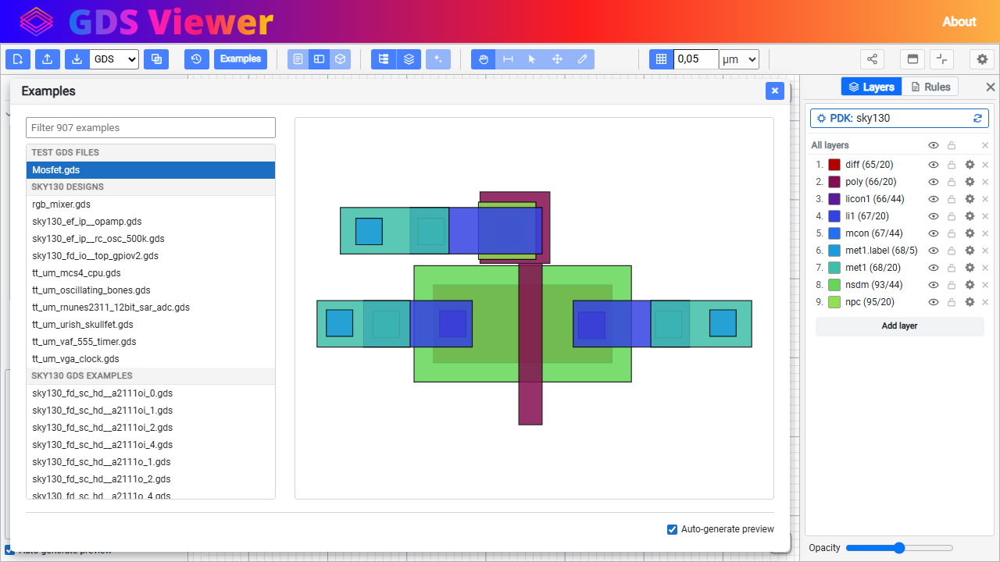

The list is filtered as you type and each row previews as you point at it, so a cell can be found by looking
rather than by remembering its name. A link can name one — `?file=sky130_fd_sc_hd__nand2_1` — and **Share**
writes that link for whatever is open, the way the QR button carries it onto a phone. The address bar itself
does not name the open file, so a reload brings back your session rather than a fresh copy.

A file off your own machine is not something a link can reach, and Share says so.

**New** starts an empty one instead: a single cell called `TOP`, no layers, nothing drawn. Every other way in
needs a file, so beginning a layout of your own used to mean opening somebody else's and deleting it. It is
drawn in the PDK in use from the start: its empty layer list offers **Set PDK**, which brings in the layers of the PDK used in the PDK manager, and a layer
added to it is named by the PDK — as an upload's layers are, when most of them are the PDK's.

## The 2D editor

The layout as SVG: drag to pan, scroll or pinch to zoom, adjustable opacity so stacked layers can be seen through.
Twenty thousand shapes pan at the screen's own frame rate.


`TEXT` elements are drawn as pin labels in their layer's color — `gate`, `source` and `drain` above — and
justified about their anchor the way the file asks.

A real standard cell is denser, and the same view holds it:

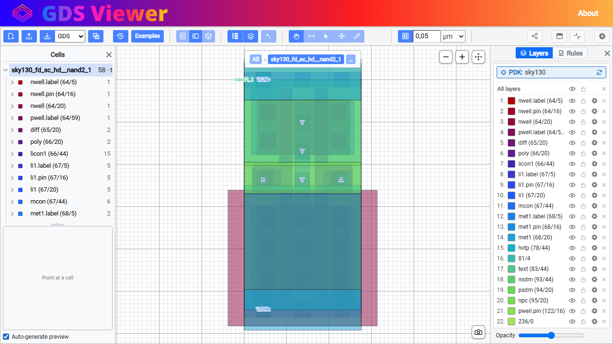

Twenty-two layers, pins named `A`, `B`, `Y`, `VPWR` and `VGND`, all of it drawn from the file's own numbers.

## Layers

**A layer is a layer/datatype pair**, the way every layout tool treats it — so `67/20` and `67/5` are separate
rows with their own colors, rather than one "layer 67" hiding drawn geometry and pins together.

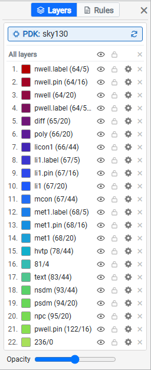

Over the list, the blue **PDK** row says which PDK names the layers and checks the file — sky130 here — and opens the
[PDK manager](#pdks). On a new layout it says *not set* while the list is empty.

**Each row carries an eye and a lock**, which answer two different questions. The eye is whether the layer is
drawn at all: switch it off and its shapes leave the view, the 3D stack and the reach of the pointer
together. The lock leaves them drawn but faded and takes them out of reach — they cannot be clicked, caught
in a band, or dragged. So locking everything except the layer you are working on isolates it without hiding
what you are lining it up against, which hiding cannot do.

**A header over the list switches a whole column at once.** Its eye draws every layer while any is hidden and
hides them all once every one is drawn; its padlock unlocks every layer while any is locked and locks them
all once none is — so "everything away, then just this one" and "put it all back" are a press each. Its
**×** removes every layer and every shape on them, asking first, and one undo brings the lot back with
their names and colors.

With a layer's settings open, pressing another row shows that row's settings instead, in the same place.

Behind the gear, a row can be renamed, recolored, hatched, given a role and given a real height and
thickness:

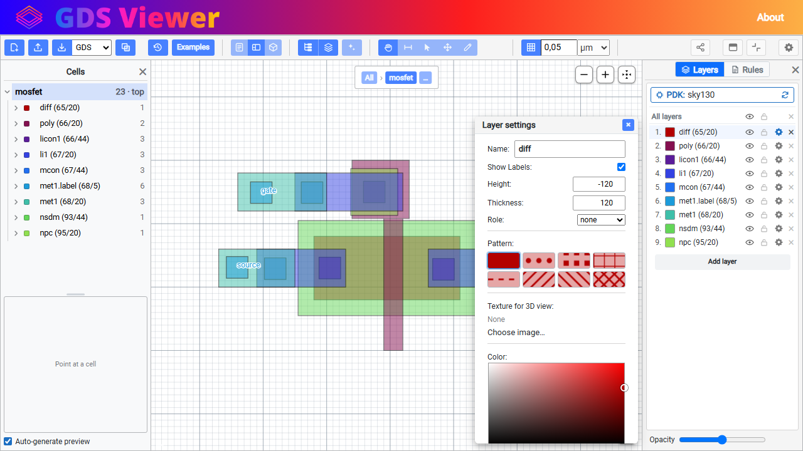

Renaming is in that panel rather than on the row. A name is a claim about what a number means across a whole
technology, and a click that lands slightly wrong on a row you meant to select is the wrong way to make one.

**Nothing in a GDSII file says what its layers mean.** `65/20` is a number; that it is diffusion is PDK data,
which is why KLayout wants a `.lyp` and Magic its techfile. So the names above came from a layermap — a CSV of
`layer,datatype,name` with further columns for color, height, thickness, role and fill — kept in a PDK, or
given by `?layermap=` in the address. sky130's is built in, and a PDK's layermap comes in and goes out in the
**PDK manager**, a button in front of the layer panel's names.

Names persist between visits and across files, since the numbers mean the same thing throughout a technology.

The heading above the list is a switch: the same panel also holds the [design rules](#design-rules) the
layout is checked against, and only one of the two is ever wanted at a time.

**Add layer**, at the foot of the list, adds a layer/datatype nothing is drawn on yet. The list is built from
what the layout draws, so a new file has no rows and an existing one offers only the numbers it already uses
— this is how an empty layout gets somewhere to draw, and how you reach a pair a file does not carry. GDSII
records a layer only through the shapes on it, so an empty one is gone when the file is written; draw on it
or name it and it stays.

The **×** at the end of a row takes that layer out, and its shapes with it — everywhere in the file, since a
layer belongs to the library rather than to the cell you are inside. It asks first, and says how many shapes
go with it; an undo puts the row back with its name, color and height rather than as a bare number.

### Fill patterns

Color runs out before layers do. A file with twenty-two of them has shades that are genuinely hard to tell
apart, so a layer can be given a **hatch** — dots, squares, a grid, dashes, diagonals either way, crosshatch —
drawn over its color. The marks can be given a color of their own and a size in screen pixels, because a
stipple is judged at the size it is actually seen at rather than in the layout's units.

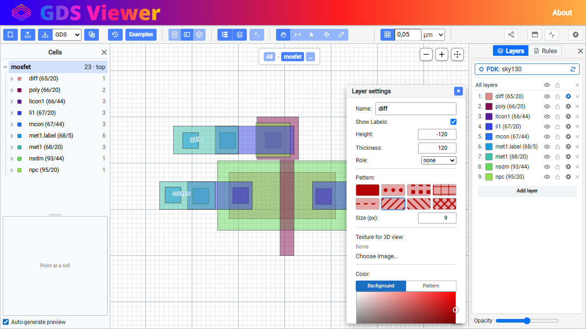

## Design rules

**The same panel, showing what the layout is allowed to be rather than what it is.** The heading is a pair
of names with the live one lit — press *Rules* and the deck comes up, press *Layers* and the rows come back.
They are never both wanted at once, so they share one panel rather than taking the width twice over.

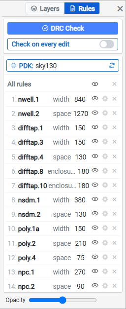

A **deck** is a small text file you supply: `width`, `space`, `enclosure`, `area`, `density` and off-grid
rules over layers the deck itself derives. **There is no standard file to download** — design rules have no
interchange format, so a foundry supporting three tools ships three separately maintained decks and nothing
converts between them. A bundled example arrives with the 30-rule sky130 starter deck already loaded - the
rules of the PDK in use. A deck of your own goes into a PDK in the **PDK manager**, whose **Export** hands back
the text that came in rather than the parse printed out, so comments and blank lines survive the round trip.

**Add rule**, at the foot of the deck, adds one — and here it takes a line of the deck's own grammar rather
than a form of dropdowns: a rule can carry `except`, a window and a step, and one line says all of it. What
you type is checked by the same parser that reads a deck file, and its complaint appears under the box in its
own words. The **×** on any row takes that rule out, asking first. Both edit the PDK in use's rules, so its
**Export** hands you exactly what the panel is showing. The form is in the **PDK manager**, whose own **Add
rule** makes one by choosing its check, its layers and its limit, with the deck's text a switch away for
anything the form does not offer.

A **gear** on each row opens that rule as the deck holds it — the line itself, editable, checked by the same
parser and refused the same way if it cannot be read. Same idea as the layer settings beside it: the row
shows you the rule, and changing one is a deliberate act behind a control rather than a click on the row you
were trying to point at.

An **eye** on each rule, the layer rows' own, switches it off: it stays in the deck and is left out of the
check, its marks and its count go, and the line over the view says how many rules were switched off. A
header over the list switches them all, or removes every rule after asking — leaving the deck's layers in
place for the next rule you add.

**DRC Check** runs it, whenever you press it. **check on every edit** runs it again after every change as well —
and with that off, an edit *takes the last result off the drawing* rather than leaving it: a marker is a
claim about where something is, and the moment the geometry under it moves the claim is about a layout that
no longer exists.

What it finds is marked on the drawing, counted per rule, and said in one line over the view:

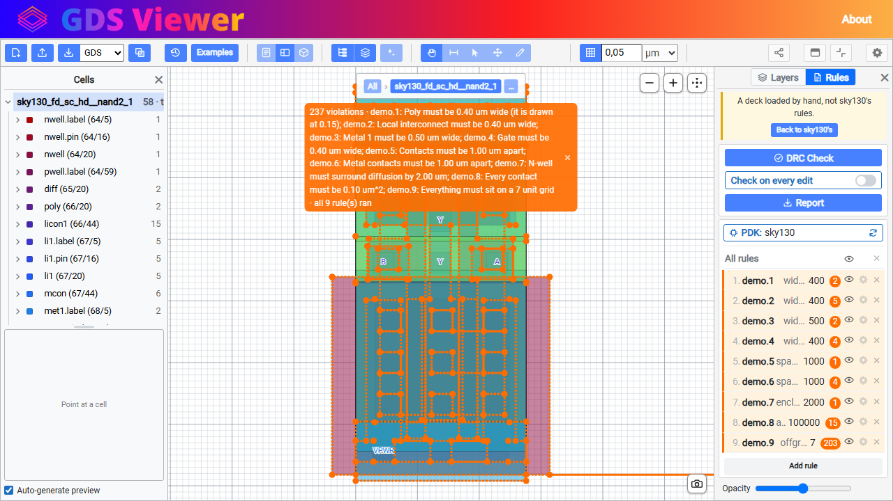

Every fault is drawn in the same orange as the rule row that found it, so the list and the marks read as one
thing. Clicking a flagged row frames the view on its first fault, and each click after that on the next, the
row's count reading how far through them you are — `2/7` — and **Waive** marks the one in view as accepted.

**The line over the view names each rule and says what it is**, in the deck's own description — the same
sentence the row's tooltip carries. A rule id is a filename to somebody who wrote the deck and nothing at all
to anybody else, so `met1.2` on its own is a fault you have to go and look up before you can act on it.

**A rule this build cannot measure is refused by name, not skipped.** It stays in the list, marked *not
measurable*, and every result from that deck says *"not fully checked"* — because a count of faults is only
an answer when every rule actually ran. That is the whole reason the format is a fixed vocabulary rather
than an expression language.

> **Not a signoff tool.** It catches the obvious against the rules you give it. The picture above uses a
> deliberately failing deck, because the bundled cells are signed-off layout and a correct deck finds
> nothing in them — the right answer, and a poor demonstration.

With a PDK's **Rules** picked in the PDK manager's tree, the **?** square under it explains all of this in the
app, and hands you a guide written to be given to an AI along with your PDK's rule document — see
[WRITING-A-DECK.md](../wwwroot/resources/WRITING-A-DECK.md). The same check runs without a browser:
`gds drc cell.gds --deck sky130A.drc`.

## PDKs

**A PDK is a process's layers and its rules**, and the one in use names and checks every file drawn in it. sky130 is
built in. The **PDK** row over the layer list opens the manager:

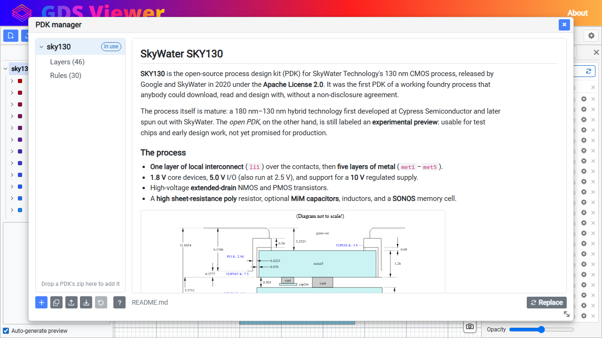

The PDKs are down its left, each with its **Layers** and its **Rules** under it. Picked, a PDK shows its own
**README** — sky130's says what the process is and draws its metal stack — and its lists show as tables, or as text in
a code editor that colors comments, numbers and layer pairs as it reads them. A rule can be made by choosing from a
form, and **Write with AI** hands a PDK's layers or rules to the [assistant](#asking-the-ai), each change it makes
shown as a diff on its card. A whole PDK comes in from a zip — a layermap, a rule deck, textures and a README — or by
dropping it on the list, and goes out the same way; **use** puts one in use.

On a new layout, **Set PDK** in the empty layer list opens the manager to pick with, and the PDK used there lays its
layers on: for sky130, its 21 drawing layers and their 16 pins and labels, named, colored and stacked.

## The cell tree

The file's own structure, docked down the side: every cell, what places it, and what is in it — down to the
individual shapes and where they sit.

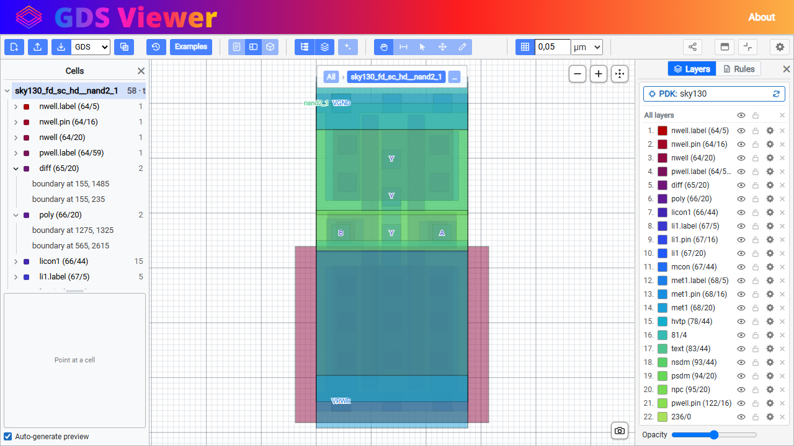

A cell placed by two different parents appears under both, and is marked the second time. That is where this
parts company with a folder tree: a directory is in one place, and a GDS cell is genuinely shared, so showing
it once would mean picking a parent to call the real one.

Right-clicking a row offers rename, copy and delete.

## Selecting and editing

Click a shape and the panel says what it is: its layer, the cell it lives in, its corner count, its area in
both units, where it sits and how big it is — in microns, typed and re-typed to move or resize it exactly.

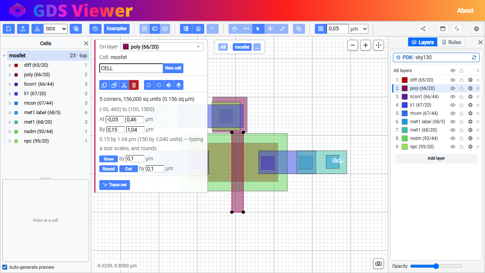

From there: copy, cut, delete, four kinds of turn, grow or shrink by a number, group into a new cell, and
**Trace net**. Drag a band across several and the panel gains combine, line up and space out.

**Editing happens in a cell.** A shape on screen may be one of a thousand instances, and moving it moves all
thousand — so the breadcrumb above the view says which cell the edit will land in, and the layout around it is
drawn faded because it is not what the pointer is for.

A file opens in its own **top cell** — the one nothing places, which is what the file is about — so there is
somewhere for a new shape to go from the moment it is on screen. **All** in the breadcrumb steps back out to
the whole layout, and a row in the cell tree steps into any other. Out there the pencil has nothing to draw
into and says so when it is pressed, rather than quietly doing nothing.

Every edit is undoable, and **the undo stack survives a refresh**: close the tab mid-edit, come back, and it is
still there to take back.

## Drawing

Five shapes under the pencil — rectangle, polygon, ellipse, path, label — each drawn as well as named, because
the shapes those five words name are the one thing about them that can be shown rather than said.

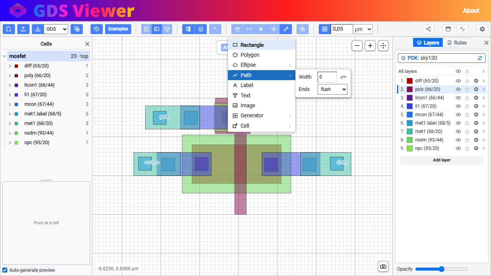

A shape's own settings hang off its own row: a path has a width and an end style, an ellipse a side count. They
appear when you point at the row that has them, rather than sitting in the toolbar asking a question about
paths at all times.

**A layout format has no curves.** GDSII knows boundaries and paths and nothing else, so an ellipse is a
many-sided polygon and how many sides is a decision rather than a detail — which is why the count is a control,
and why it says what it costs: at 64 sides each one falls about a tenth of a percent of the radius inside a
true curve.

A label is typed where it lands rather than into a box in the toolbar, and a path is clicked turn by turn and
drawn at its real width.

Four more rows put things down rather than draw them. **Cell** places a cell from the library. **Generator**
makes a structure from a few numbers — a die frame and alignment marks, test structures, a spiral inductor with
its underpass and vias, capacitors, resistors and guard rings, couplers, a balun, filters and resonators, patch,
dipole, bowtie and spiral antennas, a clock H-tree, power rails, a pad ring and fill, a ring resonator, a grating, a
serpentine channel or a chamber — on the layer being drawn on, 38 kinds in all, each with its numbers typed into a
drawing of it: every box beside the part it sets, and the part lit while its box is pointed at. **Text** writes words as real shapes on the layer being drawn on — a part
number or a name in a five-by-seven pixel font, every stroke one square wide, which is what lettering on a chip
is — clicked into place and typed where it lands, or pasted onto the drawing. **Image** turns a picture into
shapes the same way, for a logo: chosen, dropped onto the drawing, or pasted. Each lands with a frame round it
whose corner sizes it and whose middle moves it; **R** turns it a quarter, Shift+R the other way, as do the two
arrows over it, a right-click on it turns or mirrors it, and Enter puts it down. A cell, and a structure once its
**Place** is pressed, follow the pointer until you click, as many times as you click, and turn with Ctrl+R.
Writing and pictures read the right way round here, which in the file and on the die - this app draws Y
downward - is mirrored; **Mirror down** puts them upright there. Double-click writing in its frame, or choose **Edit
text** from its menu, to change the words.

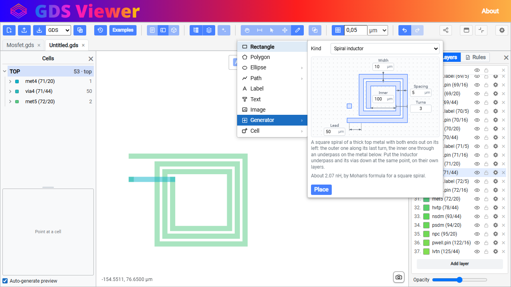

**A structure on more than one layer is a kind for each layer, sharing one set of numbers.** Above, a spiral inductor
on met5, its underpass on met4 and its vias on via4, each put down at the same point on a new sky130 layout: the turns
typed for the spiral are the underpass's and the vias', so the three meet. The panel says what the numbers come to
where a kind can — here the inductance, by Mohan's formula; elsewhere a resistor's squares, a resonator's frequency, a
pad ring's count or a fill's density. The RF and antenna kinds start from a 60 GHz design on oxide, a point to tune
from rather than a verified design.

## The grid

A grid to see and to snap to, in real units. Below, the box reads `0,5 µm`, and the dropdown beside it takes
nanometers, microns, millimeters or raw database units.

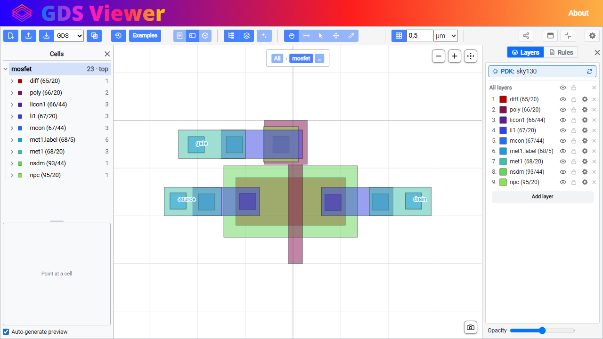

It **starts at the file's own grid** rather than at a round number somebody picked: a layout drawn on 5
database units gets a 5-unit grid, so the first thing you draw lands where the rest of the file already is.
Drawing can also snap to what is already there — a corner or an edge of a neighboring shape.

## Measuring

The ruler: drag from anywhere to anywhere, and it reads the distance in database units and in microns, with
the two deltas underneath. Below, `2102.38 units (2.1024 µm)` across `dx 1900 dy 900`.

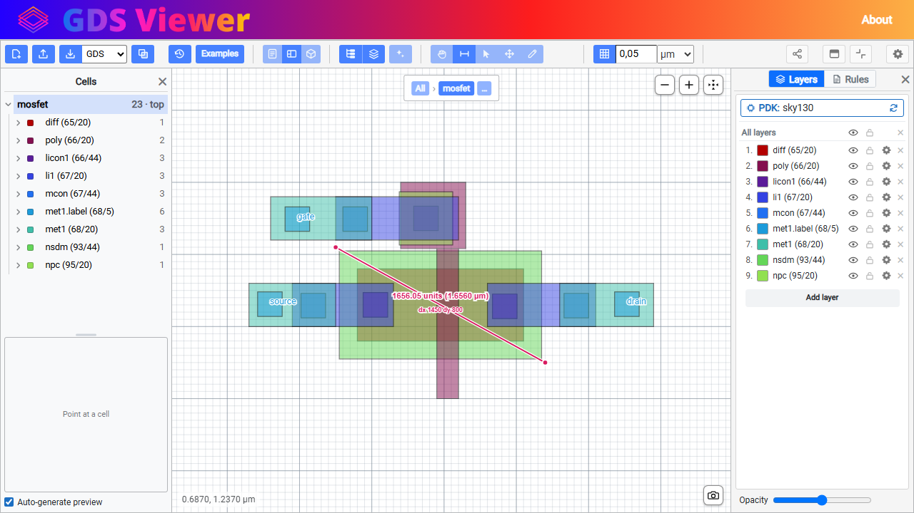

The deltas follow the *file* rather than the picture. This view maps GDSII's upward Y straight onto SVG's
downward Y, so what is drawn is flipped and a point that looks higher has the smaller number — a measurement
agreeing with the picture would disagree with every coordinate in the text view and in the download.

The same measurement is [available from the command line](CLI.md#gds-measure), computed the same way.

## Tracing a net

Choose a shape on a conductor and **Trace net** walks everything electrically joined to it — up through vias,
across layers, as far as the connection goes. Below: six shapes across `66/20`, `66/44`, `67/20`, `67/44` and
`68/20`, and the label sitting on them says the net is `"gate"`.

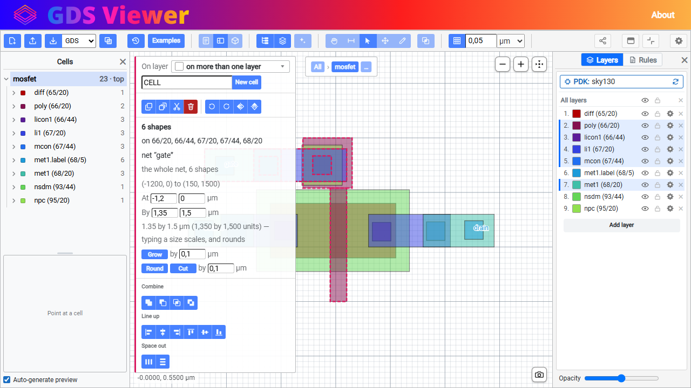

**It needs a layermap.** Nothing in a GDSII file records which of its numbers carry a net and which join the
layers either side of them, so without the `role` column no layer takes part and the button grays out with a
tooltip saying why. The mapping the app ships with covers the bundled examples, which is why the button is live
here.

**A big net comes a hundred shapes at a time**, nearest first. The panel says how far the trace has got, and
**Next** goes on by the number beside it - up to all of what is left. A chip's supply is tens of thousands of
shapes, and the first hundred out from a wire are usually what somebody following it wants.

The net comes back as an ordinary **selection**, so everything that already works on one works on it.

## Asking the AI

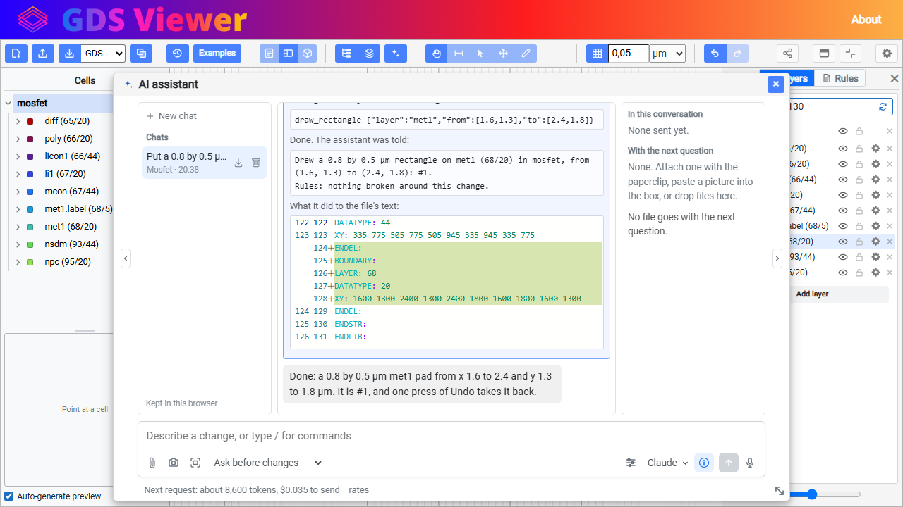

Press the **spark in the toolbar** and describe a change - *"put a 0.8 by 0.5 µm met1 pad with its corner at
x 1.6, y 1.3"* - and an assistant makes it with the editor's own tools. It looks around on its own: the layers,
the shapes, and a picture of the cell, which its card shows you too. **Every change waits on a card** for Approve
or Decline, shows what it did to the file's text, and is one step on Undo, among your own. It is told which cell
you have open, what you have selected and what is on screen, so *this* and *here* mean what they mean to you. The
menu in the box's row decides how far it goes on its own: asking before every step, asking before changes, or not
asking.

**Every chat is kept**, down the window's left, to open again and carry on. A question can carry files — picked
with the paperclip, pasted, dropped, or taken with the **camera** or as a **screenshot** — and the panel on the right
says which of them go again with the next one. The **microphone** puts speech into the box, and a **slash** lists the
window's commands. One button picks the model, its effort and, on an Opus that has it, fast mode, and the line at the
foot says what the next request will cost.

It can do more than draw: **put a PDK in use**, so its layers come in named before it draws on them — every one on a
new layout, the ones it lacks on a layout drawn in it; put down any of the **Generator's structures** whole, from the
same numbers the panel takes;
read the app's own **sky130 examples** to see how a real cell is drawn; and write a PDK's **rules and layers** from
**Write with AI** in the PDK manager. A long run pauses after the rounds set under AI settings — thirty to begin
with — and asks whether to go on.

**Bring your own key.** Under **Settings → AI settings**, add a model: Anthropic, OpenAI, Google's Gemini - a
free key from Google AI Studio works - or a server of your own that speaks OpenAI's API. Keys stay in your
browser and go only to their provider. Nothing is sent until you press Send, and what is sent is what you type
and what the assistant reads from the layout to answer.

**Or ask Claude, outside the browser.** The same tools are served by `gds mcp` to Claude Desktop and Claude
Code, over a folder of layouts: `claude mcp add gds -- gds mcp`, and Claude opens, draws on, checks and saves
the files there. See [the CLI guide](CLI.md#gds-mcp).

## The 3D view

Every layer extruded to its thickness and stacked in space, seen from above at 45° with the whole layout in
frame — orbit it and drag it. The **Distance** slider opens the stack out, moving the layers as you drag rather
than when you let go. Below it is closed, which is where a mapped file opens and what the rest of this section
is about.

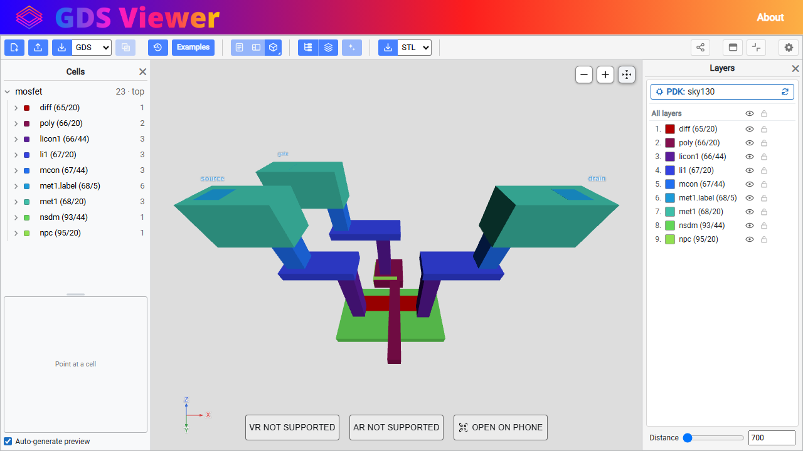

A lettered indicator in the bottom-left corner turns with the camera, so which way round the layout is
sitting is never a guess. It is lettered in the **layout's** axes rather than the scene's: **Z** is the
process stack running up through the films, the same Z the layermap gives heights in, and X and Y are the
die coordinates the 2D view measures in.

With a layermap carrying real heights and thicknesses, that stack is the wafer's rather than an even spacing:
a contact sits between the two layers it joins because the process table says where it is. The bundled sky130
mapping carries one, read from the PDK's own cross-section script, so an example opens on measured heights —
li1 at 940 nm, met1 at 1370, and mcon spanning exactly the 330 between them.

**The space between metals is the dielectric**, and no layer draws it. A via crosses that gap where a via
shape exists and nothing crosses it where none does, which is the layout rather than a gap in the drawing —
GDS3D shows the same. What a mapping does *not* cover — markers, area ids, a cell outline — is left out of
this view rather than hung at a depth nobody measured, so nothing floats over or between the real films. It
keeps its row in the sidebar and its 2D drawing, and a height in its layer settings brings it back.

The **Distance** slider starts at zero, so a mapped file opens on the process stack itself rather than on a
spread-out picture of it. Pull it up to open a gap on top of wherever each layer already rests, for seeing
between films that in reality touch.

Pin labels come too, as camera-facing billboards so they stay readable from any angle. Scene backgrounds and
**Admire**, a cinematic orbit, are in the view's settings, which open from the 3D cube of the view switch; the
toolbar has the **STL, OBJ and GLTF export**; and the **VR and AR** buttons sit over the scene beside **Open on
phone**, saying `NOT SUPPORTED` on a machine with no headset, as above.

**What is exported is Z-up**, whichever way the view happens to be turned. The scene here is Y-up because
that is what three.js uses; every CAD and EDA tool that opens an STL expects the wafer normal to be Z, so the
model is converted on the way out and its faces wound outward — the two things a slicer or a mesh tool checks
first. Compared against the same cells extruded by KLayout: same footprint, same stack height, same levels to
the nanometer.

## The text editor

The raw record stream, one record per line, in a Monaco editor with GDSII syntax highlighting and per-record
autocomplete. `HEADER`, `BGNLIB`, `LIBNAME`, `UNITS`, then every structure and every element.

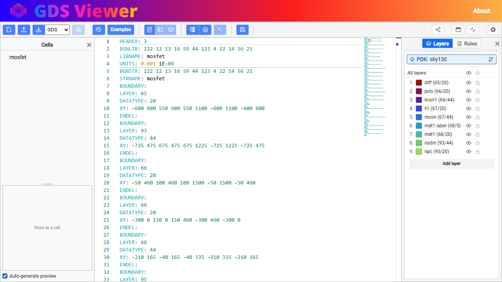

**It is editable and it saves back into the file.** Change a coordinate, save, and the layout redraws from it;
download and you get a real GDSII file with the change in it. A line that cannot be read is refused with its
line number and the file is left untouched — the whole save is refused rather than half applied, so a mistake
costs the save and not the layout.

Reading it is worth it on its own: this is what the format actually is, and every other view in the app is
built from these records.

## Formats in and out

Four formats, read and written, all through the same model:

| | In | Out |
|---|---|---|
| **GDSII** | ✓ | ✓ byte-exact for a file read in |
| **OASIS** (SEMI P39) | ✓ | ✓ hierarchy kept |
| **DXF** | ✓ text and binary | ✓ release 12 |
| **SVG** | ✓ fills and strokes as shapes | ✓ as a picture |

**Which format a file is comes off its first bytes rather than its extension**, so a `.oas` mailed as `.gds`
still opens. The dropdown beside the download button chooses what comes back out, starting on the file's own
format for GDSII or OASIS, and on GDSII for a DXF or an SVG — so opening a `.gds` and saving it as `.oas` is a
conversion, and so is the reverse.

Cells stay cells. The hierarchy is kept rather than flattened, which is most of the reason to write OASIS at
all.

The layout also downloads as an **SVG** or **PNG** picture from any view, or as **Masks** — a black and white
PNG of each layer showing, in one zip — and the 3D view as **STL, OBJ or GLTF**.

## Coming back later

Close the tab, come back, and the file is still open — with your edit in it, your layers still hidden, named
and colored, the sliders where you left them, and undo still able to take the edit back. Kept in your browser
in IndexedDB; nothing is uploaded.

**History** beside Examples lists the files you have opened off your machine or started with **New**, and any
file you have changed — an example goes in once you change it — so a file you uploaded an hour ago is one click
away rather than gone.

It is an installable **PWA** with no CDN dependencies — Monaco and three.js are vendored into the app — so it
keeps working offline once installed.

## The guided tour

The app asks as it opens whether you want a tour, until told not to, and Settings → **Take the tour** starts it
any time. One part of the app at a time shows through a shade, with a card saying what it is for - and where a
picture says it quicker, the card has one, moving where the point is a movement: here the poly layer's eye shuts
and its shape leaves the drawing, then comes back.

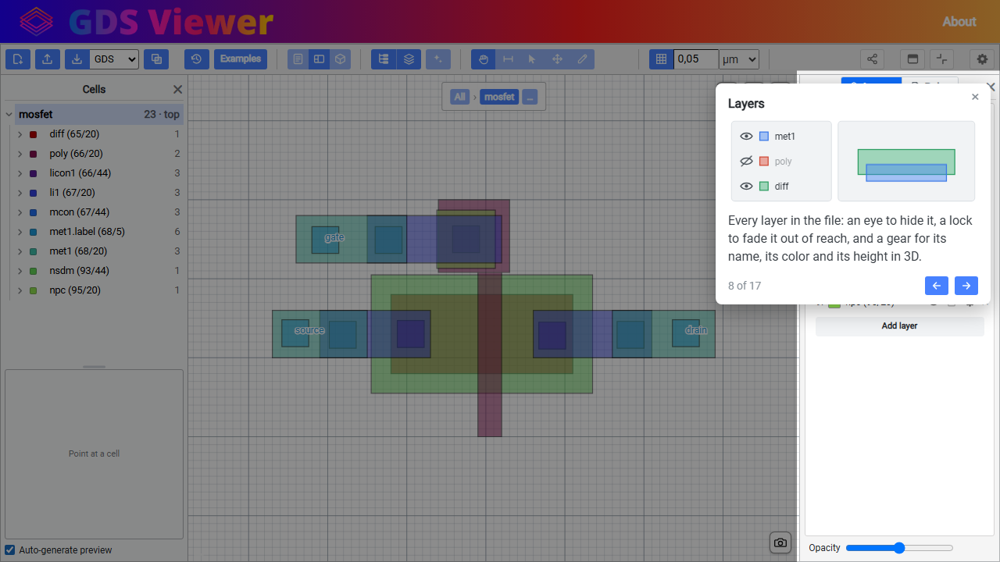

**Play game**, under it in the same menu, drops a car onto the 3D view's top layer to drive along the wires and
jump between layers - or a plane or a jet to fly over them.

## Embedding, and the command line

The app drops into somebody else's page in an `<iframe>` with its whole opening state set from the address —
which file, which view, how much of the app is offered, the grid, the tool in hand, your own files in the
picker, and a layermap to name the layers. **Share**, at the far end of the toolbar, writes the iframe from
switches - choose **Embed**, set them, and copy:

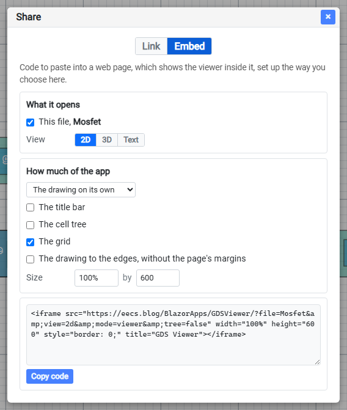

Pasted into a page, that is the viewer in it, live:

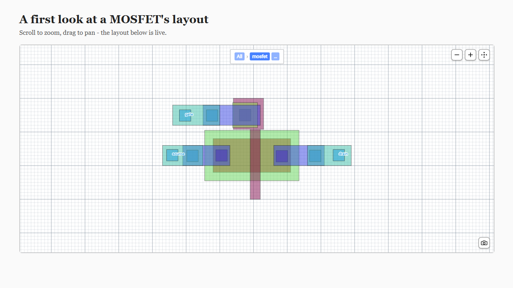

See [Embedding](../README.md#embedding) for every parameter, to write or change the code by hand.

And everything here that is not a gesture over a picture is available from a terminal: `gds` reads, checks,
names layers, draws, extrudes, combines, converts, lists cells, traces nets and measures - and `gds mcp` hands
a folder of layouts to Claude to edit. See [the CLI guide](CLI.md).
