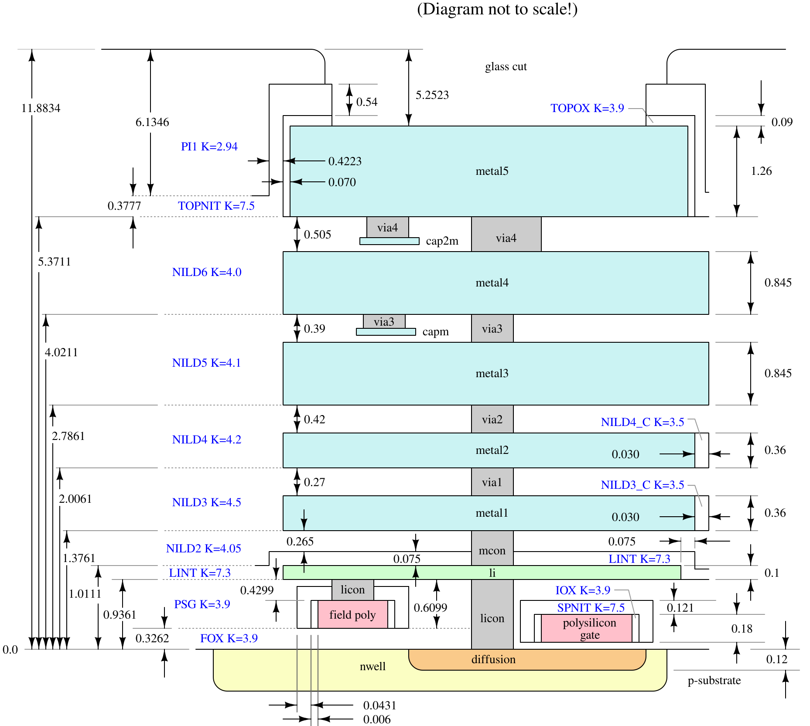
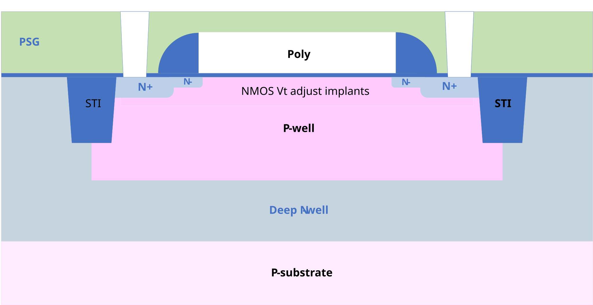
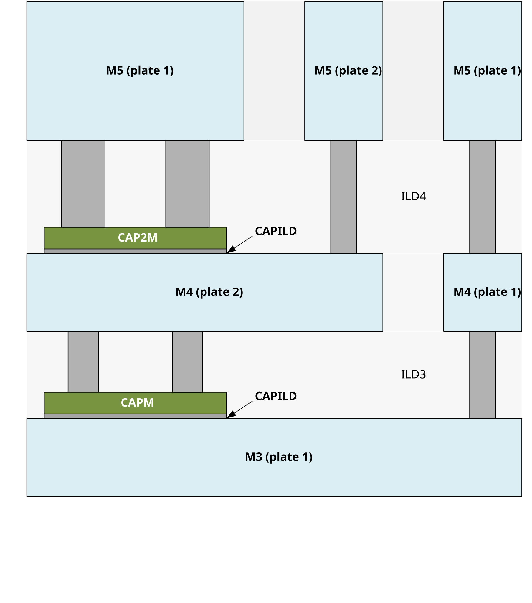

# SkyWater SKY130

**SKY130** is the open-source process design kit (PDK) for SkyWater Technology's 130 nm CMOS process, released by
Google and SkyWater in 2020 under the **Apache License 2.0**. It was the first PDK of a working foundry process that
anybody could download, read and design with, without a non-disclosure agreement.

The process itself is mature: a 180 nm–130 nm hybrid technology first developed at Cypress Semiconductor and later
spun out with SkyWater. The *open PDK*, on the other hand, is still labeled an **experimental preview**: usable for
test chips and early design work, not yet promised for production.

## The process

- **One layer of local interconnect** (`li1`) over the contacts, then **five layers of metal** (`met1`–`met5`).
- **1.8 V** core devices, **5.0 V** I/O (also run at 2.5 V), and support for a **10 V** regulated supply.
- High-voltage **extended-drain** NMOS and PMOS transistors.
- A **high sheet-resistance poly** resistor, optional **MiM capacitors**, inductors, and a **SONOS** memory cell.

*The stack in cross-section, with each layer's thickness and height - the numbers the layermap's height and thickness
columns carry.*

At the bottom of it, a 1.8 V NMOS transistor, `nfet_01v8`: its N+ source and drain in a p-well, the poly gate between
them, and shallow trench isolation on either side:

And near the top, the MiM capacitors: each a top plate of its own over a metal - `capm` over metal 3 and `cap2m` over
metal 4 - reached by the via up to the metal above it:

## Layers

The drawing layers, by their GDS numbers as `layer/datatype`. A layer's pins are its datatype 16 and its labels its
datatype 5 — `68/16` and `68/5` for `met1`.

| Layer | GDS | What it is |
|---|---|---|
| `nwell` | 64/20 | N-well |
| `diff` | 65/20 | Active area of a transistor, the opposite type to its well |
| `tap` | 65/44 | Active area of the well's own type: the well and substrate ties |
| `poly` | 66/20 | Polysilicon: the transistor gates |
| `licon1` | 66/44 | Contact from diffusion and poly up to local interconnect |
| `li1` | 67/20 | Local interconnect |
| `mcon` | 67/44 | Contact from local interconnect to metal 1 |
| `met1` | 68/20 | Metal 1 |
| `via` | 68/44 | Via from metal 1 to metal 2 |
| `met2` | 69/20 | Metal 2 |
| `via2` | 69/44 | Via from metal 2 to metal 3 |
| `met3` | 70/20 | Metal 3 |
| `via3` | 70/44 | Via from metal 3 to metal 4 |
| `met4` | 71/20 | Metal 4 |
| `via4` | 71/44 | Via from metal 4 to metal 5 |
| `met5` | 72/20 | Metal 5 |
| `pad` | 76/20 | Opening in the passivation over a bond pad |

The full table, with the implants, the marker layers and every purpose, is the PDK's
[GDS layers](https://skywater-pdk.readthedocs.io/en/main/rules/layers.html) page.

## A few of its rules

The smallest width and spacing of the layers most drawn on, from the PDK's
[periphery rules](https://skywater-pdk.readthedocs.io/en/main/rules/periphery.html):

| Layer | Min width | Min spacing | Rules |
|---|---|---|---|
| `diff` / `tap` | 0.150 µm | 0.270 µm | difftap.1, difftap.3 |
| `poly` | 0.150 µm | 0.210 µm | poly.1a, poly.2 |
| `li1` | 0.170 µm | 0.170 µm | li.1, li.3 |
| `met1`, `met2` | 0.140 µm | 0.140 µm | m1.1–m1.2, m2.1–m2.2 |
| `met3`, `met4` | 0.300 µm | 0.300 µm | m3.1–m3.2, m4.1–m4.2 |
| `met5` | 1.600 µm | 1.600 µm | m5.1, m5.2 |

The deck in this PDK checks 30 of them — see **Rules** in the tree. It catches the obvious; it is not a signoff deck.

## Libraries

Besides the primitive devices and their models, the foundry provides seven digital standard-cell libraries:

- `sky130_fd_sc_hd` — high density: the smallest cells, at a lower drive strength. The usual choice.
- `sky130_fd_sc_hdll` — high density with 5–10× less leakage, on the same grid as `hd`.
- `sky130_fd_sc_hs`, `sky130_fd_sc_ms`, `sky130_fd_sc_ls` — high, medium and low speed below 2.0 V, interchangeable cell
  for cell.
- `sky130_fd_sc_lp` — low power, the largest at nearly 750 cells, from 1.55 V to 2.0 V.
- `sky130_fd_sc_hvl` — 5 V logic, the only library for it.

## Tools

Open-source flows support it end to end — Magic and KLayout for layout and DRC, Netgen for LVS, ngspice for simulation,
OpenROAD and OpenLane for digital place and route, and open_pdks to install it all — and so do the commercial ones.

## Making chips in it

Multi-project wafer shuttles put many small designs on one wafer to share its cost. Google's free shuttles ran through
Efabless from 2020 until Efabless closed in 2025; its assets went to **ChipFoundry**, which runs paid SKY130 shuttles,
and **Cadence** runs its own aggregation service on the process. **Tiny Tapeout** puts very small designs on shared
silicon through them. Check each one for its current dates and prices before planning around it.

## Where to read more

- [SKY130 PDK documentation](https://skywater-pdk.readthedocs.io/en/main/)
- [The PDK on GitHub](https://github.com/google/skywater-pdk)
- [SkyWater Technology](https://www.skywatertechnology.com/technology/)

*Written for GDS Viewer on 2026-11-01 from the documents above. The PDK's own pages are the authority where this and
they disagree. The three drawings are the PDK's own, from its documentation, under the Apache License 2.0.*
